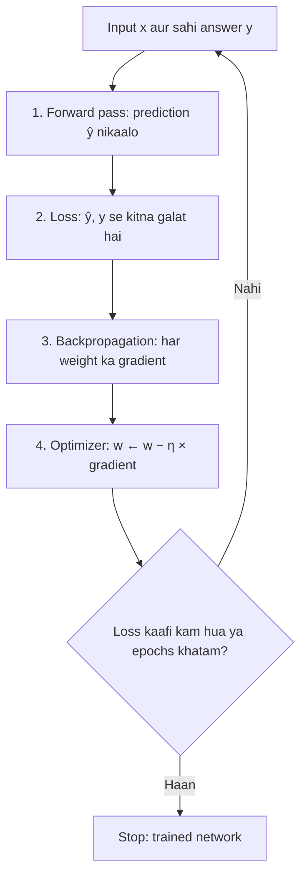
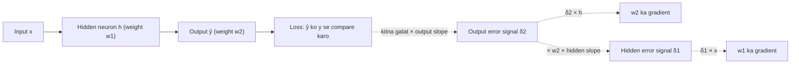

Naye ideas se pehle, ye purane ideas chahiye honge. Agar pehle se aate hain, to agle section pe jao.

## Pehle basics

- Ek **neuron** kuch numbers leta hai, har number ko ek **weight** se multiply karta hai, sabko add karta hai, ek **bias** jodta hai, aur total ko ek **activation function** se pass karta hai (jaise sigmoid, jo kisi bhi number ko 0 se 1 ke range mein daba deta hai).
- Ek **neural network** bahut saare neurons hain jo **layers** mein lage hain: ek input layer, ek ya zyada hidden layers, aur ek output layer.
- **Weights aur biases** woh numbers hain jo adjust ho sakte hain; inko milaake **parameters** kehte hain. Learning ka matlab hai inki achhi values dhoondhna.
- **Loss** ek number hai jo batata hai network ka answer kitna galat hai. Kam matlab better.
- Kisi weight ke liye loss ka **gradient** (slope) batata hai ki us weight ko thoda sa badalne pe loss kitna badlega, aur kis direction mein.
- **Learning rate**, likhte hain $\eta$ (eta), ye hai ki weight badalte waqt kitna bada step lena hai.
- Ek **epoch** matlab saare training examples pe ek poora pass.

## Big picture: network seekhta kaise hai

**Ye kya hai.** Neural network ko train karna matlab ek simple loop baar baar chalana: guess karo, galti check karo, pata karo galti kisne ki, sudhaaro. Ye syllabus <Syl m="2" /> ka section 2.2, "Learning with backpropagation" hai.

**Ye kyun zaroori hai.** Naya network random weights se shuru hota hai, isliye uske answers bhi random hote hain. Laakhon weights koi haath se set nahi kar sakta. Humein ek automatic tareeka chahiye jo har weight ke liye bataye: "isko upar karna hai ya neeche, aur kitna?" Backpropagation wala learning loop exactly yahi batata hai.

**Everyday analogy.** Socho tum basket mein ball daalna seekh rahe ho. Tum throw karte ho (guess). Dekhte ho kitna miss hua (error). Sochte ho kya badalna hai: "haath zyada zor se chala, angle theek tha" (kiski galti hai). Phir thoda adjust karke dobara throw karte ho.

<Box kind="definition">

**Learning process** chaar steps ka loop hai, jo bahut saare examples aur bahut saare epochs ke liye repeat hota hai:

1. **Forward propagation:** input ko network se guzaaro aur prediction lo.
2. **Loss calculation:** prediction ko sahi answer se compare karo aur error ke liye ek number nikaalo.
3. **Backpropagation:** loss se peeche ki taraf chalo aur pata karo har weight kitna zimmedar hai (uska gradient).
4. **Optimization (weight update):** har weight ko thoda sa us direction mein badlo jisse loss kam ho.

</Box>

Exam mein English mein likho: "The learning process is a loop of four steps: forward propagation, loss calculation, backpropagation and optimization (weight update), repeated over many examples and epochs."

Do ideas alag rakho: **backpropagation sirf gradients nikaalta hai**. Woh koi weight nahi badalta. **Optimizer** (plain gradient descent, momentum, Adam wagairah) woh hai jo un gradients ka use karke weights badalta hai. <Cite id="gfdl-ch6" loc="§6.5" />

## Step 1: forward propagation

**Ye kya hai.** Input left se andar aata hai aur right ki taraf ek ek layer karke jaata hai, jab tak output layer ek prediction $\hat{y}$ (padho "y-hat") nahi deti.

**Kaise kaam karta hai.** Layer ka har neuron do chhote kaam karta hai:

1. **Weighted sum:** har aane wali value ko uske weight se multiply karo, sabko add karo aur bias jodo.
2. **Activation:** us sum ko activation function (sigmoid, tanh, ReLU wagairah) se pass karo. Result neuron ka output hai, jo agli layer ka input ban jaata hai.

To ek layer pichhli layer ke outputs leti hai, har neuron ke liye ek weighted sum banati hai, aur har sum ko activation se daba deti hai. Aakhri layer ke outputs hi prediction hain.

<Figure caption="Ek chhota fully connected network: 2 inputs, 3 hidden neurons, 1 output. Forward pass mein numbers har line pe left se right jaate hain; backpropagation mein blame unhi lines pe right se left jaata hai.">
  <NetworkFigure layers="2,3,1" labels="Input,Hidden,Output" title="Forward: left to right. Backward: right to left." />
</Figure>

**Worked sum: ek neuron ka forward pass.**

<Sum>

<Given>

inputs 1 aur 2, weights 0.5 aur −0.25, bias 0.1, sigmoid activation $\sigma(z) = \dfrac{1}{1 + e^{-z}}$.

</Given>

<Find>

neuron ka output.

</Find>

<Steps>

1. Pehla input times uska weight: $1 \times 0.5 = 0.5$. *(Har input ko uski importance ke hisaab se scale karte hain.)*
2. Doosra input times uska weight: $2 \times (-0.25) = -0.5$. *(Negative weight sum ko neeche kheenchta hai.)*
3. Weighted sum plus bias: $z = 0.5 + (-0.5) + 0.1 = 0.1$. *(Neuron sab kuch add karta hai.)*
4. Activation: $e^{-0.1} \approx 0.9048$, to

   $$
   \begin{aligned}
   \sigma(0.1) &= \frac{1}{1 + 0.9048} \\
   &= \frac{1}{1.9048} \\
   &\approx 0.525
   \end{aligned}
   $$

   *(Sigmoid sum ko 0 se 1 ke beech daba deta hai.)*

</Steps>

<Answer>

output lagbhag 0.525 hai.

</Answer>

<Box kind="verify">

Sigmoid $z = 0$ pe exactly 0.5 deta hai, aur 0 ke paas $z$ ka lagbhag ek chauthai badhta hai (wahan uska slope 0.25 hai). To

$$
\sigma(0.1) \approx 0.5 + 0.1 / 4 = 0.525
$$

Doosre raaste se same answer, aur ye 0.5 se thoda upar hai, jaisa chhote positive sum ke liye hona chahiye.

</Box>

</Sum>

Poora network bas yahi hai, har neuron ke liye repeat. <Cite id="gfg-forward-prop" />

Forward pass ke time network har weighted sum aur output ko **yaad rakhta** hai, kyunki backpropagation ko inki zaroorat padegi.

## Step 2: loss calculation

**Ye kya hai.** Loss "kitna galat" ko ek number mein badal deta hai. Syllabus do naam leta hai:

- **Squared error** (numbers predict karne ke liye): prediction aur answer ke difference ke square ka aadha, $L = \dfrac{1}{2}(\hat{y} - y)^2$. Example: prediction 0.6, answer 1. Difference $0.6 - 1 = -0.4$; square $0.16$; uska aadha $0.08$. To **$L = 0.08$**. (Check: difference ka sign matter nahi karta, $(1 - 0.6)^2 / 2 = 0.16 / 2 = 0.08$ bhi.)
- **Cross-entropy** (classification ke liye): $L = -\ln p$, jahan $p$ woh probability hai jo network ne sahi class ko di. Jab $p$ 1 ke paas ho to ye chhota hota hai, aur jab $p$ 0 ke paas ho to bahut bada. Example: $p = 0.9$ ho to $L = -\ln 0.9 \approx 0.105$; $p = 0.1$ ho to $L = -\ln 0.1 \approx 2.303$.

Bahut saare examples ke batch ke liye hum average loss lete hain. Loss backward pass ka starting point hai: ye woh "marks" hain jo network ko batate hain usne kitna bura kiya.

## Backpropagation ka ek tool: chain rule

**Ye kya hai.** Agar A badalne se B badalta hai, aur B badalne se C badalta hai, to A ka C pe effect dono effects ka **multiplication** hai: $\dfrac{dC}{dA} = \dfrac{dC}{dB} \cdot \dfrac{dB}{dA}$.

**Everyday analogy.** Gears ki chain. Agar gear A ke ek round pe gear B 3 round ghoomta hai, aur gear B ke ek round pe gear C 2 round, to A ke ek round pe C $3 \times 2 = 6$ round ghoomta hai. <Cite id="wiki-chain-rule" /> <Cite id="gfdl-ch6" loc="§6.5.2" />

**Yahan kyun matter karta hai.** Loss output pe depend karta hai, output aakhri weights aur hidden outputs pe, hidden outputs pehle ke weights pe, aur aise hi. To kisi bhi weight ka gradient us weight se loss tak ke raaste ke **chhote local slopes ka product** hai.

## Step 3: backpropagation

**Definition.** Backpropagation ("backward propagation of errors") woh algorithm hai jo har weight ke respect mein loss ka gradient nikaalta hai, ek error signal ko output layer se input layer ki taraf peeche bhejkar, chain rule use karke. <Cite id="rumelhart1986" /> <Cite id="gfdl-ch6" loc="§6.5" />

Exam mein English mein likho: "Backpropagation is the algorithm that computes the gradient of the loss with respect to every weight by passing an error signal from the output layer back towards the input layer, using the chain rule."

**Ye kyun zaroori hai.** Output layer apni galti seedha dekh sakti hai, par hidden neuron ka apna koi "sahi answer" nahi hota. Backpropagation har hidden neuron ko output ki galti mein uska fair share batata hai.

**Everyday analogy.** Ek team project ko bure marks mile. Teacher final editor ko batata hai report kitni galat thi. Editor sochta hai usmein se kitna har section writer ki wajah se tha aur blame unko pass karta hai. Har writer apna share un logon ko pass karta hai jinhone material diya tha. Har koi apna blame jaan leta hai, bina teacher ke har insaan ko alag se check kiye.

**Kaise kaam karta hai, step by step.**

1. **Output pe error.** Prediction ko answer se compare karo. "Kitna galat" ko "output neuron kitna sensitive hai" (uske activation ka slope) se multiply karo. Ye output neuron ka **error signal** hai, likhte hain $\delta$ (delta).
2. **Aakhri layer ke gradients.** Output mein jaane wale har weight ke liye, gradient = (jis neuron ko woh feed karta hai uska error signal) × (us weight pe aaya input).
3. **Blame peeche bhejo.** Har hidden neuron un neurons ke error signals ikattha karta hai jinko woh feed karta hai, har ek ko connecting weight se weight karke. Jis neuron ka bahut galat output tak bada weight tha, usko zyada blame milta hai.
4. **Hidden error signal.** Us ikatthe blame ko hidden neuron ke apne activation slope se multiply karo.
5. **Repeat** karo step 2 se 4 tak, layer by layer, jab tak pehli layer na aa jaaye.
6. **Gradients optimizer ko do**, jo weights update karta hai.

Main trick hai **reuse**: har layer apne baad wali layer ke pehle se nikale error signals ko reuse karti hai, to kuch bhi do baar calculate nahi hota.

Symbols mein yaad rakhne layak ek rule: **weight ka gradient = uske output end pe error signal × uske start pe input**, $\dfrac{\partial L}{\partial w} = \delta \times \text{input}$. Sigmoid ke liye slope simply $a(1-a)$ hai, jo pehle se store kiye output se nikal jaata hai. <Cite id="gfdl-ch6" loc="§6.5.4" /> <Cite id="d2l-backprop" /> <Cite id="gfg-backprop" />

**Worked sum: ek poora training step (forward, loss, backward, update).** Sirf tab chahiye jab question numbers de; theory questions ke liye upar wale steps words mein kaafi hain.

<Sum>

<Given>

input $x = 1$, sahi answer $y = 1$; ek hidden sigmoid neuron weight $w_1 = 0.5$ ke saath aur ek output sigmoid neuron weight $w_2 = 0.5$ ke saath (koi bias nahi); squared error loss; learning rate $\eta = 1$.

</Given>

<Find>

loss, $w_1$ aur $w_2$ ke gradients, aur ek update ke baad naye weights.

</Find>

<Steps>

1. Hidden weighted sum: $0.5 \times 1 = 0.5$. Hidden output

   $$
   \begin{aligned}
   h &= \sigma(0.5) \\
   &= \frac{1}{1 + e^{-0.5}} \\
   &= \frac{1}{1 + 0.6065} \\
   &= 0.6225
   \end{aligned}
   $$

   *(Forward pass, pehli layer.)*
2. Output weighted sum: $0.5 \times 0.6225 = 0.3112$. Prediction

   $$
   \begin{aligned}
   \hat{y} &= \sigma(0.3112) \\
   &= \frac{1}{1 + 0.7326} \\
   &= 0.5772
   \end{aligned}
   $$

   *(Forward pass, doosri layer.)*
3. Loss:

   $$
   \begin{aligned}
   \frac{1}{2}(0.5772 - 1)^2 &= \frac{1}{2}(-0.4228)^2 \\
   &= \frac{1}{2} \times 0.1788 \\
   &= 0.0894
   \end{aligned}
   $$

   *(Guess kitna galat hai.)*
4. Output slope:

   $$
   \begin{aligned}
   \hat{y}(1 - \hat{y}) &= 0.5772 \times 0.4228 \\
   &= 0.2440
   \end{aligned}
   $$

   *(Sigmoid ka slope seedha stored output se aata hai.)*
5. Output error signal:

   $$
   \begin{aligned}
   \delta_2 &= (\hat{y} - y) \times \text{slope} \\
   &= -0.4228 \times 0.2440 \\
   &= -0.1032
   \end{aligned}
   $$

   *(Kitna galat × output neuron kitna sensitive hai.)*
6. $w_2$ ka gradient:

   $$
   \begin{aligned}
   \delta_2 \times h &= -0.1032 \times 0.6225 \\
   &= -0.0642
   \end{aligned}
   $$

   *(Weight ke end pe error signal × uske start pe input.)*
7. Hidden slope: $h(1 - h) = 0.6225 \times 0.3775 = 0.2350$. *(Hidden neuron ke liye bhi same sigmoid rule.)*
8. Hidden error signal:

   $$
   \begin{aligned}
   \delta_1 &= \delta_2 \times w_2 \times \text{hidden slope} \\
   &= -0.1032 \times 0.5 \times 0.2350 \\
   &= -0.0516 \times 0.2350 \\
   &= -0.0121
   \end{aligned}
   $$

   *(Blame $w_2$ ke through peeche gaya, phir hidden slope se scale hua.)*
9. $w_1$ ka gradient:

   $$
   \begin{aligned}
   \delta_1 \times x &= -0.0121 \times 1 \\
   &= -0.0121
   \end{aligned}
   $$

   *(Step 6 wala hi rule.)*
10. Update

    $$
    w \leftarrow w - \eta \times \text{gradient}
    $$

    se: $w_2 = 0.5 - 1 \times (-0.0642) = 0.5642$ aur $w_1 = 0.5 - 1 \times (-0.0121) = 0.5121$. *(Negative gradient matlab "loss kam karne ke liye ye weight badhao".)*

</Steps>

<Answer>

loss $= 0.0894$; gradients $w_2$ ke liye $-0.0642$ aur $w_1$ ke liye $-0.0121$; naye weights $w_2 = 0.5642$, $w_1 = 0.5121$.

</Answer>

<Box kind="verify">

**Check 1, weight ko thoda hilao.** Gradient matlab "loss mein change ÷ weight mein change". $w_2 = 0.51$ ke saath forward pass dobara chalao: loss $= 0.08875$. $w_2 = 0.49$ ke saath: loss $= 0.09003$. Slope

$$
\begin{aligned}
 &= (0.08875 - 0.09003) / 0.02 \\
&= -0.00128 / 0.02 \\
&= -0.064
\end{aligned}
$$

jo backpropagation ke $-0.0642$ se match karta hai. $w_1$ ke liye yahi karne pe bhi $-0.0121$ aata hai.

**Check 2, naye weights wapas daalo.** $h = \sigma(0.5121) = 0.6253$;

$$
\begin{aligned}
\hat{y} &= \sigma(0.5642 \times 0.6253) \\
&= \sigma(0.3528) \\
&= 0.5873
\end{aligned}
$$

naya loss $= \dfrac{1}{2}(0.5873 - 1)^2 = 0.0852$. Ye 0.0894 se kam hai, to step sach mein downhill gaya.

</Box>

</Sum>

Dhyan do ki $w_1$, jo output se door hai, ko $w_2$ se kaafi chhota gradient mila (0.0121 vs 0.0642): ye chhote roop mein vanishing-gradient problem hai.

## Step 4: optimization (weights update karna)

**Ye kya hai.** Optimizer gradients ko actual weight changes mein badalta hai. Sabse simple hai **gradient descent**: har weight ko uske gradient ke ulte ek chhota step do.

$$
w \leftarrow w - \eta \, \frac{\partial L}{\partial w}
$$

Words mein: new weight = old weight − learning rate × gradient. Minus sign ka matlab hai "loss pe downhill jao". Practice mein gradient examples ke ek chhote **mini-batch** pe nikalta hai, aur aksar smarter optimizers jaise **momentum**, **RMSProp** ya **Adam** use hote hain. In sabko phir bhi backpropagation wale gradients chahiye; ye gradient descent note mein samjhaye gaye hain. <Cite id="gfdl-ch8" loc="§8.3.1" /> <Cite id="kingma2014" />

Exam mein English mein likho: "New weight = old weight − learning rate × gradient; the minus sign moves the weight downhill on the loss."

## Forward propagation versus backpropagation

| Point | Forward propagation | Backpropagation |
|---|---|---|
| Direction | Input → output | Output → input |
| What flows | Values (activations) | Error signals (blame) |
| Purpose | Prediction banana | Har weight ka gradient nikaalna |
| Main operation | Weighted sum, phir activation | Chain rule: local slopes multiply karo |
| Used when | Training aur prediction | Sirf training |
| Changes weights? | Nahi | Nahi (optimizer badalta hai) |

## Backpropagation ke types

- **Har update mein kitna data use hota hai, uske hisaab se:** *stochastic (online)* backpropagation har example ke baad update karta hai; *batch* backpropagation poore dataset ke baad; *mini-batch* ek chhote group ke baad. Mini-batch usual choice hai. <Cite id="gfdl-ch8" loc="§8.1.3" />
- **Network type ke hisaab se:** *static* backpropagation feedforward networks ke liye, jahan ek input ka fixed output hota hai (image classification); *recurrent* backpropagation feedback loops wale networks ke liye. Recurrent networks (RNNs) usually **backpropagation through time (BPTT)** se train hote hain, jo RNN ko uske time steps pe unroll karta hai aur phir ordinary backpropagation lagata hai (module 5 mein). <Cite id="gfg-backprop" />

## Advantages aur disadvantages

**Advantages**

- **Efficient:** saare gradients ek backward pass mein nikal jaate hain, jiska cost forward pass ke order ka hai (uska ek chhota constant multiple). Slow alternative (har weight ko hilao aur network dobara chalao) mein ek million weights ke liye ek million forward passes lagte. <Cite id="cs231n-backprop" />
- **General:** differentiable pieces se bane kisi bhi network pe kaam karta hai (dense, convolutional, recurrent layers).
- **Automatic:** libraries tumhare liye kar deti hain; PyTorch ka `autograd` ise chalata hai jab tum `loss.backward()` call karte ho. <Cite id="pytorch-autograd" />
- **Iski apni koi settings nahi:** backpropagation gradients ka exact recipe hai; tune karne wali settings (learning rate, batch size) optimizer ki hain.
- **Hidden features seekhta hai:** hidden layers bina bataye useful internal features khud dhoondh leti hain. <Cite id="rumelhart1986" />

**Disadvantages**

- **Vanishing gradients:** 1 se chhote slopes layer ke baad layer multiply hokar early layers ko bahut slowly seekhne dete hain (neeche dekho).
- **Exploding gradients:** 1 se bade slopes gradients ko huge aur training ko unstable bana sakte hain.
- **Labelled data aur differentiable functions chahiye.**
- **Phans sakta hai** kharab low points, flat regions ya saddle points mein, kyunki ye sirf local slope dekhta hai. <Cite id="gfdl-ch8" loc="§8.2.2" />
- **Settings ke liye sensitive** jaise learning rate aur initial weights, aur bade networks ke liye bahut computation chahiye.

## Applications

Backpropagation lagbhag har modern neural network ko train karta hai: image classifiers (CNNs), speech recognition, machine translation aur chatbots (RNNs aur transformers), recommendation systems, medical image diagnosis aur self-driving perception. <Cite id="ibm-backprop" />

**Ek line mein history.** Rumelhart, Hinton aur Williams (1986) ne dikhaya ki ye procedure hidden layers wale networks ko useful internal features seekhna sikhata hai, aur ise famous banaya. Milte julte ideas pehle bhi aaye the. <Cite id="rumelhart1986" /> <Cite id="wiki-backprop" />

## Common problems jo pata hone chahiye

<Box kind="pitfall">

**Vanishing gradients.** Sigmoid ka slope maximum 0.25 hai aur bade inputs pe lagbhag 0. Backpropagation har layer pe aisa ek slope multiply karta hai, to bahut saari sigmoid layers ke baad early layers tak pahunchne wala blame bahut chhota hota hai aur woh mushkil se seekhti hain. Fixes: ReLU activation (positive inputs pe slope 1), achha weight initialization aur batch normalization.

</Box>

<Figure caption="Sigmoid (solid) aur uska derivative (dashed). Derivative kabhi 0.25 se upar nahi jaata, aur jab input 0 se door ho to 0 ke paas hota hai. Backpropagation har sigmoid layer pe is derivative se multiply karta hai, isliye gradients peeche jaate jaate chhote hote jaate hain.">
  <CurvePlot curves="sigmoid,sigmoid-derivative" x="-6,6" y="0,1.05" xLabel="z (weighted sum)" yLabel="value" />
</Figure>

<Box kind="pitfall">

**Shuru mein saare weights same.** Agar do hidden neurons exactly same weights se shuru hon, to woh same output nikaalte hain aur exactly same gradient paate hain, to hamesha identical rehte hain aur kabhi alag features nahi seekh paate. Isliye hum **small random** weights se shuru karte hain. Ise breaking symmetry kehte hain. <Cite id="hinton-lec6" /> <Cite id="rumelhart1986" />

</Box>

- **Local minima aur flat regions.** Bade networks ke liye experts ab maante hain ki zyadatar local minima pehle se kaafi achhe hain, aur flat regions aur saddle points (flat jagah jo minimum nahi hain) aksar badi problem hain. <Cite id="gfdl-ch8" loc="§8.2.3" />
- **Exploding gradients.** Gradient ko ek maximum size tak clip karna common fix hai.

## Ye kahan poocha gaya

| If the question says | What to write | Seen as |
|---|---|---|
| "Explain the learning process in a neural network", "how does it update its weights", "role of forward propagation, loss, backpropagation and optimization" | Chaar step wala loop uske diagram ke saath, har step pe ek paragraph theory, update rule words aur symbols mein, forward vs backward table, advantages, limitations | <PYQ id="2025-05/q6b" /> |

Gradient descent wale questions (types of gradient descent, SGD, momentum, $y = xw$ ka update rule) gradient descent note mein covered hain; woh backpropagation ke nikale gradients use karte hain.

## Quick revision

- Learning loop: **forward pass → loss → backpropagation → weight update**, repeat.
- Forward pass, har neuron: weighted sum plus bias, phir activation.
- Loss: numbers ke liye squared error, classes ke liye cross-entropy.
- Chain rule: raaste ke local slopes multiply karo (gears: 3 × 2 = 6).
- Backprop: output pe error → weights ke through blame peeche → gradient = error signal × input.
- Backprop gradients nikaalta hai; optimizer unka use karta hai: $w \leftarrow w - \eta\,\partial L/\partial w$.
- Problems: vanishing/exploding gradients, symmetry (fix: small random weights).
