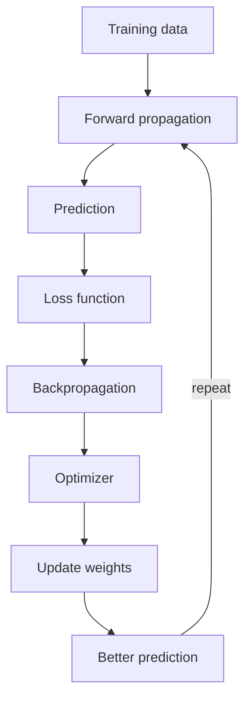
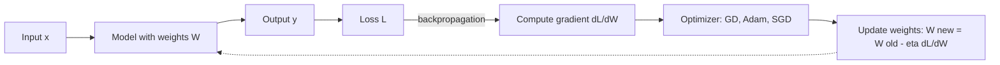
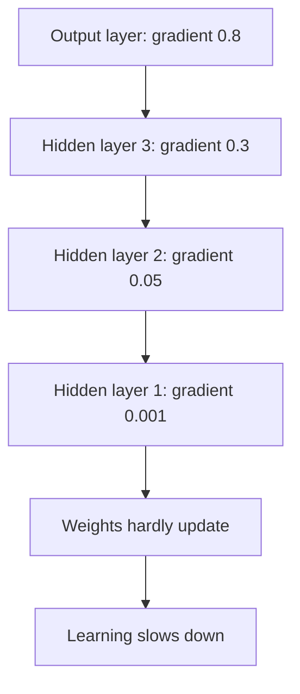

Naye ideas se pehle wo purani baatein jo chahiye. Agar pata hai to seedha agle section par jao.

## Basics pehle

- **Neuron** basic processing unit hai. Ye inputs leta hai, calculations karta hai aur result agli layer ko deta hai. **Weight** har input ki importance dikhata hai (zyada weight matlab zyada influence). **Bias** learning improve karne ke liye add ki gayi extra value hai. <Cite id="class-dl-chp2" loc="slide 4" />
- **Activation function** neuron ka output decide karta hai aur network ko complex patterns seekhne mein help karta hai. <Cite id="class-dl-chp2" loc="slide 4" />
- **Loss** prediction ka error hai. Teacher ke example mein fruit ka actual weight 180 g hai, predicted weight 220 g, to loss high hai. <Cite id="class-dl-chp2" loc="slide 57" />
- Weights aur biases **parameters** hain: wo numbers jo network seekhta hai.

## Big picture: network kaise seekhta hai

Network train karna chaar kaamon ka repeat hone wala loop hai. Teacher ise ek flow mein draw karte hain: <Cite id="class-dl-chp2" loc="slides 57 and 59" />

1. **Forward propagation:** input network se guzar kar prediction deta hai.
2. **Loss calculation:** prediction ko actual value se compare karke error nikalte hain.
3. **Backpropagation:** error ki information peeche flow karti hai aur gradient deti hai.
4. **Optimization:** optimizer gradient se weights update karta hai.

Training chalti rehne par loss ghatta hai aur predictions zyada accurate hoti hain. <Cite id="class-dl-chp2" loc="slide 59" />

<Cite id="class-dl-chp2" loc="slide 59" />

**Rozmarra ka example.** Student practice test likhta hai (forward pass), teacher check karta hai (loss), student pata lagata hai kaun se topics se galtiyan hui (backpropagation), aur un topics ko zyada padhta hai (weight update). Agla test behtar hota hai.

**Fruit example (teacher ka).** Actual weight 180 g hai aur pehli prediction 220 g (loss high). Har update ke baad prediction paas aati hai: 220 g, 205 g, 193 g, 182 g, 180 g, aur loss ghatta hai. <Cite id="class-dl-chp2" loc="slide 57" /> Ye syllabus <Syl m="2" /> hai.

## Step 1: forward propagation

<Box kind="definition">

**Multilayer Feedforward Neural Network:** a neural network with one input layer, one or more hidden layers and one output layer, where data moves only forward (input to output). It processes the input through the hidden layers and gives the final output. <Cite id="class-dl-chp2" loc="slide 4" />

</Box>

Textbook ke words mein: jab hum feedforward network se input $x$ lekar output $\hat y$ banate hain, "information flows forward through the network". Inputs initial information dete hain jo har layer ke hidden units tak jaati hai aur aakhir mein $\hat y$ banati hai. Isse **forward propagation** kehte hain. Training mein forward propagation scalar cost $J(\theta)$ banne tak chalta hai. <Cite id="class-dl-m1" loc="p. 26" />

Kaise kaam karta hai, teacher ke paanch steps (fruit example): <Cite id="class-dl-chp2" loc="slide 4" />

1. Input features diye jaate hain (colour = red, shape = round, weight = 180 g, texture = smooth).
2. Input layer data Hidden Layer 1 ko bhejti hai.
3. Hidden Layer 1 information process karke Hidden Layer 2 ko bhejti hai.
4. Hidden Layer 2 zyada complex patterns seekhti hai.
5. Output layer fruit predict karti hai (Apple).

## Step 2: loss calculation

Loss function prediction ko actual value se compare karta hai. Ye sirf batata hai **kitna error hai**. Ye nahi batata ki kaun sa weight galat hai, weights kaise update karne hain ya minimum loss tak kaise pahunchna hai. <Cite id="class-dl-chp2" loc="slide 59" /> Module 1 add karta hai ki cost (loss) function "measures the difference, or error, between actual y and predicted y", aur loss function ek training example ka error hai jabki cost function poore training set ka average error. <Cite id="class-dl-m1" loc="p. 28" />

To model ko "ek guide" chahiye: gradient. <Cite id="class-dl-chp2" loc="slide 57" />

## Gradient: wo guide jo model ko chahiye

<Box kind="definition">

**Gradient:** the slope of the loss function. It tells us which direction reduces the loss and how quickly the loss changes. The gradient acts like a guide for the optimizer. <Cite id="class-dl-chp2" loc="slide 57" />

</Box>

Gradient optimizer ko kaise guide karta hai: <Cite id="class-dl-chp2" loc="slide 57" />

- Gradient **positive** ho to ulti direction mein move karo.
- Gradient **negative** ho to (slope ki) ulti direction mein move karo.
- Gradient **zero** ho to model minimum (ya saddle point) par pahunch gaya ho sakta hai.

**Don't confuse (teacher ki table).** <Cite id="class-dl-chp2" loc="slide 57" />

| | Loss function | Gradient |
|---|---|---|
| Batata hai | Kitna error (kitna bura) | Kahan jaana hai aur kaise badalna hai |
| Direction? | Direction nahi deta | Direction deta hai (increase ya decrease) |
| Speed? | Speed nahi batata | Batata hai loss kitni tez badalta hai |
| Weights? | Weights update nahi karta | Optimizer ko weights update karne mein help karta hai |

## Step 3: backpropagation

<Box kind="definition">

**Backpropagation (backprop):** the algorithm that allows the information from the cost to flow backwards through the network, in order to compute the gradient. <Cite id="class-dl-m1" loc="p. 26" />

</Box>

Textbook saaf kehta hai ki ye kya *nahi* karta: "back-propagation refers only to the method for computing the gradient, while another algorithm, such as stochastic gradient descent, is used to perform learning using this gradient". Ye kaam "a simple and inexpensive procedure" se karta hai, gradient ke lambe expression ko numerically evaluate karne ke bajaye. <Cite id="class-dl-m1" loc="p. 26" />

Teacher ke flow mein gradient backpropagation ke dauran calculate hota hai aur phir "used by optimizers to update weights and reduce the loss": <Cite id="class-dl-chp2" loc="slide 58" />

<Cite id="class-dl-chp2" loc="slide 58" />

## Step 4: optimization (weights update karna)

Optimizer gradient leta hai aur weights badalta hai. Sabse simple optimizer gradient descent hai: <Cite id="class-dl-chp2" loc="slide 58" />

<Box kind="definition">

$W_{new} = W_{old} - \eta \dfrac{\partial L}{\partial W}$, jahan $W$ weight hai, $\eta$ learning rate, $L$ loss aur $\dfrac{\partial L}{\partial W}$ gradient. <Cite id="class-dl-chp2" loc="slide 63" />

</Box>

**Bada gradient** (steep slope) bade weight updates aur faster learning deta hai; **chhota gradient** (flat slope) chhote updates aur slower learning. <Cite id="class-dl-chp2" loc="slide 58" /> Alag-alag optimizers (SGD, momentum, AdaGrad, RMSProp, Adam) gradient descent ke note mein samjhaye gaye hain.

**Sum 1: ek weight par poora learning cycle (class files mein nahi hai; numbers dikhane ke liye add kiya).** Class update rule deti hai par loss ka derivative nahi, isliye yahan loss simple squared error $L = (\hat y - y)^2$ hai, jiska weight ke respect mein gradient $2(\hat y - y)\,x$ hai.

<Sum>

<Given>

Ek neuron bina activation ke: $\hat y = w \cdot x$. Input $x = 2$, actual output $y = 4$, weight $w = 3$, learning rate $\eta = 0.1$. Loss $L = (\hat y - y)^2$.

</Given>

<Find>

ek cycle: forward pass, loss, gradient, weight update, aur naya loss.

</Find>

<Steps>

1. **Forward propagation.** $\hat y = 3 \times 2 = 6$.
2. **Loss.** $L = (6 - 4)^2 = 4$.
3. **Backpropagation (gradient).** $\dfrac{\partial L}{\partial w} = 2(\hat y - y)\,x = 2 \times 2 \times 2 = 8$. Ye positive hai, to bada $w$ matlab bada loss.
4. **Optimizer (update).** $w_{new} = 3 - 0.1 \times 8 = 2.2$.
5. **Phir forward pass.** $\hat y = 2.2 \times 2 = 4.4$, to $L = (4.4 - 4)^2 = 0.16$.

</Steps>

<Answer>

Ek cycle loss ko 4 se 0.16 tak aur prediction ko 6 se 4.4 tak le jaata hai (actual value 4 hai).

</Answer>

<Box kind="verify">

Perfect weight $w = 2$ hai kyunki $2 \times 2 = 4$. Weight 3 se 2.2 par gaya, 2 ki taraf, aur loss gira, to update sahi direction mein gaya.

</Box>

</Sum>

## Forward propagation versus backpropagation

| | Forward propagation | Backpropagation |
|---|---|---|
| Direction | Input se output | Loss se peeche layers ke through |
| Kaam | Prediction (aur loss) banata hai | Gradient calculate karta hai |
| Kya use karta hai | Weights, biases, activation functions | Loss aur har hisse ka slope |
| Weights badalta hai? | Nahi | Nahi, sirf gradient compute karta hai; optimizer badalta hai |

<Cite id="class-dl-m1" loc="p. 26" />

## Do gradient problems

Backpropagation gradient ko kai layers ke through peeche bhejta hai, aur ye do ulte tareeko se galat ja sakta hai.

### Vanishing gradient

<Box kind="definition">

**Vanishing Gradient Problem:** it occurs when gradients become extremely small during backpropagation. Because of these tiny gradients, earlier layers receive almost no updates and stop learning. <Cite id="class-dl-chp2" loc="slide 64" />

</Box>

**Ye kyun hota hai.** Backpropagation mein gradients output layer se input layer ki taraf jaate hain. Kai layers guzarne ke baad gradient chhota aur chhota hota jaata hai. Teacher ki picture mein gradient output layer par 0.8, phir 0.3, 0.05 aur hidden layer 1 par 0.001 hai, to **pehli hidden layers ko lagbhag zero gradient milta hai**. <Cite id="class-dl-chp2" loc="slide 64" />

Gradient descent iska cause nahi hai: weight update = learning rate × gradient, to bahut chhota gradient matlab bahut chhota update. Weights mushkil se badalte hain, loss bahut slowly ghatta hai aur training best solution tak pahunchne se pehle ruk sakti hai. <Cite id="class-dl-chp2" loc="slide 64" />

<Cite id="class-dl-chp2" loc="slide 64" />

**Kahan hota hai:** deep neural networks, recurrent neural networks aur bahut deep architectures, khaaskar jab sigmoid ya tanh activation functions baar-baar use hon. <Cite id="class-dl-chp2" loc="slide 64" /> **Effects:** slow training, early hidden layers seekhna band kar deti hain, accuracy low rehti hai, training mein kai epochs lagte hain, deep networks train karna mushkil ho jaata hai. <Cite id="class-dl-chp2" loc="slide 65" />

Teacher sigmoid curve se wajah samjhate hain: uska derivative hamesha 1 se kam hai, $0 < f'(z) \le 0.25$, to backpropagation mein kai chhote derivatives multiply hote hain aur gradient dheere dheere lagbhag zero ho jaata hai. Tanh derivative $f'(z) = 1 - \tanh^2(z)$ bhi 1 se zyada nahi, to bahut deep networks mein gradient phir bhi vanish ho sakta hai. <Cite id="class-dl-chp2" loc="slide 65" />

**Sum 2: gradient kitni tezi se chhota hota hai.** <Cite id="class-dl-chp2" loc="slide 65" />

<Sum>

<Given>

Sigmoid layer ka best case: har layer par derivative $0.25$. Output par gradient 1.

</Given>

<Find>

5 layers aur 10 layers ke baad gradient.

</Find>

<Steps>

1. Har layer gradient ko 0.25 se multiply karti hai.
2. 5 layers ke baad: $0.25^5 = 0.25 \times 0.25 \times 0.25 \times 0.25 \times 0.25 = 0.000977$.
3. 10 layers ke baad: $0.25^{10} = (0.25^5)^2 = 0.000977^2 \approx 0.00000095$.

</Steps>

<Answer>

5 layers ke baad lagbhag 0.001 aur 10 layers ke baad lagbhag 0.000001. Best case mein bhi early layers mein gradient lagbhag zero hai.

</Answer>

<Box kind="verify">

$0.25^5 = 1/4^5 = 1/1024 = 0.000977$, aur $1/4^{10} = 1/1{,}048{,}576 = 0.00000095$. Dono match karte hain.

</Box>

</Sum>

**Kaise solve karein** (teacher ki list): <Cite id="class-dl-chp2" loc="slide 65" />

- **ReLU activation:** positive inputs ke liye derivative 1, to gradients kaafi bade rehte hain.
- **Leaky ReLU:** negative inputs par bhi chhota gradient allow karta hai.
- **Proper weight initialization:** He initialization (ReLU ke liye), Xavier initialization (sigmoid/tanh ke liye).
- **Batch normalization:** activations aur gradients ko healthy range mein rakhta hai aur training tez karta hai.
- **LSTM / GRU:** recurrent networks mein use hote hain, sequence data mein vanishing gradient problem kam karne ke liye hi design kiye gaye hain.

Module 1 yahi do problems batata hai: vanishing gradients mein earlier layers "learn more slowly than later layers", jab tak weights badalna band na kar dein; exploding gradients mein model weights bahut bade ho jaate hain aur aakhir mein "will eventually be represented as NaN". <Cite id="class-dl-m1" loc="p. 31" />

### Exploding gradient

<Box kind="definition">

**Exploding Gradient Problem:** it occurs when gradients become extremely large during backpropagation. Large gradients produce huge weight updates, making the neural network unstable. <Cite id="class-dl-chp2" loc="slide 66" />

</Box>

**Ye kaise hota hai.** Gradients kai layers se guzarte hain aur kabhi chhote hone ke bajaye bade aur bade hote jaate hain. Teacher ki picture mein gradient output layer par 2, phir 8, 40 aur hidden layer 1 par 200 hai. **Bahut bade gradients se huge weight updates hote hain.** <Cite id="class-dl-chp2" loc="slide 66" />

Fruit example mein predictions kudti rehti hain kyunki weight updates bahut bade hain: 220 g, 350 g, 80 g, 500 g, 120 g. Model sahi se seekh nahi paata. <Cite id="class-dl-chp2" loc="slide 66" />

**Causes:** bahut deep networks, poor weight initialization (bahut bade initial weights) aur bada learning rate (optimizer overshoot karta rehta hai). **Effects:** training unstable, loss ghatne ke bajaye badhta hai, model converge nahi hota aur weights bahut bade ho sakte hain. <Cite id="class-dl-chp2" loc="slide 67" />

**Kaise solve karein:** <Cite id="class-dl-chp2" loc="slide 67" />

- **Gradient clipping:** gradient ki maximum limit set karo; limit se upar jaaye to use chhoti value par clip kar do.
- **Proper weight initialization** (He, Xavier).
- **Chhota learning rate.**
- **Batch normalization.**
- **Better optimizers** jaise RMSProp aur Adam.

Textbook add karta hai ki cliff structures recurrent networks mein sabse common hain, kyunki wo har time step ka ek factor multiply karte hain, aur gradient clipping "intervenes to reduce the step size". <Cite id="class-dl-m2" loc="p. 47" />

### Vanishing versus exploding gradient

| | Vanishing gradient | Exploding gradient |
|---|---|---|
| Kya hota hai | Gradient bahut chhota (0 ke kareeb) | Gradient bahut bada |
| Weight updates | Tiny | Huge |
| Training | Slow, learning ruk sakti hai | Unstable, bahut kudti hai |
| Loss | Bahut slowly ghatta hai | Badh sakta hai ya fluctuate |
| Common with | Sigmoid / tanh, bahut deep networks | Poor initialization, bada learning rate, bahut deep networks |
| Solve | ReLU, Leaky ReLU, batch normalization, proper initialization, LSTM/GRU | Gradient clipping, proper initialization, kam learning rate, Adam / RMSProp |

<Cite id="class-dl-chp2" loc="slides 65 to 67" />

**Easy trick (teacher ki):** tiny baby steps = vanishing gradient; huge jumps = exploding gradient. <Cite id="class-dl-chp2" loc="slide 67" />

## Ye kahan puchha gaya

| Question | Kya likhna hai | Solution |
|---|---|---|
| "Explain the learning process in a neural network. How does it update weights? Role of forward propagation, loss, backpropagation and optimization" | Diagram ke saath chaar-step loop, har step ka kaam, update rule, chhota example | <PYQ id="2025-05/q6b" /> |

## Quick revision

- Learning loop: forward propagation → prediction → loss → backpropagation → optimizer → update weights → better prediction, repeat.
- Loss batata hai kitna error hai; gradient (loss ka slope) batata hai kis taraf aur kitni tez move karna hai.
- Backpropagation sirf gradient compute karta hai (cost ki information peeche flow karti hai). Optimizer use karta hai: $W_{new} = W_{old} - \eta\, \partial L / \partial W$.
- Vanishing gradient: tiny gradients, early layers seekhna band (sigmoid/tanh). Fixes: ReLU, Leaky ReLU, batch normalization, proper initialization, LSTM/GRU.
- Exploding gradient: huge gradients, unstable training. Fixes: gradient clipping, proper initialization, chhota learning rate, batch normalization, RMSProp/Adam.
