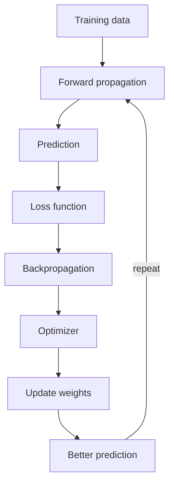
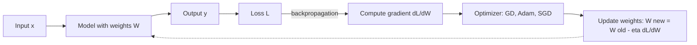
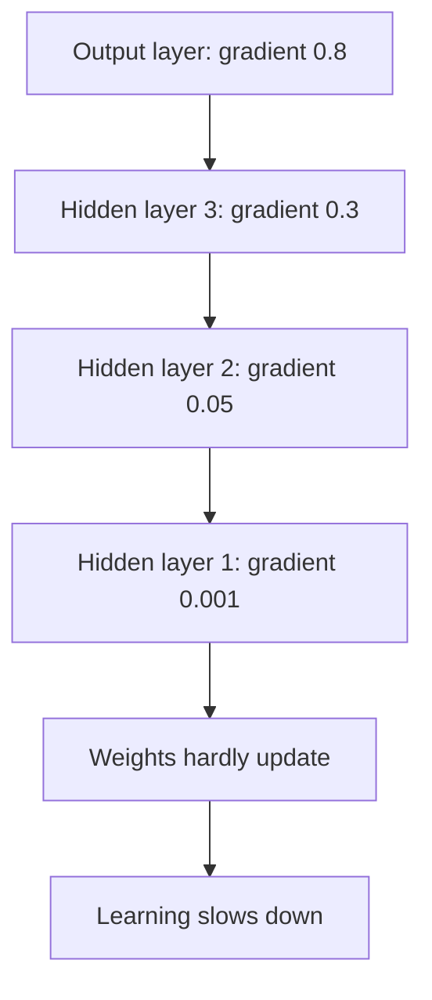

Before the new ideas, here are the old ones you need. If you already know them, skip to the next section.

## The basics first

- A **neuron** is the basic processing unit. It receives inputs, performs calculations and passes the result to the next layer. A **weight** shows the importance of each input (higher weight means more influence). A **bias** is an extra value added to improve learning. <Cite id="class-dl-chp2" loc="slide 4" />
- An **activation function** decides the output of a neuron and helps the network learn complex patterns. <Cite id="class-dl-chp2" loc="slide 4" />
- The **loss** is the error of the prediction. In the teacher's example the actual weight of a fruit is 180 g, the predicted weight is 220 g, so the loss is high. <Cite id="class-dl-chp2" loc="slide 57" />
- The weights and biases are the **parameters**: the numbers the network learns.

## The big picture: how a network learns

Training a network is a repeated loop of four jobs. The teacher draws it as one flow: <Cite id="class-dl-chp2" loc="slides 57 and 59" />

1. **Forward propagation:** the input goes through the network and gives a prediction.
2. **Loss calculation:** the prediction is compared with the actual value to find the error.
3. **Backpropagation:** the error information flows backwards and gives the gradient.
4. **Optimization:** the optimizer uses the gradient to update the weights.

As training continues, the loss decreases and the predictions become more accurate. <Cite id="class-dl-chp2" loc="slide 59" />

<Cite id="class-dl-chp2" loc="slide 59" />

**Everyday analogy.** A student writes a practice test (forward pass), the teacher marks it (loss), the student works out which topics caused the mistakes (backpropagation), and studies those topics more (weight update). The next test is better.

**The fruit example (teacher's).** The actual weight is 180 g and the first prediction is 220 g (loss is high). After each update the prediction moves closer: 220 g, 205 g, 193 g, 182 g, 180 g, and the loss decreases. <Cite id="class-dl-chp2" loc="slide 57" /> This is syllabus <Syl m="2" />.

## Step 1: forward propagation

<Box kind="definition">

**Multilayer Feedforward Neural Network:** a neural network with one input layer, one or more hidden layers and one output layer, where data moves only forward (input to output). It processes the input through the hidden layers and gives the final output. <Cite id="class-dl-chp2" loc="slide 4" />

</Box>

In the textbook's words: when we use a feedforward network to accept an input $x$ and produce an output $\hat y$, "information flows forward through the network". The inputs provide the initial information that then propagates up to the hidden units at each layer and finally produces $\hat y$. This is called **forward propagation**. During training, forward propagation continues until it produces a scalar cost $J(\theta)$. <Cite id="class-dl-m1" loc="p. 26" />

How it works, the teacher's five steps (fruit example): <Cite id="class-dl-chp2" loc="slide 4" />

1. Input features are given (colour = red, shape = round, weight = 180 g, texture = smooth).
2. The input layer sends the data to Hidden Layer 1.
3. Hidden Layer 1 processes the information and sends it to Hidden Layer 2.
4. Hidden Layer 2 learns more complex patterns.
5. The output layer predicts the fruit (Apple).

## Step 2: loss calculation

The loss function compares the prediction with the actual value. It only tells us **how much error exists**. It does not tell us which weight is wrong, how to update the weights or how to reach the minimum loss. <Cite id="class-dl-chp2" loc="slide 59" /> Module 1 adds that the cost (loss) function "measures the difference, or error, between actual y and predicted y", and that a loss function is the error of one training example while a cost function is the average error over the entire training set. <Cite id="class-dl-m1" loc="p. 28" />

So the model needs "a guide": the gradient. <Cite id="class-dl-chp2" loc="slide 57" />

## The gradient: the guide the model needs

<Box kind="definition">

**Gradient:** the slope of the loss function. It tells us which direction reduces the loss and how quickly the loss changes. The gradient acts like a guide for the optimizer. <Cite id="class-dl-chp2" loc="slide 57" />

</Box>

How the gradient guides the optimizer: <Cite id="class-dl-chp2" loc="slide 57" />

- If the gradient is **positive**, move in the opposite direction.
- If the gradient is **negative**, move in the opposite direction (of the slope).
- If the gradient is **zero**, the model may have reached a minimum (or a saddle point).

**Don't confuse (the teacher's table).** <Cite id="class-dl-chp2" loc="slide 57" />

| | Loss function | Gradient |
|---|---|---|
| Tells | How much error (how bad) | Where to go and how to change |
| Direction? | Does not give direction | Gives direction (increase or decrease) |
| Speed? | Does not tell speed | Tells how fast the loss changes |
| Weights? | Does not update weights | Helps the optimizer update weights |

## Step 3: backpropagation

<Box kind="definition">

**Backpropagation (backprop):** the algorithm that allows the information from the cost to flow backwards through the network, in order to compute the gradient. <Cite id="class-dl-m1" loc="p. 26" />

</Box>

The textbook is careful about what it does *not* do: "back-propagation refers only to the method for computing the gradient, while another algorithm, such as stochastic gradient descent, is used to perform learning using this gradient". It does the job using "a simple and inexpensive procedure", instead of evaluating a long expression for the gradient numerically. <Cite id="class-dl-m1" loc="p. 26" />

In the teacher's flow the gradient is calculated during backpropagation and then "used by optimizers to update weights and reduce the loss": <Cite id="class-dl-chp2" loc="slide 58" />

<Cite id="class-dl-chp2" loc="slide 58" />

## Step 4: optimization (updating the weights)

The optimizer takes the gradient and changes the weights. The simplest optimizer is gradient descent: <Cite id="class-dl-chp2" loc="slide 58" />

<Box kind="definition">

$W_{new} = W_{old} - \eta \dfrac{\partial L}{\partial W}$, where $W$ is the weight, $\eta$ the learning rate, $L$ the loss and $\dfrac{\partial L}{\partial W}$ the gradient. <Cite id="class-dl-chp2" loc="slide 63" />

</Box>

A **large gradient** (steep slope) gives large weight updates and faster learning; a **small gradient** (flat slope) gives small updates and slower learning. <Cite id="class-dl-chp2" loc="slide 58" /> The different optimizers (SGD, momentum, AdaGrad, RMSProp, Adam) are explained in the note on gradient descent.

**Sum 1: one full learning cycle on one weight (not in the class files; added to show the numbers).** The class gives the update rule but not the derivative of the loss, so here the loss is the simple squared error $L = (\hat y - y)^2$, whose gradient with respect to the weight is $2(\hat y - y)\,x$.

<Sum>

<Given>

One neuron with no activation: $\hat y = w \cdot x$. Input $x = 2$, actual output $y = 4$, weight $w = 3$, learning rate $\eta = 0.1$. Loss $L = (\hat y - y)^2$.

</Given>

<Find>

one cycle: forward pass, loss, gradient, weight update, and the new loss.

</Find>

<Steps>

1. **Forward propagation.** $\hat y = 3 \times 2 = 6$.
2. **Loss.** $L = (6 - 4)^2 = 4$.
3. **Backpropagation (gradient).** $\dfrac{\partial L}{\partial w} = 2(\hat y - y)\,x = 2 \times 2 \times 2 = 8$. It is positive, so a bigger $w$ means a bigger loss.
4. **Optimizer (update).** $w_{new} = 3 - 0.1 \times 8 = 2.2$.
5. **Forward pass again.** $\hat y = 2.2 \times 2 = 4.4$, so $L = (4.4 - 4)^2 = 0.16$.

</Steps>

<Answer>

One cycle takes the loss from 4 to 0.16 and the prediction from 6 to 4.4 (the actual value is 4).

</Answer>

<Box kind="verify">

The perfect weight is $w = 2$ because $2 \times 2 = 4$. The weight moved from 3 to 2.2, toward 2, and the loss fell, so the update went the right way.

</Box>

</Sum>

## Forward propagation versus backpropagation

| | Forward propagation | Backpropagation |
|---|---|---|
| Direction | Input to output | From the loss back through the layers |
| Job | Makes the prediction (and the loss) | Calculates the gradient |
| Uses | Weights, biases, activation functions | The loss and the slope of each part |
| Changes the weights? | No | No, it only computes the gradient; the optimizer changes them |

<Cite id="class-dl-m1" loc="p. 26" />

## The two gradient problems

Backpropagation sends the gradient backwards through many layers, and it can go wrong in two opposite ways.

### Vanishing gradient

<Box kind="definition">

**Vanishing Gradient Problem:** it occurs when gradients become extremely small during backpropagation. Because of these tiny gradients, earlier layers receive almost no updates and stop learning. <Cite id="class-dl-chp2" loc="slide 64" />

</Box>

**Why it happens.** During backpropagation the gradients travel from the output layer to the input layer. After passing through many layers the gradient becomes smaller and smaller. In the teacher's picture the gradient is 0.8 at the output layer, 0.3, 0.05 and then 0.001 at hidden layer 1, so **the first hidden layers receive almost zero gradient**. <Cite id="class-dl-chp2" loc="slide 64" />

Gradient descent is not the cause: the weight update is learning rate × gradient, so a very small gradient means a very small update. The weights hardly change, the loss decreases very slowly and training may stop before reaching the best solution. <Cite id="class-dl-chp2" loc="slide 64" />

<Cite id="class-dl-chp2" loc="slide 64" />

**Where it occurs:** deep neural networks, recurrent neural networks and very deep architectures, especially when using sigmoid or tanh activation functions repeatedly. <Cite id="class-dl-chp2" loc="slide 64" /> **Effects:** slow training, early hidden layers stop learning, accuracy remains low, training takes many epochs, deep networks become difficult to train. <Cite id="class-dl-chp2" loc="slide 65" />

The teacher explains the cause with the sigmoid curve: its derivative is always less than 1, with $0 < f'(z) \le 0.25$, so during backpropagation many small derivatives are multiplied together and the gradient gradually becomes almost zero. The tanh derivative $f'(z) = 1 - \tanh^2(z)$ is also at most 1, so in very deep networks the gradient can still vanish. <Cite id="class-dl-chp2" loc="slide 65" />

**Sum 2: how fast the gradient shrinks.** <Cite id="class-dl-chp2" loc="slide 65" />

<Sum>

<Given>

The best case for a sigmoid layer: derivative $0.25$ at every layer. Gradient at the output is 1.

</Given>

<Find>

the gradient after 5 layers and after 10 layers.

</Find>

<Steps>

1. Each layer multiplies the gradient by 0.25.
2. After 5 layers: $0.25^5 = 0.25 \times 0.25 \times 0.25 \times 0.25 \times 0.25 = 0.000977$.
3. After 10 layers: $0.25^{10} = (0.25^5)^2 = 0.000977^2 \approx 0.00000095$.

</Steps>

<Answer>

About 0.001 after 5 layers and about 0.000001 after 10 layers. Even in the best case the gradient is nearly zero in the early layers.

</Answer>

<Box kind="verify">

$0.25^5 = 1/4^5 = 1/1024 = 0.000977$, and $1/4^{10} = 1/1{,}048{,}576 = 0.00000095$. Both agree.

</Box>

</Sum>

**How to solve it** (the teacher's list): <Cite id="class-dl-chp2" loc="slide 65" />

- **ReLU activation:** derivative of 1 for positive inputs, so gradients remain much larger.
- **Leaky ReLU:** allows a small gradient even for negative inputs.
- **Proper weight initialization:** He initialization (for ReLU), Xavier initialization (for sigmoid/tanh).
- **Batch normalization:** keeps activations and gradients in a healthy range and speeds up training.
- **LSTM / GRU:** used in recurrent networks, designed specifically to reduce the vanishing gradient problem in sequence data.

Module 1 describes the same two problems: with vanishing gradients the earlier layers "learn more slowly than later layers", until the weights stop changing; with exploding gradients the model weights grow too large and "will eventually be represented as NaN". <Cite id="class-dl-m1" loc="p. 31" />

### Exploding gradient

<Box kind="definition">

**Exploding Gradient Problem:** it occurs when gradients become extremely large during backpropagation. Large gradients produce huge weight updates, making the neural network unstable. <Cite id="class-dl-chp2" loc="slide 66" />

</Box>

**How it happens.** Gradients pass through many layers and sometimes, instead of becoming smaller, they become larger and larger. In the teacher's picture the gradient is 2 at the output layer, 8, 40 and 200 at hidden layer 1. **Very large gradients lead to huge weight updates.** <Cite id="class-dl-chp2" loc="slide 66" />

In the fruit example the predictions keep jumping because the weight updates are too large: 220 g, 350 g, 80 g, 500 g, 120 g. The model cannot learn properly. <Cite id="class-dl-chp2" loc="slide 66" />

**Causes:** very deep networks, poor weight initialization (too-large initial weights) and a large learning rate (the optimizer keeps overshooting). **Effects:** training becomes unstable, the loss increases instead of decreasing, the model fails to converge and weights may become extremely large. <Cite id="class-dl-chp2" loc="slide 67" />

**How to solve it:** <Cite id="class-dl-chp2" loc="slide 67" />

- **Gradient clipping:** set a maximum limit for the gradient; if it exceeds the limit it is clipped to a smaller value.
- **Proper weight initialization** (He, Xavier).
- **Smaller learning rate.**
- **Batch normalization.**
- **Better optimizers** such as RMSProp and Adam.

The textbook adds that cliff structures are most common in recurrent networks, because they multiply many factors, one for each time step, and gradient clipping "intervenes to reduce the step size". <Cite id="class-dl-m2" loc="p. 47" />

### Vanishing versus exploding gradient

| | Vanishing gradient | Exploding gradient |
|---|---|---|
| What happens | Gradient becomes very small (close to 0) | Gradient becomes very large |
| Weight updates | Tiny | Huge |
| Training | Slow, may stop learning | Unstable, jumps a lot |
| Loss | Decreases very slowly | May increase or fluctuate |
| Common with | Sigmoid / tanh, very deep networks | Poor initialization, large learning rate, very deep networks |
| Solved by | ReLU, Leaky ReLU, batch normalization, proper initialization, LSTM/GRU | Gradient clipping, proper initialization, lower learning rate, Adam / RMSProp |

<Cite id="class-dl-chp2" loc="slides 65 to 67" />

**Easy trick (the teacher's):** tiny baby steps = vanishing gradient; huge jumps = exploding gradient. <Cite id="class-dl-chp2" loc="slide 67" />

## Where this was asked

| Question | What to write | Solution |
|---|---|---|
| "Explain the learning process in a neural network. How does it update weights? Role of forward propagation, loss, backpropagation and optimization" | The four-step loop with a diagram, each step's job, the update rule, a small example | <PYQ id="2025-05/q6b" /> |

## Quick revision

- Learning loop: forward propagation → prediction → loss → backpropagation → optimizer → update weights → better prediction, repeated.
- The loss tells how much error exists; the gradient (slope of the loss) tells which way and how fast to move.
- Backpropagation only computes the gradient (the information from the cost flows backwards). The optimizer uses it: $W_{new} = W_{old} - \eta\, \partial L / \partial W$.
- Vanishing gradient: tiny gradients, early layers stop learning (sigmoid/tanh). Fixes: ReLU, Leaky ReLU, batch normalization, proper initialization, LSTM/GRU.
- Exploding gradient: huge gradients, unstable training. Fixes: gradient clipping, proper initialization, smaller learning rate, batch normalization, RMSProp/Adam.
