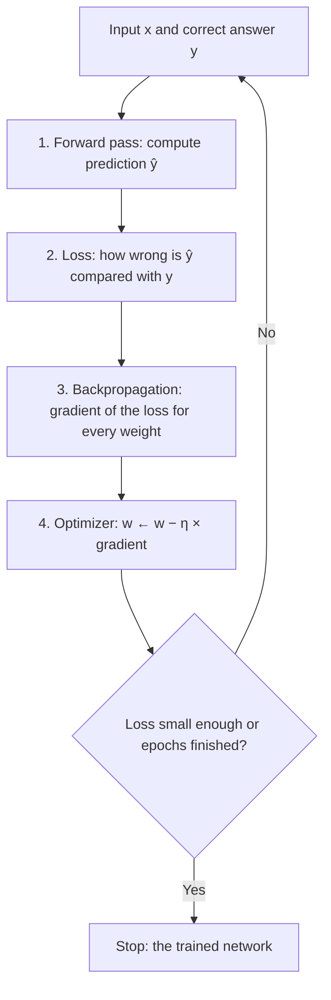
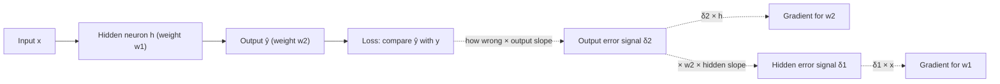

Before the new ideas, here are the old ones you need. If you already know them, skip to the next section.

## The basics first

- A **neuron** takes some numbers in, multiplies each by a **weight**, adds them up, adds a **bias**, and passes the total through an **activation function** (for example sigmoid, which squeezes any number into the range 0 to 1).
- A **neural network** is many neurons arranged in **layers**: an input layer, one or more hidden layers, and an output layer.
- The **weights and biases** are the adjustable numbers, together called the **parameters**. Learning means finding good values for them.
- The **loss** is one number that says how wrong the network's answer is. Lower is better.
- A **gradient** (slope) of the loss for a weight says how much the loss changes when that weight is changed a tiny bit, and in which direction.
- The **learning rate**, written $\eta$ (eta), is how big a step we take when we change a weight.
- One **epoch** is one full pass over all the training examples.

## The big picture: how a network learns

**What it is.** Training a neural network means repeating a simple loop: guess, check the mistake, find who caused it, correct. This is syllabus <Syl m="2" />, "Learning with backpropagation" in section 2.2.

**Why it is needed.** A new network starts with random weights, so its answers are random. Nobody can set millions of weights by hand. We need an automatic way to know, for every weight, "should this go up or down, and by how much?" The learning loop with backpropagation answers exactly that.

**Everyday analogy.** Think of learning to throw a ball into a basket. You throw (a guess). You see how far you missed (the error). You work out what to change: "my arm was too strong, my angle was fine" (who is to blame). Then you adjust a little and throw again.

<Box kind="definition">

**The learning process** is a loop with four steps, repeated for many examples and many epochs:

1. **Forward propagation:** send the input through the network to get a prediction.
2. **Loss calculation:** compare the prediction with the correct answer and get one number for the error.
3. **Backpropagation:** work backwards from the loss to find how much each weight is to blame (its gradient).
4. **Optimization (weight update):** change every weight a little in the direction that lowers the loss.

</Box>

Keep two ideas apart: **backpropagation only computes gradients**. It does not change any weight. The **optimizer** (plain gradient descent, momentum, Adam and so on) is what uses those gradients to change the weights. <Cite id="gfdl-ch6" loc="§6.5" />

## Step 1: forward propagation

**What it is.** The input enters at the left and flows to the right, one layer at a time, until the output layer gives a prediction $\hat{y}$ (read "y-hat").

**How it works.** Every neuron in a layer does two small things:

1. **Weighted sum:** multiply each incoming value by its weight, add them up and add the bias.
2. **Activation:** pass that sum through the activation function (sigmoid, tanh, ReLU and so on). The result is the neuron's output, which becomes an input to the next layer.

So a layer takes the outputs of the previous layer, forms one weighted sum per neuron, and squeezes each sum through the activation. The outputs of the last layer are the prediction.

<Figure caption="A small fully connected network: 2 inputs, 3 hidden neurons, 1 output. In the forward pass numbers flow left to right along every line; in backpropagation the blame flows right to left along the same lines.">
  <NetworkFigure layers="2,3,1" labels="Input,Hidden,Output" title="Forward: left to right. Backward: right to left." />
</Figure>

**Worked sum: the forward pass of one neuron.**

<Sum>

<Given>

inputs 1 and 2, weights 0.5 and −0.25, bias 0.1, sigmoid activation $\sigma(z) = \dfrac{1}{1 + e^{-z}}$.

</Given>

<Find>

the neuron's output.

</Find>

<Steps>

1. First input times its weight: $1 \times 0.5 = 0.5$. *(Each input is scaled by how important it is.)*
2. Second input times its weight: $2 \times (-0.25) = -0.5$. *(A negative weight pulls the sum down.)*
3. Weighted sum plus bias: $z = 0.5 + (-0.5) + 0.1 = 0.1$. *(The neuron adds everything up.)*
4. Activation: $e^{-0.1} \approx 0.9048$, so

   $$
   \begin{aligned}
   \sigma(0.1) &= \frac{1}{1 + 0.9048} \\
   &= \frac{1}{1.9048} \\
   &\approx 0.525
   \end{aligned}
   $$

   *(Sigmoid squeezes the sum into 0 to 1.)*

</Steps>

<Answer>

the output is about 0.525.

</Answer>

<Box kind="verify">

Sigmoid gives exactly 0.5 at $z = 0$, and near 0 it rises by about one quarter of $z$ (its slope there is 0.25). So

$$
\sigma(0.1) \approx 0.5 + 0.1 / 4 = 0.525
$$

Same answer by a different route, and it sits just above 0.5 as it should for a small positive sum.

</Box>

</Sum>

A whole network is just this, repeated for every neuron. <Cite id="gfg-forward-prop" />

During the forward pass the network also **remembers** every weighted sum and output, because backpropagation will need them.

## Step 2: loss calculation

**What it is.** The loss turns "how wrong" into one number. The syllabus names two:

- **Squared error** (for predicting numbers): half the square of the difference between prediction and answer, $L = \dfrac{1}{2}(\hat{y} - y)^2$. Example: prediction 0.6, answer 1. Difference $0.6 - 1 = -0.4$; square $0.16$; half of it $0.08$. So **$L = 0.08$**. (Check: the sign of the difference does not matter, $(1 - 0.6)^2 / 2 = 0.16 / 2 = 0.08$ too.)
- **Cross-entropy** (for classification): $L = -\ln p$, where $p$ is the probability the network gave to the correct class. It is small when $p$ is near 1 and very large when $p$ is near 0. Example: if $p = 0.9$, $L = -\ln 0.9 \approx 0.105$; if $p = 0.1$, $L = -\ln 0.1 \approx 2.303$.

For a batch of many examples we take the average loss. The loss is the starting point of the backward pass: it is the "mark" that tells the network how badly it did.

## The one tool backpropagation needs: the chain rule

**What it is.** If a change in A causes a change in B, and a change in B causes a change in C, then the effect of A on C is the two effects **multiplied**: $\dfrac{dC}{dA} = \dfrac{dC}{dB} \cdot \dfrac{dB}{dA}$.

**Everyday analogy.** A chain of gears. If gear B turns 3 times for each turn of gear A, and gear C turns 2 times for each turn of gear B, then C turns $3 \times 2 = 6$ times for each turn of A. <Cite id="wiki-chain-rule" /> <Cite id="gfdl-ch6" loc="§6.5.2" />

**Why it matters here.** The loss depends on the output, the output depends on the last weights and on the hidden outputs, the hidden outputs depend on earlier weights, and so on. So the gradient for any weight is a **product of small local slopes along the path** from that weight to the loss.

## Step 3: backpropagation

**Definition.** Backpropagation ("backward propagation of errors") is the algorithm that computes the gradient of the loss with respect to every weight by passing an error signal from the output layer back towards the input layer, using the chain rule. <Cite id="rumelhart1986" /> <Cite id="gfdl-ch6" loc="§6.5" />

**Why it is needed.** The output layer can see its own mistake directly, but a hidden neuron has no "correct answer" of its own. Backpropagation tells each hidden neuron its fair share of the output's mistake.

**Everyday analogy.** A team project gets a bad mark. The teacher tells the final editor how wrong the report was. The editor works out how much of that came from each section writer and passes the blame back to them. Each writer passes their share back to the people who gave them material. Everyone learns their own share of the blame without the teacher checking each person separately.

**How it works, step by step.**

1. **Error at the output.** Compare the prediction with the answer. Multiply "how wrong" by "how sensitive the output neuron is" (the slope of its activation). This is the output neuron's **error signal**, written $\delta$ (delta).
2. **Gradients of the last layer.** For each weight going into the output, gradient = (error signal of the neuron it feeds) × (the input that came along that weight).
3. **Pass the blame back.** Each hidden neuron collects the error signals of the neurons it feeds, each weighted by the connecting weight. A neuron that had a big weight to a very wrong output gets more blame.
4. **Hidden error signal.** Multiply that collected blame by the hidden neuron's own activation slope.
5. **Repeat** steps 2 to 4 layer by layer until the first layer is reached.
6. **Hand the gradients to the optimizer**, which updates the weights.

The key trick is **reuse**: each layer reuses the error signals already worked out for the layer after it, so nothing is computed twice.

The one rule worth remembering in symbols: **gradient of a weight = error signal at its output end × input at its start**, $\dfrac{\partial L}{\partial w} = \delta \times \text{input}$. For sigmoid the slope is simply $a(1-a)$, computed from the output we already stored. <Cite id="gfdl-ch6" loc="§6.5.4" /> <Cite id="d2l-backprop" /> <Cite id="gfg-backprop" />

**Worked sum: one full training step (forward, loss, backward, update).** Only needed if a question gives numbers; theory questions need the steps above in words.

<Sum>

<Given>

input $x = 1$, correct answer $y = 1$; one hidden sigmoid neuron with weight $w_1 = 0.5$ and one output sigmoid neuron with weight $w_2 = 0.5$ (no biases); squared error loss; learning rate $\eta = 1$.

</Given>

<Find>

the loss, the gradients for $w_1$ and $w_2$, and the new weights after one update.

</Find>

<Steps>

1. Hidden weighted sum: $0.5 \times 1 = 0.5$. Hidden output

   $$
   \begin{aligned}
   h &= \sigma(0.5) \\
   &= \frac{1}{1 + e^{-0.5}} \\
   &= \frac{1}{1 + 0.6065} \\
   &= 0.6225
   \end{aligned}
   $$

   *(Forward pass, first layer.)*
2. Output weighted sum: $0.5 \times 0.6225 = 0.3112$. Prediction

   $$
   \begin{aligned}
   \hat{y} &= \sigma(0.3112) \\
   &= \frac{1}{1 + 0.7326} \\
   &= 0.5772
   \end{aligned}
   $$

   *(Forward pass, second layer.)*
3. Loss:

   $$
   \begin{aligned}
   \frac{1}{2}(0.5772 - 1)^2 &= \frac{1}{2}(-0.4228)^2 \\
   &= \frac{1}{2} \times 0.1788 \\
   &= 0.0894
   \end{aligned}
   $$

   *(How wrong the guess is.)*
4. Output slope:

   $$
   \begin{aligned}
   \hat{y}(1 - \hat{y}) &= 0.5772 \times 0.4228 \\
   &= 0.2440
   \end{aligned}
   $$

   *(For sigmoid the slope comes straight from the stored output.)*
5. Output error signal:

   $$
   \begin{aligned}
   \delta_2 &= (\hat{y} - y) \times \text{slope} \\
   &= -0.4228 \times 0.2440 \\
   &= -0.1032
   \end{aligned}
   $$

   *(How wrong × how sensitive the output neuron is.)*
6. Gradient for $w_2$:

   $$
   \begin{aligned}
   \delta_2 \times h &= -0.1032 \times 0.6225 \\
   &= -0.0642
   \end{aligned}
   $$

   *(Error signal at the end of the weight × input at its start.)*
7. Hidden slope: $h(1 - h) = 0.6225 \times 0.3775 = 0.2350$. *(Same sigmoid rule for the hidden neuron.)*
8. Hidden error signal:

   $$
   \begin{aligned}
   \delta_1 &= \delta_2 \times w_2 \times \text{hidden slope} \\
   &= -0.1032 \times 0.5 \times 0.2350 \\
   &= -0.0516 \times 0.2350 \\
   &= -0.0121
   \end{aligned}
   $$

   *(Blame passed back through $w_2$, then scaled by the hidden slope.)*
9. Gradient for $w_1$:

   $$
   \begin{aligned}
   \delta_1 \times x &= -0.0121 \times 1 \\
   &= -0.0121
   \end{aligned}
   $$

   *(Same rule as step 6.)*
10. Update with

    $$
    w \leftarrow w - \eta \times \text{gradient}
    $$

    : $w_2 = 0.5 - 1 \times (-0.0642) = 0.5642$ and $w_1 = 0.5 - 1 \times (-0.0121) = 0.5121$. *(A negative gradient means "raise this weight to lower the loss".)*

</Steps>

<Answer>

loss $= 0.0894$; gradients $-0.0642$ for $w_2$ and $-0.0121$ for $w_1$; new weights $w_2 = 0.5642$, $w_1 = 0.5121$.

</Answer>

<Box kind="verify">

**Check 1, nudge the weight.** A gradient is "change in loss ÷ change in weight". Run the forward pass again with $w_2 = 0.51$: loss $= 0.08875$. With $w_2 = 0.49$: loss $= 0.09003$. Slope

$$
\begin{aligned}
 &= (0.08875 - 0.09003) / 0.02 \\
&= -0.00128 / 0.02 \\
&= -0.064
\end{aligned}
$$

matching $-0.0642$ from backpropagation. Doing the same for $w_1$ gives $-0.0121$ as well.

**Check 2, plug the new weights back in.** $h = \sigma(0.5121) = 0.6253$;

$$
\begin{aligned}
\hat{y} &= \sigma(0.5642 \times 0.6253) \\
&= \sigma(0.3528) \\
&= 0.5873
\end{aligned}
$$

new loss $= \dfrac{1}{2}(0.5873 - 1)^2 = 0.0852$. It is lower than 0.0894, so the step really went downhill.

</Box>

</Sum>

Notice that $w_1$, further from the output, got a much smaller gradient than $w_2$ (0.0121 against 0.0642): that is the vanishing-gradient problem in miniature.

## Step 4: optimization (updating the weights)

**What it is.** The optimizer turns gradients into actual weight changes. The simplest one is **gradient descent**: move each weight a small step against its gradient.

$$
w \leftarrow w - \eta \, \frac{\partial L}{\partial w}
$$

In words: new weight = old weight − learning rate × gradient. The minus sign means "go downhill on the loss". In practice the gradient is computed on a small **mini-batch** of examples, and smarter optimizers such as **momentum**, **RMSProp** or **Adam** are often used. All of them still need the gradients that backpropagation provides; they are explained in the gradient descent note. <Cite id="gfdl-ch8" loc="§8.3.1" /> <Cite id="kingma2014" />

## Forward propagation versus backpropagation

| Point | Forward propagation | Backpropagation |
|---|---|---|
| Direction | Input → output | Output → input |
| What flows | Values (activations) | Error signals (blame) |
| Purpose | Make a prediction | Find the gradient of every weight |
| Main operation | Weighted sum, then activation | Chain rule: multiply local slopes |
| Used when | Training and prediction | Training only |
| Changes weights? | No | No (the optimizer does) |

## Types of backpropagation

- **By how much data is used per update:** *stochastic (online)* backpropagation updates after every example; *batch* backpropagation after the whole dataset; *mini-batch* after a small group. Mini-batch is the usual choice. <Cite id="gfdl-ch8" loc="§8.1.3" />
- **By network type:** *static* backpropagation for feedforward networks, where an input gives a fixed output (image classification); *recurrent* backpropagation for networks with feedback loops. Recurrent networks (RNNs) are usually trained with **backpropagation through time (BPTT)**, which unrolls the RNN over its time steps and then applies ordinary backpropagation (covered in module 5). <Cite id="gfg-backprop" />

## Advantages and disadvantages

**Advantages**

- **Efficient:** finds all gradients in one backward pass, whose cost is of the same order as a forward pass (a small constant multiple of it). The slow alternative (nudge each weight and re-run the network) would need a million forward passes for a million weights. <Cite id="cs231n-backprop" />
- **General:** works for any network built from differentiable pieces (dense, convolutional, recurrent layers).
- **Automatic:** libraries do it for you; PyTorch's `autograd` runs it when you call `loss.backward()`. <Cite id="pytorch-autograd" />
- **No settings of its own:** backpropagation is an exact recipe for the gradients; the settings to tune (learning rate, batch size) belong to the optimizer.
- **Learns hidden features:** hidden layers discover useful internal features without being told what they are. <Cite id="rumelhart1986" />

**Disadvantages**

- **Vanishing gradients:** slopes smaller than 1 multiplied layer after layer make early layers learn very slowly (see below).
- **Exploding gradients:** slopes larger than 1 can make gradients huge and training unstable.
- **Needs labelled data and differentiable functions.**
- **Can get stuck** in poor low points, flat regions or saddle points, because it only sees the local slope. <Cite id="gfdl-ch8" loc="§8.2.2" />
- **Sensitive to settings** such as learning rate and initial weights, and needs a lot of computation for big networks.

## Applications

Backpropagation trains almost every modern neural network: image classifiers (CNNs), speech recognition, machine translation and chatbots (RNNs and transformers), recommendation systems, medical image diagnosis and self-driving perception. <Cite id="ibm-backprop" />

**History in one line.** Rumelhart, Hinton and Williams (1986) showed that this procedure trains networks with hidden layers to learn useful internal features, and made it widely known. Similar ideas had appeared earlier. <Cite id="rumelhart1986" /> <Cite id="wiki-backprop" />

## Common problems to know

<Box kind="pitfall">

**Vanishing gradients.** The sigmoid's slope is at most 0.25 and almost 0 for large inputs. Backpropagation multiplies one such slope per layer, so after many sigmoid layers the blame reaching the early layers is tiny and they barely learn. Fixes: ReLU activation (slope 1 for positive inputs), good weight initialization and batch normalization.

</Box>

<Figure caption="The sigmoid (solid) and its derivative (dashed). The derivative never goes above 0.25, and it is close to 0 when the input is far from 0. Backpropagation multiplies by this derivative at every sigmoid layer, so gradients shrink as they travel back.">
  <CurvePlot curves="sigmoid,sigmoid-derivative" x="-6,6" y="0,1.05" xLabel="z (weighted sum)" yLabel="value" />
</Figure>

<Box kind="pitfall">

**All weights the same at the start.** If two hidden neurons start with exactly the same weights, they compute the same output and get exactly the same gradient, so they stay identical forever and can never learn different features. We therefore start with **small random** weights. This is called breaking symmetry. <Cite id="hinton-lec6" /> <Cite id="rumelhart1986" />

</Box>

- **Local minima and flat regions.** For large networks, experts now think most local minima are already fairly good, and flat regions and saddle points (flat spots that are not a minimum) are often the bigger problem. <Cite id="gfdl-ch8" loc="§8.2.3" />
- **Exploding gradients.** Clipping the gradient to a maximum size is a common fix.

## Where this was asked

| If the question says | What to write | Seen as |
|---|---|---|
| "Explain the learning process in a neural network", "how does it update its weights", "role of forward propagation, loss, backpropagation and optimization" | The four-step loop with its diagram, one paragraph of theory per step, the update rule in words and symbols, forward vs backward table, advantages, limitations | <PYQ id="2025-05/q6b" /> |

Gradient descent questions (types of gradient descent, SGD, momentum, the update rule for $y = xw$) are covered in the gradient descent note; they use the gradients that backpropagation computes.

## Quick revision

- Learning loop: **forward pass → loss → backpropagation → weight update**, repeated.
- Forward pass, per neuron: weighted sum plus bias, then activation.
- Loss: squared error for numbers, cross-entropy for classes.
- Chain rule: multiply local slopes along the path (gears: 3 × 2 = 6).
- Backprop: error at output → pass blame back through the weights → gradient = error signal × input.
- Backprop computes gradients; the optimizer uses them: $w \leftarrow w - \eta\,\partial L/\partial w$.
- Problems: vanishing/exploding gradients, symmetry (fix: small random weights).
