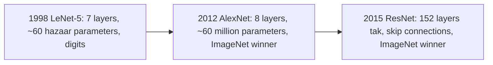
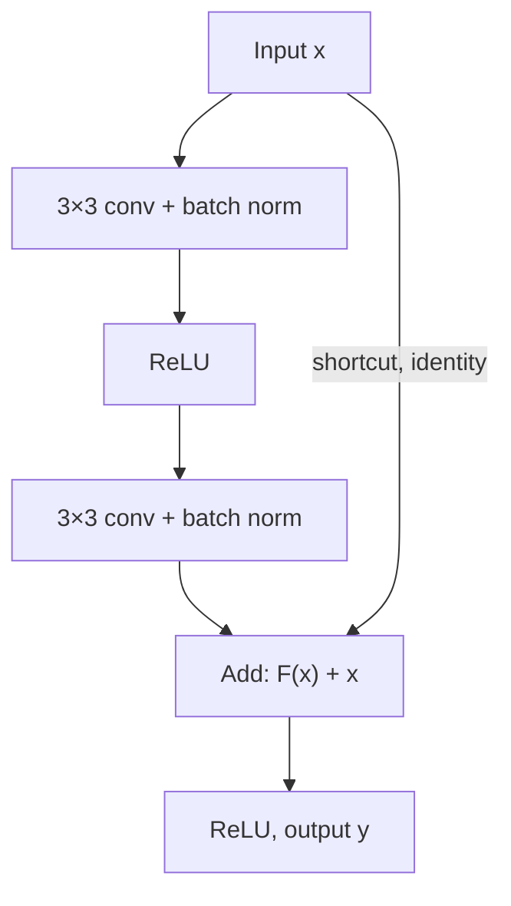

Naye ideas se pehle, purane ideas jo chahiye wo yahan hain. Agar pehle se aate hain to agle section pe chale jao. Convolutional neural networks wala note in sabko detail mein samjhata hai.

## Pehle basics

- **Convolutional layer** apne input pe chhote learned **filters** slide karti hai. Har filter ek **feature map** deta hai.
- **Output size.** Filter edge ke bahar nahi latak sakta, isliye output input se thoda chhota hota hai; padding zeros ka border add karke size bachaati hai, aur bada stride (step) size ko jaldi chhota karta hai. Symbols mein: $O = (N - F + 2P)/S + 1$, jahan $N$ input size, $F$ filter size, $P$ padding aur $S$ stride hai. Ye sirf calculation questions mein chahiye.
- **Pooling** har feature map ko chhota karta hai (chhote blocks ka max ya average) aur iske koi parameters nahi hote.
- **ReLU** positive values rakhta hai aur negatives ko 0 kar deta hai. **tanh** aur **sigmoid** S-shaped curves hain jo bade inputs pe flat ho jaate hain ("saturate"), wahan slope almost zero hota hai, isliye learning slow ho jaati hai.
- **Dropout** training ke dauraan random neurons ko off kar deta hai taaki overfitting kam ho. **Batch normalization** har layer ki values ko average 0 aur spread 1 pe rescale karta hai, jisse training fast aur stable hoti hai.
- **ImageNet (ILSVRC)** ek yearly contest tha (2010 se 2017) jisme lagbhag 1.2 million training images aur 1000 classes thi. **Top-5 error** un test images ka fraction hai jinki sahi class network ke paanch best guesses mein nahi hai.

## Named architectures kyun seekhein?

**Architecture** network ka poora plan hai: kaun si layers, kis order mein, kis size ki. Har famous architecture ek milestone hai jisne poocha "ab aage kaise badhein?"

**Everyday analogy.** Cars ki history socho. Ek early car ne prove kiya ki idea kaam karta hai. Baad wali car mein bahut bada engine aur better tyres lage aur wo har race jeeti. Modern car mein ek clever naya part aaya (jaise power steering) jisne pehle impossible cheez ko easy bana diya. LeNet ne prove kiya ki CNNs kaam karte hain, AlexNet ne unhe bada aur fast banaya, aur ResNet ne wo shortcut add kiya jisse bahut deep networks train ho sake. Ye syllabus <Syl m="4" /> hai, CNN module ka last topic. <Cite id="gfdl-ch9" loc="§9.11" />

## LeNet-5 (1998)

**Ye kya hai.** LeNet-5 sabse pehle successful convolutional neural networks mein se ek hai, jise Yann LeCun aur unke colleagues ne AT&amp;T mein handwritten digits (MNIST dataset) aur bank cheques padhne ke liye banaya. <Cite id="lecun1998" />

**Ye kyun zaroori tha.** Pehle ke digit readers hand-designed features use karte the, jo handwriting badalte hi toot jaate the. LeNet ne apne features seedha pixels se seekhe, aur weight sharing use kiya taaki network 1990s ke computers ke liye kaafi chhota rahe. Goodfellow batate hain ki 1990s ke end tak aise networks pe based ek system US ke 10% se zyada cheques padh raha tha. <Cite id="gfdl-ch9" loc="§9.11" />

**Ye kaise kaam karta hai, step by step.** Paper layers ko C (convolution), S (subsampling) aur F (fully connected) naam deta hai. Input ko chhod ke saat layers mein weights hain. Idea simple hai: shuru ki layers chhote strokes dhoondhti hain, beech ki layers strokes ko shapes mein jodti hain, aur last layers decide karti hain ki shapes kaun sa digit banate hain.

1. **Input:** ek 32×32 grayscale image.
2. **C1:** 5×5 ke 6 filters simple strokes aur edges dhoondhte hain, 28×28 ke 6 maps dete hain.
3. **S2:** 2×2 subsampling har map ko aadha karke 14×14 kar deta hai.
4. **C3:** 5×5 ke 16 filters strokes ko shapes mein jodte hain, 10×10 ke 16 maps dete hain.
5. **S4:** subsampling unhe aadha karke 5×5 kar deta hai.
6. **C5:** 5×5 ke 120 filters poore 5×5 map ko cover karte hain, 120 numbers dete hain.
7. **F6:** 84 units ki ek fully connected layer.
8. **Output:** 10 units, har digit ke liye ek.

```mermaid
%% caption: LeNet-5 left se right, har layer ke baad data ke size ke saath. Convolution aur subsampling do baar alternate hote hain, phir teen layers classification karti hain.
flowchart LR
  A["Input 32×32×1"] --> B["C1 conv 5×5, 6 maps: 28×28×6"]
  B --> C["S2 subsample 2×2: 14×14×6"]
  C --> D["C3 conv 5×5, 16 maps: 10×10×16"]
  D --> E["S4 subsample 2×2: 5×5×16"]
  E --> F["C5 conv 5×5: 120"]
  F --> G["F6 fully connected: 84"]
  G --> H["Output: 10 digits"]
```

| Layer | What it does | Output | Trainable parameters (from the paper) |
|---|---|---|---|
| Input | Grayscale image | 32×32×1 | 0 |
| C1 | 5×5 ke 6 filters, stride 1 | 28×28×6 | 156 |
| S2 | 2×2 subsampling, stride 2 | 14×14×6 | 12 |
| C3 | 5×5 ke 16 filters, har ek sirf kuch S2 maps se connected | 10×10×16 | 1,516 |
| S4 | 2×2 subsampling, stride 2 | 5×5×16 | 32 |
| C5 | 5×5 ke 120 filters, saare 16 maps pe | 1×1×120 | 48,120 |
| F6 | Fully connected | 84 | 10,164 |
| Output | 10 RBF units, har digit ka ek | 10 | haath se fixed (count nahi) |

Ye milke paper ke "about 60,000 trainable free parameters" bante hain. Output layer count nahi hoti kyunki har unit ka pattern haath se choose kiya gaya tha, seekha nahi gaya. <Cite id="lecun1998" />

**Special features (words mein).**

- **Trainable subsampling, aaj wala pooling nahi.** Har S unit apne chaar inputs add karta hai, ek learned coefficient se multiply karta hai, ek learned bias add karta hai aur sigmoid-type function lagata hai. Ye scaled average pooling jaisa behave karta hai.
- **C3 mein partial connections.** Har C3 map sirf kuch S2 maps dekhta hai. Paper do reasons deta hai: kam connections, aur alag maps ko alag features seekhne pe majboor karna.
- **Activation:** ek scaled tanh (S-shaped curve), ReLU nahi.
- **Output:** 10 Euclidean RBF units, har ek naapta hai ki 84 numbers uske digit ke stored pattern se kitne door hain. Modern versions 10-way softmax use karte hain.
- **Result:** MNIST pe 0.95% test error, aur 0.8% jab images ki extra distorted copies se train kiya (data augmentation). <Cite id="lecun1998" />

<Box kind="pitfall">

Bahut saare tutorials LeNet-5 ko ReLU, max pooling aur softmax ke saath draw karte hain. Ye modern substitutions hain. 1998 ka paper scaled tanh, trainable subsampling aur RBF outputs use karta hai. Exam mein dono version pe marks milte hain agar tum batao ki kaun sa draw kar rahe ho. D2L, example ke liye, sigmoid aur average pooling use karta hai, jo us time ke common choices the. <Cite id="d2l-lenet" />

</Box>

**Advantages.** Chhota aur fast (lagbhag 60 hazaar parameters); apne features khud seekhe; weight sharing ne compact rakha; digits pe bahut accurate.

**Disadvantages.** Chhoti grayscale images ke liye design hua; 1000 classes wali badi colour photos ke liye bahut chhota; tanh-type activations slowly train hote hain; 1998 mein computers isse bahut bade versions train nahi kar sakte the.

**Applications.** Handwritten digit recognition, bank cheque reading, postal ZIP code reading. Aaj ye CNN ka standard teaching example hai. <Cite id="gfg-lenet" /> <Cite id="av-lenet" />

**Sum 1: LeNet-5 sizes aur parameters.** Theory question ("Describe LeNet") mein iski zaroorat nahi. Sirf tab use karo jab question sizes ya parameters calculate karne ko bole.

<Sum>

<Given>

32×32×1 input; har convolution 5×5 filters, stride 1, no padding use karta hai; har subsampling 2×2 windows, stride 2 use karta hai; C1 mein 6 filters, C3 mein 16, C5 mein 120; F6 mein 84 units. Output size rule $O = (N - F + 2P)/S + 1$.

</Given>

<Find>

C1, S2, C3, S4 aur C5 ka output size, aur C1, C5 aur F6 ke trainable parameters.

</Find>

<Steps>

1. **C1 size.** $(32 - 5 + 0)/1 + 1 = 27 + 1 = 28$, toh 28×28×6. 5×5 filter 32 pixels mein sirf 28 positions pe fit hota hai; 6 filters 6 maps dete hain.
2. **S2 size.** $(28 - 2)/2 + 1 = 13 + 1 = 14$, toh 14×14×6. Subsampling size aadha karta hai aur maps ki ginti same rakhta hai.
3. **C3 size.** $(14 - 5)/1 + 1 = 9 + 1 = 10$, toh 10×10×16. C1 wala hi filter rule, ab 16 filters ke saath.
4. **S4 size.** $(10 - 2)/2 + 1 = 4 + 1 = 5$, toh 5×5×16. Phir se aadha.
5. **C5 size.** $(5 - 5)/1 + 1 = 0 + 1 = 1$, toh 1×1×120. 5×5 filter poore 5×5 map ko cover karta hai, isliye har filter ek number deta hai.
6. **C1 parameters.** Har filter mein $5 \times 5 \times 1 = 25$ weights plus 1 bias, toh 26. Chhe filters: $6 \times 26 = 156$. Input mein ek hi channel hai, isliye har filter 5×5×1 hai.
7. **C5 parameters.** Har filter S4 ke saare 16 maps dekhta hai: $5 \times 5 \times 16 = 400$ weights plus 1 bias, toh 401. Phir $120 \times 401 = 48{,}120$. Har filter ko har input map cover karna padta hai.
8. **F6 parameters.** 84 units mein se har ek C5 ki saari 120 values se connected hai, plus 1 bias, toh 121. Phir $84 \times 121 = 10{,}164$. Fully connected unit mein har input ka ek weight hota hai.

</Steps>

<Answer>

sizes 28×28×6 → 14×14×6 → 10×10×16 → 5×5×16 → 1×1×120; parameters C1 = 156, C5 = 48,120, F6 = 10,164.

</Answer>

<Box kind="verify">

Sizes ko ek pattern se check karo: bina padding ka 5×5 filter hamesha size se 4 kam karta hai ($32 - 4 = 28$, $14 - 4 = 10$, $5 - 4 = 1$), aur 2×2 stride-2 window hamesha aadha karta hai ($28 / 2 = 14$, $10 / 2 = 5$). Dono steps se match karte hain. Parameters ko paper ke total se check karo: table ki har layer add karo,

$$
156 + 12 + 1{,}516 + 32 + 48{,}120 + 10{,}164
$$

Order mein: $156 + 12 = 168$; $168 + 1{,}516 = 1{,}684$; $1{,}684 + 32 = 1{,}716$; $1{,}716 + 48{,}120 = 49{,}836$; $49{,}836 + 10{,}164 = 60{,}000$. Ye bilkul paper ka "about 60,000" hai, toh teeno counts fit baithte hain.

</Box>

</Sum>

Exam mein English mein likho: "LeNet-5 has about 60,000 trainable parameters, most of them (48,120) in layer C5."

## AlexNet (2012)

**Ye kya hai.** AlexNet ek deep CNN hai jise Alex Krizhevsky, Ilya Sutskever aur Geoffrey Hinton ne banaya. Isne ILSVRC-2012 **15.3%** top-5 test error ke saath jeeta, jabki second-best entry ka **26.2%** tha. Goodfellow is jeet ko deep learning mein aaj ke strong commercial interest ki shuruaat maante hain. <Cite id="krizhevsky2012" /> <Cite id="gfdl-ch9" loc="§9.11" />

**Ye kyun zaroori tha.** LeNet chhoti digit images pe kaam karta tha, par ImageNet mein 1000 classes ki ek million se zyada badi colour photos hain. Iske liye bahut bada network chahiye tha, aur bade network ne do nayi problems laayi: bahut slow training aur heavy overfitting. AlexNet ke naye ideas bilkul inhi do problems ko solve karte hain.

**Ye kaise kaam karta hai (architecture).** Weights wali 8 layers: **5 convolutional** aur **3 fully connected**, end mein 1000-way softmax. Lagbhag **60 million parameters** aur 650,000 neurons. Pehli conv layers edges aur colour blobs dhoondhti hain, deeper layers textures aur object parts dhoondhti hain, aur fully connected layers in parts ko jodke class decide karti hain. Table common single-GPU description use karti hai, 227×227×3 input ke saath.

| Layer | Setting | Output |
|---|---|---|
| Input | Colour image | 227×227×3 |
| Conv1 + ReLU | 96 filters, 11×11, stride 4 | 55×55×96 |
| Normalization + max pool | 3×3, stride 2 | 27×27×96 |
| Conv2 + ReLU | 256 filters, 5×5, pad 2 | 27×27×256 |
| Normalization + max pool | 3×3, stride 2 | 13×13×256 |
| Conv3 + ReLU | 384 filters, 3×3, pad 1 | 13×13×384 |
| Conv4 + ReLU | 384 filters, 3×3, pad 1 | 13×13×384 |
| Conv5 + ReLU | 256 filters, 3×3, pad 1 | 13×13×256 |
| Max pool | 3×3, stride 2 | 6×6×256 = 9216 values |
| FC6 + ReLU + dropout | 4096 units | 4096 |
| FC7 + ReLU + dropout | 4096 units | 4096 |
| FC8 + softmax | 1000 classes | 1000 |

```mermaid
%% caption: AlexNet. Paanch convolution layers features dhoondhti hain, 1st, 2nd aur 5th ke baad max pooling. Teen fully connected layers, do dropout ke saath, decision leti hain.
flowchart LR
  A["Input 227×227×3"] --> B["Conv1 11×11 stride 4, 96 + pool"]
  B --> C["Conv2 5×5, 256 + pool"]
  C --> D["Conv3 3×3, 384"]
  D --> E["Conv4 3×3, 384"]
  E --> F["Conv5 3×3, 256 + pool"]
  F --> G["FC6 4096 + dropout"]
  G --> H["FC7 4096 + dropout"]
  H --> I["FC8 1000 softmax"]
```

<Box kind="pitfall">

Paper kehta hai input 224×224×3 hai, par 11×11 filter aur stride 4 ke saath sizes sirf 227×227 se sahi aate hain; 224 ke saath padding kuch bhi ho, whole number nahi aata. CS231n ye mismatch point out karta hai. Size calculation dikhate waqt 227 use karo aur iska mention karo. <Cite id="cs231n-cnn" />

</Box>

**Kya naya tha, aur har idea ne kyun help kiya.** <Cite id="krizhevsky2012" />

1. **tanh ki jagah ReLU.** ReLU positive inputs pe saturate nahi hota, isliye gradients bade rehte hain aur learning fast hoti hai. Paper report karta hai ki ReLU network ne CIFAR-10 pe 25% training error, same tanh network se lagbhag chhe guna fast reach kiya.
2. **Do GPUs pe training.** Har GTX 580 GPU mein sirf 3 GB memory thi, isliye network ko do GPUs mein split kiya gaya. Training mein paanch se chhe din lage.
3. **Local response normalization** pehli do conv layers ke baad, jisse neighbouring feature maps compete kar sake. Aaj ye rarely use hota hai (batch normalization ne iski jagah le li).
4. **Overlapping max pooling:** stride 2 ke saath 3×3 windows, toh neighbouring windows overlap karti hain. Isne non-overlapping 2×2 windows ke comparison mein error thoda kam kiya.
5. **Dropout** probability 0.5 ke saath pehli do fully connected layers mein. Iske bina network bahut overfit karta tha. <Cite id="srivastava2014" />
6. **Data augmentation:** 256×256 images se random 224×224 crops, horizontal flips, aur colour intensity mein changes, taaki network bahut zyada varied training images dekhe.

**Parameters kahan hain (analysis).** Paanch conv layers mein sirf lagbhag 3.7 million parameters hain; teen fully connected layers mein lagbhag 58.6 million (akele FC6 mein lagbhag 37.8 million). Toh **AlexNet ke zyada tar parameters fully connected layers mein hain**, isiliye dropout wahan lagaya gaya. Conv layers saste hain kyunki ek chhota filter har position pe reuse hota hai (weight sharing); fully connected layer ko har input-output pair ke liye alag weight chahiye. (Ye single-GPU version total lagbhag 62.4 million hai; paper ka "60 million" thoda kam hai kyunki kuch layers do GPUs mein split thi.) Neeche Sum 3 ye count dikhata hai.

**Everyday analogy.** LeNet ek bicycle tha. AlexNet wahi basic design tha jo motorbike ban gaya: bahut bada engine (60 million parameters), better fuel (ReLU), powerful workshop (GPUs) aur overfitting ke against achhe brakes (dropout aur augmentation).

**Advantages.** Real photos pe accuracy mein huge jump; dikhaya ki GPUs pe trained deep CNNs hand-designed features ko hara dete hain; ReLU, dropout aur augmentation ko standard tools banaya.

**Disadvantages.** Bahut bada aur memory-hungry, zyada tar FC layers ki wajah se; pehli layer mein bade 11×11 filters (baad mein VGG jaise networks mein chhote 3×3 filters ke stacks se replace hue); local response normalization zyada useful nahi nikla; sirf 8 layers, toh abhi bhi kaafi shallow.

**Applications.** Large-scale image classification, aur pretrained feature extractor ki tarah (transfer learning) object detection aur medical images jaise tasks ke liye. <Cite id="d2l-alexnet" /> <Cite id="gfg-alexnet" /> <Cite id="av-alexnet" />

**Sum 2: AlexNet output sizes.** Sirf un questions ke liye jo sizes calculate karne ko bolein.

<Sum>

<Given>

227×227×3 input aur upar wali table ki layer settings. Output size rule $O = (N - F + 2P)/S + 1$.

</Given>

<Find>

last pooling tak har layer ke baad output size, aur FC6 ko kitni values jaati hain.

</Find>

<Steps>

1. **Conv1.**

   $$
   \begin{aligned}
   (227 - 11 + 0)/4 + 1 &= 216/4 + 1 \\
   &= 54 + 1 \\
   &= 55
   \end{aligned}
   $$

   toh 55×55×96. Bada 11×11 filter stride 4 ke saath image ko jaldi chhota karta hai; 96 filters 96 maps dete hain.
2. **Pool1.** $(55 - 3)/2 + 1 = 52/2 + 1 = 26 + 1 = 27$, toh 27×27×96. Pooling maps ki ginti same rakhta hai.
3. **Conv2.**

   $$
   (27 - 5 + 2 \times 2)/1 + 1 = 26 + 1 = 27
   $$

   toh 27×27×256. Padding 2 bilkul 5×5 filter ki kami poori karta hai, isliye size same rehta hai.
4. **Pool2.** $(27 - 3)/2 + 1 = 12 + 1 = 13$, toh 13×13×256.
5. **Conv3, Conv4, Conv5.** Har baar

   $$
   (13 - 3 + 2 \times 1)/1 + 1 = 12 + 1 = 13
   $$

   toh 13×13×384, 13×13×384 aur 13×13×256. Padding 1 3×3 filter ki kami poori karta hai.
6. **Pool3.** $(13 - 3)/2 + 1 = 5 + 1 = 6$, toh 6×6×256.
7. **FC6 ke liye flatten.**

   $$
   \begin{aligned}
   6 \times 6 \times 256 &= 36 \times 256 \\
   &= 9{,}216
   \end{aligned}
   $$

   FC6 ko numbers ki ek lambi list chahiye.

</Steps>

<Answer>

55×55×96 → 27×27×96 → 27×27×256 → 13×13×256 → 13×13×384 → 13×13×384 → 13×13×256 → 6×6×256, toh FC6 ko 9,216 values milti hain.

</Answer>

<Box kind="verify">

Ulta chalo: output $O$ dene wala input size $(O - 1) \times S + F - 2P$ hai. Conv1: $(55 - 1) \times 4 + 11 = 216 + 11 = 227$, given input. Pool1: $(27 - 1) \times 2 + 3 = 55$. Pool2: $(13 - 1) \times 2 + 3 = 27$. Pool3: $(6 - 1) \times 2 + 3 = 13$. Har layer apne pehle wale size pe wapas map hoti hai, toh forward sizes sahi hain. Agar 224 try karo, Conv1 $(224 - 11)/4 + 1 = 54.25$ deta hai, jo whole number nahi hai; yahi upar pitfall wala mismatch hai.

</Box>

</Sum>

**Sum 3: AlexNet ke parameters kahan hain.** Sirf un questions ke liye jo parameters count karne ko bolein.

<Sum>

<Given>

table wala single-GPU AlexNet. Conv layer mein har filter ke (filter height × filter width × input channels + 1 bias) parameters hote hain. Fully connected layer mein har unit ke (inputs ki ginti + 1 bias) parameters hote hain.

</Given>

<Find>

conv layers, FC layers aur total mein parameters.

</Find>

<Steps>

1. **Conv1.** $11 \times 11 \times 3 = 363$ weights + 1 = 364 per filter; $96 \times 364 = 34{,}944$. Input mein 3 colour channels hain.
2. **Conv2.** $5 \times 5 \times 96 = 2{,}400$ + 1 = 2,401; $256 \times 2{,}401 = 614{,}656$. Iske input mein 96 maps hain.
3. **Conv3.** $3 \times 3 \times 256 = 2{,}304$ + 1 = 2,305; $384 \times 2{,}305 = 885{,}120$.
4. **Conv4.** $3 \times 3 \times 384 = 3{,}456$ + 1 = 3,457; $384 \times 3{,}457 = 1{,}327{,}488$.
5. **Conv5.** Phir se 3,457 per filter (input 384 maps hai); $256 \times 3{,}457 = 884{,}992$.
6. **Saari conv layers.** Paanchon layers ke totals jodo:

   $$
   34{,}944 + 614{,}656 + 885{,}120 + 1{,}327{,}488 + 884{,}992 = 3{,}747{,}200
   $$

   (lagbhag 3.7 million).
7. **FC6.**

   $$
   \begin{aligned}
   4{,}096 \times (9{,}216 + 1) &= 4{,}096 \times 9{,}217 \\
   &= 37{,}752{,}832
   \end{aligned}
   $$

   Har unit Sum 2 ki saari 9,216 values dekhta hai.
8. **FC7.**

   $$
   4{,}096 \times (4{,}096 + 1) = 16{,}781{,}312
   $$

   Har unit ke 4,096 inputs aur ek bias hain.
9. **FC8.**

   $$
   1{,}000 \times (4{,}096 + 1) = 4{,}097{,}000
   $$

   Har output unit ke 4,096 inputs aur ek bias hain.
10. **Saari FC layers.** Teeno FC totals jodo:

    $$
    37{,}752{,}832 + 16{,}781{,}312 + 4{,}097{,}000 = 58{,}631{,}144
    $$

    (lagbhag 58.6 million).
11. **Total.** Conv aur FC parts jodo, toh poore network ke parameters milte hain:

    $$
    3{,}747{,}200 + 58{,}631{,}144 = 62{,}378{,}344
    $$

    (lagbhag 62.4 million).

</Steps>

<Answer>

conv layers lagbhag 3.7 million, FC layers lagbhag 58.6 million, total lagbhag 62.4 million parameters, toh lagbhag 94% ($58.6 / 62.4$) fully connected layers mein hain.

</Answer>

<Box kind="verify">

Weights aur biases alag count karo, phir add karo. Conv weights:

$$
34{,}848 + 614{,}400 + 884{,}736 + 1{,}327{,}104 + 884{,}736 = 3{,}745{,}824
$$

conv biases (har filter ka ek): $96 + 256 + 384 + 384 + 256 = 1{,}376$; milke $3{,}747{,}200$, step 6 jaisa hi. FC weights:

$$
\begin{aligned}
9{,}216 \times 4{,}096 + 4{,}096 \times 4{,}096 + 4{,}096 \times 1{,}000 &= 37{,}748{,}736 + 16{,}777{,}216 + 4{,}096{,}000 \\
&= 58{,}621{,}952
\end{aligned}
$$

FC biases: $4{,}096 + 4{,}096 + 1{,}000 = 9{,}192$; milke $58{,}631{,}144$, step 10 jaisa hi. Total bhi paper ke "60 million" ke paas hai, jaisa single-GPU version ke liye expected hai.

</Box>

</Sum>

Exam mein English mein likho: "Most of AlexNet's parameters (about 58.6 million of 62.4 million) are in the fully connected layers, so dropout is applied there."

## ResNet (2015)

**Ye kya hai.** ResNet (residual network), Kaiming He aur unke colleagues ne Microsoft Research mein banaya, ek bahut deep CNN hai jo **residual blocks** se bana hai: layers ke chhote groups jinme ek **skip connection** hota hai jo input ko layers ke around le jaake unke output mein add kar deta hai. <Cite id="he2015" />

**Ye kyun zaroori tha: degradation problem.** AlexNet ke baad, deeper networks better hote gaye; 2014 ki best ImageNet entries (VGG aur GoogLeNet) mein lagbhag 16 se 22 layers thi. Phir He aur colleagues ne dikhaya ki jab ek plain network ko deeper banaya jaata hai (jaise 18 se 34 layers), accuracy pehle saturate hoti hai aur phir **kharab** ho jaati hai, aur ye overfitting ki wajah se nahi: **training** error khud badh jaata hai. Isse unhone **degradation problem** kaha.

Ye ajeeb kyun hai? Ek achha shallow network lo aur extra layers add karo jo bas apna input copy karti hain (**identity mapping**). Ye deeper network bilkul same answers dega, toh deeper network kabhi worse nahi hona chahiye. Training ko aisa solution nahi mil paaya, iska matlab plain stacked layers ko "kuch mat karo" seekhna bhi mushkil lagta hai.

**Ye kaise kaam karta hai: sirf change seekho.** Kuch layers se poora desired output seekhne ko kehne ki jagah, ResNet unse sirf **residual** seekhne ko kehta hai (wo correction jo input mein add karna hai), aur phir shortcut se input wapas add kar deta hai. Words mein: output = layers ne jo seekha + original input. Formula ki tarah (har textbook mein hai, toh exam mein likho):

$$
y = F(x) + x
$$

$x$ block ka input hai, $F(x)$ block ki layers ka output hai (aam taur pe batch normalization aur ReLU ke saath do 3×3 convolutions), aur $y$ block ka output hai. Agar kuch na karna best hai, toh layers ko bas $F(x)$ ko zero pe push karna hai, jo easy hai. Identity shortcut **koi extra parameters add nahi karta**. <Cite id="he2015" />

**Gradients better kyun flow karte hain (words mein).** Backpropagation ke dauraan gradient shortcut se seedha wapas ja sakta hai, layers se guzre bina, toh agar layers wala gradient bahut chhota bhi ho jaaye, signal ka kuch hissa phir bhi early layers tak pahunchta hai. Isse vanishing-gradient problem kam hoti hai. <Cite id="d2l-resnet" />

**Everyday analogy.** Essay improve karne wala editor blank page se dobara nahi likhta. Wo essay ko jaisa hai waise leta hai aur sirf corrections mark karta hai. Agar essay already perfect hai, toh kuch mark nahi karta. Har residual block aisa hi editor hai.

**Jab sizes match na karein.** Agar block channels ki ginti badalta hai ya height aur width aadhi karta hai, toh $x$ aur $F(x)$ seedha add nahi ho sakte. Tab shortcut ek **projection** use karta hai: ek 1×1 convolution (size aadha ho to stride 2 ke saath) jo $x$ ko match karne ke liye reshape karta hai. <Cite id="he2015" />

**Poora network (ResNet-34), step by step.**

1. 7×7 convolution, 64 filters, stride 2 (224 → 112).
2. 3×3 max pool, stride 2 (112 → 56).
3. Stage 1: 64 filters wale 3 residual blocks (56×56).
4. Stage 2: 128 filters wale 4 blocks (28×28). Pehla block size aadha karne ke liye stride 2 use karta hai.
5. Stage 3: 256 filters wale 6 blocks (14×14).
6. Stage 4: 512 filters wale 3 blocks (7×7).
7. Global average pooling, phir 1000 outputs aur softmax wali ek fully connected layer.

Layers ginna: $3 + 4 + 6 + 3 = 16$ blocks, har ek mein 2 convolutions, toh 32, plus pehla conv aur last FC: $32 + 1 + 1 = 34$. Simple rule: jab bhi size aadha hota hai, filters ki ginti double hoti hai. Batch normalization har convolution ke turant baad, activation se pehle use hota hai. <Cite id="he2015" /> <Cite id="ioffe2015" />

**Types (variants).** **ResNet-18 aur ResNet-34** upar dikhaya basic two-layer block use karte hain. **ResNet-50, 101 aur 152** ek **bottleneck block** use karte hain: ek 1×1 convolution channels kam karta hai, ek 3×3 convolution chhote block pe kaam karta hai, aur ek aur 1×1 convolution channels wapas badha deta hai. Isme 256 channels pe do full 3×3 convolutions se lagbhag 17 guna kam weights lagte hain (Sum 4), toh bahut deep networks affordable rehte hain.

**Results.** 152 layers tak deep networks, VGG se 8 guna deeper par kam complexity ke saath. Ek ensemble ne **3.57% top-5 error** reach kiya aur **ILSVRC 2015** jeeta. <Cite id="he2015" /> <Cite id="gfg-resnet" />

**Advantages.** Bahut deep networks (100+ layers) trainable ho jaate hain; degradation solve karta hai aur vanishing gradients kam karta hai; shortcuts koi parameters add nahi karte; global average pooling bade FC layers se bachata hai; residual idea lagbhag har baad wali architecture mein reuse hota hai.

**Disadvantages.** Bahut layers matlab lambi training aur chhote devices pe slow inference; bahut deep versions mein kuch layers kam contribute karti hain (near-zero residuals seekhti hain); shapes badalne pe projection shortcuts kuch parameters add karte hain.

**Applications.** Image classification, object detection aur segmentation backbones (jaise Faster R-CNN aur Mask R-CNN mein), face recognition, medical imaging, aur transfer learning. <Cite id="wiki-resnet" />

**Sum 4: bottleneck block sasta kyun hai.** Sirf un questions ke liye jo blocks ki cost compare karne ko bolein.

<Sum>

<Given>

ek block jiske input aur output mein 256 channels hain. Basic version: do 3×3 convolutions, 256 → 256 → 256. Bottleneck version: 1×1 (256 → 64), 3×3 (64 → 64), 1×1 (64 → 256). Ek conv layer ke weights = filter height × filter width × input channels × output channels. Biases chhod diye kyunki ResNet har convolution ke baad unki jagah batch normalization lagata hai.

</Given>

<Find>

har version ke weights aur bottleneck ko kitne guna kam chahiye.

</Find>

<Steps>

1. **Ek basic 3×3 layer.**

   $$
   \begin{aligned}
   3 \times 3 \times 256 \times 256 &= 9 \times 65{,}536 \\
   &= 589{,}824
   \end{aligned}
   $$

   256 filters mein se har ek 3×3×256 hai.
2. **Basic block (do layers).** Block mein do aisi layers hain, toh ek ko double karo: $2 \times 589{,}824 = 1{,}179{,}648$.
3. **Bottleneck 1×1 shrink.**

   $$
   1 \times 1 \times 256 \times 64 = 16{,}384
   $$

   1×1 filter sirf channels mix karta hai, isliye sasta hai.
4. **Bottleneck 3×3 middle.**

   $$
   \begin{aligned}
   3 \times 3 \times 64 \times 64 &= 9 \times 4{,}096 \\
   &= 36{,}864
   \end{aligned}
   $$

   Mehnga 3×3 ab sirf 64 channels pe kaam karta hai.
5. **Bottleneck 1×1 expand.**

   $$
   1 \times 1 \times 64 \times 256 = 16{,}384
   $$

   Ye channels wapas 256 karta hai taaki shortcut add kar sake.
6. **Bottleneck block total.** Teeno layers jodo:

   $$
   16{,}384 + 36{,}864 + 16{,}384 = 69{,}632
   $$
7. **Ratio.** Basic total ko bottleneck total se divide karo: $1{,}179{,}648 / 69{,}632 \approx 16.9$.

</Steps>

<Answer>

basic block 1,179,648 weights, bottleneck block 69,632 weights, toh bottleneck ko lagbhag 17 guna kam chahiye.

</Answer>

<Box kind="verify">

Common factor $64 \times 64 = 4{,}096$ bahar nikalo. Basic:

$$
\begin{aligned}
2 \times 9 \times 256 \times 256 &= 4{,}096 \times (2 \times 9 \times 4 \times 4) \\
&= 4{,}096 \times 288
\end{aligned}
$$

Bottleneck:

$$
4{,}096 \times (4 + 9 + 4) = 4{,}096 \times 17
$$

Ratio $288 / 17 \approx 16.9$ hai, step 7 jaisa hi. Saath hi $4{,}096 \times 17 = 69{,}632$ aur $4{,}096 \times 288 = 1{,}179{,}648$, steps 6 aur 2 se match.

</Box>

</Sum>

## Teeno ka comparison

| | LeNet-5 (1998) | AlexNet (2012) | ResNet (2015) |
|---|---|---|---|
| Task | Handwritten digits, 32×32 grayscale | ImageNet, 1000 classes, colour | ImageNet, 1000 classes, colour |
| Depth (weighted layers) | 7 | 8 (5 conv + 3 FC) | 18 se 152 (basic example mein 34) |
| Size | Lagbhag 60 hazaar parameters | Lagbhag 60 million parameters | Paper cost report karta hai, parameters nahi: ResNet-34 ke liye 3.6 billion FLOPs, VGG-19 ka 18% |
| Activation | Scaled tanh | ReLU | ReLU |
| Pooling | Trainable average-like subsampling | Overlapping max pooling 3×3, stride 2 | Shuru mein ek max pool, end mein global average pool |
| Key new idea | Convolution + weight sharing + backprop | ReLU, dropout, GPUs, augmentation | Skip connections, batch norm, very deep |
| End of the network | FC layers (120, 84) aur 10 outputs | Teen bade FC layers | Global average pool + ek FC |
| Main limit | Real photos ke liye bahut chhota | Bade FC layers, memory-hungry | Lambi training, bahut layers |

<Box kind="pitfall">

"Deeper" ka matlab "zyada parameters" nahi hai. ResNet-152 VGG se 8 guna deeper hai par kam complexity wala, kyunki ye bade fully connected layers ki jagah chhote filters, bottleneck blocks aur global average pooling use karta hai. ResNet paper complexity FLOPs (multiply-adds) mein report karta hai, parameters mein nahi, toh ResNet ka parameter count tab tak quote mat karo jab tak question na de.

</Box>

<Box kind="exam">

"Draw and explain any two modern architectures" ke liye AlexNet aur ResNet sabse safe pair hai. Har ek ke liye: kyun banaya, block diagram, layers ki chhoti list, kya naya tha aur kyun help kiya, advantages aur limits. ResNet ke liye hamesha $y = F(x) + x$ likho aur residual block draw karo. Size aur parameter sums sirf tab chahiye jab question unhe maange.

</Box>

Kuch aur well-known architectures jinhe ek-ek line mein naam de sakte ho: **VGG** (ILSVRC 2014 runner-up, bahut regular design jo sirf 3×3 convolutions aur 2×2 pooling use karta hai, best version mein 16 layers) aur **GoogLeNet** (ILSVRC 2014 winner, "Inception modules" se bana aur sirf lagbhag 4 million parameters). <Cite id="cs231n-cnn" /> <Cite id="ibm-cnn" /> <Cite id="wiki-cnn" />

**Conclusion.** LeNet ne dikhaya ki CNN apne features khud seekh sakta hai, AlexNet ne dikhaya ki GPUs pe ReLU aur dropout wala bada CNN real photos pe hand-made features ko hara deta hai, aur ResNet ke skip connections ne 100+ layers wale networks trainable banaye; bahut se modern vision models in ideas pe based hain. <Cite id="nptel-dl" />

Exam mein English mein likho: "LeNet proved CNNs work, AlexNet made them large and fast with ReLU, dropout and GPUs, and ResNet made very deep networks trainable with skip connections."

## Ye kahan poocha gaya

| If the question says | What to write | Seen as |
|---|---|---|
| "Describe LeNET architecture" | Purpose, sizes ke saath step-by-step layers, diagram, subsampling aur tanh, ~60k parameters, MNIST result, advantages aur limits | <PYQ id="2023-12/q6a" /> |
| "Explain and analyze the architecture of AlexNet" | Kyun zaroori tha, layer table, diagram, chhe naye ideas aur har ek ne kyun help kiya, parameters kahan hain, advantages aur limits | <PYQ id="2024-12/q2b" /> |
| "Draw and explain any two modern deep learning architectures" | AlexNet aur ResNet: diagram, layers, key ideas, $y = F(x) + x$, comparison | <PYQ id="2025-05/q3a" /> |

## Quick revision

- LeNet-5: 32×32 → C1 (6@28×28) → S2 (6@14×14) → C3 (16@10×10) → S4 (16@5×5) → C5 (120) → F6 (84) → 10. Lagbhag 60k trainable parameters, scaled tanh. <Cite id="wiki-lenet" />
- AlexNet: 227×227×3 → 5 conv (11×11 stride 4 ke 96, 5×5 ke 256, 3×3 ke 384, 384, 256) → FC 4096, 4096, 1000. Lagbhag 60M parameters, zyada tar FC mein. <Cite id="wiki-alexnet" />
- AlexNet ke naye ideas: ReLU, do GPUs, local response normalization, overlapping max pooling, dropout, data augmentation. Top-5 error 15.3% vs 26.2%.
- ResNet: degradation problem → residual block $y = F(x) + x$; shapes alag hon to 1×1 projection; 50+ layers ke liye bottleneck blocks; 152 layers tak; 3.57% top-5 error, ILSVRC 2015.
- Skip connection gradient ko seedha wapas jaane ka raasta deta hai, isliye vanish hone ka chance kam hota hai.
