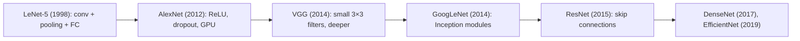
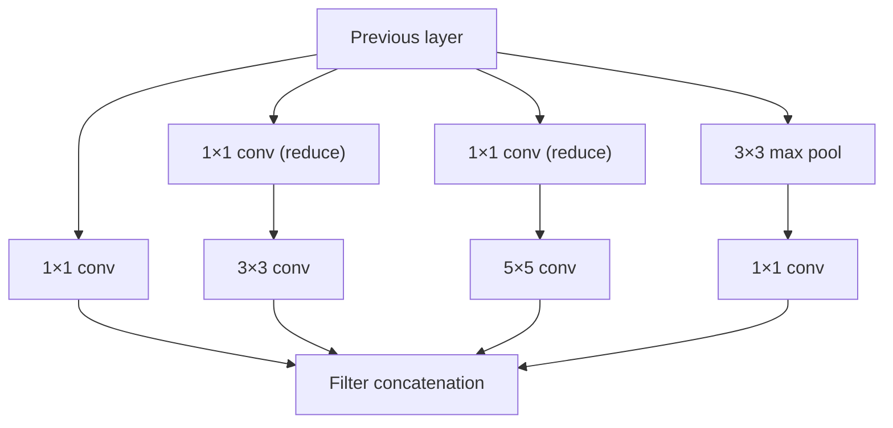
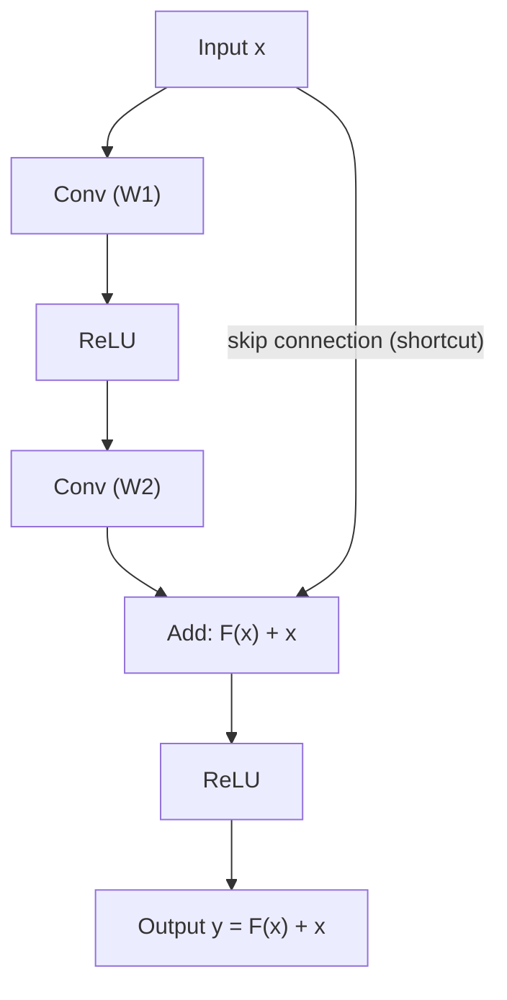
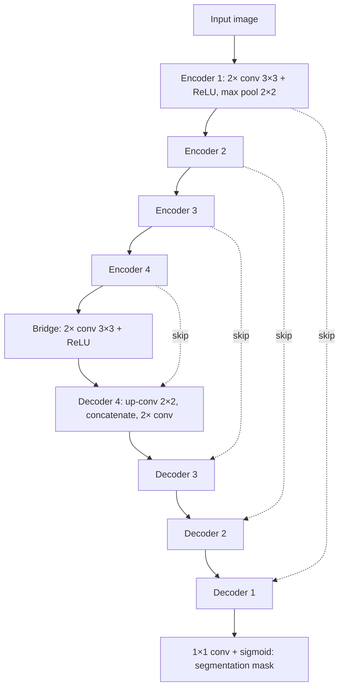

Naye ideas se pehle wo purani baatein jo chahiye. Agar aapko pata hai to seedha agle section par jao.

## Basics pehle

- **Convolution layer** chhote filters ko image par slide karta hai aur feature maps deta hai. Output size $= \lfloor (N - F + 2P)/S \rfloor + 1$ aur output depth = filters ki sankhya. Layer ke parameters $= (F \times F \times D + 1) \times K$. (CNN note dekho.) <Cite id="class-dl-chp4" loc="slide 19" /> <Cite id="class-dl-chp4" loc="slide 27" />
- **Pooling layer** height aur width kam karta hai, depth nahi. **Max pooling** har region ki sabse badi value rakhta hai, **average pooling** average. <Cite id="class-dl-chp4" loc="slide 31" />
- **Fully connected (FC) layer** har input ko har neuron se jodta hai. Aakhri layer **softmax** se class probabilities deti hai. <Cite id="class-dl-chp4" loc="slide 28" />
- **ReLU** positive values rakhta hai aur negative values ko 0 bana deta hai. **Dropout** training ke dauraan randomly neurons band karta hai taaki overfitting kam ho. **ImageNet** lagbhag 14 million images ka dataset hai jisme hazaar classes hain. <Cite id="class-dl-m4" loc="p. 54" />

## Named architectures kyun seekhein?

CNN ke kai architectures hain jo AI ko power dene wale algorithms banane mein key rahe hain: **LeNet, AlexNet, VGGNet, GoogLeNet, ResNet aur ZFNet.** Har ek ne ek naya idea diya jo baad ke saare networks use karte hain. <Cite id="class-dl-m4" loc="p. 41" />

## LeNet-5 (1998)

<Box kind="definition">

**LeNet-5** is a CNN architecture designed for handwritten digit recognition, which uses convolution, subsampling/pooling and fully connected layers to automatically learn features from images and classify them. <Cite id="class-dl-chp4" loc="slide 43" />

</Box>

**Ye kyun zaroori tha?** CNNs se pehle image recognition manually designed features par depend karti thi jaise edges, curves aur corners. LeNet ka idea: network ko ye features khud seekhne do. Handwritten image → CNN features seekhta hai → edges → curves → shapes → digit classification 0 se 9. <Cite id="class-dl-chp4" loc="slide 43" />

LeNet-5 pehla "famous" CNN architecture tha, LeCun et al. (1998) ne handwritten digits pehchanne ke liye banaya. LeCun aur unke saathiyon ne ek efficient architecture tak pahunchne mein ek dashak CNN models par kaam kiya. Isne deep learning researchers ko aaj ke efficient CNN models banane ke liye inspire kiya. <Cite id="class-dl-m4" loc="p. 43" />

**Input:** 32 × 32 grayscale image, yaani height = 32, width = 32 aur channels = 1. <Cite id="class-dl-chp4" loc="slide 43" /> <Cite id="class-dl-m4" loc="p. 44" />

### Architecture

Network mein **5 layers learnable parameters ke saath** hain, isliye naam LeNet-5. Ismein average pooling ke saath teen sets ki convolution layers hain, phir do fully connected layers, aur aakhir mein softmax classifier. <Cite id="class-dl-m4" loc="p. 44" />

**Layer by layer** <Cite id="class-dl-chp4" loc="slide 45" /> <Cite id="class-dl-m4" loc="p. 51" />

```mermaid
%% caption: Har layer ke baad shape ke saath LeNet-5. Convolutions zyada feature maps banate hain; subsampling size aadha karta hai; aakhri layers classify karti hain.
flowchart LR
  A["Input 32×32×1"] --> B["C1: 6 filters 5×5 → 28×28×6"]
  B --> C["S2: average pool 2×2 → 14×14×6"]
  C --> D["C3: 16 filters 5×5 → 10×10×16"]
  D --> E["S4: average pool 2×2 → 5×5×16"]
  E --> F["C5: 120 filters 5×5 → 1×1×120"]
  F --> G["F6: fully connected 84"]
  G --> H["Output: 10 (softmax)"]
```

| Layer | Operation | Input | Filters / neurons | Filter size | Output | What it learns |
|---|---|---|---|---|---|---|
| Input | Image | – | – | – | 32×32×1 | Raw pixel values |
| C1 | Convolution (tanh) | 32×32×1 | 6 | 5×5 | 28×28×6 | Edges, lines, curves |
| S2 | Subsampling (average pooling) | 28×28×6 | – | 2×2, stride 2 | 14×14×6 | Downsamples, keeps important information |
| C3 | Convolution (tanh) | 14×14×6 | 16 | 5×5 | 10×10×16 | Edges ko shapes aur corners mein combine karta hai |
| S4 | Subsampling | 10×10×16 | – | 2×2, stride 2 | 5×5×16 | Further downsampling |
| C5 | Convolution (tanh) | 5×5×16 | 120 | 5×5 | 1×1×120 | High-level features (poora digit) |
| F6 | Fully connected (tanh) | 120 | 84 | – | 84 | Saare features combine karke decide karta hai |
| Output | Fully connected + softmax | 84 | 10 | – | 10 | Digits 0 se 9 ke scores / probability |

**Sizes check karo** formula $\lfloor (N - F + 2P)/S \rfloor + 1$ se (padding nahi): <Cite id="class-dl-chp4" loc="slide 19" />

<Sum>

<Given>

32×32×1 input; C1: 6 filters 5×5, stride 1; S2: 2×2 pooling, stride 2; C3: 16 filters 5×5; S4: 2×2 pooling, stride 2; C5: 120 filters 5×5. Padding nahi.

</Given>

<Find>

har layer ka output size.

</Find>

<Steps>

1. **C1:** $(32 - 5)/1 + 1 = 28$, depth 6, to **28×28×6**.
2. **S2:** $(28 - 2)/2 + 1 = 14$, depth 6 hi rehti hai, to **14×14×6**.
3. **C3:** $(14 - 5)/1 + 1 = 10$, depth 16, to **10×10×16**.
4. **S4:** $(10 - 2)/2 + 1 = 5$, depth 16 hi rehti hai, to **5×5×16**.
5. **C5:** $(5 - 5)/1 + 1 = 1$, depth 120, to **1×1×120** (5×5×16 map ko ek filter position cover kar leti hai, isliye 120 values flattened vector jaisi kaam karti hain).

</Steps>

<Answer>

28×28×6 → 14×14×6 → 10×10×16 → 5×5×16 → 1×1×120, phir 84 aur 10.

</Answer>

<Box kind="verify">

Ye wahi sizes hain jo class sheet par chhape hain. Pooling height aur width aadha karta hai aur depth kabhi nahi badalta ($6 \to 6$, $16 \to 16$), jaise class ka rule hai.

</Box>

</Sum>

**Parameters check karo** ("around sixty thousand"). Convolution layer ke $(F \times F \times D + 1) \times K$ parameters hote hain; fully connected layer ke (inputs × neurons) weights plus har neuron ka ek bias. Pooling ke koi nahi. <Cite id="class-dl-m4" loc="p. 51" /> <Cite id="class-dl-chp4" loc="slide 27" />

<Sum>

<Given>

upar ki table ki LeNet-5 layers.

</Given>

<Find>

total trainable parameters.

</Find>

<Steps>

1. **C1:** $(5 \cdot 5 \cdot 1 + 1) \times 6 = 26 \times 6 = 156$.
2. **C3:** input depth 6 hai, to $(5 \cdot 5 \cdot 6 + 1) \times 16 = 151 \times 16 = 2{,}416$.
3. **C5:** input depth 16 hai, to $(5 \cdot 5 \cdot 16 + 1) \times 120 = 401 \times 120 = 48{,}120$.
4. **F6:** $120 \times 84 + 84 = 10{,}164$.
5. **Output:** $84 \times 10 + 10 = 850$.
6. **Total:** $156 + 2{,}416 + 48{,}120 + 10{,}164 + 850 = 61{,}706$.

</Steps>

<Answer>

lagbhag 61,706, jo class notes ka "around sixty thousand" hai.

</Answer>

<Box kind="verify">

Alag order mein add karo: $156 + 850 = 1{,}006$; $2{,}416 + 10{,}164 = 12{,}580$; $1{,}006 + 12{,}580 + 48{,}120 = 61{,}706$. (S2 aur S4 kuch nahi jodte.) Slide bhi lagbhag 60K kehti hai.

</Box>

</Sum>

### Important ideas, aur LeNet-5 kyun matter karta hai

- **Convolution**, **subsampling / pooling**, **hierarchical feature learning** aur **multiple feature maps** (zyada filters = zyada feature maps; C1 mein 6, C3 mein 16). <Cite id="class-dl-chp4" loc="slide 43" />
- LeNet ne dikhaya ki network **images se seedhe useful visual features khud seekh sakta hai**. Isne modern CNNs ke basic ideas establish kiye: convolution, pooling, feature maps, hierarchical feature learning, weight sharing aur end-to-end image classification. <Cite id="class-dl-chp4" loc="slide 43" />

**LeNet-5 naam kyun?** Kyunki ismein paanch trainable layers hain (C1, C3, C5, F6 aur Output). Pooling layers S2 aur S4 trainable layers mein nahi ginti jaati. <Cite id="class-dl-chp4" loc="slide 43" />

**Merits aur demerits** (Module 4): LeNet ne computation aur parameter count kam karne ke liye spatial correlation use kiya, aur uski feature hierarchies automatically seekhi gayin. Lekin wo alag-alag picture classes par kam scale hua, bade-size filters use kiye aur sirf low-level features nikaale. <Cite id="class-dl-m4" loc="p. 85" />

<Box kind="key">

**Exam-ready conclusion (LeNet-5):** LeNet-5 is an early and influential CNN architecture developed for handwritten digit recognition. It takes a grayscale image, extracts features hierarchically using convolution and subsampling layers, and uses fully connected layers to classify the image into one of ten digit classes. It is considered a foundational architecture in the development of modern CNNs. <Cite id="class-dl-chp4" loc="slide 43" />

</Box>

## AlexNet (2012)

<Box kind="definition">

**AlexNet** is a deep CNN architecture that became a landmark in 2012 by achieving outstanding ImageNet image-classification performance and popularizing deep learning for computer vision. <Cite id="class-dl-chp4" loc="slide 46" />

</Box>

**Ye kyun zaroori tha?** AlexNet se pehle CNNs strong aur train karne mein aasaan the, lekin bade, high-resolution images ke liye expensive the, bilkul wahi problem jab ImageNet aaya. Traditional approach: image → manually designed features → classifier → prediction. AlexNet ka approach: image → convolution → edges → shapes → textures → object parts → objects → classification. <Cite id="class-dl-m4" loc="p. 53" /> <Cite id="class-dl-chp4" loc="slide 46" />

### AlexNet ke key features

- **Aath layers** learnable parameters ke saath: **paanch convolutional layers aur teen fully connected layers**. Output layer ko chhod kar har layer mein ReLU use hota hai. <Cite id="class-dl-m4" loc="p. 54" /> <Cite id="class-dl-m4" loc="p. 55" />
- tanh ki jagah **ReLU**: training lagbhag **chhe guna tez** ho gayi (Module example mein CIFAR-10 par error 25%). <Cite id="class-dl-m4" loc="p. 54" /> <Cite id="class-dl-m4" loc="p. 55" />
- **GPU training**: neurons ko kai GPUs mein baanta gaya, isse training tez hui aur bada model bana. <Cite id="class-dl-m4" loc="p. 55" />
- **Overlapping pooling** (padosi pooling regions overlap karte hain) ne error 0.5% kam kiya. <Cite id="class-dl-m4" loc="p. 55" />
- 60 million parameters ke saath **overfitting** badha, isliye **dropout** (neurons ko ek fixed probability se drop karna, yahan 50%) aur **data augmentation** (data ki variety badhane ke liye image transformations) use hue. <Cite id="class-dl-m4" loc="p. 55" /> <Cite id="class-dl-chp4" loc="slide 43" />
- Isne **2012 ImageNet competition jeeti** runner-up par bade margin se, aur ye ImageNet dataset (lagbhag 14 million images, 1000 classes) par train hua. Koi bhi convolutional layer hatane se performance bahut gir jaati hai. <Cite id="class-dl-m4" loc="p. 55" />

### Architecture

**Layer by layer** (output $= \lfloor (N + 2P - F)/S \rfloor + 1$): <Cite id="class-dl-m4" loc="p. 57" /> <Cite id="class-dl-m4" loc="p. 58" /> <Cite id="class-dl-m4" loc="p. 60" />

```mermaid
%% caption: Har layer ke baad shape ke saath AlexNet. Har convolution ke baad ReLU; dropout 0.5 do bade fully connected layers par.
flowchart LR
  A["Input 227×227×3"] --> B["Conv1: 96 filters 11×11, stride 4 → 55×55×96"]
  B --> C["Max pool 3×3, stride 2 → 27×27×96"]
  C --> D["Conv2: 256 filters 5×5, pad 2 → 27×27×256"]
  D --> E["Max pool 3×3, stride 2 → 13×13×256"]
  E --> F["Conv3: 384 filters 3×3, pad 1 → 13×13×384"]
  F --> G["Conv4: 384 filters 3×3, pad 1 → 13×13×384"]
  G --> H["Conv5: 256 filters 3×3, pad 1 → 13×13×256"]
  H --> I["Max pool 3×3, stride 2 → 6×6×256"]
  I --> J["Flatten 9216 → FC6 4096 → FC7 4096 (dropout 0.5)"]
  J --> K["FC8: 1000 (softmax)"]
```

| Layer | Filters / units | Filter | Stride | Padding | Output |
|---|---|---|---|---|---|
| Input | – | – | – | – | 227×227×3 |
| Conv1 + ReLU | 96 | 11×11 | 4 | 0 | 55×55×96 |
| Max pool 1 | – | 3×3 | 2 | 0 | 27×27×96 |
| Conv2 + ReLU | 256 | 5×5 | 1 | 2 | 27×27×256 |
| Max pool 2 | – | 3×3 | 2 | 0 | 13×13×256 |
| Conv3 + ReLU | 384 | 3×3 | 1 | 1 | 13×13×384 |
| Conv4 + ReLU | 384 | 3×3 | 1 | 1 | 13×13×384 |
| Conv5 + ReLU | 256 | 3×3 | 1 | 1 | 13×13×256 |
| Max pool 3 | – | 3×3 | 2 | 0 | 6×6×256 |
| Dropout 1 (0.5) + FC6 + ReLU | 4096 | – | – | – | 4096 |
| Dropout 2 (0.5) + FC7 + ReLU | 4096 | – | – | – | 4096 |
| FC8 + softmax | 1000 | – | – | – | 1000 |

Depth ke saath filters ki sankhya **badhti** hai (96, 256, 384, 384, 256) aur filter size **ghatta** hai (11, 5, 3, 3, 3), isliye deeper layers chhoti windows se zyada features nikaalti hain. <Cite id="class-dl-m4" loc="p. 58" />

**Sum: AlexNet ke sizes check karo.** <Cite id="class-dl-m4" loc="p. 57" />

<Sum>

<Given>

input 227×227×3 aur upar ki table ki layer settings.

</Given>

<Find>

har convolution aur pooling layer ke baad ka size, aur FC6 ka input.

</Find>

<Steps>

1. **Conv1:** $(227 + 0 - 11)/4 + 1 = 54 + 1 = 55$, depth 96, to 55×55×96.
2. **Pool 1:** $(55 - 3)/2 + 1 = 26 + 1 = 27$, to 27×27×96.
3. **Conv2:** $(27 + 4 - 5)/1 + 1 = 27$, depth 256, to 27×27×256.
4. **Pool 2:** $(27 - 3)/2 + 1 = 13$, to 13×13×256.
5. **Conv3, Conv4, Conv5:** har ek $(13 + 2 - 3)/1 + 1 = 13$, depths 384, 384, 256.
6. **Pool 3:** $(13 - 3)/2 + 1 = 6$, to 6×6×256.
7. **Flatten:** $6 \times 6 \times 256 = 9216$ values FC6 mein jaati hain.

</Steps>

<Answer>

55×55×96 → 27×27×96 → 27×27×256 → 13×13×256 → 13×13×384 → 13×13×384 → 13×13×256 → 6×6×256 → 9216.

</Answer>

<Box kind="verify">

3×3 filter, padding 1 aur stride 1 "same" padding hai ($P = (F-1)/2 = 1$), isliye Conv3, Conv4 aur Conv5 ko 13×13 rakhna chahiye. 5×5 filter ke saath padding 2 bhi "same" hai, isliye Conv2 27×27 rakhta hai. Dono match karte hain.

</Box>

</Sum>

**Sum: kitne parameters?** <Cite id="class-dl-m4" loc="p. 60" />

<Sum>

<Given>

upar ki AlexNet layers; convolution layer ke parameters $= (F \cdot F \cdot D + 1) \times K$; fully connected layer ke $=$ inputs $\times$ neurons $+$ neurons.

</Given>

<Find>

total learnable parameters.

</Find>

<Steps>

1. **Conv1:** $(11 \cdot 11 \cdot 3 + 1) \times 96 = 364 \times 96 = 34{,}944$.
2. **Conv2:** $(5 \cdot 5 \cdot 96 + 1) \times 256 = 2401 \times 256 = 614{,}656$.
3. **Conv3:** $(3 \cdot 3 \cdot 256 + 1) \times 384 = 2305 \times 384 = 885{,}120$.
4. **Conv4:** $(3 \cdot 3 \cdot 384 + 1) \times 384 = 3457 \times 384 = 1{,}327{,}488$.
5. **Conv5:** $(3 \cdot 3 \cdot 384 + 1) \times 256 = 3457 \times 256 = 884{,}992$.
6. **FC6:** $9216 \times 4096 + 4096 = 37{,}752{,}832$.
7. **FC7:** $4096 \times 4096 + 4096 = 16{,}781{,}312$.
8. **FC8:** $4096 \times 1000 + 1000 = 4{,}097{,}000$.
9. **Total:** convolutions ke $34{,}944 + 614{,}656 + 885{,}120 + 1{,}327{,}488 + 884{,}992 = 3{,}747{,}200$, aur FC layers ke $37{,}752{,}832 + 16{,}781{,}312 + 4{,}097{,}000 = 58{,}631{,}144$, to lagbhag **62.4 million**.

</Steps>

<Answer>

lagbhag 62.4 million parameters (Module 4 notes "62.3 million learnable parameters" likhte hain). Zyadatar parameters fully connected layers mein hain, isliye wahin dropout lagta hai.

</Answer>

<Box kind="verify">

$3{,}747{,}200 + 58{,}631{,}144 = 62{,}378{,}344 \approx 62.4$ million, jo class ke lagbhag 60 million se 62.3 million wale figure se match karta hai. Pehli layer ki value 34,944 CNN note ke class sum se match karti hai.

</Box>

</Sum>

### AlexNet versus LeNet

| Feature | LeNet-5 | AlexNet |
|---|---|---|
| Year | 1998 | 2012 |
| Application | Handwritten digits | ImageNet classification |
| Input | Chhoti grayscale image (32×32) | Badi RGB images (227×227×3) |
| Depth | Relatively shallow | Bahut deeper |
| Activation | Tanh / sigmoid | ReLU |
| Pooling | Subsampling (average) | Max pooling |
| GPU | Central nahi | Haan (GPU based) |
| Dropout | Nahi | Haan |
| Data augmentation | Limited | Haan |
| Importance | Early successful CNN | Major deep-learning breakthrough |

<Cite id="class-dl-chp4" loc="slide 41" />

**AlexNet ke demerits** (Module 4): pehli aur doosri layers ke neurons dormant ho sakte hain, aur zyada bade filter size ki wajah se trained feature maps mein aliasing artefacts aate hain. <Cite id="class-dl-m4" loc="p. 85" />

## VGG-16 (2014)

**VGG-16** agla bada breakthrough tha: isne bahut deep CNNs ki shuruaat ki. AlexNet jaise pehle ke models pehli layers mein bade filters use karte the; VGG ne ye badla aur **3×3 filters** use kiye. Simonyan aur Zisserman ne banaya, us waqt ka best performing model. <Cite id="class-dl-m4" loc="p. 69" />

- **Bahut systematic architecture:** sirf 3×3 convolutions stride 1 ke saath; paanch 2×2 max-pooling layers stride 2 ke saath; jaise-jaise deeper jaate hain **image size aadha hota hai aur channels (filters) double**: 64, 128, 256, 512, 512. <Cite id="class-dl-m4" loc="p. 70" /> <Cite id="class-dl-m4" loc="p. 73" />
- **Fully connected layers** hamesha same: 4096, 4096, phir 1000-way ImageNet classification ke liye 1000, phir softmax. Saari hidden layers mein ReLU. Pehli do fully connected layers par dropout 0.5. <Cite id="class-dl-m4" loc="p. 71" /> <Cite id="class-dl-m4" loc="p. 74" />
- **Depth:** configurations sirf depth mein alag hain, 11 weight layers (network A) se 19 (network E) tak. VGG-16 mein 13 convolutional aur 3 fully connected layers hain. <Cite id="class-dl-m4" loc="p. 73" />
- **Input:** 224 × 224 RGB image; pre-processing mein har pixel se mean RGB value ghatayi jaati hai. <Cite id="class-dl-m4" loc="p. 71" />
- **Result:** us waqt ILSVRC mein best single-net result (7.0% test error). <Cite id="class-dl-m4" loc="p. 75" />
- **Drawbacks:** lagbhag **138 million parameters** (us waqt ke dusre models se do guna se zyada), train hone mein hafte, aur trained model 500 MB se bada, isliye slow aur real-time use ke liye kam practical. <Cite id="class-dl-m4" loc="p. 70" /> <Cite id="class-dl-m4" loc="p. 75" />

**Sum: VGG-16 ke sizes kyun kaam karte hain.** <Cite id="class-dl-m4" loc="p. 73" />

<Sum>

<Given>

input 224×224×3. 3×3 convolutions ke paanch blocks (stride 1, "same" padding taaki size na ghate) 64, 128, 256, 512, 512 filters ke saath, har ek ke baad 2×2 max pool stride 2 ke saath.

</Given>

<Find>

har block ke baad ka size aur pehli fully connected layer ka input. Layers gino.

</Find>

<Steps>

1. **Block 1:** convolutions 224×224 rakhte hain, pool $(224 - 2)/2 + 1 = 112$ deta hai, to 112×112×64.
2. **Block 2:** pool 56 deta hai, to 56×56×128.
3. **Block 3:** pool 28 deta hai, to 28×28×256.
4. **Block 4:** pool 14 deta hai, to 14×14×512.
5. **Block 5:** pool 7 deta hai, to 7×7×512.
6. **FC6 input:** $7 \times 7 \times 512 = 25{,}088$. Phir 4096, 4096, 1000.
7. **Layers:** convolutions $2 + 2 + 3 + 3 + 3 = 13$, plus 3 fully connected $= 16$.

</Steps>

<Answer>

224 → 112 → 56 → 28 → 14 → 7 channels 64, 128, 256, 512, 512 ke saath; 25,088 values FC6 mein jaati hain; 16 weight layers, isliye "VGG-16".

</Answer>

<Box kind="verify">

Size paanch baar aadha hota hai: $224 / 2^5 = 7$. Channels 64 se 512 tak double hote hain aur phir 512 par rehte hain, jaise class kehti hai. Parameter check: 13 convolution layers ke lagbhag 14.7 million parameters aur 3 FC layers ke lagbhag 123.6 million ($25{,}088 \times 4096$ akela lagbhag 102.8 million), total lagbhag 138.4 million, class ka 138 million figure.

</Box>

</Sum>

## GoogLeNet (Inception v1, 2014)

**GoogLeNet** ko Szegedy et al. ne Inception ke initial version ke roop mein propose kiya; isne ImageNet challenge ILSVRC14 mein state-of-the-art image classification aur detection di aur **pehla sthaan** paaya. Fully connected layers ki jagah ye **global average pooling** use karta hai, aur network ke beech mein **1×1 convolution**. <Cite id="class-dl-m4" loc="p. 62" />

Poora network **22 layers deep** hai. Isse computational efficiency dhyan mein rakh kar design kiya gaya, taaki ye kam computational resources wale individual devices par bhi chal sake. Ye 224 × 224 RGB image leta hai aur har convolution ReLU use karta hai. Ismein do auxiliary classifiers bhi hain jo Inception (4a) aur Inception (4d) ke outputs se jude hain. <Cite id="class-dl-m4" loc="p. 66" />

### Inception module

AlexNet jaise purane networks mein har layer mein ek fixed filter size hota hai. Inception module mein **1×1, 3×3, 5×5 convolutions aur ek 3×3 max pooling same input par parallel chalte hain, aur unke outputs ek saath stack hote hain** (depth ke saath concatenate) taaki output bane. Idea: alag-alag size ke filters multiple scales par objects ko behtar handle karte hain. <Cite id="class-dl-m4" loc="p. 64" /> <Cite id="class-dl-m4" loc="p. 63" />

Neural networks train karne mein time-consuming aur expensive hote hain, isliye authors **3×3 aur 5×5 convolutions se pehle ek extra 1×1 convolution jodkar input channels limit karte hain** (aur max pooling ke baad bhi) taaki dimensions kam hon aur computation tez ho. <Cite id="class-dl-m4" loc="p. 63" />

### GoogLeNet ke aur features

- **1×1 convolution:** architecture ke parameters (aur operations) kam karta hai, isse architecture deeper bhi ban sakta hai. <Cite id="class-dl-m4" loc="p. 67" />
- **Global average pooling:** AlexNet jaise networks ke end ki fully connected layers mein zyadatar parameters hote hain. GoogLeNet 7×7 feature map ko average karke 1×1 bana deta hai, isliye is layer mein **0 trainable parameters** hain, aur top-1 accuracy 0.6% badhi. <Cite id="class-dl-m4" loc="p. 64" />
- **Auxiliary classifiers (sirf training mein):** beech ki classifier branches (5×5 average pooling stride 3 ke saath, 128 filters wali 1×1 convolution, do fully connected layers, softmax). Inka loss total loss mein 0.3 weight ke saath jodta hai. Ye vanishing gradient se bachne mein madad karte hain aur regularization ka kaam karte hain. <Cite id="class-dl-m4" loc="p. 65" />

**Sum: 1×1 convolution kaam kaise bachata hai (class ka example).** 14×14×480 input par 48 filters wali 5×5 convolution karo. <Cite id="class-dl-m4" loc="p. 67" />

<Sum>

<Given>

14×14 positions, input depth 480. 1×1 layer ke bina: 48 filters 5×5×480. 1×1 layer ke saath: pehle 1×1×480 ke 16 filters, phir 5×5×16 ke 48 filters.

</Given>

<Find>

dono cases mein operations (multiplications) ki sankhya.

</Find>

<Steps>

1. **1×1 ke bina:** $(14 \times 14 \times 48) \times (5 \times 5 \times 480) = 9408 \times 12000 = 112{,}896{,}000 \approx 112.9$ million.
2. **1×1 ke saath, pehli layer:** $(14 \times 14 \times 16) \times (1 \times 1 \times 480) = 3136 \times 480 = 1{,}505{,}280 \approx 1.5$ million.
3. **1×1 ke saath, doosri layer:** $(14 \times 14 \times 48) \times (5 \times 5 \times 16) = 9408 \times 400 = 3{,}763{,}200 \approx 3.8$ million.
4. **1×1 ke saath total:** $1.5 + 3.8 = 5.3$ million.

</Steps>

<Answer>

1×1 layer ke bina 112.9 million operations, uske saath sirf lagbhag 5.3 million.

</Answer>

<Box kind="verify">

Bachat ka factor $112.9 / 5.3 \approx 21$. Exact: $1{,}505{,}280 + 3{,}763{,}200 = 5{,}268{,}480 \approx 5.3$ million, jo Module mein chhape figures hain.

</Box>

</Sum>

## ResNet (2015)

<Box kind="definition">

**ResNet** is a deep CNN architecture that uses skip connections (shortcut connections) to allow information and gradients to flow more easily through very deep networks. <Cite id="class-dl-chp4" loc="slide 49" />

</Box>

ResNet ko He et al. (Microsoft Research) ne 2015 mein propose kiya: ek aisa model jo sau se hazaar layers tak use kar sakta tha aur phir bhi compelling performance deta tha. 152 layers (us waqt sabse deep) ke saath isne ILSVRC 2015 classification competition 3.57% top-5 error se jeeti. <Cite id="class-dl-m4" loc="p. 77" />

### ResNet kyun chahiye tha? Degradation problem

Hum expect karte hain ki deeper = behtar accuracy. Lekin ek certain depth ke baad zyada layers training ko mushkil bana deti hain, accuracy badhna ruk jaati hai ya ghat bhi jaati hai. Ise **degradation problem** kehte hain. Ye sirf overfitting nahi hai: deeper network ka training error bhi zyada ho sakta hai. Layers badhne par information aur gradients ko kai layers se guzarna padta hai (vanishing gradients, learning mushkil). Sawaal: network ko bahut deep kaise banayein bina training ko kharab kiye? ResNet ka jawab: **shortcut connection se kuch layers skip karo.** <Cite id="class-dl-chp4" loc="slide 49" /> <Cite id="class-dl-m4" loc="p. 77" />

### Residual ka idea

Maan lo desired output $H(x)$ hai. $H(x)$ ko seedha seekhne ki jagah ResNet $F(x) = H(x) - x$ seekhta hai, isliye $H(x) = F(x) + x$. Yahan $x$ input hai, $F(x)$ convolution layers ka seekha **residual** aur $H(x)$ final output. Agli layers ko sirf wo seekhna hai ki kaunsi additional information jodni chahiye. <Cite id="class-dl-chp4" loc="slide 49" />

**Roz ki analogy.** Aapke paas apple ki ek rough drawing hai. ResNet sirf wo corrections seekhta hai jo drawing mein jodni hain, poora apple dobara banane ki jagah. <Cite id="class-dl-chp4" loc="slide 49" />

### Residual block

1. Input $x$ block mein aata hai.
2. Convolution layers naye features $F(x)$ seekhti hain.
3. Input $x$ shortcut se chalta hai.
4. Dono add karo: $F(x) + x$.
5. Activation (ReLU) lagao. Output $y = F(x) + x$. <Cite id="class-dl-chp4" loc="slide 49" />

**Jab input aur output ke sizes alag hon.** Agar convolution layers height, width ya channels badal dein to shortcut seedha add nahi ho sakta. **Projection shortcut** (1×1 convolution) use karo taaki dimensions compatible ho jaayein. <Cite id="class-dl-chp4" loc="slide 49" />

**Skip connections important kyun hain.** Shortcut information aur gradients ko network mein zyada seedha raasta deta hai, isliye gradient poore stack mein ghatte bina early layers tak pahunch sakta hai. <Cite id="class-dl-chp4" loc="slide 49" /> <Cite id="class-dl-m4" loc="p. 77" />

**Sum: numbers par ek residual block.**

<Sum>

<Given>

input $x = [2,\ 3]$. Do convolution layers $F(x) = [0.5,\ -1]$ deti hain.

</Given>

<Find>

block output $y = \text{ReLU}(F(x) + x)$.

</Find>

<Steps>

1. **Skip connection add karo:** $F(x) + x = [0.5 + 2,\ -1 + 3] = [2.5,\ 2]$.
2. **ReLU lagao** (negative 0 ho jaate hain, positive waise hi): $[2.5,\ 2]$.

</Steps>

<Answer>

$y = [2.5,\ 2]$

</Answer>

<Box kind="verify">

Agar block ke paas jodne ko kuch nahi hota ($F(x) = [0, 0]$), to output bilkul $x = [2, 3]$ hota. Ye wo aasaan "kuch mat karo" case hai jo shortcut possible banata hai, isliye extra layers cheezein aasani se kharab nahi kar sakti.

</Box>

</Sum>

### ResNet architecture aur versions

Basic flow: input image → initial convolution → residual blocks (repeated, kai groups) → global average pooling → fully connected layer → softmax → prediction. ResNet alag-alag depths mein aata hai: **ResNet-18, 34, 50, 101, 152.** Number lagbhag layers ki sankhya batata hai. <Cite id="class-dl-chp4" loc="slide 49" /> <Cite id="class-dl-chp4" loc="slide 51" />

**Sum: ise ResNet-50 kyun kehte hain.** <Cite id="class-dl-m4" loc="p. 76" />

<Sum>

<Given>

ResNet-50: shuru mein ek 7×7 convolution, phir 3, 4, 6 aur 3 residual blocks ke chaar stages. Har block mein 3 convolutions (1×1, 3×3, 1×1). Aakhir mein ek fully connected layer.

</Given>

<Find>

weight layers ki sankhya.

</Find>

<Steps>

1. **Blocks ki convolutions:** $(3 + 4 + 6 + 3) \times 3 = 16 \times 3 = 48$.
2. **Pehli convolution jodo:** $48 + 1 = 49$.
3. **Fully connected layer jodo:** $49 + 1 = 50$.

</Steps>

<Answer>

50 layers (49 convolutional + 1 FC), jaise Module kehta hai.

</Answer>

<Box kind="verify">

Block counts Module ke ResNet-101 note se bhi match karte hain: $[3, 4, 23, 3]$ deta hai $(3 + 4 + 23 + 3) \times 3 + 2 = 33 \times 3 + 2 = 101$.

</Box>

</Sum>

**ResNet ke advantages:** bahut deep networks (dason se sau layers) allow karta hai; shortcut connections se gradient flow behtar; degradation problem kam; behtar feature learning. Image classification, object detection, image segmentation, face recognition, medical image analysis aur transfer learning mein use hota hai. <Cite id="class-dl-chp4" loc="slide 49" />

**ResNeXt (variant).** Xie et al. ne ResNeXt propose kiya. Ye Inception module jaisa dikhta hai (dono split-transform-merge karte hain), lekin alag paths ke outputs **add** hote hain jabki Inception unhe depth ke saath **concatenate** karta hai, aur har path ka structure (topology) same hota hai jabki Inception alag structures use karta hai (1×1, 3×3, 5×5). Isme **cardinality** naam ka hyperparameter hai, paths ki sankhya. <Cite id="class-dl-m4" loc="p. 78" />

<Box kind="key">

**Exam-ready definition (ResNet):** ResNet is a deep CNN architecture that uses residual blocks and skip connections to learn residual mappings and enable efficient training of very deep neural networks. <Cite id="class-dl-chp4" loc="slide 51" />

</Box>

## U-Net (2015)

U-Net ko Olaf Ronneberger et al. ne 2015 mein University of Freiburg, Germany mein **biomedical image segmentation** ke liye banaya. Aaj semantic segmentation ke liye ye sabse popular approaches mein se ek hai. Ye ek **fully convolutional neural network** hai jo **kam training samples** se seekhne ke liye design kiya gaya hai, aur Long et al. ke pehle wale FCN (fully convolutional networks) ka improvement hai. <Cite id="class-dl-m4" loc="p. 80" />

**Segmentation kya hai?** **Image segmentation** ek computer vision task hai jisme hum image ke specific regions ko label karte hain. **Semantic image segmentation** ka goal image ke **har pixel** ko us class se label karna hai jo wo represent kar raha hai. Uses: autonomous vehicles aur medical image diagnostics. <Cite id="class-dl-m4" loc="p. 81" />

### Architecture: U-shaped encoder-decoder

U-Net ek U-shaped **encoder-decoder** network hai, chaar encoder blocks aur chaar decoder blocks ek bridge se jude hue. Encoder (contracting path) har encoder block par **spatial dimensions aadhe aur filters ki sankhya double** karta hai; decoder **spatial dimensions double aur feature channels aadhe** karta hai. <Cite id="class-dl-m4" loc="p. 83" />

- **Encoder network** (contracting path): feature extractor hai; input ka abstract representation seekhta hai. Har encoder block mein **do 3×3 convolutions** hain, har ek ke baad ReLU, phir **2×2 max pooling** jo height aur width aadhi karta hai aur cost kam karta hai. ReLU ka output matching decoder block ke liye **skip connection** ke roop mein rakha jaata hai. <Cite id="class-dl-m4" loc="p. 83" />
- **Bridge:** encoder aur decoder ko jodta hai; do 3×3 convolutions, har ek ke baad ReLU. <Cite id="class-dl-m4" loc="p. 84" />
- **Decoder network:** abstract representation leke semantic segmentation mask banata hai. Har decoder block **2×2 transpose convolution** se shuru hota hai, encoder se **matching skip connection ke saath concatenate** hota hai, phir ReLU ke saath do 3×3 convolutions. Aakhri decoder ka output **sigmoid ke saath 1×1 convolution** se guzarta hai, jo pixel-wise classification mask deta hai. <Cite id="class-dl-m4" loc="p. 84" />
- **Skip connections:** decoder ko extra information dete hain (earlier layers ke features jo depth ki wajah se kho sakte hain), taaki wo behtar semantic features bana sake. Ye shortcut ki tarah bhi kaam karte hain jo backpropagation mein gradients ko earlier layers tak pahunchne mein madad karta hai. <Cite id="class-dl-m4" loc="p. 84" />

**Sum: U-Net figure ke sizes check karo.** Figure bina padding ke 3×3 convolutions use karta hai, isliye har convolution height aur width se 2 ghatata hai. <Cite id="class-dl-m4" loc="p. 82" />

<Sum>

<Given>

input tile 572×572. Har encoder block: do 3×3 convolutions (har ek $-2$), phir 2×2 max pool (÷2). Bridge mein do convolutions. Har decoder block: 2×2 up-convolution (×2), encoder map ka crop aur copy, phir do 3×3 convolutions.

</Given>

<Find>

left path aur U ke neeche ke sizes, aur output size.

</Find>

<Steps>

1. **Level 1:** $572 \to 570 \to 568$, pool: $568 / 2 = 284$.
2. **Level 2:** $284 \to 282 \to 280$, pool: $140$.
3. **Level 3:** $140 \to 138 \to 136$, pool: $68$.
4. **Level 4:** $68 \to 66 \to 64$, pool: $32$.
5. **Bridge:** $32 \to 30 \to 28$.
6. **Decoder 4:** up-convolution $28 \times 2 = 56$, phir $56 \to 54 \to 52$ (encoder map 64 ko fit karne ke liye 56 tak crop kiya jaata hai).
7. **Decoder 3:** $52 \times 2 = 104 \to 102 \to 100$.
8. **Decoder 2:** $100 \times 2 = 200 \to 198 \to 196$.
9. **Decoder 1:** $196 \times 2 = 392 \to 390 \to 388$.

</Steps>

<Answer>

left: 572 → 568 → 284 → 280 → 140 → 136 → 68 → 64 → 32 → 28 (neeche); right: 56 → 52 → 104 → 100 → 200 → 196 → 392 → 388. Output segmentation map 388×388 hai.

</Answer>

<Box kind="verify">

Ye bilkul wahi numbers hain jo figure mein chhape hain (572, 570, 568, 284, 282, 280, 140, 138, 136, 68, 66, 64, 32, 30, 28 aur upar jaate hue 56, 54, 52, 104, 102, 100, 200, 198, 196, 392, 390, 388). Channels neeche $1 \to 64 \to 128 \to 256 \to 512 \to 1024$ aur upar $512 \to 256 \to 128 \to 64 \to 2$ jaate hain.

</Box>

</Sum>

## Architectures ki comparison

| | LeNet-5 | AlexNet | VGG-16 | GoogLeNet | ResNet-50 | U-Net |
|---|---|---|---|---|---|---|
| Year | 1998 | 2012 | 2014 | 2014 | 2015 | 2015 |
| Key building block | Convolution + pooling + FC | Large convolutions, ReLU, dropout | Small 3×3 convolutions | Inception module | Residual block | Encoder-decoder with skip connections |
| Depth | 5 trainable layers | 8 | 16 | 22 | 50 | about 23 |
| Parameters (approx.) | 60 thousand | 60 million | 138 million | 6.8 million | 25.6 million | 7 to 30 million |
| Input | 32×32×1 | 227×227×3 | 224×224×3 | 224×224×3 | 224×224×3 | variable |
| Strength | Simple, chhote data par fast | Deep CNNs ki power dikhai | High accuracy, simple aur uniform | Efficient, kam parameters mein achhi accuracy | Bahut deep networks train karta hai | Limited data se segmentation |
| Limitation | Low capacity | Bahut parameters, bada memory | Bahut bada model, slow | Complex modules | Bahut high resolutions par heavy | Plain classification ke liye nahi |
| Typical use | Digit recognition | ImageNet classification | Classification, transfer learning | Classification, feature extraction | Classification, detection, recognition | Medical, satellite segmentation |

<Cite id="class-dl-m4" loc="p. 86" />

**Evolution summary:** LeNet ki simplicity → AlexNet ka deep learning breakthrough → VGG ki chhote filters ke saath depth → GoogLeNet ka efficient multi-scale design → ResNet ki bahut deep models train karne ki ability → U-Net ki segmentation ke liye specialization. <Cite id="class-dl-m4" loc="p. 86" />

## Ye kahan puchha gaya

| If the question says | What to write | Seen as |
|---|---|---|
| "Describe LeNet architecture" | Definition, 32×32×1 input, sizes ke saath layers ki aath rows, ideas, "5" kyun, conclusion | <PYQ id="2023-12/q6a" /> |
| "Explain and analyze AlexNet" | Definition, kyun important, key features, layer-by-layer sizes, dropout aur augmentation, LeNet se comparison | <PYQ id="2024-12/q2b" /> |
| "Draw and explain any two modern architectures" | Do chuno (jaise ResNet aur GoogLeNet ya AlexNet): diagram, key idea, features, ek comparison line | <PYQ id="2025-05/q3a" /> |
| "Discuss and analyse LeNet / AlexNet / GoogLeNet / ResNet and U-Net" | Har ek ka chhota block: diagram, key idea, sizes ya features, strength aur limit | <PYQ id="assignment-2/q4c" /> |

## Quick revision

- LeNet-5 (1998): 32×32×1 → C1 28×28×6 → S2 14×14×6 → C3 10×10×16 → S4 5×5×16 → C5 1×1×120 → F6 84 → 10. Paanch trainable layers, tanh, average pooling, lagbhag 60 hazaar parameters.
- AlexNet (2012): 227×227×3 → 55×55×96 → 27×27×96 → 27×27×256 → 13×13×256 → 13×13×384 → 13×13×384 → 13×13×256 → 6×6×256 → 9216 → 4096 → 4096 → 1000. ReLU, max pooling, dropout 0.5, augmentation, GPU; lagbhag 60 million parameters.
- VGG-16 (2014): sirf 3×3 convolutions; size aadha aur channels double (64 se 512); 13 convolution + 3 FC; 138 million parameters; slow.
- GoogLeNet (2014): Inception module (1×1, 3×3, 5×5, pooling parallel, concatenated); 1×1 convolution kaam kam karta hai (112.9 million se 5.3 million); global average pooling; auxiliary classifiers; 22 layers.
- ResNet (2015): $y = F(x) + x$; skip connection; degradation fix; 18, 34, 50, 101, 152 layers; projection shortcut = 1×1 convolution.
- U-Net (2015): U-shaped encoder-decoder, skip connections, sigmoid ke saath 1×1 convolution; segmentation ke liye (har pixel ko label karo).
