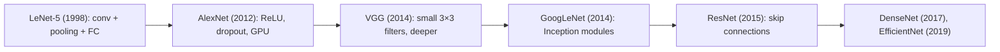
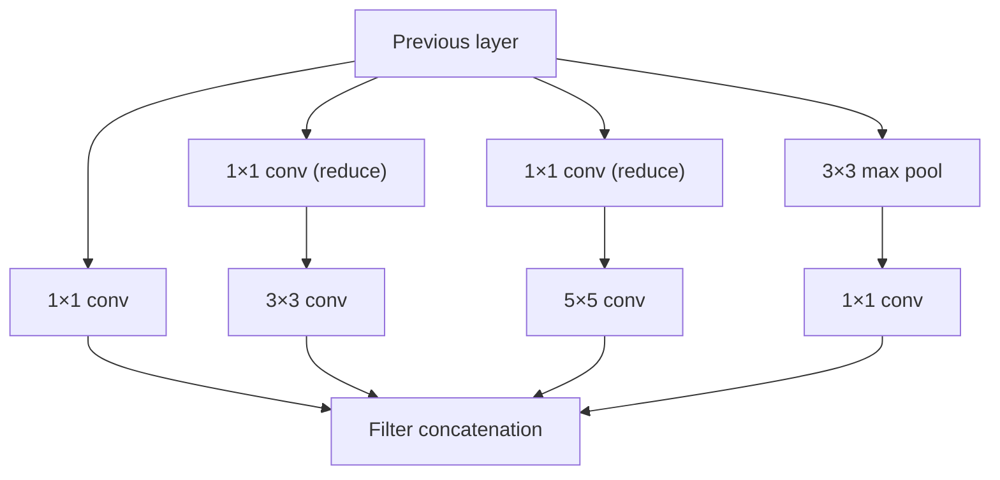
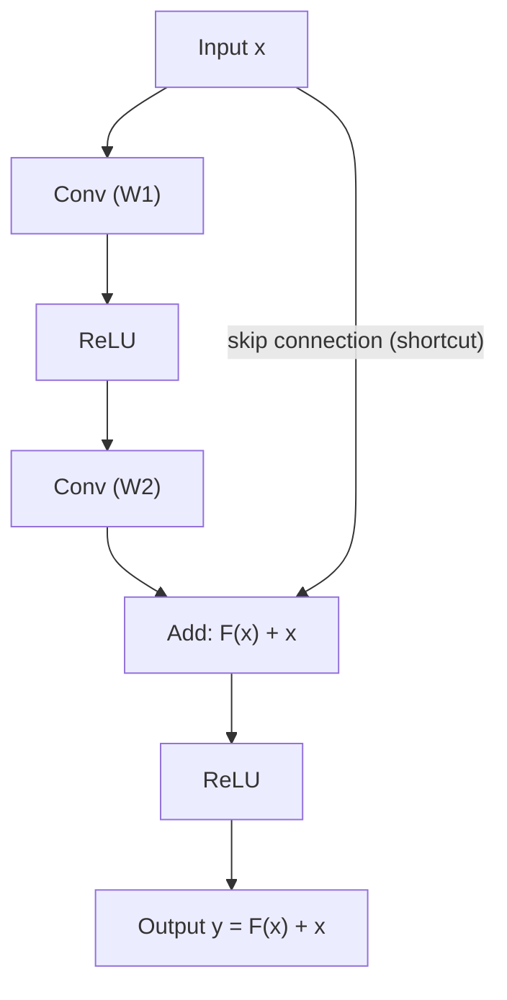
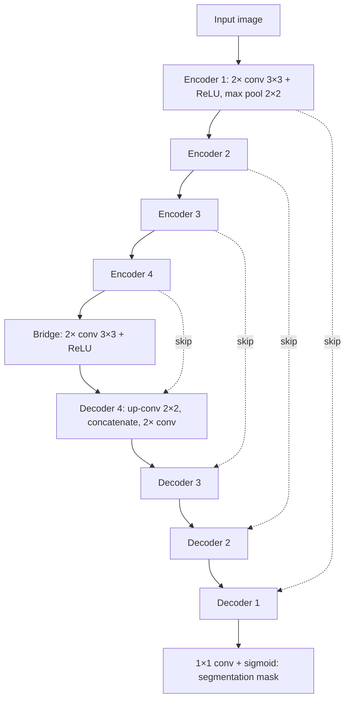

Before the new ideas, here are the old ones you need. If you already know them, skip to the next section.

## The basics first

- A **convolution layer** slides small filters over the image and gives feature maps. Output size $= \lfloor (N - F + 2P)/S \rfloor + 1$ and output depth = number of filters. Parameters of a layer $= (F \times F \times D + 1) \times K$. (See the CNN note.) <Cite id="class-dl-chp4" loc="slide 19" /> <Cite id="class-dl-chp4" loc="slide 27" />
- A **pooling layer** reduces height and width, not depth. **Max pooling** keeps the largest value of each region, **average pooling** the average. <Cite id="class-dl-chp4" loc="slide 31" />
- A **fully connected (FC) layer** connects every input to every neuron. The last layer uses **softmax** to give class probabilities. <Cite id="class-dl-chp4" loc="slide 28" />
- **ReLU** keeps positive values and turns negative values into 0. **Dropout** randomly switches off neurons during training to reduce overfitting. **ImageNet** is a dataset of almost 14 million images in a thousand classes. <Cite id="class-dl-m4" loc="p. 54" />

## Why learn the named architectures?

There are various CNN architectures which have been key in building the algorithms that power AI: **LeNet, AlexNet, VGGNet, GoogLeNet, ResNet and ZFNet.** Each one introduced one new idea that all later networks use. <Cite id="class-dl-m4" loc="p. 41" />

## LeNet-5 (1998)

<Box kind="definition">

**LeNet-5** is a CNN architecture designed for handwritten digit recognition, which uses convolution, subsampling/pooling and fully connected layers to automatically learn features from images and classify them. <Cite id="class-dl-chp4" loc="slide 43" />

</Box>

**Why was it needed?** Before CNNs, image recognition depended on manually designed features such as edges, curves and corners. LeNet's idea: let the network learn these features automatically. Handwritten image → CNN learns features → edges → curves → shapes → digit classification 0 to 9. <Cite id="class-dl-chp4" loc="slide 43" />

LeNet-5 was the first "famous" CNN architecture, developed by LeCun et al. (1998) for recognition of handwritten digits. LeCun and his fellow researchers worked on CNN models for a decade to come up with an efficient architecture. It inspired deep learning researchers to develop the efficient CNN models used today. <Cite id="class-dl-m4" loc="p. 43" />

**Input:** a 32 × 32 grayscale image, so height = 32, width = 32 and channels = 1. <Cite id="class-dl-chp4" loc="slide 43" /> <Cite id="class-dl-m4" loc="p. 44" />

### The architecture

The network has **5 layers with learnable parameters**, hence the name LeNet-5. It has three sets of convolution layers combined with average pooling, then two fully connected layers, and at last a softmax classifier. <Cite id="class-dl-m4" loc="p. 44" />

**Layer by layer** <Cite id="class-dl-chp4" loc="slide 45" /> <Cite id="class-dl-m4" loc="p. 51" />

```mermaid
%% caption: LeNet-5 with the shape after every layer. Convolutions make more feature maps; subsampling halves the size; the last layers classify.
flowchart LR
  A["Input 32×32×1"] --> B["C1: 6 filters 5×5 → 28×28×6"]
  B --> C["S2: average pool 2×2 → 14×14×6"]
  C --> D["C3: 16 filters 5×5 → 10×10×16"]
  D --> E["S4: average pool 2×2 → 5×5×16"]
  E --> F["C5: 120 filters 5×5 → 1×1×120"]
  F --> G["F6: fully connected 84"]
  G --> H["Output: 10 (softmax)"]
```

| Layer | Operation | Input | Filters / neurons | Filter size | Output | What it learns |
|---|---|---|---|---|---|---|
| Input | Image | – | – | – | 32×32×1 | Raw pixel values |
| C1 | Convolution (tanh) | 32×32×1 | 6 | 5×5 | 28×28×6 | Edges, lines, curves |
| S2 | Subsampling (average pooling) | 28×28×6 | – | 2×2, stride 2 | 14×14×6 | Downsamples, keeps important information |
| C3 | Convolution (tanh) | 14×14×6 | 16 | 5×5 | 10×10×16 | Combines edges into shapes and corners |
| S4 | Subsampling | 10×10×16 | – | 2×2, stride 2 | 5×5×16 | Further downsampling |
| C5 | Convolution (tanh) | 5×5×16 | 120 | 5×5 | 1×1×120 | High-level features (the whole digit) |
| F6 | Fully connected (tanh) | 120 | 84 | – | 84 | Combines all features to decide |
| Output | Fully connected + softmax | 84 | 10 | – | 10 | Scores / probability for digits 0 to 9 |

**Check the sizes** with the formula $\lfloor (N - F + 2P)/S \rfloor + 1$ (no padding): <Cite id="class-dl-chp4" loc="slide 19" />

<Sum>

<Given>

32×32×1 input; C1: 6 filters 5×5, stride 1; S2: 2×2 pooling, stride 2; C3: 16 filters 5×5; S4: 2×2 pooling, stride 2; C5: 120 filters 5×5. No padding.

</Given>

<Find>

the output size of every layer.

</Find>

<Steps>

1. **C1:** $(32 - 5)/1 + 1 = 28$, depth 6, so **28×28×6**.
2. **S2:** $(28 - 2)/2 + 1 = 14$, depth stays 6, so **14×14×6**.
3. **C3:** $(14 - 5)/1 + 1 = 10$, depth 16, so **10×10×16**.
4. **S4:** $(10 - 2)/2 + 1 = 5$, depth stays 16, so **5×5×16**.
5. **C5:** $(5 - 5)/1 + 1 = 1$, depth 120, so **1×1×120** (the 5×5×16 map is covered by one filter position, so the 120 values act like a flattened vector).

</Steps>

<Answer>

28×28×6 → 14×14×6 → 10×10×16 → 5×5×16 → 1×1×120, then 84 and 10.

</Answer>

<Box kind="verify">

These are the sizes printed on the class sheet. Pooling halves height and width and never changes depth ($6 \to 6$, $16 \to 16$), as the class rule says.

</Box>

</Sum>

**Check the parameters** ("around sixty thousand"). A convolution layer has $(F \times F \times D + 1) \times K$ parameters; a fully connected layer has (inputs × neurons) weights plus one bias per neuron. Pooling has none. <Cite id="class-dl-m4" loc="p. 51" /> <Cite id="class-dl-chp4" loc="slide 27" />

<Sum>

<Given>

the LeNet-5 layers of the table above.

</Given>

<Find>

the total number of trainable parameters.

</Find>

<Steps>

1. **C1:** $(5 \cdot 5 \cdot 1 + 1) \times 6 = 26 \times 6 = 156$.
2. **C3:** the input depth is 6, so $(5 \cdot 5 \cdot 6 + 1) \times 16 = 151 \times 16 = 2{,}416$.
3. **C5:** the input depth is 16, so $(5 \cdot 5 \cdot 16 + 1) \times 120 = 401 \times 120 = 48{,}120$.
4. **F6:** $120 \times 84 + 84 = 10{,}164$.
5. **Output:** $84 \times 10 + 10 = 850$.
6. **Total:** $156 + 2{,}416 + 48{,}120 + 10{,}164 + 850 = 61{,}706$.

</Steps>

<Answer>

about 61,706, which is the "around sixty thousand" of the class notes.

</Answer>

<Box kind="verify">

Add in a different order: $156 + 850 = 1{,}006$; $2{,}416 + 10{,}164 = 12{,}580$; $1{,}006 + 12{,}580 + 48{,}120 = 61{,}706$. (S2 and S4 add nothing.) The slide also says about 60K.

</Box>

</Sum>

### Important ideas, and why LeNet-5 matters

- **Convolution**, **subsampling / pooling**, **hierarchical feature learning** and **multiple feature maps** (more filters give more feature maps; C1 has 6, C3 has 16). <Cite id="class-dl-chp4" loc="slide 43" />
- LeNet demonstrated that a network can **automatically learn useful visual features directly from images**. It established the basic ideas of modern CNNs: convolution, pooling, feature maps, hierarchical feature learning, weight sharing and end-to-end image classification. <Cite id="class-dl-chp4" loc="slide 43" />

**Why is it called LeNet-5?** Because it has five trainable layers (C1, C3, C5, F6 and Output). The pooling layers S2 and S4 are not counted as trainable layers. <Cite id="class-dl-chp4" loc="slide 43" />

**Merits and demerits** (Module 4): LeNet used spatial correlation to minimize computation and parameter count, and its feature hierarchies were learned automatically. But it scaled poorly to various picture classes, used large-size filters and extracted only low-level features. <Cite id="class-dl-m4" loc="p. 85" />

<Box kind="key">

**Exam-ready conclusion (LeNet-5):** LeNet-5 is an early and influential CNN architecture developed for handwritten digit recognition. It takes a grayscale image, extracts features hierarchically using convolution and subsampling layers, and uses fully connected layers to classify the image into one of ten digit classes. It is considered a foundational architecture in the development of modern CNNs. <Cite id="class-dl-chp4" loc="slide 43" />

</Box>

## AlexNet (2012)

<Box kind="definition">

**AlexNet** is a deep CNN architecture that became a landmark in 2012 by achieving outstanding ImageNet image-classification performance and popularizing deep learning for computer vision. <Cite id="class-dl-chp4" loc="slide 46" />

</Box>

**Why was it needed?** Before AlexNet, CNNs were strong and easy to train, but they were expensive for large, high-resolution images, exactly the problem when ImageNet arrived. The traditional approach was image → manually designed features → classifier → prediction. AlexNet's approach is image → convolution → edges → shapes → textures → object parts → objects → classification. <Cite id="class-dl-m4" loc="p. 53" /> <Cite id="class-dl-chp4" loc="slide 46" />

### Key features of AlexNet

- **Eight layers** with learnable parameters: **five convolutional layers and three fully connected layers**. ReLU is used in every layer except the output layer. <Cite id="class-dl-m4" loc="p. 54" /> <Cite id="class-dl-m4" loc="p. 55" />
- **ReLU** in place of tanh: training became almost **six times faster** (error 25% on CIFAR-10 in the Module example). <Cite id="class-dl-m4" loc="p. 54" /> <Cite id="class-dl-m4" loc="p. 55" />
- **GPU training**: the neurons were split across multiple GPUs, which gave faster training and a bigger model. <Cite id="class-dl-m4" loc="p. 55" />
- **Overlapping pooling** (neighbouring pooling regions overlap) reduced the error by 0.5%. <Cite id="class-dl-m4" loc="p. 55" />
- **Overfitting** grew with the 60 million parameters, so **dropout** (dropping neurons with a fixed probability, here 50%) and **data augmentation** (image transformations to increase data variety) were used. <Cite id="class-dl-m4" loc="p. 55" /> <Cite id="class-dl-chp4" loc="slide 43" />
- It **won the 2012 ImageNet competition** with a large margin over the runner-up, and it is trained on the ImageNet dataset (about 14 million images, 1000 classes). Removing any convolutional layer drastically degrades its performance. <Cite id="class-dl-m4" loc="p. 55" />

### The architecture

**Layer by layer** (output $= \lfloor (N + 2P - F)/S \rfloor + 1$): <Cite id="class-dl-m4" loc="p. 57" /> <Cite id="class-dl-m4" loc="p. 58" /> <Cite id="class-dl-m4" loc="p. 60" />

```mermaid
%% caption: AlexNet with the shape after every layer. ReLU follows every convolution; dropout 0.5 sits on the two big fully connected layers.
flowchart LR
  A["Input 227×227×3"] --> B["Conv1: 96 filters 11×11, stride 4 → 55×55×96"]
  B --> C["Max pool 3×3, stride 2 → 27×27×96"]
  C --> D["Conv2: 256 filters 5×5, pad 2 → 27×27×256"]
  D --> E["Max pool 3×3, stride 2 → 13×13×256"]
  E --> F["Conv3: 384 filters 3×3, pad 1 → 13×13×384"]
  F --> G["Conv4: 384 filters 3×3, pad 1 → 13×13×384"]
  G --> H["Conv5: 256 filters 3×3, pad 1 → 13×13×256"]
  H --> I["Max pool 3×3, stride 2 → 6×6×256"]
  I --> J["Flatten 9216 → FC6 4096 → FC7 4096 (dropout 0.5)"]
  J --> K["FC8: 1000 (softmax)"]
```

| Layer | Filters / units | Filter | Stride | Padding | Output |
|---|---|---|---|---|---|
| Input | – | – | – | – | 227×227×3 |
| Conv1 + ReLU | 96 | 11×11 | 4 | 0 | 55×55×96 |
| Max pool 1 | – | 3×3 | 2 | 0 | 27×27×96 |
| Conv2 + ReLU | 256 | 5×5 | 1 | 2 | 27×27×256 |
| Max pool 2 | – | 3×3 | 2 | 0 | 13×13×256 |
| Conv3 + ReLU | 384 | 3×3 | 1 | 1 | 13×13×384 |
| Conv4 + ReLU | 384 | 3×3 | 1 | 1 | 13×13×384 |
| Conv5 + ReLU | 256 | 3×3 | 1 | 1 | 13×13×256 |
| Max pool 3 | – | 3×3 | 2 | 0 | 6×6×256 |
| Dropout 1 (0.5) + FC6 + ReLU | 4096 | – | – | – | 4096 |
| Dropout 2 (0.5) + FC7 + ReLU | 4096 | – | – | – | 4096 |
| FC8 + softmax | 1000 | – | – | – | 1000 |

The number of filters **increases** with depth (96, 256, 384, 384, 256) and the filter size **decreases** (11, 5, 3, 3, 3), so deeper layers extract more features from smaller windows. <Cite id="class-dl-m4" loc="p. 58" />

**Sum: check the AlexNet sizes.** <Cite id="class-dl-m4" loc="p. 57" />

<Sum>

<Given>

input 227×227×3 and the layer settings of the table above.

</Given>

<Find>

the size after each convolution and pooling layer, and the input of FC6.

</Find>

<Steps>

1. **Conv1:** $(227 + 0 - 11)/4 + 1 = 54 + 1 = 55$, depth 96, so 55×55×96.
2. **Pool 1:** $(55 - 3)/2 + 1 = 26 + 1 = 27$, so 27×27×96.
3. **Conv2:** $(27 + 4 - 5)/1 + 1 = 27$, depth 256, so 27×27×256.
4. **Pool 2:** $(27 - 3)/2 + 1 = 13$, so 13×13×256.
5. **Conv3, Conv4, Conv5:** $(13 + 2 - 3)/1 + 1 = 13$ each, depths 384, 384, 256.
6. **Pool 3:** $(13 - 3)/2 + 1 = 6$, so 6×6×256.
7. **Flatten:** $6 \times 6 \times 256 = 9216$ values go into FC6.

</Steps>

<Answer>

55×55×96 → 27×27×96 → 27×27×256 → 13×13×256 → 13×13×384 → 13×13×384 → 13×13×256 → 6×6×256 → 9216.

</Answer>

<Box kind="verify">

Padding 1 with a 3×3 filter and stride 1 is "same" padding ($P = (F-1)/2 = 1$), so Conv3, Conv4 and Conv5 must keep 13×13. Padding 2 with a 5×5 filter is also "same", so Conv2 keeps 27×27. Both match.

</Box>

</Sum>

**Sum: how many parameters?** <Cite id="class-dl-m4" loc="p. 60" />

<Sum>

<Given>

the AlexNet layers above; parameters of a convolution layer $= (F \cdot F \cdot D + 1) \times K$; of a fully connected layer $=$ inputs $\times$ neurons $+$ neurons.

</Given>

<Find>

the total number of learnable parameters.

</Find>

<Steps>

1. **Conv1:** $(11 \cdot 11 \cdot 3 + 1) \times 96 = 364 \times 96 = 34{,}944$.
2. **Conv2:** $(5 \cdot 5 \cdot 96 + 1) \times 256 = 2401 \times 256 = 614{,}656$.
3. **Conv3:** $(3 \cdot 3 \cdot 256 + 1) \times 384 = 2305 \times 384 = 885{,}120$.
4. **Conv4:** $(3 \cdot 3 \cdot 384 + 1) \times 384 = 3457 \times 384 = 1{,}327{,}488$.
5. **Conv5:** $(3 \cdot 3 \cdot 384 + 1) \times 256 = 3457 \times 256 = 884{,}992$.
6. **FC6:** $9216 \times 4096 + 4096 = 37{,}752{,}832$.
7. **FC7:** $4096 \times 4096 + 4096 = 16{,}781{,}312$.
8. **FC8:** $4096 \times 1000 + 1000 = 4{,}097{,}000$.
9. **Total:** $34{,}944 + 614{,}656 + 885{,}120 + 1{,}327{,}488 + 884{,}992 = 3{,}747{,}200$ for the convolutions, and $37{,}752{,}832 + 16{,}781{,}312 + 4{,}097{,}000 = 58{,}631{,}144$ for the FC layers, so about **62.4 million**.

</Steps>

<Answer>

about 62.4 million parameters (the Module 4 notes quote "62.3 million learnable parameters"). Most of them sit in the fully connected layers, which is why dropout is used there.

</Answer>

<Box kind="verify">

$3{,}747{,}200 + 58{,}631{,}144 = 62{,}378{,}344 \approx 62.4$ million, which agrees with the class figure of about 60 million to 62.3 million. The first-layer value 34,944 matches the class sum in the CNN note.

</Box>

</Sum>

### AlexNet versus LeNet

| Feature | LeNet-5 | AlexNet |
|---|---|---|
| Year | 1998 | 2012 |
| Application | Handwritten digits | ImageNet classification |
| Input | Small grayscale image (32×32) | Large RGB images (227×227×3) |
| Depth | Relatively shallow | Much deeper |
| Activation | Tanh / sigmoid | ReLU |
| Pooling | Subsampling (average) | Max pooling |
| GPU | Not central | Yes (GPU based) |
| Dropout | No | Yes |
| Data augmentation | Limited | Yes |
| Importance | Early successful CNN | Major deep-learning breakthrough |

<Cite id="class-dl-chp4" loc="slide 41" />

**Demerits of AlexNet** (Module 4): neurons in the first and second layers can be dormant, and aliasing artefacts appear in the trained feature maps because of the excessive filter size. <Cite id="class-dl-m4" loc="p. 85" />

## VGG-16 (2014)

**VGG-16** was the next big breakthrough: it marked the beginning of very deep CNNs. Earlier models such as AlexNet used large filters in the first layers; VGG changed this and used **3×3 filters** instead. Developed by Simonyan and Zisserman, it was the best performing model at that time. <Cite id="class-dl-m4" loc="p. 69" />

- **Very systematic architecture:** only 3×3 convolutions with stride 1; five 2×2 max-pooling layers with stride 2; as we go deeper the **image size halves while the number of channels (filters) doubles**: 64, 128, 256, 512, 512. <Cite id="class-dl-m4" loc="p. 70" /> <Cite id="class-dl-m4" loc="p. 73" />
- **Fully connected layers** are always the same: 4096, 4096, then 1000 for the 1000-way ImageNet classification, then softmax. All hidden layers use ReLU. Dropout 0.5 is used on the first two fully connected layers. <Cite id="class-dl-m4" loc="p. 71" /> <Cite id="class-dl-m4" loc="p. 74" />
- **Depth:** configurations differ only in depth, from 11 weight layers (network A) to 19 (network E). VGG-16 has 13 convolutional and 3 fully connected layers. <Cite id="class-dl-m4" loc="p. 73" />
- **Input:** a 224 × 224 RGB image; the mean RGB value is subtracted from each pixel in pre-processing. <Cite id="class-dl-m4" loc="p. 71" />
- **Result:** the best single-net result in ILSVRC (7.0% test error) at that time. <Cite id="class-dl-m4" loc="p. 75" />
- **Drawbacks:** about **138 million parameters** (more than twice the parameters of other models of the time), weeks to train, and a trained model of over 500 MB, so it is slow and less practical for real-time use. <Cite id="class-dl-m4" loc="p. 70" /> <Cite id="class-dl-m4" loc="p. 75" />

**Sum: why the VGG-16 sizes work.** <Cite id="class-dl-m4" loc="p. 73" />

<Sum>

<Given>

input 224×224×3. Five blocks of 3×3 convolutions (stride 1, "same" padding so the size does not shrink) with 64, 128, 256, 512, 512 filters, each followed by a 2×2 max pool with stride 2.

</Given>

<Find>

the size after every block and the input of the first fully connected layer. Count the layers.

</Find>

<Steps>

1. **Block 1:** convolutions keep 224×224, pool gives $(224 - 2)/2 + 1 = 112$, so 112×112×64.
2. **Block 2:** pool gives 56, so 56×56×128.
3. **Block 3:** pool gives 28, so 28×28×256.
4. **Block 4:** pool gives 14, so 14×14×512.
5. **Block 5:** pool gives 7, so 7×7×512.
6. **FC6 input:** $7 \times 7 \times 512 = 25{,}088$. Then 4096, 4096, 1000.
7. **Layers:** convolutions $2 + 2 + 3 + 3 + 3 = 13$, plus 3 fully connected $= 16$.

</Steps>

<Answer>

224 → 112 → 56 → 28 → 14 → 7 with channels 64, 128, 256, 512, 512; 25,088 values go into FC6; 16 weight layers, hence "VGG-16".

</Answer>

<Box kind="verify">

Size halves five times: $224 / 2^5 = 7$. Channels double from 64 up to 512 and then stay at 512, as the class says. Parameter check: the 13 convolution layers have about 14.7 million parameters and the 3 FC layers about 123.6 million ($25{,}088 \times 4096$ alone is about 102.8 million), total about 138.4 million, the class figure of 138 million.

</Box>

</Sum>

## GoogLeNet (Inception v1, 2014)

**GoogLeNet** was proposed by Szegedy et al. as the initial version of the Inception; it gave state-of-the-art image classification and detection in the ImageNet challenge ILSVRC14 and **secured the first place**. Instead of fully connected layers it uses **global average pooling**, with **1×1 convolution** in the middle of the network. <Cite id="class-dl-m4" loc="p. 62" />

The overall network is **22 layers deep**. It was designed with computational efficiency in mind, so that it can run on individual devices even with low computational resources. It takes a 224 × 224 RGB image and every convolution uses ReLU. It also has two auxiliary classifiers attached to the outputs of Inception (4a) and Inception (4d). <Cite id="class-dl-m4" loc="p. 66" />

### The Inception module

In older networks such as AlexNet there is a fixed filter size in each layer. In the Inception module, **1×1, 3×3, 5×5 convolutions and a 3×3 max pooling are performed in parallel on the same input, and their outputs are stacked together** (concatenated along the depth) to make the output. The idea: filters of different sizes handle objects at multiple scales better. <Cite id="class-dl-m4" loc="p. 64" /> <Cite id="class-dl-m4" loc="p. 63" />

Neural networks are time-consuming and expensive to train, so the authors **limit the input channels by adding an extra 1×1 convolution before the 3×3 and 5×5 convolutions** (and after the max pooling) to reduce the dimensions and compute faster. <Cite id="class-dl-m4" loc="p. 63" />

### Other features of GoogLeNet

- **1×1 convolution:** decreases the number of parameters (and operations), which also lets the architecture be deeper. <Cite id="class-dl-m4" loc="p. 67" />
- **Global average pooling:** the fully connected layers at the end of AlexNet-like networks hold most of the parameters. GoogLeNet takes a 7×7 feature map and averages it to 1×1, so this layer has **0 trainable parameters**, and top-1 accuracy improved by 0.6%. <Cite id="class-dl-m4" loc="p. 64" />
- **Auxiliary classifiers (training only):** intermediate classifier branches (5×5 average pooling with stride 3, a 1×1 convolution with 128 filters, two fully connected layers, softmax). Their loss is added to the total loss with a weight of 0.3. They help against the vanishing gradient and act as regularization. <Cite id="class-dl-m4" loc="p. 65" />

**Sum: why the 1×1 convolution saves work (the class example).** Perform a 5×5 convolution with 48 filters on a 14×14×480 input. <Cite id="class-dl-m4" loc="p. 67" />

<Sum>

<Given>

14×14 positions, input depth 480. Without the 1×1 layer: 48 filters of 5×5×480. With the 1×1 layer: first 16 filters of 1×1×480, then 48 filters of 5×5×16.

</Given>

<Find>

the number of operations (multiplications) in each case.

</Find>

<Steps>

1. **Without 1×1:** $(14 \times 14 \times 48) \times (5 \times 5 \times 480) = 9408 \times 12000 = 112{,}896{,}000 \approx 112.9$ million.
2. **With 1×1, first layer:** $(14 \times 14 \times 16) \times (1 \times 1 \times 480) = 3136 \times 480 = 1{,}505{,}280 \approx 1.5$ million.
3. **With 1×1, second layer:** $(14 \times 14 \times 48) \times (5 \times 5 \times 16) = 9408 \times 400 = 3{,}763{,}200 \approx 3.8$ million.
4. **Total with 1×1:** $1.5 + 3.8 = 5.3$ million.

</Steps>

<Answer>

112.9 million operations without the 1×1 layer, only about 5.3 million with it.

</Answer>

<Box kind="verify">

The saving factor is $112.9 / 5.3 \approx 21$. Exact: $1{,}505{,}280 + 3{,}763{,}200 = 5{,}268{,}480 \approx 5.3$ million, the figures printed in the Module.

</Box>

</Sum>

## ResNet (2015)

<Box kind="definition">

**ResNet** is a deep CNN architecture that uses skip connections (shortcut connections) to allow information and gradients to flow more easily through very deep networks. <Cite id="class-dl-chp4" loc="slide 49" />

</Box>

ResNet was put forward by He et al. (Microsoft Research) in 2015: a model that could employ hundreds to thousands of layers while giving compelling performance. With 152 layers (the deepest then) it won the ILSVRC 2015 classification competition with a top-5 error of 3.57%. <Cite id="class-dl-m4" loc="p. 77" />

### Why was ResNet needed? The degradation problem

We expect deeper to give better accuracy. But after a certain depth, more layers make training difficult, accuracy stops improving or even decreases. This is called the **degradation problem**. It is not simply overfitting: a deeper network may have higher training error. As layers increase, information and gradients have to pass through many layers (vanishing gradients, harder learning). The question: how can we make a network very deep without making training worse? ResNet's answer: **skip some layers using a shortcut connection.** <Cite id="class-dl-chp4" loc="slide 49" /> <Cite id="class-dl-m4" loc="p. 77" />

### The residual idea

Let the desired output be $H(x)$. Instead of learning $H(x)$ directly, ResNet learns $F(x) = H(x) - x$, so $H(x) = F(x) + x$. Here $x$ is the input, $F(x)$ the **residual** learned by the convolution layers and $H(x)$ the final output. The next layers only need to learn what additional information should be added. <Cite id="class-dl-chp4" loc="slide 49" />

**Everyday analogy.** You already have a rough drawing of an apple. ResNet learns only the corrections to add to the drawing, instead of redrawing the whole apple. <Cite id="class-dl-chp4" loc="slide 49" />

### The residual block

1. The input $x$ enters the block.
2. The convolution layers learn new features $F(x)$.
3. The input $x$ travels through the shortcut.
4. Add them: $F(x) + x$.
5. Apply the activation (ReLU). Output $y = F(x) + x$. <Cite id="class-dl-chp4" loc="slide 49" />

**When input and output sizes are different.** If the convolution layers change the height, width or channels, the shortcut cannot be added directly. Use a **projection shortcut** (a 1×1 convolution) to make the dimensions compatible. <Cite id="class-dl-chp4" loc="slide 49" />

**Why skip connections are important.** The shortcut gives information and gradients a more direct path through the network, so the gradient can reach early layers without being multiplied down the whole stack. <Cite id="class-dl-chp4" loc="slide 49" /> <Cite id="class-dl-m4" loc="p. 77" />

**Sum: a residual block on numbers.**

<Sum>

<Given>

input $x = [2,\ 3]$. The two convolution layers give $F(x) = [0.5,\ -1]$.

</Given>

<Find>

the block output $y = \text{ReLU}(F(x) + x)$.

</Find>

<Steps>

1. **Add the skip connection:** $F(x) + x = [0.5 + 2,\ -1 + 3] = [2.5,\ 2]$.
2. **Apply ReLU** (negatives become 0, positives stay): $[2.5,\ 2]$.

</Steps>

<Answer>

$y = [2.5,\ 2]$

</Answer>

<Box kind="verify">

If the block had nothing to add ($F(x) = [0, 0]$), the output would be exactly $x = [2, 3]$. That is the easy "do nothing" case the shortcut makes possible, so extra layers cannot easily make things worse.

</Box>

</Sum>

### ResNet architecture and versions

Basic flow: input image → initial convolution → residual blocks (repeated, several groups) → global average pooling → fully connected layer → softmax → prediction. ResNet comes in different depths: **ResNet-18, 34, 50, 101, 152.** The number indicates approximately the number of layers. <Cite id="class-dl-chp4" loc="slide 49" /> <Cite id="class-dl-chp4" loc="slide 51" />

**Sum: why it is called ResNet-50.** <Cite id="class-dl-m4" loc="p. 76" />

<Sum>

<Given>

ResNet-50: one 7×7 convolution at the start, then four stages with 3, 4, 6 and 3 residual blocks. Each block has 3 convolutions (1×1, 3×3, 1×1). One fully connected layer at the end.

</Given>

<Find>

the number of weight layers.

</Find>

<Steps>

1. **Convolutions in the blocks:** $(3 + 4 + 6 + 3) \times 3 = 16 \times 3 = 48$.
2. **Add the first convolution:** $48 + 1 = 49$.
3. **Add the fully connected layer:** $49 + 1 = 50$.

</Steps>

<Answer>

50 layers (49 convolutional + 1 FC), as the Module says.

</Answer>

<Box kind="verify">

The block counts match the Module's ResNet-101 note too: $[3, 4, 23, 3]$ gives $(3 + 4 + 23 + 3) \times 3 + 2 = 33 \times 3 + 2 = 101$.

</Box>

</Sum>

**Advantages of ResNet:** allows very deep networks (tens to hundreds of layers); helps gradient flow through shortcut connections; reduces the degradation problem; better feature learning. Used in image classification, object detection, image segmentation, face recognition, medical image analysis and transfer learning. <Cite id="class-dl-chp4" loc="slide 49" />

**ResNeXt (variant).** Xie et al. proposed ResNeXt. It looks like the Inception module (both do split-transform-merge), but the outputs of different paths are **added** together while Inception **concatenates** them by depth, and every path has the same structure (topology) while Inception uses different structures (1×1, 3×3, 5×5). It adds a hyperparameter called **cardinality**, the number of paths. <Cite id="class-dl-m4" loc="p. 78" />

<Box kind="key">

**Exam-ready definition (ResNet):** ResNet is a deep CNN architecture that uses residual blocks and skip connections to learn residual mappings and enable efficient training of very deep neural networks. <Cite id="class-dl-chp4" loc="slide 51" />

</Box>

## U-Net (2015)

U-Net is an architecture developed by Olaf Ronneberger et al. for **biomedical image segmentation** in 2015 at the University of Freiburg, Germany. It is one of the most popular approaches for semantic segmentation today. It is a **fully convolutional neural network** designed to learn from **fewer training samples**, and it is an improvement over the earlier FCN (fully convolutional networks) of Long et al. <Cite id="class-dl-m4" loc="p. 80" />

**What is segmentation?** **Image segmentation** is a computer vision task in which we label specific regions of an image. The goal of **semantic image segmentation** is to label **each pixel** of an image with a corresponding class of what is being represented. Uses: autonomous vehicles and medical image diagnostics. <Cite id="class-dl-m4" loc="p. 81" />

### The architecture: a U-shaped encoder-decoder

U-Net is a U-shaped **encoder-decoder** network, with four encoder blocks and four decoder blocks connected by a bridge. The encoder (contracting path) **halves the spatial dimensions and doubles the number of filters** at each encoder block; the decoder **doubles the spatial dimensions and halves the number of feature channels.** <Cite id="class-dl-m4" loc="p. 83" />

- **Encoder network** (contracting path): the feature extractor; it learns an abstract representation of the input. Each encoder block has **two 3×3 convolutions**, each followed by ReLU, then a **2×2 max pooling** that halves the height and width and reduces the cost. The output of the ReLU is kept as the **skip connection** for the matching decoder block. <Cite id="class-dl-m4" loc="p. 83" />
- **Bridge:** connects the encoder and the decoder; two 3×3 convolutions, each followed by ReLU. <Cite id="class-dl-m4" loc="p. 84" />
- **Decoder network:** takes the abstract representation and generates a semantic segmentation mask. Each decoder block starts with a **2×2 transpose convolution**, is **concatenated with the matching skip connection** from the encoder, and then has two 3×3 convolutions with ReLU. The last decoder output goes through a **1×1 convolution with sigmoid**, which gives the pixel-wise classification mask. <Cite id="class-dl-m4" loc="p. 84" />
- **Skip connections:** give the decoder extra information (features from earlier layers that may be lost because of depth), so it can generate better semantic features. They also act as a shortcut that helps the flow of gradients to the earlier layers during backpropagation. <Cite id="class-dl-m4" loc="p. 84" />

**Sum: check the sizes in the U-Net figure.** The figure uses 3×3 convolutions without padding, so each convolution takes 2 off the height and width. <Cite id="class-dl-m4" loc="p. 82" />

<Sum>

<Given>

input tile 572×572. Each encoder block: two 3×3 convolutions (each $-2$), then a 2×2 max pool (÷2). The bridge has two convolutions. Each decoder block: a 2×2 up-convolution (×2), a crop and copy of the encoder map, then two 3×3 convolutions.

</Given>

<Find>

the sizes along the left path and the bottom of the U, and the output size.

</Find>

<Steps>

1. **Level 1:** $572 \to 570 \to 568$, pool: $568 / 2 = 284$.
2. **Level 2:** $284 \to 282 \to 280$, pool: $140$.
3. **Level 3:** $140 \to 138 \to 136$, pool: $68$.
4. **Level 4:** $68 \to 66 \to 64$, pool: $32$.
5. **Bridge:** $32 \to 30 \to 28$.
6. **Decoder 4:** up-convolution $28 \times 2 = 56$, then $56 \to 54 \to 52$ (the encoder map 64 is cropped to 56 to fit).
7. **Decoder 3:** $52 \times 2 = 104 \to 102 \to 100$.
8. **Decoder 2:** $100 \times 2 = 200 \to 198 \to 196$.
9. **Decoder 1:** $196 \times 2 = 392 \to 390 \to 388$.

</Steps>

<Answer>

left: 572 → 568 → 284 → 280 → 140 → 136 → 68 → 64 → 32 → 28 (bottom); right: 56 → 52 → 104 → 100 → 200 → 196 → 392 → 388. The output segmentation map is 388×388.

</Answer>

<Box kind="verify">

These are exactly the numbers printed in the figure (572, 570, 568, 284, 282, 280, 140, 138, 136, 68, 66, 64, 32, 30, 28 and on the way up 56, 54, 52, 104, 102, 100, 200, 198, 196, 392, 390, 388). The channels go $1 \to 64 \to 128 \to 256 \to 512 \to 1024$ down and $512 \to 256 \to 128 \to 64 \to 2$ up.

</Box>

</Sum>

## Comparing the architectures

| | LeNet-5 | AlexNet | VGG-16 | GoogLeNet | ResNet-50 | U-Net |
|---|---|---|---|---|---|---|
| Year | 1998 | 2012 | 2014 | 2014 | 2015 | 2015 |
| Key building block | Convolution + pooling + FC | Large convolutions, ReLU, dropout | Small 3×3 convolutions | Inception module | Residual block | Encoder-decoder with skip connections |
| Depth | 5 trainable layers | 8 | 16 | 22 | 50 | about 23 |
| Parameters (approx.) | 60 thousand | 60 million | 138 million | 6.8 million | 25.6 million | 7 to 30 million |
| Input | 32×32×1 | 227×227×3 | 224×224×3 | 224×224×3 | 224×224×3 | variable |
| Strength | Simple, fast on small data | First to show the power of deep CNNs | High accuracy, simple and uniform | Efficient, good accuracy with fewer parameters | Trains extremely deep networks | Segmentation with limited data |
| Limitation | Low capacity | Many parameters, large memory | Very large model, slow | Complex modules | Heavy at very high resolutions | Not for plain classification |
| Typical use | Digit recognition | ImageNet classification | Classification, transfer learning | Classification, feature extraction | Classification, detection, recognition | Medical, satellite segmentation |

<Cite id="class-dl-m4" loc="p. 86" />

**Evolution summary:** LeNet's simplicity → AlexNet's deep learning breakthrough → VGG's depth with small filters → GoogLeNet's efficient multi-scale design → ResNet's ability to train very deep models → U-Net's specialization for segmentation. <Cite id="class-dl-m4" loc="p. 86" />

## Where this was asked

| If the question says | What to write | Seen as |
|---|---|---|
| "Describe LeNet architecture" | Definition, 32×32×1 input, the eight rows of layers with sizes, ideas, why "5", conclusion | <PYQ id="2023-12/q6a" /> |
| "Explain and analyze AlexNet" | Definition, why important, key features, layer-by-layer sizes, dropout and augmentation, comparison with LeNet | <PYQ id="2024-12/q2b" /> |
| "Draw and explain any two modern architectures" | Pick two (for example ResNet and GoogLeNet or AlexNet): diagram, key idea, features, one comparison line | <PYQ id="2025-05/q3a" /> |
| "Discuss and analyse LeNet / AlexNet / GoogLeNet / ResNet and U-Net" | One short block each: diagram, key idea, sizes or features, strength and limit | <PYQ id="assignment-2/q4c" /> |

## Quick revision

- LeNet-5 (1998): 32×32×1 → C1 28×28×6 → S2 14×14×6 → C3 10×10×16 → S4 5×5×16 → C5 1×1×120 → F6 84 → 10. Five trainable layers, tanh, average pooling, about 60 thousand parameters.
- AlexNet (2012): 227×227×3 → 55×55×96 → 27×27×96 → 27×27×256 → 13×13×256 → 13×13×384 → 13×13×384 → 13×13×256 → 6×6×256 → 9216 → 4096 → 4096 → 1000. ReLU, max pooling, dropout 0.5, augmentation, GPU; about 60 million parameters.
- VGG-16 (2014): only 3×3 convolutions; size halves and channels double (64 to 512); 13 convolution + 3 FC; 138 million parameters; slow.
- GoogLeNet (2014): Inception module (1×1, 3×3, 5×5, pooling in parallel, concatenated); 1×1 convolution reduces work (112.9 million to 5.3 million); global average pooling; auxiliary classifiers; 22 layers.
- ResNet (2015): $y = F(x) + x$; skip connection; fixes degradation; 18, 34, 50, 101, 152 layers; projection shortcut = 1×1 convolution.
- U-Net (2015): U-shaped encoder-decoder, skip connections, 1×1 convolution with sigmoid; for segmentation (label every pixel).
