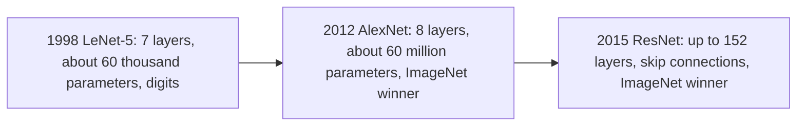
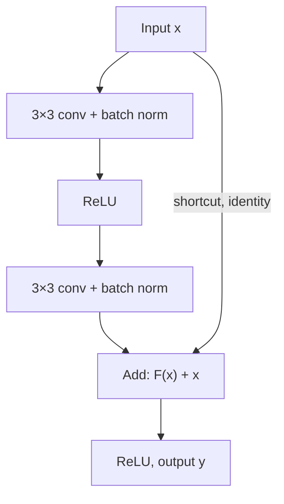

Before the new ideas, here are the old ones you need. If you already know them, skip to the next section. The note on convolutional neural networks explains all of them in detail.

## The basics first

- A **convolutional layer** slides small learned **filters** over its input. Each filter gives one **feature map**.
- **Output size.** A filter cannot hang off the edge, so the output is a little smaller than the input; padding adds a border of zeros to keep the size, and a bigger stride (step) shrinks it faster. In symbols: $O = (N - F + 2P)/S + 1$, with input size $N$, filter size $F$, padding $P$ and stride $S$. You need this only for calculation questions.
- **Pooling** shrinks each feature map (max or average of small blocks) and has no parameters.
- **ReLU** keeps positive values and turns negatives into 0. **tanh** and **sigmoid** are S-shaped curves that flatten out ("saturate") for large inputs, where their slope is almost zero, so learning slows down.
- **Dropout** switches off random neurons during training to reduce overfitting. **Batch normalization** rescales each layer's values to average 0 and spread 1, which makes training faster and more stable.
- **ImageNet (ILSVRC)** is a yearly contest (2010 to 2017) on about 1.2 million training images in 1000 classes. **Top-5 error** is the fraction of test images whose correct class is not among the network's five best guesses.

## Why learn named architectures?

An **architecture** is the full plan of a network: which layers, in which order, with what sizes. Each famous architecture is a milestone that answered "how do we go further?"

**Everyday analogy.** Think of the history of cars. An early car proved the idea works. A later car added a much bigger engine and better tyres and won every race. A modern car added a clever new part (like power steering) that made something previously impossible easy. LeNet proved CNNs work, AlexNet made them big and fast, and ResNet added the shortcut that made very deep networks trainable. This is syllabus <Syl m="4" />, the last topic of the CNN module. <Cite id="gfdl-ch9" loc="§9.11" />

## LeNet-5 (1998)

**What it is.** LeNet-5 is one of the first successful convolutional neural networks, built by Yann LeCun and colleagues at AT&amp;T to read handwritten digits (the MNIST dataset) and bank cheques. <Cite id="lecun1998" />

**Why it was needed.** Earlier digit readers used hand-designed features, which broke easily when handwriting changed. LeNet learned its own features straight from the pixels, and it used weight sharing so the network stayed small enough for 1990s computers. Goodfellow notes that by the end of the 1990s a system based on such networks was reading over 10% of all cheques in the US. <Cite id="gfdl-ch9" loc="§9.11" />

**How it works, step by step.** The paper names layers C (convolution), S (subsampling) and F (fully connected). There are seven layers with weights, not counting the input. The idea is simple: early layers find small strokes, middle layers join strokes into shapes, and the last layers decide which digit the shapes make.

1. **Input:** a 32×32 grayscale image.
2. **C1:** 6 filters of 5×5 find simple strokes and edges, giving 6 maps of 28×28.
3. **S2:** 2×2 subsampling halves each map to 14×14.
4. **C3:** 16 filters of 5×5 combine strokes into shapes, giving 16 maps of 10×10.
5. **S4:** subsampling halves them to 5×5.
6. **C5:** 120 filters of 5×5 cover the whole 5×5 map, giving 120 numbers.
7. **F6:** a fully connected layer of 84 units.
8. **Output:** 10 units, one per digit.

```mermaid
%% caption: LeNet-5 from left to right, with the size of the data after each layer. Convolution and subsampling alternate twice, then three layers do the classification.
flowchart LR
  A["Input 32×32×1"] --> B["C1 conv 5×5, 6 maps: 28×28×6"]
  B --> C["S2 subsample 2×2: 14×14×6"]
  C --> D["C3 conv 5×5, 16 maps: 10×10×16"]
  D --> E["S4 subsample 2×2: 5×5×16"]
  E --> F["C5 conv 5×5: 120"]
  F --> G["F6 fully connected: 84"]
  G --> H["Output: 10 digits"]
```

| Layer | What it does | Output | Trainable parameters (from the paper) |
|---|---|---|---|
| Input | Grayscale image | 32×32×1 | 0 |
| C1 | 6 filters of 5×5, stride 1 | 28×28×6 | 156 |
| S2 | 2×2 subsampling, stride 2 | 14×14×6 | 12 |
| C3 | 16 filters of 5×5, each connected to only some S2 maps | 10×10×16 | 1,516 |
| S4 | 2×2 subsampling, stride 2 | 5×5×16 | 32 |
| C5 | 120 filters of 5×5 over all 16 maps | 1×1×120 | 48,120 |
| F6 | Fully connected | 84 | 10,164 |
| Output | 10 RBF units, one per digit | 10 | fixed by hand (not counted) |

These add up to the paper's "about 60,000 trainable free parameters". The output layer is not counted because each unit's pattern was chosen by hand, not learned. <Cite id="lecun1998" />

**Special features (in words).**

- **Trainable subsampling, not today's pooling.** Each S unit adds its four inputs, multiplies by one learned coefficient, adds a learned bias and applies a sigmoid-type function. It behaves like a scaled average pooling.
- **Partial connections in C3.** Each C3 map sees only some of the S2 maps. The paper gives two reasons: fewer connections, and different maps are forced to learn different features.
- **Activation:** a scaled tanh (an S-shaped curve), not ReLU.
- **Output:** 10 Euclidean RBF units, each measuring how far the 84 numbers are from a stored pattern for its digit. Modern versions use a 10-way softmax.
- **Result:** 0.95% test error on MNIST, and 0.8% when trained with extra distorted copies of the images (data augmentation). <Cite id="lecun1998" />

<Box kind="pitfall">

Many tutorials draw LeNet-5 with ReLU, max pooling and softmax. Those are modern substitutions. The 1998 paper uses scaled tanh, trainable subsampling and RBF outputs. In an exam either version earns marks if you say which one you are drawing. D2L, for example, uses sigmoid and average pooling, which were the common choices then. <Cite id="d2l-lenet" />

</Box>

**Advantages.** Small and fast (about 60 thousand parameters); learned its own features; weight sharing kept it compact; very accurate on digits.

**Disadvantages.** Designed for small grayscale images; too small for large colour photos with 1000 classes; tanh-type activations train slowly; in 1998 computers could not train much bigger versions.

**Applications.** Handwritten digit recognition, bank cheque reading, postal ZIP code reading. Today it is the standard teaching example of a CNN. <Cite id="gfg-lenet" /> <Cite id="av-lenet" />

**Sum 1: LeNet-5 sizes and parameters.** A theory question ("Describe LeNet") does not need this. Use it only when a question asks you to calculate sizes or parameters.

<Sum>

<Given>

a 32×32×1 input; every convolution uses 5×5 filters, stride 1, no padding; every subsampling uses 2×2 windows with stride 2; C1 has 6 filters, C3 has 16, C5 has 120; F6 has 84 units. Output size rule $O = (N - F + 2P)/S + 1$.

</Given>

<Find>

the output size of C1, S2, C3, S4 and C5, and the number of trainable parameters in C1, C5 and F6.

</Find>

<Steps>

1. **C1 size.** $(32 - 5 + 0)/1 + 1 = 27 + 1 = 28$, so 28×28×6. The 5×5 filter fits in only 28 positions across 32 pixels; 6 filters give 6 maps.
2. **S2 size.** $(28 - 2)/2 + 1 = 13 + 1 = 14$, so 14×14×6. Subsampling halves the size and keeps the number of maps.
3. **C3 size.** $(14 - 5)/1 + 1 = 9 + 1 = 10$, so 10×10×16. Same filter rule as C1, now with 16 filters.
4. **S4 size.** $(10 - 2)/2 + 1 = 4 + 1 = 5$, so 5×5×16. Halved again.
5. **C5 size.** $(5 - 5)/1 + 1 = 0 + 1 = 1$, so 1×1×120. The 5×5 filter covers the whole 5×5 map, so each filter gives one number.
6. **C1 parameters.** Each filter has $5 \times 5 \times 1 = 25$ weights plus 1 bias, so 26. Six filters: $6 \times 26 = 156$. The input has one channel, so each filter is 5×5×1.
7. **C5 parameters.** Each filter looks at all 16 maps of S4: $5 \times 5 \times 16 = 400$ weights plus 1 bias, so 401. Then $120 \times 401 = 48{,}120$. Each filter must cover every input map.
8. **F6 parameters.** Each of the 84 units connects to all 120 values of C5, plus 1 bias, so 121. Then $84 \times 121 = 10{,}164$. A fully connected unit has one weight per input.

</Steps>

<Answer>

sizes 28×28×6 → 14×14×6 → 10×10×16 → 5×5×16 → 1×1×120; parameters C1 = 156, C5 = 48,120, F6 = 10,164.

</Answer>

<Box kind="verify">

Check the sizes with a pattern: a 5×5 filter with no padding always removes 4 from the size ($32 - 4 = 28$, $14 - 4 = 10$, $5 - 4 = 1$), and a 2×2 stride-2 window always halves it ($28 / 2 = 14$, $10 / 2 = 5$). Both agree with the steps. Check the parameters against the paper's total: add every layer in the table,

$$
156 + 12 + 1{,}516 + 32 + 48{,}120 + 10{,}164
$$

In order: $156 + 12 = 168$; $168 + 1{,}516 = 1{,}684$; $1{,}684 + 32 = 1{,}716$; $1{,}716 + 48{,}120 = 49{,}836$; $49{,}836 + 10{,}164 = 60{,}000$. That is exactly the paper's "about 60,000", so the three counts fit.

</Box>

</Sum>

## AlexNet (2012)

**What it is.** AlexNet is a deep CNN by Alex Krizhevsky, Ilya Sutskever and Geoffrey Hinton. It won ILSVRC-2012 with a top-5 test error of **15.3%**, against **26.2%** for the second-best entry. Goodfellow marks this win as the start of today's strong commercial interest in deep learning. <Cite id="krizhevsky2012" /> <Cite id="gfdl-ch9" loc="§9.11" />

**Why it was needed.** LeNet worked on small digit images, but ImageNet has over a million large colour photos in 1000 classes. That needed a much bigger network, and a bigger network brought two new problems: very slow training and heavy overfitting. AlexNet's new ideas solve exactly these two problems.

**How it works (architecture).** 8 layers with weights: **5 convolutional** and **3 fully connected**, ending in a 1000-way softmax. About **60 million parameters** and 650,000 neurons. The first conv layers find edges and colour blobs, the deeper ones find textures and object parts, and the fully connected layers combine these parts into a class decision. The table uses the common single-GPU description with a 227×227×3 input.

| Layer | Setting | Output |
|---|---|---|
| Input | Colour image | 227×227×3 |
| Conv1 + ReLU | 96 filters, 11×11, stride 4 | 55×55×96 |
| Normalization + max pool | 3×3, stride 2 | 27×27×96 |
| Conv2 + ReLU | 256 filters, 5×5, pad 2 | 27×27×256 |
| Normalization + max pool | 3×3, stride 2 | 13×13×256 |
| Conv3 + ReLU | 384 filters, 3×3, pad 1 | 13×13×384 |
| Conv4 + ReLU | 384 filters, 3×3, pad 1 | 13×13×384 |
| Conv5 + ReLU | 256 filters, 3×3, pad 1 | 13×13×256 |
| Max pool | 3×3, stride 2 | 6×6×256 = 9216 values |
| FC6 + ReLU + dropout | 4096 units | 4096 |
| FC7 + ReLU + dropout | 4096 units | 4096 |
| FC8 + softmax | 1000 classes | 1000 |

```mermaid
%% caption: AlexNet. Five convolution layers find features, with max pooling after the 1st, 2nd and 5th. Three fully connected layers, two with dropout, make the decision.
flowchart LR
  A["Input 227×227×3"] --> B["Conv1 11×11 stride 4, 96 + pool"]
  B --> C["Conv2 5×5, 256 + pool"]
  C --> D["Conv3 3×3, 384"]
  D --> E["Conv4 3×3, 384"]
  E --> F["Conv5 3×3, 256 + pool"]
  F --> G["FC6 4096 + dropout"]
  G --> H["FC7 4096 + dropout"]
  H --> I["FC8 1000 softmax"]
```

<Box kind="pitfall">

The paper says the input is 224×224×3, but with an 11×11 filter and stride 4 the sizes only work out with 227×227: 224 gives a non-whole number whatever the padding. CS231n points out this mismatch. Use 227 when you show the size calculation and mention it. <Cite id="cs231n-cnn" />

</Box>

**What was new, and why each idea helped.** <Cite id="krizhevsky2012" />

1. **ReLU instead of tanh.** ReLU does not saturate for positive inputs, so gradients stay large and learning is fast. The paper reports that a ReLU network reached 25% training error on CIFAR-10 about six times faster than the same network with tanh.
2. **Training on two GPUs.** Each GTX 580 GPU had only 3 GB of memory, so the network was split across two GPUs. Training took five to six days.
3. **Local response normalization** after the first two conv layers, which helped neighbouring feature maps compete. It is rarely used today (batch normalization replaced it).
4. **Overlapping max pooling:** windows of 3×3 with stride 2, so neighbouring windows overlap. It slightly reduced the error compared with non-overlapping 2×2 windows.
5. **Dropout** with probability 0.5 in the first two fully connected layers. Without it the network overfitted badly. <Cite id="srivastava2014" />
6. **Data augmentation:** random 224×224 crops of the 256×256 images, horizontal flips, and changes to colour intensity, so the network sees many more varied training images.

**Where the parameters are (analysis).** The five conv layers hold only about 3.7 million parameters; the three fully connected layers hold about 58.6 million (FC6 alone about 37.8 million). So **most of AlexNet's parameters sit in the fully connected layers**, which is why dropout was placed there. Conv layers are cheap because one small filter is reused at every position (weight sharing); a fully connected layer needs a separate weight for every input-output pair. (This single-GPU version totals about 62.4 million; the paper's "60 million" is a little lower because some layers were split across the two GPUs.) Sum 3 below shows the count.

**Everyday analogy.** LeNet was a bicycle. AlexNet was the same basic design turned into a motorbike: a far bigger engine (60 million parameters), a better fuel (ReLU), a powerful workshop (GPUs) and good brakes against overfitting (dropout and augmentation).

**Advantages.** Huge jump in accuracy on real photos; showed that deep CNNs trained on GPUs beat hand-designed features; introduced ReLU, dropout and augmentation as standard tools.

**Disadvantages.** Very large and memory-hungry, mostly because of the FC layers; large 11×11 first-layer filters (later replaced by stacks of small 3×3 filters in networks such as VGG); local response normalization turned out to be of little use; only 8 layers, so still fairly shallow.

**Applications.** Large-scale image classification, and as a pretrained feature extractor (transfer learning) for tasks such as object detection and medical images. <Cite id="d2l-alexnet" /> <Cite id="gfg-alexnet" /> <Cite id="av-alexnet" />

**Sum 2: AlexNet output sizes.** Only for questions that ask you to calculate the sizes.

<Sum>

<Given>

a 227×227×3 input and the layer settings in the table above. Output size rule $O = (N - F + 2P)/S + 1$.

</Given>

<Find>

the output size after every layer up to the last pooling, and the number of values passed to FC6.

</Find>

<Steps>

1. **Conv1.**

   $$
   \begin{aligned}
   (227 - 11 + 0)/4 + 1 &= 216/4 + 1 \\
   &= 54 + 1 \\
   &= 55
   \end{aligned}
   $$

   so 55×55×96. The large 11×11 filter with stride 4 shrinks the image fast; 96 filters give 96 maps.
2. **Pool1.** $(55 - 3)/2 + 1 = 52/2 + 1 = 26 + 1 = 27$, so 27×27×96. Pooling keeps the number of maps.
3. **Conv2.**

   $$
   (27 - 5 + 2 \times 2)/1 + 1 = 26 + 1 = 27
   $$

   so 27×27×256. Padding 2 exactly makes up for the 5×5 filter, so the size stays.
4. **Pool2.** $(27 - 3)/2 + 1 = 12 + 1 = 13$, so 13×13×256.
5. **Conv3, Conv4, Conv5.**

   $$
   (13 - 3 + 2 \times 1)/1 + 1 = 12 + 1 = 13
   $$

   each time, giving 13×13×384, 13×13×384 and 13×13×256. Padding 1 makes up for the 3×3 filter.
6. **Pool3.** $(13 - 3)/2 + 1 = 5 + 1 = 6$, so 6×6×256.
7. **Flatten for FC6.**

   $$
   \begin{aligned}
   6 \times 6 \times 256 &= 36 \times 256 \\
   &= 9{,}216
   \end{aligned}
   $$

   FC6 needs one long list of numbers.

</Steps>

<Answer>

55×55×96 → 27×27×96 → 27×27×256 → 13×13×256 → 13×13×384 → 13×13×384 → 13×13×256 → 6×6×256, so FC6 receives 9,216 values.

</Answer>

<Box kind="verify">

Work backwards: the input size that gives output $O$ is $(O - 1) \times S + F - 2P$. Conv1: $(55 - 1) \times 4 + 11 = 216 + 11 = 227$, the given input. Pool1: $(27 - 1) \times 2 + 3 = 55$. Pool2: $(13 - 1) \times 2 + 3 = 27$. Pool3: $(6 - 1) \times 2 + 3 = 13$. Every layer maps back to the size before it, so the forward sizes are right. If you try 224 instead, Conv1 gives $(224 - 11)/4 + 1 = 54.25$, not a whole number, which is the mismatch in the pitfall above.

</Box>

</Sum>

**Sum 3: where AlexNet's parameters are.** Only for questions that ask you to count parameters.

<Sum>

<Given>

the single-GPU AlexNet in the table. A conv layer has (filter height × filter width × input channels + 1 bias) parameters per filter. A fully connected layer has (number of inputs + 1 bias) parameters per unit.

</Given>

<Find>

the parameters in the conv layers, in the FC layers, and in total.

</Find>

<Steps>

1. **Conv1.** $11 \times 11 \times 3 = 363$ weights + 1 = 364 per filter; $96 \times 364 = 34{,}944$. The input has 3 colour channels.
2. **Conv2.** $5 \times 5 \times 96 = 2{,}400$ + 1 = 2,401; $256 \times 2{,}401 = 614{,}656$. Its input has 96 maps.
3. **Conv3.** $3 \times 3 \times 256 = 2{,}304$ + 1 = 2,305; $384 \times 2{,}305 = 885{,}120$.
4. **Conv4.** $3 \times 3 \times 384 = 3{,}456$ + 1 = 3,457; $384 \times 3{,}457 = 1{,}327{,}488$.
5. **Conv5.** 3,457 per filter again (input is 384 maps); $256 \times 3{,}457 = 884{,}992$.
6. **All conv layers.** Add the five layer totals:

   $$
   34{,}944 + 614{,}656 + 885{,}120 + 1{,}327{,}488 + 884{,}992 = 3{,}747{,}200
   $$

   (about 3.7 million).
7. **FC6.**

   $$
   \begin{aligned}
   4{,}096 \times (9{,}216 + 1) &= 4{,}096 \times 9{,}217 \\
   &= 37{,}752{,}832
   \end{aligned}
   $$

   Every unit sees all 9,216 values from Sum 2.
8. **FC7.**

   $$
   4{,}096 \times (4{,}096 + 1) = 16{,}781{,}312
   $$

   Each of the 4,096 units has 4,096 inputs plus a bias.
9. **FC8.**

   $$
   1{,}000 \times (4{,}096 + 1) = 4{,}097{,}000
   $$

   Each of the 1,000 output units has 4,096 inputs plus a bias.
10. **All FC layers.** Add the three FC totals:

    $$
    37{,}752{,}832 + 16{,}781{,}312 + 4{,}097{,}000 = 58{,}631{,}144
    $$

    (about 58.6 million).
11. **Total.** Add the conv and FC parts to get the whole network:

    $$
    3{,}747{,}200 + 58{,}631{,}144 = 62{,}378{,}344
    $$

    (about 62.4 million).

</Steps>

<Answer>

conv layers about 3.7 million, FC layers about 58.6 million, total about 62.4 million parameters, so about 94% ($58.6 / 62.4$) sit in the fully connected layers.

</Answer>

<Box kind="verify">

Count weights and biases separately, then add. Conv weights:

$$
34{,}848 + 614{,}400 + 884{,}736 + 1{,}327{,}104 + 884{,}736 = 3{,}745{,}824
$$

conv biases (one per filter): $96 + 256 + 384 + 384 + 256 = 1{,}376$; together $3{,}747{,}200$, same as step 6. FC weights:

$$
\begin{aligned}
9{,}216 \times 4{,}096 + 4{,}096 \times 4{,}096 + 4{,}096 \times 1{,}000 &= 37{,}748{,}736 + 16{,}777{,}216 + 4{,}096{,}000 \\
&= 58{,}621{,}952
\end{aligned}
$$

FC biases: $4{,}096 + 4{,}096 + 1{,}000 = 9{,}192$; together $58{,}631{,}144$, same as step 10. The total is also close to the paper's "60 million", as expected for the single-GPU version.

</Box>

</Sum>

## ResNet (2015)

**What it is.** ResNet (residual network), by Kaiming He and colleagues at Microsoft Research, is a very deep CNN built from **residual blocks**: small groups of layers with a **skip connection** that carries the input around the layers and adds it to their output. <Cite id="he2015" />

**Why it was needed: the degradation problem.** After AlexNet, deeper networks kept getting better; the best ImageNet entries of 2014 (VGG and GoogLeNet) had about 16 to 22 layers. Then He and colleagues showed that when a plain network is made deeper (for example from 18 to 34 layers), accuracy first saturates and then gets **worse**, and not because of overfitting: the **training** error itself goes up. They called this the **degradation problem**.

Why is this strange? Take a good shallow network and add extra layers that simply copy their input (an **identity mapping**). This deeper network gives exactly the same answers, so a deeper network should never be worse. The fact that training could not find such a solution means that plain stacked layers find it hard to learn even "do nothing".

**How it works: learn only the change.** Instead of asking a few layers to learn the whole desired output, ResNet asks them to learn only the **residual** (the correction that must be added to the input), and then adds the input back through a shortcut. In words: output = what the layers learned + the original input. As a formula (named in every textbook, so write it in the exam):

$$
y = F(x) + x
$$

$x$ is the input to the block, $F(x)$ is the output of the block's layers (usually two 3×3 convolutions with batch normalization and ReLU), and $y$ is the block's output. If doing nothing is best, the layers only have to push $F(x)$ to zero, which is easy. An identity shortcut adds **no extra parameters**. <Cite id="he2015" />

**Why gradients flow better (in words).** During backpropagation the gradient can travel straight back through the shortcut, without passing through the layers, so even if the gradient through the layers becomes tiny, part of the signal still reaches the early layers. This eases the vanishing-gradient problem. <Cite id="d2l-resnet" />

**Everyday analogy.** An editor improving an essay does not rewrite it from a blank page. They take the essay as it is and mark only the corrections. If the essay is already perfect, they mark nothing. Each residual block is such an editor.

**When the sizes do not match.** If a block changes the number of channels or halves the height and width, $x$ and $F(x)$ cannot be added directly. Then the shortcut uses a **projection**: a 1×1 convolution (with stride 2 when the size halves) that reshapes $x$ to match. <Cite id="he2015" />

**The full network (ResNet-34), step by step.**

1. 7×7 convolution, 64 filters, stride 2 (224 → 112).
2. 3×3 max pool, stride 2 (112 → 56).
3. Stage 1: 3 residual blocks with 64 filters (56×56).
4. Stage 2: 4 blocks with 128 filters (28×28). The first block uses stride 2 to halve the size.
5. Stage 3: 6 blocks with 256 filters (14×14).
6. Stage 4: 3 blocks with 512 filters (7×7).
7. Global average pooling, then one fully connected layer with 1000 outputs and softmax.

Counting layers: $3 + 4 + 6 + 3 = 16$ blocks with 2 convolutions each gives 32, plus the first conv and the final FC: $32 + 1 + 1 = 34$. A simple rule: whenever the size halves, the number of filters doubles. Batch normalization is used right after every convolution, before the activation. <Cite id="he2015" /> <Cite id="ioffe2015" />

**Types (variants).** **ResNet-18 and ResNet-34** use the basic two-layer block shown above. **ResNet-50, 101 and 152** use a **bottleneck block**: a 1×1 convolution shrinks the channels, a 3×3 convolution works on the smaller block, and another 1×1 convolution expands the channels back. This needs about 17 times fewer weights than two full 3×3 convolutions at 256 channels (Sum 4), so very deep networks stay affordable.

**Results.** Networks up to 152 layers deep, 8 times deeper than VGG but with lower complexity. An ensemble reached **3.57% top-5 error** and won **ILSVRC 2015**. <Cite id="he2015" /> <Cite id="gfg-resnet" />

**Advantages.** Very deep networks (100+ layers) become trainable; solves degradation and eases vanishing gradients; shortcuts add no parameters; global average pooling avoids huge FC layers; the residual idea is reused in almost every later architecture.

**Disadvantages.** Many layers mean long training and slow inference on small devices; some layers in very deep versions contribute little (they learn near-zero residuals); projection shortcuts add some parameters when shapes change.

**Applications.** Image classification, object detection and segmentation backbones (for example in Faster R-CNN and Mask R-CNN), face recognition, medical imaging, and transfer learning. <Cite id="wiki-resnet" />

**Sum 4: why the bottleneck block is cheaper.** Only for questions that ask you to compare the cost of blocks.

<Sum>

<Given>

a block whose input and output have 256 channels. Basic version: two 3×3 convolutions, 256 → 256 → 256. Bottleneck version: 1×1 (256 → 64), 3×3 (64 → 64), 1×1 (64 → 256). Weights in one conv layer = filter height × filter width × input channels × output channels. Biases are left out because ResNet puts batch normalization after each convolution instead.

</Given>

<Find>

the number of weights in each version and how many times fewer the bottleneck needs.

</Find>

<Steps>

1. **One basic 3×3 layer.**

   $$
   \begin{aligned}
   3 \times 3 \times 256 \times 256 &= 9 \times 65{,}536 \\
   &= 589{,}824
   \end{aligned}
   $$

   Every one of 256 filters is 3×3×256.
2. **Basic block (two layers).** The block has two such layers, so double one: $2 \times 589{,}824 = 1{,}179{,}648$.
3. **Bottleneck 1×1 shrink.**

   $$
   1 \times 1 \times 256 \times 64 = 16{,}384
   $$

   A 1×1 filter only mixes channels, so it is cheap.
4. **Bottleneck 3×3 middle.**

   $$
   \begin{aligned}
   3 \times 3 \times 64 \times 64 &= 9 \times 4{,}096 \\
   &= 36{,}864
   \end{aligned}
   $$

   The costly 3×3 now works on only 64 channels.
5. **Bottleneck 1×1 expand.**

   $$
   1 \times 1 \times 64 \times 256 = 16{,}384
   $$

   It returns to 256 channels so the shortcut can add it.
6. **Bottleneck block total.** Add the three layers:

   $$
   16{,}384 + 36{,}864 + 16{,}384 = 69{,}632
   $$
7. **Ratio.** Divide the basic total by the bottleneck total: $1{,}179{,}648 / 69{,}632 \approx 16.9$.

</Steps>

<Answer>

basic block 1,179,648 weights, bottleneck block 69,632 weights, so the bottleneck needs about 17 times fewer.

</Answer>

<Box kind="verify">

Take out the common factor $64 \times 64 = 4{,}096$. Basic:

$$
\begin{aligned}
2 \times 9 \times 256 \times 256 &= 4{,}096 \times (2 \times 9 \times 4 \times 4) \\
&= 4{,}096 \times 288
\end{aligned}
$$

Bottleneck:

$$
4{,}096 \times (4 + 9 + 4) = 4{,}096 \times 17
$$

The ratio is $288 / 17 \approx 16.9$, the same as step 7. Also $4{,}096 \times 17 = 69{,}632$ and $4{,}096 \times 288 = 1{,}179{,}648$, matching steps 6 and 2.

</Box>

</Sum>

## Comparing the three

| | LeNet-5 (1998) | AlexNet (2012) | ResNet (2015) |
|---|---|---|---|
| Task | Handwritten digits, 32×32 grayscale | ImageNet, 1000 classes, colour | ImageNet, 1000 classes, colour |
| Depth (weighted layers) | 7 | 8 (5 conv + 3 FC) | 18 to 152 (34 in the basic example) |
| Size | About 60 thousand parameters | About 60 million parameters | Paper reports cost, not parameters: 3.6 billion FLOPs for ResNet-34, 18% of VGG-19 |
| Activation | Scaled tanh | ReLU | ReLU |
| Pooling | Trainable average-like subsampling | Overlapping max pooling 3×3, stride 2 | One max pool at the start, global average pool at the end |
| Key new idea | Convolution + weight sharing + backprop | ReLU, dropout, GPUs, augmentation | Skip connections, batch norm, very deep |
| End of the network | FC layers (120, 84) and 10 outputs | Three large FC layers | Global average pool + one FC |
| Main limit | Too small for real photos | Huge FC layers, memory-hungry | Long training, many layers |

<Box kind="pitfall">

"Deeper" does not mean "more parameters". ResNet-152 is 8 times deeper than VGG but has lower complexity, because it uses small filters, bottleneck blocks and global average pooling instead of huge fully connected layers. The ResNet paper reports complexity in FLOPs (multiply-adds), not in parameters, so do not quote a parameter count for ResNet unless the question gives one.

</Box>

<Box kind="exam">

For "draw and explain any two modern architectures", AlexNet and ResNet are the safest pair. For each: why it was built, a block diagram, a short list of layers, what was new and why it helped, advantages and limits. For ResNet, always write $y = F(x) + x$ and draw the residual block. Size and parameter sums are needed only when the question asks for them.

</Box>

Other well-known architectures you can name in one line each: **VGG** (ILSVRC 2014 runner-up, a very regular design that uses only 3×3 convolutions and 2×2 pooling, 16 layers in its best version) and **GoogLeNet** (ILSVRC 2014 winner, built from "Inception modules" and only about 4 million parameters). <Cite id="cs231n-cnn" /> <Cite id="ibm-cnn" /> <Cite id="wiki-cnn" />

**Conclusion.** LeNet showed that a CNN can learn its own features, AlexNet showed that a big CNN on GPUs with ReLU and dropout beats hand-made features on real photos, and ResNet's skip connections made networks of 100+ layers trainable; many modern vision models build on these ideas. <Cite id="nptel-dl" />

## Where this was asked

| If the question says | What to write | Seen as |
|---|---|---|
| "Describe LeNET architecture" | Purpose, step-by-step layers with sizes, diagram, subsampling and tanh, about 60k parameters, result on MNIST, advantages and limits | <PYQ id="2023-12/q6a" /> |
| "Explain and analyze the architecture of AlexNet" | Why it was needed, layer table, diagram, the six new ideas and why each helped, where the parameters are, advantages and limits | <PYQ id="2024-12/q2b" /> |
| "Draw and explain any two modern deep learning architectures" | AlexNet and ResNet: diagram, layers, key ideas, $y = F(x) + x$, comparison | <PYQ id="2025-05/q3a" /> |

## Quick revision

- LeNet-5: 32×32 → C1 (6@28×28) → S2 (6@14×14) → C3 (16@10×10) → S4 (16@5×5) → C5 (120) → F6 (84) → 10. About 60k trainable parameters, scaled tanh. <Cite id="wiki-lenet" />
- AlexNet: 227×227×3 → 5 conv (96 of 11×11 stride 4, 256 of 5×5, 384, 384, 256 of 3×3) → FC 4096, 4096, 1000. About 60M parameters, mostly in FC. <Cite id="wiki-alexnet" />
- AlexNet's new ideas: ReLU, two GPUs, local response normalization, overlapping max pooling, dropout, data augmentation. Top-5 error 15.3% vs 26.2%.
- ResNet: degradation problem → residual block $y = F(x) + x$; 1×1 projection when shapes differ; bottleneck blocks for 50+ layers; up to 152 layers; 3.57% top-5 error, ILSVRC 2015.
- A skip connection gives the gradient a direct path back, so it is less likely to vanish.
