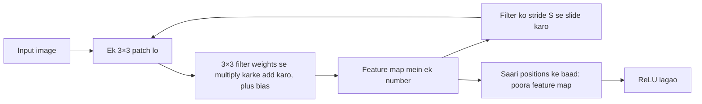
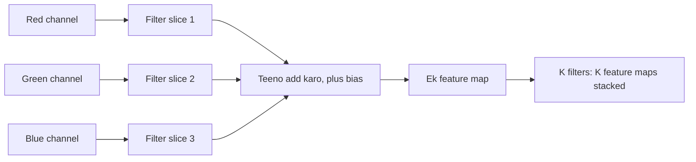
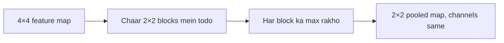
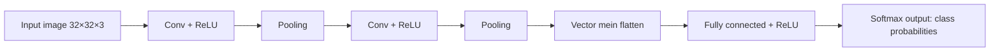

Naye ideas se pehle, purane ideas jo chahiye wo yahan hain. Agar pehle se aate hain to agle section pe chale jao.

## Pehle basics

- **Neuron** kuch inputs leta hai, har input ko ek **weight** se multiply karta hai, sab add karta hai, ek **bias** add karta hai, aur result ko ek **activation function** se pass karta hai.
- **ReLU** (rectified linear unit) sabse simple activation hai: negative numbers 0 ban jaate hain, positive numbers waise hi rehte hain.
- **Fully connected** (dense) layer mein har neuron har input se connected hota hai.
- **Parameters** wo numbers hain jo network seekhta hai: saare weights aur biases. Zyada parameters matlab zyada memory, zyada computation aur overfitting (general pattern seekhne ki jagah training data ratta maar lena) ka zyada chance.
- Grayscale **image** numbers ka ek grid hai, har pixel ke liye ek number (jaise 0 = black, 255 = white). Colour image mein aise teen grids hote hain, red, green aur blue ke liye ek-ek. Har grid ko **channel** kehte hain. To 32×32 colour image numbers ka ek block hai jiska size 32×32×3 hai (height × width × channels).
- **Softmax** scores ki list ko probabilities mein badal deta hai jinka total 1 hota hai, taaki last layer bol sake "cat: 0.9, dog: 0.1".

## Problem: normal network images ke liye fit nahi hai

Fully connected network ko images ke saath teen problems hain:

1. **Bahut zyada weights.** Ek chhoti 32×32×3 image mein hi 3072 numbers hain, to first layer ke **har** neuron ko 3072 weights chahiye. 1000 neurons ki layer ko 3 million se zyada weights chahiye, aur real photos isse kahin badi hoti hain.
2. **Layout ignore karta hai.** Ye image ko ek lambi list mein flatten kar deta hai, to use pata hi nahi ki do pixels padosi hain.
3. **Har position pe pattern dobara seekhna padta hai.** "Aankh kaisi dikhti hai" ye har us jagah ke liye alag seekhna padta hai jahan aankh aa sakti hai.

**Everyday analogy.** Socho tum crowd ki photo mein apne dost ko dhundh rahe ho. Tum poori photo ek saath nahi ghoorte. Tum aankhein photo pe ghumaate ho, ek chhota area ek baar mein, aur har area ko same idea se check karte ho ki "mere dost ka chehra kaisa dikhta hai". **Convolutional neural network (CNN)** bilkul yahi karta hai: chhote patches ek ke baad ek check karta hai, har jagah same chhota detector use karke. Ye syllabus <Syl m="4" /> hai. <Cite id="gfdl-ch9" loc="§9.2" />

<Box kind="definition">

**Convolutional neural network (CNN):** grid jaise data (jaise images) ke liye ek neural network, jisme kam se kam ek layer full connections ki jagah **convolution** (input pe slide hota hua ek chhota filter) use karti hai. Uske baad usually **pooling** layers aati hain aur end mein normal fully connected layers hoti hain.

</Box>

Exam mein English mein likho: "A CNN is a neural network for grid-like data such as images, in which at least one layer uses convolution instead of full connections."

## Convolution operation

**Ye kya hai.** **Filter** (ise **kernel** bhi kehte hain) learned weights ka ek chhota grid hai, jaise 3×3. **Convolution** is filter ko image pe slide karta hai aur har position pe measure karta hai ki neeche wala patch filter ke pattern se kitna match karta hai. In saare match scores ke grid ko **feature map** (ya activation map) kehte hain.

**Ye kyun zaroori hai.** Ye thode se weights se local patterns (edges, corners, textures) dhundh leta hai, image ka 2D layout bachaa ke rakhta hai, aur same pattern jahan bhi aaye wahan dhundh leta hai.

**Kaise kaam karta hai, step by step.**

1. Filter ko image ke top-left corner pe rakho.
2. Har filter weight ko uske neeche wale pixel se multiply karo aur saare products add karo, plus ek bias. Isse feature map ka **ek number** milta hai.
3. Filter ko **stride** (usually 1 pixel) jitna right slide karo aur repeat karo.
4. Row khatam hone pe neeche jao aur left se phir shuru karo.
5. Jab har position ho jaaye, feature map complete hai. Use ReLU se pass karo.

**Formula (2D convolution).** Words mein: ek position pe output, filter jis patch ko cover karta hai us pe "pixel × filter weight" ka sum hai. Image $I$ aur kernel $K$ ke liye:

$$
S(i, j) = \sum_{m}\sum_{n} I(i+m,\; j+n)\, K(m, n)
$$

$S(i,j)$ row $i$, column $j$ pe output hai; $m$ aur $n$ kernel ki rows aur columns pe chalte hain. Strictly ye **cross-correlation** hai: true mathematical convolution pehle kernel ko flip karta hai, par deep learning libraries flip skip kar deti hain aur phir bhi ise convolution kehti hain. Kyunki filter weights waise bhi learn hote hain, isse koi fark nahi padta. <Cite id="gfdl-ch9" loc="§9.1" />

**Sum 1: chhoti image ko haath se convolve karo.** <Cite id="d2l-cnn-conv" />

<Sum>

<Given>

ek 3×3 image $I$ aur ek 2×2 kernel $K$, stride 1, no padding, bias 0.

$$
\begin{aligned}
I &= \begin{bmatrix} 1 & 2 & 3 \\ 4 & 5 & 6 \\ 7 & 8 & 9 \end{bmatrix}
\qquad
K \\
&= \begin{bmatrix} 1 & 0 \\ 0 & 1 \end{bmatrix}
\end{aligned}
$$

</Given>

<Find>

feature map $S$.

</Find>

<Steps>

1. **Output ka size.** 2×2 filter across 2 positions mein aur neeche 2 positions mein fit hota hai (3 − 2 + 1 = 2), to $S$ 2×2 hai.
2. **Top-left patch** 1, 2, 4, 5: har pixel ko uske neeche wale kernel number se multiply karke add karo, kyunki kernel ke 0 do pixels ko band kar dete hain:

   $$
   1\cdot1 + 2\cdot0 + 4\cdot0 + 5\cdot1 = 6
   $$
3. **Ek step right slide karo** (stride 1), patch 2, 3, 5, 6, aur wahi sum repeat karo, kyunki har position ka apna output hota hai:

   $$
   2\cdot1 + 3\cdot0 + 5\cdot0 + 6\cdot1 = 8
   $$
4. **Ek row neeche jao**, kyunki window aur right nahi ja sakti, patch 4, 5, 7, 8:

   $$
   4\cdot1 + 5\cdot0 + 7\cdot0 + 8\cdot1 = 12
   $$
5. **Ek step right slide karo**, patch 5, 6, 8, 9, last position bharne ke liye:

   $$
   5\cdot1 + 6\cdot0 + 8\cdot0 + 9\cdot1 = 14
   $$

</Steps>

<Answer>

$S = \begin{bmatrix} 6 & 8 \\ 12 & 14 \end{bmatrix}$ **(ek 2×2 feature map).**

</Answer>

<Box kind="verify">

Dobara multiply karne ki jagah pattern se check karo. Is kernel mein 1s sirf diagonal pe hain, to har output apne patch ka "top-left pixel + bottom-right pixel" hai. Image mein har pixel apne left wale pixel se 1 zyada hai, to ek step right jaane pe output mein 1 + 1 = 2 badhna chahiye: 6 → 8 aur 12 → 14. Har pixel apne upar wale pixel se 3 zyada hai, to ek step neeche jaane pe 3 + 3 = 6 badhna chahiye: 6 → 12 aur 8 → 14. Chaaron numbers match karte hain.

</Box>

</Sum>

**Filter kya "dhundhta" hai?** Jis filter ke left mein positive aur right mein negative weights hain, wo flat areas pe zero deta hai aur wahan bada value deta hai jahan left side right side se zyada bright hai: ye ek vertical **edge detector** hai. CNN mein koi filters haath se design nahi karta; network backpropagation se filter weights **seekhta** hai. Early layers edges aur colours detect karne lagti hain, middle layers corners aur circles jaise shapes, aur deep layers aankh ya wheel jaise object parts. <Cite id="mlm-cnn-conv" /> <Cite id="ibm-cnn" />

## Padding

**Ye kya hai.** **Padding** matlab convolve karne se pehle input ke chaaron taraf extra pixels (usually zeros) ka border add karna.

**Ye kyun zaroori hai.** Padding ke bina, (1) har layer ke baad output chhota hota jaata hai, to deep network image ko jaldi hi kuch nahi tak shrink kar dega, aur (2) corner aur edge pixels ko filter centre pixels se bahut kam baar cover karta hai, to border ki information kam use hoti hai.

**Types.** Goodfellow teen cases batata hai. <Cite id="gfdl-ch9" loc="§9.5" />

| Type | What is added | Output size (stride 1) | When used |
|---|---|---|---|
| **Valid** | Koi padding nahi | Chhota hota hai: $N - F + 1$ | Jab shrink hona theek hai |
| **Same** | Size bachaane jitne zeros ($P = (F-1)/2$, 3×3 filter ke liye 1) | Input jitna: $N$ | Zyadatar modern CNNs, bahut layers stack karne ke liye |
| **Full** | Itne zeros ki corner wala pixel bhi filter se kam se kam ek baar cover ho | Bada hota hai: $N + F - 1$ | Rare |

**Advantages:** spatial size bachaata hai, to bahut layers stack ho sakti hain; edge pixels ka fair use. **Disadvantages:** add kiye zeros real image data nahi hain aur border pe weak artificial edges bana sakte hain; thoda zyada computation. <Cite id="gfg-cnn-padding" /> <Cite id="mlm-cnn-padding" />

## Stride

**Ye kya hai.** **Stride** batata hai ki har slide pe filter kitne pixels jump karta hai. Stride 1 har position visit karta hai. Stride 2 har doosri position skip karta hai, to output lagbhag aadha chauda aur aadha lamba hota hai.

**Kyun use hota hai.** Bada stride output chhota karta hai aur computation kam karta hai, thoda pooling jaisa, par convolution ke andar hi.

**Everyday analogy.** Stride waise hai jaise page padhte waqt ungli ek-ek word aage badhana (stride 1) ya do-do word (stride 2): jump jitna bada, utne kam stops.

**Advantages:** kam computation aur memory, jaldi size kam hota hai. **Disadvantages:** bada stride chhoti details skip kar sakta hai, to information lose hoti hai.

## Input, output aur filter size ka relation

Syllabus ye relation maangta hai, aur numericals har saal ise use karte hain.

<Box kind="key">

Words mein: input size se shuru karo, dono taraf ki padding add karo, filter size subtract karo, gino ki size $S$ ke kitne jumps fit hote hain, aur starting position ke liye 1 add karo. Square input $N \times N$, filter $F \times F$, padding $P$ (har side pe add kiye zeros) aur stride $S$ ke liye:

$$
\text{Output size } O = \frac{N - F + 2P}{S} + 1
$$

Agar division exact nahi hai, libraries round down karti hain. Output ki **depth** = **filters ki sankhya**.

</Box>

**Worked examples (har ek haath se check karo).**

| Input $N$ | Filter $F$ | Padding $P$ | Stride $S$ | Output $O$ |
|---|---|---|---|---|
| 7 | 3 | 0 | 1 | $(7-3)/1+1 = 5$ |
| 7 | 3 | 0 | 2 | $(7-3)/2+1 = 3$ |
| 32 | 5 | 2 | 1 | $(32-5+4)/1+1 = 32$ (same size) |
| 227 | 11 | 0 | 4 | $(227-11)/4+1 = 55$ (AlexNet ki first layer) |

<Cite id="cs231n-cnn" /> <Cite id="d2l-cnn-padding" /> <Cite id="dumoulin2016" />

**Sum 2: AlexNet ki first layer ka output size, step by step.**

<Sum>

<Given>

input $N = 227$, filter $F = 11$, padding $P = 0$, stride $S = 4$.

</Given>

<Find>

output size $O$.

</Find>

<Steps>

1. **Padding add karo:** $N + 2P = 227 + 0 = 227$, kyunki koi border add nahi karna.
2. **Filter size subtract karo:** $227 - 11 = 216$. Filter ka left edge itni door tak travel kar sakta hai.
3. **Jumps gino:** $216 / 4 = 54$, kyunki har jump 4 pixels aage jaata hai.
4. **Starting position add karo:** $54 + 1 = 55$, kyunki pehli position koi jump nahi hai.

</Steps>

<Answer>

$O = 55$, **to output 55×55 hai** (iski depth filters ki sankhya hai).

</Answer>

<Box kind="verify">

Ulta chal ke check karo. Pixels ko 0 se gino to 55th (last) filter position pixel $(55 - 1) \times 4 = 216$ se shuru hoti hai aur pixels 216 se $216 + 11 - 1 = 226$ tak cover karti hai. Image ka last pixel $227 - 1 = 226$ hai, to filter bilkul border pe khatam hota hai: na kuch bachta hai, na kuch bahar nikalta hai. Answer 55 sahi hai.

</Box>

</Sum>

## Multichannel convolution

**Ye kya hai.** Jab input mein kai channels hon (colour image ke liye 3, ya pichhli layer ke bahut saare feature maps), to har filter ki **depth input jitni** hoti hai. RGB image pe 5×5 filter asal mein $5 \times 5 \times 3$ hai.

**Kaise kaam karta hai.**

1. Filter mein har input channel ke liye ek 5×5 slice hoti hai.
2. Har position pe, har slice apne channel ke saath multiply-and-add karti hai.
3. Saari slices ke results **add** hote hain, plus ek bias, aur **ek** number milta hai.
4. To ek filter hamesha **ek** feature map deta hai, chahe input channels kitne bhi hon.
5. $K$ filters use karne se $K$ feature maps milte hain, jo stack hoke depth $K$ ka output banate hain.

**Yaad rakhne ke rules.** Filter depth = input channels ki sankhya. Filters ki sankhya = output channels ki sankhya.

**Everyday analogy.** Har filter ek "expert" hai jo saari colour layers ek saath dekhta hai aur ek report (ek feature map) likhta hai. Dus experts dus reports likhte hain, jo stack hoke depth 10 ka output banti hain. <Cite id="d2l-cnn-channels" />

## 1D, 2D aur 3D convolution

Syllabus **2D convolution** ka naam leta hai, jo images pe use hota hai. Same idea doosri dimensions mein bhi kaam karta hai; naam batata hai ki filter kitni directions mein slide karta hai.

| | 1D convolution | 2D convolution | 3D convolution |
|---|---|---|---|
| Filter slides along | Ek axis (time) | Do axes (height aur width) | Teen axes (height, width, time ya depth) |
| Typical data | Audio, sensor signals, text | Images | Video, CT aur MRI scans |
| Filter shape example | 3 | 3×3 (× channels) | 3×3×3 (× channels) |

<Cite id="gfdl-ch9" loc="§9.7" />

## Basic convolution function ke variants

Plain convolution ko kuch standard tareekon se badla ja sakta hai. Goodfellow inhe §9.5 mein describe karta hai. <Cite id="gfdl-ch9" loc="§9.5" />

| Variant | What changes | Why use it |
|---|---|---|
| **Multichannel convolution** | Filter saare input channels pe failta hai, bahut filters se bahut output channels | Real images aur feature maps mein bahut channels hote hain |
| **Strided convolution** | Filter $S > 1$ pixels jump karta hai | Output chhota karta hai aur computation bachaata hai |
| **Zero-padded convolution** (valid, same, full) | Border ke chaaron taraf zeros | Output size control karta hai, edge pixels use karta hai |
| **Locally connected layer (unshared convolution)** | Har position ka **apna** filter, koi weight sharing nahi | Jab feature sirf ek jagah aana chahiye, jaise centred face mein mouth sirf neeche wale half mein |
| **Tiled convolution** | Filters ka ek chhota set positions pe cycle hota hai | Full sharing aur no sharing ke beech ka raasta |

Zyadatar exam answers ko sirf pehle teen chahiye; last do dikhaate hain ki weight sharing hata dene se kya khota hai.

## Weight sharing aur convolution itna achha kyun kaam karta hai

**Weight sharing kya hai.** Convolutional layer mein **same filter weights image ki har position pe use hote hain**. 3×3 filter mein sirf 9 weights (per channel) hote hain, chahe image 32×32 ho ya 1000×1000.

**Ye sense kyun banata hai.** Vertical edge jaisa pattern jahan bhi aaye, same dikhta hai. Jo detector top-left corner mein useful hai, wo bottom-right mein bhi utna hi useful hai, to use ek hi baar seekhna chahiye.

Goodfellow convolution ki success teen ideas se samjhaata hai. <Cite id="gfdl-ch9" loc="§9.2" />

1. **Sparse interactions (local connectivity).** Har output sirf ek chhota patch (jaise 5×5) dekhta hai, poori image nahi. Kam connections matlab kam computation aur memory.
2. **Parameter sharing (weight sharing).** Same filter har position pe use hota hai. Seekhne ke liye bahut kam weights, aur ye regularization ki tarah bhi kaam karta hai, kyunki kam free weights mein ratta maarne ki jagah kam hoti hai.
3. **Equivariance to translation.** Agar input mein object kuch pixels khisak jaaye, to feature map mein uska response bhi utna hi khisakta hai. Network ko har position ke liye object dobara nahi seekhna padta.

**Weight sharing ke advantages:** bahut kam parameters, kam overfitting, kisi bhi image size pe kaam karta hai, feature kahin bhi detect hota hai. **Disadvantages:** ye maan leta hai ki same pattern har jagah barabar important hai, jo hamesha sach nahi (tab locally connected layer better hai); akela convolution rotation ya scale ke bade change ko handle nahi karta.

## Fully connected network versus CNN

| Point | Fully connected layer | Convolutional layer |
|---|---|---|
| Connections | Har output har input dekhta hai | Har output ek chhota patch dekhta hai |
| Weight sharing | Nahi, har connection ka apna weight | Haan, ek filter har position pe reuse |
| Number of weights | Bahut zyada, image size ke saath badhta hai | Kam, image size se independent |
| Keeps the 2D layout of the image | Nahi, image pehle flatten hoti hai | Haan |
| Shift of the object | Har jagah dobara seekhna padta hai | Same filter use kahin bhi dhundh leta hai |
| Overfitting risk | High | Kam |
| Good for | Chhote feature vector pe final decision | Image mein kahin bhi local patterns dhundhna |

**Quote karne ke liye ek number.** 32×32×3 input aur 32×32×10 output ke liye, dus 5×5 filters wali convolutional layer ko 750 weights chahiye, jabki same output wali fully connected layer ko lagbhag 31.5 million: lagbhag 42,000 guna zyada. (Fully connected: $3072$ inputs $\times$ $10{,}240$ outputs $= 31{,}457{,}280$ weights; convolution: $5 \times 5 \times 3 \times 10 = 750$; aur $31{,}457{,}280 / 750 \approx 41{,}943$.) <Cite id="d2l-cnn-why" />

<Figure caption="Ek fully connected layer: har input neuron se har output neuron tak ek line hai, aur har line ek alag weight hai. Convolutional layer ismein har output ko sirf kuch paas wale inputs se jodegi, har baar wahi thode weights use karke.">
  <NetworkFigure layers="6,4" title="Fully connected: 6 × 4 = 24 alag weights" labels="Inputs,Outputs" />
</Figure>

## Convolutional layer mein parameters ginna

Ye wo numerical hai jo papers mein baar-baar aata hai. Convolutional layer **sirf apne filters** seekhti hai: har filter mein $F \times F \times C_{in}$ weights hote hain (wo saare input channels cover karta hai) aur ek bias.

<Box kind="key">

$$
\text{Total parameters} = (F \times F \times C_{in} + 1) \times K
$$

$F$ = filter ki height aur width, $C_{in}$ = input channels ki sankhya, $+1$ = har filter ka ek bias, $K$ = filters ki sankhya. Image ki height aur width, stride aur padding parameters ki sankhya **nahi** badalte. Wo sirf output size badalte hain.

</Box>

**Sum 3: ek layer ke parameters (<PYQ id="2023-12/q3a" /> mein poocha gaya).** <Cite id="cs231n-cnn" />

<Sum>

<Given>

input $32 \times 32 \times 3$ (to $C_{in} = 3$), size $F = 5$ ke $K = 10$ filters, stride $S = 1$, padding $P = 2$.

</Given>

<Find>

layer mein parameters ki sankhya (aur bonus mein, uska output size).

</Find>

<Steps>

1. **Filter shape:** har filter saare 3 input channels cover karta hai, to wo $5 \times 5 \times 3$ hai.
2. **Har filter ke weights:** $5 \times 5 = 25$, aur $25 \times 3 = 75$, kyunki har 25 grid cells ka ek weight har 3 channels mein hota hai.
3. **Bias add karo:** har filter ka ek bias hai, to har filter mein $75 + 1 = 76$ parameters.
4. **Saare filters:** $76 \times 10 = 760$, kyunki 10 mein se har filter ke apne 76 parameters hain.
5. **Output size (bonus):**

   $$
   (32 - 5 + 2 \times 2)/1 + 1 = 31 + 1 = 32
   $$

   depth filters ki sankhya hai, 10.

</Steps>

<Answer>

760 parameters (750 weights + 10 biases); output 32×32×10 hai.

</Answer>

<Box kind="verify">

Weights aur biases alag-alag gino. Weights: $5 \times 5 \times 3 \times 10 = 750$. Biases: har filter ka ek, 10. Total $750 + 10 = 760$, wahi. Output size ke liye dekho $P = 2 = (5 - 1)/2$, jo bilkul "same" padding hai; stride 1 pe same padding size bachaati hai, to 32 expected hai.

</Box>

</Sum>

**Sum 4: ek layer ke weights (<PYQ id="2024-12/q4b" /> mein poocha gaya).**

<Sum>

<Given>

$64 \times 64$ input, $C_{in} = 32$ channels, size $F = 3$ ke $K = 64$ filters, stride 1, no padding.

</Given>

<Find>

layer mein total parameters (weights) ki sankhya.

</Find>

<Steps>

1. **Filter shape:** har filter har input channel pe lagta hai, to wo $3 \times 3 \times 32$ hai.
2. **Har filter ke weights:** $3 \times 3 = 9$, aur $9 \times 32 = 288$, kyunki 9 cells mein se har cell ka ek weight har 32 input channels ke liye hota hai.
3. **Saare filters:** $288 \times 64$. Aasaani se multiply karne ke liye todo: $288 \times 60 = 17{,}280$ aur $288 \times 4 = 1{,}152$, to $17{,}280 + 1{,}152 = 18{,}432$ weights.
4. **Biases:** har filter ka ek, 64, to biases ke saath $18{,}432 + 64 = 18{,}496$.
5. **Output size (bonus):** $(64 - 3 + 0)/1 + 1 = 62$, to output $62 \times 62 \times 64$ hai.

</Steps>

<Answer>

18,432 weights; 64 biases gino to 18,496 parameters.

</Answer>

<Box kind="verify">

Doosre order mein multiply karo. Pehle wo weights gino jo ek input channel ko chhoote hain: 64 filters mein se har ek mein uske liye 3×3 slice hai, to $3 \times 3 \times 64 = 576$. Input channels 32 hain, to $576 \times 32 = 18{,}432$ (check: $576 \times 30 = 17{,}280$, $576 \times 2 = 1{,}152$, sum $18{,}432$). Same answer. Ye bhi dekho ki image size 64×64 kahin use nahi hua, jaisa hona chahiye.

</Box>

</Sum>

<Box kind="pitfall">

Image size (32×32 ya 64×64) se multiply mat karo. Same filter har position pe reuse hota hai, to image size parameter count mein kabhi nahi aata. Ye bhi mat bhoolo ki har filter **saare** input channels pe failta hai. Agar question "weights" bole, to weight count do, aur safe rehne ke liye biases ke saath total bhi likho.

</Box>

Exam mein English mein likho: "Parameters = (F × F × C_in + 1) × K; the image size, stride and padding do not change the parameter count."

## Pooling layer

**Ye kya hai.** **Pooling** layer har feature map ko chhota karti hai, har chhote block (jaise 2×2) ko ek summary number se replace karke.

**Ye kyun zaroori hai.** Convolution ke baad feature maps bade hote hain. Pooling size kam karta hai, to aage ki layers ko kam computation chahiye, aur network feature ki exact position ke liye kam sensitive ho jaata hai.

**Kaise kaam karta hai.**

1. Window size (usually 2×2) aur stride (usually 2) choose karo.
2. Window ko **har feature map pe alag se** slide karo.
3. Har window ka ek number likho: sabse bada (max pooling) ya mean (average pooling).
4. Channels same rehte hain; sirf height aur width chhoti hoti hain. $28 \times 28 \times 6$ input $14 \times 14 \times 6$ ban jaata hai.

**Types.**

- **Max pooling:** har block ka sabse bada value rakhta hai, matlab "kya yahan kahin pattern strongly mila?" Sabse common choice.
- **Average pooling:** har block ka average rakhta hai; smooth hai, background information bachaata hai.
- **Global average pooling:** poore feature map ko average karke har channel ka ek number banata hai. ResNet jaise modern networks ise end mein bade fully connected layers ki jagah use karte hain.

**Sum 5: max aur average pooling haath se.**

<Sum>

<Given>

ek 4×4 feature map, window 2×2, stride 2.

$$
\begin{bmatrix} 1 & 3 & 2 & 4 \\ 5 & 6 & 1 & 2 \\ 7 & 2 & 9 & 0 \\ 1 & 4 & 3 & 8 \end{bmatrix}
$$

</Given>

<Find>

max-pooled aur average-pooled outputs.

</Find>

<Steps>

1. **Output size:** $(4 - 2)/2 + 1 = 2$, to har output 2×2 hai.
2. **Chaar 2×2 blocks mein todo** (stride 2 matlab blocks overlap nahi karte): top-left 1, 3, 5, 6; top-right 2, 4, 1, 2; bottom-left 7, 2, 1, 4; bottom-right 9, 0, 3, 8.
3. **Max pooling:** har block ka sabse bada number lo, kyunki max pooling sabse strong value rakhta hai: 6, 4, 7, 9.
4. **Average pooling:** har block add karo (15, 9, 14, 20) aur 4 se divide karo, kyunki average matlab sum ko numbers ki ginti se divide karna: 3.75, 2.25, 3.5, 5.

</Steps>

<Answer>

max pooling deta hai $\begin{bmatrix} 6 & 4 \\ 7 & 9 \end{bmatrix}$ **aur average pooling deta hai** $\begin{bmatrix} 3.75 & 2.25 \\ 3.5 & 5 \end{bmatrix}$.

</Answer>

<Box kind="verify">

Averages ko grand total se check karo. Rows se add karo: $10 + 14 + 18 + 16 = 58$, to saare 16 numbers ka average $58/16 = 3.625$. Kyunki chaaron blocks barabar hain aur overlap nahi karte, chaaron block averages ka average bhi wahi hona chahiye:

$$
(3.75 + 2.25 + 3.5 + 5)/4 = 14.5/4 = 3.625
$$

Match karta hai. Range check bhi theek hai: har max (6, 4, 7, 9) apne block ke average se kam nahi hai.

</Box>

</Sum>

**Advantages.**

- Size aur computation kam karta hai (2×2, stride 2 ke liye lagbhag 4 guna).
- **Chhote shifts ke liye invariance** deta hai: agar top-left block ka 6 us block ke andar ek pixel khisak jaaye, max phir bhi 6 hi rahega. <Cite id="gfdl-ch9" loc="§9.3" />
- **Seekhne ke liye koi parameters nahi**: ye ek fixed rule hai.
- Overfitting mein madad karta hai, kyunki aage ki layers ek compact summary dekhti hain.

**Disadvantages.** Ye information phenk deta hai (2×2 max pooling mein har 4 mein se 3 values), exact positions bhi, jo segmentation jaise tasks ke liye matter karta hai. Bahut modern networks kuch pooling layers ki jagah strided convolution use karte hain.

**Everyday analogy.** Max pooling waise hai jaise class teacher har chaar students ki bench ka sirf top score report kare. Report chaar guna chhoti hai, aur phir bhi batati hai ki bench pe koi strong student hai ya nahi. <Cite id="d2l-cnn-pooling" /> <Cite id="gfg-cnn-pooling" /> <Cite id="mlm-cnn-pooling" />

## Poora CNN architecture

Typical CNN ke do parts hote hain: ek **feature extractor** (convolution, ReLU, pooling, repeat) aur ek **classifier** (fully connected layers aur softmax).

1. **Input layer:** image, jaise $32 \times 32 \times 3$.
2. **Convolutional layer:** kai learned filters kai feature maps banate hain.
3. **ReLU:** positive responses rakhta hai aur negative ko 0 karta hai. Ye non-linearity add karta hai taaki network complex shapes seekh sake.
4. **Pooling layer:** har feature map chhota karta hai.
5. Steps 2 se 4 kuch baar **repeat** hote hain. Maps height aur width mein chhote par deeper (zyada channels) hote jaate hain, aur features zyada abstract hote jaate hain: edges, phir shapes, phir object parts.
6. **Flatten:** final block of numbers ko ek lambe vector mein bichha dete hain.
7. **Fully connected layers:** saare features combine karke decision lete hain.
8. **Softmax wali output layer:** har class ki ek probability.

CS231n is pattern ko aise likhta hai: INPUT → [[CONV → RELU] × N → POOL?] × M → [FC → RELU] × K → FC. <Cite id="cs231n-cnn" />

**Ek chhote CNN mein shape trace** (diagram label karne ke kaam aata hai). Input $32 \times 32 \times 3$.

| Layer | Setting | Output shape | Parameters |
|---|---|---|---|
| Conv1 | 6 filters, 5×5, S=1, P=0 | $28 \times 28 \times 6$ | 456 |
| Max pool | 2×2, S=2 | $14 \times 14 \times 6$ | 0 |
| Conv2 | 16 filters, 5×5, S=1, P=0 | $10 \times 10 \times 16$ | 2,416 |
| Max pool | 2×2, S=2 | $5 \times 5 \times 16$ | 0 |
| Flatten | | 400 | 0 |
| FC | 10 outputs | 10 | 4,010 |

Dekho ki akeli FC layer mein dono conv layers milake se zyada parameters hain. Ye common hai: fully connected part usually sabse bhaari hota hai. <Cite id="gfg-cnn" />

<Box kind="verify">

Har row dobara check karo. Conv1:

$$
(5 \cdot 5 \cdot 3 + 1) \times 6 = 76 \times 6 = 456
$$

size $(32 - 5)/1 + 1 = 28$. Pool: $28/2 = 14$. Conv2: iske input mein 6 channels hain, to

$$
(5 \cdot 5 \cdot 6 + 1) \times 16 = 151 \times 16 = 2{,}416
$$

size $(14 - 5)/1 + 1 = 10$. Pool: $10/2 = 5$. Flatten: $5 \times 5 \times 16 = 400$. FC: $400 \times 10$ weights $+ 10$ biases $= 4{,}010$.

</Box>

<Figure caption="ReLU, har convolution ke baad lagta hai. Negative filter responses (pattern nahi mila) 0 ban jaate hain; positive responses (pattern mila) bina badle pass hote hain.">
  <CurvePlot curves="relu" x="-4,4" y="-1,4" xLabel="filter response z" yLabel="ReLU(z)" />
</Figure>

**Ye seekhta kaise hai?** Bilkul kisi bhi doosre network ki tarah: forward pass, loss (usually cross-entropy), backpropagation, aur gradient descent. Sirf ek fark hai: ek shared filter weight har us position se gradient collect (add) karta hai jahan wo use hua tha. <Cite id="gfdl-ch9" />

<Box kind="intuition">

CNN ko left se right ek factory line ki tarah padho. Pehle workers edges pakadte hain. Agle workers edges ko corners aur curves mein jodte hain. Baad wale unhe aankh, wheel ya letters mein jodte hain. End mein ek manager (fully connected layer) mile hue parts ki list dekhta hai aur bolta hai "ye cat hai".

</Box>

## CNNs ke advantages aur disadvantages

| Advantages | Disadvantages |
|---|---|
| Fully connected network se bahut kam parameters (local connectivity aur weight sharing) | Achhe se train hone ke liye bahut labelled data chahiye |
| Apne features khud seekhta hai; haath se design kiye edge ya shape detectors nahi chahiye | Training bhaari hai aur usually GPU chahiye |
| Pattern jahan bhi ho wahan dhundh leta hai (translation equivariance, pooling invariance) | Rotation ya scale ke bade changes ke liye naturally invariant nahi |
| Image ka 2D structure bachaata hai | Ye samjhaana mushkil ki decision kyun liya (ek "black box") |
| 1D, 2D aur 3D data pe kaam karta hai | Pooling exact position information kho deta hai |

## CNNs kahan use hote hain

Image classification, object detection, face recognition, medical image analysis (X-rays, MRI), handwriting aur number-plate reading, aur self-driving cars. Same idea audio jaise 1D data aur video jaise 3D data pe bhi kaam karta hai. <Cite id="gfdl-ch9" loc="§9.7" /> <Cite id="wiki-cnn" /> <Cite id="tp-cnn" /> <Cite id="tpoint-cnn" />

## Code mein (reference ke liye)

Keras mein convolutional layer `Conv2D(filters, kernel_size, strides, padding)` hai aur pooling layer `MaxPooling2D(pool_size, strides)`. Keras no padding ke liye `padding="valid"` aur size bachaane ke liye `padding="same"` use karta hai. PyTorch ka `nn.Conv2d(in_channels, out_channels, kernel_size, stride, padding)` input channels explicitly maangta hai, jo bilkul parameter formula ka $C_{in}$ hai. <Cite id="keras-conv2d" /> <Cite id="keras-maxpool2d" /> <Cite id="pytorch-conv2d" /> <Cite id="pytorch-maxpool2d" />

## Ye kahan poocha gaya

| If the question says | What to write | Seen as |
|---|---|---|
| "Explain CNN architecture in detail" plus parameter count (32×32×3, dus 5×5 filters, stride 1, pad 2) | Diagram ke saath layer-by-layer architecture, phir $(5\cdot5\cdot3+1)\times10 = 760$ aur output $32\times32\times10$ | <PYQ id="2023-12/q3a" /> |
| "Explain the architecture of CNN with the help of a diagram" | Pipeline diagram, har layer ka kaam, CNN FC se better kyun, advantages aur applications | <PYQ id="2024-05/q2b" /> |
| "Explain pooling operation in CNN" | Kya aur kyun, steps, max aur average pooling, chhota example, advantages aur limits | <PYQ id="2024-05/q1e" /> <PYQ id="2024-12/q1e" /> |
| "Basic working of CNN" | Filter sliding, feature maps, ReLU, pooling, FC + softmax ek short flow mein | <PYQ id="2025-05/q1e" /> |
| Parameter count: 32 input channels, 3×3 ke 64 filters, stride 1, no padding | $3\cdot3\cdot32\cdot64 = 18{,}432$ weights, plus 64 biases = 18,496; output $62\times62\times64$ | <PYQ id="2024-12/q4b" /> |

## Quick revision

- Filter learned weights ka ek chhota grid hai jo input pe slide karta hai; ek filter ek feature map deta hai.
- Padding: valid (chhota karta hai), same (size bachaata hai), full (bada karta hai). Stride: jump ka size.
- Output size: $O = (N - F + 2P)/S + 1$. Stride 1 ke liye same padding: $P = (F-1)/2$.
- Conv parameters: $(F \cdot F \cdot C_{in} + 1) \times K$. Image size, stride aur padding matter nahi karte.
- Filter depth = input channels; filters ki sankhya = output channels.
- CNNs ke kaam karne ke teen reasons: sparse interactions, parameter sharing, translation equivariance.
- Variants: multichannel, strided, padded, locally connected (unshared), tiled.
- Pooling (max ya average, usually 2×2 stride 2 ke saath) height aur width aadhi karta hai, channels rakhta hai, koi parameters nahi.
- Order: input → [conv → ReLU → pool] × M → flatten → FC → softmax.

**Conclusion.** CNN image ko shared, learned filters se ek chhota patch ek baar mein dekhta hai, pooling se result chhota karta hai, aur ek chhote classifier se decide karta hai, isliye ye fully connected network se bahut kam weights ke saath images pe accurate hota hai.

Exam mein English mein likho: "A CNN looks at an image one small patch at a time with shared, learned filters, shrinks the result with pooling, and decides with a small classifier."
