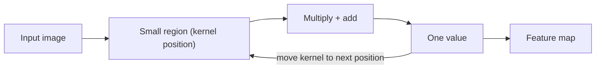
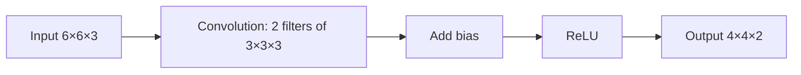

Naye ideas se pehle wo purani baatein jo chahiye. Agar aapko pata hai to seedha agle section par jao.

## Basics pehle

- Computer ko apple nahi dikhta. Use **numbers ka grid** dikhta hai, har **pixel** (picture banane wale chhote square dots) ke liye ek number. <Cite id="class-dl-chp4" loc="slide 2" />
- Colour image teen aise grids mein store hoti hai, red, green aur blue ke liye ek-ek. Har grid ko **channel** kehte hain. To 32×32 pixels ki RGB image 32×32×3 (height × width × channels) numbers ka block hai. <Cite id="class-dl-m4" loc="p. 8" />
- **Neuron** har input ko **weight** se multiply karta hai, **bias** add karta hai aur result ko activation function se guzarta hai. Weights aur biases hi **parameters** hain: wo numbers jo network seekhta hai.
- **ReLU** convolution ke baad use hone wala activation hai: negative values 0 ban jaati hain aur positive values waisi hi rehti hain. Example: [−2, 3, −1] ban jaata hai [0, 3, 0]. <Cite id="class-dl-chp4" loc="slide 28" />
- **Softmax** scores ko 0 aur 1 ke beech probabilities mein badalta hai jinka sum 1 hota hai. <Cite id="class-dl-chp4" loc="slide 28" />

## CNN kya hai?

<Box kind="definition">

**Convolutional neural network (CNN):** a type of deep neural network specially designed to work with images and other grid-like data. <Cite id="class-dl-chp4" loc="slide 5" />

**Easy definition (exam mein ye likho):** CNN is a deep learning model that automatically learns spatial features from images using convolutional filters. <Cite id="class-dl-chp4" loc="slide 5" />

</Box>

CNN **automatically important features seekhta hai** jaise edges, lines, corners, textures, shapes aur objects. Model ko manually batane ke bajaye ki kaun se features dekhne hain, CNN training ke dauran khud seekhta hai. Dusre classification algorithms ke mukable ise bahut kam pre-processing chahiye. <Cite id="class-dl-chp4" loc="slide 5" /> <Cite id="class-dl-m4" loc="p. 4" />

Design brain ke visual cortex se inspired hai. Har neuron sirf dikhne wale area ke ek restricted region par respond karta hai, jise **receptive field** kehte hain, aur aise kai fields overlap hokar poori picture cover karte hain. <Cite id="class-dl-m4" loc="p. 4" />

**Rozmarra ka example.** Aap crowd ki photo mein apne dost ko dhundte ho: aankhein ek chhote area par, phir agle par, aur har baar wahi sawal: "kya ye mere dost ka chehra jaisa lagta hai?" CNN image ko "small area by small area using a sliding window" dekhta hai, aur ye karne wala mathematical operation **convolution** kehlata hai. <Cite id="class-dl-chp4" loc="slide 4" />

Ye syllabus <Syl m="4" /> hai.

<Cite id="class-dl-chp4" loc="slide 5" />

```mermaid
%% caption: CNN ka simple idea, jaise teacher draw karte hain. Convolution aur pooling steps features dhundte hain; flatten aur fully connected layer decision lete hain.
flowchart LR
  A["Input image"] --> B["Convolution"]
  B --> C["Feature maps"]
  C --> D["Pooling"]
  D --> E["More convolution"]
  E --> F["More feature maps"]
  F --> G["Flatten"]
  G --> H["Fully connected layer"]
  H --> I["Output / prediction"]
```

## CNN ki zaroorat kyun?

Images mein **spatial information** hoti hai: paas ke pixels ek dusre se related hote hain. Teacher ke example mein aankh ke aas-paas ke pixels matter karte hain, aur pixels ki arrangement matter karti hai. CNN ke paanch main reasons: <Cite id="class-dl-chp4" loc="slide 5" />

1. Images mein bahut saare pixels hote hain.
2. Important features chhote regions mein milte hain.
3. Same feature alag-alag locations par aa sakta hai.
4. CNN automatically useful features seekhta hai.
5. Images ke liye CNN ko fully connected network se bahut kam parameters chahiye.

### Fully connected networks ki problem

**Fully connected** (dense) network mein har input har neuron se connected hota hai. <Cite id="class-dl-chp4" loc="slide 5" />

- 28 × 28 image mein 784 pixels hain. 100 neurons wale fully connected layer ko $784 \times 100 = 78{,}400$ weights chahiye.
- Badi RGB image 224 × 224 × 3 mein $224 \times 224 \times 3 = 150{,}528$ values hain. Inhe hazaaron neurons se jodne par parameters bahut ho jaate hain.

Isse paanch problems aati hain (list ke roop mein likho): <Cite id="class-dl-chp4" loc="slide 5" />

1. Too many parameters.
2. High computational cost.
3. Spatial information is lost.
4. No local feature detection.
5. The same feature at different locations is not handled efficiently.

### CNN ye problems kaise solve karta hai

CNN **teen important ideas** laata hai. <Cite id="class-dl-chp4" loc="slide 5" />

| Idea | Matlab | Example |
|---|---|---|
| **Local connectivity** | CNN ek time par ek chhota region dekhta hai (chhota filter use karke). Ye edges, corners aur textures jaise local features dhundta hai. | 3×3 filter image ka ek 3×3 region dekhta hai |
| **Weight sharing** | Same filter weights alag-alag locations par reuse hote hain. Same filter + different locations = weight sharing, isliye fewer parameters. | Ek 3×3 filter (9 weights) har position par use hota hai |
| **Pooling** | Pooling feature maps ka spatial size kam karta hai. Ye computation, memory aur agli layers ke values kam karta hai, aur important features par focus karta hai. | 8×8 feature map 4×4 ban jaata hai (2×2 window, stride 2) |

**Remember:** CNN = Local connectivity + Weight sharing + Pooling → Efficient feature learning from images. <Cite id="class-dl-chp4" loc="slide 5" />

CNN ka **big advantage** ye hai: feature (jaise edge) kahin bhi aa sakta hai, aur CNN use alag-alag locations par detect kar sakta hai. Teacher ke words mein CNN seekhta hai "this is an edge, wherever I find it". <Cite id="class-dl-chp4" loc="slide 4" />

### Fully connected network versus CNN

| Aspect | Fully connected network | CNN |
|---|---|---|
| Connection | Every input connected to every neuron | Local connection (using small filters) |
| Weights | Different weights for different connections | Same filter weights reused everywhere |
| Parameters | Very large | Much smaller |
| Spatial info | Does not naturally preserve spatial structure | Preserves and exploits spatial structure |
| Computation | More computationally expensive | More efficient |
| Feature detection | Location-specific | Same feature can be detected anywhere |

Class ye bhi kehti hai ki fully connected network tabular data ke liye best hai aur CNN images ke liye best hai. <Cite id="class-dl-chp4" loc="slide 67" />

### CNN kya seekhta hai?

CNN step by step seekhta hai, simple se complex tak. <Cite id="class-dl-chp4" loc="slide 4" />

- **Early layers:** edges, lines, corners.
- **Middle layers:** curves aur shapes (edges mil kar curves aur shapes banate hain).
- **Deeper layers:** object parts jaise apple ka stem, leaf aur body.
- **Final layers:** complete object pehchaanti hain.

Pehli convolution layer **low-level features** pakadti hai jaise edges, colour aur gradient direction. Layers badhne par network **high-level features** bhi seekhta hai. <Cite id="class-dl-m4" loc="p. 14" />

## Convolution operation

<Box kind="definition">

**Convolution** is an operation that applies a small filter (kernel) to an input image to detect useful features such as edges, lines, textures, and patterns. <Cite id="class-dl-chp4" loc="slide 6" />

</Box>

**Ye kaunsi problem solve karta hai?** Har pixel mein information hoti hai. Agar har pixel ko har neuron se jodein to parameters bahut ho jaate hain, training slow ho jaati hai, memory zyada lagti hai, paas ke pixels ka spatial relationship kho sakta hai aur model aasaani se overfit ho sakta hai. <Cite id="class-dl-chp4" loc="slide 6" />

### Filter (kernel)

<Box kind="definition">

**Filter / kernel:** a small matrix of learnable weights used to detect features in an image. Ye convolution ke dauran image par move karta hai. <Cite id="class-dl-chp4" loc="slide 10" />

</Box>

- Ise **convolution filter** ya **kernel** bhi kehte hain. <Cite id="class-dl-chp4" loc="slide 6" />
- Filter ek **pattern detector** hai. Har chhote region par wo puchhta hai: "Can I find my pattern here?" <Cite id="class-dl-chp4" loc="slide 8" />
- **Ek filter ek hi type ka pattern detect karta hai** (edge, texture ya koi aur pattern). CNN kai filters use karta hai, isliye har filter alag feature map banata hai. <Cite id="class-dl-chp4" loc="slide 8" />
- Filter ke numbers insaan **nahi** chunta. CNN weights ko training mein seekhta hai: prediction → loss → backpropagation → weights updated. <Cite id="class-dl-chp4" loc="slide 8" />
- Kernel ek chhote matrix se represent hota hai jaise 3×3×1. <Cite id="class-dl-m4" loc="p. 9" />

**Rozmarra ka example.** Filter ek special chashme jaisa hai. Ek chashma sirf edges dikhata hai, dusra sirf texture. Har chashma kuch alag notice karne mein help karta hai. <Cite id="class-dl-chp4" loc="slide 8" />

### Ye kaise kaam karta hai, step by step

Filter ko image ke ek chhote region par rakho. Har position par: <Cite id="class-dl-chp4" loc="slide 7" />

1. Image ka ek chhota region lo.
2. Har image value ko kernel ki corresponding value se multiply karo.
3. Saari multiplied values add karo.
4. Result feature map mein store karo.
5. Kernel ko agli position par le jao.

Filter **stride** ke hisaab se right mein chalta hai jab tak poori width na nikal jaye. Phir wo left se neeche hop karke dobara wahi karta hai, jab tak poori image cover na ho jaye. <Cite id="class-dl-m4" loc="p. 11" />

**Sum 1: ek chhoti image ko haath se convolve karo.** <Cite id="class-dl-chp4" loc="slide 7" />

<Sum>

<Given>

3×3 input aur 2×2 kernel, stride 1, no padding.

$$
\text{Input} = \begin{bmatrix} 1 & 2 & 3 \\ 4 & 5 & 6 \\ 7 & 8 & 9 \end{bmatrix}
\qquad
\text{Kernel} = \begin{bmatrix} 1 & 0 \\ 0 & 1 \end{bmatrix}
$$

</Given>

<Find>

feature map.

</Find>

<Steps>

1. **Output ka size.** 2×2 filter 2 positions across aur 2 down fit hota hai, kyunki $3 - 2 + 1 = 2$. To feature map 2×2 hai.
2. **Top-left region** (1, 2, 4, 5): har image value ko uske neeche wali kernel value se multiply karke add karo, kyunki kernel ke 0 do pixels ko band kar dete hain:

   $$
   1\cdot1 + 2\cdot0 + 4\cdot0 + 5\cdot1 = 6
   $$
3. **Ek step right**, region (2, 3, 5, 6), kyunki stride 1 hai:

   $$
   2\cdot1 + 3\cdot0 + 5\cdot0 + 6\cdot1 = 8
   $$
4. **Ek row neeche**, region (4, 5, 7, 8), kyunki filter aur right nahi ja sakta:

   $$
   4\cdot1 + 5\cdot0 + 7\cdot0 + 8\cdot1 = 12
   $$
5. **Ek step right**, region (5, 6, 8, 9):

   $$
   5\cdot1 + 6\cdot0 + 8\cdot0 + 9\cdot1 = 14
   $$

</Steps>

<Answer>

feature map $= \begin{bmatrix} 6 & 8 \\ 12 & 14 \end{bmatrix}$ (2×2).

</Answer>

<Box kind="verify">

Is kernel mein 1 sirf diagonal par hai, isliye har output apne region ka "top-left value + bottom-right value" hai. Image mein har number apne left wale se 1 zyada hai, to ek step right par output mein $1 + 1 = 2$ badhna chahiye: 6 → 8 aur 12 → 14. Har number apne upar wale se 3 zyada hai, to ek step neeche par $3 + 3 = 6$ badhna chahiye: 6 → 12 aur 8 → 14. Chaaron values match karti hain.

</Box>

</Sum>

**Class ka edge-detecting example.** Rows [1, 0, −1] wala edge filter region [1 2 3; 4 5 6; 7 8 9] par lagane se $(1 - 3) + (4 - 6) + (7 - 9) = -6$ milta hai. Saare products ka sum output feature map ki ek value hai. <Cite id="class-dl-chp4" loc="slide 6" />

**Ek bada worked example (4×4 image, stride 1).** <Cite id="class-dl-chp4" loc="slide 9" />

<Sum>

<Given>

1 se 16 tak numbers row-wise likhi 4×4 image, 2×2 filter $\begin{bmatrix} 1 & 0 \\ 0 & 1 \end{bmatrix}$, stride 1.

</Given>

<Find>

feature map.

</Find>

<Steps>

1. **Size.** $(4 - 2)/1 + 1 = 3$, to feature map 3×3 hai (9 positions).
2. **Image ki row 1.** Region (1, 2, 5, 6) se $1 + 6 = 7$. Right: (2, 3, 6, 7) se $2 + 7 = 9$. Right: (3, 4, 7, 8) se $3 + 8 = 11$.
3. **Ek pixel neeche.** Region (5, 6, 9, 10) se 15, phir 17, phir 19.
4. **Phir neeche.** Region (9, 10, 13, 14) se 23, phir 25, phir 27.

</Steps>

<Answer>

$\begin{bmatrix} 7 & 9 & 11 \\ 15 & 17 & 19 \\ 23 & 25 & 27 \end{bmatrix}$

</Answer>

<Box kind="verify">

Is filter ke saath har output (top-left number) + (bottom-right number) $= a + (a + 5) = 2a + 5$ hai, jahan $a$ top-left number hai. $a = 1, 2, 3$ ke liye 7, 9, 11 aate hain aur $a = 5$ ke liye 15. Sab match karte hain, aur ek step right par 2 badhta hai jabki ek step neeche par 8 ($2 \times 4$).

</Box>

</Sum>

### Convolution important kyun hai?

Ye local features detect karta hai, spatial information preserve karta hai, kam parameters use karta hai, features automatically seekhta hai, aur same feature ko alag-alag locations par detect karta hai. <Cite id="class-dl-chp4" loc="slide 6" />

## Feature map

<Box kind="definition">

**Feature map:** the output produced after applying a filter to an image. It shows **where** a specific feature (like an edge or a texture) is detected and how strongly it is present at different locations. <Cite id="class-dl-chp4" loc="slide 16" />

</Box>

- **Memory trick:** Filter = what to look for. Feature map = where it was found. Filter learnable weights ka chhota matrix (detector) hai. Feature map convolution ka output (detection result) hai. <Cite id="class-dl-chp4" loc="slide 17" />
- **Ek filter → ek feature map.** Agar K filters use karein to K feature maps milte hain. <Cite id="class-dl-chp4" loc="slide 23" />
- Filter training mein seekha jaata hai. Feature map convolution ke dauran banta hai. <Cite id="class-dl-chp4" loc="slide 17" />
- **Alag-alag layers ke feature maps:** pehli layers edges, lines aur corners deti hain; beech ki layers edges ko curves aur shapes mein jodti hain; deeper layers shapes ko object parts aur complete object mein jodti hain. <Cite id="class-dl-chp4" loc="slide 17" />
- Feature map ka size input size N, filter size F, padding P aur stride S par depend karta hai. <Cite id="class-dl-chp4" loc="slide 17" />

## Stride

<Box kind="definition">

**Stride** is the number of pixels by which the filter moves across the image at each step. <Cite id="class-dl-chp4" loc="slide 12" />

</Box>

- **Stride = 1:** filter ek time par ek pixel chalta hai. Ye zyada positions check karta hai, isliye output bada hota hai.
- **Stride = 2:** filter ek baar mein do pixel jump karta hai. Ye kam positions check karta hai, isliye output chhota hota hai.
- 5×5 image par 3×3 kernel aur stride 1 ke saath kernel 9 baar shift hota hai. <Cite id="class-dl-m4" loc="p. 11" />
- Stride distance hai, direction nahi: wo batata hai filter kitna door jump karta hai. Stride "HOW FAR" hai, filter "WHAT" hai. <Cite id="class-dl-chp4" loc="slide 12" />

**Stride = 2 kyun use karein?** Stride feature map ka spatial size kam karne mein help karta hai. <Cite id="class-dl-chp4" loc="slide 12" />

**Exam answer (stride).** Stride determines how far the filter moves at each step. Increasing the stride reduces the number of positions where the filter is applied, thereby reducing the output size. <Cite id="class-dl-chp4" loc="slide 19" />

| Stride | Filter movement | Output size |
|---|---|---|
| 1 | Moves 1 pixel | Larger |
| 2 | Moves 2 pixels | Smaller |
| 3 | Moves 3 pixels | Even smaller |

<Cite id="class-dl-chp4" loc="slide 13" />

## Padding

<Box kind="definition">

**Padding** adds extra pixels (usually zeros) around the image. It allows the filter to be applied at the boundary and helps control the output size, preventing the image from shrinking too much. <Cite id="class-dl-chp4" loc="slide 14" />

</Box>

**Padding ki zaroorat kyun.** <Cite id="class-dl-chp4" loc="slide 14" /> <Cite id="class-dl-chp4" loc="slide 15" />

1. **Padding ke bina image jaldi chhoti ho jaati hai.** 5×5 image par 3×3 filter se 3×3 banta hai, aur ek aur convolution ke baad 1×1.
2. **Border pixels ko kam chance milta hai.** Corner aur border pixels beech ke pixels se kam baar use hote hain. Padding border pixels ko zyada hissa lene ka chance deta hai.
3. **Ye image size (spatial size) preserve karta hai** jab hum use same rakhna chahte hain.

Zeros ek row upar, ek row neeche, ek column left aur ek column right mein jodte hain, isliye 3×3 image 5×5 ban jaati hai. Ise **zero padding** bhi kehte hain. <Cite id="class-dl-chp4" loc="slide 15" />

### Valid, same aur full padding

| Type | Padding | Kya hota hai | Output size |
|---|---|---|---|
| **Valid** ("no padding") | P = 0 | Operation sirf wahan hota hai jahan filter input ko poori tarah overlap karta hai. Output chhota ho jaata hai. | $N - F + 1$ |
| **Same** | Stride 1 ke liye: $P = (F - 1)/2$ | Zeros aise jode jaate hain ki output ki height aur width input jaisi rahe. | Same as input |
| **Full** | $P = F - 1$ | Filter poori tarah original image ke bahar bhi ja sakta hai. Output bada ho jaata hai. | Larger than input |

<Cite id="class-dl-m4" loc="p. 18" /> <Cite id="class-dl-m4" loc="p. 19" /> <Cite id="class-dl-chp4" loc="slide 37" />

- Valid tab use hota hai jab size kam karna ho ya computation zyada matter kare. Same tab jab network mein spatial size same rakhna ho. <Cite id="class-dl-m4" loc="p. 18" /> <Cite id="class-dl-m4" loc="p. 19" />
- Same padding ka example: 5×5 image, 3×3 filter aur stride 1 ko $P = (3 - 1)/2 = 1$ chahiye, aur output 5×5 hota hai. <Cite id="class-dl-chp4" loc="slide 37" />
- Valid padding ka example: 5×5 input par 3×3 filter se 3×3 output milta hai. <Cite id="class-dl-chp4" loc="slide 37" />
- Full convolution ka example: 5×5 input, 3×3 filter aur $P = F - 1 = 2$ se $(5 - 3 + 2 \cdot 2)/1 + 1 = 7$ milta hai, to output 7×7 hai. <Cite id="class-dl-chp4" loc="slide 37" />

**Memory trick.** Valid: no padding, output chhota ho jaata hai. Same: padding added, output same size rehta hai. <Cite id="class-dl-chp4" loc="slide 15" />

**Exam answer (padding).** Padding is the process of adding extra pixels, usually zeros, around the boundary of an input image before convolution to preserve spatial dimensions and allow better processing of border features. <Cite id="class-dl-chp4" loc="slide 15" />

<Box kind="pitfall">

**Padding stride nahi hai.** Padding image ke aas-paas pixels jodta hai. Stride control karta hai ki filter kitna door chalta hai. <Cite id="class-dl-chp4" loc="slide 17" />

</Box>

## Input, output aur filter size ka relation

Output ka size chaar numbers par depend karta hai. <Cite id="class-dl-chp4" loc="slide 7" />

<Box kind="key">

$$
\text{Output} = \left\lfloor \frac{N - F + 2P}{S} \right\rfloor + 1
$$

N = input size, F = filter size, P = padding, S = stride. Symbol $\lfloor\ \rfloor$ ka matlab round down (floor operation). General case ke liye ise use karo. <Cite id="class-dl-chp4" loc="slide 19" />

</Box>

- **Padding ke bina** (P = 0) formula $(N - F)/S + 1$ hai. $N = 7$, $F = 3$ ke liye: stride 1 se 5, stride 2 se 3, aur stride 3 se 2.33 aata hai, jo whole number nahi hai, isliye wo stride theek se fit nahi hota. <Cite id="class-dl-m4" loc="p. 20" />
- **Round down kyun?** Filter sirf wahan rakha ja sakta hai jahan wo (padded) image ke andar poora fit ho. Adhoori position use nahi hoti. <Cite id="class-dl-chp4" loc="slide 21" />
- **Output depth** = filters ki sankhya (K). <Cite id="class-dl-chp4" loc="slide 26" />
- **Bada stride → chhota output. Zyada padding → bada output.** <Cite id="class-dl-chp4" loc="slide 21" />

**Sum 2: class ke paanch practice questions.** 3×3 input aur 2×2 filter. Har case mein output ka size nikalo. <Cite id="class-dl-chp4" loc="slide 22" /> <Cite id="class-dl-chp4" loc="slide 21" />

<Sum>

<Given>

$N = 3$, $F = 2$. Cases: (1) no padding aur stride 1 (jab kuch na kaha ho to yahi default), (2) $P = 0$, $S = 1$, (3) $P = 0$, $S = 2$, (4) $P = 1$, $S = 1$, (5) $P = 1$, $S = 2$.

</Given>

<Find>

har case mein output size.

</Find>

<Steps>

1. **Cases 1 aur 2** same hain: $(3 - 2 + 0)/1 + 1 = 2$, to **2×2**.
2. **Case 3:** $(3 - 2 + 0)/2 + 1 = 0.5 + 1 = 1.5$. Round down karke 1, kyunki sirf ek position poori fit hoti hai, to **1×1**.
3. **Case 4:** $(3 - 2 + 2)/1 + 1 = 3 + 1 = 4$, to **4×4**.
4. **Case 5:** $(3 - 2 + 2)/2 + 1 = 1.5 + 1 = 2.5$. Round down karke 2, to **2×2**.

</Steps>

<Answer>

(1) 2×2, (2) 2×2, (3) 1×1, (4) 4×4, (5) 2×2.

</Answer>

<Box kind="verify">

Formula ke bajaye positions gino. Case 3 mein filter column 1 se shuru hota hai aur agla start (column 3) ko column 4 chahiye jo exist nahi karta, isliye har side par 1 position hai. Case 5 mein padded image 5 wide hai, starts columns 1 aur 3 hain (column 5 par start ko column 6 chahiye), isliye har side par 2. Cases 4 aur 5 teacher ki table ke 4×4 aur 2×2 se match karte hain.

</Box>

</Sum>

**Class ke teen aur numerical questions.** <Cite id="class-dl-chp4" loc="slide 59" /> <Cite id="class-dl-chp4" loc="slide 60" /> <Cite id="class-dl-chp4" loc="slide 61" />

<Sum>

<Given>

(a) 28×28 input aur 7×7 filter, stride 1. (b) 224×224×3 input, paanch 7×7 kernels, stride 1, zero padding (P = 0). (c) 32×32×3 input, paanch 3×3 kernels, no padding, stride 1.

</Given>

<Find>

agli layer ko jo data milta hai uska size.

</Find>

<Steps>

1. **(a)** $(28 - 7 + 0)/1 + 1 = 21 + 1 = 22$, to output **22×22** hai.
2. **(b)** Height aur width: $(224 - 7 + 0)/1 + 1 = 217 + 1 = 218$. Depth = kernels ki sankhya = 5. To **218×218×5**. Input ke 3 channels output depth mein nahi aate.
3. **(c)** Height aur width: $(32 - 3 + 0)/1 + 1 = 29 + 1 = 30$. Depth = 5. To **30×30×5**.
4. **Agar (b) ke parameters puchhe jaayein** (assignment version), har kernel 7×7×3 hai aur ek bias: $(7 \cdot 7 \cdot 3 + 1) \times 5 = 148 \times 5 = 740$.

</Steps>

<Answer>

(a) 22×22, (b) 218×218×5 (740 parameters), (c) 30×30×5.

</Answer>

<Box kind="verify">

Positions rule se check karo: size F ka filter stride 1 par $N - F + 1$ jagah fit hota hai. (a) $28 - 7 + 1 = 22$. (b) $224 - 7 + 1 = 218$. (c) $32 - 3 + 1 = 30$. Teeno match karte hain.

</Box>

</Sum>

## Multichannel (RGB) convolution

Colour image mein teen channels (R, G, B) hote hain, isliye uski shape H × W × 3 hai. Us par convolution ek cheez mein alag hai: **filter ke bhi 3 channels hote hain.** <Cite id="class-dl-chp4" loc="slide 23" />

- RGB input ke liye filter depth input channels se match honi chahiye. RGB image par 3×3 filter asal mein 3×3×3 hota hai. <Cite id="class-dl-chp4" loc="slide 24" />
- Har position par filter R, G aur B par alag-alag multiply-and-add karta hai, phir teeno results aur bias add karta hai: $\text{Output} = R_{conv} + G_{conv} + B_{conv} + b$. Isse **ek value** milti hai. <Cite id="class-dl-chp4" loc="slide 24" />
- Filter stride ke hisaab se chalta hai. Saari values mil kar **ek feature map** banati hain. K filters se K feature maps. <Cite id="class-dl-chp4" loc="slide 23" />

**Exam answer (RGB convolution).** For an RGB image, the filter has three channel parts. At each position, convolution is performed on R, G and B separately, their results are added together along with bias, and this gives one output value. As the filter moves across the image, these values form one feature map. <Cite id="class-dl-chp4" loc="slide 23" />

**Sum 3: convolution layer ka output volume.** <Cite id="class-dl-chp4" loc="slide 26" />

<Sum>

<Given>

input volume 32×32×3, 10 filters of size 5×5, stride 1, padding 2.

</Given>

<Find>

output volume.

</Find>

<Steps>

1. **Har filter 5×5×3 hai**, kyunki filter depth input depth (3) ke barabar honi chahiye.
2. **Height:** $(32 + 2 \cdot 2 - 5)/1 + 1 = 31 + 1 = 32$.
3. **Width:** input square hai, isliye width bhi 32.
4. **Depth** = filters ki sankhya = 10, kyunki har filter ek 32×32 feature map deta hai aur 10 maps stack ho jaate hain.

</Steps>

<Answer>

output volume = 32 × 32 × 10.

</Answer>

<Box kind="verify">

5×5 filter ke saath padding 2 "same" padding hai: $P = (F - 1)/2 = (5 - 1)/2 = 2$. Same padding height aur width ko nahi badalta, isliye 32×32 hi expected hai.

</Box>

</Sum>

<Box kind="pitfall">

**Input depth, output depth nahi hai.** Input depth = 3 (RGB channels). Output depth = filters ki sankhya = 10. <Cite id="class-dl-chp4" loc="slide 26" />

</Box>

## Ek convolution layer: bias, ReLU aur stacking

<Box kind="definition">

A convolution layer applies multiple learnable filters to the input, adds a bias to each filter's output, applies an activation function (ReLU), and produces multiple feature maps that are stacked to form the output volume. <Cite id="class-dl-chp4" loc="slide 27" />

</Box>

Simple flow: input → convolution → add bias → activation (ReLU) → feature maps (output). <Cite id="class-dl-chp4" loc="slide 29" />

**6×6×3 input aur 3×3×3 ke 2 filters lo, stride 1, padding 0.** <Cite id="class-dl-chp4" loc="slide 29" />

1. Filter 1 $(6 - 3)/1 + 1 = 4$ ka feature map deta hai, yaani 4×4. Filter 2 alag weights ke saath ek aur 4×4 map deta hai.
2. Har filter ke output mein ek bias jodo.
3. Har value par ReLU lagao: negative → 0, positive → same. −5 ban jaata hai 0 aur 2 rehta hai 2.
4. Dono 4×4 maps ko depth ke saath stack karo. Output volume **4×4×2** hai. Output depth filters ki sankhya ke barabar hai.

**Yaad rakhne ke quick rules.** <Cite id="class-dl-chp4" loc="slide 27" />

1. Filter depth = input depth.
2. One filter produces one feature map.
3. Number of filters = output depth.
4. Bias is one per filter.
5. ReLU is applied after convolution + bias.

### Convolution layer ke parameters gina

<Box kind="key">

$$
\text{Parameters} = (F \times F \times D + 1) \times K
$$

F = filter size, D = input depth (channels), K = filters ki sankhya, +1 = har filter ka bias. <Cite id="class-dl-chp4" loc="slide 27" />

</Box>

Parameter count mein stride aur padding use **nahi** hote. Wo output size badalte hain, weights ki sankhya nahi. <Cite id="class-dl-chp4" loc="slide 66" /> Filter ke weights har position par same rehte hain (weight sharing), isliye image ka size matter nahi karta.

**Sum 4: AlexNet ki pehli layer.** Input 227×227×3, 96 kernels of size 11×11, stride 4, padding 0. Parameters ki sankhya nikalo. <Cite id="class-dl-chp4" loc="slide 66" /> <Cite id="class-dl-m4" loc="p. 32" />

<Sum>

<Given>

input channels $C = 3$, kernel size $K = 11$, kernels ki sankhya $N = 96$.

</Given>

<Find>

pehli conv layer ke parameters.

</Find>

<Steps>

1. **Har kernel ke weights:** $11 \times 11 \times 3 = 363$, kyunki har kernel teeno channels cover karta hai.
2. **Saare kernels ke weights:** $363 \times 96 = 34{,}848$.
3. **Biases:** har kernel ka ek, yaani 96.
4. **Total:** $34{,}848 + 96 = 34{,}944$. Stride 4 aur padding 0 use nahi hue.

</Steps>

<Answer>

34,944 parameters.

</Answer>

<Box kind="verify">

Formula ka dusra form use karo, $(F \times F \times D + 1) \times K = (363 + 1) \times 96 = 364 \times 96 = 34{,}944$. Wahi answer.

</Box>

</Sum>

**Sum 5: class mein puchha gaya exercise.** 64×64 size ke 32 input channels, 3×3 ke 64 filters, stride 1, no padding, har filter har channel par lagta hai. Total weights nikalo. <Cite id="class-dl-m4" loc="p. 30" />

<Sum>

<Given>

input 64×64×32, 3×3 ke 64 filters, stride 1, padding 0.

</Given>

<Find>

weights (aur biases aur output size).

</Find>

<Steps>

1. **Har filter ke weights:** $3 \times 3 \times 32 = 288$, kyunki filter 32 channels cover karta hai.
2. **64 filters ke weights:** $288 \times 64 = 18{,}432$.
3. **Biases:** har filter ka ek, yaani 64. Biases ke saath total $18{,}432 + 64 = 18{,}496$.
4. **Output size** (diagram ke liye): $(64 - 3)/1 + 1 = 62$, to 62×62×64.

</Steps>

<Answer>

18,432 weights (64 biases ke saath 18,496 parameters), output 62×62×64.

</Answer>

<Box kind="verify">

Formula se dobara: $(3 \cdot 3 \cdot 32 + 1) \times 64 = 289 \times 64 = 18{,}496$, jo $18{,}432 + 64$ ke barabar hai.

</Box>

</Sum>

**Sum 6: RGB image par do layers (assignment question).** <PYQ id="assignment-2/q4d" /> 100×100×3 image layer 1 (8 filters, 3×3, stride 1, padding 0) se, phir layer 2 (1 filter, 3×3, stride 1, padding 0) se guzarti hai. <Cite id="class-dl-qb2" loc="Q4" />

<Sum>

<Given>

input 100×100×3. Layer 1: 3×3 ke 8 filters. Layer 2: 3×3 ka 1 filter. Stride 1, padding 0.

</Given>

<Find>

har layer ka output volume aur trainable parameters (bias ke saath), aur total.

</Find>

<Steps>

1. **Layer 1 output:** $(100 - 3)/1 + 1 = 98$, depth 8, to **98×98×8**.
2. **Layer 1 parameters:** $(3 \times 3 \times 3 + 1) \times 8 = 28 \times 8 = 224$.
3. **Layer 2 output:** ab input 98×98×8 hai, to $(98 - 3)/1 + 1 = 96$ aur depth 1, yaani **96×96×1**.
4. **Layer 2 parameters:** filter depth naye input depth 8 ke barabar honi chahiye, to $(3 \times 3 \times 8 + 1) \times 1 = 73$.
5. **Total:** $224 + 73 = 297$.

</Steps>

<Answer>

layer 1: 98×98×8, 224 parameters. Layer 2: 96×96×1, 73 parameters. Total 297.

</Answer>

<Box kind="verify">

Padding ke bina har 3×3 convolution height aur width se 2 ghatata hai: $100 \to 98 \to 96$. Output depth filters ki sankhya ke barabar hai (8, phir 1). Dusri layer ke filter ki depth (8) pehli layer ki output depth ke barabar hai, isliye har filter ke weights $3 \cdot 3 \cdot 8 = 72$, plus 1 bias = 73.

</Box>

</Sum>

**Interpretation jo likhni hai.** Height aur width isliye ghatte hain kyunki padding nahi hai (har 3×3 filter har side se 1 pixel kho deta hai). Output depth filters ki sankhya ke barabar hai, kyunki har filter ek feature map banata hai. Parameters filter size, input depth aur filters ki sankhya par depend karte hain, image size par nahi.

## Pooling layer

<Box kind="definition">

A **pooling layer** is a layer in CNN used to reduce the size of feature maps while keeping the most important information. <Cite id="class-dl-chp4" loc="slide 31" />

</Box>

**Pooling kyun use karte hain?** <Cite id="class-dl-chp4" loc="slide 31" />

- Feature maps ki height aur width kam karna.
- Computation kam karna.
- Agli layers ke parameters kam karna.
- Model ko position ke chhote changes ke prati kam sensitive banana.
- Important features ko rakhna.

Pooling layer dominant features bhi nikalti hai jo rotation aur position invariant hote hain, jisse training effective hoti hai. Ye sabse useful information ko rakhne aur bekaar information ko phenkne mein help karti hai, aur resolution aur dimension kam karti hai, isliye computational complexity bhi kam hoti hai. <Cite id="class-dl-m4" loc="p. 34" />

**Pooling kaise kaam karta hai?** Ek chhoti window (jaise 2×2) feature map par move karti hai. Har position par wo ek operation karti hai, aur window stride ke hisaab se chalti hai. <Cite id="class-dl-chp4" loc="slide 31" />

- **Maximum** → max pooling.
- **Minimum** → min pooling.
- **Average** → average pooling.

(Module 4 notes sum pooling ka bhi zikr karte hain.) <Cite id="class-dl-m4" loc="p. 34" />

<Box kind="key">

Pooling usually changes **height × width** but does **not** change **depth (channels)**. <Cite id="class-dl-chp4" loc="slide 31" />

</Box>

### Max pooling

<Box kind="definition">

**Max pooling** selects the largest value from each pooling region. <Cite id="class-dl-chp4" loc="slide 32" />

</Box>

### Average pooling aur min pooling

- **Average pooling** calculates the average of all values inside the pooling region. <Cite id="class-dl-chp4" loc="slide 33" />
- **Min pooling** selects the smallest value from each pooling region. Ye sabse weak feature rakhta hai aur max pooling se kam use hota hai. <Cite id="class-dl-chp4" loc="slide 34" />

**Sum 7: ek hi map par max, average aur min pooling.** <Cite id="class-dl-chp4" loc="slide 32" /> <Cite id="class-dl-chp4" loc="slide 33" /> <Cite id="class-dl-chp4" loc="slide 34" />

<Sum>

<Given>

4×4 feature map, 2×2 pooling window, stride 2.

$$
\begin{bmatrix} 4 & 3 & 1 & 5 \\ 1 & 3 & 4 & 8 \\ 4 & 5 & 4 & 3 \\ 6 & 5 & 9 & 4 \end{bmatrix}
$$

</Given>

<Find>

max, average aur min pooling ka output.

</Find>

<Steps>

1. **Size:** $(4 - 2)/2 + 1 = 2$, to har output 2×2 hai.
2. **Chaar regions mein baanto,** top-left (4, 3, 1, 3), top-right (1, 5, 4, 8), bottom-left (4, 5, 6, 5), bottom-right (4, 3, 9, 4).
3. **Max** (har region ka sabse bada): 4, 8, 6, 9.
4. **Average** (sum ko 4 se divide): $11/4 = 2.75$, $18/4 = 4.5$, $20/4 = 5$, $20/4 = 5$.
5. **Min** (har region ka sabse chhota): 1, 1, 4, 3.

</Steps>

<Answer>

max $= \begin{bmatrix} 4 & 8 \\ 6 & 9 \end{bmatrix}$, average $= \begin{bmatrix} 2.75 & 4.5 \\ 5 & 5 \end{bmatrix}$, min $= \begin{bmatrix} 1 & 1 \\ 4 & 3 \end{bmatrix}$.

</Answer>

<Box kind="verify">

Har region mein min ≤ average ≤ max hona chahiye: $1 \le 2.75 \le 4$, $1 \le 4.5 \le 8$, $4 \le 5 \le 6$, $3 \le 5 \le 9$. Saath hi chaar region sums $11 + 18 + 20 + 20 = 69$ saare 16 numbers ke sum ke barabar hain ($13 + 16 + 16 + 24 = 69$).

</Box>

</Sum>

**Kaunsa use hota hai?** Max pooling sabse zyada use hota hai. Ye noise suppressant bhi hai: ye noisy (weak) activations ko phenk deta hai aur dimension kam karta hai. Average pooling sirf dimension kam karta hai. Isliye max pooling aam taur par average pooling se behtar kaam karta hai. <Cite id="class-dl-chp4" loc="slide 31" /> <Cite id="class-dl-m4" loc="p. 35" />

Agar filter kisi location par edge ko strongly detect karta hai, to max pooling wo strong value rakh leta hai. <Cite id="class-dl-chp4" loc="slide 32" />

### Pooling ka output size

Padding 0 ke saath: $\text{Output} = (N - F)/S + 1$, jahan N input size (height ya width), F pooling window size aur S stride hai. Example: $N = 8$, $F = 2$, $S = 2$ se $(8 - 2)/2 + 1 = 4$ milta hai, to 8×8 ban jaata hai 4×4 aur depth same rehti hai. <Cite id="class-dl-chp4" loc="slide 31" />

**Key points.** Pooling feature map ko chhota karta hai. Max pooling sabse zyada use hota hai. Window size aur stride output size control karte hain. Depth nahi badalti. <Cite id="class-dl-chp4" loc="slide 31" />

**Ek poora chhota example: convolution → ReLU → max pooling.** <Cite id="class-dl-chp4" loc="slide 35" />

**Sum 8: 6×6 image par convolution → ReLU → max pooling (assignment question).** <Cite id="class-dl-qb2" loc="Q4" /> <PYQ id="assignment-2/q4e" />

<Sum>

<Given>

6×6×1 image, rows [1, 0, −1] wala 3×3 filter, stride 1, padding 0, phir ReLU, phir 2×2 max pooling stride 2 ke saath.

$$
\text{Image} = \begin{bmatrix} 3 & 0 & 1 & 2 & 1 & 0 \\ 1 & 2 & 4 & 3 & 1 & 2 \\ 0 & 1 & 3 & 5 & 3 & 1 \\ 2 & 3 & 6 & 4 & 2 & 1 \\ 1 & 2 & 4 & 3 & 1 & 0 \\ 0 & 1 & 2 & 2 & 1 & 1 \end{bmatrix}
$$

</Given>

<Find>

(a) output size, (b) 4×4 feature map, (c) ReLU ke baad, (d) max pooling ke baad, (e) trainable parameters.

</Find>

<Steps>

1. **Output size.** $W_1 = H_1 = 6$, $D_1 = 1$, $F = 3$, $S = 1$, $P = 0$, $K = 1$. To $W_2 = (6 - 3 + 0)/1 + 1 = 4$, $H_2 = 4$, $D_2 = 1$. Output 4×4×1 hai.
2. **Is filter ka shortcut.** Filter ki har row [1, 0, −1] hai, isliye image ki har row ke liye filter ke neeche wale 3 numbers mein (pehla number − teesra number) lo, phir teeno rows add karo. Pehle output ke liye: row 1 se $3 - 1 = 2$, row 2 se $1 - 4 = -3$, row 3 se $0 - 3 = -3$, to $2 - 3 - 3 = -4$.
3. **Har position par yahi karo.** Feature map hai

   $$
   \begin{bmatrix} -4 & -7 & 3 & 7 \\ -10 & -6 & 7 & 8 \\ -10 & -6 & 7 & 10 \\ -9 & -3 & 8 & 7 \end{bmatrix}
   $$
4. **ReLU** (negative → 0):

   $$
   \begin{bmatrix} 0 & 0 & 3 & 7 \\ 0 & 0 & 7 & 8 \\ 0 & 0 & 7 & 10 \\ 0 & 0 & 8 & 7 \end{bmatrix}
   $$
5. **Max pooling, 2×2, stride 2.** Chaar blocks se $\max(0,0,0,0) = 0$, $\max(3,7,7,8) = 8$, $\max(0,0,0,0) = 0$ aur $\max(7,10,8,7) = 10$ milte hain.
6. **Parameters:** $(3 \cdot 3 \cdot 1 + 1) \times 1 = 10$.

</Steps>

<Answer>

(a) 4×4×1. (b) step 3 ka feature map. (c) step 4 ka ReLU map. (d) $\begin{bmatrix} 0 & 8 \\ 0 & 10 \end{bmatrix}$. (e) 10 parameters.

</Answer>

<Box kind="verify">

Feature map ki saari 16 values ka sum = (har image row ke "pehla − teesra" ke row totals) × (us row ko kitne outputs use karte hain: rows 1 se 6 ke liye 1, 2, 3, 3, 2, 1) ke barabar hona chahiye. Ye row totals 2, 0, −3, 2, 2, −1 hain, to weighted sum $2 + 0 - 9 + 6 + 4 - 1 = 2$. Feature map ka sum (row by row) $-1 - 1 + 1 + 3 = 2$ hai. Dono match karte hain.

</Box>

</Sum>

**Interpretation jo likhni hai.** 6×6 image 4×4 ban gayi (no padding), phir 2×2 (pooling se). Filter [1, 0, −1] vertical edge par react karta hai (left side right se badi): right ki badi positive values dikhati hain ki aisi edges kahan strong hain. ReLU ne negative responses hata diye aur pooling ne har block ka sabse strong response rakha.

## Poora CNN architecture

Convolution layer aur pooling layer milkar CNN ki i-th layer banate hain. Images kitni complex hain uske hisaab se aisi layers badhai ja sakti hain taaki low-level details aur achhe se pakde jaayein, lekin zyada computational power ki keemat par. <Cite id="class-dl-m4" loc="p. 36" />

Basic CNN, step by step. <Cite id="class-dl-chp4" loc="slide 28" />

| Step | Layer | Ye kya karti hai |
|---|---|---|
| 1 | **Input** | Image CNN ko pixel values ke roop mein di jaati hai. |
| 2 | **Convolution + ReLU** | Filters input par slide karke edges, lines, corners jaise features detect karte hain. Ek filter ek feature map deta hai. |
| 3 | **Pooling** (max pooling) | Har region ki maximum value rakhta hai aur size kam karta hai. |
| 4 | **More convolution + ReLU** | Zyada complex features seekhta hai (curves, textures, object parts). |
| 5 | **Pooling** | Size dobara kam karta hai. |
| 6 | **Flatten** | 3D feature maps ko 1D vector mein badalta hai. |
| 7 | **Fully connected (dense)** | Pichhli layer ke saare neurons is layer ke neurons se connected hote hain. Ye seekhe hue features ko combine karta hai. |
| 8 | **Softmax** (output layer) | Scores ko 0 aur 1 ke beech probabilities mein badalta hai (sum 1). |
| 9 | **Classification** | Sabse high probability wali class chuno. |

```mermaid
%% caption: Class ka basic CNN, har step ke baad data ki shape ke saath. Left part features nikalta hai; right part classify karta hai.
flowchart LR
  A["Input 32×32×3"] --> B["Conv + ReLU: 28×28×32"]
  B --> C["Max pool: 14×14×32"]
  C --> D["Conv + ReLU: 10×10×64"]
  D --> E["Max pool: 5×5×64"]
  E --> F["Flatten: 1600"]
  F --> G["Fully connected: 128 neurons"]
  G --> H["Softmax: Cat 0.10, Dog 0.80, Horse 0.10"]
  H --> I["Prediction: Dog"]
```

**Flatten aur fully connected layer.** Convolution aur pooling layers ke baad image multi-level perceptron ke liye suitable form mein aa jaati hai. Hum use ek column vector mein **flatten** karte hain aur feed-forward neural network ko dete hain. Training ki har iteration mein backpropagation lagta hai. Kai epochs ke baad model dominating aur low-level features ko alag pehchanna aur **softmax** se classify karna seekh jaata hai. Fully connected layer convolution layers ke diye high-level features ka possibly non-linear combination seekhti hai. <Cite id="class-dl-m4" loc="p. 38" /> <Cite id="class-dl-chp4" loc="slide 28" />

**Class example ka shape trace** (5×5 filter size hi 32 ko 28 aur 14 ko 10 banata hai).

| Layer | Output shape | Parameters |
|---|---|---|
| Input | 32×32×3 | 0 |
| Conv 1: 32 filters 5×5 | 28×28×32 | $(5 \cdot 5 \cdot 3 + 1) \times 32 = 2{,}432$ |
| Max pool 2×2, stride 2 | 14×14×32 | 0 |
| Conv 2: 64 filters 5×5 | 10×10×64 | $(5 \cdot 5 \cdot 32 + 1) \times 64 = 51{,}264$ |
| Max pool 2×2, stride 2 | 5×5×64 | 0 |
| Flatten | 1600 | 0 |
| Fully connected, 128 neurons | 128 | $1600 \times 128 + 128 = 204{,}928$ |

Pooling aur flatten sirf reshape karte hain ya values chunte hain, isliye unmein seekhne ke liye weights nahi hote. Zyada parameters fully connected layer mein hote hain. <Cite id="class-dl-chp4" loc="slide 28" />

<Box kind="verify">

Sizes ko $(N - F + 2P)/S + 1$ se dobara check karo: $(32 - 5)/1 + 1 = 28$, pool $28/2 = 14$, $(14 - 5)/1 + 1 = 10$, pool $10/2 = 5$. Flatten: $5 \times 5 \times 64 = 1600$. Conv 2 ko 32 channels dikhte hain, isliye uske filters mein $5 \cdot 5 \cdot 32 = 800$ weights plus 1 bias $= 801$, aur $801 \times 64 = 51{,}264$.

</Box>

**Hierarchical learning.** Input image → early layers (simple features) → middle layers (complex features) → deep layers (higher-level features) → final layer (recognition). Simple se complex se complete understanding tak. <Cite id="class-dl-chp4" loc="slide 5" />

**Advantages (class ke hisaab se).** CNN fully connected network se bahut kam parameters use karta hai (local connectivity aur weight sharing), spatial information preserve karta hai, same feature ko image mein kahin bhi detect karta hai, features automatically seekhta hai, aur zyada efficient hai. <Cite id="class-dl-chp4" loc="slide 5" /> Kam parameters aur reusable weights ki wajah se CNN image data par better fit karta hai. <Cite id="class-dl-m4" loc="p. 7" />

**Class mein bataye limits.** Zyada convolution aur pooling layers lagane par zyada computational power lagti hai. <Cite id="class-dl-m4" loc="p. 36" /> Volume ko bahut tezi se chhota karna (jaise 32 → 28 → 24 → ...) "doesn't work well", jo padding ki ek wajah hai. <Cite id="class-dl-m4" loc="p. 29" /> Pooling resolution phenk deta hai. <Cite id="class-dl-m4" loc="p. 34" />

## Basic convolution function ke variants

Teacher ki convolution types ki list. <Cite id="class-dl-chp4" loc="slide 36" />

| Type | Ye kya karta hai |
|---|---|
| **Standard** | Filter input par move karke multiplication aur addition karta hai. Edges, textures aur shapes jaise features nikalta hai. |
| **1×1** | 1×1 filter channels ki information combine karta hai. Channels ki sankhya kam ya change karta hai. |
| **Dilated** | Filter elements ke beech gaps daalta hai. Parameters bahut badhaye bina bada area capture karta hai. |
| **Transposed** | Feature map ka spatial size badhata hai. Upsampling aur image generation mein use hota hai. |
| **Depthwise** | Har input channel par alag filter lagata hai. Computation aur parameters kam karta hai. |
| **Separable** | Convolution ko depthwise + 1×1 convolution mein todta hai. CNN ko faster aur lightweight banata hai. |
| **Strided** | 1 se bada stride use karta hai. Feature map ke spatial dimensions kam karta hai. |
| **Grouped** | Channels ko groups mein baantkar har group par alag convolution karta hai. Computation aur parameters kam karta hai. |

**Normal, unshared aur tiled convolution** (weight-sharing ka view). <Cite id="class-dl-chp4" loc="slide 39" />

| Feature | Normal convolution | Tiled convolution | Unshared convolution |
|---|---|---|---|
| Weight sharing | Complete | Partial (repeating) | None |
| Filters | One set | Small set | Different at each location |
| Parameters | Low | Medium | Very high |
| Location information | Low | Some | High |
| Computational cost | Low | Medium | High |
| Common in CNNs? | Yes (most common) | Less common | Rare |

**Exam answer (tiled convolution).** Tiled convolution uses a small set of different filters that are repeatedly applied according to a spatial pattern, providing partial weight sharing between standard (shared) and unshared convolution. <Cite id="class-dl-chp4" loc="slide 39" />

Padding aur stride ke variants (full, valid, valid with stride S, same) upar padding section mein hain. <Cite id="class-dl-chp4" loc="slide 38" />

## CNN kahan use hota hai

Image classification, face recognition, object detection, medical image analysis, handwritten digit recognition, OCR, image segmentation, autonomous vehicles, aur deepfake ya image analysis. <Cite id="class-dl-chp4" loc="slide 67" />

## Ye kahan puchha gaya

| Agar question kehta hai | Kya likhna hai | Kahan aaya |
|---|---|---|
| "Explain CNN architecture in detail" plus parameter count (32×32×3, das 5×5 filters, stride 1, padding 2) | Diagram ke saath 9-step architecture, phir $(5 \cdot 5 \cdot 3 + 1) \times 10 = 760$ aur output 32×32×10 | <PYQ id="2023-12/q3a" /> |
| "Explain the architecture of CNN with the help of a diagram" | Pipeline diagram, har layer ka kaam, CNN fully connected network se behtar kyun | <PYQ id="2024-05/q2b" /> |
| "Explain pooling operation in CNN" | Definition, kyun, kaise kaam karta hai, max aur average pooling, chhota example, depth unchanged | <PYQ id="2024-05/q1e" /> <PYQ id="2024-12/q1e" /> |
| "Basic working of CNN" | Filter sliding, feature maps, ReLU, pooling, flatten, fully connected, softmax ek chhote flow mein | <PYQ id="2025-05/q1e" /> |
| 100×100×3 par do conv layers (8 filters, phir 1 filter, dono 3×3): output volumes aur parameters | Sum 6: 98×98×8 ke 224 parameters, phir 96×96×1 ke 73 parameters, total 297 | <PYQ id="assignment-2/q4d" /> |
| 6×6 image, 3×3 filter, phir ReLU aur 2×2 max pooling | Sum 8: size 4×4, feature map, ReLU, pooled 2×2 map, 10 parameters | <PYQ id="assignment-2/q4e" /> |
| 224×224×3 image, paanch 7×7 filters: output aur parameters | 218×218×5 aur $(7 \cdot 7 \cdot 3 + 1) \times 5 = 740$ | <PYQ id="assignment-2/q4f" /> |
| Parameter count: 32 input channels, 3×3 ke 64 filters, stride 1, no padding | $3 \cdot 3 \cdot 32 \cdot 64 = 18{,}432$ weights, plus 64 biases = 18,496; output 62×62×64 | <PYQ id="2024-12/q4b" /> |

## Quick revision

- Convolution is an operation that applies a small filter (kernel) to an input image to detect useful features such as edges, lines, textures, and patterns.
- Filter = what to look for. Feature map = where it was found. Ek filter ek feature map deta hai.
- Stride = how far the filter moves. Padding = extra border (usually zeros). Valid: P = 0, chhota output. Same: stride 1 ke liye $P = (F - 1)/2$, same size.
- Output size $= \lfloor (N - F + 2P)/S \rfloor + 1$. Output depth = filters ki sankhya.
- Parameters $= (F \times F \times D + 1) \times K$. Stride aur padding matter nahi karte.
- RGB: filter depth input depth ke barabar; R, G, B ke results aur bias add hokar ek value dete hain.
- Pooling height aur width kam karta hai, depth nahi. Max pooling (sabse bada), average pooling (mean), min pooling (sabse chhota). Output $= (N - F)/S + 1$.
- Order: input → [convolution + ReLU → pooling] repeat → flatten → fully connected → softmax → sabse high probability wali class.
- CNN = local connectivity + weight sharing + pooling.

**Conclusion.** CNN image ko ek ek chhote region mein shared, learned filters ke saath dekhta hai, pooling se result chhota karta hai, aur fully connected layers aur softmax se decide karta hai. Isse fully connected network se bahut kam parameters lagte hain. <Cite id="class-dl-chp4" loc="slide 5" />
