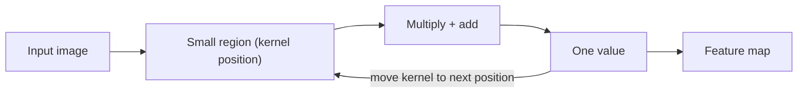
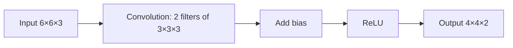

Before the new ideas, here are the old ones you need. If you already know them, skip to the next section.

## The basics first

- A computer does not see an apple. It sees a **grid of numbers**, one number per **pixel** (the small square dots that make up a picture). <Cite id="class-dl-chp4" loc="slide 2" />
- A colour image is stored as three such grids, one each for red, green and blue. Each grid is called a **channel**. So an RGB image of 32×32 pixels is a block of numbers of size 32×32×3 (height × width × channels). <Cite id="class-dl-m4" loc="p. 8" />
- A **neuron** multiplies each input by a **weight**, adds a **bias** and passes the result through an activation function. The weights and biases are the **parameters**: the numbers the network learns.
- **ReLU** is the activation used after convolution: negative values become 0 and positive values stay the same. Example: [−2, 3, −1] becomes [0, 3, 0]. <Cite id="class-dl-chp4" loc="slide 28" />
- **Softmax** converts scores to probabilities between 0 and 1 that add up to 1. <Cite id="class-dl-chp4" loc="slide 28" />

## What is a CNN?

<Box kind="definition">

**Convolutional neural network (CNN):** a type of deep neural network specially designed to work with images and other grid-like data. <Cite id="class-dl-chp4" loc="slide 5" />

**Easy definition (write this in the exam):** CNN is a deep learning model that automatically learns spatial features from images using convolutional filters. <Cite id="class-dl-chp4" loc="slide 5" />

</Box>

A CNN **automatically learns important features** such as edges, lines, corners, textures, shapes and objects. Instead of manually telling the model what features to look for, the CNN learns them during training. The pre-processing it needs is much lower than for other classification algorithms. <Cite id="class-dl-chp4" loc="slide 5" /> <Cite id="class-dl-m4" loc="p. 4" />

The design is inspired by the visual cortex of the brain. Each neuron responds only to a restricted region of what we see, called its **receptive field**, and many such fields overlap to cover the whole picture. <Cite id="class-dl-m4" loc="p. 4" />

**Everyday analogy.** You look for your friend in a crowd photo by moving your eyes over it, one small area at a time, always asking the same question: "does this look like my friend's face?" A CNN looks at the image "small area by small area using a sliding window" and the mathematical operation used to do this is called **convolution**. <Cite id="class-dl-chp4" loc="slide 4" />

This is syllabus <Syl m="4" />.

<Cite id="class-dl-chp4" loc="slide 5" />

```mermaid
%% caption: The simple idea of a CNN, as the teacher draws it. The convolution and pooling steps find features; flatten and the fully connected layer make the decision.
flowchart LR
  A["Input image"] --> B["Convolution"]
  B --> C["Feature maps"]
  C --> D["Pooling"]
  D --> E["More convolution"]
  E --> F["More feature maps"]
  F --> G["Flatten"]
  G --> H["Fully connected layer"]
  H --> I["Output / prediction"]
```

## Why do we need a CNN?

Images contain **spatial information**: nearby pixels are related to each other. In the teacher's example, the pixels around an eye matter, and the arrangement of the pixels matters. The five main reasons for a CNN are: <Cite id="class-dl-chp4" loc="slide 5" />

1. Images contain a large number of pixels.
2. Important features are found in small regions.
3. The same feature can appear at different locations.
4. A CNN automatically learns useful features.
5. A CNN requires far fewer parameters than a fully connected network for images.

### The problem with fully connected networks

In a **fully connected** (dense) network, every input is connected to every neuron. <Cite id="class-dl-chp4" loc="slide 5" />

- A 28 × 28 image has 784 pixels. A fully connected layer with 100 neurons needs $784 \times 100 = 78{,}400$ weights.
- A larger RGB image of 224 × 224 × 3 has $224 \times 224 \times 3 = 150{,}528$ values. Connecting all of them to thousands of neurons gives a huge number of parameters.

The five problems that follow (write them as a list): <Cite id="class-dl-chp4" loc="slide 5" />

1. Too many parameters.
2. High computational cost.
3. Spatial information is lost.
4. No local feature detection.
5. The same feature at different locations is not handled efficiently.

### How a CNN solves these problems

A CNN introduces **three important ideas**. <Cite id="class-dl-chp4" loc="slide 5" />

| Idea | What it means | Example |
|---|---|---|
| **Local connectivity** | A CNN looks at a small region at a time (using a small filter). It detects local features such as edges, corners and textures. | A 3×3 filter sees one 3×3 region of the image |
| **Weight sharing** | The same filter weights are reused at different locations. Same filter + different locations = weight sharing, so fewer parameters. | One 3×3 filter (9 weights) is used at every position |
| **Pooling** | Pooling reduces the spatial size of feature maps. It reduces computation, memory and the number of values for the next layers, and it focuses on important features. | An 8×8 feature map becomes 4×4 (2×2 window, stride 2) |

**Remember:** CNN = Local connectivity + Weight sharing + Pooling → Efficient feature learning from images. <Cite id="class-dl-chp4" loc="slide 5" />

A CNN also has **the big advantage**: a feature (like an edge) can appear anywhere, and the CNN can detect it at different locations. In the teacher's words, the CNN learns "this is an edge, wherever I find it". <Cite id="class-dl-chp4" loc="slide 4" />

### Fully connected network versus CNN

| Aspect | Fully connected network | CNN |
|---|---|---|
| Connection | Every input connected to every neuron | Local connection (using small filters) |
| Weights | Different weights for different connections | Same filter weights reused everywhere |
| Parameters | Very large | Much smaller |
| Spatial info | Does not naturally preserve spatial structure | Preserves and exploits spatial structure |
| Computation | More computationally expensive | More efficient |
| Feature detection | Location-specific | Same feature can be detected anywhere |

The class also says a fully connected network is best for tabular data and a CNN is best for images. <Cite id="class-dl-chp4" loc="slide 67" />

### What does a CNN learn?

A CNN learns step by step, from simple to complex. <Cite id="class-dl-chp4" loc="slide 4" />

- **Early layers:** edges, lines, corners.
- **Middle layers:** curves and shapes (edges combine into curves and shapes).
- **Deeper layers:** object parts such as stem, leaf and body of an apple.
- **Final layers:** recognize the complete object.

The first convolution layer captures **low-level features** such as edges, colour and gradient direction. With added layers, the network also learns **high-level features**. <Cite id="class-dl-m4" loc="p. 14" />

## The convolution operation

<Box kind="definition">

**Convolution** is an operation that applies a small filter (kernel) to an input image to detect useful features such as edges, lines, textures, and patterns. <Cite id="class-dl-chp4" loc="slide 6" />

</Box>

**What is the problem it solves?** Every pixel contains information. If we connect every pixel to every neuron, the number of parameters becomes very large, training becomes slow, memory use increases, the spatial relationship between nearby pixels may be lost and the model can overfit easily. <Cite id="class-dl-chp4" loc="slide 6" />

### Filter (kernel)

<Box kind="definition">

**Filter / kernel:** a small matrix of learnable weights used to detect features in an image. It moves across the image during convolution. <Cite id="class-dl-chp4" loc="slide 10" />

</Box>

- It is also called the **convolution filter** or **kernel**. <Cite id="class-dl-chp4" loc="slide 6" />
- A filter is a **pattern detector**. At each small region it asks: "Can I find my pattern here?" <Cite id="class-dl-chp4" loc="slide 8" />
- **One filter detects ONE type of pattern** (edge, texture or another pattern). A CNN uses many filters, so each filter produces a different feature map. <Cite id="class-dl-chp4" loc="slide 8" />
- A human does **not** choose the filter numbers. The CNN learns the weights during training: prediction → loss → backpropagation → weights updated. <Cite id="class-dl-chp4" loc="slide 8" />
- The kernel is represented by a small matrix such as 3×3×1. <Cite id="class-dl-m4" loc="p. 9" />

**Everyday analogy.** A filter is like a pair of special glasses. One pair shows only edges, another shows only texture. Each pair helps you notice something different. <Cite id="class-dl-chp4" loc="slide 8" />

### How it works, step by step

Place the filter on a small region of the image. At every position: <Cite id="class-dl-chp4" loc="slide 7" />

1. Take a small region of the image.
2. Multiply each image value by the corresponding kernel value.
3. Add all the multiplied values.
4. Store the result in the feature map.
5. Move the kernel to the next position.

The filter moves to the right by the **stride** until it passes the whole width. Then it hops down to the left edge and repeats, until the entire image is covered. <Cite id="class-dl-m4" loc="p. 11" />

**Sum 1: convolve a small image by hand.** <Cite id="class-dl-chp4" loc="slide 7" />

<Sum>

<Given>

a 3×3 input and a 2×2 kernel, stride 1, no padding.

$$
\text{Input} = \begin{bmatrix} 1 & 2 & 3 \\ 4 & 5 & 6 \\ 7 & 8 & 9 \end{bmatrix}
\qquad
\text{Kernel} = \begin{bmatrix} 1 & 0 \\ 0 & 1 \end{bmatrix}
$$

</Given>

<Find>

the feature map.

</Find>

<Steps>

1. **Size of the output.** The 2×2 filter fits in 2 positions across and 2 down, because $3 - 2 + 1 = 2$. So the feature map is 2×2.
2. **Top-left region** (1, 2, 4, 5): multiply each image value by the kernel value under it and add, because the kernel's 0s switch off two pixels:

   $$
   1\cdot1 + 2\cdot0 + 4\cdot0 + 5\cdot1 = 6
   $$
3. **Move one step right**, region (2, 3, 5, 6), because the stride is 1:

   $$
   2\cdot1 + 3\cdot0 + 5\cdot0 + 6\cdot1 = 8
   $$
4. **Move down one row**, region (4, 5, 7, 8), because the filter cannot go further right:

   $$
   4\cdot1 + 5\cdot0 + 7\cdot0 + 8\cdot1 = 12
   $$
5. **Move one step right**, region (5, 6, 8, 9):

   $$
   5\cdot1 + 6\cdot0 + 8\cdot0 + 9\cdot1 = 14
   $$

</Steps>

<Answer>

feature map $= \begin{bmatrix} 6 & 8 \\ 12 & 14 \end{bmatrix}$ (2×2).

</Answer>

<Box kind="verify">

This kernel has 1s only on its diagonal, so each output is "top-left value + bottom-right value" of its region. In the image, every number is 1 more than the one on its left, so one step right should add $1 + 1 = 2$ to the output: 6 → 8 and 12 → 14. Every number is 3 more than the one above it, so one step down should add $3 + 3 = 6$: 6 → 12 and 8 → 14. All four values agree.

</Box>

</Sum>

**An edge-detecting example from the class.** The edge filter with rows [1, 0, −1] applied to the region [1 2 3; 4 5 6; 7 8 9] gives $(1 - 3) + (4 - 6) + (7 - 9) = -6$. The sum of all the products is one value of the output feature map. <Cite id="class-dl-chp4" loc="slide 6" />

**A bigger worked example (4×4 image, stride 1).** <Cite id="class-dl-chp4" loc="slide 9" />

<Sum>

<Given>

a 4×4 image with the numbers 1 to 16 written row by row, a 2×2 filter $\begin{bmatrix} 1 & 0 \\ 0 & 1 \end{bmatrix}$, stride 1.

</Given>

<Find>

the feature map.

</Find>

<Steps>

1. **Size.** $(4 - 2)/1 + 1 = 3$, so the feature map is 3×3 (9 positions).
2. **Row 1 of the image.** Region (1, 2, 5, 6) gives $1 + 6 = 7$. Move right: (2, 3, 6, 7) gives $2 + 7 = 9$. Move right: (3, 4, 7, 8) gives $3 + 8 = 11$.
3. **Move down one pixel.** Region (5, 6, 9, 10) gives 15, then 17, then 19.
4. **Move down again.** Region (9, 10, 13, 14) gives 23, then 25, then 27.

</Steps>

<Answer>

$\begin{bmatrix} 7 & 9 & 11 \\ 15 & 17 & 19 \\ 23 & 25 & 27 \end{bmatrix}$

</Answer>

<Box kind="verify">

With this filter each output is (top-left number) + (bottom-right number) $= a + (a + 5) = 2a + 5$, where $a$ is the top-left number. For $a = 1, 2, 3$ this gives 7, 9, 11 and for $a = 5$ it gives 15. All match, and one step right adds 2 while one step down adds 8 ($2 \times 4$).

</Box>

</Sum>

### Why is convolution important?

It detects local features, preserves spatial information, uses fewer parameters, learns features automatically, and detects the same feature at different locations. <Cite id="class-dl-chp4" loc="slide 6" />

## Feature map

<Box kind="definition">

**Feature map:** the output produced after applying a filter to an image. It shows **where** a specific feature (like an edge or a texture) is detected and how strongly it is present at different locations. <Cite id="class-dl-chp4" loc="slide 16" />

</Box>

- **Memory trick:** Filter = what to look for. Feature map = where it was found. A filter is a small matrix of learnable weights (a detector). A feature map is the output of convolution (the detection result). <Cite id="class-dl-chp4" loc="slide 17" />
- **One filter → one feature map.** If we use K filters, we get K feature maps. <Cite id="class-dl-chp4" loc="slide 23" />
- The filter is learned during training. The feature map is generated during convolution. <Cite id="class-dl-chp4" loc="slide 17" />
- **Feature maps in different layers:** the first layers give edges, lines and corners; the middle layers combine edges into curves and shapes; the deeper layers combine shapes into object parts and the complete object. <Cite id="class-dl-chp4" loc="slide 17" />
- The feature map size depends on the input size N, the filter size F, the padding P and the stride S. <Cite id="class-dl-chp4" loc="slide 17" />

## Stride

<Box kind="definition">

**Stride** is the number of pixels by which the filter moves across the image at each step. <Cite id="class-dl-chp4" loc="slide 12" />

</Box>

- **Stride = 1:** the filter moves one pixel at a time. It checks more positions, so the output is larger.
- **Stride = 2:** the filter jumps two pixels at a time. It checks fewer positions, so the output is smaller.
- The kernel shifts 9 times on a 5×5 image with a 3×3 kernel and stride 1. <Cite id="class-dl-m4" loc="p. 11" />
- Stride is distance, not direction: it says how far the filter jumps. Stride is "HOW FAR", the filter is "WHAT". <Cite id="class-dl-chp4" loc="slide 12" />

**Why use stride = 2?** Stride helps reduce the spatial size of the feature map. <Cite id="class-dl-chp4" loc="slide 12" />

**Exam answer (stride).** Stride determines how far the filter moves at each step. Increasing the stride reduces the number of positions where the filter is applied, thereby reducing the output size. <Cite id="class-dl-chp4" loc="slide 19" />

| Stride | Filter movement | Output size |
|---|---|---|
| 1 | Moves 1 pixel | Larger |
| 2 | Moves 2 pixels | Smaller |
| 3 | Moves 3 pixels | Even smaller |

<Cite id="class-dl-chp4" loc="slide 13" />

## Padding

<Box kind="definition">

**Padding** adds extra pixels (usually zeros) around the image. It allows the filter to be applied at the boundary and helps control the output size, preventing the image from shrinking too much. <Cite id="class-dl-chp4" loc="slide 14" />

</Box>

**Why we need padding.** <Cite id="class-dl-chp4" loc="slide 14" /> <Cite id="class-dl-chp4" loc="slide 15" />

1. **Without padding the image shrinks quickly.** A 5×5 image with a 3×3 filter becomes 3×3, and after another convolution it becomes 1×1.
2. **Border pixels get less chance to take part.** Corner and border pixels are used fewer times than middle pixels. Padding gives the border pixels more chance to participate.
3. **It preserves the image size** (spatial size) when we want it to stay the same.

The zeros are added one row at the top, one row at the bottom, one column on the left and one column on the right, so a 3×3 image becomes 5×5. This is also called **zero padding**. <Cite id="class-dl-chp4" loc="slide 15" />

### Valid, same and full padding

| Type | Padding | What happens | Output size |
|---|---|---|---|
| **Valid** ("no padding") | P = 0 | The operation is done only where the filter completely overlaps the input. The output becomes smaller. | $N - F + 1$ |
| **Same** | For stride 1: $P = (F - 1)/2$ | Zeros are added so that the output keeps the same height and width as the input. | Same as input |
| **Full** | $P = F - 1$ | The filter can go completely outside the original image. The output becomes larger. | Larger than input |

<Cite id="class-dl-m4" loc="p. 18" /> <Cite id="class-dl-m4" loc="p. 19" /> <Cite id="class-dl-chp4" loc="slide 37" />

- Valid is used when a reduction in size is wanted or computation matters most. Same is used when the spatial size must stay the same through the network. <Cite id="class-dl-m4" loc="p. 18" /> <Cite id="class-dl-m4" loc="p. 19" />
- Example of same padding: a 5×5 image, a 3×3 filter and stride 1 need $P = (3 - 1)/2 = 1$, and the output is 5×5. <Cite id="class-dl-chp4" loc="slide 37" />
- Example of valid padding: a 5×5 input with a 3×3 filter gives a 3×3 output. <Cite id="class-dl-chp4" loc="slide 37" />
- Example of full convolution: a 5×5 input, a 3×3 filter and $P = F - 1 = 2$ give $(5 - 3 + 2 \cdot 2)/1 + 1 = 7$, so the output is 7×7. <Cite id="class-dl-chp4" loc="slide 37" />

**Memory trick.** Valid: no padding, output becomes smaller. Same: padding added, output remains the same size. <Cite id="class-dl-chp4" loc="slide 15" />

**Exam answer (padding).** Padding is the process of adding extra pixels, usually zeros, around the boundary of an input image before convolution to preserve spatial dimensions and allow better processing of border features. <Cite id="class-dl-chp4" loc="slide 15" />

<Box kind="pitfall">

**Padding is not stride.** Padding adds pixels around the image. Stride controls how far the filter moves. <Cite id="class-dl-chp4" loc="slide 17" />

</Box>

## Relation between input, output and filter size

The size of the output depends on four numbers. <Cite id="class-dl-chp4" loc="slide 7" />

<Box kind="key">

$$
\text{Output} = \left\lfloor \frac{N - F + 2P}{S} \right\rfloor + 1
$$

N = input size, F = filter size, P = padding, S = stride. The symbol $\lfloor\ \rfloor$ means round down (the floor operation). Use it for the general case. <Cite id="class-dl-chp4" loc="slide 19" />

</Box>

- **Without padding** (P = 0) the formula is $(N - F)/S + 1$. For $N = 7$, $F = 3$: stride 1 gives 5, stride 2 gives 3, and stride 3 gives 2.33, which is not a whole number, so that stride does not fit neatly. <Cite id="class-dl-m4" loc="p. 20" />
- **Why round down?** The filter can only be placed where it fits completely inside the (padded) image. A partial position is not used. <Cite id="class-dl-chp4" loc="slide 21" />
- **Output depth** = number of filters (K). <Cite id="class-dl-chp4" loc="slide 26" />
- **Larger stride → smaller output. More padding → larger output.** <Cite id="class-dl-chp4" loc="slide 21" />

**Sum 2: the five practice questions from class.** A 3×3 input and a 2×2 filter. Find the size of the output in each case. <Cite id="class-dl-chp4" loc="slide 22" /> <Cite id="class-dl-chp4" loc="slide 21" />

<Sum>

<Given>

$N = 3$, $F = 2$. The cases are: (1) no padding and stride 1 (the usual default when nothing is said), (2) $P = 0$, $S = 1$, (3) $P = 0$, $S = 2$, (4) $P = 1$, $S = 1$, (5) $P = 1$, $S = 2$.

</Given>

<Find>

the output size in every case.

</Find>

<Steps>

1. **Cases 1 and 2** are the same: $(3 - 2 + 0)/1 + 1 = 2$, so **2×2**.
2. **Case 3:** $(3 - 2 + 0)/2 + 1 = 0.5 + 1 = 1.5$. Round down to 1, because only one position fits completely, so **1×1**.
3. **Case 4:** $(3 - 2 + 2)/1 + 1 = 3 + 1 = 4$, so **4×4**.
4. **Case 5:** $(3 - 2 + 2)/2 + 1 = 1.5 + 1 = 2.5$. Round down to 2, so **2×2**.

</Steps>

<Answer>

(1) 2×2, (2) 2×2, (3) 1×1, (4) 4×4, (5) 2×2.

</Answer>

<Box kind="verify">

Count the positions instead of using the formula. In case 3 the filter starts at column 1 and the next start (column 3) would need column 4, which does not exist, so there is 1 position per side. In case 5 the padded image is 5 wide, the starts are columns 1 and 3 (a start at column 5 would need column 6), so 2 per side. Cases 4 and 5 agree with the teacher's table 4×4 and 2×2.

</Box>

</Sum>

**Three more numerical questions from class.** <Cite id="class-dl-chp4" loc="slide 59" /> <Cite id="class-dl-chp4" loc="slide 60" /> <Cite id="class-dl-chp4" loc="slide 61" />

<Sum>

<Given>

(a) a 28×28 input and a 7×7 filter, stride 1. (b) A 224×224×3 input, five 7×7 kernels, stride 1, zero padding (P = 0). (c) A 32×32×3 input, five 3×3 kernels, no padding, stride 1.

</Given>

<Find>

the size of the data the next layer receives.

</Find>

<Steps>

1. **(a)** $(28 - 7 + 0)/1 + 1 = 21 + 1 = 22$, so the output is **22×22**.
2. **(b)** Height and width: $(224 - 7 + 0)/1 + 1 = 217 + 1 = 218$. Depth = number of kernels = 5. So **218×218×5**. The input's 3 channels do not appear in the output depth.
3. **(c)** Height and width: $(32 - 3 + 0)/1 + 1 = 29 + 1 = 30$. Depth = 5. So **30×30×5**.
4. **If the parameters of (b) are asked** (assignment version), each kernel is 7×7×3 with one bias: $(7 \cdot 7 \cdot 3 + 1) \times 5 = 148 \times 5 = 740$.

</Steps>

<Answer>

(a) 22×22, (b) 218×218×5 (740 parameters), (c) 30×30×5.

</Answer>

<Box kind="verify">

Check with the positions rule: a filter of size F fits in $N - F + 1$ places when the stride is 1. (a) $28 - 7 + 1 = 22$. (b) $224 - 7 + 1 = 218$. (c) $32 - 3 + 1 = 30$. All three agree.

</Box>

</Sum>

## Multichannel (RGB) convolution

A colour image has three channels (R, G, B), so its shape is H × W × 3. Convolution on it differs in one way: **the filter also has 3 channels.** <Cite id="class-dl-chp4" loc="slide 23" />

- For an RGB input the filter depth must match the input channels. A 3×3 filter on an RGB image is really 3×3×3. <Cite id="class-dl-chp4" loc="slide 24" />
- At each position the filter does a multiply-and-add on R, G and B separately, then adds the three results and the bias: $\text{Output} = R_{conv} + G_{conv} + B_{conv} + b$. This gives **one value**. <Cite id="class-dl-chp4" loc="slide 24" />
- The filter moves according to the stride. All the values together form **one feature map**. K filters give K feature maps. <Cite id="class-dl-chp4" loc="slide 23" />

**Exam answer (RGB convolution).** For an RGB image, the filter has three channel parts. At each position, convolution is performed on R, G and B separately, their results are added together along with bias, and this gives one output value. As the filter moves across the image, these values form one feature map. <Cite id="class-dl-chp4" loc="slide 23" />

**Sum 3: output volume of a convolution layer.** <Cite id="class-dl-chp4" loc="slide 26" />

<Sum>

<Given>

an input volume of 32×32×3, 10 filters of size 5×5, stride 1, padding 2.

</Given>

<Find>

the output volume.

</Find>

<Steps>

1. **Each filter is 5×5×3**, because the filter depth must equal the input depth (3).
2. **Height:** $(32 + 2 \cdot 2 - 5)/1 + 1 = 31 + 1 = 32$.
3. **Width:** the input is square, so the width is also 32.
4. **Depth** = number of filters = 10, because each filter gives one 32×32 feature map and the 10 maps are stacked.

</Steps>

<Answer>

output volume = 32 × 32 × 10.

</Answer>

<Box kind="verify">

Padding 2 with a 5×5 filter is "same" padding: $P = (F - 1)/2 = (5 - 1)/2 = 2$. Same padding keeps height and width unchanged, so 32×32 is expected.

</Box>

</Sum>

<Box kind="pitfall">

**Input depth is not output depth.** Input depth = 3 (the RGB channels). Output depth = number of filters = 10. <Cite id="class-dl-chp4" loc="slide 26" />

</Box>

## One convolution layer: bias, ReLU and stacking

<Box kind="definition">

A convolution layer applies multiple learnable filters to the input, adds a bias to each filter's output, applies an activation function (ReLU), and produces multiple feature maps that are stacked to form the output volume. <Cite id="class-dl-chp4" loc="slide 27" />

</Box>

The simple flow is: input → convolution → add bias → activation (ReLU) → feature maps (output). <Cite id="class-dl-chp4" loc="slide 29" />

**Take 6×6×3 input and 2 filters of size 3×3×3, stride 1, padding 0.** <Cite id="class-dl-chp4" loc="slide 29" />

1. Filter 1 gives a feature map of $(6 - 3)/1 + 1 = 4$, so 4×4. Filter 2 gives another 4×4 map using different weights.
2. Add one bias to each filter's output.
3. Apply ReLU to every value: negative → 0, positive → same. A value −5 becomes 0 and a value 2 stays 2.
4. Stack the two 4×4 maps along the depth. The output volume is **4×4×2**. The output depth equals the number of filters.

**Quick rules to remember.** <Cite id="class-dl-chp4" loc="slide 27" />

1. Filter depth = input depth.
2. One filter produces one feature map.
3. Number of filters = output depth.
4. Bias is one per filter.
5. ReLU is applied after convolution + bias.

### Counting the parameters of a convolution layer

<Box kind="key">

$$
\text{Parameters} = (F \times F \times D + 1) \times K
$$

F = filter size, D = input depth (channels), K = number of filters, +1 = bias per filter. <Cite id="class-dl-chp4" loc="slide 27" />

</Box>

Stride and padding are **not** used for the parameter count. They change the output size, not the number of weights. <Cite id="class-dl-chp4" loc="slide 66" /> A filter has the same weights at every position (weight sharing), so the image size does not matter.

**Sum 4: AlexNet first layer.** Input 227×227×3, 96 kernels of size 11×11, stride 4, padding 0. Find the number of parameters. <Cite id="class-dl-chp4" loc="slide 66" /> <Cite id="class-dl-m4" loc="p. 32" />

<Sum>

<Given>

input channels $C = 3$, kernel size $K = 11$, number of kernels $N = 96$.

</Given>

<Find>

the number of parameters of the first conv layer.

</Find>

<Steps>

1. **Weights per kernel:** $11 \times 11 \times 3 = 363$, because each kernel covers all 3 channels.
2. **Weights of all kernels:** $363 \times 96 = 34{,}848$.
3. **Biases:** one per kernel, so 96.
4. **Total:** $34{,}848 + 96 = 34{,}944$. Stride 4 and padding 0 are not used.

</Steps>

<Answer>

34,944 parameters.

</Answer>

<Box kind="verify">

Use the other form of the formula, $(F \times F \times D + 1) \times K = (363 + 1) \times 96 = 364 \times 96 = 34{,}944$. Same answer.

</Box>

</Sum>

**Sum 5: the exercise asked in class.** 32 input channels of size 64×64, 64 filters of 3×3, stride 1, no padding, each filter applied to every channel. Find the total number of weights. <Cite id="class-dl-m4" loc="p. 30" />

<Sum>

<Given>

input 64×64×32, 64 filters of 3×3, stride 1, padding 0.

</Given>

<Find>

the weights (and the biases and the output size).

</Find>

<Steps>

1. **Weights per filter:** $3 \times 3 \times 32 = 288$, because the filter covers all 32 channels.
2. **Weights of 64 filters:** $288 \times 64 = 18{,}432$.
3. **Biases:** one per filter, so 64. With biases the total is $18{,}432 + 64 = 18{,}496$.
4. **Output size** (for the diagram): $(64 - 3)/1 + 1 = 62$, so 62×62×64.

</Steps>

<Answer>

18,432 weights (18,496 parameters with the 64 biases), output 62×62×64.

</Answer>

<Box kind="verify">

Recompute with the formula: $(3 \cdot 3 \cdot 32 + 1) \times 64 = 289 \times 64 = 18{,}496$, which equals $18{,}432 + 64$.

</Box>

</Sum>

**Sum 6: two layers on an RGB image (assignment question).** <PYQ id="assignment-2/q4d" /> A 100×100×3 image goes through layer 1 (8 filters, 3×3, stride 1, padding 0) and then layer 2 (1 filter, 3×3, stride 1, padding 0). <Cite id="class-dl-qb2" loc="Q4" />

<Sum>

<Given>

input 100×100×3. Layer 1: 8 filters of 3×3. Layer 2: 1 filter of 3×3. Stride 1, padding 0.

</Given>

<Find>

the output volume and the trainable parameters (with bias) of each layer, and the total.

</Find>

<Steps>

1. **Layer 1 output:** $(100 - 3)/1 + 1 = 98$, depth 8, so **98×98×8**.
2. **Layer 1 parameters:** $(3 \times 3 \times 3 + 1) \times 8 = 28 \times 8 = 224$.
3. **Layer 2 output:** the input is now 98×98×8, so $(98 - 3)/1 + 1 = 96$ and the depth is 1, giving **96×96×1**.
4. **Layer 2 parameters:** the filter depth must equal the new input depth 8, so $(3 \times 3 \times 8 + 1) \times 1 = 73$.
5. **Total:** $224 + 73 = 297$.

</Steps>

<Answer>

layer 1: 98×98×8 with 224 parameters. Layer 2: 96×96×1 with 73 parameters. Total 297.

</Answer>

<Box kind="verify">

Each 3×3 convolution without padding removes 2 from the height and width: $100 \to 98 \to 96$. Output depth equals the number of filters (8, then 1). The second layer's filter depth (8) equals the first layer's output depth, so the weights per filter are $3 \cdot 3 \cdot 8 = 72$, plus 1 bias = 73.

</Box>

</Sum>

**Interpretation to write.** The height and width shrink because there is no padding (each 3×3 filter loses 1 pixel on each side). The output depth equals the number of filters, since each filter makes one feature map. The number of parameters depends on the filter size, input depth and number of filters, not on the image size.

## The pooling layer

<Box kind="definition">

A **pooling layer** is a layer in CNN used to reduce the size of feature maps while keeping the most important information. <Cite id="class-dl-chp4" loc="slide 31" />

</Box>

**Why do we use pooling?** <Cite id="class-dl-chp4" loc="slide 31" />

- Reduce the height and width of feature maps.
- Reduce computation.
- Reduce the number of parameters in later layers.
- Make the model less sensitive to small changes in position.
- Keep important features.

The pooling layer also extracts dominant features that are rotation and position invariant, which helps effective training. It helps in retaining the most useful information and throwing away useless information, and it reduces resolution and dimension, hence the computational complexity. <Cite id="class-dl-m4" loc="p. 34" />

**How does pooling work?** A small window (for example 2×2) moves over the feature map. At every position it performs an operation, and the window moves according to the stride. <Cite id="class-dl-chp4" loc="slide 31" />

- **Maximum** → max pooling.
- **Minimum** → min pooling.
- **Average** → average pooling.

(The Module 4 notes also mention sum pooling.) <Cite id="class-dl-m4" loc="p. 34" />

<Box kind="key">

Pooling usually changes **height × width** but does **not** change **depth (channels)**. <Cite id="class-dl-chp4" loc="slide 31" />

</Box>

### Max pooling

<Box kind="definition">

**Max pooling** selects the largest value from each pooling region. <Cite id="class-dl-chp4" loc="slide 32" />

</Box>

### Average pooling and min pooling

- **Average pooling** calculates the average of all values inside the pooling region. <Cite id="class-dl-chp4" loc="slide 33" />
- **Min pooling** selects the smallest value from each pooling region. It keeps the weakest feature and is less commonly used than max pooling. <Cite id="class-dl-chp4" loc="slide 34" />

**Sum 7: max, average and min pooling on the same map.** <Cite id="class-dl-chp4" loc="slide 32" /> <Cite id="class-dl-chp4" loc="slide 33" /> <Cite id="class-dl-chp4" loc="slide 34" />

<Sum>

<Given>

a 4×4 feature map, a 2×2 pooling window, stride 2.

$$
\begin{bmatrix} 4 & 3 & 1 & 5 \\ 1 & 3 & 4 & 8 \\ 4 & 5 & 4 & 3 \\ 6 & 5 & 9 & 4 \end{bmatrix}
$$

</Given>

<Find>

the output of max, average and min pooling.

</Find>

<Steps>

1. **Size:** $(4 - 2)/2 + 1 = 2$, so each output is 2×2.
2. **Split into four regions,** top-left (4, 3, 1, 3), top-right (1, 5, 4, 8), bottom-left (4, 5, 6, 5), bottom-right (4, 3, 9, 4).
3. **Max** (the largest of each region): 4, 8, 6, 9.
4. **Average** (the sum divided by 4): $11/4 = 2.75$, $18/4 = 4.5$, $20/4 = 5$, $20/4 = 5$.
5. **Min** (the smallest of each region): 1, 1, 4, 3.

</Steps>

<Answer>

max $= \begin{bmatrix} 4 & 8 \\ 6 & 9 \end{bmatrix}$, average $= \begin{bmatrix} 2.75 & 4.5 \\ 5 & 5 \end{bmatrix}$, min $= \begin{bmatrix} 1 & 1 \\ 4 & 3 \end{bmatrix}$.

</Answer>

<Box kind="verify">

For every region, min ≤ average ≤ max: $1 \le 2.75 \le 4$, $1 \le 4.5 \le 8$, $4 \le 5 \le 6$, $3 \le 5 \le 9$. Also the four region sums $11 + 18 + 20 + 20 = 69$ equal the sum of all 16 numbers ($13 + 16 + 16 + 24 = 69$).

</Box>

</Sum>

**Which one is used?** Max pooling is the most commonly used. It also acts as a noise suppressant: it discards the noisy (weak) activations and reduces dimension. Average pooling only reduces the dimension. So max pooling usually works better than average pooling. <Cite id="class-dl-chp4" loc="slide 31" /> <Cite id="class-dl-m4" loc="p. 35" />

If a filter detects an edge strongly at one location, max pooling keeps that strong value. <Cite id="class-dl-chp4" loc="slide 32" />

### Output size of pooling

With padding 0: $\text{Output} = (N - F)/S + 1$, where N is the input size (height or width), F the pooling window size and S the stride. Example: $N = 8$, $F = 2$, $S = 2$ gives $(8 - 2)/2 + 1 = 4$, so 8×8 becomes 4×4 and the depth stays the same. <Cite id="class-dl-chp4" loc="slide 31" />

**Key points.** Pooling makes the feature map smaller. Max pooling is most commonly used. The window size and stride control the output size. Depth does not change. <Cite id="class-dl-chp4" loc="slide 31" />

**A complete tiny example: convolution → ReLU → max pooling.** <Cite id="class-dl-chp4" loc="slide 35" />

**Sum 8: convolution → ReLU → max pooling on a 6×6 image (assignment question).** <Cite id="class-dl-qb2" loc="Q4" /> <PYQ id="assignment-2/q4e" />

<Sum>

<Given>

a 6×6×1 image, a 3×3 filter with rows [1, 0, −1], stride 1, padding 0, then ReLU, then 2×2 max pooling with stride 2.

$$
\text{Image} = \begin{bmatrix} 3 & 0 & 1 & 2 & 1 & 0 \\ 1 & 2 & 4 & 3 & 1 & 2 \\ 0 & 1 & 3 & 5 & 3 & 1 \\ 2 & 3 & 6 & 4 & 2 & 1 \\ 1 & 2 & 4 & 3 & 1 & 0 \\ 0 & 1 & 2 & 2 & 1 & 1 \end{bmatrix}
$$

</Given>

<Find>

(a) the output size, (b) the 4×4 feature map, (c) after ReLU, (d) after max pooling, (e) the trainable parameters.

</Find>

<Steps>

1. **Output size.** $W_1 = H_1 = 6$, $D_1 = 1$, $F = 3$, $S = 1$, $P = 0$, $K = 1$. So $W_2 = (6 - 3 + 0)/1 + 1 = 4$, $H_2 = 4$, $D_2 = 1$. The output is 4×4×1.
2. **Shortcut for this filter.** Each filter row is [1, 0, −1], so for each image row take (first number − third number) of the 3 numbers under the filter, then add the three rows. For the first output: row 1 gives $3 - 1 = 2$, row 2 gives $1 - 4 = -3$, row 3 gives $0 - 3 = -3$, so $2 - 3 - 3 = -4$.
3. **Do the same at every position.** The feature map is

   $$
   \begin{bmatrix} -4 & -7 & 3 & 7 \\ -10 & -6 & 7 & 8 \\ -10 & -6 & 7 & 10 \\ -9 & -3 & 8 & 7 \end{bmatrix}
   $$
4. **ReLU** (negative → 0):

   $$
   \begin{bmatrix} 0 & 0 & 3 & 7 \\ 0 & 0 & 7 & 8 \\ 0 & 0 & 7 & 10 \\ 0 & 0 & 8 & 7 \end{bmatrix}
   $$
5. **Max pooling, 2×2, stride 2.** The four blocks give $\max(0,0,0,0) = 0$, $\max(3,7,7,8) = 8$, $\max(0,0,0,0) = 0$ and $\max(7,10,8,7) = 10$.
6. **Parameters:** $(3 \cdot 3 \cdot 1 + 1) \times 1 = 10$.

</Steps>

<Answer>

(a) 4×4×1. (b) the feature map in step 3. (c) the ReLU map in step 4. (d) $\begin{bmatrix} 0 & 8 \\ 0 & 10 \end{bmatrix}$. (e) 10 parameters.

</Answer>

<Box kind="verify">

The sum of all 16 feature-map values must equal the sum over image rows of (row total of "first − third" numbers) times how many outputs use that row (1, 2, 3, 3, 2, 1 for rows 1 to 6). Those row totals are 2, 0, −3, 2, 2, −1, so the weighted sum is $2 + 0 - 9 + 6 + 4 - 1 = 2$. The feature map adds up to $-1 - 1 + 1 + 3 = 2$ (row by row). They match.

</Box>

</Sum>

**Interpretation to write.** The 6×6 image became 4×4 (no padding), then 2×2 (pooling). The filter [1, 0, −1] reacts to a vertical edge (left side bigger than right side): the large positive values on the right show where such edges are strong. ReLU removed the negative responses and pooling kept the strongest one in each block.

## The full CNN architecture

The convolution layer and the pooling layer together form the i-th layer of a CNN. Depending on how complex the images are, the number of such layers can be increased to capture low-level details further, but at the cost of more computational power. <Cite id="class-dl-m4" loc="p. 36" />

The basic CNN, step by step. <Cite id="class-dl-chp4" loc="slide 28" />

| Step | Layer | What it does |
|---|---|---|
| 1 | **Input** | The image is given to the CNN as pixel values. |
| 2 | **Convolution + ReLU** | Filters slide over the input and detect features like edges, lines, corners. One filter gives one feature map. |
| 3 | **Pooling** (max pooling) | Keeps the maximum value in each region and reduces size. |
| 4 | **More convolution + ReLU** | Learns more complex features (curves, textures, parts of objects). |
| 5 | **Pooling** | Reduces size again. |
| 6 | **Flatten** | Converts the 3D feature maps into a 1D vector. |
| 7 | **Fully connected (dense)** | All neurons in the previous layer are connected to the neurons in this layer. It combines the learned features. |
| 8 | **Softmax** (output layer) | Converts scores to probabilities between 0 and 1 (the sum is 1). |
| 9 | **Classification** | Choose the class with the highest probability. |

```mermaid
%% caption: The basic CNN of the class with the shape of the data after each step. The left part extracts features; the right part classifies.
flowchart LR
  A["Input 32×32×3"] --> B["Conv + ReLU: 28×28×32"]
  B --> C["Max pool: 14×14×32"]
  C --> D["Conv + ReLU: 10×10×64"]
  D --> E["Max pool: 5×5×64"]
  E --> F["Flatten: 1600"]
  F --> G["Fully connected: 128 neurons"]
  G --> H["Softmax: Cat 0.10, Dog 0.80, Horse 0.10"]
  H --> I["Prediction: Dog"]
```

**Flatten and the fully connected layer.** After the convolution and pooling layers the image is in a form suitable for a multi-level perceptron. We **flatten** it into a column vector and feed it to a feed-forward neural network. Backpropagation is applied in every iteration of training. Over a series of epochs the model learns to tell dominating and low-level features apart and classify them using **softmax**. The fully connected layer learns a possibly non-linear combination of the high-level features given by the convolution layers. <Cite id="class-dl-m4" loc="p. 38" /> <Cite id="class-dl-chp4" loc="slide 28" />

**Shape trace of the class example** (the filter size 5×5 is what turns 32 into 28 and 14 into 10).

| Layer | Output shape | Parameters |
|---|---|---|
| Input | 32×32×3 | 0 |
| Conv 1: 32 filters 5×5 | 28×28×32 | $(5 \cdot 5 \cdot 3 + 1) \times 32 = 2{,}432$ |
| Max pool 2×2, stride 2 | 14×14×32 | 0 |
| Conv 2: 64 filters 5×5 | 10×10×64 | $(5 \cdot 5 \cdot 32 + 1) \times 64 = 51{,}264$ |
| Max pool 2×2, stride 2 | 5×5×64 | 0 |
| Flatten | 1600 | 0 |
| Fully connected, 128 neurons | 128 | $1600 \times 128 + 128 = 204{,}928$ |

Pooling and flatten only reshape or pick values, so they have no weights to learn. The fully connected layer holds most of the parameters. <Cite id="class-dl-chp4" loc="slide 28" />

<Box kind="verify">

Recheck the sizes with $(N - F + 2P)/S + 1$: $(32 - 5)/1 + 1 = 28$, pool $28/2 = 14$, $(14 - 5)/1 + 1 = 10$, pool $10/2 = 5$. Flatten: $5 \times 5 \times 64 = 1600$. Conv 2 sees 32 channels, so its filters have $5 \cdot 5 \cdot 32 = 800$ weights plus 1 bias $= 801$, and $801 \times 64 = 51{,}264$.

</Box>

**Hierarchical learning.** Input image → early layers (simple features) → middle layers (complex features) → deep layers (higher-level features) → final layer (recognition). From simple to complex to complete understanding. <Cite id="class-dl-chp4" loc="slide 5" />

**Advantages (from the class).** A CNN uses far fewer parameters than a fully connected network (local connectivity and weight sharing), it preserves spatial information, it detects the same feature anywhere in the image, it learns features automatically, and it is more efficient. <Cite id="class-dl-chp4" loc="slide 5" /> A CNN performs a better fit to the image data because of fewer parameters and reusable weights. <Cite id="class-dl-m4" loc="p. 7" />

**Limits mentioned in class.** Adding more convolution and pooling layers costs more computational power. <Cite id="class-dl-m4" loc="p. 36" /> Shrinking the volume too fast (for example 32 → 28 → 24 → ...) "doesn't work well", which is one reason for padding. <Cite id="class-dl-m4" loc="p. 29" /> Pooling throws away resolution. <Cite id="class-dl-m4" loc="p. 34" />

## Variants of the basic convolution function

Teacher's list of convolution types. <Cite id="class-dl-chp4" loc="slide 36" />

| Type | What it does |
|---|---|
| **Standard** | A filter moves across the input and does multiplication and addition. Extracts features such as edges, textures and shapes. |
| **1×1** | A 1×1 filter combines information across channels. It reduces or changes the number of channels. |
| **Dilated** | Inserts gaps between the filter elements. Captures a larger area without greatly increasing parameters. |
| **Transposed** | Increases the spatial size of the feature map. Used for upsampling and image generation. |
| **Depthwise** | Applies a separate filter to each input channel. Reduces computation and parameters. |
| **Separable** | Splits convolution into depthwise + 1×1 convolution. Makes CNNs faster and more lightweight. |
| **Strided** | Uses a stride greater than 1. Reduces the spatial dimensions of the feature map. |
| **Grouped** | Divides channels into groups and convolves each group separately. Reduces computation and parameters. |

**Normal, unshared and tiled convolution** (the weight-sharing view). <Cite id="class-dl-chp4" loc="slide 39" />

| Feature | Normal convolution | Tiled convolution | Unshared convolution |
|---|---|---|---|
| Weight sharing | Complete | Partial (repeating) | None |
| Filters | One set | Small set | Different at each location |
| Parameters | Low | Medium | Very high |
| Location information | Low | Some | High |
| Computational cost | Low | Medium | High |
| Common in CNNs? | Yes (most common) | Less common | Rare |

**Exam answer (tiled convolution).** Tiled convolution uses a small set of different filters that are repeatedly applied according to a spatial pattern, providing partial weight sharing between standard (shared) and unshared convolution. <Cite id="class-dl-chp4" loc="slide 39" />

The padding and stride variants (full, valid, valid with stride S, same) are in the padding section above. <Cite id="class-dl-chp4" loc="slide 38" />

## Where CNNs are used

Image classification, face recognition, object detection, medical image analysis, handwritten digit recognition, OCR, image segmentation, autonomous vehicles, and deepfake or image analysis. <Cite id="class-dl-chp4" loc="slide 67" />

## Where this was asked

| If the question says | What to write | Seen as |
|---|---|---|
| "Explain CNN architecture in detail" plus a parameter count (32×32×3, ten 5×5 filters, stride 1, padding 2) | The 9-step architecture with a diagram, then $(5 \cdot 5 \cdot 3 + 1) \times 10 = 760$ and output 32×32×10 | <PYQ id="2023-12/q3a" /> |
| "Explain the architecture of CNN with the help of a diagram" | The pipeline diagram, each layer's job, why CNN beats a fully connected network | <PYQ id="2024-05/q2b" /> |
| "Explain pooling operation in CNN" | Definition, why, how it works, max and average pooling, small example, depth unchanged | <PYQ id="2024-05/q1e" /> <PYQ id="2024-12/q1e" /> |
| "Basic working of CNN" | Filter sliding, feature maps, ReLU, pooling, flatten, fully connected, softmax in one short flow | <PYQ id="2025-05/q1e" /> |
| Two conv layers on 100×100×3 (8 filters, then 1 filter, both 3×3): output volumes and parameters | Sum 6: 98×98×8 with 224 parameters, then 96×96×1 with 73 parameters, total 297 | <PYQ id="assignment-2/q4d" /> |
| 6×6 image, 3×3 filter, then ReLU and 2×2 max pooling | Sum 8: size 4×4, feature map, ReLU, pooled 2×2 map, 10 parameters | <PYQ id="assignment-2/q4e" /> |
| 224×224×3 image, five 7×7 filters: output and parameters | 218×218×5 and $(7 \cdot 7 \cdot 3 + 1) \times 5 = 740$ | <PYQ id="assignment-2/q4f" /> |
| Parameter count: 32 input channels, 64 filters of 3×3, stride 1, no padding | $3 \cdot 3 \cdot 32 \cdot 64 = 18{,}432$ weights, plus 64 biases = 18,496; output 62×62×64 | <PYQ id="2024-12/q4b" /> |

## Quick revision

- Convolution is an operation that applies a small filter (kernel) to an input image to detect useful features such as edges, lines, textures, and patterns.
- Filter = what to look for. Feature map = where it was found. One filter gives one feature map.
- Stride = how far the filter moves. Padding = extra border (usually zeros). Valid: P = 0, smaller output. Same: $P = (F - 1)/2$ for stride 1, same size.
- Output size $= \lfloor (N - F + 2P)/S \rfloor + 1$. Output depth = number of filters.
- Parameters $= (F \times F \times D + 1) \times K$. Stride and padding do not matter.
- RGB: the filter depth equals the input depth; the R, G, B results and the bias are added to give one value.
- Pooling reduces height and width, not depth. Max pooling (largest), average pooling (mean), min pooling (smallest). Output $= (N - F)/S + 1$.
- Order: input → [convolution + ReLU → pooling] repeated → flatten → fully connected → softmax → class with the highest probability.
- CNN = local connectivity + weight sharing + pooling.

**Conclusion.** A CNN looks at an image one small region at a time with shared, learned filters, shrinks the result with pooling, and decides with fully connected layers and softmax. This needs far fewer parameters than a fully connected network. <Cite id="class-dl-chp4" loc="slide 5" />
