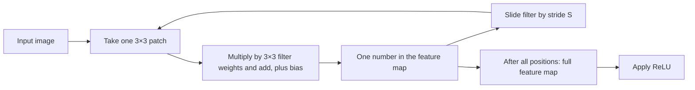
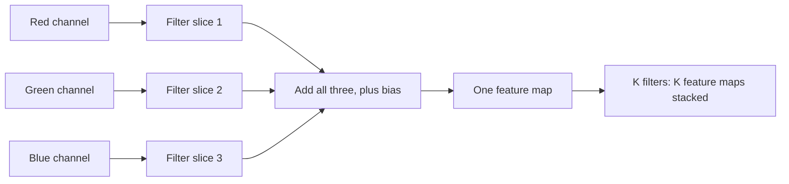
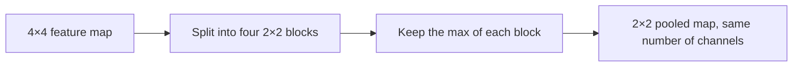
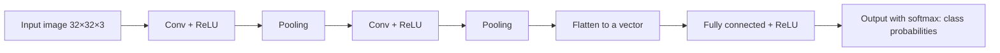

Before the new ideas, here are the old ones you need. If you already know them, skip to the next section.

## The basics first

- A **neuron** takes some inputs, multiplies each by a **weight**, adds them up, adds a **bias**, and passes the result through an **activation function**.
- **ReLU** (rectified linear unit) is the simplest activation: negative numbers become 0, positive numbers stay as they are.
- In a **fully connected** (dense) layer, every neuron is connected to every input.
- **Parameters** are the numbers the network learns: all the weights and biases. More parameters means more memory, more computation and more chance of overfitting (memorizing the training data instead of learning the general pattern).
- A grayscale **image** is a grid of numbers, one per pixel (for example 0 = black, 255 = white). A colour image has three such grids, one each for red, green and blue. Each grid is called a **channel**. So a 32×32 colour image is a block of numbers of size 32×32×3 (height × width × channels).
- **Softmax** turns a list of scores into probabilities that add up to 1, so the last layer can say "cat: 0.9, dog: 0.1".

## The problem: a normal network is a bad fit for images

A fully connected network has three problems with images:

1. **Too many weights.** A small 32×32×3 image already has 3072 numbers, so **each** neuron of the first layer needs 3072 weights. A layer of 1000 neurons needs over 3 million weights, and real photos are far larger.
2. **It ignores the layout.** It flattens the image into one long list, so it does not know that two pixels are neighbours.
3. **It must relearn a pattern at every position.** "What an eye looks like" has to be learned separately for every place the eye can appear.

**Everyday analogy.** Think of looking for your friend in a crowd photo. You do not stare at the whole photo at once. You move your eyes over it, one small area at a time, checking each area with the same idea of "what my friend's face looks like". A **convolutional neural network (CNN)** does exactly that: it checks small patches, one after another, using the same small detector everywhere. This is syllabus <Syl m="4" />. <Cite id="gfdl-ch9" loc="§9.2" />

<Box kind="definition">

**Convolutional neural network (CNN):** a neural network for grid-like data such as images, in which at least one layer uses **convolution** (a small filter slid over the input) instead of full connections. It is usually followed by **pooling** layers and ends with ordinary fully connected layers.

</Box>

## The convolution operation

**What it is.** A **filter** (also called a **kernel**) is a small grid of learned weights, for example 3×3. **Convolution** slides this filter over the image and, at every position, measures how well the patch under it matches the filter's pattern. The grid of all these match scores is called a **feature map** (or activation map).

**Why it is needed.** It finds local patterns (edges, corners, textures) with a handful of weights, keeps the 2D layout of the image, and finds the same pattern wherever it appears.

**How it works, step by step.**

1. Place the filter on the top-left corner of the image.
2. Multiply each filter weight by the pixel under it and add all the products, plus one bias. This gives **one number** of the feature map.
3. Slide the filter to the right by the **stride** (usually 1 pixel) and repeat.
4. At the end of a row, move down and start again from the left.
5. When every position is done, the feature map is complete. Pass it through ReLU.

**The formula (2D convolution).** In words: the output at a position is the sum of "pixel × filter weight" over the patch that the filter covers. For an image $I$ and kernel $K$:

$$
S(i, j) = \sum_{m}\sum_{n} I(i+m,\; j+n)\, K(m, n)
$$

$S(i,j)$ is the output at row $i$, column $j$; $m$ and $n$ walk over the rows and columns of the kernel. Strictly this is **cross-correlation**: true mathematical convolution flips the kernel first, but deep learning libraries skip the flip and still call it convolution. Because the filter weights are learned anyway, this makes no difference. <Cite id="gfdl-ch9" loc="§9.1" />

**Sum 1: convolve a small image by hand.** <Cite id="d2l-cnn-conv" />

<Sum>

<Given>

a 3×3 image $I$ and a 2×2 kernel $K$, stride 1, no padding, bias 0.

$$
\begin{aligned}
I &= \begin{bmatrix} 1 & 2 & 3 \\ 4 & 5 & 6 \\ 7 & 8 & 9 \end{bmatrix}
\qquad
K \\
&= \begin{bmatrix} 1 & 0 \\ 0 & 1 \end{bmatrix}
\end{aligned}
$$

</Given>

<Find>

the feature map $S$.

</Find>

<Steps>

1. **Size of the output.** The 2×2 filter fits in 2 positions across and 2 down (3 − 2 + 1 = 2), so $S$ is 2×2.
2. **Top-left patch** 1, 2, 4, 5: multiply each pixel by the kernel number under it and add, because the kernel's 0s switch off two pixels:

   $$
   1\cdot1 + 2\cdot0 + 4\cdot0 + 5\cdot1 = 6
   $$
3. **Slide one step right** (stride 1), patch 2, 3, 5, 6, and repeat the same sum, because every position gives its own output:

   $$
   2\cdot1 + 3\cdot0 + 5\cdot0 + 6\cdot1 = 8
   $$
4. **Move down one row**, because the window cannot go further right, patch 4, 5, 7, 8:

   $$
   4\cdot1 + 5\cdot0 + 7\cdot0 + 8\cdot1 = 12
   $$
5. **Slide one step right**, patch 5, 6, 8, 9, to fill the last position:

   $$
   5\cdot1 + 6\cdot0 + 8\cdot0 + 9\cdot1 = 14
   $$

</Steps>

<Answer>

$S = \begin{bmatrix} 6 & 8 \\ 12 & 14 \end{bmatrix}$ **(a 2×2 feature map).**

</Answer>

<Box kind="verify">

Check it with the pattern instead of re-multiplying. This kernel has 1s only on its diagonal, so each output is "top-left pixel + bottom-right pixel" of its patch. In the image, every pixel is 1 more than the pixel on its left, so one step right should add 1 + 1 = 2 to the output: 6 → 8 and 12 → 14. Every pixel is 3 more than the pixel above it, so one step down should add 3 + 3 = 6: 6 → 12 and 8 → 14. All four numbers agree.

</Box>

</Sum>

**What does a filter "find"?** A filter with positive weights on the left and negative weights on the right gives zero on flat areas and a large value where the left side is brighter than the right side: it is a vertical **edge detector**. In a CNN nobody designs filters by hand; the network **learns** the filter weights by backpropagation. Early layers end up detecting edges and colours, middle layers detect shapes such as corners and circles, and deep layers detect object parts such as eyes or wheels. <Cite id="mlm-cnn-conv" /> <Cite id="ibm-cnn" />

## Padding

**What it is.** **Padding** means adding a border of extra pixels (usually zeros) around the input before convolving.

**Why it is needed.** Without padding, (1) the output shrinks after every layer, so a deep network would quickly shrink the image to nothing, and (2) corner and edge pixels are covered by the filter far fewer times than centre pixels, so information at the border is under-used.

**Types.** Goodfellow names three cases. <Cite id="gfdl-ch9" loc="§9.5" />

| Type | What is added | Output size (stride 1) | When used |
|---|---|---|---|
| **Valid** | No padding | Shrinks: $N - F + 1$ | When shrinking is fine |
| **Same** | Just enough zeros to keep the size ($P = (F-1)/2$, so 1 for a 3×3 filter) | Same as input: $N$ | Most modern CNNs, to stack many layers |
| **Full** | Enough zeros that even a corner pixel is covered by the filter at least once | Grows: $N + F - 1$ | Rare |

**Advantages:** keeps the spatial size, so many layers can be stacked; uses edge pixels fairly. **Disadvantages:** the added zeros are not real image data and can create weak artificial edges at the border; slightly more computation. <Cite id="gfg-cnn-padding" /> <Cite id="mlm-cnn-padding" />

## Stride

**What it is.** The **stride** is how many pixels the filter jumps at each slide. Stride 1 visits every position. Stride 2 skips every other position, so the output is about half as wide and half as tall.

**Why it is used.** A bigger stride shrinks the output and reduces computation, a bit like pooling but inside the convolution itself.

**Everyday analogy.** Stride is like reading a page by moving your finger one word at a time (stride 1) or two words at a time (stride 2): the bigger the jump, the fewer stops you make.

**Advantages:** less computation and memory, faster down-sizing. **Disadvantages:** a large stride can skip over small details, so information is lost.

## Relation between input, output and filter size

The syllabus asks for this relation, and numericals use it every year.

<Box kind="key">

In words: start with the input size, add the padding on both sides, subtract the filter size, count how many jumps of size $S$ fit, and add 1 for the starting position. For a square input of size $N \times N$, filter $F \times F$, padding $P$ (zeros added on each side) and stride $S$:

$$
\text{Output size } O = \frac{N - F + 2P}{S} + 1
$$

If the division is not exact, libraries round down. The **depth** of the output equals the **number of filters**.

</Box>

**Worked examples (check each by hand).**

| Input $N$ | Filter $F$ | Padding $P$ | Stride $S$ | Output $O$ |
|---|---|---|---|---|
| 7 | 3 | 0 | 1 | $(7-3)/1+1 = 5$ |
| 7 | 3 | 0 | 2 | $(7-3)/2+1 = 3$ |
| 32 | 5 | 2 | 1 | $(32-5+4)/1+1 = 32$ (same size) |
| 227 | 11 | 0 | 4 | $(227-11)/4+1 = 55$ (AlexNet's first layer) |

<Cite id="cs231n-cnn" /> <Cite id="d2l-cnn-padding" /> <Cite id="dumoulin2016" />

**Sum 2: output size of AlexNet's first layer, step by step.**

<Sum>

<Given>

input $N = 227$, filter $F = 11$, padding $P = 0$, stride $S = 4$.

</Given>

<Find>

the output size $O$.

</Find>

<Steps>

1. **Add the padding:** $N + 2P = 227 + 0 = 227$, because there is no border to add.
2. **Subtract the filter size:** $227 - 11 = 216$. This is how far the filter's left edge can travel.
3. **Count the jumps:** $216 / 4 = 54$, because each jump moves 4 pixels.
4. **Add the starting position:** $54 + 1 = 55$, because the first position is not a jump.

</Steps>

<Answer>

$O = 55$, **so the output is 55×55** (its depth is the number of filters).

</Answer>

<Box kind="verify">

Work backwards. Counting pixels from 0, the 55th (last) filter position starts at pixel $(55 - 1) \times 4 = 216$ and covers pixels 216 to $216 + 11 - 1 = 226$. The image's last pixel is $227 - 1 = 226$, so the filter ends exactly at the border: nothing is left over and nothing sticks out. The answer 55 is right.

</Box>

</Sum>

## Multichannel convolution

**What it is.** When the input has several channels (3 for a colour image, or many feature maps from an earlier layer), each filter has the **same depth as the input**. A 5×5 filter on an RGB image is really $5 \times 5 \times 3$.

**How it works.**

1. The filter has one 5×5 slice for each input channel.
2. At each position, every slice multiplies-and-adds with its own channel.
3. The results of all slices are **added together**, plus one bias, giving **one** number.
4. So one filter always gives **one** feature map, however many input channels there are.
5. Using $K$ filters gives $K$ feature maps, stacked into an output of depth $K$.

**Rules to remember.** Filter depth = number of input channels. Number of filters = number of output channels.

**Everyday analogy.** Each filter is one "expert" who looks at all colour layers at once and writes one report (one feature map). Ten experts write ten reports, stacked into an output of depth 10. <Cite id="d2l-cnn-channels" />

## 1D, 2D and 3D convolution

The syllabus names **2D convolution**, the kind used on images. The same idea works in other dimensions; the name says in how many directions the filter slides.

| | 1D convolution | 2D convolution | 3D convolution |
|---|---|---|---|
| Filter slides along | One axis (time) | Two axes (height and width) | Three axes (height, width, time or depth) |
| Typical data | Audio, sensor signals, text | Images | Video, CT and MRI scans |
| Filter shape example | 3 | 3×3 (× channels) | 3×3×3 (× channels) |

<Cite id="gfdl-ch9" loc="§9.7" />

## Variants of the basic convolution function

The plain convolution can be changed in a few standard ways. Goodfellow describes these in §9.5. <Cite id="gfdl-ch9" loc="§9.5" />

| Variant | What changes | Why use it |
|---|---|---|
| **Multichannel convolution** | Filter spans all input channels, many filters give many output channels | Real images and feature maps have many channels |
| **Strided convolution** | Filter jumps $S > 1$ pixels | Shrinks the output and saves computation |
| **Zero-padded convolution** (valid, same, full) | Zeros added around the border | Controls the output size, uses edge pixels |
| **Locally connected layer (unshared convolution)** | Each position has its **own** filter, no weight sharing | When a feature should appear only in one place, for example the mouth only in the lower half of a centred face |
| **Tiled convolution** | A small set of filters is cycled through positions | A middle path between full sharing and no sharing |

Most exam answers need only the first three; the last two show what weight sharing buys by taking it away.

## Weight sharing and why convolution works so well

**What weight sharing is.** In a convolutional layer the **same filter weights are used at every position** of the image. A 3×3 filter has only 9 weights (per channel), whether the image is 32×32 or 1000×1000.

**Why it makes sense.** A pattern such as a vertical edge looks the same wherever it appears. A detector that is useful in the top-left corner is just as useful in the bottom-right, so it should be learned once.

Goodfellow explains the success of convolution by three ideas. <Cite id="gfdl-ch9" loc="§9.2" />

1. **Sparse interactions (local connectivity).** Each output looks at only a small patch (for example 5×5), not the whole image. Fewer connections means less computation and memory.
2. **Parameter sharing (weight sharing).** The same filter is used at every position. Far fewer weights to learn, and it also acts as regularization, because fewer free weights leave less room to memorize.
3. **Equivariance to translation.** If the object in the input moves a few pixels, its response in the feature map moves by the same amount. The network does not need to relearn the object for every position.

**Advantages of weight sharing:** very few parameters, less overfitting, works on any image size, a feature is detected anywhere. **Disadvantages:** it assumes the same pattern matters equally everywhere, which is not always true (then a locally connected layer is better); convolution alone does not handle rotation or a big change of scale.

## Fully connected network versus CNN

| Point | Fully connected layer | Convolutional layer |
|---|---|---|
| Connections | Every output sees every input | Each output sees one small patch |
| Weight sharing | No, every connection has its own weight | Yes, one filter reused at every position |
| Number of weights | Huge, grows with image size | Small, independent of image size |
| Keeps the 2D layout of the image | No, the image is flattened first | Yes |
| Shift of the object | Must be relearned at each place | Same filter finds it anywhere |
| Overfitting risk | High | Lower |
| Good for | Final decision on a short feature vector | Finding local patterns anywhere in an image |

**One number to quote.** For a 32×32×3 input and an output of 32×32×10, a convolutional layer with ten 5×5 filters needs 750 weights, while a fully connected layer with the same output needs about 31.5 million: roughly 42,000 times more. (Fully connected: $3072$ inputs $\times$ $10{,}240$ outputs $= 31{,}457{,}280$ weights; convolution: $5 \times 5 \times 3 \times 10 = 750$; and $31{,}457{,}280 / 750 \approx 41{,}943$.) <Cite id="d2l-cnn-why" />

<Figure caption="A fully connected layer: every input neuron has a line to every output neuron, and each line is a separate weight. A convolutional layer would instead connect each output to only a few nearby inputs, using the same few weights each time.">
  <NetworkFigure layers="6,4" title="Fully connected: 6 × 4 = 24 separate weights" labels="Inputs,Outputs" />
</Figure>

## Counting parameters in a convolutional layer

This is the numerical that keeps coming in the papers. A convolutional layer learns **only its filters**: each filter has $F \times F \times C_{in}$ weights (it covers all input channels) and one bias.

<Box kind="key">

$$
\text{Total parameters} = (F \times F \times C_{in} + 1) \times K
$$

$F$ = filter height and width, $C_{in}$ = number of input channels, $+1$ = the one bias of each filter, $K$ = number of filters. The height and width of the image, the stride and the padding do **not** change the number of parameters. They only change the output size.

</Box>

**Sum 3: parameters of a layer (asked in <PYQ id="2023-12/q3a" />).** <Cite id="cs231n-cnn" />

<Sum>

<Given>

input $32 \times 32 \times 3$ (so $C_{in} = 3$), $K = 10$ filters of size $F = 5$, stride $S = 1$, padding $P = 2$.

</Given>

<Find>

the number of parameters in the layer (and, as a bonus, its output size).

</Find>

<Steps>

1. **Filter shape:** each filter covers all 3 input channels, so it is $5 \times 5 \times 3$.
2. **Weights per filter:** $5 \times 5 = 25$, and $25 \times 3 = 75$, because each of the 25 grid cells has one weight in each of the 3 channels.
3. **Add the bias:** each filter has one bias, so $75 + 1 = 76$ parameters per filter.
4. **All filters:** $76 \times 10 = 760$, because each of the 10 filters has its own 76 parameters.
5. **Output size (bonus):**

   $$
   (32 - 5 + 2 \times 2)/1 + 1 = 31 + 1 = 32
   $$

   the depth is the number of filters, 10.

</Steps>

<Answer>

760 parameters (750 weights + 10 biases); the output is 32×32×10.

</Answer>

<Box kind="verify">

Count weights and biases separately. Weights: $5 \times 5 \times 3 \times 10 = 750$. Biases: one per filter, 10. Total $750 + 10 = 760$, the same. For the output size, notice $P = 2 = (5 - 1)/2$, which is exactly "same" padding; with stride 1 same padding keeps the size, so 32 is expected.

</Box>

</Sum>

**Sum 4: weights of a layer (asked in <PYQ id="2024-12/q4b" />).**

<Sum>

<Given>

input $64 \times 64$ with $C_{in} = 32$ channels, $K = 64$ filters of size $F = 3$, stride 1, no padding.

</Given>

<Find>

the total number of parameters (weights) in the layer.

</Find>

<Steps>

1. **Filter shape:** each filter is applied to every input channel, so it is $3 \times 3 \times 32$.
2. **Weights per filter:** $3 \times 3 = 9$, and $9 \times 32 = 288$, because each of the 9 cells has one weight for each of the 32 input channels.
3. **All filters:** $288 \times 64$. Split it to multiply easily: $288 \times 60 = 17{,}280$ and $288 \times 4 = 1{,}152$, so $17{,}280 + 1{,}152 = 18{,}432$ weights.
4. **Biases:** one per filter, 64, so with biases $18{,}432 + 64 = 18{,}496$.
5. **Output size (bonus):** $(64 - 3 + 0)/1 + 1 = 62$, so the output is $62 \times 62 \times 64$.

</Steps>

<Answer>

18,432 weights; 18,496 parameters if the 64 biases are counted.

</Answer>

<Box kind="verify">

Multiply in another order. First count the weights that touch one input channel: each of the 64 filters has a 3×3 slice for it, so $3 \times 3 \times 64 = 576$. There are 32 input channels, so $576 \times 32 = 18{,}432$ (check: $576 \times 30 = 17{,}280$, $576 \times 2 = 1{,}152$, sum $18{,}432$). Same answer. Also note the image size 64×64 was never used, as it should be.

</Box>

</Sum>

<Box kind="pitfall">

Do not multiply by the image size (32×32 or 64×64). The same filter is reused at every position, so the image size never enters the parameter count. Also do not forget that each filter spans **all** input channels. If the question says "weights", give the weight count, and also state the total with biases to be safe.

</Box>

## The pooling layer

**What it is.** A **pooling** layer makes each feature map smaller by replacing every small block (for example 2×2) with one summary number.

**Why it is needed.** After convolution the feature maps are large. Pooling cuts the size, so later layers need less computation, and it makes the network less sensitive to the exact position of a feature.

**How it works.**

1. Choose a window size (usually 2×2) and a stride (usually 2).
2. Slide the window over **each feature map separately**.
3. Write one number per window: the largest (max pooling) or the mean (average pooling).
4. The channels stay the same; only height and width shrink. A $28 \times 28 \times 6$ input becomes $14 \times 14 \times 6$.

**Types.**

- **Max pooling:** keeps the largest value of each block, that is, "was the pattern found strongly anywhere here?" The most common choice.
- **Average pooling:** keeps the average of each block; smoother, keeps background information.
- **Global average pooling:** averages a whole feature map into one number per channel. Modern networks such as ResNet use it at the end instead of large fully connected layers.

**Sum 5: max and average pooling by hand.**

<Sum>

<Given>

a 4×4 feature map, window 2×2, stride 2.

$$
\begin{bmatrix} 1 & 3 & 2 & 4 \\ 5 & 6 & 1 & 2 \\ 7 & 2 & 9 & 0 \\ 1 & 4 & 3 & 8 \end{bmatrix}
$$

</Given>

<Find>

the max-pooled and the average-pooled outputs.

</Find>

<Steps>

1. **Output size:** $(4 - 2)/2 + 1 = 2$, so each output is 2×2.
2. **Split into four 2×2 blocks** (stride 2 means the blocks do not overlap): top-left 1, 3, 5, 6; top-right 2, 4, 1, 2; bottom-left 7, 2, 1, 4; bottom-right 9, 0, 3, 8.
3. **Max pooling:** take the largest number of each block, because max pooling keeps the strongest value: 6, 4, 7, 9.
4. **Average pooling:** add each block (15, 9, 14, 20) and divide by 4, because an average is the sum divided by how many numbers there are: 3.75, 2.25, 3.5, 5.

</Steps>

<Answer>

max pooling gives $\begin{bmatrix} 6 & 4 \\ 7 & 9 \end{bmatrix}$ **and average pooling gives** $\begin{bmatrix} 3.75 & 2.25 \\ 3.5 & 5 \end{bmatrix}$.

</Answer>

<Box kind="verify">

Check the averages through the grand total. Adding by rows: $10 + 14 + 18 + 16 = 58$, so the average of all 16 numbers is $58/16 = 3.625$. Because the four blocks are equal and do not overlap, the average of the four block averages must be the same:

$$
(3.75 + 2.25 + 3.5 + 5)/4 = 14.5/4 = 3.625
$$

It matches. A range check also holds: every max (6, 4, 7, 9) is at least its block's average.

</Box>

</Sum>

**Advantages.**

- Reduces size and computation (about 4 times for 2×2, stride 2).
- Gives **invariance to small shifts**: if the 6 in the top-left block moved one pixel inside that block, the max would still be 6. <Cite id="gfdl-ch9" loc="§9.3" />
- **Has no parameters to learn**: it is a fixed rule.
- Helps against overfitting, because later layers see a compact summary.

**Disadvantages.** It throws away information (3 of every 4 values for 2×2 max pooling), including exact positions, which matters for tasks such as segmentation. Many modern networks use strided convolution instead of some pooling layers.

**Everyday analogy.** Max pooling is like a class teacher who reports only the top score of each bench of four students. The report is four times shorter, and it still says whether a bench has a strong student. <Cite id="d2l-cnn-pooling" /> <Cite id="gfg-cnn-pooling" /> <Cite id="mlm-cnn-pooling" />

## The full CNN architecture

A typical CNN has two parts: a **feature extractor** (convolution, ReLU, pooling, repeated) and a **classifier** (fully connected layers and softmax).

1. **Input layer:** the image, for example $32 \times 32 \times 3$.
2. **Convolutional layer:** several learned filters produce several feature maps.
3. **ReLU:** keeps positive responses and sets negative ones to 0. It adds non-linearity so the network can learn complex shapes.
4. **Pooling layer:** shrinks each feature map.
5. Steps 2 to 4 are **repeated** a few times. The maps get smaller in height and width but deeper (more channels), and the features get more abstract: edges, then shapes, then object parts.
6. **Flatten:** the final block of numbers is laid out as one long vector.
7. **Fully connected layers:** combine all the features to make the decision.
8. **Output layer with softmax:** one probability per class.

CS231n writes this pattern as INPUT → [[CONV → RELU] × N → POOL?] × M → [FC → RELU] × K → FC. <Cite id="cs231n-cnn" />

**Shape trace through a small CNN** (useful to label the diagram). Input $32 \times 32 \times 3$.

| Layer | Setting | Output shape | Parameters |
|---|---|---|---|
| Conv1 | 6 filters, 5×5, S=1, P=0 | $28 \times 28 \times 6$ | 456 |
| Max pool | 2×2, S=2 | $14 \times 14 \times 6$ | 0 |
| Conv2 | 16 filters, 5×5, S=1, P=0 | $10 \times 10 \times 16$ | 2,416 |
| Max pool | 2×2, S=2 | $5 \times 5 \times 16$ | 0 |
| Flatten | | 400 | 0 |
| FC | 10 outputs | 10 | 4,010 |

Notice that the single FC layer has more parameters than both conv layers together. This is common: the fully connected part is usually the heaviest. <Cite id="gfg-cnn" />

<Box kind="verify">

Recheck each row. Conv1:

$$
(5 \cdot 5 \cdot 3 + 1) \times 6 = 76 \times 6 = 456
$$

size $(32 - 5)/1 + 1 = 28$. Pool: $28/2 = 14$. Conv2: its input has 6 channels, so

$$
(5 \cdot 5 \cdot 6 + 1) \times 16 = 151 \times 16 = 2{,}416
$$

size $(14 - 5)/1 + 1 = 10$. Pool: $10/2 = 5$. Flatten: $5 \times 5 \times 16 = 400$. FC: $400 \times 10$ weights $+ 10$ biases $= 4{,}010$.

</Box>

<Figure caption="ReLU, applied after every convolution. Negative filter responses (pattern not found) become 0; positive responses (pattern found) pass through unchanged.">
  <CurvePlot curves="relu" x="-4,4" y="-1,4" xLabel="filter response z" yLabel="ReLU(z)" />
</Figure>

**How does it learn?** Exactly like any other network: forward pass, loss (usually cross-entropy), backpropagation, and gradient descent. The only difference is that a shared filter weight collects (adds up) the gradient from every position where it was used. <Cite id="gfdl-ch9" />

<Box kind="intuition">

Read a CNN from left to right as a factory line. The first workers spot edges. The next ones combine edges into corners and curves. Later ones combine those into eyes, wheels or letters. At the end a manager (the fully connected layer) looks at the list of parts found and says "this is a cat".

</Box>

## Advantages and disadvantages of CNNs

| Advantages | Disadvantages |
|---|---|
| Far fewer parameters than a fully connected network (local connectivity and weight sharing) | Needs a lot of labelled data to train well |
| Learns its own features; no hand-designed edge or shape detectors | Training is heavy and usually needs a GPU |
| Finds a pattern wherever it appears (translation equivariance, pooling invariance) | Not naturally invariant to rotation or large changes of scale |
| Keeps the 2D structure of the image | Hard to explain why it made a decision (a "black box") |
| Works on 1D, 2D and 3D data | Pooling loses exact position information |

## Where CNNs are used

Image classification, object detection, face recognition, medical image analysis (X-rays, MRI), handwriting and number-plate reading, and self-driving cars. The same idea also works on 1D data such as audio and on 3D data such as video. <Cite id="gfdl-ch9" loc="§9.7" /> <Cite id="wiki-cnn" /> <Cite id="tp-cnn" /> <Cite id="tpoint-cnn" />

## In code (for reference)

In Keras a convolutional layer is `Conv2D(filters, kernel_size, strides, padding)` and a pooling layer is `MaxPooling2D(pool_size, strides)`. Keras uses `padding="valid"` for no padding and `padding="same"` to keep the size. PyTorch's `nn.Conv2d(in_channels, out_channels, kernel_size, stride, padding)` asks for the input channels explicitly, which is exactly the $C_{in}$ in the parameter formula. <Cite id="keras-conv2d" /> <Cite id="keras-maxpool2d" /> <Cite id="pytorch-conv2d" /> <Cite id="pytorch-maxpool2d" />

## Where this was asked

| If the question says | What to write | Seen as |
|---|---|---|
| "Explain CNN architecture in detail" plus a parameter count (32×32×3, ten 5×5 filters, stride 1, pad 2) | Layer-by-layer architecture with diagram, then $(5\cdot5\cdot3+1)\times10 = 760$ and output $32\times32\times10$ | <PYQ id="2023-12/q3a" /> |
| "Explain the architecture of CNN with the help of a diagram" | The pipeline diagram, each layer's job, why CNN beats FC, advantages and applications | <PYQ id="2024-05/q2b" /> |
| "Explain pooling operation in CNN" | What and why, steps, max and average pooling, small example, advantages and limits | <PYQ id="2024-05/q1e" /> <PYQ id="2024-12/q1e" /> |
| "Basic working of CNN" | Filter sliding, feature maps, ReLU, pooling, FC + softmax in one short flow | <PYQ id="2025-05/q1e" /> |
| Parameter count: 32 input channels, 64 filters of 3×3, stride 1, no padding | $3\cdot3\cdot32\cdot64 = 18{,}432$ weights, plus 64 biases = 18,496; output $62\times62\times64$ | <PYQ id="2024-12/q4b" /> |

## Quick revision

- A filter is a small learned grid of weights that slides over the input; one filter gives one feature map.
- Padding: valid (shrinks), same (keeps size), full (grows). Stride: size of the jump.
- Output size: $O = (N - F + 2P)/S + 1$. Same padding for stride 1: $P = (F-1)/2$.
- Conv parameters: $(F \cdot F \cdot C_{in} + 1) \times K$. Image size, stride and padding do not matter.
- Filter depth = input channels; number of filters = output channels.
- Three reasons CNNs work: sparse interactions, parameter sharing, translation equivariance.
- Variants: multichannel, strided, padded, locally connected (unshared), tiled.
- Pooling (max or average, usually 2×2 with stride 2) halves height and width, keeps channels, has no parameters.
- Order: input → [conv → ReLU → pool] × M → flatten → FC → softmax.

**Conclusion.** A CNN looks at an image one small patch at a time with shared, learned filters, shrinks the result with pooling, and decides with a small classifier, which makes it accurate on images with far fewer weights than a fully connected network.
