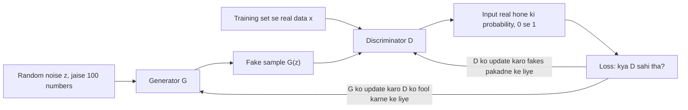
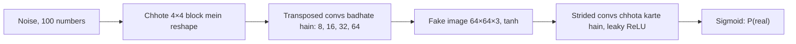
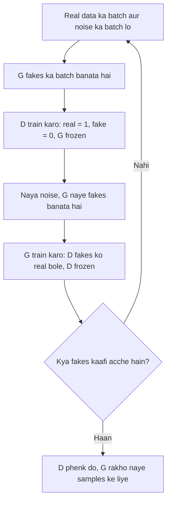
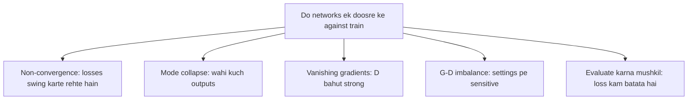
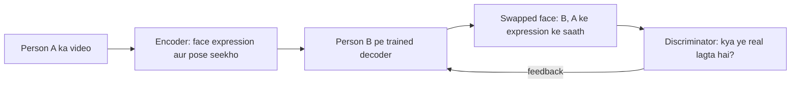

Naye ideas se pehle, woh purane ideas jo tumhe chahiye. Agar pehle se aate hain, to next section pe jao.

## Pehle basics

- Neural network ek bada formula hai jisme bahut saare adjust hone wale numbers hote hain, jinhe **weights** kehte hain. Training matlab weights ko adjust karna taaki **loss** kam ho. Loss ek number hai jo batata hai network kitna galat hai.
- **Classifier** ek network hai jo input dekhkar ek probability deta hai. **Sigmoid** output ke saath ye 0 aur 1 ke beech ka number deta hai, jaise "0.9 = 90% sure hai ki ye cat hai".
- **Binary cross-entropy** yes/no classifier ka usual loss hai. Ye confident galat answers ko bahut zyada punish karta hai, aur confident sahi answers ko lagbhag bilkul nahi.
- **Backpropagation** har weight ke liye nikalta hai ki use kis taraf thoda sa khiskaana hai taaki loss kam ho. **Gradient descent** phir us direction mein ek chhota step leta hai.
- **Random noise** ka yahan matlab bas random numbers ki ek list hai, jaise 100 numbers jo bell curve se liye gaye hain. Alag random list = alag output.

**Discriminative vs generative models.** GANs doosre group mein aate hain, isliye pehle farak samajh lo.

| | Discriminative model | Generative model |
|---|---|---|
| Question it answers | "Ye cat hai ya dog?" | "Cats kaise dikhti hain? Ek nayi bana ke dikhao." |
| What it learns | Classes ke beech ki boundary | Data khud kaisa dikhta hai |
| Output | Ek label ya probability | Ek bilkul naya sample |
| Needs labels? | Usually haan | Usually nahi |
| Examples | Logistic regression, CNN classifier | GAN, variational autoencoder (VAE) |

## Idea: ek forger aur ek detective

Socho ek forger hai jo nakli notes chhaapta hai, aur ek police detective hai jo notes check karta hai.

- Shuru mein forger kharab hai, aur detective har fake aasaani se pakad leta hai.
- Forger dekhta hai ki fakes kis wajah se pakde gaye, aur better notes chhaapta hai.
- Ab detective ko dhyaan se dekhna padta hai, aur woh real notes ki aur baareek details seekhta hai.
- Forger phir improve karta hai, aur aise hi chalta rehta hai.

Agar ye chalta rahe, to forger itne acche notes chhaapne lagta hai ki detective sirf guess kar sakta hai. Original GAN paper bilkul yahi picture use karta hai: generator "a team of counterfeiters" hai aur discriminator police hai. <Cite id="goodfellow2014" />

**Generative adversarial network (GAN)** is game ko do neural networks mein daal deta hai. "Generative" kyunki ye data generate karta hai, "adversarial" kyunki dono networks opponents hain. Ise Ian Goodfellow aur colleagues ne 2014 mein introduce kiya. Ye syllabus <Syl m="6" /> hai: GAN architecture, aur applications jaise image generation aur deepfakes.

<Box kind="definition">

**Generative adversarial network (GAN):** do neural networks ka pair jo ek game ki tarah saath mein train hote hain. **Generator** random noise ko ek fake sample mein badalta hai. **Discriminator** ek sample dekhta hai aur batata hai ki uske real hone ki probability kitni hai. Discriminator ko real aur fake alag karna sikhaya jaata hai, aur generator ko discriminator ko bewakoof banana.

Neeche use hone wale short names: $G$ = generator, $D$ = discriminator, $z$ = random noise, $G(z)$ = ek fake sample, $x$ = ek real sample, $D(x)$ = discriminator ki probability ki $x$ real hai.

</Box>

Exam mein English mein likho: "A GAN is a pair of neural networks, a generator and a discriminator, trained together as a two-player game."

**Iski zaroorat kyun hai?**

- Humein aksar **naya** data chahiye jo real dikhe: game ke liye naye faces, classifier train karne ke liye extra medical scans, blurry photo ka sharp version.
- Kai purane generative models ko har possible image ki exact probability likhni aur calculate karni padti thi. Badi pictures ke liye ye bahut mushkil hai, aur results aksar blurry aate the.
- GAN ye step skip kar deta hai. Isko bas ek network chahiye jo samples **banata** hai aur ek doosra network jo unhe **judge** karta hai. Judge ka feedback us mushkil probability calculation ki jagah le leta hai. Book kehti hai: GAN learning ko "neither approximate inference nor approximation of a partition function gradient" chahiye, jo do mushkil steps purane models ko chahiye the. <Cite id="gfdl-ch20" loc="§20.10.4" />
- Isko **labels bhi nahi chahiye**: bas real examples ka ek dher.

## GAN architecture

GAN ke paanch parts hain. Unhe usi order mein padho jisme data flow hota hai.

1. **Random noise $z$ (latent vector).** Random numbers ki ek chhoti list, jaise bell curve se 100 numbers. Ye ek naye sample ka "seed" hai. $z$ badlo to alag face milega.
2. **Generator $G$.** Ek neural network jo $z$ ko real data ke same shape ke sample mein badalta hai, jaise $64 \times 64$ colour picture. Ye **real data kabhi nahi dekhta**. Ye sirf discriminator ke feedback se seekhta hai.
3. **Real data $x$.** Training set ke examples, jaise faces ki real photos. Labels ki zaroorat nahi.
4. **Discriminator $D$.** Ek classifier. Iska input ek sample hai, real ya fake. Iska output 0 aur 1 ke beech ka ek number hai (sigmoid se): 1 ke paas matlab "mujhe lagta hai ye real hai", 0 ke paas matlab "mujhe lagta hai ye fake hai".
5. **Loss aur feedback.** Discriminator ka answer sach (real ya fake) se compare hota hai. Error se discriminator directly update hota hai, aur ye error discriminator ke **through** peeche generator tak jaata hai taaki generator update ho.

**Dono networks ke roles side by side.**

| | Generator $G$ | Discriminator $D$ |
|---|---|---|
| Job | Real dikhne wale fakes banana | Real aur fake alag karna |
| Input | Random noise $z$ | Ek sample, real ya fake |
| Output | Ek fake sample (jaise image) | "Real" ki ek probability |
| Analogy | Forger | Detective |
| Wins when | $D$ uske fakes ko "real" bole | Real aur fake ko sahi label kare |
| Kept after training? | Haan, yahi useful part hai | Nahi, phenk diya jaata hai |

**Andar se dono networks kaise dikhte hain.**

- **Original (vanilla) GAN** mein dono mostly simple fully connected networks (multilayer perceptrons) hain. 2014 paper ne inhe chhoti images pe test kiya jaise handwritten digits (MNIST), faces aur CIFAR-10 (CIFAR-10 ke liye ek chhota convolutional version bhi try kiya). <Cite id="goodfellow2014" />
- Badi pictures ke liye **DCGAN** (deep convolutional GAN) convolution layers use karta hai. Discriminator ek normal CNN hai jo picture ko chhota karte-karte ek number tak le aata hai. Generator ulta chalta hai: $z$ se shuru karta hai aur **transposed convolutions** se har layer pe picture badi karta hai, jaise $4 \times 4 \to 8 \times 8 \to 16 \times 16 \to 32 \times 32 \to 64 \times 64$. <Cite id="radford2015" /> <Cite id="pytorch-dcgan" /> <Cite id="tf-dcgan" /> <Cite id="keras-dcgan" />

<Figure caption="Ek chhota vanilla GAN, do fully connected networks ki tarah. Generator (left) 3 noise numbers ko 6-number fake sample mein badhata hai. Discriminator (right) 6-number sample ko ek output tak chhota karta hai: uske real hone ki probability. Real GANs mein bahut zyada neurons hote hain.">
  <NetworkFigure layers="3,5,6" title="Generator G" labels="Noise z,Hidden,Fake sample" />
  <NetworkFigure layers="6,4,1" title="Discriminator D" labels="Sample,Hidden,P(real)" />
</Figure>

**DCGAN design rules** (Radford et al., 2015), 10-mark answer mein likhne layak:

- Koi pooling layer nahi: discriminator chhota karne ke liye **strided convolutions** use karta hai, aur generator bada karne ke liye **transposed convolutions**.
- Dono networks mein **batch normalization**, jo training ko steady rakhta hai.
- Deep versions mein koi fully connected hidden layer nahi.
- Generator mein **ReLU**, sirf output pe **tanh** (taaki pixel values −1 aur 1 ke beech rahein).
- Discriminator mein **Leaky ReLU**.

## Game ek formula mein

Is topic mein sirf yahi section ek formula rakhta hai. Pehle words samjho; formula tabhi likho jab question "architecture in detail" ya "working" pooche, jahan iski ek line marks dilaati hai.

Dono networks ek hi score share karte hain, jise **value function** $V(D, G)$ kehte hain. Words mein:

- Pehla part $D$ ko reward deta hai jab woh real data ko "real" bole.
- Doosra part $D$ ko reward deta hai jab woh fake data ko "fake" bole.
- $D$ score ko **bada** karna chahta hai (accha judge banna). $G$ ise **chhota** karna chahta hai, doosre part pe $D$ ko fool karke.

Kyunki ek player same score ko maximize karta hai aur doosra minimize, ise **minimax** game kehte hain. Exam mein likhne layak yahi ek formula hai: <Cite id="goodfellow2014" /> <Cite id="gfdl-ch20" loc="§20.10.4" />

$$
\min_G \max_D \; V(D,G) = \mathbb{E}_{x \sim p_{\text{data}}}\big[\ln D(x)\big] + \mathbb{E}_{z \sim p_z}\big[\ln\big(1 - D(G(z))\big)\big]
$$

- $x \sim p_{\text{data}}$: training data ka ek real example. $z \sim p_z$: random noise.
- $\mathbb{E}[\dots]$: "bahut saare examples ka average".
- $D(x)$: $D$ ki probability ki real sample real hai. $D$ chahta hai ye 1 ke paas ho.
- $D(G(z))$: $D$ ki probability ki fake real hai. $D$ chahta hai ye 0 ke paas ho; $G$ chahta hai 1 ke paas ho.

**Ek chhota example, real numbers ke saath.** Maan lo $D$ ek real sample ko 0.9 aur ek fake sample ko 0.2 deta hai. Tab $V = \ln(0.9) + \ln(1 - 0.2) = -0.1054 - 0.2231 = -0.3285$. Agar $D$ better ho jaye aur fake ko 0.1 de, to $V = \ln(0.9) + \ln(0.9) = -0.2108$, jo bada hai, aur $D$ yahi chahta hai. Agar $G$ $D$ ko fool kare aur fake ko 0.6 mile, to $V = \ln(0.9) + \ln(0.4) = -0.1054 - 0.9163 = -1.0217$, jo chhota hai, aur $G$ yahi chahta hai. End point check: agar $D$ har cheez ko 0.5 de, to $V = \ln(0.5) + \ln(0.5) = -1.3863$, jo $-2 \ln 2$ hai.

<Box kind="intuition">

Ye asal mein binary cross-entropy hi hai, bas bhes badal ke. Discriminator ek normal classifier hai jisme real ka label 1 aur fake ka label 0 hai. Nayi cheez bas itni hai ki "fake" examples ek doosra network bana raha hai jo lagataar better hota ja raha hai.

</Box>

**Ideal end point.** Paper prove karta hai ki agar dono networks kaafi bade hon aur perfectly train hon, to game tab khatam hota hai jab fakes bilkul real data ki tarah spread ho jaate hain. Tab discriminator unhe alag nahi kar pata aur har sample ke liye $0.5$ ("50-50, main sirf guess kar sakta hoon") output deta hai. Training ke baad discriminator phenk diya jaata hai. Hum sirf generator rakhte hain, aur use naya random $z$ dekar naye samples banate hain. <Cite id="goodfellow2014" />

## GAN train kaise hota hai

Dono networks **baari-baari** train hote hain, ek saath nahi. Loop ka ek round:

1. **Discriminator train karo** ($G$ ko frozen rakho).
   - Real examples ka ek mini-batch lo aur unhe label 1 (real) do.
   - Noise ko $G$ se pass karke fakes ka batch banao, aur unhe label 0 (fake) do.
   - $D$ ko update karo taaki woh fakes pakadne mein better ho. Ye normal classifier training hai.
2. **Generator train karo** ($D$ ko frozen rakho).
   - Naya noise lo aur naye fakes banao.
   - Unhe $D$ se pass karo. **$D$ ke through $G$ tak** backpropagate karo, lekin sirf $G$ ke weights badlo, taaki $D$ fakes ko zyada real rate kare.
3. **Repeat** karo bahut saare epochs tak. Jab fakes acche dikhne lagein tab ruko. Log usually samples dekhkar judge karte hain, kyunki sirf loss values se pata nahi chalta kab rukna hai.

<Cite id="goodfellow2014" /> <Cite id="google-gan-training" /> <Cite id="d2l-gan" />

**Ek practical trick: non-saturating loss.** Training ke shuru mein fakes kharab hote hain, to $D$ unhe confidently reject karta hai. Original formula ke saath generator ko tab lagbhag koi learning signal nahi milta, jaise ek student jise har test mein "0" milta hai bina kisi comment ke. Paper ka fix: generator ka goal "$D$ ko kam sure karo ki fake fake hai" se badal ke "$D$ ko zyada sure karo ki fake real hai" kar do. Dono same direction mein push karte hain, lekin naya wala strong signal deta hai bilkul tab jab generator kharab hai. Goodfellow ki book ye reason deti hai: signal bada rehta hai "even in the situation when the discriminator confidently rejects all generator samples". <Cite id="goodfellow2014" /> <Cite id="gfdl-ch20" loc="§20.10.4" /> <Cite id="mlm-gan-loss" />

<Figure caption="Non-saturating generator loss, us probability ke against jo D ek fake ko deta hai. Left side pe ye bahut steep hai, jahan fakes kharab hain aur aasaani se pakde jaate hain, isliye generator ko strong push bilkul tab milta hai jab use chahiye.">
  <CurvePlot curves="ce-loss" x="0.01,1" y="0,4.7" xLabel="D(G(z)): probability D gives to the fake" yLabel="Generator loss" />
</Figure>

## Vanilla GANs ki problems

"Vanilla GAN" matlab original 2014 GAN: fully connected networks aur upar wala minimax loss. Ye chhoti images pe kaam karta hai lekin train karna famously mushkil hai. Book seedha kehti hai ki "stabilization of GAN learning remains an open problem". <Cite id="gfdl-ch20" loc="§20.10.4" />

**1. Non-convergence (game kabhi settle nahi hota).** Normal training ek loss pe neeche ki taraf jaati hai. Yahan do players opposite directions mein push karte hain, aur simple gradient steps balance point tak pahunchne ki **guarantee nahi** dete. Woh uske around ghoom sakte hain, jaise do log baari-baari rassi kheench rahe hon. Practice mein losses upar-neeche swing karte hain, aur sample quality better hone ke baad kharab bhi ho sakti hai. <Cite id="gfdl-ch20" loc="§20.10.4" />

**2. Mode collapse.** "Mode" data mein ek typical kind ka example hai, jaise MNIST mein har digit 0 se 9. Mode collapse mein generator ek ya kuch outputs dhoondh leta hai jo discriminator ko fool karte hain, aur sirf wahi banata rehta hai, to variety khatam ho jaati hai. Example: saare das digits pe trained GAN sirf bahut acche 1s banata hai. Original paper ise "Helvetica scenario" kehta hai: bahut saare alag noise inputs se same output. Ye warn karta hai ki ye tab ho sakta hai jab $G$ ko $D$ update kiye bina bahut zyada train kiya jaaye, lekin ye akela cause nahi hai. <Cite id="goodfellow2014" /> <Cite id="wiki-mode-collapse" /> <Cite id="gfg-gan-mode-collapse" />

**3. Vanishing gradients.** Agar discriminator bahut jaldi bahut accha ho jaaye, to woh har fake ko poore confidence se reject karta hai, aur original generator loss flat ho jaata hai. Generator ko lagbhag koi signal nahi milta aur woh seekhna band kar deta hai. Arjovsky aur Bottou ne dikhaya kyun: jab real aur fake data lagbhag overlap nahi karte, to ek near-perfect discriminator exist karta hai aur generator ka gradient fade ho jaata hai. <Cite id="arjovsky2017-principled" /> <Cite id="google-gan-problems" />

**4. Dono networks ka balance.** Agar $D$ bahut weak hai, to woh bekaar feedback deta hai aur $G$ kuch real nahi seekhta. Agar $D$ bahut strong hai, to gradients vanish ho jaate hain. Dono ko match rakhne ke liye learning rates, network sizes aur har ek ko kitne steps milte hain, inko dhyaan se choose karna padta hai, isliye results **hyperparameters pe bahut sensitive** hote hain. <Cite id="goodfellow2014" />

**5. Evaluate karna mushkil.** GAN kabhi sample ki probability nahi likhta, isliye hum use test data pe simply score nahi kar sakte. Loss values nahi batati ki pictures acchi hain ya nahi. Log samples dekhte hain ya alag scores use karte hain jaise Inception Score. <Cite id="goodfellow2014" /> <Cite id="salimans2016" />

**6. Low quality aur koi control nahi.** Fully connected vanilla GANs chhoti, blurry ya noisy images dete hain, aur tum ek particular kind ka output nahi maang sakte (jaise "ek 7 banao"), kyunki $G$ ko sirf random noise milta hai.

**Common fixes** (exam mein har ek ki ek line kaafi hai):

| Issue | Fix | Source |
|---|---|---|
| Vanishing gradients | Non-saturating generator loss; Wasserstein loss (WGAN) | <Cite id="goodfellow2014" /> <Cite id="arjovsky2017" /> |
| Mode collapse | Minibatch discrimination (D poora batch dekhta hai, to notice karta hai jab saare fakes same hon); unrolled GANs; WGAN | <Cite id="salimans2016" /> <Cite id="metz2016" /> |
| Non-convergence | Feature matching; one-sided label smoothing (real label 1 ki jagah 0.9); D ke inputs mein noise add karna; D ke weights ko penalize karna | <Cite id="salimans2016" /> <Cite id="google-gan-problems" /> |
| Poor image quality, unstable training | DCGAN design rules: convolutions, batch normalization, ReLU / leaky ReLU | <Cite id="radford2015" /> |
| No control over output | Conditional GAN: G aur D dono ko ek label do | <Cite id="mirza2014" /> |

<Box kind="pitfall">

Ye mat likho ki GAN "always converges to the real data distribution". Ye sirf ideal case mein proven hai jahan networks unlimited hain aur $D$ har step pe perfectly train hota hai. Real neural networks ke saath training oscillate ya collapse ho sakti hai.

</Box>

## GAN ke types

| Type | What changes | Main benefit | Source |
|---|---|---|---|
| **Vanilla GAN** (2014) | Fully connected G aur D, minimax loss | Original idea; simple | <Cite id="goodfellow2014" /> |
| **DCGAN** (2015) | Convolutional G aur D, upar ke design rules ke saath | Steady training, better images; standard starting point | <Cite id="radford2015" /> <Cite id="gfg-dcgan" /> |
| **Conditional GAN (cGAN)** (2014) | Dono networks ko ek label bhi milta hai, jaise digit class | Tum "ek 7 banao" maang sakte ho | <Cite id="mirza2014" /> <Cite id="gfg-cgan" /> |
| **Wasserstein GAN (WGAN)** (2017) | D ek "critic" ban jaata hai jo realness score deta hai, probability nahi | Steady training; loss quality ko better track karta hai | <Cite id="arjovsky2017" /> |
| **pix2pix** (2017) | Paired images pe conditional GAN | Sketch se photo, map se satellite image | <Cite id="isola2017" /> |
| **CycleGAN** (2017) | Paired examples ke bina translation | Horse se zebra, summer se winter | <Cite id="zhu2017" /> |
| **SRGAN** (2017) | Generator chhoti image ko upscale karta hai | Super-resolution: blurry se sharp | <Cite id="ledig2017" /> |
| **StyleGAN** (2019) | Generator har layer pe style control karta hai | Bahut realistic faces, pose aur hair pe control | <Cite id="karras2019" /> |

## GANs ki applications

| Application | What the GAN does | Example |
|---|---|---|
| **Image generation** | Noise se bilkul nayi realistic images banata hai | Aise logon ke faces jo exist hi nahi karte (StyleGAN) <Cite id="karras2019" /> |
| **Image-to-image translation** | Ek kind ki picture ko doosri mein badalta hai | Sketch se photo, day se night (pix2pix); horse se zebra (CycleGAN) <Cite id="isola2017" /> <Cite id="zhu2017" /> |
| **Super-resolution** | Chhoti, low-quality images mein realistic detail add karta hai | Purani photos ya CCTV frames sharp karna (SRGAN) <Cite id="ledig2017" /> |
| **Text-to-image** | Ek sentence se picture banata hai | "A small bird with a red head" |
| **Inpainting and photo editing** | Image ke missing ya damaged parts bharta hai | Koi object hatana, scratch repair karna |
| **Data augmentation** | Jab real data kam ya private ho, extra training data banata hai | Classifier train karne ke liye synthetic medical scans |
| **Face aging, pose and style** | Age, expression ya artistic style badalta hai | Face ko 30 saal bada dikhana |
| **Video and 3D** | Agle video frames predict karta hai; 3D object shapes banata hai | Video prediction, 3D chairs |
| **Deepfakes** | Video mein faces aur voices swap ya edit karta hai | Ek actor ka face doosre ki body pe lagana |

<Cite id="mlm-gan-apps" /> <Cite id="gfg-gan" /> <Cite id="ibm-gan" /> <Cite id="aws-gan" />

**Image generation thoda detail mein.** Bahut saari face photos pe training ke baad sirf generator rakha jaata hai. Har naya random noise vector ek naya face deta hai jo kabhi exist nahi karta tha. Ek noise vector se doosre tak smoothly move karne pe ek face smoothly doosre mein badalta hai, jo dikhata hai ki generator ne meaningful features (pose, smile, hair) seekhe hain, photos copy nahi kiye. <Cite id="radford2015" /> <Cite id="karras2019" />

**Deepfakes thoda detail mein.** **Deepfake** ek photo, video ya audio clip hai jisme kisi insaan ka face ya voice deep learning se replace ya change kiya gaya hai taaki woh real lage. Bahut saare deepfakes autoencoders se bante hain, aur kuch GANs bhi use karte hain: ek encoder-decoder ek insaan ke face ko doosre pe map karna seekhta hai, aur kuch tools ek GAN-style discriminator add karte hain jo result ko natural dikhne ki taraf push karta hai. <Cite id="wiki-deepfake" />

| Good uses of deepfakes | Harms of deepfakes |
|---|---|
| Film dubbing aur special effects | Fake news aur political misinformation |
| Education mein historical figures ko zinda dikhana | Fraud, jaise boss ki fake voice paise maangti hui |
| Privacy: witness ka face chhupana | Real logon ke fake videos bina consent ke |

Isliye deepfake **detection** ek active research area hai, aur bahut saare countries inke baare mein laws bana rahe hain.

## Advantages aur disadvantages

| Advantages | Disadvantages |
|---|---|
| Bahut sharp, realistic samples (kai purane generative models se sharp) | Unstable training; game shayad kabhi settle na ho |
| Labels nahi chahiye, sirf real examples | Mode collapse: limited variety |
| $G$ ke ek quick forward pass mein naya sample | Evaluate karna mushkil; loss quality ke baare mein kam batata hai |
| Images ki exact probabilities compute karne ki zaroorat nahi | Bahut data, compute aur careful tuning chahiye |
| Extend karna aasaan: conditional, translation, super-resolution | Misuse ho sakta hai (deepfakes) |

## GAN vs variational autoencoder

VAE syllabus mein named nahi hai, lekin ye Module 3 ke autoencoders pe based hai aur doosra famous generative model hai, isliye contrast ke liye useful hai. <Cite id="kingma2013-vae" /> <Cite id="gfg-vae" />

| | GAN | Variational autoencoder (VAE) |
|---|---|---|
| Parts | Generator + discriminator | Encoder + decoder |
| How it learns | Ek game: judge ko fool karo | Input ko rebuild karo aur hidden code smooth rakho |
| Image quality | Usually zyada sharp | Aksar zyada blurry |
| Training | Unstable, collapse ho sakta hai | Stable, ek loss neeche jaata hai |
| Has an encoder (image to code)? | Nahi (basic version mein) | Haan |

## Conclusion

GAN do networks ko ek doosre ke against lagaakar realistic naya data banana seekhta hai: generator fakes banata hai aur discriminator unhe judge karta hai. Isko labels nahi chahiye aur ye bahut sharp samples deta hai, lekin training unstable hai, isliye DCGAN, WGAN aur conditional GAN jaise improved versions bane.

Exam mein English mein likho: "A GAN learns to generate realistic data through a game between a generator and a discriminator; it needs no labels but its training is unstable."

<Box kind="exam">

"Explain the architecture/working of GAN and its applications" (10 marks) ke liye is order mein likho: definition aur forger-detective analogy, iski zaroorat kyun hai, labelled architecture diagram (noise, G, fake, real, D, probability, feedback), G aur D ke roles, minimax formula words mein explain karke, training steps, ideal end point ($D = 0.5$), advantages aur disadvantages, phir 5 se 6 applications har ek ke ek example ke saath, aur ek line ka conclusion.

</Box>

## Ye kahan pucha gaya

| If the question says | What to write | Seen as |
|---|---|---|
| "Explain the working of GAN" | Analogy, G aur D ke roles, architecture diagram, minimax idea, alternating training steps, end point $D = 0.5$ | <PYQ id="2023-12/q4b" /> |
| "Issues faced by vanilla GAN models" | Vanilla GAN kya hai, phir non-convergence, mode collapse, vanishing gradients, G-D balance aur hyperparameters, evaluation, low quality; ek fixes table | <PYQ id="2024-05/q4b" /> |
| "What are GANs, comment on applications" | Definition, short architecture aur training, phir examples ke saath applications table, deepfakes aur unke risks samet | <PYQ id="2024-05/q6b" /> |
| "GAN architecture and its applications" ya "architecture of GAN in detail, applications" | Paanch parts, labelled diagram, G aur D ke andar (MLP ya DCGAN), loss, training loop, phir applications | <PYQ id="2024-12/q6b" /> <PYQ id="2025-05/q5b" /> |

## Quick revision

- GAN = generator $G$ (noise → fake sample) + discriminator $D$ (sample → real ki probability). Opponents ki tarah train hote hain, jaise forger aur detective.
- Zaroorat isliye ki ye bina labels ke aur bina exact image probabilities compute kiye realistic naya data banata hai.
- Value function: $\min_G \max_D \; \mathbb{E}[\ln D(x)] + \mathbb{E}[\ln(1 - D(G(z)))]$. $D$ ise high chahta hai, $G$ low.
- Training alternate hoti hai: $D$ ko real = 1 aur fake = 0 se update karo, phir $G$ ko update karo taaki $D$ "real" bole (D frozen).
- Practice mein $G$ koshish karta hai ki $D$ "real" bole (non-saturating loss), taaki shuru mein weak signal na mile.
- Ideal end point: fakes real data se match karte hain, har jagah $D = 0.5$. Phir $D$ phenk do.
- Vanilla GAN issues: non-convergence, mode collapse (Helvetica scenario), vanishing gradients, G-D imbalance, evaluate karna mushkil, low quality.
- Types: DCGAN, conditional GAN, WGAN, pix2pix, CycleGAN, SRGAN, StyleGAN.
- Applications: image generation, image translation, super-resolution, inpainting, data augmentation, deepfakes.
