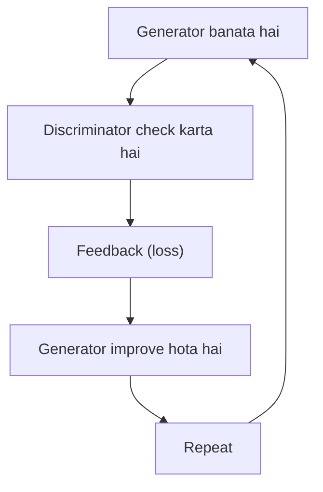
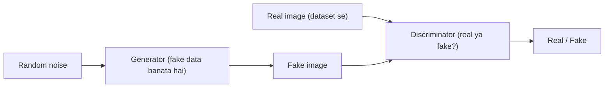
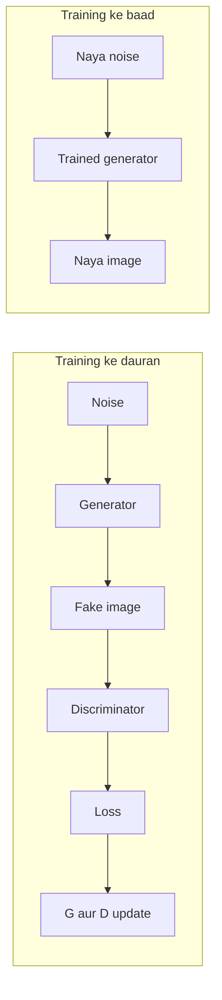
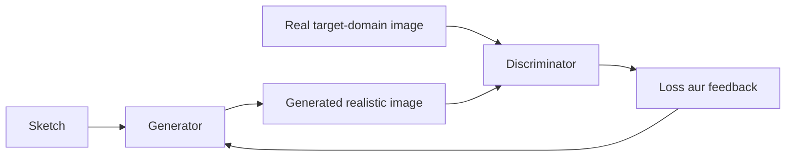

Ye syllabus <Syl m="6" /> hai: generative adversarial network ka architecture aur uski applications.

## GAN kya hai?

<Box kind="definition">

**GAN** stands for **Generative Adversarial Network**. A GAN is a deep learning model used to **generate new data** that looks similar to real training data. <Cite id="class-dl-chp6" loc="slide 2" /> <Cite id="class-dl-chp6" loc="slide 3" />

</Box>

Jo models mainly existing data ko classify ya predict karte hain unse alag, GANs naya data generate karna seekh sakte hain. **Generative** matlab aisa naya data banana jo us data jaisa dikhe jisse model ne seekha. Agar GAN ko bahut saari real human face images dein, to wo patterns seekhta hai aur aisa naya face bana sakta hai jo training data mein tha hi nahi. Important word hai "Generative". <Cite id="class-dl-chp6" loc="slide 2" />

**Generative model.** Generative model data se seekhta hai aur aisa naya data banata hai jo seekhe hue jaisa dikhe. Ye training data ke underlying patterns seekhta hai (digits ke liye: shape, curves, thickness, general structure, appearance mein variations) aur unse naye examples generate karta hai. Generated image kisi ek training image ki copy nahi hoti; ye model ne jo seekha uske base par naya sample hai. <Cite id="class-dl-chp6" loc="slide 4" />

## GANs ki zaroorat kyun hai?

Traditional machine learning existing data ko samajhne mein great hai, lekin ye mainly recognize, predict ya classify karta hai. GANs ek step aage jaate hain: ye naya data bhi generate kar sakte hain. <Cite id="class-dl-chp6" loc="slide 5" />

| Aspect | Traditional model | GAN |
|---|---|---|
| Main focus | Existing data ko recognize karta hai | Naya data generate karta hai |
| Task type | Classification, prediction | Generation |
| Example question | "What is this?" ("Is this a human face?") | "Can I create something like this?" ("How can I create a new human face?") |

<Cite id="class-dl-chp6" loc="slide 5" /> Short mein: traditional ML batata hai ki kuch kya hai; GANs kuch naya banane mein help karte hain.

## Basic idea: do networks jo compete karte hain

GAN mein **do neural networks hote hain jo ek dusre ke against kaam karte hain**. <Cite id="class-dl-chp6" loc="slide 6" />

- **Generator (G):** naya (fake) data banata hai jo real dikhe. Ye random noise leta hai aur fake (synthetic) sample banata hai. <Cite id="class-dl-chp6" loc="slide 3" />
- **Discriminator (D):** data check karta hai aur decide karta hai ki wo real hai ya fake. Ye real aur fake samples dekhta hai aur predict karta hai ki sample real hai ya fake. <Cite id="class-dl-chp6" loc="slide 3" />

Wo compete karte hain: generator discriminator ko fool karne ki koshish karta hai (fake ko real jaisa dikhata hai); discriminator fake ko detect karne ki koshish karta hai (fake pakadta hai). Dono time ke saath improve karte hain, aur ye competition generator ko zyada realistic data banane mein help karta hai. <Cite id="class-dl-chp6" loc="slide 6" />

**Simple example: fake currency.** Generator us insaan jaisa hai jo fake currency banata hai ("I will create a fake note that looks like a real note"). Discriminator examiner jaisa hai ("I will examine the note and decide whether it is real or fake"). <Cite id="class-dl-chp6" loc="slide 6" />

## GAN architecture

Generator **random noise** se fake images banata hai. Discriminator check karta hai ki image real hai ya fake. Ise images do sources se milti hain: **real data** (training images) aur **generated data** (generator ki fake images). <Cite id="class-dl-chp6" loc="slide 7" />

**Random noise.** Generator ka input random noise hota hai, jo aam taur par random numbers ka **vector** hota hai, jaise [0.2, −0.7, 1.1, 0.4, ...]. Ye image jaisa nahi dikhta; ye sirf ek starting point hai. Generator ise realistic-looking image mein badalta hai, aur **alag noise se alag results** aate hain. <Cite id="class-dl-chp6" loc="slide 8" />

**Generator aur discriminator ka role** <Cite id="class-dl-chp6" loc="slide 9" />

| | Generator (G) | Discriminator (D) |
|---|---|---|
| Zimmedari | Fake ya generated data banana | Check karna ki input real hai ya generated |
| Input | Random noise ya latent vector | Dataset ki real image ya generator ki generated image |
| Output | Generated image | REAL ya FAKE |
| Goal | Generated image ko itna realistic banana ki discriminator fool ho jaaye | Real images ko generated images se sahi alag pehchaanna |
| Isse aise socho | Ek artist jo realistic painting banane ki koshish karta hai | Art critic jo check karta hai ki painting genuine hai ya fake |

## GAN ki training kaise hoti hai

1. Generator ko **random noise** milta hai.
2. Generator ek **fake image** banata hai.
3. Discriminator ko fake image milti hai aur wo **real images** bhi dekhta hai aur compare karta hai.
4. Discriminator **real ya fake** predict karta hai.
5. Prediction se **loss** nikalta hai (discriminator galti kare to loss badhta hai; sahi ho to loss low).
6. **Backpropagation** feedback deti hai.
7. **Generator aur discriminator dono ke parameters update** hote hain.
8. Process tab tak **repeat** hota hai jab tak generator realistic samples na banaye. <Cite id="class-dl-chp6" loc="slide 2" /> <Cite id="class-dl-chp6" loc="slide 10" />

**Do losses.** Discriminator chahta hai ki real images real classify hon aur fake images fake; wo galti kare to uska loss badhta hai. Generator chahta hai ki discriminator uski generated image ko real classify kare; discriminator "fake" kahe to generator ka loss badhta hai. Discriminator ka loss kam matlab behtar separation; generator ka loss kam matlab behtar fooling. <Cite id="class-dl-chp6" loc="slide 10" /> <Cite id="class-dl-chp6" loc="slide 12" />

**Feedback ke baad kya hota hai.** Discriminator ka feedback generator ko batata hai ki wo kitna galat tha. Pehli koshish mein face poor hota hai aur discriminator "fake" kehta hai; loss aur backpropagation generator ko update karte hain; agli iterations mein face better, even better aur aakhir mein realistic ho jaata hai. Generator apne aap better nahi hota; wo isliye better hota hai kyunki training process discriminator ke through use feedback deti hai. <Cite id="class-dl-chp6" loc="slide 10" /> <Cite id="class-dl-chp6" loc="slide 11" />

**Time ke saath improvement.** Early stage: generator lagbhag kuch nahi jaanta aur discriminator poor-quality fake ko aasani se pakad leta hai. Thodi aur training ke baad: generator better samples banata hai aur discriminator abhi bhi unhe detect kar leta hai. Kai iterations ke baad: samples realistic dikhte hain aur unhe alag pehchaanna mushkil ho jaata hai. <Cite id="class-dl-chp6" loc="slide 12" />

<Box kind="pitfall">

"Finally the generator wins" mat likho. Ye likho: generator discriminator ko fool karna chahta hai aur discriminator fake ko detect karna chahta hai. Goal ye hai ki generator aise samples banaye jinhe discriminator real se alag pehchaanne mein mushkil mehsoos kare. <Cite id="class-dl-chp6" loc="slide 12" />

</Box>

**Training ke baad.** Discriminator mainly training ke dauran chahiye. Training complete hone ke baad sirf trained generator use hota hai: naya random noise andar jaata hai aur generator apne aap naya image banata hai. <Cite id="class-dl-chp6" loc="slide 11" /> <Cite id="class-dl-chp6" loc="slide 27" />

## Vanilla GAN ke issues

GANs powerful hain, lekin unhe train karna aasan nahi. <Cite id="class-dl-chp6" loc="slide 13" />

1. **Training instability.** GAN mein do networks ek saath opposite objectives ke saath seekhte hain. Kabhi ek network dusre se bahut better ho jaata hai. Discriminator bahut strong ho to generator bahut poor hota hai aur lagbhag har generated image fake pakdi jaati hai. Generator bahut strong ho to wo tez improve hota hai aur discriminator struggle karta hai, fake images sahi pehchaan nahi paata. Dono ko balanced tareeke se improve hona chahiye, warna training unstable ho jaati hai.
2. **Mode collapse.** Generator ko pata chal sakta hai ki sirf ek ya kuch hi types ke samples banana discriminator ko fool karne ke liye kaafi hai. Hum chahte hain kai alag faces; ho sakta hai baar-baar wahi face aaye. Mode collapse tab hota hai jab generator diverse samples ki jagah limited ya bahut milte-julte samples banata hai.
3. **Difficult to train.** Training mein kai factors ka careful selection chahiye: learning rate, network architecture, batch size, training strategy aur generator aur discriminator ke beech balance. Chhote changes training ko kaafi affect kar sakte hain, isliye GANs ko kaafi experimentation chahiye ho sakta hai. Ye plug-and-play model nahi hai. <Cite id="class-dl-chp6" loc="slide 13" />

| Problem | Matlab |
|---|---|
| Training instability | Generator aur discriminator balanced tareeke se nahi seekh paate |
| Mode collapse | Generator limited ya milte-julte outputs banata hai |
| Training difficulty | GANs ko careful tuning aur experimentation chahiye |

## GANs ki applications

GANs sirf theoretical nahi hain; ye kai real-world applications mein use hote hain. <Cite id="class-dl-chp6" loc="slide 16" />

| # | Application | Kya karti hai |
|---|---|---|
| 1 | Image generation | Naye human faces, objects, animals, scenery generate karna; training data jaisi synthetic images |
| 2 | DeepFake | Face swapping, face synthesis, facial expressions ya appearance manipulate karna |
| 3 | Image-to-image translation | Ek type ki image ko dusre type mein badalna (sketch se realistic image, day se night, summer se winter) |
| 4 | Image super-resolution | Low-resolution (blurry) image ko higher-resolution version mein badalna |
| 5 | Image restoration | Noise hatana, damaged ya purani images restore karna, missing portions bharna (inpainting) |
| 6 | Data augmentation ya synthetic data | Jab real data limited ya collect karna mushkil ho to additional training samples generate karna |
| 7 | Video generation ya manipulation | Video frames generate ya modify karna; face aur expression manipulation |
| 8 | Art aur creative content | Artistic images generate karna; naye visual styles aur designs banana |
| 9 | Medical imaging | Research aur training ke liye synthetic medical images (jaise MRI ya CT style) generate karna |
| 10 | Text-to-image generation | GAN-based research text descriptions se images generate karne ke liye bhi use hui hai |

**Lagbhag har application ke liye same pattern.** Training: real training data (images, videos, text) GAN (generator + discriminator) ko jaata hai, loss dikhata hai ki wo kaisa perform kar raha hai, backpropagation learning signal deti hai, parameters update hote hain, generator better data banata hai aur discriminator phir check karta hai, aur loop repeat hota hai. Training ke baad: naya input (random noise, text ya condition) trained generator mein jaata hai, jo final output (image ya video) deta hai. <Cite id="class-dl-chp6" loc="slide 27" />

### Image-to-image translation

Image-to-image translation GANs se ek domain ki image ko dusre domain mein badalta hai (jaise sketch se realistic image). <Cite id="class-dl-chp6" loc="slide 19" />

1. Generator ko source domain ki image do (ek sketch).
2. Generator use target domain ki realistic-looking image mein badalta hai.
3. Discriminator ko real target-domain image aur generated image dono milti hain aur wo poochta hai: "does this generated image look like a real image from the target domain?"
4. Generated image realistic na dikhe to loss badhta hai aur generator ko feedback milta hai.
5. Generator feedback se apne parameters update karta hai aur phir koshish karta hai.
6. Kai iterations tak repeat karo, jab tak generator realistic images na banaye aur discriminator ko difference batana aasan na rahe. <Cite id="class-dl-chp6" loc="slide 19" />

### Dusre model ke liye synthetic data

Jab real data limited ho to GANs additional data samples generate kar sakte hain, jisse bada aur zyada diverse training dataset banta hai. Example: maano hamare paas sirf 500 real images hain. GAN ko inpar train karo, trained generator se random noise se naye samples banwao, discriminator se check karo, aur achhi synthetic images ko real images ke saath milakar bada training dataset banao. Synthetic images ko training data ki tarah use karne se pehle quality-check karna chahiye, kyunki saare generated samples achhe nahi hote. <Cite id="class-dl-chp6" loc="slide 22" />

### DeepFake aur baaki applications short mein

- **DeepFake** digitally generated ya manipulated media hai jismein kisi person ki appearance, voice ya dusri characteristics badal di jaati hain taaki content authentic lage (face swapping, facial expressions badalna, lip-sync manipulation). Goal Person A ka face generate karna hai jo Person B ke expressions aur movements follow kare. GANs historically DeepFake systems mein use hue hain, halanki modern DeepFake systems sirf GANs tak limited nahi hain. <Cite id="class-dl-chp6" loc="slide 18" />
- **Super-resolution:** generator plausible fine details (textures, edges, patterns) jodta hai; wo exact original lost pixels wapas nahi laata. <Cite id="class-dl-chp6" loc="slide 20" />
- **Restoration aur inpainting:** generator predict karta hai ki missing ya corrupted region mein kya plausibly aa sakta hai; result visually plausible hota hai lekin exact original image nahi. <Cite id="class-dl-chp6" loc="slide 21" />
- **Video:** frames individually realistic hone chahiye, ek dusre ke saath consistent aur time ke saath smoothly badalne chahiye; key challenge temporal consistency hai. <Cite id="class-dl-chp6" loc="slide 23" />
- **Art aur medical images:** generator training data se style aur characteristics seekhta hai aur naya original kaam banata hai, copies nahi; generated medical images synthetic hain aur apne aap medically accurate nahi, isliye research, development aur data augmentation ke liye hain, direct diagnosis ke liye nahi. <Cite id="class-dl-chp6" loc="slide 24" /> <Cite id="class-dl-chp6" loc="slide 25" />
- **Text-to-image:** text ko numerical representation (embedding) mein badalte hain aur generator image banata hai; modern text-to-image systems mein diffusion-based approaches chhaaye hue hain. <Cite id="class-dl-chp6" loc="slide 26" />

## GANs aur DeepFakes ke ethical aur social issues

GAN technology useful aur harmful dono purposes ke liye use ho sakti hai. <Cite id="class-dl-chp6" loc="slide 14" />

1. **Misinformation:** manipulated images ya videos aisa dikha sakte hain ki kisi ne kuch kaha ya kiya jo kabhi hua hi nahi.
2. **Identity misuse:** kisi ka face permission ke bina dusri image ya video mein daala ja sakta hai (privacy aur consent issues).
3. **Fraud aur impersonation:** synthetic media se kisi ki nakal ki ja sakti hai, jisse financial loss aur scams ho sakte hain.
4. **Non-consensual content:** kisi ka face ya identity consent ke bina manipulated content mein.
5. **Digital media par bharosa mushkil:** sirf image ya video dekhna ye establish karne ke liye kaafi nahi ki wo genuine hai. Zaroori: DeepFake detection, media verification, digital provenance aur responsible AI practices.

Positive uses: creative content generation, image restoration, synthetic training data, medical research, visual effects, research aur experimentation. <Cite id="class-dl-chp6" loc="slide 14" />

## Ye kahan pucha gaya

| Agar question kahe | Kya likhna hai | Kab aaya |
|---|---|---|
| "Explain the working of GAN" / "working principle with a suitable example" | Generator aur discriminator, noise, training loop, training ke baad, faces ya currency ka example | <PYQ id="2023-12/q4b" /> <PYQ id="assignment-2/q6a" /> |
| "What are the issues faced by vanilla GAN models?" | Training instability, mode collapse, difficult to train | <PYQ id="2024-05/q4b" /> |
| "What are GANs, comment on applications" / "Explain GAN architecture and its applications" | Definition, architecture diagram, roles, training, applications ki list ek-ek line ke saath | <PYQ id="2024-05/q6b" /> <PYQ id="2024-12/q6b" /> <PYQ id="2025-05/q5b" /> |
| Additional training data ke liye GANs | Limited real data par train, synthetic samples generate, quality-check, merge | <PYQ id="assignment-2/q6b" /> |
| Image-to-image translation ke liye GANs | Sketch se realistic image, discriminator feedback loop ke saath chhe steps | <PYQ id="assignment-2/q6c" /> |
| Discriminator ka role | Real aur generated input, real ya fake output, goal, generator ko feedback | <PYQ id="assignment-2/q6d" /> |

## Quick revision

- GAN = Generative Adversarial Network: deep learning model jo real training data jaisa naya data generate karta hai.
- Do networks: generator (noise se fake sample) aur discriminator (real ya fake?). Wo compete karte hain aur dono improve hote hain.
- Training: generator banata hai, discriminator check karta hai, loss, backpropagation, dono update, repeat. Training ke baad sirf generator use hota hai.
- Issues: training instability, mode collapse, difficult to train (tuning chahiye).
- Applications: image generation, DeepFake, image-to-image translation, super-resolution, restoration, synthetic data, video, art, medical imaging, text-to-image.
- Ethics: misinformation, identity misuse, fraud, non-consensual content, digital media par bharosa ka loss.

**Conclusion.** GANs powerful generative models hain: generator discriminator se compete karke random noise se realistic data banana seekhta hai. Inki applications beneficial ho sakti hain, lekin realistic synthetic media privacy, consent, misinformation aur authenticity ki challenges bhi laata hai, isliye responsible use matter karta hai. <Cite id="class-dl-chp6" loc="slide 14" />
