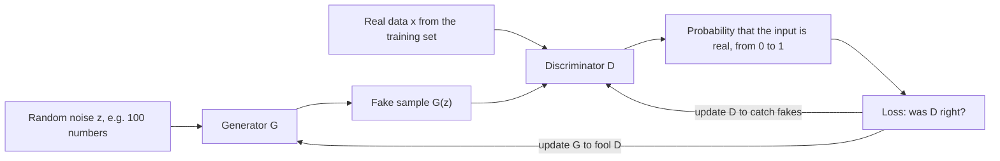
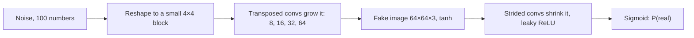
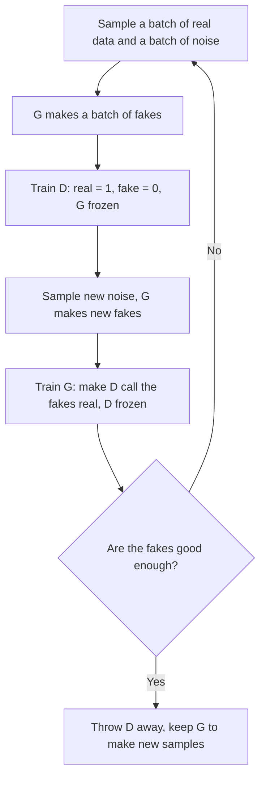
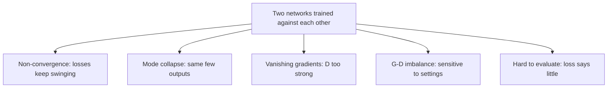
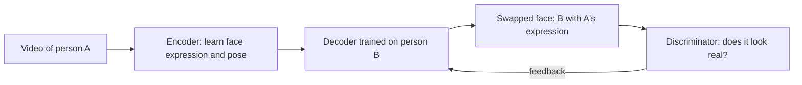

Before the new ideas, here are the old ones you need. If you already know them, skip to the next section.

## The basics first

- A neural network is a big formula with many adjustable numbers called **weights**. Training means adjusting the weights to lower a **loss**, one number that says how wrong the network is.
- A **classifier** is a network that looks at an input and outputs a probability. With a **sigmoid** output it gives a number between 0 and 1, such as "0.9 = 90% sure this is a cat".
- **Binary cross-entropy** is the usual loss for a yes/no classifier. It punishes confident wrong answers heavily and confident right answers hardly at all.
- **Backpropagation** works out, for every weight, which way to nudge it to lower the loss. **Gradient descent** then takes a small step in that direction.
- **Random noise** here just means a list of random numbers, for example 100 numbers each drawn from a bell curve. Different random lists give different outputs.

**Discriminative versus generative models.** GANs belong to the second group, so it helps to see the difference first.

| | Discriminative model | Generative model |
|---|---|---|
| Question it answers | "Is this a cat or a dog?" | "What do cats look like? Draw me a new one." |
| What it learns | The boundary between classes | What the data itself looks like |
| Output | A label or a probability | A brand-new sample |
| Needs labels? | Usually yes | Usually no |
| Examples | Logistic regression, CNN classifier | GAN, variational autoencoder (VAE) |

## The idea: a forger and a detective

Imagine a forger who prints fake banknotes and a police detective who checks notes.

- At first the forger is bad, and the detective catches every fake easily.
- The forger studies what gave the fakes away and prints better ones.
- Now the detective must look more carefully, and learns finer details of real notes.
- The forger improves again, and so on.

If this keeps going, the forger ends up printing notes so good that the detective can only guess. The original GAN paper uses exactly this picture: the generator is "a team of counterfeiters" and the discriminator is the police. <Cite id="goodfellow2014" />

A **generative adversarial network (GAN)** puts this game into two neural networks. "Generative" because it generates data, "adversarial" because the two networks are opponents. It was introduced by Ian Goodfellow and colleagues in 2014. This is syllabus <Syl m="6" />: GAN architecture, and applications such as image generation and deepfakes.

<Box kind="definition">

**Generative adversarial network (GAN):** a pair of neural networks trained together as a game. The **generator** turns random noise into a fake sample. The **discriminator** looks at a sample and outputs the probability that it is real. The discriminator is trained to tell real from fake, and the generator is trained to fool the discriminator.

Short names used below: $G$ = generator, $D$ = discriminator, $z$ = random noise, $G(z)$ = a fake sample, $x$ = a real sample, $D(x)$ = the discriminator's probability that $x$ is real.

</Box>

**Why do we need it?**

- We often want **new** data that looks real: new faces for a game, extra medical scans to train a classifier, a sharper version of a blurry photo.
- Many older generative models had to write down and compute the exact probability of every possible image. For big pictures this is extremely hard, and the results were often blurry.
- A GAN skips that step. It only needs one network that **makes** samples and a second network that **judges** them. The judge's feedback replaces the hard probability calculation. The book puts it this way: GAN learning needs "neither approximate inference nor approximation of a partition function gradient", two hard steps that older models needed. <Cite id="gfdl-ch20" loc="§20.10.4" />
- It also needs **no labels**: just a pile of real examples.

## GAN architecture

A GAN has five parts. Read them in the order data flows.

1. **Random noise $z$ (the latent vector).** A short list of random numbers, for example 100 numbers from a bell curve. It is the "seed" of one new sample. Change $z$ and you get a different face.
2. **Generator $G$.** A neural network that turns $z$ into a sample of the same shape as the real data, for example a $64 \times 64$ colour picture. It **never sees real data**. It learns only from the discriminator's feedback.
3. **Real data $x$.** Examples from the training set, for example real photos of faces. No labels are needed.
4. **Discriminator $D$.** A classifier. Its input is one sample, real or fake. Its output is one number between 0 and 1 (from a sigmoid): near 1 means "I think this is real", near 0 means "I think this is fake".
5. **Loss and feedback.** The discriminator's answer is compared with the truth (real or fake). The error is used to update the discriminator directly, and it is passed back **through** the discriminator into the generator to update the generator.

**Roles of the two networks side by side.**

| | Generator $G$ | Discriminator $D$ |
|---|---|---|
| Job | Make fakes that look real | Tell real from fake |
| Input | Random noise $z$ | One sample, real or fake |
| Output | A fake sample (e.g. an image) | One probability of "real" |
| Analogy | Forger | Detective |
| Wins when | $D$ calls its fakes "real" | It labels real and fake correctly |
| Kept after training? | Yes, it is the useful part | No, it is thrown away |

**What the two networks look like inside.**

- In the **original (vanilla) GAN**, both are mostly simple fully connected networks (multilayer perceptrons). The 2014 paper tested them on small images such as handwritten digits (MNIST), faces and CIFAR-10 (for CIFAR-10 it also tried a small convolutional version). <Cite id="goodfellow2014" />
- For bigger pictures, the **DCGAN** (deep convolutional GAN) uses convolution layers. The discriminator is an ordinary CNN that shrinks the picture down to one number. The generator runs the other way: it starts from $z$ and uses **transposed convolutions** to make the picture bigger at every layer, for example $4 \times 4 \to 8 \times 8 \to 16 \times 16 \to 32 \times 32 \to 64 \times 64$. <Cite id="radford2015" /> <Cite id="pytorch-dcgan" /> <Cite id="tf-dcgan" /> <Cite id="keras-dcgan" />

<Figure caption="A tiny vanilla GAN drawn as two fully connected networks. The generator (left) grows 3 noise numbers into a 6-number fake sample. The discriminator (right) shrinks a 6-number sample down to one output: the probability that it is real. Real GANs use far more neurons.">
  <NetworkFigure layers="3,5,6" title="Generator G" labels="Noise z,Hidden,Fake sample" />
  <NetworkFigure layers="6,4,1" title="Discriminator D" labels="Sample,Hidden,P(real)" />
</Figure>

**DCGAN design rules** (Radford et al., 2015), worth listing in a 10-mark answer:

- No pooling layers: the discriminator uses **strided convolutions** to shrink, and the generator uses **transposed convolutions** to grow.
- **Batch normalization** in both networks, which keeps training steady.
- No fully connected hidden layers in deep versions.
- **ReLU** in the generator, except **tanh** at the output (so pixel values lie between −1 and 1).
- **Leaky ReLU** in the discriminator.

## The game in one formula

This section holds the only formula in the topic. Learn the words first; write the formula only when the question asks for "architecture in detail" or "working", where one line of it earns marks.

Both networks share one score, called the **value function** $V(D, G)$. In words:

- The first part rewards $D$ for saying "real" to real data.
- The second part rewards $D$ for saying "fake" to fake data.
- $D$ tries to make the score **large** (be a good judge). $G$ tries to make it **small** by fooling $D$ on the second part.

Because one player maximizes and the other minimizes the same score, it is called a **minimax** game. This is the one formula worth writing in an exam: <Cite id="goodfellow2014" /> <Cite id="gfdl-ch20" loc="§20.10.4" />

$$
\min_G \max_D \; V(D,G) = \mathbb{E}_{x \sim p_{\text{data}}}\big[\ln D(x)\big] + \mathbb{E}_{z \sim p_z}\big[\ln\big(1 - D(G(z))\big)\big]
$$

- $x \sim p_{\text{data}}$: a real example from the training data. $z \sim p_z$: random noise.
- $\mathbb{E}[\dots]$: "the average over many examples".
- $D(x)$: $D$'s probability that a real sample is real. $D$ wants it near 1.
- $D(G(z))$: $D$'s probability that a fake is real. $D$ wants it near 0; $G$ wants it near 1.

**Tiny example with real numbers.** Say $D$ gives a real sample 0.9 and a fake sample 0.2. Then $V = \ln(0.9) + \ln(1 - 0.2) = -0.1054 - 0.2231 = -0.3285$. If $D$ improves and gives the fake 0.1, $V = \ln(0.9) + \ln(0.9) = -0.2108$, which is larger, as $D$ wants. If $G$ fools $D$ so the fake gets 0.6, $V = \ln(0.9) + \ln(0.4) = -0.1054 - 0.9163 = -1.0217$, which is smaller, as $G$ wants. Check the end point: if $D$ gives 0.5 to everything, $V = \ln(0.5) + \ln(0.5) = -1.3863$, which is $-2 \ln 2$.

<Box kind="intuition">

This is just binary cross-entropy in disguise. The discriminator is a normal classifier with label 1 for real and label 0 for fake. The only new thing is that the "fake" examples are made by a second network that keeps getting better.

</Box>

**The ideal end point.** The paper proves that, if both networks were big enough and trained perfectly, the game ends when the fakes are spread exactly like the real data. Then the discriminator cannot tell them apart and outputs $0.5$ ("50-50, I can only guess") for every sample. After training, the discriminator is thrown away. We keep only the generator, and feed it new random $z$ to make new samples. <Cite id="goodfellow2014" />

## How a GAN is trained

The two networks are trained **in turns**, not at the same time. One turn of the loop:

1. **Train the discriminator** (keep $G$ frozen).
   - Take a mini-batch of real examples and label them 1 (real).
   - Pass noise through $G$ to get a batch of fakes, and label them 0 (fake).
   - Update $D$ so it gets better at spotting fakes. This is ordinary classifier training.
2. **Train the generator** (keep $D$ frozen).
   - Take new noise and make new fakes.
   - Pass them through $D$. Backpropagate **through $D$ into $G$**, but change only $G$'s weights, so that $D$ will rate the fakes as more real.
3. **Repeat** for many epochs. Stop when the fakes look good. People usually judge by looking at samples, because the loss values alone do not say when to stop.

<Cite id="goodfellow2014" /> <Cite id="google-gan-training" /> <Cite id="d2l-gan" />

**A practical trick: the non-saturating loss.** Early in training the fakes are poor, so $D$ rejects them confidently. With the original formula the generator then gets almost no learning signal, like a student who gets "0" on every test with no comments. The paper's fix is to change the generator's goal from "make $D$ less sure the fake is fake" to "make $D$ more sure the fake is real". Both push the same way, but the new one gives a strong signal exactly when the generator is bad. Goodfellow's book gives this reason: the signal stays large "even in the situation when the discriminator confidently rejects all generator samples". <Cite id="goodfellow2014" /> <Cite id="gfdl-ch20" loc="§20.10.4" /> <Cite id="mlm-gan-loss" />

<Figure caption="The non-saturating generator loss plotted against the probability D gives to a fake. It is very steep on the left, where the fakes are bad and caught easily, so the generator gets a strong push exactly when it needs one.">
  <CurvePlot curves="ce-loss" x="0.01,1" y="0,4.7" xLabel="D(G(z)): probability D gives to the fake" yLabel="Generator loss" />
</Figure>

## Issues faced by vanilla GANs

"Vanilla GAN" means the original 2014 GAN: fully connected networks and the minimax loss above. It works on small images but is famously hard to train. The book says plainly that "stabilization of GAN learning remains an open problem". <Cite id="gfdl-ch20" loc="§20.10.4" />

**1. Non-convergence (the game never settles).** Ordinary training goes downhill on one loss. Here two players push in opposite directions, and simple gradient steps are **not guaranteed** to reach the balance point. They can circle around it, like two people pulling a rope in turns. In practice the losses swing up and down, and sample quality can get worse after getting better. <Cite id="gfdl-ch20" loc="§20.10.4" />

**2. Mode collapse.** A "mode" is one typical kind of example in the data, for example each digit 0 to 9 in MNIST. In mode collapse the generator finds one or a few outputs that fool the discriminator and keeps making only those, so variety is lost. Example: a GAN trained on all ten digits produces only very good 1s. The original paper calls this the "Helvetica scenario": many different noise inputs give the same output. It warns that this can happen if $G$ is trained too much without updating $D$, though that is not the only cause. <Cite id="goodfellow2014" /> <Cite id="wiki-mode-collapse" /> <Cite id="gfg-gan-mode-collapse" />

**3. Vanishing gradients.** If the discriminator becomes too good too early, it rejects every fake with total confidence, and the original generator loss becomes flat. The generator gets almost no signal and stops learning. Arjovsky and Bottou showed why: when real and fake data hardly overlap, a near-perfect discriminator exists and the generator's gradient fades away. <Cite id="arjovsky2017-principled" /> <Cite id="google-gan-problems" />

**4. Balancing the two networks.** If $D$ is too weak, it gives useless feedback and $G$ learns nothing real. If $D$ is too strong, gradients vanish. Keeping them matched needs careful choice of learning rates, network sizes and how many steps each gets, so results are very **sensitive to hyperparameters**. <Cite id="goodfellow2014" />

**5. Hard to evaluate.** A GAN never writes down the probability of a sample, so we cannot simply score it on test data. The loss values do not tell you whether the pictures are good. People look at samples or use separate scores such as the Inception Score. <Cite id="goodfellow2014" /> <Cite id="salimans2016" />

**6. Low quality and no control.** Fully connected vanilla GANs give small, blurry or noisy images, and you cannot ask for a particular kind of output (for example "draw a 7"), because $G$ only gets random noise.

**Common fixes** (one line each is enough in an exam):

| Issue | Fix | Source |
|---|---|---|
| Vanishing gradients | Non-saturating generator loss; Wasserstein loss (WGAN) | <Cite id="goodfellow2014" /> <Cite id="arjovsky2017" /> |
| Mode collapse | Minibatch discrimination (D looks at a whole batch, so it notices when all fakes are the same); unrolled GANs; WGAN | <Cite id="salimans2016" /> <Cite id="metz2016" /> |
| Non-convergence | Feature matching; one-sided label smoothing (real label 0.9 instead of 1); adding noise to D's inputs; penalizing D's weights | <Cite id="salimans2016" /> <Cite id="google-gan-problems" /> |
| Poor image quality, unstable training | DCGAN design rules: convolutions, batch normalization, ReLU / leaky ReLU | <Cite id="radford2015" /> |
| No control over output | Conditional GAN: give both G and D a label | <Cite id="mirza2014" /> |

<Box kind="pitfall">

Do not say a GAN "always converges to the real data distribution". That is only proven for the ideal case where the networks are unlimited and $D$ is trained to perfection at every step. With real neural networks, training can oscillate or collapse.

</Box>

## Types of GAN

| Type | What changes | Main benefit | Source |
|---|---|---|---|
| **Vanilla GAN** (2014) | Fully connected G and D, minimax loss | The original idea; simple | <Cite id="goodfellow2014" /> |
| **DCGAN** (2015) | Convolutional G and D with the design rules above | Steadier training, better images; the standard starting point | <Cite id="radford2015" /> <Cite id="gfg-dcgan" /> |
| **Conditional GAN (cGAN)** (2014) | Both networks also get a label, such as a digit class | You can ask for "make a 7" | <Cite id="mirza2014" /> <Cite id="gfg-cgan" /> |
| **Wasserstein GAN (WGAN)** (2017) | D becomes a "critic" giving a realness score, not a probability | Steadier training; loss tracks quality better | <Cite id="arjovsky2017" /> |
| **pix2pix** (2017) | Conditional GAN on paired images | Sketch to photo, map to satellite image | <Cite id="isola2017" /> |
| **CycleGAN** (2017) | Translation without paired examples | Horse to zebra, summer to winter | <Cite id="zhu2017" /> |
| **SRGAN** (2017) | Generator upscales a small image | Super-resolution: blurry to sharp | <Cite id="ledig2017" /> |
| **StyleGAN** (2019) | Generator controls style at each layer | Very realistic faces with control over pose and hair | <Cite id="karras2019" /> |

## Applications of GANs

| Application | What the GAN does | Example |
|---|---|---|
| **Image generation** | Makes brand-new realistic images from noise | Faces of people who do not exist (StyleGAN) <Cite id="karras2019" /> |
| **Image-to-image translation** | Turns one kind of picture into another | Sketch to photo, day to night (pix2pix); horse to zebra (CycleGAN) <Cite id="isola2017" /> <Cite id="zhu2017" /> |
| **Super-resolution** | Adds realistic detail to small, low-quality images | Sharpening old photos or CCTV frames (SRGAN) <Cite id="ledig2017" /> |
| **Text-to-image** | Draws a picture from a sentence | "A small bird with a red head" |
| **Inpainting and photo editing** | Fills in missing or damaged parts of an image | Removing an object, repairing a scratch |
| **Data augmentation** | Makes extra training data when real data is scarce or private | Synthetic medical scans to train a classifier |
| **Face aging, pose and style** | Changes age, expression or artistic style | Showing a face 30 years older |
| **Video and 3D** | Predicts next video frames; makes 3D object shapes | Video prediction, 3D chairs |
| **Deepfakes** | Swaps or edits faces and voices in video | Putting one actor's face on another's body |

<Cite id="mlm-gan-apps" /> <Cite id="gfg-gan" /> <Cite id="ibm-gan" /> <Cite id="aws-gan" />

**Image generation in a little more detail.** After training on many face photos, the generator alone is kept. Each new random noise vector gives a new face that never existed. Moving smoothly from one noise vector to another makes one face change smoothly into another, which shows the generator has learned meaningful features (pose, smile, hair) rather than copying photos. <Cite id="radford2015" /> <Cite id="karras2019" />

**Deepfakes in a little more detail.** A **deepfake** is a photo, video or audio clip where a person's face or voice has been replaced or changed by deep learning so that it looks real. Many deepfakes are made with autoencoders, and some also use GANs: an encoder-decoder learns to map one person's face onto another, and some tools add a GAN-style discriminator that pushes the result to look natural. <Cite id="wiki-deepfake" />

| Good uses of deepfakes | Harms of deepfakes |
|---|---|
| Film dubbing and special effects | Fake news and political misinformation |
| Bringing historical figures to life in education | Fraud, for example a fake voice of a boss asking for money |
| Privacy: hiding a witness's face | Fake videos of real people made without consent |

That is why deepfake **detection** is an active research area, and many countries are writing laws about them.

## Advantages and disadvantages

| Advantages | Disadvantages |
|---|---|
| Very sharp, realistic samples (sharper than many older generative models) | Unstable training; the game may never settle |
| Needs no labels, only real examples | Mode collapse: limited variety |
| Makes a new sample in one quick forward pass of $G$ | Hard to evaluate; the loss says little about quality |
| No need to compute exact probabilities of images | Needs a lot of data, compute and careful tuning |
| Easy to extend: conditional, translation, super-resolution | Can be misused (deepfakes) |

## GAN compared with a variational autoencoder

A VAE is not named in the syllabus, but it builds on the autoencoders of Module 3 and is the other well-known generative model, so it is a useful contrast. <Cite id="kingma2013-vae" /> <Cite id="gfg-vae" />

| | GAN | Variational autoencoder (VAE) |
|---|---|---|
| Parts | Generator + discriminator | Encoder + decoder |
| How it learns | A game: fool the judge | Rebuild the input and keep the hidden code smooth |
| Image quality | Usually sharper | Often blurrier |
| Training | Unstable, can collapse | Stable, one loss going down |
| Has an encoder (image to code)? | No (in the basic version) | Yes |

## Conclusion

A GAN learns to create realistic new data by setting two networks against each other: the generator makes fakes and the discriminator judges them. It needs no labels and gives very sharp samples, but training is unstable, which is why improved versions such as DCGAN, WGAN and conditional GAN exist.

<Box kind="exam">

For "Explain the architecture/working of GAN and its applications" (10 marks), write in this order: definition and forger-detective analogy, why it is needed, the labelled architecture diagram (noise, G, fake, real, D, probability, feedback), the roles of G and D, the minimax formula explained in words, the training steps, the ideal end point ($D = 0.5$), advantages and disadvantages, then 5 to 6 applications with one example each, and a one-line conclusion.

</Box>

## Where this was asked

| If the question says | What to write | Seen as |
|---|---|---|
| "Explain the working of GAN" | Analogy, G and D roles, architecture diagram, minimax idea, alternating training steps, end point $D = 0.5$ | <PYQ id="2023-12/q4b" /> |
| "Issues faced by vanilla GAN models" | What vanilla GAN is, then non-convergence, mode collapse, vanishing gradients, G-D balance and hyperparameters, evaluation, low quality; a fixes table | <PYQ id="2024-05/q4b" /> |
| "What are GANs, comment on applications" | Definition, short architecture and training, then an applications table with examples, including deepfakes and their risks | <PYQ id="2024-05/q6b" /> |
| "GAN architecture and its applications" or "architecture of GAN in detail, applications" | The five parts, labelled diagram, inside G and D (MLP or DCGAN), loss, training loop, then applications | <PYQ id="2024-12/q6b" /> <PYQ id="2025-05/q5b" /> |

## Quick revision

- GAN = generator $G$ (noise → fake sample) + discriminator $D$ (sample → probability of real). Trained as opponents, like a forger and a detective.
- Needed because it makes realistic new data without labels and without computing exact image probabilities.
- Value function: $\min_G \max_D \; \mathbb{E}[\ln D(x)] + \mathbb{E}[\ln(1 - D(G(z)))]$. $D$ wants it high, $G$ wants it low.
- Training alternates: update $D$ with real = 1 and fake = 0, then update $G$ to make $D$ say "real" (D frozen).
- In practice $G$ tries to make $D$ say "real" (non-saturating loss) to avoid weak signals early on.
- Ideal end point: fakes match real data, $D = 0.5$ everywhere. Then throw $D$ away.
- Vanilla GAN issues: non-convergence, mode collapse (Helvetica scenario), vanishing gradients, G-D imbalance, hard to evaluate, low quality.
- Types: DCGAN, conditional GAN, WGAN, pix2pix, CycleGAN, SRGAN, StyleGAN.
- Applications: image generation, image translation, super-resolution, inpainting, data augmentation, deepfakes.
