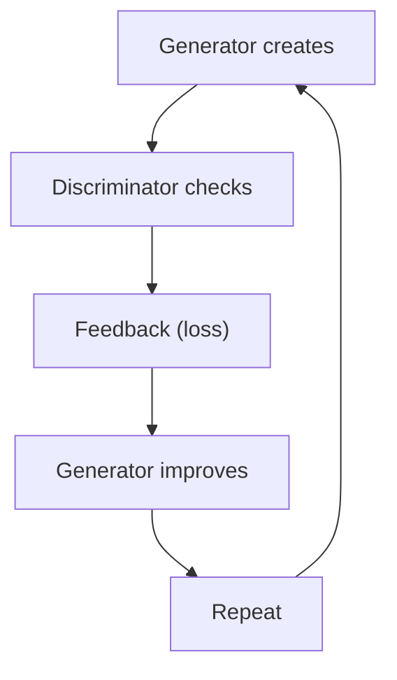
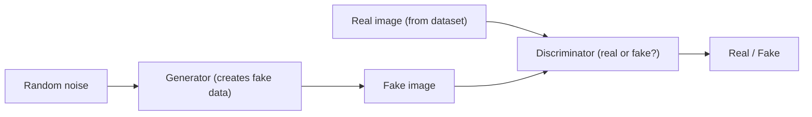
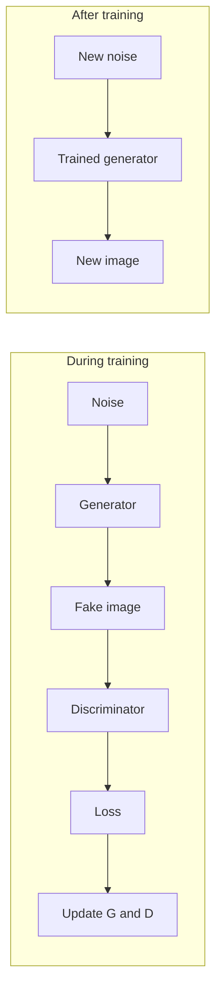
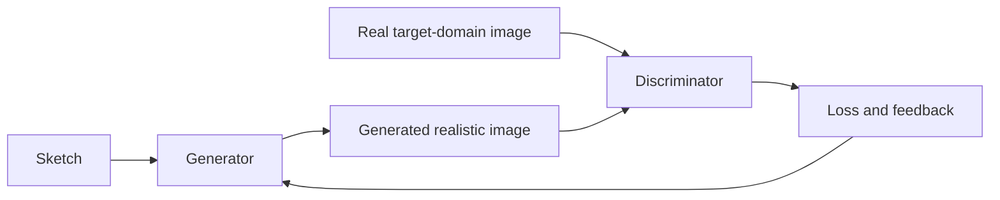

This is syllabus <Syl m="6" />: the architecture of a generative adversarial network and its applications.

## What is a GAN?

<Box kind="definition">

**GAN** stands for **Generative Adversarial Network**. A GAN is a deep learning model used to **generate new data** that looks similar to real training data. <Cite id="class-dl-chp6" loc="slide 2" /> <Cite id="class-dl-chp6" loc="slide 3" />

</Box>

Unlike models that mainly classify or predict existing data, GANs can learn to generate new data. **Generative** means creating new data that looks similar to the data it learned from. If we give a GAN many real human face images, it learns the patterns and can generate a new face that was not in the training data. The important word is "Generative". <Cite id="class-dl-chp6" loc="slide 2" />

**Generative model.** A generative model learns from the data and creates new data that looks similar to what it has learned. It learns the underlying patterns of the training data (for digits: shape, curves, thickness, general structure, variations in appearance) and uses them to generate new examples. The generated image is not simply copied from one training image; it is a new sample based on what the model has learned. <Cite id="class-dl-chp6" loc="slide 4" />

## Why do we need GANs?

Traditional machine learning is great at understanding existing data, but it mainly focuses on recognizing, predicting or classifying. GANs go a step further: they can also generate new data. <Cite id="class-dl-chp6" loc="slide 5" />

| Aspect | Traditional model | GAN |
|---|---|---|
| Main focus | Recognizes existing data | Generates new data |
| Task type | Classification, prediction | Generation |
| Example question | "What is this?" ("Is this a human face?") | "Can I create something like this?" ("How can I create a new human face?") |

<Cite id="class-dl-chp6" loc="slide 5" /> In short: traditional ML tells us what something is; GANs help us create something new.

## The basic idea: two networks that compete

A GAN contains **two neural networks that work against each other**. <Cite id="class-dl-chp6" loc="slide 6" />

- **Generator (G):** creates new (fake) data that looks real. It takes random noise and creates a fake (synthetic) sample. <Cite id="class-dl-chp6" loc="slide 3" />
- **Discriminator (D):** checks the data and decides whether it is real or fake. It looks at real and fake samples and predicts whether the sample is real or fake. <Cite id="class-dl-chp6" loc="slide 3" />

They compete: the generator tries to fool the discriminator (disguises fake as real); the discriminator tries to detect the fake (spots the fake). Both improve over time, and this competition helps the generator create more realistic data. <Cite id="class-dl-chp6" loc="slide 6" />

**Simple example: fake currency.** The generator is like someone making fake currency ("I will create a fake note that looks like a real note"). The discriminator is like an examiner ("I will examine the note and decide whether it is real or fake"). <Cite id="class-dl-chp6" loc="slide 6" />

## GAN architecture

The generator creates fake images from **random noise**. The discriminator checks whether an image is real or fake. It receives images from two sources: **real data** (training images) and **generated data** (fake images from the generator). <Cite id="class-dl-chp6" loc="slide 7" />

**Random noise.** The input of the generator is random noise, often represented as a **vector** of random numbers, for example [0.2, −0.7, 1.1, 0.4, ...]. It does not look like an image; it is only a starting point. The generator converts it into a realistic-looking image, and **different noise gives different results**. <Cite id="class-dl-chp6" loc="slide 8" />

**Role of the generator and the discriminator** <Cite id="class-dl-chp6" loc="slide 9" />

| | Generator (G) | Discriminator (D) |
|---|---|---|
| Responsible for | Creating fake or generated data | Checking whether an input is real or generated |
| Input | Random noise or latent vector | A real image from the dataset or a generated image from the generator |
| Output | Generated image | REAL or FAKE |
| Goal | Make the generated image look realistic enough to fool the discriminator | Correctly distinguish real images from generated images |
| Think of it as | An artist trying to create a realistic painting | An art critic checking whether a painting is genuine |

## How a GAN is trained

1. The generator receives **random noise**.
2. The generator creates a **fake image**.
3. The discriminator receives the fake image and also sees **real images** and compares them.
4. The discriminator predicts **real or fake**.
5. The prediction produces a **loss** (if the discriminator makes mistakes the loss increases; if correct the loss is low).
6. **Backpropagation** provides feedback.
7. The parameters of **both the generator and the discriminator are updated**.
8. The process **repeats** until the generator produces realistic samples. <Cite id="class-dl-chp6" loc="slide 2" /> <Cite id="class-dl-chp6" loc="slide 10" />

**The two losses.** The discriminator wants real images classified as real and fake images classified as fake; if it makes mistakes, its loss increases. The generator wants the discriminator to classify its generated image as real; its loss increases if the discriminator says "fake". Lower discriminator loss means better separation; lower generator loss means better fooling. <Cite id="class-dl-chp6" loc="slide 10" /> <Cite id="class-dl-chp6" loc="slide 12" />

**What happens after feedback.** The discriminator's feedback tells the generator how wrong it was. In the first attempt the face is poor and the discriminator says "fake"; the loss and backpropagation update the generator; in the next iterations the face becomes better, even better and finally realistic. The generator does not become better automatically; it becomes better because the training process gives it feedback through the discriminator. <Cite id="class-dl-chp6" loc="slide 10" /> <Cite id="class-dl-chp6" loc="slide 11" />

**Improving over time.** Early stage: the generator knows almost nothing and the discriminator easily spots the poor-quality fake. After more training: the generator produces better samples and the discriminator still detects them. After many iterations: the samples look realistic and are harder to distinguish. <Cite id="class-dl-chp6" loc="slide 12" />

<Box kind="pitfall">

Do not say "finally the generator wins". Say: the generator aims to fool the discriminator and the discriminator aims to detect the fake. The goal is for the generator to produce samples that are difficult for the discriminator to distinguish from real ones. <Cite id="class-dl-chp6" loc="slide 12" />

</Box>

**After training.** The discriminator is mainly needed during training. Once training is complete, only the trained generator is used: a new random noise goes in and the generator creates a new image on its own. <Cite id="class-dl-chp6" loc="slide 11" /> <Cite id="class-dl-chp6" loc="slide 27" />

## Issues faced by a vanilla GAN

GANs are powerful, but they are not easy to train. <Cite id="class-dl-chp6" loc="slide 13" />

1. **Training instability.** A GAN has two networks learning at the same time with opposite objectives. Sometimes one network becomes much better than the other. If the discriminator is too strong, the generator is very poor and almost every generated image is identified as fake. If the generator is too strong, it improves fast and the discriminator struggles and cannot correctly identify fake images. Both need to improve in a balanced way, otherwise training becomes unstable.
2. **Mode collapse.** The generator may find that producing only one or a few types of samples is enough to fool the discriminator. What we want is many different faces; what can happen is the same face again and again. Mode collapse occurs when the generator produces limited or very similar types of samples instead of diverse samples.
3. **Difficult to train.** Training requires careful selection of many factors: learning rate, network architecture, batch size, training strategy and the balance between generator and discriminator. Small changes can affect training significantly, so GANs can need considerable experimentation. It is not a plug-and-play model. <Cite id="class-dl-chp6" loc="slide 13" />

| Problem | Meaning |
|---|---|
| Training instability | Generator and discriminator may not learn in a balanced way |
| Mode collapse | Generator produces limited or similar outputs |
| Training difficulty | GANs can require careful tuning and experimentation |

## Applications of GANs

GANs are not just theoretical; they are used in many real-world applications. <Cite id="class-dl-chp6" loc="slide 16" />

| # | Application | What it does |
|---|---|---|
| 1 | Image generation | Generate new human faces, objects, animals, scenery; synthetic images similar to the training data |
| 2 | DeepFake | Face swapping, face synthesis, manipulating facial expressions or appearance |
| 3 | Image-to-image translation | Convert one type of image into another (sketch to realistic image, day to night, summer to winter) |
| 4 | Image super-resolution | Convert a low-resolution (blurry) image into a higher-resolution version |
| 5 | Image restoration | Remove noise, restore damaged or old images, fill missing portions (inpainting) |
| 6 | Data augmentation or synthetic data | Generate additional training samples when real data is limited or hard to collect |
| 7 | Video generation or manipulation | Generate or modify video frames; face and expression manipulation |
| 8 | Art and creative content | Generate artistic images; create new visual styles and designs |
| 9 | Medical imaging | Generate synthetic medical images (for example MRI or CT style) for research and training |
| 10 | Text-to-image generation | GAN-based research has been used to generate images from textual descriptions |

**The same pattern for almost every application.** Training: real training data (images, videos, text) goes to the GAN (generator + discriminator), the loss shows how well it is performing, backpropagation gives the learning signal, parameters are updated, the generator produces better data and the discriminator checks again, and the loop repeats. After training: new input (random noise, text or a condition) goes into the trained generator, which gives the final output (image or video). <Cite id="class-dl-chp6" loc="slide 27" />

### Image-to-image translation

Image-to-image translation uses GANs to convert an image from one domain to another (for example sketch to realistic image). <Cite id="class-dl-chp6" loc="slide 19" />

1. Give the generator an image from the source domain (a sketch).
2. The generator transforms it into a realistic-looking image in the target domain.
3. The discriminator receives both the real target-domain image and the generated image and asks: "does this generated image look like a real image from the target domain?"
4. If the generated image does not look realistic, the loss increases and gives feedback to the generator.
5. The generator updates its parameters using the feedback and tries again.
6. Repeat for many iterations, until the generator produces realistic images and the discriminator can no longer easily tell the difference. <Cite id="class-dl-chp6" loc="slide 19" />

### Synthetic data for another model

GANs can generate additional data samples when real data is limited, which helps create a larger and more diverse training dataset. Example: suppose we have only 500 real images. Train the GAN on them, let the trained generator create new samples from random noise, check them with the discriminator, and add the good synthetic images to the real ones to form a larger training dataset. Synthetic images should be quality-checked before being used as training data, because not all generated samples are good. <Cite id="class-dl-chp6" loc="slide 22" />

### DeepFake and the other applications in short

- **DeepFake** is digitally generated or manipulated media in which a person's appearance, voice or other characteristics are altered to make the content appear authentic (face swapping, changing facial expressions, lip-sync manipulation). The goal is to generate Person A's face while following Person B's expressions and movements. GANs have historically been used in DeepFake systems, although modern DeepFake systems are not limited to GANs. <Cite id="class-dl-chp6" loc="slide 18" />
- **Super-resolution:** the generator adds plausible fine details (textures, edges, patterns); it is not recovering the exact original lost pixels. <Cite id="class-dl-chp6" loc="slide 20" />
- **Restoration and inpainting:** the generator predicts what could plausibly fill the missing or corrupted region; the result is visually plausible but not the exact original image. <Cite id="class-dl-chp6" loc="slide 21" />
- **Video:** frames must look realistic individually, remain consistent with each other and change smoothly over time; the key challenge is temporal consistency. <Cite id="class-dl-chp6" loc="slide 23" />
- **Art and medical images:** the generator learns the style and characteristics from the training data and creates new original work, not copies; generated medical images are synthetic and not automatically medically accurate, so they are for research, development and data augmentation, not direct diagnosis. <Cite id="class-dl-chp6" loc="slide 24" /> <Cite id="class-dl-chp6" loc="slide 25" />
- **Text-to-image:** the text is converted to a numerical representation (embedding) and the generator creates the image; modern text-to-image systems are dominated by diffusion-based approaches. <Cite id="class-dl-chp6" loc="slide 26" />

## Ethical and social issues of GANs and DeepFakes

GAN technology can be used for both useful and harmful purposes. <Cite id="class-dl-chp6" loc="slide 14" />

1. **Misinformation:** manipulated images or videos can make it appear that a person said or did something that never happened.
2. **Identity misuse:** a person's face can be placed into another image or video without permission (privacy and consent issues).
3. **Fraud and impersonation:** synthetic media can be used to impersonate someone and can lead to financial loss and scams.
4. **Non-consensual content:** a person's face or identity used in manipulated content without consent.
5. **Difficulty in trusting digital media:** simply seeing an image or video is not always enough to establish that it is genuine. Needed: DeepFake detection, media verification, digital provenance and responsible AI practices.

Positive uses: creative content generation, image restoration, synthetic training data, medical research, visual effects, research and experimentation. <Cite id="class-dl-chp6" loc="slide 14" />

## Where this was asked

| If the question says | What to write | Seen as |
|---|---|---|
| "Explain the working of GAN" / "working principle with a suitable example" | Generator and discriminator, noise, the training loop, after training, example of faces or currency | <PYQ id="2023-12/q4b" /> <PYQ id="assignment-2/q6a" /> |
| "What are the issues faced by vanilla GAN models?" | Training instability, mode collapse, difficult to train | <PYQ id="2024-05/q4b" /> |
| "What are GANs, comment on applications" / "Explain GAN architecture and its applications" | Definition, architecture diagram, roles, training, the application list with one line each | <PYQ id="2024-05/q6b" /> <PYQ id="2024-12/q6b" /> <PYQ id="2025-05/q5b" /> |
| GANs to generate additional training data | Train on limited real data, generate synthetic samples, quality-check, merge | <PYQ id="assignment-2/q6b" /> |
| GANs for image-to-image translation | Sketch to realistic image, six steps with the discriminator feedback loop | <PYQ id="assignment-2/q6c" /> |
| Role of the discriminator | Input real and generated, output real or fake, goal, feedback to the generator | <PYQ id="assignment-2/q6d" /> |

## Quick revision

- GAN = Generative Adversarial Network: a deep learning model that generates new data similar to real training data.
- Two networks: generator (noise to fake sample) and discriminator (real or fake?). They compete and both improve.
- Training: generator creates, discriminator checks, loss, backpropagation, update both, repeat. After training only the generator is used.
- Issues: training instability, mode collapse, difficult to train (needs tuning).
- Applications: image generation, DeepFake, image-to-image translation, super-resolution, restoration, synthetic data, video, art, medical imaging, text-to-image.
- Ethics: misinformation, identity misuse, fraud, non-consensual content, loss of trust in digital media.

**Conclusion.** GANs are powerful generative models: a generator learns to create realistic data from random noise by competing with a discriminator. Their applications can be beneficial, but realistic synthetic media also creates privacy, consent, misinformation and authenticity challenges, so responsible use matters. <Cite id="class-dl-chp6" loc="slide 14" />
