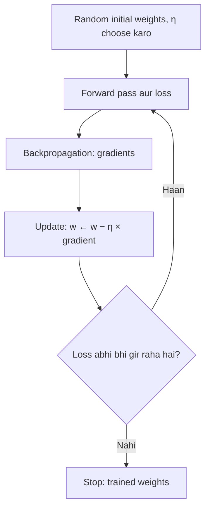
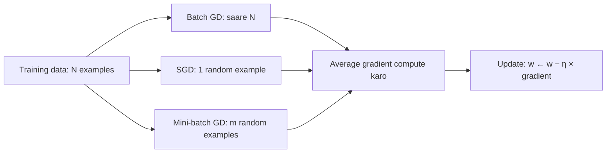
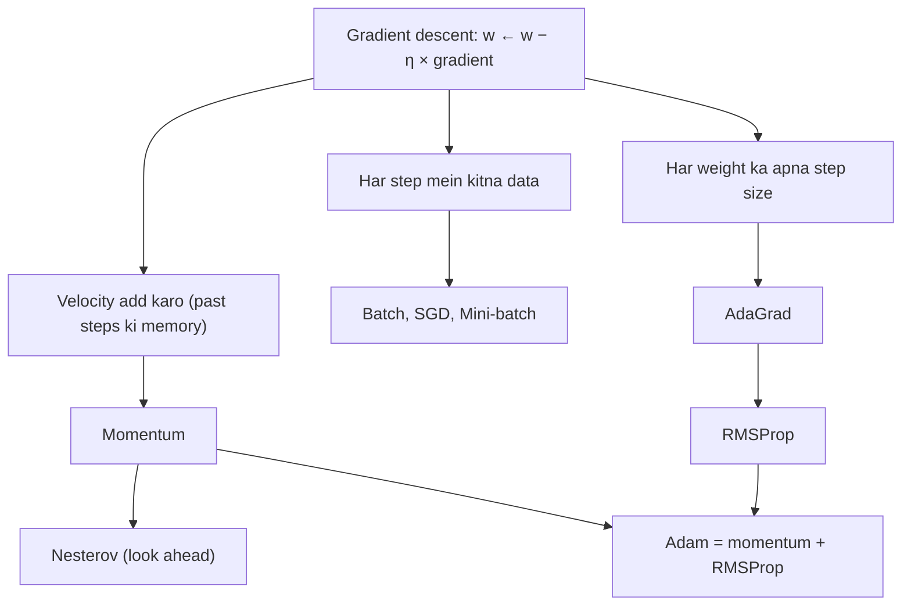

Naye ideas se pehle, purane ideas jo tumhe chahiye. Agar pata hain to agle section pe chale jao.

## Pehle basics

- Network mein kuch adjustable numbers hote hain jinhe **weights** (aur biases) kehte hain. Training ka matlab hai inki achhi values dhoondhna.
- **Loss** ek number hai jo batata hai ki network training data pe kitna galat hai. Kam loss = better.
- Kisi weight ke liye loss ka **gradient** uska slope hai: us weight ko thoda sa badhane pe loss kitna aur kis direction mein badalta hai.
- **Backpropagation** woh method hai jo ye saare slopes efficiently nikalta hai. Gradient descent woh hai jo inhe **use** karta hai.
- Ek **epoch** = saare training examples pe ek poora pass. Ek **iteration** (ya step) = ek weight update.

## Gradient descent kya hai

**Definition.** Gradient descent ek iterative optimization algorithm hai jo loss ko kam karta hai: woh baar baar har weight ko uske gradient ke opposite direction (downhill direction) mein ek chhota step move karta hai. Ye syllabus module <Syl m="2" />, "Training, Optimization and Regularization" mein cover hota hai (module 1 mein bhi introduce hota hai).

Exam mein English mein likho: "Gradient descent is an iterative optimization algorithm that minimizes the loss by moving each weight a small step opposite to its gradient."

**Ye kyun zaroori hai.** Network mein hazaaron ya lakhon weights hote hain, aur koi formula nahi hai jo seedha unki best values de de. Lekin hum har weight ke liye loss ka slope measure kar sakte hain. Gradient descent us slope ko use karke weights ko thoda thoda improve karta hai, aur ye kisi bhi size ke network pe kaam karta hai.

**Everyday analogy: fog mein pahaad se neeche utarna.** Tum ek pahaad pe ho, ghana kohra (fog) hai, aur tumhe valley tak pahunchna hai. Valley dikh nahi rahi, lekin pairon ke neeche zameen kis taraf dhalaan hai ye feel kar sakte ho. To tum sabse steep downhill direction mein ek chhota step lete ho, phir feel karte ho, phir step lete ho. Zameen ki height = loss, aur tumhari position = weights ka set.

**Update rule.** Shabdon mein: *new weight = old weight − learning rate × gradient*.

$$
w \leftarrow w - \eta \, \frac{\partial L}{\partial w}
$$

$w$ ek weight hai, $\eta$ (eta) **learning rate** hai (ek chhota positive step size jaise 0.1 ya 0.01), aur $\dfrac{\partial L}{\partial w}$ gradient hai. <Cite id="gfdl-ch4" loc="§4.3" />

**Minus sign kyun kaam karta hai.** Agar slope positive hai, to weight badhne pe loss badhta hai, isliye hum weight kam karte hain. Agar slope negative hai, to use subtract karne se weight badhta hai, jo phir se loss kam karta hai. Bottom ke paas slope lagbhag 0 hota hai, isliye steps apne aap chhote ho jaate hain.

## Algorithm kaise kaam karta hai

1. **Initialise:** weights ko chhoti random values do aur learning rate choose karo.
2. **Forward pass:** predictions aur loss compute karo.
3. **Backward pass:** backpropagation se har weight ke liye loss ka gradient nikalo.
4. **Update:** upar wale rule se har weight update karo.
5. **Repeat:** steps 2 se 4 tab tak dohrao jab tak loss girna band na ho jaaye ya planned epochs khatam na ho jaayein.

**Worked sum: bowl-shaped loss pe teen steps.**

<Sum>

<Given>

ek weight jiska loss $L(w) = (w - 1)^2$ hai (sabse neeche ka point $w = 1$ pe), gradient $2(w - 1)$, start $w = 4$, learning rate $\eta = 0.1$.

</Given>

<Find>

teen gradient descent steps ke baad $w$ aur loss.

</Find>

<Steps>

1. $w = 4$ pe gradient: $2(4 - 1) = 6$. *(Slope batata hai ki uphill kis taraf hai.)*
2. Step 1: $w = 4 - 0.1 \times 6 = 4 - 0.6 = 3.4$. *(Slope ke against learning rate × gradient jitna move karo.)*
3. $w = 3.4$ pe gradient: $2(3.4 - 1) = 4.8$; step 2: $w = 3.4 - 0.48 = 2.92$. *(Wahi rule, naya slope.)*
4. $w = 2.92$ pe gradient: $2(2.92 - 1) = 3.84$; step 3: $w = 2.92 - 0.384 = 2.536$. *(Slope chhota hai, isliye step bhi chhota.)*
5. Har point pe loss: $(4-1)^2 = 9$, $(3.4-1)^2 = 5.76$, $(2.92-1)^2 = 3.6864 \approx 3.69$, $(2.536-1)^2 = 2.359 \approx 2.36$. *(Check karo ki sach mein neeche gaye.)*

</Steps>

<Answer>

teen steps ke baad $w = 2.536$ aur loss 9 se girke lagbhag 2.36 ho gaya.

</Answer>

<Box kind="verify">

Yahan har step bottom se distance ($w - 1$) ko $1 - 2\eta = 0.8$ se multiply karta hai. Distance: $3 \to 2.4 \to 1.92 \to 1.536$, to $w = 1 + 1.536 = 2.536$. Same answer, alag tarike se. Loss $1.536^2 = 2.359$ bhi match karta hai, aur har step pe gira, jaisa chhote learning rate ke saath hona chahiye.

</Box>

</Sum>

<Figure caption="Ek weight ka loss jo bowl jaisa hai, (1 − w)², jo (w − 1)² ke barabar hai. Gradient descent right wall pe upar (w = 4) se start karta hai aur bottom w = 1 (dashed line) ki taraf neeche chalta hai. Bottom se door slope steep hai aur bottom pe flat.">
  <CurvePlot curves="mse-loss" x="-2,4.5" y="0,10" xLabel="weight w" yLabel="loss" mark="min:mse-loss" />
</Figure>

## Learning rate

Gradient descent mein learning rate sabse important setting hai.

| Learning rate | What happens |
|---|---|
| Too small | Bahut saare tiny steps; training bahut slow, flat region mein atak sakti hai |
| About right | Loss dheere dheere steadily low value tak girta hai |
| Too large | Steps bottom ke upar se jump karte hain; loss jhoolta hai aur badh sakta hai (training **diverge** hoti hai) |

**Worked sum: bahut bada learning rate kya karta hai.**

<Sum>

<Given>

wahi bowl $L(w) = (w - 1)^2$, start $w = 4$, lekin $\eta = 1.1$.

</Given>

<Find>

do steps ke baad $w$ aur loss.

</Find>

<Steps>

1. $w = 4$ pe gradient $6$ hai; step 1: $w = 4 - 1.1 \times 6 = 4 - 6.6 = -2.6$. *(Step itna bada hai ki bottom (1) ke paar kood jaata hai.)*
2. $w = -2.6$ pe gradient: $2(-2.6 - 1) = -7.2$; step 2:

   $$
   \begin{aligned}
   w &= -2.6 - 1.1 \times (-7.2) \\
   &= -2.6 + 7.92 \\
   &= 5.32
   \end{aligned}
   $$

   *(Wapas aur bhi door kood jaata hai.)*
3. Loss:

   $$
   \begin{aligned}
   9 &\to (-3.6)^2 \\
   &= 12.96 \\
   &\to (4.32)^2 \\
   &= 18.6624 \\
   &\approx 18.66
   \end{aligned}
   $$

   *(Loss badh raha hai, matlab training diverge ho rahi hai.)*

</Steps>

<Answer>

$w$ jaata hai $4 \to -2.6 \to 5.32$ aur loss badhta hai $9 \to 12.96 \to 18.66$.

</Answer>

<Box kind="verify">

Yahan har step bottom se distance ko $1 - 2 \times 1.1 = -1.2$ se multiply karta hai. Distance: $3 \to -3.6 \to 4.32$, to $w = 1 - 3.6 = -2.6$ aur phir $1 + 4.32 = 5.32$. Size har baar 1.2 guna badhta hai (minus sign ka matlab side flip hoti hai), aur isi wajah se bahut bada rate blow up karta hai.

</Box>

</Sum>

Ek common practical rule: moderate learning rate se start karo aur jab loss improve hona band ho to use kam karo (isse learning-rate **schedule** kehte hain). <Cite id="hinton-lec6" /> <Cite id="gfdl-ch8" loc="§8.3.1" />

## Gradient descent ke advantages, disadvantages aur applications

**Advantages:** samajhna aur code karna simple hai; kisi bhi differentiable loss aur kisi bhi size ke network pe kaam karta hai; sirf first derivatives chahiye, jo backpropagation sasta deta hai; agar learning rate kaafi chhota ho to downhill jaana guaranteed hai.

**Disadvantages:** learning rate choose karna tricky hai; local minimum mein atak sakta hai ya flat regions aur saddle points pe bahut dheere chalta hai; lambi patli valleys mein zig-zag karta hai; plain (full-batch) gradient descent bade datasets pe slow hai. <Cite id="gfdl-ch8" loc="§8.2" />

**Applications:** har tarah ke neural network ki training (images ke liye CNNs, text aur speech ke liye RNNs aur transformers), linear aur logistic regression, recommendation systems aur matrix factorisation. <Cite id="ibm-gradient-descent" />

## Ek simple model ke liye update rule derive karna

<PYQ id="2023-12/q1b" /> exactly yahi poochta hai, isliye yahi ek derivation yaad rakhne layak hai.

**Set-up.** Humare paas $N$ input-output pairs $(x_1, y_1), \dots, (x_N, y_N)$ hain aur model $\hat{y} = xw$ hai, jisme ek parameter $w$ hai.

**1. Sum-of-squared error.** Pair $n$ ke liye prediction $x_n w$ hai, to error $y_n - x_n w$ hai. Ise square karo (taaki positive aur negative errors cancel na ho jaayein) aur saare pairs pe add karo:

$$
E(w) = \frac{1}{2}\sum_{n=1}^{N} \left(y_n - x_n w\right)^2
$$

$\dfrac{1}{2}$ optional hai; ye bas us 2 ko cancel karta hai jo differentiate karne pe aata hai.

**2. Chain rule se differentiate karo.** $(y_n - x_n w)^2$ ka $w$ ke respect mein slope $2(y_n - x_n w)\cdot(-x_n)$ hai, to

$$
\frac{\partial E}{\partial w} = -\sum_{n=1}^{N} (y_n - x_n w)\,x_n
$$

**3. Gradient descent mein daalo**, learning rate $\alpha$ ke saath:

$$
w \leftarrow w - \alpha\frac{\partial E}{\partial w} = w + \alpha \sum_{n=1}^{N} (y_n - x_n w)\,x_n
$$

Shabdon mein: har example ke liye (error × input) lo, saare examples pe sum karo aur $\alpha$ se scale karo. Agar predictions bahut chhote hain to $w$ badhta hai; bahut bade hain to $w$ ghatta hai.

**Worked sum: real numbers ke saath ek update.**

<Sum>

<Given>

data pairs $(x, y) = (1, 2)$ aur $(2, 4)$, model $\hat{y} = xw$, start $w = 0$, learning rate $\alpha = 0.1$.

</Given>

<Find>

start pe error $E$, gradient, naya $w$ aur naya $E$.

</Find>

<Steps>

1. $w = 0$ pe errors: $2 - 1 \times 0 = 2$ aur $4 - 2 \times 0 = 4$. *(Error = true output − prediction.)*
2.

   $$
   \begin{aligned}
   E &= \frac{1}{2}(2^2 + 4^2) \\
   &= \frac{1}{2}(4 + 16) \\
   &= 10
   \end{aligned}
   $$

   *(Square karo, add karo, aadha karo.)*
3. Gradient:

   $$
   \begin{aligned}
   \frac{\partial E}{\partial w} &= -(2 \times 1 + 4 \times 2) \\
   &= -(2 + 8) \\
   &= -10
   \end{aligned}
   $$

   *(Error × input ka sum, minus sign ke saath.)*
4. Naya $w = 0 - 0.1 \times (-10) = 0 + 1 = 1$. *(Update rule; negative gradient $w$ ko upar dhakelta hai.)*
5. Naye errors: $2 - 1 = 1$ aur $4 - 2 = 2$, to $E = \dfrac{1}{2}(1 + 4) = 2.5$. *(Naye weight se error dobara nikalo.)*

</Steps>

<Answer>

$E$ 10 se start hota hai, gradient −10 hai, $w$ 1 ban jaata hai aur $E$ girke 2.5 ho jaata hai.

</Answer>

<Box kind="verify">

Dono points $y = 2x$ pe hain, to best weight $w = 2$ hai; wahan gradient $-(0 \times 1 + 0 \times 2) = 0$ hai, jaisa bottom pe hona chahiye. Humara step $w$ ko 0 se 2 ki taraf le gaya, aur ek aur step pe gradient $-(1 \times 1 + 2 \times 2) = -5$, to $w = 1 + 0.1 \times 5 = 1.5$ aur $E = \dfrac{1}{2}(0.5^2 + 1^2) = 0.625$. Error girta ja raha hai, matlab rule sahi kaam kar raha hai.

</Box>

</Sum>

## Data ki amount ke hisaab se types: batch, stochastic aur mini-batch

**Types kyun hain.** Training loss saare examples ka average hai. Teen basic types sirf is baat mein alag hain ki **ek update se pehle gradient nikalne ke liye kitne examples use hote hain**. <Cite id="gfdl-ch8" loc="§8.1.3" />

**Everyday analogy.** Public opinion kis taraf hai ye jaanne ke liye: batch GD har decision se pehle har citizen se poochta hai (accurate lekin slow), SGD ek random insaan se poochta hai (fast lekin noisy), aur mini-batch ek chhote random group se, maan lo 64 logon se, poochta hai (kaafi accurate aur fast).

**1. Batch (full-batch) gradient descent.** **Saare** training examples pe jao, unke gradients ka average lo, phir ek update karo. Ek epoch mein ek update.

- *Advantages:* exact gradient, smooth aur stable path, convex problems pe steady convergence.
- *Disadvantages:* bade datasets pe bahut slow aur memory-hungry; jab tak poora dataset process na ho, koi progress nahi; steps mein noise nahi hota, isliye local minimum ya saddle point ke paas atak sakta hai.
- *Used for:* chhote datasets jo memory mein fit ho jaate hain.

**2. Stochastic gradient descent (SGD).** Data shuffle karo, phir **har ek** example ke baad sirf uske gradient se update karo. $N$ examples ho to ek epoch mein $N$ updates. <Cite id="gfg-sgd" />

- *Advantages:* har step bahut sasta; learning turant shuru; streaming (online) data pe kaam karta hai; noise chhote bure spots se bahar kudne mein help kar sakta hai.
- *Disadvantages:* ek example ka gradient noisy hota hai, isliye loss upar neeche jumps karta hai aur path zig-zag hota hai; minimum ke paas weights hilte rehte hain jab tak learning rate time ke saath kam na karo; GPU ki parallel power achhe se use nahi kar paata.
- *Used for:* online learning, bahut bade ya streaming datasets.

**3. Mini-batch gradient descent.** Shuffled data ko $m$ examples ke chhote groups (**mini-batches**) mein baanto, jaise 32, 64 ya 128, aur har group ke baad update karo. Ek epoch mein $N/m$ updates.

- *Advantages:* SGD se kam noisy, batch GD se bahut sasta, GPUs pe fast kyunki poora batch ek matrix operation hai; thoda noise generalization mein bhi help karta hai.
- *Disadvantages:* batch size ek aur setting hai tune karne ke liye; thoda noise abhi bhi hai; batch GPU memory mein fit hona chahiye.
- *Used for:* lagbhag saari deep learning. Libraries mein "SGD" ka matlab usually mini-batch SGD hota hai. <Cite id="hinton-lec6" /> <Cite id="mlm-minibatch" />

Teeno same update rule use karte hain; sirf gradient badalta hai. Batch GD gradient ko saare $N$ examples pe average karta hai, SGD ek example se leta hai, aur mini-batch batch ke $m$ examples pe average karta hai.

**Worked sum: ek epoch mein updates ginna.**

<Sum>

<Given>

$N = 1000$ training examples, mini-batch size $m = 50$.

</Given>

<Find>

har type ke liye ek epoch mein kitne weight updates.

</Find>

<Steps>

1. Batch GD: saare 1000 examples milke ek gradient dete hain, to **1 update**. *(Ek full pass pe ek update.)*
2. SGD: har example pe ek update, to $1000 / 1 =$ **1000 updates**. *(Har example apna khud ka step hai.)*
3. Mini-batch: $1000 / 50 =$ **20 updates**. *(50 ke har group pe ek update.)*

</Steps>

<Answer>

ek epoch mein 1 (batch), 1000 (SGD) aur 20 (mini-batch) updates.

</Answer>

<Box kind="verify">

Har case mein, updates × examples per update = ek epoch mein dekhe gaye 1000 examples hona chahiye: $1 \times 1000 = 1000$, $1000 \times 1 = 1000$, $20 \times 50 = 1000$. Teeno sahi hain.

</Box>

</Sum>

| | Batch GD | Stochastic GD | Mini-batch GD |
|---|---|---|---|
| Examples per update | Saare $N$ | 1 | $m$ (jaise 32 to 256) |
| Updates per epoch | 1 | $N$ | $N/m$ |
| Gradient | Exact | Bahut noisy | Thoda noisy |
| Cost per update | High | Bahut low | Low |
| Path to the minimum | Smooth | Zig-zag | Mostly smooth |
| Memory | Poora dataset | Ek example | Ek batch |
| GPU use | Achha lekin har step slow | Poor | Excellent |
| Used for | Chhote datasets | Online learning | Lagbhag saari deep learning |

## Plain gradient descent kaafi kyun nahi hai

- **Ravines (zig-zag).** Lambi patli valley mein gradient zyada tar valley ke across point karta hai, isliye steps ek wall se doosri wall pe uchhalte hain aur floor ke along dheere chalte hain. <Cite id="hinton-lec6" />
- **Flat regions aur saddle points.** Jahan slope lagbhag zero hai, wahan steps tiny ho jaate hain aur progress ruk jaati hai. <Cite id="gfdl-ch8" loc="§8.2.3" />
- **Local minima.** Kisi aise low point pe settle ho sakta hai jo sabse low nahi hai. <Cite id="gfdl-ch8" loc="§8.2.2" />
- **Saare weights ke liye ek learning rate.** Kuch weights ke gradients bahut bade hain aur kuch ke bahut chhote, lekin sabko same $\eta$ milta hai.

Neeche ke improved optimizers ye problems fix karte hain: **momentum** aur **Nesterov** zig-zag fix karte hain; **AdaGrad**, **RMSProp** aur **Adam** "sabke liye ek learning rate" wali problem fix karte hain.

## Momentum-based gradient descent

**Ye kya hai.** Memory wala gradient descent: har step naye gradient aur pichhle step (**velocity**) ka mix hota hai.

**Ye kyun zaroori hai.** Plain gradient descent ravines aur halki slopes pe slow hai, aur zig-zag karta hai.

**Analogy.** Pahaad se neeche ludhakti ball har bump pe ruk ke dobara start nahi karti; jis direction mein woh chalti rehti hai, usme speed pakadti jaati hai. <Cite id="hinton-lec6" />

**Kaise kaam karta hai.**

1. Velocity 0 se start karo.
2. Har step pe purani velocity ko thoda chhota karo (usually uska 90 percent rakho) aur naya downhill push (learning rate × gradient) add karo.
3. Weight ko velocity se move karo, raw gradient se nahi.

$$
v \leftarrow \alpha\,v - \eta\,\nabla L(w) \qquad w \leftarrow w + v
$$

$v$ velocity hai, $\alpha$ **momentum coefficient** (usually 0.9) aur $\nabla L(w)$ gradient. <Cite id="gfdl-ch8" loc="§8.3.2" />

Jin directions mein gradient ka sign same rehta hai, wahan pushes jud jaate hain aur ball speed pakadti hai. Jahan gradient ka sign baar baar flip hota hai (ravine ke across zig-zag), wahan pushes cancel ho jaate hain aur uchhalna kam ho jaata hai. Rumelhart, Hinton aur Williams ne 1986 ke backpropagation paper mein hi ye term use kiya tha. <Cite id="rumelhart1986" />

**Worked sum: usi bowl pe momentum.**

<Sum>

<Given>

$L(w) = (w - 1)^2$, gradient $2(w - 1)$, start $w = 4$, $v = 0$, $\eta = 0.1$, $\alpha = 0.9$.

</Given>

<Find>

teen momentum steps ke baad $w$, plain gradient descent (2.536) se compare karke.

</Find>

<Steps>

1. Step 1: gradient $6$; $v = 0.9 \times 0 - 0.1 \times 6 = -0.6$; $w = 4 - 0.6 = 3.4$. *(Abhi purani velocity nahi hai, to ye plain step hai.)*
2. Step 2: gradient $2(3.4 - 1) = 4.8$;

   $$
   \begin{aligned}
   v &= 0.9 \times (-0.6) - 0.48 \\
   &= -0.54 - 0.48 \\
   &= -1.02
   \end{aligned}
   $$

   $w = 3.4 - 1.02 = 2.38$. *(Purani velocity naye push mein judti hai, to step bada hota hai.)*
3. Step 3: gradient $2(2.38 - 1) = 2.76$;

   $$
   \begin{aligned}
   v &= 0.9 \times (-1.02) - 0.276 \\
   &= -0.918 - 0.276 \\
   &= -1.194
   \end{aligned}
   $$

   $w = 2.38 - 1.194 = 1.186$. *(Abhi bhi speed badh rahi hai.)*

</Steps>

<Answer>

teen steps ke baad momentum $w = 1.186$ tak pahunchta hai, jabki plain gradient descent abhi 2.536 pe hai.

</Answer>

<Box kind="verify">

Weight velocities ke sum jitna move karta hai:

$$
\begin{aligned}
4 + (-0.6) + (-1.02) + (-1.194) &= 4 - 2.814 \\
&= 1.186
\end{aligned}
$$

Same answer. Ek aur step pe gradient $0.372$, $v = -1.0746 - 0.0372 = -1.1118$ aur $w = 0.0742$, jo bottom (1) ke paar hai: momentum fast hai lekin overshoot karta hai, bilkul theory ke hisaab se.

</Box>

</Sum>

- *Advantages:* fast convergence, kam zig-zag, chhote bumps aur flat regions ke paar ludhak sakta hai.
- *Disadvantages:* minimum ke paar overshoot kar sakta hai; ek aur setting ($\alpha$).
- *Applications:* "SGD with momentum" image CNNs train karne mein bahut use hota hai (original ResNet aise hi train hua tha) aur ye usual baseline optimizer hai. <Cite id="gfg-momentum" />

## Nesterov accelerated gradient (NAG)

**Ye kya hai.** Ek smarter momentum jo step lene se pehle aage dekhta hai.

**Kaise kaam karta hai.** Plain momentum gradient wahan measure karta hai jahan tum abhi ho, phir jump karta hai. Nesterov pehle wahan jaata hai jahan velocity tumhe le jaane wali hai (**look-ahead point**), gradient **wahan** measure karta hai, aur phir correct karta hai. Jaise ek skier jo turn lene se pehle slope pe thoda aage dekh leta hai. <Cite id="sutskever2013" /> <Cite id="gfdl-ch8" loc="§8.3.3" />

$$
v \leftarrow \alpha\,v - \eta\,\nabla L(w + \alpha v) \qquad w \leftarrow w + v
$$

Momentum se sirf ek change hai ki gradient kahan liya jaata hai: $w + \alpha v$ pe.

- *Advantages:* slope flat hone se pehle hi dekh leta hai, isliye momentum se kam overshoot karta hai aur jaldi settle hota hai.
- *Disadvantages:* thoda zyada complex; abhi bhi saare weights ke liye ek learning rate.
- *Applications:* deep network training mein ek option ki tarah use hota hai, jaise Keras SGD mein `nesterov=True`. <Cite id="keras-sgd" />

## AdaGrad (adaptive gradient)

**Ye kya hai.** Ek optimizer jo har weight ko uska **apna** learning rate deta hai. <Cite id="duchi2011" />

**Kaise kaam karta hai.** Har weight ke liye woh uske saare past gradients ke squares ka running **sum** rakhta hai. Step = gradient ko learning rate se guna karke, us sum ke square root se divide karo. Jin weights ke gradients bade rahe hain unhe chhote steps milte hain; jinke gradients chhote ya rare hain unhe relatively bade steps milte hain.

$$
r \leftarrow r + g^2 \qquad w \leftarrow w - \frac{\eta}{\delta + \sqrt{r}}\,g
$$

$g$ is weight ka gradient hai, $r$ uske squared gradients ka sum, aur $\delta$ ek tiny number (jaise $10^{-7}$) jo zero se divide hone se bachata hai. <Cite id="gfdl-ch8" loc="§8.5.1" />

- *Advantages:* har weight ka rate haath se tune nahi karna padta; sparse data ke liye bahut achha jahan kuch features rare hain.
- *Disadvantages:* sum sirf badhta hai, isliye effective learning rate ghatta rehta hai aur lambi training mein learning lagbhag ruk sakti hai.
- *Applications:* rare words wale text aur natural language problems, sparse features wale recommendation systems. <Cite id="keras-adagrad" />

## RMSProp (root mean square propagation)

**Ye kya hai.** AdaGrad ka fix jo sum ki jagah squared gradients ka **moving average** use karta hai, taaki purane gradients dheere dheere bhool jaayein aur step size khatam na ho. Hinton ne ise apne course lectures mein propose kiya tha, kisi paper mein nahi. <Cite id="hinton-lec6" />

$$
r \leftarrow \rho\,r + (1-\rho)\,g^2 \qquad w \leftarrow w - \frac{\eta}{\sqrt{\delta + r}}\,g
$$

$\rho$ (rho) decay rate hai, usually 0.9: average zyada tar purani value hota hai plus naye squared gradient ka thoda sa hissa. <Cite id="gfdl-ch8" loc="§8.5.2" />

- *Advantages:* har weight ka apna rate, aur rate khatam nahi hota; badalti (non-stationary) problems pe achha kaam karta hai.
- *Disadvantages:* $\eta$ aur $\rho$ abhi bhi choose karne padte hain; khud ka momentum nahi hai.
- *Applications:* recurrent neural networks aur reinforcement learning ke liye popular. <Cite id="keras-rmsprop" />

## Adam (adaptive moment estimation)

**Ye kya hai.** Adam dono achhe ideas combine karta hai: gradients ka momentum jaisa running average (**first moment**) aur squared gradients ka RMSProp jaisa running average (**second moment**). Ye aaj ke sabse zyada use hone wale optimizers mein se ek hai. <Cite id="kingma2014" />

**Kaise kaam karta hai.**

1. Average gradient update karo (direction, momentum jaisa).
2. Average squared gradient update karo (size, RMSProp jaisa).
3. Dono averages 0 se start hote hain, isliye pehle steps mein bahut chhote hote hain; isliye har ek ko ek correction factor se divide karo (**bias correction**).
4. Har weight ko (corrected average gradient) ÷ √(corrected average squared gradient), times $\eta$ jitna step do.

$$
m \leftarrow \beta_1 m + (1-\beta_1)\,g \qquad v \leftarrow \beta_2 v + (1-\beta_2)\,g^2
$$

$$
\hat{m} = \frac{m}{1-\beta_1^{\,t}} \qquad \hat{v} = \frac{v}{1-\beta_2^{\,t}} \qquad w \leftarrow w - \eta\,\frac{\hat{m}}{\sqrt{\hat{v}} + \epsilon}
$$

$t$ step number hai. Paper ke suggested defaults hain $\eta = 0.001$, $\beta_1 = 0.9$, $\beta_2 = 0.999$ aur $\epsilon = 10^{-8}$. <Cite id="kingma2014" /> <Cite id="gfdl-ch8" loc="§8.5.3" />

- *Advantages:* fast, kam tuning mein achha kaam karta hai, noisy aur sparse gradients handle karta hai, har weight ka apna rate plus momentum.
- *Disadvantages:* zyada settings aur zyada memory (har weight ke liye do averages); kuch tasks pe well-tuned SGD with momentum utna hi ya better generalize karta hai.
- *Applications:* transformers, GANs, NLP models aur zyada tar quick experiments ka default choice. <Cite id="mlm-adam" />

<Box kind="intuition">

Adaptive optimizers (AdaGrad, RMSProp, Adam) har step ko lagbhag same size ka bana dete hain, chahe gradient ka size kuch bhi ho. Inka asli fayda un networks mein dikhta hai jinme lakhon weights hain aur unke gradients ke size mein bahut farak hai, jahan ek shared learning rate sabko suit nahi kar sakta.

</Box>

## Saare optimizers side by side

| Method | What it remembers | Update in words | Main benefit | Main weakness |
|---|---|---|---|---|
| Gradient descent | Kuch nahi | Gradient ke against step | Simple | Ravines mein slow, ek $\eta$ |
| Momentum | Velocity (past gradients) | Velocity ke saath step | Fast, kam zig-zag | Overshoot kar sakta hai |
| Nesterov | Velocity | Look-ahead point pe gradient | Momentum se kam overshoot | Thoda zyada complex |
| AdaGrad | Squared gradients ka sum | Step ko √(sum) se divide | Har weight ka apna rate, rare features ke liye achha | Rate zero ki taraf ghatta hai |
| RMSProp | Squared gradients ka moving average | Step ko √(average) se divide | Rate khatam nahi hota | $\rho$ aur $\eta$ chahiye |
| Adam | Gradients aur squared gradients ke averages | Momentum plus RMSProp, bias correction ke saath | Kam tuning mein achha | Zyada settings; well-tuned SGD with momentum match kar sakta hai |

Sabse best kaun sa hai? Koi ek answer nahi hai; Goodfellow kehte hain ki koi consensus nahi hai, aur SGD (momentum ke saath ya bina), RMSProp aur Adam sab popular choices hain. <Cite id="gfdl-ch8" loc="§8.5.4" /> <Cite id="ruder2016" />

Code mein ye ek line ke hain, jaise `keras.optimizers.SGD(learning_rate=0.01, momentum=0.9, nesterov=True)` ya `torch.optim.Adam(model.parameters(), lr=0.001)`. <Cite id="keras-sgd" /> <Cite id="pytorch-sgd" /> <Cite id="pytorch-adam" />

**Conclusion.** Gradient descent training ka engine hai: ye backpropagation ke gradients use karke har weight ko downhill move karta hai, aur iske variants sirf ye badalte hain ki har step kitna data use kare ya har step ka size kaise decide ho.

Exam mein English mein likho: "Gradient descent is the engine of training; its variants only change how much data each step uses or how each step is sized."

## Ye kahan poocha gaya

| If the question says | What to write | Seen as |
|---|---|---|
| "Calculate the sum-of-squared error for $y = xw$ and derive the gradient descent update rule" | $E = \dfrac{1}{2}\sum(y_n - x_n w)^2$, derivative step by step, $w \leftarrow w + \alpha\sum(y_n - x_n w)x_n$, do points wala check | <PYQ id="2023-12/q1b" /> |
| "Explain gradient descent in deep learning" (5 marks) | Definition, kyun zaroori, fog wala idea, steps, update rule shabdon mein, learning rate, advantages aur disadvantages, types pe ek line | <PYQ id="2024-05/q1b" /> <PYQ id="2024-12/q1b" /> |
| "Explain SGD and momentum-based gradient descent" | Dono ke liye: definition, kyun, kaise kaam karta hai, advantages, disadvantages, applications; diagram; comparison table | <PYQ id="2023-12/q5a" /> |
| "Different types of gradient descent, explain any three" | Saare types list karo, phir batch, stochastic aur mini-batch working, pros aur cons, diagram aur comparison table ke saath | <PYQ id="2024-05/q3a" /> <PYQ id="2024-12/q3a" /> |
| "Explain the gradient descent algorithm and discuss its types in detail" | Algorithm steps aur diagram, phir batch, SGD, mini-batch detail mein, aur momentum, Nesterov, AdaGrad, RMSProp aur Adam pe ek chhota paragraph | <PYQ id="2025-05/q2a" /> |

## Quick revision

- Update rule: new weight = old weight − learning rate × gradient, $w \leftarrow w - \eta\,\partial L/\partial w$. Minus sign = downhill.
- Learning rate bahut chhota: slow. Bahut bada: overshoot karta hai aur diverge ho sakta hai.
- $\hat{y} = xw$ ke liye: $E = \dfrac{1}{2}\sum(y_n - x_n w)^2$, $\partial E/\partial w = -\sum(y_n - x_n w)x_n$.
- Batch: har step saara data (exact, slow). SGD: ek example (fast, noisy). Mini-batch: $m$ examples, usual choice.
- Momentum: velocity = 0.9 × old velocity − η × gradient; speed badhata hai aur zig-zag kam karta hai. Nesterov: look-ahead point pe gradient.
- AdaGrad √(squared gradients ka sum) se divide karta hai; RMSProp √(moving average) se; Adam = momentum + RMSProp + bias correction.
