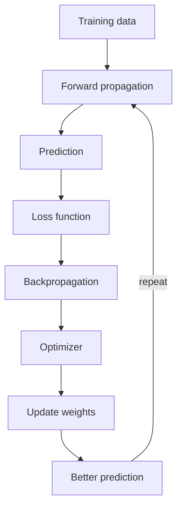
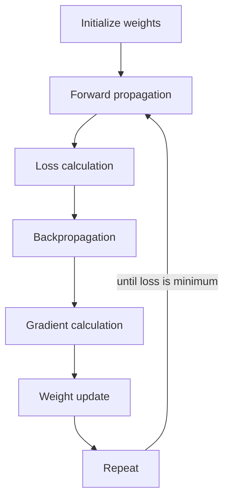
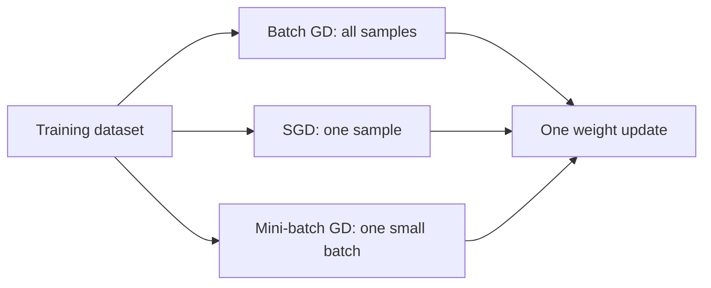
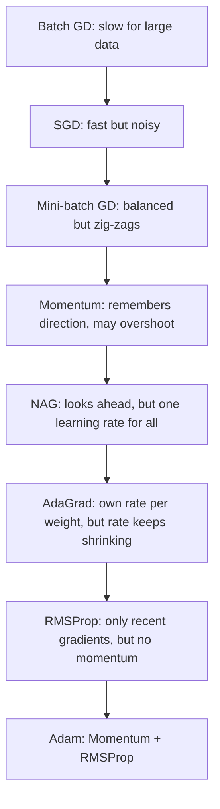

Naye ideas se pehle wo purani baatein jo chahiye. Agar pata hai to seedha agle section par jao.

## Basics pehle

- **Weight** ek number hai jo batata hai network ek input ko kitni importance deta hai. **Bias** learning ko help karne ke liye add kiya gaya extra number hai. Weights aur biases hi **parameters** hain: wo numbers jo network seekhta hai. <Cite id="class-dl-chp2" loc="slide 4" />
- Network **prediction** banata hai. **Loss** error hai: prediction actual value se kitni door hai. Teacher ke example mein fruit ka actual weight 180 g hai, prediction 220 g hai, to loss high hai. <Cite id="class-dl-chp2" loc="slide 57" />
- Loss function **sirf batata hai ki kitna error hai**. Ye nahi batata ki kis direction mein move karna hai, kitni speed se, ya kaun sa weight badalna hai. Isliye ek aur concept chahiye: gradient. <Cite id="class-dl-chp2" loc="slide 57" />
- **Loss function** ek training example ka error hai; **cost function** poore training set ka average error hai. <Cite id="class-dl-m1" loc="p. 28" />
- **Epoch** poore training dataset ka ek complete pass hai <Cite id="class-dl-chp2" loc="slide 69" />. **Batch** training samples ka ek chhota group hai jo saath mein process hota hai <Cite id="class-dl-chp2" loc="slide 110" />.

## Gradient

<Box kind="definition">

**Gradient:** the slope of the loss function. It tells us which direction reduces the loss and how quickly the loss changes. <Cite id="class-dl-chp2" loc="slide 57" />

</Box>

**Rozmarra ka example.** Aap kohre mein ek pahaad par khade ho aur ghati tak pahunchna hai. Ghati dikhti nahi, par pair ke neeche slope mehsoos hota hai. Slope batata hai neeche kis taraf hai aur kitna steep hai. Gradient wahi slope hai, aur "think of it as the slope of a hill". <Cite id="class-dl-chp2" loc="slide 63" />

Gradient ko $\dfrac{\partial L}{\partial W}$ likhte hain aur matlab hai "weight badalne par loss kitna badalta hai?". Ye do cheezein batata hai: <Cite id="class-dl-chp2" loc="slide 58" />

1. **Direction:** loss kam karne ke liye weights kis taraf move karein.
2. **Magnitude:** weights badalne par loss kitna badalta hai. Bada gradient matlab steep slope, bade weight updates aur fast learning. Chhota gradient matlab flat slope, chhote updates aur slow learning.

Gradient **backpropagation ke dauran calculate hota hai** aur optimizer (GD, Adam, SGD wagairah) use weights update karne ke liye use karta hai. <Cite id="class-dl-chp2" loc="slide 58" />

| Gradient | Matlab | Optimizer kya karta hai |
|---|---|---|
| **Positive** (slope > 0) | Weight badhne par loss badhta hai | Weight ko ulti direction mein move karo (kam karo) |
| **Negative** (slope < 0) | Current direction mein loss ghatta hai | Usi direction mein update karte raho (gradient descent rule) |
| **Zero** | Koi slope nahi | Updates bahut chhote ho jaate hain ya ruk jaate hain; aksar global minimum, local minimum ya saddle point ke paas |

**Don't confuse (teacher ki table).** <Cite id="class-dl-chp2" loc="slide 58" />

| | Gradient | Gradient descent |
|---|---|---|
| Matlab | Change ki direction aur size batata hai | Gradient use karke weights update karta hai |
| Ye kya hai? | Backpropagation ke dauran calculate hota hai | Ek optimization algorithm |
| Role | Information (slope) | Action (weight update) |

## Optimization kya hai?

<Box kind="definition">

**Optimization** is the process of finding the best values of weights and biases so that the loss becomes as small as possible. An **optimizer** updates the weights after every training step to improve the model's predictions. <Cite id="class-dl-chp2" loc="slide 59" />

</Box>

Textbook ke words mein: optimization matlab "finding the parameters θ of a neural network that significantly reduce a cost function J(θ)". <Cite id="class-dl-m2" loc="p. 44" />

Optimizer: (1) calculate karta hai weights loss ko kaise affect karte hain (backpropagation ke gradients se), (2) weights ko sahi direction mein update karta hai, (3) loss bahut chhota hone tak repeat karta hai. Ye **backpropagation ke baad aur agli prediction se pehle** kaam karta hai, aur sirf training ke dauran. <Cite id="class-dl-chp2" loc="slide 59" />

<Cite id="class-dl-chp2" loc="slide 59" />

Teacher common optimizers list karte hain: Gradient Descent (GD), Stochastic Gradient Descent (SGD), Mini-Batch GD, Momentum, Nesterov (NAG), AdaGrad, RMSProp aur Adam. <Cite id="class-dl-chp2" loc="slide 59" /> Ye syllabus <Syl m="2" /> hai.

## Gradient descent (GD)

<Box kind="definition">

**Gradient Descent (GD)** is an optimization algorithm that updates the weights and biases to reduce the loss. Its goal is to find the minimum loss by moving the weights in the correct direction. <Cite id="class-dl-chp2" loc="slide 60" />

</Box>

**Ye kaunsi problem solve karta hai?** Prediction ke baad network ko pata hai ki wo galat hai, par ye nahi pata ki kaun sa weight badalna hai, weight badhana hai ya ghatana hai, aur kitna badalna hai. Sahi method ke bina model improve nahi kar sakta. <Cite id="class-dl-chp2" loc="slide 60" />

### Step by step kaise kaam karta hai

Gradient Descent: <Cite id="class-dl-chp2" loc="slide 60" />

1. Loss ka gradient (slope) calculate karta hai.
2. Wo direction dhundta hai jahan loss ghatta hai.
3. Weights update karta hai.
4. Loss bahut chhota hone tak process repeat karta hai.

Zyada detail mein teacher ke chhe steps: weights randomly initialize karo, forward propagation karo, loss calculate karo, backpropagation se gradients calculate karo, weights update karo, aur loss minimum hone tak repeat karo. <Cite id="class-dl-chp2" loc="slide 63" />

<Box kind="definition">

**Update rule:** $W_{new} = W_{old} - \eta \dfrac{\partial L}{\partial W}$, jahan $W$ weight hai, $\eta$ (eta) learning rate hai, $L$ loss function hai aur $\dfrac{\partial L}{\partial W}$ gradient (slope) hai. <Cite id="class-dl-chp2" loc="slide 63" />

</Box>

Minus sign isliye hai kyunki gradient uphill point karta hai aur humein downhill jaana hai.

<Cite id="class-dl-chp2" loc="slide 63" />

**Sum 1: gradient descent ka ek step.** <Cite id="class-dl-chp2" loc="slide 63" />

<Sum>

<Given>

$W_{old} = 5$, learning rate $\eta = 0.1$, gradient $\dfrac{\partial L}{\partial W} = 3$.

</Given>

<Find>

naya weight.

</Find>

<Steps>

1. Step size $= \eta \times$ gradient $= 0.1 \times 3 = 0.3$. *Reason: step = learning rate × slope.*
2. Gradient positive hai, to $W$ badhne par loss badhta hai. Ulti taraf jao: $W_{new} = 5 - 0.3 = 4.7$.

</Steps>

<Answer>

$W_{new} = 4.7$

</Answer>

<Box kind="verify">

Wapas daalo: $4.7 + 0.3 = 5$, starting weight. Gradient positive tha, isliye weight neeche gaya.

</Box>

</Sum>

### Cost curve, minima aur saddle point

**Cost (loss) curve** dikhata hai ki weights badalne par loss kaise badalta hai: x-axis weight (model parameter) hai aur y-axis loss (error). Gradient descent ka objective higher loss se lowest possible loss tak jaana hai. <Cite id="class-dl-chp2" loc="slide 63" />

- **Global minimum:** poori cost curve ka sabse neecha point. Ye smallest possible loss deta hai, best solution aur most accurate model. Ye gradient descent ki desired destination hai. <Cite id="class-dl-chp2" loc="slide 61" />
- **Local minimum:** cost curve ke ek chhote region ka sabse neecha point. Ye aas-paas ka minimum lagta hai, par curve par ek aur point hai jiska loss aur kam hai. Model yahan ruk sakta hai ye sochkar ki learning khatam ho gayi. Aisa isliye hota hai kyunki complex neural networks mein kai valleys hoti hain, aur gradient descent slope follow karta hai aur pehli valley mein settle ho sakta hai. <Cite id="class-dl-chp2" loc="slide 61" />
- **Saddle point:** wo point jahan gradient (slope) lagbhag zero hai, par wo na minimum hai na maximum. Optimizer bahut slow ho jaata hai kyunki use lagta hai ki wo minimum ke lagbhag pahunch gaya. Deep neural networks mein ye bahut common hai. <Cite id="class-dl-chp2" loc="slide 61" />

**Easy trick (teacher ki):** global minimum = poori duniya ka sabse neecha point; local minimum = aapke mohalle ka sabse neecha point; saddle point = ghode ki zeen par baithne jaisa, ek direction mein flat par dusri mein curved. <Cite id="class-dl-chp2" loc="slide 62" />

Textbook wo aur flat jagahein batata hai jo optimization mushkil banati hain: **ill-conditioning** (SGD "stuck" ho jaata hai: bahut chhote steps bhi cost badha dete hain), **plateaus** (chaude flat regions jahan gradient zero hai), **cliffs** (bahut steep regions jo exploding gradients dete hain, gradient clipping se theek hote hain), bahut deep graphs mein **long-term dependencies**, aur **inexact gradients**. <Cite id="class-dl-m2" loc="pp. 45-48" />

### Learning rate

<Box kind="definition">

**Learning rate (η):** decides the size of each step while updating the weights. <Cite id="class-dl-chp2" loc="slide 63" />

</Box>

| Learning rate | Kya hota hai |
|---|---|
| Chhota | Slow learning (tiny steps) |
| Bada | Minimum skip (overshoot) ho sakta hai |
| Proper | Fast aur stable learning |

Textbook kehta hai ki learning rate trial and error se chuna ja sakta hai, par usually best hai ki ise learning curves dekh kar chuno jo objective function ko time ke saath plot karti hain. <Cite id="class-dl-m2" loc="p. 51" /> Module 1 add karta hai: high learning rate bade steps deta hai par minimum overshoot karne ka risk hai; low learning rate zyada precise hai, par zyada time aur computation lagta hai. <Cite id="class-dl-m1" loc="p. 29" />

### Gradient ke advantages aur disadvantages

Teacher likhte hain: advantage, ye learning ke liye sahi direction dikhata hai, loss kam karne mein help karta hai aur lagbhag har optimizer use karta hai. Disadvantage: gradient bahut chhota ho jaaye to learning slow ho jaati hai (vanishing gradient); gradient bahut bada ho jaaye to learning unstable ho jaati hai (exploding gradient). <Cite id="class-dl-chp2" loc="slide 58" /> In dono problems ko backpropagation ke note mein samjhaya gaya hai.

## Gradient descent ke types: batch, stochastic aur mini-batch

Teeno types mein bas itna fark hai ki **ek weight update ke liye kitna data use hota hai**. Module 1 yun kehta hai: batch GD sab training examples evaluate hone ke baad hi update karta hai (ek training epoch); SGD ek-ek training example ke parameters update karta hai; mini-batch dono ideas combine karta hai. <Cite id="class-dl-m1" loc="p. 34" />

### Batch gradient descent

Batch Gradient Descent weights update karne se pehle gradient calculate karne ke liye poora training dataset use karta hai. Teacher ka example 1,00,000 fruit images hai: total loss calculate karo, gradients calculate karo, weights update karo (ek baar). Bade datasets ke liye ye process bahut slow hai. Ye har update ke liye poora dataset use karta hai, zyada time leta hai, zyada memory chahiye aur weights kam frequently update hote hain. <Cite id="class-dl-chp2" loc="slide 68" />

### Stochastic gradient descent (SGD)

<Box kind="definition">

**Stochastic Gradient Descent (SGD)** is an optimization algorithm that updates the model's weights after processing only one training sample at a time. Instead of waiting for the entire dataset, SGD updates the weights immediately after each sample. <Cite id="class-dl-chp2" loc="slide 68" />

</Box>

SGD kaise kaam karta hai: <Cite id="class-dl-chp2" loc="slide 68" />

1. Ek training sample pick karo.
2. Forward propagation karo.
3. Loss calculate karo.
4. Backpropagation karo.
5. Weights turant update karo.
6. Agle sample ke liye repeat karo.

Formula: $W_{new} = W_{old} - \eta \dfrac{\partial L_i}{\partial W}$, jahan $L_i$ **ek** training sample ka loss hai aur $\dfrac{\partial L_i}{\partial W}$ us ek sample ka gradient. Batch GD ke ulta, SGD ek sample ka loss use karta hai, poore dataset ka nahi. <Cite id="class-dl-chp2" loc="slide 69" />

**Advantages:** batch GD se faster, kam memory, weights turant update (har sample ke baad), bahut bade datasets ke liye suitable, noisy updates ki wajah se kuch local minima se nikal sakta hai. **Disadvantages:** training path noisy (zig-zag) hai, training mein loss fluctuate karta hai, minimum par settle hone mein zyada time lag sakta hai, learning rate ke prati sensitive hai. **SGD tab use karo jab** dataset bahut bada ho, faster training chahiye, memory limited ho, ya online learning chahiye. **Tab avoid karo jab** dataset bahut chhota ho, stable aur smooth convergence prefer ho, ya precise updates speed se zyada important hon. <Cite id="class-dl-chp2" loc="slide 70" />

### Mini-batch gradient descent

<Box kind="definition">

**Mini-Batch Gradient Descent** divides the training dataset into small groups called mini-batches. Instead of updating after one sample (SGD) or all samples (Batch GD), it updates after each mini-batch. <Cite id="class-dl-chp2" loc="slide 71" />

</Box>

**Ye kaunsi problem solve karta hai:** SGD har sample ke baad update karta hai, to learning path noisy (zig-zag) hota hai, loss fluctuate karta hai aur minimum overshoot ho sakta hai. Humein aisa method chahiye jo Batch GD se faster ho par SGD se zyada stable. <Cite id="class-dl-chp2" loc="slide 71" />

Kaise kaam karta hai: <Cite id="class-dl-chp2" loc="slide 72" />

1. Dataset ko mini-batches mein split karo.
2. Ek batch ke liye forward propagation karo.
3. Loss calculate karo.
4. Backpropagation gradients calculate karta hai.
5. Weights update karo.
6. Agle mini-batch ke liye repeat karo.

Formula: $W_{new} = W_{old} - \eta \dfrac{\partial L_{batch}}{\partial W}$, jahan $L_{batch}$ ek mini-batch ka loss hai. <Cite id="class-dl-chp2" loc="slide 72" />

Ek mini-batch mein samples ki sankhya **batch size** kehlati hai. Common batch sizes 16, 32, 64 aur 128 hain. <Cite id="class-dl-chp2" loc="slide 71" />

**Sum 2: ek epoch mein kitne weight updates?** <Cite id="class-dl-chp2" loc="slide 71" />

<Sum>

<Given>

100 fruits ka dataset aur batch size 20. Saath mein 8 fruits batch size 2 ke saath, aur 1000 images batch size 32 ke saath.

</Given>

<Find>

batch GD, SGD aur mini-batch GD ke liye ek epoch mein updates ki sankhya.

</Find>

<Steps>

1. **Batch GD:** sab samples ek update ke liye use hote hain, to ek epoch mein **1 update**.
2. **SGD:** har sample par ek update, to 100 samples se **100 updates**.
3. **Mini-batch, 100 fruits, batch size 20:** $100 \div 20 = 5$ batches, to **5 updates**.
4. **Mini-batch, 8 fruits, batch size 2:** $8 \div 2 = 4$ batches, to **4 updates**.
5. **Mini-batch, 1000 images, batch size 32:** $1000 \div 32 = 31.25$, to 31 poore batches ($31 \times 32 = 992$ images) aur ek aakhri chhota batch 8 images ka, **32 updates**.

</Steps>

<Answer>

Batch GD 1, SGD 100, mini-batch 5 (100 fruits, batch size 20 ke liye). 1000 images aur batch size 32 ke liye 32 updates hote hain.

</Answer>

<Box kind="verify">

Use hui images: $31 \times 32 + 8 = 992 + 8 = 1000$, to har image ek epoch mein ek baar use hoti hai.

</Box>

</Sum>

**Mini-batch ke advantages:** batch GD se faster, SGD se zyada stable, efficient memory usage, GPUs par parallel processing support, deep learning mein sabse zyada use hota hai. **Disadvantages:** suitable batch size chunna padta hai, kuch fluctuations ab bhi hain, batch size training performance ko affect karta hai (bahut chhota to noisy updates, bahut bada to batch GD jaisa slow). Practice mein gradient descent ka sabse commonly used version yahi hai. <Cite id="class-dl-chp2" loc="slide 73" />

| Feature | Batch GD | SGD | Mini-batch GD |
|---|---|---|---|
| Uses | Entire dataset | One sample | Small batch |
| Speed | Slow | Very fast | Fast |
| Learning path | Smooth | Zig-zag | Slight zig-zag (balanced) |
| Stability | Stable | Noisy | Balanced |
| Memory | High | Low | Medium |
| Updates per epoch | One | One per sample | One per batch |

<Cite id="class-dl-chp2" loc="slide 72" />

<Cite id="class-dl-chp2" loc="slide 72" />

Textbook add karta hai ki SGD minibatch ke $m$ examples ka average gradient lekar gradient ka unbiased estimate deta hai, aur har update ka computation time training examples ki sankhya ke saath nahi badhta. <Cite id="class-dl-m2" loc="pp. 49-51" />

## Plain gradient descent kaafi kyun nahi: momentum

**Problem.** Mini-batch GD SGD se faster aur zyada stable hai, par training mein optimizer minimum ki taraf jaate hue zig-zag kar sakta hai. Smooth path ke bajaye wo direction badalta rehta hai. Wo ab bhi frequently direction badalta hai, narrow valleys mein slow hota hai, minimum ke aas-paas oscillate kar sakta hai aur converge hone mein zyada iterations leta hai. Isliye aisa optimizer chahiye jo zyada smoothly move kare aur minimum tak jaldi pahunche. <Cite id="class-dl-chp2" loc="slide 74" />

<Box kind="definition">

**Momentum Gradient Descent** improves Gradient Descent by remembering the previous weight update. Instead of relying only on the current gradient, it also uses the previous direction. This helps the optimizer move faster in the correct direction and reduces zig-zag movement. <Cite id="class-dl-chp2" loc="slide 74" />

</Box>

**Real-life example (teacher ka).** Socho aap ek bhaari shopping cart dhakel rahe ho. Shuru mein wo dheere chalti hai. Ek baar speed pakad le to usi direction mein chalti rehti hai. Raste mein chhote bumps hon tab bhi wo aage badhti rehti hai. Momentum bhi isi tarah speed banata hai. <Cite id="class-dl-chp2" loc="slide 74" />

Kaise kaam karta hai: current gradient calculate karo, pichla update yaad rakho, pichle update ko current gradient ke saath combine karo, weights update karo, repeat karo. Isse faster convergence, smoother learning aur kam oscillation milta hai. <Cite id="class-dl-chp2" loc="slide 74" />

<Box kind="definition">

**Momentum formulas.** Velocity update: $V_t = \beta V_{t-1} - \eta \dfrac{\partial L}{\partial W}$. Weight update: $W_{new} = W_{old} + V_t$. Yahan $V$ velocity (momentum) hai, $\beta$ momentum coefficient (usually 0.9), $\eta$ learning rate, $L$ loss aur $W$ weight hai. <Cite id="class-dl-chp2" loc="slide 75" />

</Box>

Textbook bhi yahi kehta hai: momentum algorithm past gradients ka exponentially decaying moving average accumulate karta hai aur unki direction mein chalta rehta hai; velocity $v$ "the direction and speed at which the parameters move" hai. <Cite id="class-dl-m2" loc="pp. 52-53" />

**Sum 3: do momentum steps.** <Cite id="class-dl-chp2" loc="slide 75" />

<Sum>

<Given>

$W = 1.0$, $V_0 = 0$, $\beta = 0.9$, $\eta = 0.1$. Dono steps par gradient 2 hai (steady slope).

</Given>

<Find>

momentum ke saath do steps ke baad $W$, aur plain GD ke do steps ke baad.

</Find>

<Steps>

1. **Step 1 (momentum).** $V_1 = \beta V_0 - \eta \times 2 = 0 - 0.2 = -0.2$. $W_1 = 1.0 + (-0.2) = 0.8$.
2. **Step 2 (momentum).** $V_2 = 0.9 \times (-0.2) - 0.1 \times 2 = -0.18 - 0.2 = -0.38$. $W_2 = 0.8 + (-0.38) = 0.42$.
3. **Comparison ke liye plain GD.** Har step $\eta \times 2 = 0.2$ hai, to $W$ jaata hai $1.0 \to 0.8 \to 0.6$.

</Steps>

<Answer>

Momentum do steps mein $W = 0.42$ tak pahunchta hai, plain GD sirf $W = 0.6$ tak. Dusra momentum step (0.38) pehle (0.2) se bada hai kyunki pehle ke steps usi direction mein the.

</Answer>

<Box kind="verify">

Dusri velocity doosre tareeke se check karo: $V_2 = -(0.9 \times 0.2 + 0.2) = -0.38$. Steps $0.2$ phir $0.38$ hain, aur $1.0 - 0.2 - 0.38 = 0.42$.

</Box>

</Sum>

**Momentum kab use karein:** deep neural networks train karte waqt, GD oscillate kar raha ho, faster convergence chahiye, cost curve mein narrow valleys hon. **Advantages:** mini-batch GD se faster convergence, zig-zag kam, smooth weight updates, shallow local minima aur flat regions se nikalne mein help, deep learning mein widely used. **Disadvantages:** ek extra parameter ($\beta$) chunna padta hai, momentum zyada ho to minimum overshoot ho sakta hai, basic GD se thoda zyada computation. <Cite id="class-dl-chp2" loc="slide 76" />

| Mini-batch GD | Momentum GD |
|---|---|
| Sirf current gradient use karta hai | Current gradient + previous update use karta hai |
| Zyada zig-zag | Smoother path |
| Slower convergence | Faster convergence |
| Pichle step ki memory nahi | Pichli direction yaad rakhta hai |

<Cite id="class-dl-chp2" loc="slide 76" />

## Nesterov accelerated gradient (NAG)

**Problem.** Momentum GD pichli direction yaad rakhta hai aur tez chalta hai, par apne momentum ki wajah se kabhi kabhi minimum se aage nikal jaata hai (overshoot). Use ye step lene ke baad hi pata chalta hai, jisse convergence slow ho sakta hai. Wo pichli velocity use karta hai par ye nahi jaanta ki aage kya hai. <Cite id="class-dl-chp2" loc="slide 77" />

<Box kind="definition">

**Nesterov Accelerated Gradient (NAG)** is an improved version of Momentum Gradient Descent. Instead of calculating the gradient at the current position, NAG first looks ahead using the momentum and then calculates the gradient. This gives a more accurate update. <Cite id="class-dl-chp2" loc="slide 77" />

</Box>

NAG kaise kaam karta hai: momentum se aage dekho, naye (look-ahead) position par gradient calculate karo, is improved gradient se weights update karo. **NAG move karne se pehle plan karta hai, isliye overshooting se bachta hai.** Result: better direction, kam overshooting aur faster convergence. <Cite id="class-dl-chp2" loc="slide 77" /> Textbook difference ek line mein kehta hai: Nesterov momentum mein gradient current velocity apply hone ke baad evaluate hota hai. <Cite id="class-dl-m2" loc="p. 54" />

**Real-life example (teacher ka).** Momentum GD: aap curve dekhne ke baad steering wheel ghumate ho. NAG: aap aage curve dekhte ho, phir curve tak pahunchne se pehle steering wheel ghumate ho. <Cite id="class-dl-chp2" loc="slide 77" />

Formulas (corrected, neeche box dekho): look-ahead position $W_{look} = W + \beta V_{t-1}$; velocity $V_t = \beta V_{t-1} - \eta \nabla L(W_{look})$; weight update $W_{new} = W_{old} + V_t$. <Cite id="class-dl-chp2" loc="slide 78" />

<Box kind="verify">

**Correction.** Slide look-ahead position ko $W_{look} = W - \beta V_{t-1}$ likhti hai. Slide ke apne update $W_{new} = W_{old} + V_t$ aur $V_t = \beta V_{t-1} - \eta \nabla L$ ke saath, momentum mein minus sign pehle se $V$ ke andar hai, to weight $+\beta V_{t-1}$ se move karta hai aur look-ahead position $W + \beta V_{t-1}$ hai.

</Box>

**Sum 4: ek chhote curve par momentum versus NAG (class files mein nahi hai; idea dikhane ke liye add kiya).** Loss $L = W^2$ lo, jiska gradient $2W$ hai.

<Sum>

<Given>

$W = 1$, $V_0 = 0$, $\beta = 0.9$, $\eta = 0.1$, loss $L = W^2$ (gradient $2W$).

</Given>

<Find>

momentum aur NAG ke saath do steps ke baad $W$.

</Find>

<Steps>

1. **Step 1 dono ke liye same hai.** Velocity 0 hai, to look-ahead position $W$ hi hai. Gradient $= 2 \times 1 = 2$. $V_1 = 0 - 0.1 \times 2 = -0.2$, $W_1 = 0.8$.
2. **Momentum, step 2.** Current $W_1 = 0.8$ par gradient $1.6$ hai. $V_2 = 0.9 \times (-0.2) - 0.1 \times 1.6 = -0.18 - 0.16 = -0.34$. $W_2 = 0.8 - 0.34 = 0.46$.
3. **NAG, step 2.** Aage dekho: $W_{look} = 0.8 + 0.9 \times (-0.2) = 0.62$. Wahan gradient $= 2 \times 0.62 = 1.24$. $V_2 = -0.18 - 0.1 \times 1.24 = -0.304$. $W_2 = 0.8 - 0.304 = 0.496$.

</Steps>

<Answer>

Momentum $W_2 = 0.46$ deta hai, NAG $W_2 = 0.496$. NAG ne dekha ki look-ahead position pehle se minimum 0 ke kareeb hai, to wahan gradient chhota hai aur wo pehle brake lagata hai.

</Answer>

<Box kind="verify">

Minimum $W = 0$ par hai. Do steps ke baad momentum 0 ke zyada kareeb hai par zyada speed (velocity $-0.34$ vs $-0.304$) ke saath, jo agle steps mein overshoot ki wajah banti hai.

</Box>

</Sum>

**NAG ke advantages:** Momentum GD se faster convergence, update se pehle aage dekhta hai, overshooting kam, zyada accurate weight updates. **Disadvantages:** Momentum GD se thoda zyada computation, samajhna aur implement karna zyada complex, $\beta$ (usually 0.9) tune karna padta hai. <Cite id="class-dl-chp2" loc="slide 79" />

| | Momentum GD | NAG |
|---|---|---|
| Gradient calculation | Current position par | Look-ahead position par |
| Overshooting | Minimum overshoot kar sakta hai | Overshooting kam karta hai |
| Speed | Mini-batch GD se faster | Momentum GD se faster aur zyada accurate |

<Cite id="class-dl-chp2" loc="slide 79" />

## AdaGrad (adaptive gradient)

**Problem.** NAG movement ki direction better karta hai, par ab bhi sab weights ke liye ek fixed learning rate use karta hai. Neural network mein kuch weights ko bade updates chahiye aur kuch ko chhote, to har weight ke liye same learning rate hamesha best nahi hota. <Cite id="class-dl-chp2" loc="slide 80" />

<Box kind="definition">

**AdaGrad (Adaptive Gradient)** is an optimizer that gives each weight its own learning rate. Weights that are updated frequently get a smaller learning rate. Weights that are updated less often get a larger learning rate. This allows each parameter to learn at its own pace. <Cite id="class-dl-chp2" loc="slide 80" />

</Box>

Kaise kaam karta hai: gradient calculate karo, past gradients ka track rakho, learning rate automatically adjust karo. **Real-life example (teacher ka).** Teacher un students par kam dhyan deta hai jo topic pehle se samajhte hain aur struggle karne wale students par zyada; AdaGrad un weights ko zyada learning deta hai jinhe zaroorat hai. <Cite id="class-dl-chp2" loc="slide 80" />

<Box kind="definition">

**AdaGrad formulas.** Gradients accumulate karo: $G_t = G_{t-1} + g_t^2$ (element-wise square). Weight update: $W_{new} = W_{old} - \dfrac{\eta}{\sqrt{G_t} + \epsilon}\, g_t$. Yahan $\eta$ initial learning rate hai, $g_t$ current gradient, $G_t$ past squared gradients ka sum aur $\epsilon$ zero se divide hone se bachne ke liye chhoti value (usually $10^{-8}$). <Cite id="class-dl-chp2" loc="slide 81" />

</Box>

**Key idea:** bade past gradients se $\sqrt{G_t}$ bada hota hai, to learning rate chhota ho jaata hai; chhote past gradients se $\sqrt{G_t}$ chhota hota hai, to learning rate bada ho jaata hai. Textbook kehta hai ki ye learning rates ko "inversely proportional to the square root of the sum of all of their historical squared values" scale karta hai. <Cite id="class-dl-m2" loc="p. 59" />

**Sum 5: do weights par AdaGrad (teacher ka example, dobara compute kiya).** <Cite id="class-dl-chp2" loc="slide 81" />

<Sum>

<Given>

Weight $W_1$ (aksar update hota hai) ke gradients 0.6, 0.7, 0.5, 0.8 hain. Weight $W_2$ (kabhi kabhi update hota hai) ke gradients 0.1, 0.2, 0.1, 0.15 hain. Initial learning rate $\eta = 0.1$ ($\epsilon$ bahut chhota hai, ignore).

</Given>

<Find>

har step par accumulated $G_t$ aur learning rate $\eta / \sqrt{G_t}$.

</Find>

<Steps>

1. **Gradients ka square.** $W_1$: 0.36, 0.49, 0.25, 0.64. $W_2$: 0.01, 0.04, 0.01, 0.0225.
2. **Jodo (accumulate).** $W_1$: 0.36, 0.85, 1.10, 1.74. $W_2$: 0.01, 0.05, 0.06, 0.0825.
3. **Learning rate $0.1 / \sqrt{G_t}$.** $W_1$: 0.167, 0.108, 0.095, 0.076. $W_2$: 1.000, 0.447, 0.408, 0.348.

</Steps>

<Answer>

$W_1$ ka rate 0.167 se 0.076 tak girta hai; $W_2$ ka rate kaafi bada rehta hai (1.0 se 0.348). Aksar update hone wale weight ko chhota learning rate milta hai, jaisa AdaGrad promise karta hai.

</Answer>

<Box kind="verify">

Ek value check karo: $\sqrt{1.74} = 1.319$ aur $0.1 / 1.319 = 0.0758$. Ye bhi: $0.36 + 0.49 + 0.25 + 0.64 = 1.74$. (Slide mein $W_1$ ki pehli accumulated value 0.36 ki jagah 1.10 chhapi hai, isliye uski poori row shift ho gayi hai; upar ke numbers sahi hain.)

</Box>

</Sum>

**AdaGrad tab use karo jab** features sparse hon (bahut values zero), kuch parameters ko doosron se zyada updates chahiye, alag weights alag speed se seekhein (text classification, NLP, recommendation systems). **Advantages:** learning rate automatically adjust karta hai, har parameter ka learning rate manually tune nahi karna padta, sparse data ke saath achha kaam karta hai. **Disadvantages:** learning rate lagatar ghatta hai, training time ke saath slow hoti hai, best solution tak pahunchne se pehle seekhna band kar sakta hai, lambi deep learning training ke liye ideal nahi. <Cite id="class-dl-chp2" loc="slide 82" />

## RMSProp (root mean square propagation)

**Problem.** AdaGrad har weight ka learning rate adjust karta hai, par training chalti rehne par wo saare past squared gradients jodta rehta hai, to learning rate chhota hota jaata hai aur aakhir mein lagbhag zero ho jaata hai. Phir model bahut slowly seekhta hai ya seekhna band kar deta hai. <Cite id="class-dl-chp2" loc="slide 83" />

<Box kind="definition">

**RMSProp (Root Mean Square Propagation)** is an optimizer that adjusts the learning rate using only recent gradients instead of all past gradients. It uses a moving average of squared gradients. This prevents the learning rate from shrinking too much. <Cite id="class-dl-chp2" loc="slide 83" />

</Box>

Kaise kaam karta hai: current gradient calculate karo, recent squared gradients ka moving average rakho, learning rate adjust karo, **bahut purane gradients ignore karo**, weights update karo. Isse learning fast aur stable rehti hai. <Cite id="class-dl-chp2" loc="slide 83" />

**Real-life example (teacher ka).** Exam ki taiyari: AdaGrad shuru se ab tak ki har galti yaad rakhta hai aur aakhir mein bahut cautious ho jaata hai; RMSProp mainly recent galtiyon par focus karta hai, purani galtiyan kam important ho jaati hain, aur aap improve karte rehte ho. <Cite id="class-dl-chp2" loc="slide 83" />

<Box kind="definition">

**RMSProp formulas.** Moving average: $S_t = \beta S_{t-1} + (1 - \beta)\, g_t^2$. Weight update: $W_{new} = W_{old} - \dfrac{\eta}{\sqrt{S_t} + \epsilon}\, g_t$. Yahan $S_t$ squared gradients ka moving average hai, $\beta$ decay rate (usually 0.9), $\eta$ learning rate, $g_t$ current gradient. <Cite id="class-dl-chp2" loc="slide 84" />

</Box>

Textbook wajah batata hai: AdaGrad learning rate ko squared gradient ki poori history ke hisaab se shrink karta hai aur kisi achhe region tak pahunchne se pehle rate bahut chhota kar sakta hai. RMSProp accumulation ko exponentially weighted moving average bana deta hai, aur naya hyperparameter $\rho$ (jo $\beta$ jaisa hai) average ki length control karta hai. <Cite id="class-dl-m2" loc="p. 61" />

**Sum 6: RMSProp ke numbers (teacher ka example, dobara compute kiya).** <Cite id="class-dl-chp2" loc="slide 84" />

<Sum>

<Given>

Ek weight, gradients $g_t$ = 0.4, −0.2, 0.1, −0.3, 0.2 ($t = 1$ se 5), $\beta = 0.9$, $\eta = 0.1$, $S_0 = 0$ ($\epsilon$ ignore).

</Given>

<Find>

har step par $S_t$ aur learning-rate factor $\eta / \sqrt{S_t}$.

</Find>

<Steps>

1. **Squares:** $g_t^2$ = 0.16, 0.04, 0.01, 0.09, 0.04.
2. **$S_1$** $= 0.9 \times 0 + 0.1 \times 0.16 = 0.016$.
3. **$S_2$** $= 0.9 \times 0.016 + 0.1 \times 0.04 = 0.0144 + 0.004 = 0.0184$.
4. **$S_3$** $= 0.9 \times 0.0184 + 0.1 \times 0.01 = 0.01656 + 0.001 = 0.01756$.
5. **$S_4$** $= 0.9 \times 0.01756 + 0.1 \times 0.09 = 0.015804 + 0.009 = 0.024804$.
6. **$S_5$** $= 0.9 \times 0.024804 + 0.1 \times 0.04 = 0.0223236 + 0.004 = 0.0263236$.
7. **Factor $0.1 / \sqrt{S_t}$:** 0.79, 0.74, 0.75, 0.63, 0.62.

</Steps>

<Answer>

$S_t$ = 0.016, 0.0184, 0.01756, 0.0248, 0.0263 aur factor 0.62 aur 0.79 ke beech rehta hai: wo zero nahi hota, yahi RMSProp ka point hai.

</Answer>

<Box kind="verify">

Comparison ke liye, wahi gradients par AdaGrad $G_t$ = 0.16, 0.20, 0.21, 0.30, 0.34 accumulate karta hai aur uska factor $0.1/\sqrt{G_t}$ = 0.25, 0.22, 0.22, 0.18, 0.17 girta hi rehta hai. (Slide $t = 2$ se 5 ke liye $S_t$ = 0.017, 0.0163, 0.0217, 0.0205 chhapti hai, jo formula se nahi aate; upar ki values aati hain.)

</Box>

</Sum>

**RMSProp tab use karo jab** deep neural networks ya recurrent neural networks train kar rahe ho, adaptive learning rate chahiye, lambi training chahiye. **Advantages:** AdaGrad ki decreasing learning rate problem solve karta hai, adaptive learning rate, faster convergence, stable learning, deep learning aur RNNs ke liye achha. **Disadvantages:** $\beta$ aur learning rate tune karne padte hain, AdaGrad se thoda zyada computation, aksar Adam usse behtar nikalta hai. <Cite id="class-dl-chp2" loc="slide 85" />

## Adam (adaptive moment estimation)

**Problem.** Momentum pichli direction yaad rakhta hai aur learning tez karta hai. RMSProp learning rate automatically adjust karta hai. Dono achhe hain, par har ek sirf ek problem solve karta hai. Kya better nahi hoga agar dono ek saath use kar sakein? <Cite id="class-dl-chp2" loc="slide 86" />

<Box kind="definition">

**Adam (Adaptive Moment Estimation)** is an optimizer that combines Momentum (remembers the previous direction) and RMSProp (adaptive learning rate). It is one of the most popular optimizers in deep learning because it provides fast, stable and efficient training. <Cite id="class-dl-chp2" loc="slide 86" />

</Box>

Adam kaise kaam karta hai: current gradient calculate karo, momentum se pichle updates yaad rakho, RMSProp se learning rate adjust karo, weights update karo, loss minimize hone tak repeat karo. **Real-life example (car chalana):** momentum direction yaad rakhta hai, RMSProp road ke hisaab se speed adjust karta hai, Adam dono ek saath karta hai. <Cite id="class-dl-chp2" loc="slide 86" />

<Box kind="definition">

**Adam formulas** <Cite id="class-dl-chp2" loc="slide 87" />

1. First moment (momentum): $m_t = \beta_1 m_{t-1} + (1 - \beta_1)\, g_t$
2. Second moment (RMSProp): $v_t = \beta_2 v_{t-1} + (1 - \beta_2)\, g_t^2$
3. Bias correction: $\hat m_t = \dfrac{m_t}{1 - \beta_1^t}$ aur $\hat v_t = \dfrac{v_t}{1 - \beta_2^t}$
4. Weight update: $W_{new} = W_{old} - \eta \dfrac{\hat m_t}{\sqrt{\hat v_t} + \epsilon}$

$\beta_1$ usually 0.9, $\beta_2$ usually 0.999, $\eta$ learning rate aur $\epsilon$ (usually $10^{-8}$) zero se divide hone se bachata hai.

</Box>

Textbook Adam ko "a variant on the combination of RMSProp and momentum" kehta hai aur **bias correction** samjhata hai: ye isliye hai kyunki first aur second moments origin (zero) se shuru hote hain, to shuru ke estimates bahut chhote hote. Adam hyperparameters ke choice ke prati kaafi robust hai. <Cite id="class-dl-m2" loc="p. 64" />

**Sum 7: Adam ka pehla step.** <Cite id="class-dl-chp2" loc="slide 87" />

<Sum>

<Given>

Pehla gradient $g_1 = 0.4$, $m_0 = v_0 = 0$, $\beta_1 = 0.9$, $\beta_2 = 0.999$, $\eta = 0.1$ ($\epsilon$ ignore).

</Given>

<Find>

pehla weight change.

</Find>

<Steps>

1. $m_1 = 0.9 \times 0 + 0.1 \times 0.4 = 0.04$.
2. $v_1 = 0.999 \times 0 + 0.001 \times 0.16 = 0.00016$.
3. **Bias correction.** $\hat m_1 = 0.04 / (1 - 0.9) = 0.4$ aur $\hat v_1 = 0.00016 / (1 - 0.999) = 0.16$. Correction ke bina shuru ki values bahut chhoti hoti.
4. **Update size.** $\eta \times \hat m_1 / \sqrt{\hat v_1} = 0.1 \times 0.4 / 0.4 = 0.1$, to $W$ 0.1 se ghatta hai.

</Steps>

<Answer>

$W_{new} = W_{old} - 0.1$. Pehla Adam step gradient kitna bhi ho, lagbhag $\eta$ jitna hota hai.

</Answer>

<Box kind="verify">

$\sqrt{0.16} = 0.4$ aur $0.4 / 0.4 = 1$, to step bilkul $\eta \times 1 = 0.1$ hai.

</Box>

</Sum>

**Adam tab use karo jab** DNNs, CNNs, RNNs aur LSTMs train kar rahe ho, dataset bada ho, fast convergence chahiye, ya abhi koi optimizer select nahi kiya. **Advantages:** Momentum aur RMSProp combine karta hai, fast convergence, adaptive learning rate, smooth weight updates, kam hyperparameter tuning, zyadatar deep learning applications mein achha, sabse widely used optimizer. **Disadvantages:** thodi zyada memory chahiye, SGD se computationally zyada expensive, kuch tasks mein SGD ke mukable best generalization nahi bhi de sakta. <Cite id="class-dl-chp2" loc="slide 88" />

## Sab optimizers side by side

Textbook ki ek-line summary: <Cite id="class-dl-m2" loc="p. 65" />

- Vanilla gradient descent bas gradient follow karta hai (learning rate se scale karke).
- **Momentum** method decay rate ke saath first moment use karke speed pakadta hai.
- **AdaGrad** sparse features handle karne ke liye second moment bina decay ke use karta hai.
- **RMSProp** AdaGrad se tez hone ke liye second moment decay rate ke saath use karta hai.
- **Adam** first aur second dono moments use karta hai, aur generally best choice hai.
- Kuch aur variations bhi hain, jaise Nesterov accelerated gradient aur AdaDelta.

<Cite id="class-dl-chp2" loc="slides 68 to 86" />

| Optimizer | Idea | Learning rate | Kya fix karta hai |
|---|---|---|---|
| Momentum | Pichli direction yaad rakhta hai | Fixed | Mini-batch GD ka zig-zag |
| NAG | Gradient se pehle aage dekhta hai | Fixed | Momentum ki overshooting |
| AdaGrad | Har weight ka apna rate (sab past squared gradients ka sum) | Adaptive, ghatta rehta hai | Sab weights ke liye ek rate |
| RMSProp | Recent squared gradients ka moving average | Adaptive, stable rehta hai | AdaGrad ka shrinking rate |
| Adam | Momentum + RMSProp, bias correction ke saath | Adaptive + momentum | Har ek akela sirf ek problem solve karta hai |

<Cite id="class-dl-chp2" loc="slides 79 to 88" />

## Ye kahan puchha gaya

| Question | Kya likhna hai | Solution |
|---|---|---|
| "Explain Gradient Descent in Deep Learning" | Definition, kaunsi problem solve karta hai, 4 steps, update rule, learning rate, minima | <PYQ id="2024-05/q1b" /> <PYQ id="2024-12/q1b" /> |
| "Types of gradient descent, explain any three" | Batch, SGD, mini-batch: working, formula, advantages, disadvantages, table | <PYQ id="2024-05/q3a" /> <PYQ id="2024-12/q3a" /> <PYQ id="2025-05/q2a" /> |
| "SGD and momentum based gradient descent" | SGD ke steps aur formula, momentum velocity aur weight update, comparison | <PYQ id="2023-12/q5a" /> |
| $y = xw$ ke liye sum-of-squared error se update rule derive karo | $E$, $\partial E / \partial w$, update rule, chhota example | <PYQ id="2023-12/q1b" /> |
| "AdaGrad, RMSProp and Adam with diagrams" | Har ek ki problem, idea, formula, advantages, disadvantages; comparison | <PYQ id="assignment-1/q2c" /> |

## Quick revision

- Gradient = loss ka slope. Direction aur magnitude deta hai. Update: $W_{new} = W_{old} - \eta\, \partial L / \partial W$.
- Gradient positive ho ya negative, slope ke ulta move karo; zero ho to shayad minimum (ya saddle point) par ho.
- Batch GD: sab samples, ek epoch mein ek update. SGD: ek sample, har sample par update. Mini-batch: har batch par update (16, 32, 64, 128); sabse zyada use hota hai.
- Momentum: pichla update yaad rakhta hai ($\beta = 0.9$). NAG: aage dekho, phir gradient nikalo.
- AdaGrad: har weight ka apna learning rate, par rate ghatta rehta hai. RMSProp: recent squared gradients ka moving average. Adam: Momentum + RMSProp, bias correction ke saath.
- Chhota learning rate: slow. Bada: minimum skip ho sakta hai. Proper: fast aur stable.
