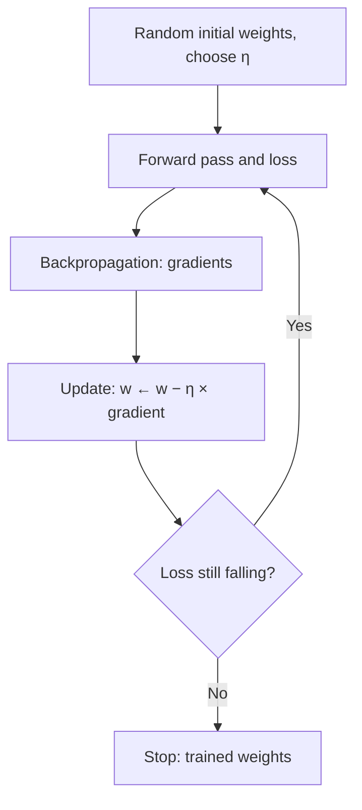
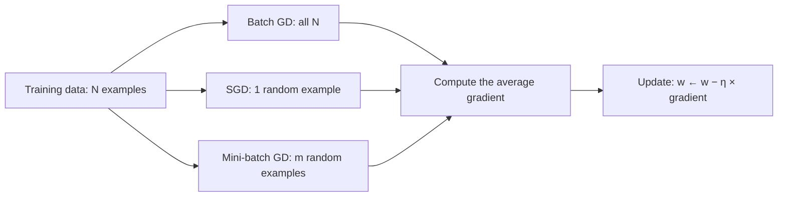
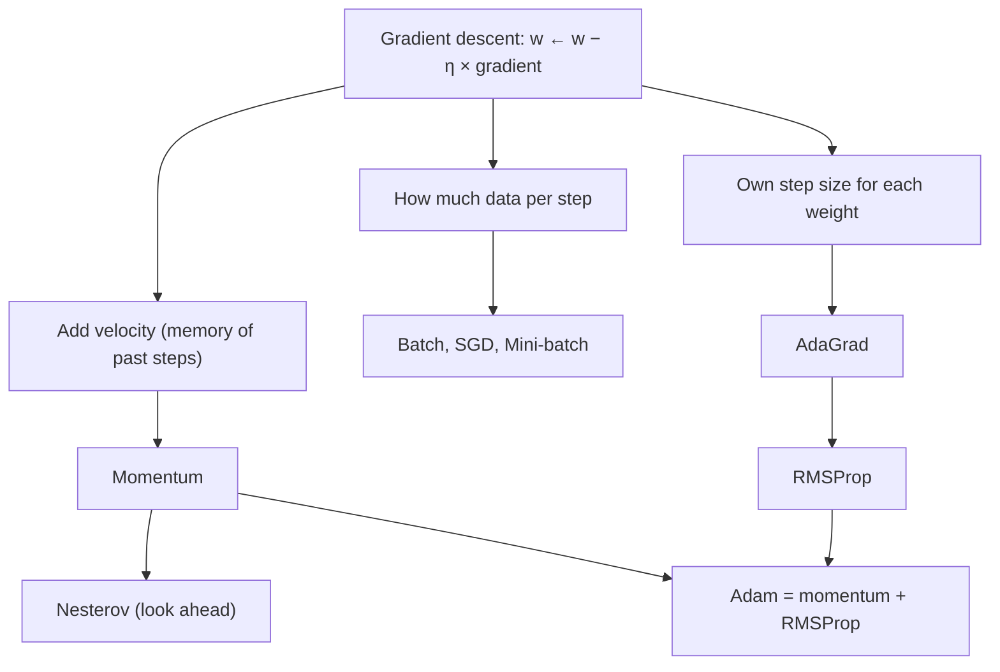

Before the new ideas, here are the old ones you need. If you already know them, skip to the next section.

## The basics first

- A network has adjustable numbers called **weights** (and biases). Training means finding good values for them.
- The **loss** is one number that says how wrong the network is on the training data. Lower is better.
- The **gradient** of the loss for a weight is its slope: how much, and in which direction, the loss changes when that weight goes up a tiny bit.
- **Backpropagation** is the method that computes all these slopes efficiently. Gradient descent is what **uses** them.
- One **epoch** is one full pass through all the training examples. One **iteration** (or step) is one weight update.

## What gradient descent is

**Definition.** Gradient descent is an iterative optimization algorithm that lowers the loss by repeatedly moving every weight a small step in the direction opposite to its gradient (the downhill direction). This is covered in syllabus module <Syl m="2" />, "Training, Optimization and Regularization" (it is also introduced in module 1).

**Why it is needed.** A network has thousands or millions of weights, and there is no formula that gives their best values directly. We can, however, measure the slope of the loss for each weight. Gradient descent uses that slope to improve the weights a little at a time, which works for any size of network.

**Everyday analogy: walking downhill in fog.** You are on a hillside in thick fog and want to reach the valley. You cannot see the valley, but you can feel which way the ground slopes under your feet. So you take a small step in the steepest downhill direction, feel again, step again. The height of the ground is the loss and your position is the set of weights.

**The update rule.** In words: *new weight = old weight − learning rate × gradient*.

$$
w \leftarrow w - \eta \, \frac{\partial L}{\partial w}
$$

$w$ is a weight, $\eta$ (eta) is the **learning rate** (a small positive step size such as 0.1 or 0.01), and $\dfrac{\partial L}{\partial w}$ is the gradient. <Cite id="gfdl-ch4" loc="§4.3" />

**Why the minus sign works.** If the slope is positive, the loss rises as the weight rises, so we lower the weight. If the slope is negative, subtracting it raises the weight, which again lowers the loss. Near the bottom the slope is almost 0, so the steps become small on their own.

## How the algorithm works

1. **Initialise** the weights with small random values and choose the learning rate.
2. **Forward pass:** compute the predictions and the loss.
3. **Backward pass:** use backpropagation to find the gradient of the loss for every weight.
4. **Update** every weight with the rule above.
5. **Repeat** steps 2 to 4 until the loss stops falling or the planned number of epochs is done.

**Worked sum: three steps on a bowl-shaped loss.**

<Sum>

<Given>

one weight with loss $L(w) = (w - 1)^2$ (lowest point at $w = 1$), gradient $2(w - 1)$, start $w = 4$, learning rate $\eta = 0.1$.

</Given>

<Find>

$w$ and the loss after three gradient descent steps.

</Find>

<Steps>

1. Gradient at $w = 4$: $2(4 - 1) = 6$. *(The slope tells us which way is uphill.)*
2. Step 1: $w = 4 - 0.1 \times 6 = 4 - 0.6 = 3.4$. *(Move against the slope by learning rate × gradient.)*
3. Gradient at $w = 3.4$: $2(3.4 - 1) = 4.8$; step 2: $w = 3.4 - 0.48 = 2.92$. *(Same rule, new slope.)*
4. Gradient at $w = 2.92$: $2(2.92 - 1) = 3.84$; step 3: $w = 2.92 - 0.384 = 2.536$. *(The slope is smaller, so the step is smaller.)*
5. Loss at each point: $(4-1)^2 = 9$, $(3.4-1)^2 = 5.76$, $(2.92-1)^2 = 3.6864 \approx 3.69$, $(2.536-1)^2 = 2.359 \approx 2.36$. *(Check that we really went downhill.)*

</Steps>

<Answer>

after three steps $w = 2.536$ and the loss has fallen from 9 to about 2.36.

</Answer>

<Box kind="verify">

Each step here multiplies the distance from the bottom ($w - 1$) by $1 - 2\eta = 0.8$. Distance: $3 \to 2.4 \to 1.92 \to 1.536$, so $w = 1 + 1.536 = 2.536$. Same answer, found a different way. The loss $1.536^2 = 2.359$ also matches, and it fell at every step, as it should with a small learning rate.

</Box>

</Sum>

<Figure caption="A one-weight loss shaped like a bowl, (1 − w)², which is the same as (w − 1)². Gradient descent starts high on the right wall (w = 4) and walks down towards the bottom at w = 1, marked by the dashed line. The slope is steep far from the bottom and flat at the bottom.">
  <CurvePlot curves="mse-loss" x="-2,4.5" y="0,10" xLabel="weight w" yLabel="loss" mark="min:mse-loss" />
</Figure>

## The learning rate

The learning rate is the most important setting in gradient descent.

| Learning rate | What happens |
|---|---|
| Too small | Many tiny steps; training is very slow and may stall in a flat region |
| About right | The loss falls steadily to a low value |
| Too large | Steps jump over the bottom; the loss swings and can grow (training **diverges**) |

**Worked sum: what a too-large learning rate does.**

<Sum>

<Given>

the same bowl $L(w) = (w - 1)^2$, start $w = 4$, but $\eta = 1.1$.

</Given>

<Find>

$w$ and the loss after two steps.

</Find>

<Steps>

1. Gradient at $w = 4$ is $6$; step 1: $w = 4 - 1.1 \times 6 = 4 - 6.6 = -2.6$. *(The step is so big it jumps past the bottom at 1.)*
2. Gradient at $w = -2.6$: $2(-2.6 - 1) = -7.2$; step 2:

   $$
   \begin{aligned}
   w &= -2.6 - 1.1 \times (-7.2) \\
   &= -2.6 + 7.92 \\
   &= 5.32
   \end{aligned}
   $$

   *(It jumps back even further.)*
3. Loss:

   $$
   \begin{aligned}
   9 &\to (-3.6)^2 \\
   &= 12.96 \\
   &\to (4.32)^2 \\
   &= 18.6624 \\
   &\approx 18.66
   \end{aligned}
   $$

   *(The loss grows, so training diverges.)*

</Steps>

<Answer>

$w$ goes $4 \to -2.6 \to 5.32$ and the loss grows $9 \to 12.96 \to 18.66$.

</Answer>

<Box kind="verify">

Here each step multiplies the distance from the bottom by $1 - 2 \times 1.1 = -1.2$. Distance: $3 \to -3.6 \to 4.32$, so $w = 1 - 3.6 = -2.6$ and then $1 + 4.32 = 5.32$. The size grows by 1.2 each time (the minus sign means it flips side), which is exactly why a too-large rate blows up.

</Box>

</Sum>

A common practical rule is to start with a moderate learning rate and lower it when the loss stops improving (a learning-rate **schedule**). <Cite id="hinton-lec6" /> <Cite id="gfdl-ch8" loc="§8.3.1" />

## Advantages, disadvantages and applications of gradient descent

**Advantages:** simple to understand and code; works for any differentiable loss and any network size; needs only first derivatives, which backpropagation gives cheaply; guaranteed to go downhill when the learning rate is small enough.

**Disadvantages:** choosing the learning rate is tricky; it can settle in a local minimum or crawl across flat regions and saddle points; it zig-zags in long narrow valleys; plain (full-batch) gradient descent is slow on big datasets. <Cite id="gfdl-ch8" loc="§8.2" />

**Applications:** training every kind of neural network (CNNs for images, RNNs and transformers for text and speech), linear and logistic regression, recommendation systems and matrix factorisation. <Cite id="ibm-gradient-descent" />

## Deriving the update rule for a simple model

This is exactly what <PYQ id="2023-12/q1b" /> asks, so it is the one derivation worth knowing.

**Set-up.** We have $N$ input-output pairs $(x_1, y_1), \dots, (x_N, y_N)$ and the model $\hat{y} = xw$ with one parameter $w$.

**1. Sum-of-squared error.** For pair $n$ the prediction is $x_n w$, so the error is $y_n - x_n w$. Square it (so positive and negative errors cannot cancel) and add over all pairs:

$$
E(w) = \frac{1}{2}\sum_{n=1}^{N} \left(y_n - x_n w\right)^2
$$

The $\dfrac{1}{2}$ is optional; it only cancels the 2 that appears when we differentiate.

**2. Differentiate with the chain rule.** The slope of $(y_n - x_n w)^2$ with respect to $w$ is $2(y_n - x_n w)\cdot(-x_n)$, so

$$
\frac{\partial E}{\partial w} = -\sum_{n=1}^{N} (y_n - x_n w)\,x_n
$$

**3. Plug into gradient descent** with learning rate $\alpha$:

$$
w \leftarrow w - \alpha\frac{\partial E}{\partial w} = w + \alpha \sum_{n=1}^{N} (y_n - x_n w)\,x_n
$$

In words: for each example, add (error × input), sum over all examples and scale by $\alpha$. If predictions are too small, $w$ goes up; if too large, $w$ goes down.

**Worked sum: one update with real numbers.**

<Sum>

<Given>

data pairs $(x, y) = (1, 2)$ and $(2, 4)$, model $\hat{y} = xw$, start $w = 0$, learning rate $\alpha = 0.1$.

</Given>

<Find>

the error $E$ at the start, the gradient, the new $w$ and the new $E$.

</Find>

<Steps>

1. Errors at $w = 0$: $2 - 1 \times 0 = 2$ and $4 - 2 \times 0 = 4$. *(Error = true output − prediction.)*
2.

   $$
   \begin{aligned}
   E &= \frac{1}{2}(2^2 + 4^2) \\
   &= \frac{1}{2}(4 + 16) \\
   &= 10
   \end{aligned}
   $$

   *(Square, add, halve.)*
3. Gradient:

   $$
   \begin{aligned}
   \frac{\partial E}{\partial w} &= -(2 \times 1 + 4 \times 2) \\
   &= -(2 + 8) \\
   &= -10
   \end{aligned}
   $$

   *(Sum of error × input, with a minus sign.)*
4. New $w = 0 - 0.1 \times (-10) = 0 + 1 = 1$. *(The update rule; a negative gradient pushes $w$ up.)*
5. New errors: $2 - 1 = 1$ and $4 - 2 = 2$, so $E = \dfrac{1}{2}(1 + 4) = 2.5$. *(Recompute the error with the new weight.)*

</Steps>

<Answer>

$E$ starts at 10, the gradient is −10, $w$ becomes 1 and $E$ drops to 2.5.

</Answer>

<Box kind="verify">

Both points lie on $y = 2x$, so the best weight is $w = 2$; its gradient is $-(0 \times 1 + 0 \times 2) = 0$, as it must be at the bottom. Our step moved $w$ from 0 towards 2, and one more step gives gradient $-(1 \times 1 + 2 \times 2) = -5$, so $w = 1 + 0.1 \times 5 = 1.5$ and $E = \dfrac{1}{2}(0.5^2 + 1^2) = 0.625$. The error keeps falling, so the rule works.

</Box>

</Sum>

## Types by amount of data: batch, stochastic and mini-batch

**Why there are types.** The training loss is an average over all examples. The three basic types differ only in **how many examples are used to compute each gradient** before one update. <Cite id="gfdl-ch8" loc="§8.1.3" />

**Everyday analogy.** To know which way public opinion leans, batch GD asks every citizen before each decision (accurate but slow), SGD asks one random person (fast but noisy), and mini-batch asks a small random group of, say, 64 people (fairly accurate and fast).

**1. Batch (full-batch) gradient descent.** Go through **all** training examples, average their gradients, then make one update. One update per epoch.

- *Advantages:* exact gradient, smooth and stable path, steady convergence on convex problems.
- *Disadvantages:* very slow and memory-hungry on large datasets; no progress until the whole dataset is processed; with no noise in its steps it can stay stuck in a local minimum or near a saddle point.
- *Used for:* small datasets that fit in memory.

**2. Stochastic gradient descent (SGD).** Shuffle the data, then update after **every single** example using only its gradient. With $N$ examples that is $N$ updates per epoch. <Cite id="gfg-sgd" />

- *Advantages:* each step is very cheap; learning starts immediately; works with streaming (online) data; the noise can help jump out of shallow bad spots.
- *Disadvantages:* the gradient from one example is noisy, so the loss jumps around and the path zig-zags; the weights keep wobbling near the minimum unless the learning rate is lowered over time; it cannot use the GPU's parallel power well.
- *Used for:* online learning, very large or streaming datasets.

**3. Mini-batch gradient descent.** Split the shuffled data into small groups (**mini-batches**) of $m$ examples, for example 32, 64 or 128, and update after each group. That is $N/m$ updates per epoch.

- *Advantages:* less noisy than SGD, far cheaper than batch GD, fast on GPUs because a whole batch is one matrix operation; the small noise still helps generalization.
- *Disadvantages:* batch size is one more setting to tune; still some noise; a batch must fit in GPU memory.
- *Used for:* almost all deep learning. In libraries "SGD" usually means mini-batch SGD. <Cite id="hinton-lec6" /> <Cite id="mlm-minibatch" />

All three use the same update rule; only the gradient changes. Batch GD averages the gradient over all $N$ examples, SGD takes it from one example, and mini-batch averages it over the $m$ examples in the batch.

**Worked sum: counting updates per epoch.**

<Sum>

<Given>

$N = 1000$ training examples, mini-batch size $m = 50$.

</Given>

<Find>

the number of weight updates in one epoch for each type.

</Find>

<Steps>

1. Batch GD: all 1000 examples give one gradient, so **1 update**. *(One update per full pass.)*
2. SGD: one update per example, so $1000 / 1 =$ **1000 updates**. *(Every example is its own step.)*
3. Mini-batch: $1000 / 50 =$ **20 updates**. *(One update per group of 50.)*

</Steps>

<Answer>

1 (batch), 1000 (SGD) and 20 (mini-batch) updates per epoch.

</Answer>

<Box kind="verify">

In every case, updates × examples per update must equal the 1000 examples seen in one epoch: $1 \times 1000 = 1000$, $1000 \times 1 = 1000$, $20 \times 50 = 1000$. All three check out.

</Box>

</Sum>

| | Batch GD | Stochastic GD | Mini-batch GD |
|---|---|---|---|
| Examples per update | All $N$ | 1 | $m$ (e.g. 32 to 256) |
| Updates per epoch | 1 | $N$ | $N/m$ |
| Gradient | Exact | Very noisy | Slightly noisy |
| Cost per update | High | Very low | Low |
| Path to the minimum | Smooth | Zig-zag | Mostly smooth |
| Memory | Whole dataset | One example | One batch |
| GPU use | Good but slow per step | Poor | Excellent |
| Used for | Small datasets | Online learning | Almost all deep learning |

## Why plain gradient descent is not enough

- **Ravines (zig-zag).** In a long narrow valley the gradient points mostly across the valley, so the steps bounce from wall to wall and move slowly along the floor. <Cite id="hinton-lec6" />
- **Flat regions and saddle points.** Where the slope is almost zero, steps become tiny and progress stalls. <Cite id="gfdl-ch8" loc="§8.2.3" />
- **Local minima.** It can settle in a low point that is not the lowest. <Cite id="gfdl-ch8" loc="§8.2.2" />
- **One learning rate for all weights.** Some weights have huge gradients and some tiny ones, but they all get the same $\eta$.

The improved optimizers below fix these problems: **momentum** and **Nesterov** fix the zig-zag; **AdaGrad**, **RMSProp** and **Adam** fix the "one learning rate for all" problem.

## Momentum-based gradient descent

**What it is.** Gradient descent with a memory: each step is a mix of the new gradient and the previous step (the **velocity**).

**Why it is needed.** Plain gradient descent is slow in ravines and on gentle slopes, and it zig-zags.

**Analogy.** A ball rolling downhill does not stop and restart at every bump; it builds up speed in the direction it keeps going. <Cite id="hinton-lec6" />

**How it works.**

1. Start with velocity 0.
2. At each step, shrink the old velocity (usually keep 90 per cent of it) and add the new downhill push (learning rate × gradient).
3. Move the weight by the velocity, not by the raw gradient.

$$
v \leftarrow \alpha\,v - \eta\,\nabla L(w) \qquad w \leftarrow w + v
$$

$v$ is the velocity, $\alpha$ the **momentum coefficient** (usually 0.9) and $\nabla L(w)$ the gradient. <Cite id="gfdl-ch8" loc="§8.3.2" />

In directions where the gradient keeps the same sign, the pushes add up and the ball speeds up. Where the gradient keeps flipping sign (the zig-zag across a ravine), the pushes cancel and the bouncing is damped. Rumelhart, Hinton and Williams already used this term in their 1986 backpropagation paper. <Cite id="rumelhart1986" />

**Worked sum: momentum on the same bowl.**

<Sum>

<Given>

$L(w) = (w - 1)^2$, gradient $2(w - 1)$, start $w = 4$, $v = 0$, $\eta = 0.1$, $\alpha = 0.9$.

</Given>

<Find>

$w$ after three momentum steps, compared with plain gradient descent (2.536).

</Find>

<Steps>

1. Step 1: gradient $6$; $v = 0.9 \times 0 - 0.1 \times 6 = -0.6$; $w = 4 - 0.6 = 3.4$. *(No old velocity yet, so this is a plain step.)*
2. Step 2: gradient $2(3.4 - 1) = 4.8$;

   $$
   \begin{aligned}
   v &= 0.9 \times (-0.6) - 0.48 \\
   &= -0.54 - 0.48 \\
   &= -1.02
   \end{aligned}
   $$

   $w = 3.4 - 1.02 = 2.38$. *(Old velocity adds to the new push, so the step grows.)*
3. Step 3: gradient $2(2.38 - 1) = 2.76$;

   $$
   \begin{aligned}
   v &= 0.9 \times (-1.02) - 0.276 \\
   &= -0.918 - 0.276 \\
   &= -1.194
   \end{aligned}
   $$

   $w = 2.38 - 1.194 = 1.186$. *(Still speeding up.)*

</Steps>

<Answer>

momentum reaches $w = 1.186$ after three steps, while plain gradient descent is still at 2.536.

</Answer>

<Box kind="verify">

The weight moves by the sum of the velocities:

$$
\begin{aligned}
4 + (-0.6) + (-1.02) + (-1.194) &= 4 - 2.814 \\
&= 1.186
\end{aligned}
$$

Same answer. One more step gives gradient $0.372$, $v = -1.0746 - 0.0372 = -1.1118$ and $w = 0.0742$, which is past the bottom at 1: momentum is faster but overshoots, exactly as the theory says.

</Box>

</Sum>

- *Advantages:* faster convergence, less zig-zag, can roll through small bumps and flat regions.
- *Disadvantages:* can overshoot the minimum; one more setting ($\alpha$).
- *Applications:* "SGD with momentum" is widely used to train image CNNs (the original ResNet was trained this way) and is the usual baseline optimizer. <Cite id="gfg-momentum" />

## Nesterov accelerated gradient (NAG)

**What it is.** A smarter momentum that looks ahead before it steps.

**How it works.** Plain momentum measures the gradient where you are now, then jumps. Nesterov first moves to where the velocity is about to carry you (the **look-ahead point**), measures the gradient **there**, and then corrects. Like a skier who looks a little ahead down the slope before turning. <Cite id="sutskever2013" /> <Cite id="gfdl-ch8" loc="§8.3.3" />

$$
v \leftarrow \alpha\,v - \eta\,\nabla L(w + \alpha v) \qquad w \leftarrow w + v
$$

The only change from momentum is where the gradient is taken: at $w + \alpha v$.

- *Advantages:* sees the slope flattening before it arrives, so it overshoots less and settles faster than momentum.
- *Disadvantages:* slightly more complex; still one learning rate for all weights.
- *Applications:* used as an option in deep network training, for example `nesterov=True` in Keras SGD. <Cite id="keras-sgd" />

## AdaGrad (adaptive gradient)

**What it is.** An optimizer that gives every weight its **own** learning rate. <Cite id="duchi2011" />

**How it works.** For each weight it keeps a running **sum** of the squares of all its past gradients. The step is the gradient times the learning rate, divided by the square root of that sum. Weights that have had large gradients get smaller steps; weights with small or rare gradients get relatively larger steps.

$$
r \leftarrow r + g^2 \qquad w \leftarrow w - \frac{\eta}{\delta + \sqrt{r}}\,g
$$

$g$ is this weight's gradient, $r$ the sum of its squared gradients and $\delta$ a tiny number (such as $10^{-7}$) that avoids dividing by zero. <Cite id="gfdl-ch8" loc="§8.5.1" />

- *Advantages:* no need to hand-tune a rate per weight; very good for sparse data where some features are rare.
- *Disadvantages:* because the sum only grows, the effective learning rate keeps shrinking and learning can almost stop in long training.
- *Applications:* text and natural language problems with rare words, recommendation systems with sparse features. <Cite id="keras-adagrad" />

## RMSProp (root mean square propagation)

**What it is.** A fix for AdaGrad that uses a **moving average** of squared gradients instead of a sum, so old gradients are slowly forgotten and the step size does not die out. Proposed by Hinton in his course lectures, not in a paper. <Cite id="hinton-lec6" />

$$
r \leftarrow \rho\,r + (1-\rho)\,g^2 \qquad w \leftarrow w - \frac{\eta}{\sqrt{\delta + r}}\,g
$$

$\rho$ (rho) is the decay rate, usually 0.9: the average is mostly the old value plus a little of the new squared gradient. <Cite id="gfdl-ch8" loc="§8.5.2" />

- *Advantages:* own rate per weight without the rate dying out; works well on changing (non-stationary) problems.
- *Disadvantages:* still needs $\eta$ and $\rho$ to be chosen; no momentum of its own.
- *Applications:* popular for recurrent neural networks and reinforcement learning. <Cite id="keras-rmsprop" />

## Adam (adaptive moment estimation)

**What it is.** Adam combines the two good ideas: a momentum-like running average of the gradients (the **first moment**) and an RMSProp-like running average of the squared gradients (the **second moment**). It is one of the most widely used optimizers today. <Cite id="kingma2014" />

**How it works.**

1. Update the average gradient (direction, like momentum).
2. Update the average squared gradient (size, like RMSProp).
3. Because both averages start at 0, they are too small in the first steps, so divide each by a correction factor (**bias correction**).
4. Step each weight by (corrected average gradient) ÷ √(corrected average squared gradient), times $\eta$.

$$
m \leftarrow \beta_1 m + (1-\beta_1)\,g \qquad v \leftarrow \beta_2 v + (1-\beta_2)\,g^2
$$

$$
\hat{m} = \frac{m}{1-\beta_1^{\,t}} \qquad \hat{v} = \frac{v}{1-\beta_2^{\,t}} \qquad w \leftarrow w - \eta\,\frac{\hat{m}}{\sqrt{\hat{v}} + \epsilon}
$$

$t$ is the step number. The paper's suggested defaults are $\eta = 0.001$, $\beta_1 = 0.9$, $\beta_2 = 0.999$ and $\epsilon = 10^{-8}$. <Cite id="kingma2014" /> <Cite id="gfdl-ch8" loc="§8.5.3" />

- *Advantages:* fast, works well with little tuning, handles noisy and sparse gradients, own rate per weight plus momentum.
- *Disadvantages:* more settings and more memory (two averages per weight); on some tasks well-tuned SGD with momentum generalizes as well or better.
- *Applications:* the default choice for transformers, GANs, NLP models and most quick experiments. <Cite id="mlm-adam" />

<Box kind="intuition">

The adaptive optimizers (AdaGrad, RMSProp, Adam) make each step roughly the same size whatever the size of the gradient. Their real advantage appears in networks with millions of weights whose gradients differ hugely in size, where one shared learning rate cannot suit them all.

</Box>

## All the optimizers side by side

| Method | What it remembers | Update in words | Main benefit | Main weakness |
|---|---|---|---|---|
| Gradient descent | Nothing | Step against the gradient | Simple | Slow in ravines, one $\eta$ |
| Momentum | Velocity (past gradients) | Step with the velocity | Faster, less zig-zag | Can overshoot |
| Nesterov | Velocity | Gradient at the look-ahead point | Less overshoot than momentum | Slightly more complex |
| AdaGrad | Sum of squared gradients | Divide step by √(sum) | Own rate per weight, good for rare features | Rate shrinks towards zero |
| RMSProp | Moving average of squared gradients | Divide step by √(average) | Rate does not die out | Needs $\rho$ and $\eta$ |
| Adam | Averages of gradients and squared gradients | Momentum plus RMSProp, with bias correction | Works well with little tuning | More settings; well-tuned SGD with momentum can match it |

Which one is best? There is no single answer; Goodfellow notes there is no consensus, and that SGD (with or without momentum), RMSProp and Adam are all popular choices. <Cite id="gfdl-ch8" loc="§8.5.4" /> <Cite id="ruder2016" />

In code, these are one line each, for example `keras.optimizers.SGD(learning_rate=0.01, momentum=0.9, nesterov=True)` or `torch.optim.Adam(model.parameters(), lr=0.001)`. <Cite id="keras-sgd" /> <Cite id="pytorch-sgd" /> <Cite id="pytorch-adam" />

**Conclusion.** Gradient descent is the engine of training: it uses the gradients from backpropagation to move every weight downhill, and its variants only change how much data each step uses or how each step is sized.

## Where this was asked

| If the question says | What to write | Seen as |
|---|---|---|
| "Calculate the sum-of-squared error for $y = xw$ and derive the gradient descent update rule" | $E = \dfrac{1}{2}\sum(y_n - x_n w)^2$, the derivative step by step, $w \leftarrow w + \alpha\sum(y_n - x_n w)x_n$, a two-point check | <PYQ id="2023-12/q1b" /> |
| "Explain gradient descent in deep learning" (5 marks) | Definition, why needed, hill-in-fog idea, the steps, update rule in words, learning rate, advantages and disadvantages, one line on the types | <PYQ id="2024-05/q1b" /> <PYQ id="2024-12/q1b" /> |
| "Explain SGD and momentum-based gradient descent" | For each: definition, why, how it works, advantages, disadvantages, applications; diagram; comparison table | <PYQ id="2023-12/q5a" /> |
| "Different types of gradient descent, explain any three" | List all types, then batch, stochastic and mini-batch with working, pros and cons, diagram and comparison table | <PYQ id="2024-05/q3a" /> <PYQ id="2024-12/q3a" /> |
| "Explain the gradient descent algorithm and discuss its types in detail" | The algorithm steps and diagram, then batch, SGD, mini-batch in detail, and a short paragraph on momentum, Nesterov, AdaGrad, RMSProp and Adam | <PYQ id="2025-05/q2a" /> |

## Quick revision

- Update rule: new weight = old weight − learning rate × gradient, $w \leftarrow w - \eta\,\partial L/\partial w$. Minus sign = downhill.
- Learning rate too small: slow. Too large: overshoots and can diverge.
- For $\hat{y} = xw$: $E = \dfrac{1}{2}\sum(y_n - x_n w)^2$, $\partial E/\partial w = -\sum(y_n - x_n w)x_n$.
- Batch: all data per step (exact, slow). SGD: one example (fast, noisy). Mini-batch: $m$ examples, the usual choice.
- Momentum: velocity = 0.9 × old velocity − η × gradient; speeds up and damps zig-zag. Nesterov: gradient at the look-ahead point.
- AdaGrad divides by √(sum of squared gradients); RMSProp by √(moving average); Adam = momentum + RMSProp + bias correction.
