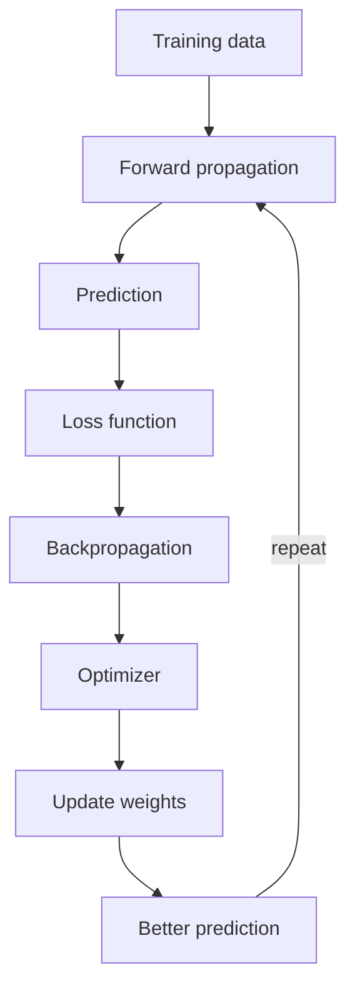
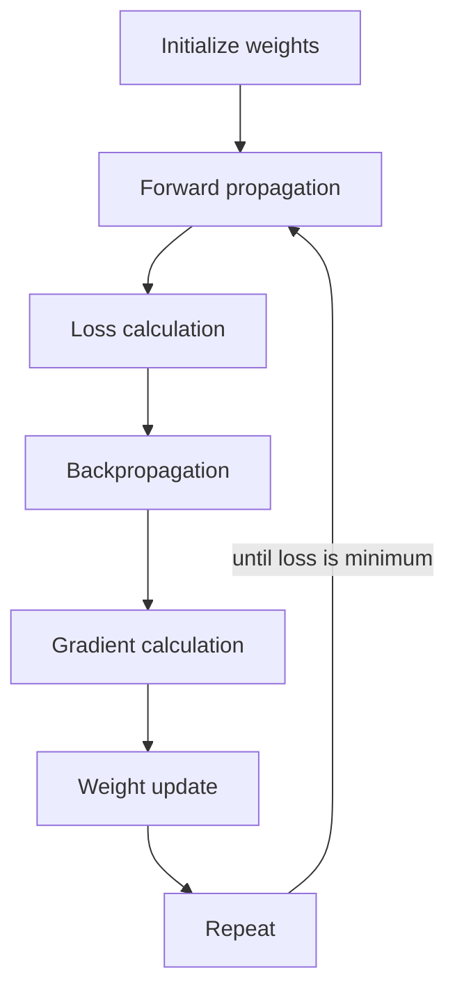
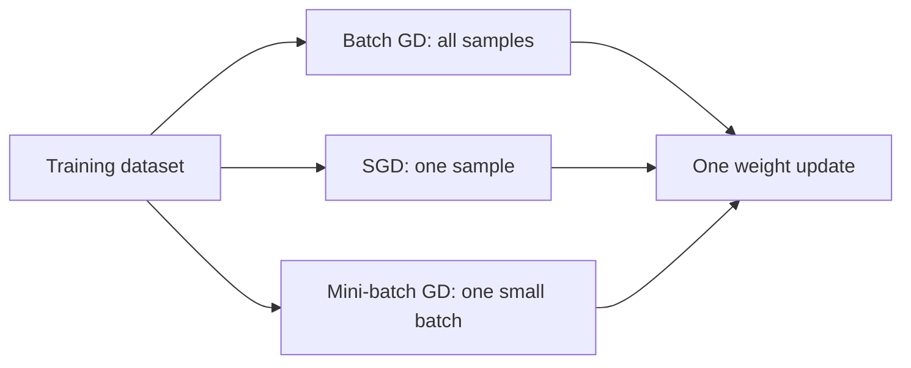
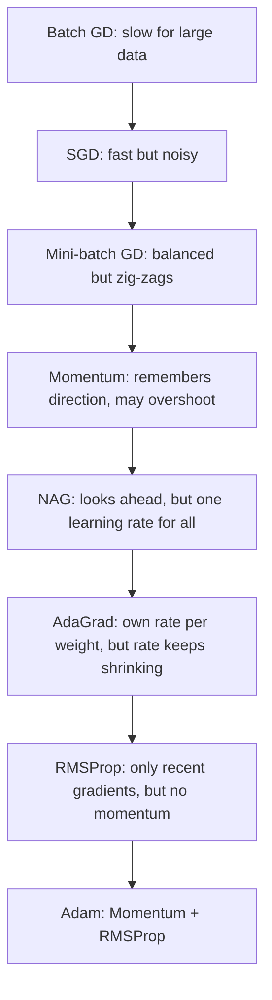

Before the new ideas, here are the old ones you need. If you already know them, skip to the next section.

## The basics first

- A **weight** is a number that says how much importance the network gives to an input. A **bias** is an extra number added to help learning. Weights and biases are the **parameters**: the numbers the network learns. <Cite id="class-dl-chp2" loc="slide 4" />
- The network makes a **prediction**. The **loss** is the error: how far the prediction is from the actual value. In the teacher's example the actual weight of a fruit is 180 g, the prediction is 220 g, so the loss is high. <Cite id="class-dl-chp2" loc="slide 57" />
- A loss function **only tells us how much error exists**. It does not tell us which direction to move, how fast to move, or which weight should change. So we need another concept: the gradient. <Cite id="class-dl-chp2" loc="slide 57" />
- A **loss function** is the error of one training example; a **cost function** is the average error across the entire training set. <Cite id="class-dl-m1" loc="p. 28" />
- An **epoch** is one complete pass through the whole training dataset <Cite id="class-dl-chp2" loc="slide 69" />. A **batch** is a small group of training samples processed together <Cite id="class-dl-chp2" loc="slide 110" />.

## The gradient

<Box kind="definition">

**Gradient:** the slope of the loss function. It tells us which direction reduces the loss and how quickly the loss changes. <Cite id="class-dl-chp2" loc="slide 57" />

</Box>

**Everyday analogy.** You are standing on a hill in fog and want to reach the valley. You cannot see the valley, but you can feel the slope under your feet. The slope says which way is downhill and how steep it is. The gradient is that slope, and "think of it as the slope of a hill". <Cite id="class-dl-chp2" loc="slide 63" />

The gradient is written $\dfrac{\partial L}{\partial W}$ and means "how much does the loss change when the weight changes?". It tells us two things: <Cite id="class-dl-chp2" loc="slide 58" />

1. **Direction:** which way the weights should move to reduce the loss.
2. **Magnitude:** how much the loss changes when the weights change. A large gradient is a steep slope, so large weight updates and faster learning. A small gradient is a flat slope, so small updates and slower learning.

The gradient is **calculated during backpropagation** and used by the optimizer (GD, Adam, SGD and so on) to update the weights. <Cite id="class-dl-chp2" loc="slide 58" />

| Gradient is | Meaning | What the optimizer does |
|---|---|---|
| **Positive** (slope > 0) | Loss increases as the weight increases | Move the weight in the opposite direction (decrease it) |
| **Negative** (slope < 0) | Loss decreases in the current direction | Keep updating in that direction (the gradient descent rule) |
| **Zero** | No slope | Updates become very small or stop; usually near a global minimum, a local minimum or a saddle point |

**Don't confuse (the teacher's table).** <Cite id="class-dl-chp2" loc="slide 58" />

| | Gradient | Gradient descent |
|---|---|---|
| Meaning | Tells the direction and size of change | Uses the gradient to update weights |
| What is it? | Calculated during backpropagation | An optimization algorithm |
| Role | Information (slope) | Action (weight update) |

## What is optimization?

<Box kind="definition">

**Optimization** is the process of finding the best values of weights and biases so that the loss becomes as small as possible. An **optimizer** updates the weights after every training step to improve the model's predictions. <Cite id="class-dl-chp2" loc="slide 59" />

</Box>

In the textbook words: optimization means "finding the parameters θ of a neural network that significantly reduce a cost function J(θ)". <Cite id="class-dl-m2" loc="p. 44" />

The optimizer: (1) calculates how the weights affect the loss (using gradients from backpropagation), (2) updates the weights in the correct direction, (3) repeats until the loss becomes very small. It works **after backpropagation and before the next prediction**, and only during training. <Cite id="class-dl-chp2" loc="slide 59" />

<Cite id="class-dl-chp2" loc="slide 59" />

The teacher lists the common optimizers: Gradient Descent (GD), Stochastic Gradient Descent (SGD), Mini-Batch GD, Momentum, Nesterov (NAG), AdaGrad, RMSProp and Adam. <Cite id="class-dl-chp2" loc="slide 59" /> This is syllabus <Syl m="2" />.

## Gradient descent (GD)

<Box kind="definition">

**Gradient Descent (GD)** is an optimization algorithm that updates the weights and biases to reduce the loss. Its goal is to find the minimum loss by moving the weights in the correct direction. <Cite id="class-dl-chp2" loc="slide 60" />

</Box>

**What is the problem it solves?** After a prediction the network knows it is wrong, but it does not know which weight should be changed, whether the weight should increase or decrease, and how much it should change. Without a proper method the model cannot improve. <Cite id="class-dl-chp2" loc="slide 60" />

### How it works, step by step

Gradient Descent: <Cite id="class-dl-chp2" loc="slide 60" />

1. Calculates the gradient (slope) of the loss.
2. Finds the direction where the loss decreases.
3. Updates the weights.
4. Repeats the process until the loss becomes very small.

In more detail, the teacher's six steps are: initialize weights randomly, perform forward propagation, calculate the loss, use backpropagation to calculate the gradients, update the weights, and repeat until the loss becomes minimum. <Cite id="class-dl-chp2" loc="slide 63" />

<Box kind="definition">

**Update rule:** $W_{new} = W_{old} - \eta \dfrac{\partial L}{\partial W}$, where $W$ is the weight, $\eta$ (eta) is the learning rate, $L$ is the loss function and $\dfrac{\partial L}{\partial W}$ is the gradient (slope). <Cite id="class-dl-chp2" loc="slide 63" />

</Box>

The minus sign is because the gradient points uphill and we want to go downhill.

<Cite id="class-dl-chp2" loc="slide 63" />

**Sum 1: one gradient descent step.** <Cite id="class-dl-chp2" loc="slide 63" />

<Sum>

<Given>

$W_{old} = 5$, learning rate $\eta = 0.1$, gradient $\dfrac{\partial L}{\partial W} = 3$.

</Given>

<Find>

the new weight.

</Find>

<Steps>

1. Step size $= \eta \times$ gradient $= 0.1 \times 3 = 0.3$. *Reason: the step is the learning rate times the slope.*
2. The gradient is positive, so the loss rises as $W$ rises. Move the other way: $W_{new} = 5 - 0.3 = 4.7$.

</Steps>

<Answer>

$W_{new} = 4.7$

</Answer>

<Box kind="verify">

Plug back in: $4.7 + 0.3 = 5$, the starting weight. The weight went down because the gradient was positive.

</Box>

</Sum>

### The cost curve, minima and the saddle point

A **cost (loss) curve** shows how the loss changes as the weights change: the x-axis is the weight (model parameter) and the y-axis is the loss (error). The objective of gradient descent is to move from a higher loss to the lowest possible loss. <Cite id="class-dl-chp2" loc="slide 63" />

- **Global minimum:** the lowest point on the entire cost curve. It gives the smallest possible loss, the best solution and the most accurate model. It is the desired destination of gradient descent. <Cite id="class-dl-chp2" loc="slide 61" />
- **Local minimum:** the lowest point in a small region of the cost curve. It looks like the minimum nearby, but another point on the curve has an even lower loss. The model may stop here thinking it has finished learning. It happens because complex neural networks have many valleys, and gradient descent follows the slope and may settle in the first valley it reaches. <Cite id="class-dl-chp2" loc="slide 61" />
- **Saddle point:** a point where the gradient (slope) is almost zero, but it is neither a minimum nor a maximum. The optimizer becomes very slow because it thinks it has almost reached the minimum. It is very common in deep neural networks. <Cite id="class-dl-chp2" loc="slide 61" />

**Easy trick (the teacher's):** global minimum = lowest point in the entire world; local minimum = lowest point in your neighbourhood; saddle point = like sitting on a horse saddle, flat in one direction but curved in another. <Cite id="class-dl-chp2" loc="slide 62" />

The textbook adds the other flat places that make optimization hard: **ill-conditioning** (SGD gets "stuck": even very small steps increase the cost), **plateaus** (wide flat regions where the gradient is zero), **cliffs** (very steep regions that cause exploding gradients, fixed by gradient clipping), **long-term dependencies** in very deep graphs, and **inexact gradients**. <Cite id="class-dl-m2" loc="pp. 45-48" />

### The learning rate

<Box kind="definition">

**Learning rate (η):** decides the size of each step while updating the weights. <Cite id="class-dl-chp2" loc="slide 63" />

</Box>

| Learning rate | What happens |
|---|---|
| Small | Slow learning (tiny steps) |
| Large | May skip (overshoot) the minimum |
| Proper | Fast and stable learning |

The textbook says the learning rate may be chosen by trial and error, but it is usually best to choose it by monitoring learning curves that plot the objective function as a function of time. <Cite id="class-dl-m2" loc="p. 51" /> Module 1 adds: high learning rates result in larger steps but risk overshooting the minimum; a low learning rate has more precision, but takes more time and computations. <Cite id="class-dl-m1" loc="p. 29" />

### Advantages and disadvantages of the gradient

The teacher lists: advantage, it shows the correct direction for learning, helps reduce the loss and is used by almost all optimizers. Disadvantage: if the gradient becomes too small, learning slows down (vanishing gradient); if the gradient becomes too large, learning becomes unstable (exploding gradient). <Cite id="class-dl-chp2" loc="slide 58" /> These two problems are explained in the note on backpropagation.

## Types of gradient descent: batch, stochastic and mini-batch

The three types differ only in **how much data is used for one weight update**. Module 1 puts it this way: batch GD updates only after all training examples have been evaluated (one training epoch); SGD updates one training example's parameters at a time; mini-batch combines both ideas. <Cite id="class-dl-m1" loc="p. 34" />

### Batch gradient descent

Batch Gradient Descent uses the entire training dataset to calculate the gradient before updating the weights. The teacher's example is 1,00,000 fruit images: calculate the total loss, calculate the gradients, update the weights (once). This process is very slow for large datasets. It uses the complete dataset for every update, takes more time, requires more memory and updates the weights less frequently. <Cite id="class-dl-chp2" loc="slide 68" />

### Stochastic gradient descent (SGD)

<Box kind="definition">

**Stochastic Gradient Descent (SGD)** is an optimization algorithm that updates the model's weights after processing only one training sample at a time. Instead of waiting for the entire dataset, SGD updates the weights immediately after each sample. <Cite id="class-dl-chp2" loc="slide 68" />

</Box>

How SGD works: <Cite id="class-dl-chp2" loc="slide 68" />

1. Pick one training sample.
2. Perform forward propagation.
3. Calculate the loss.
4. Perform backpropagation.
5. Update the weights immediately.
6. Repeat for the next sample.

Formula: $W_{new} = W_{old} - \eta \dfrac{\partial L_i}{\partial W}$, where $L_i$ is the loss of **one** training sample and $\dfrac{\partial L_i}{\partial W}$ is the gradient of that one sample. Unlike batch GD, SGD uses the loss from one sample, not the entire dataset. <Cite id="class-dl-chp2" loc="slide 69" />

**Advantages:** faster than batch GD, less memory required, weights update immediately (after every sample), suitable for very large datasets, can escape some local minima because of its noisy updates. **Disadvantages:** the training path is noisy (zig-zag), the loss fluctuates during training, it may take longer to settle at the minimum, it is sensitive to the learning rate. **Use SGD when** the dataset is very large, faster training is needed, memory is limited, or online learning is required. **Avoid it when** the dataset is very small, stable and smooth convergence is preferred, or precise updates are more important than speed. <Cite id="class-dl-chp2" loc="slide 70" />

### Mini-batch gradient descent

<Box kind="definition">

**Mini-Batch Gradient Descent** divides the training dataset into small groups called mini-batches. Instead of updating after one sample (SGD) or all samples (Batch GD), it updates after each mini-batch. <Cite id="class-dl-chp2" loc="slide 71" />

</Box>

**The problem it solves:** SGD updates after every sample, so the learning path is noisy (zig-zag), the loss fluctuates and it may overshoot the minimum. We need a method that is faster than Batch GD but more stable than SGD. <Cite id="class-dl-chp2" loc="slide 71" />

How it works: <Cite id="class-dl-chp2" loc="slide 72" />

1. Split the dataset into mini-batches.
2. Perform forward propagation for one batch.
3. Calculate the loss.
4. Backpropagation calculates the gradients.
5. Update the weights.
6. Repeat for the next mini-batch.

Formula: $W_{new} = W_{old} - \eta \dfrac{\partial L_{batch}}{\partial W}$, where $L_{batch}$ is the loss of one mini-batch. <Cite id="class-dl-chp2" loc="slide 72" />

The number of samples in one mini-batch is called the **batch size**. Common batch sizes are 16, 32, 64 and 128. <Cite id="class-dl-chp2" loc="slide 71" />

**Sum 2: how many weight updates in one epoch?** <Cite id="class-dl-chp2" loc="slide 71" />

<Sum>

<Given>

A dataset of 100 fruits and batch size 20. Also 8 fruits with batch size 2, and 1000 images with batch size 32.

</Given>

<Find>

the number of updates in one epoch for batch GD, SGD and mini-batch GD.

</Find>

<Steps>

1. **Batch GD:** all samples are used for one update, so **1 update** per epoch.
2. **SGD:** one update per sample, so 100 samples give **100 updates**.
3. **Mini-batch, 100 fruits, batch size 20:** $100 \div 20 = 5$ batches, so **5 updates**.
4. **Mini-batch, 8 fruits, batch size 2:** $8 \div 2 = 4$ batches, so **4 updates**.
5. **Mini-batch, 1000 images, batch size 32:** $1000 \div 32 = 31.25$, so 31 full batches ($31 \times 32 = 992$ images) and one last smaller batch of 8 images, **32 updates**.

</Steps>

<Answer>

Batch GD 1, SGD 100, mini-batch 5 (for 100 fruits, batch size 20). For 1000 images with batch size 32 there are 32 updates.

</Answer>

<Box kind="verify">

Images used: $31 \times 32 + 8 = 992 + 8 = 1000$, so every image is used once per epoch.

</Box>

</Sum>

**Advantages of mini-batch:** faster than batch GD, more stable than SGD, efficient memory usage, supports parallel processing on GPUs, most widely used in deep learning. **Disadvantages:** need to choose a suitable batch size, still has some fluctuations, batch size affects training performance (too small gives noisy updates, too large is slow like batch GD). It is the most commonly used version of gradient descent in practice. <Cite id="class-dl-chp2" loc="slide 73" />

| Feature | Batch GD | SGD | Mini-batch GD |
|---|---|---|---|
| Uses | Entire dataset | One sample | Small batch |
| Speed | Slow | Very fast | Fast |
| Learning path | Smooth | Zig-zag | Slight zig-zag (balanced) |
| Stability | Stable | Noisy | Balanced |
| Memory | High | Low | Medium |
| Updates per epoch | One | One per sample | One per batch |

<Cite id="class-dl-chp2" loc="slide 72" />

<Cite id="class-dl-chp2" loc="slide 72" />

The textbook adds that SGD gives an unbiased estimate of the gradient when it averages the gradient on a minibatch of $m$ examples, and that the computation time per update does not grow with the number of training examples. <Cite id="class-dl-m2" loc="pp. 49-51" />

## Why plain gradient descent is not enough: momentum

**The problem.** Mini-batch GD is faster and more stable than SGD, but during training the optimizer may zig-zag while moving toward the minimum. Instead of a smooth path it keeps changing direction. It still changes direction frequently, slows down in narrow valleys, may oscillate around the minimum and takes more iterations to converge. So we need an optimizer that moves more smoothly and reaches the minimum faster. <Cite id="class-dl-chp2" loc="slide 74" />

<Box kind="definition">

**Momentum Gradient Descent** improves Gradient Descent by remembering the previous weight update. Instead of relying only on the current gradient, it also uses the previous direction. This helps the optimizer move faster in the correct direction and reduces zig-zag movement. <Cite id="class-dl-chp2" loc="slide 74" />

</Box>

**Real-life example (the teacher's).** Imagine pushing a heavy shopping cart. At first it moves slowly. Once it gains speed, it continues moving in the same direction. Even if the road has small bumps, it keeps moving forward. Momentum builds speed in the same way. <Cite id="class-dl-chp2" loc="slide 74" />

How it works: calculate the current gradient, remember the previous update, combine the previous update with the current gradient, update the weights, repeat. This gives faster convergence, smoother learning and less oscillation. <Cite id="class-dl-chp2" loc="slide 74" />

<Box kind="definition">

**Momentum formulas.** Velocity update: $V_t = \beta V_{t-1} - \eta \dfrac{\partial L}{\partial W}$. Weight update: $W_{new} = W_{old} + V_t$. Here $V$ is the velocity (momentum), $\beta$ is the momentum coefficient (usually 0.9), $\eta$ is the learning rate, $L$ is the loss and $W$ is the weight. <Cite id="class-dl-chp2" loc="slide 75" />

</Box>

The textbook says the same: the momentum algorithm accumulates an exponentially decaying moving average of past gradients and continues to move in their direction; the velocity $v$ is "the direction and speed at which the parameters move". <Cite id="class-dl-m2" loc="pp. 52-53" />

**Sum 3: two momentum steps.** <Cite id="class-dl-chp2" loc="slide 75" />

<Sum>

<Given>

$W = 1.0$, $V_0 = 0$, $\beta = 0.9$, $\eta = 0.1$. The gradient is 2 at both steps (a steady slope).

</Given>

<Find>

$W$ after two steps with momentum, and after two steps of plain GD.

</Find>

<Steps>

1. **Step 1 (momentum).** $V_1 = \beta V_0 - \eta \times 2 = 0 - 0.2 = -0.2$. $W_1 = 1.0 + (-0.2) = 0.8$.
2. **Step 2 (momentum).** $V_2 = 0.9 \times (-0.2) - 0.1 \times 2 = -0.18 - 0.2 = -0.38$. $W_2 = 0.8 + (-0.38) = 0.42$.
3. **Plain GD for comparison.** Each step is $\eta \times 2 = 0.2$, so $W$ goes $1.0 \to 0.8 \to 0.6$.

</Steps>

<Answer>

Momentum reaches $W = 0.42$ in two steps, plain GD only $W = 0.6$. The second momentum step (0.38) is bigger than the first (0.2) because the earlier steps pushed in the same direction.

</Answer>

<Box kind="verify">

Check the second velocity another way: $V_2 = -(0.9 \times 0.2 + 0.2) = -0.38$. The steps are $0.2$ then $0.38$, and $1.0 - 0.2 - 0.38 = 0.42$.

</Box>

</Sum>

**When to use momentum:** training deep neural networks, GD is oscillating, faster convergence is required, the cost curve has narrow valleys. **Advantages:** faster convergence than mini-batch GD, reduces zig-zag movement, smooth weight updates, helps move through shallow local minima and flat regions, widely used in deep learning. **Disadvantages:** an extra parameter ($\beta$) must be selected, it can overshoot the minimum if momentum is too high, slightly more computation. <Cite id="class-dl-chp2" loc="slide 76" />

| Mini-batch GD | Momentum GD |
|---|---|
| Uses only the current gradient | Uses current gradient + previous update |
| More zig-zag movement | Smoother path |
| Slower convergence | Faster convergence |
| No memory of previous step | Remembers previous direction |

<Cite id="class-dl-chp2" loc="slide 76" />

## Nesterov accelerated gradient (NAG)

**The problem.** Momentum GD remembers the previous direction and moves faster, but because of its momentum it sometimes moves too far (overshoots) the minimum. It only realizes this after taking the step, which can slow down convergence. It uses the previous velocity but does not know what lies ahead. <Cite id="class-dl-chp2" loc="slide 77" />

<Box kind="definition">

**Nesterov Accelerated Gradient (NAG)** is an improved version of Momentum Gradient Descent. Instead of calculating the gradient at the current position, NAG first looks ahead using the momentum and then calculates the gradient. This gives a more accurate update. <Cite id="class-dl-chp2" loc="slide 77" />

</Box>

How NAG works: use momentum to look ahead, calculate the gradient at the new (look-ahead) position, update the weights using this improved gradient. **NAG plans before moving, so it avoids overshooting.** The result is a better direction, less overshooting and faster convergence. <Cite id="class-dl-chp2" loc="slide 77" /> The textbook states the difference in one line: with Nesterov momentum the gradient is evaluated after the current velocity is applied. <Cite id="class-dl-m2" loc="p. 54" />

**Real-life example (the teacher's).** Momentum GD: you turn the steering wheel after seeing the curve. NAG: you see the curve ahead, then turn the steering wheel before reaching it. <Cite id="class-dl-chp2" loc="slide 77" />

Formulas (corrected, see the box below): look-ahead position $W_{look} = W + \beta V_{t-1}$; velocity $V_t = \beta V_{t-1} - \eta \nabla L(W_{look})$; weight update $W_{new} = W_{old} + V_t$. <Cite id="class-dl-chp2" loc="slide 78" />

<Box kind="verify">

**Correction.** The slide writes the look-ahead position as $W_{look} = W - \beta V_{t-1}$. With the slide's own update $W_{new} = W_{old} + V_t$ and $V_t = \beta V_{t-1} - \eta \nabla L$, the momentum already carries the minus sign inside $V$, so the weight moves by $+\beta V_{t-1}$ and the look-ahead position is $W + \beta V_{t-1}$.

</Box>

**Sum 4: momentum versus NAG on one small curve (not in the class files; added to show the idea).** Take the loss $L = W^2$, whose gradient is $2W$.

<Sum>

<Given>

$W = 1$, $V_0 = 0$, $\beta = 0.9$, $\eta = 0.1$, loss $L = W^2$ (gradient $2W$).

</Given>

<Find>

$W$ after two steps with momentum and with NAG.

</Find>

<Steps>

1. **Step 1 is the same for both.** The velocity is 0, so the look-ahead position is $W$ itself. Gradient $= 2 \times 1 = 2$. $V_1 = 0 - 0.1 \times 2 = -0.2$, $W_1 = 0.8$.
2. **Momentum, step 2.** Gradient at the current $W_1 = 0.8$ is $1.6$. $V_2 = 0.9 \times (-0.2) - 0.1 \times 1.6 = -0.18 - 0.16 = -0.34$. $W_2 = 0.8 - 0.34 = 0.46$.
3. **NAG, step 2.** Look ahead: $W_{look} = 0.8 + 0.9 \times (-0.2) = 0.62$. Gradient there $= 2 \times 0.62 = 1.24$. $V_2 = -0.18 - 0.1 \times 1.24 = -0.304$. $W_2 = 0.8 - 0.304 = 0.496$.

</Steps>

<Answer>

Momentum gives $W_2 = 0.46$, NAG gives $W_2 = 0.496$. NAG saw that the look-ahead position is already closer to the minimum at 0, so the gradient there is smaller and it brakes earlier.

</Answer>

<Box kind="verify">

The minimum is at $W = 0$. Momentum is closer to 0 after two steps but carries more speed (velocity $-0.34$ against $-0.304$), which is what makes it overshoot on the next steps.

</Box>

</Sum>

**Advantages of NAG:** faster convergence than Momentum GD, looks ahead before updating, reduces overshooting, more accurate weight updates. **Disadvantages:** slightly more computation than Momentum GD, more complex to understand and implement, requires tuning of $\beta$ (usually 0.9). <Cite id="class-dl-chp2" loc="slide 79" />

| | Momentum GD | NAG |
|---|---|---|
| Gradient calculation | At the current position | At the look-ahead position |
| Overshooting | May overshoot the minimum | Reduces overshooting |
| Speed | Faster than mini-batch GD | Faster and more accurate than Momentum GD |

<Cite id="class-dl-chp2" loc="slide 79" />

## AdaGrad (adaptive gradient)

**The problem.** NAG improves the direction of movement, but it still uses one fixed learning rate for all weights. In a neural network some weights need large updates and some need small updates, so the same learning rate for every weight is not always the best choice. <Cite id="class-dl-chp2" loc="slide 80" />

<Box kind="definition">

**AdaGrad (Adaptive Gradient)** is an optimizer that gives each weight its own learning rate. Weights that are updated frequently get a smaller learning rate. Weights that are updated less often get a larger learning rate. This allows each parameter to learn at its own pace. <Cite id="class-dl-chp2" loc="slide 80" />

</Box>

How it works: calculate the gradient, keep track of past gradients, adjust the learning rate automatically. **Real-life example (the teacher's).** A teacher gives less attention to students who already understand the topic and more attention to the students who are struggling; AdaGrad gives more learning to weights that need it. <Cite id="class-dl-chp2" loc="slide 80" />

<Box kind="definition">

**AdaGrad formulas.** Accumulate gradients: $G_t = G_{t-1} + g_t^2$ (element-wise square). Weight update: $W_{new} = W_{old} - \dfrac{\eta}{\sqrt{G_t} + \epsilon}\, g_t$. Here $\eta$ is the initial learning rate, $g_t$ the current gradient, $G_t$ the sum of past squared gradients and $\epsilon$ a small value (usually $10^{-8}$) to avoid division by zero. <Cite id="class-dl-chp2" loc="slide 81" />

</Box>

**Key idea:** large past gradients give a large $\sqrt{G_t}$, so the learning rate becomes small; small past gradients give a small $\sqrt{G_t}$, so the learning rate becomes large. The textbook says it scales the learning rates "inversely proportional to the square root of the sum of all of their historical squared values". <Cite id="class-dl-m2" loc="p. 59" />

**Sum 5: AdaGrad on two weights (the teacher's example, recomputed).** <Cite id="class-dl-chp2" loc="slide 81" />

<Sum>

<Given>

Weight $W_1$ (updated often) has gradients 0.6, 0.7, 0.5, 0.8. Weight $W_2$ (updated rarely) has gradients 0.1, 0.2, 0.1, 0.15. Initial learning rate $\eta = 0.1$ ($\epsilon$ is tiny and ignored).

</Given>

<Find>

the accumulated $G_t$ and the learning rate $\eta / \sqrt{G_t}$ at each step.

</Find>

<Steps>

1. **Square the gradients.** $W_1$: 0.36, 0.49, 0.25, 0.64. $W_2$: 0.01, 0.04, 0.01, 0.0225.
2. **Add them up (accumulate).** $W_1$: 0.36, 0.85, 1.10, 1.74. $W_2$: 0.01, 0.05, 0.06, 0.0825.
3. **Learning rate $0.1 / \sqrt{G_t}$.** $W_1$: 0.167, 0.108, 0.095, 0.076. $W_2$: 1.000, 0.447, 0.408, 0.348.

</Steps>

<Answer>

$W_1$'s rate falls from 0.167 to 0.076; $W_2$'s rate stays much larger (1.0 down to 0.348). The frequently updated weight gets the smaller learning rate, as AdaGrad promises.

</Answer>

<Box kind="verify">

Check one value: $\sqrt{1.74} = 1.319$ and $0.1 / 1.319 = 0.0758$. Also $0.36 + 0.49 + 0.25 + 0.64 = 1.74$. (The slide's first accumulated value for $W_1$ is printed as 1.10 instead of 0.36, so its whole row is shifted; the numbers above are the correct ones.)

</Box>

</Sum>

**Use AdaGrad when** features are sparse (many values are zero), some parameters need more updates than others, different weights should learn at different speeds (text classification, NLP, recommendation systems). **Advantages:** automatically adjusts the learning rate, no need to tune each parameter's learning rate manually, works well with sparse data. **Disadvantages:** the learning rate continuously decreases, training becomes slower over time, may stop learning before reaching the best solution, not ideal for long deep learning training. <Cite id="class-dl-chp2" loc="slide 82" />

## RMSProp (root mean square propagation)

**The problem.** AdaGrad adjusts the learning rate for each weight, but as training continues it keeps adding all the past squared gradients, so the learning rate becomes smaller and smaller and eventually almost zero. The model then learns very slowly or even stops learning. <Cite id="class-dl-chp2" loc="slide 83" />

<Box kind="definition">

**RMSProp (Root Mean Square Propagation)** is an optimizer that adjusts the learning rate using only recent gradients instead of all past gradients. It uses a moving average of squared gradients. This prevents the learning rate from shrinking too much. <Cite id="class-dl-chp2" loc="slide 83" />

</Box>

How it works: calculate the current gradient, keep a moving average of recent squared gradients, adjust the learning rate, **ignore very old gradients**, update the weights. This keeps learning fast and stable. <Cite id="class-dl-chp2" loc="slide 83" />

**Real-life example (the teacher's).** Preparing for an exam: AdaGrad remembers every mistake you have ever made since the beginning and eventually becomes too cautious; RMSProp mainly focuses on your recent mistakes, old mistakes become less important, and you continue improving. <Cite id="class-dl-chp2" loc="slide 83" />

<Box kind="definition">

**RMSProp formulas.** Moving average: $S_t = \beta S_{t-1} + (1 - \beta)\, g_t^2$. Weight update: $W_{new} = W_{old} - \dfrac{\eta}{\sqrt{S_t} + \epsilon}\, g_t$. Here $S_t$ is the moving average of squared gradients, $\beta$ the decay rate (usually 0.9), $\eta$ the learning rate, $g_t$ the current gradient. <Cite id="class-dl-chp2" loc="slide 84" />

</Box>

The textbook explains the reason: AdaGrad shrinks the learning rate according to the entire history of the squared gradient and may have made the rate too small before arriving at a good region. RMSProp changes the accumulation into an exponentially weighted moving average, with the new hyperparameter $\rho$ (the same as $\beta$) controlling the length of the average. <Cite id="class-dl-m2" loc="p. 61" />

**Sum 6: RMSProp numbers (the teacher's example, recomputed).** <Cite id="class-dl-chp2" loc="slide 84" />

<Sum>

<Given>

One weight with gradients $g_t$ = 0.4, −0.2, 0.1, −0.3, 0.2 at $t = 1$ to 5, $\beta = 0.9$, $\eta = 0.1$, $S_0 = 0$ ($\epsilon$ ignored).

</Given>

<Find>

$S_t$ and the learning-rate factor $\eta / \sqrt{S_t}$ at each step.

</Find>

<Steps>

1. **Squares:** $g_t^2$ = 0.16, 0.04, 0.01, 0.09, 0.04.
2. **$S_1$** $= 0.9 \times 0 + 0.1 \times 0.16 = 0.016$.
3. **$S_2$** $= 0.9 \times 0.016 + 0.1 \times 0.04 = 0.0144 + 0.004 = 0.0184$.
4. **$S_3$** $= 0.9 \times 0.0184 + 0.1 \times 0.01 = 0.01656 + 0.001 = 0.01756$.
5. **$S_4$** $= 0.9 \times 0.01756 + 0.1 \times 0.09 = 0.015804 + 0.009 = 0.024804$.
6. **$S_5$** $= 0.9 \times 0.024804 + 0.1 \times 0.04 = 0.0223236 + 0.004 = 0.0263236$.
7. **Factor $0.1 / \sqrt{S_t}$:** 0.79, 0.74, 0.75, 0.63, 0.62.

</Steps>

<Answer>

$S_t$ = 0.016, 0.0184, 0.01756, 0.0248, 0.0263 and the factor stays between 0.62 and 0.79: it does not go to zero, which is the point of RMSProp.

</Answer>

<Box kind="verify">

For comparison, AdaGrad on the same gradients accumulates $G_t$ = 0.16, 0.20, 0.21, 0.30, 0.34 and its factor $0.1/\sqrt{G_t}$ = 0.25, 0.22, 0.22, 0.18, 0.17, which keeps falling. (The slide prints $S_t$ = 0.017, 0.0163, 0.0217, 0.0205 for $t = 2$ to 5, which do not follow from the formula; the values above do.)

</Box>

</Sum>

**Use RMSProp when** training deep neural networks or recurrent neural networks, an adaptive learning rate is required, long training is needed. **Advantages:** solves AdaGrad's decreasing learning rate problem, adaptive learning rate, faster convergence, stable learning, works well for deep learning and RNNs. **Disadvantages:** requires tuning of $\beta$ and the learning rate, slightly more computation than AdaGrad, usually outperformed by Adam. <Cite id="class-dl-chp2" loc="slide 85" />

## Adam (adaptive moment estimation)

**The problem.** Momentum remembers the previous direction and speeds up learning. RMSProp automatically adjusts the learning rate. Both are good, but each solves only one problem. Wouldn't it be better if we could use both together? <Cite id="class-dl-chp2" loc="slide 86" />

<Box kind="definition">

**Adam (Adaptive Moment Estimation)** is an optimizer that combines Momentum (remembers the previous direction) and RMSProp (adaptive learning rate). It is one of the most popular optimizers in deep learning because it provides fast, stable and efficient training. <Cite id="class-dl-chp2" loc="slide 86" />

</Box>

How Adam works: calculate the current gradient, use momentum to remember previous updates, use RMSProp to adjust the learning rate, update the weights, repeat until the loss is minimized. **Real-life example (driving a car):** momentum remembers the direction, RMSProp adjusts the speed to the road, Adam does both at the same time. <Cite id="class-dl-chp2" loc="slide 86" />

<Box kind="definition">

**Adam formulas** <Cite id="class-dl-chp2" loc="slide 87" />

1. First moment (momentum): $m_t = \beta_1 m_{t-1} + (1 - \beta_1)\, g_t$
2. Second moment (RMSProp): $v_t = \beta_2 v_{t-1} + (1 - \beta_2)\, g_t^2$
3. Bias correction: $\hat m_t = \dfrac{m_t}{1 - \beta_1^t}$ and $\hat v_t = \dfrac{v_t}{1 - \beta_2^t}$
4. Weight update: $W_{new} = W_{old} - \eta \dfrac{\hat m_t}{\sqrt{\hat v_t} + \epsilon}$

$\beta_1$ is usually 0.9, $\beta_2$ usually 0.999, $\eta$ is the learning rate and $\epsilon$ (usually $10^{-8}$) avoids division by zero.

</Box>

The textbook calls Adam "a variant on the combination of RMSProp and momentum" and explains the **bias correction**: it accounts for the first and second moments being initialized at the origin (zero), so the early estimates would otherwise be too small. Adam is fairly robust to the choice of hyperparameters. <Cite id="class-dl-m2" loc="p. 64" />

**Sum 7: the first Adam step.** <Cite id="class-dl-chp2" loc="slide 87" />

<Sum>

<Given>

First gradient $g_1 = 0.4$, $m_0 = v_0 = 0$, $\beta_1 = 0.9$, $\beta_2 = 0.999$, $\eta = 0.1$ ($\epsilon$ ignored).

</Given>

<Find>

the first weight change.

</Find>

<Steps>

1. $m_1 = 0.9 \times 0 + 0.1 \times 0.4 = 0.04$.
2. $v_1 = 0.999 \times 0 + 0.001 \times 0.16 = 0.00016$.
3. **Bias correction.** $\hat m_1 = 0.04 / (1 - 0.9) = 0.4$ and $\hat v_1 = 0.00016 / (1 - 0.999) = 0.16$. Without the correction the early values would be far too small.
4. **Update size.** $\eta \times \hat m_1 / \sqrt{\hat v_1} = 0.1 \times 0.4 / 0.4 = 0.1$, so $W$ decreases by 0.1.

</Steps>

<Answer>

$W_{new} = W_{old} - 0.1$. The first Adam step has size about $\eta$ whatever the size of the gradient.

</Answer>

<Box kind="verify">

$\sqrt{0.16} = 0.4$ and $0.4 / 0.4 = 1$, so the step is exactly $\eta \times 1 = 0.1$.

</Box>

</Sum>

**Use Adam when** training DNNs, CNNs, RNNs and LSTMs, the dataset is large, fast convergence is required, or no optimizer has been selected yet. **Advantages:** combines Momentum and RMSProp, fast convergence, adaptive learning rate, smooth weight updates, less hyperparameter tuning, works well for most deep learning applications, most widely used optimizer. **Disadvantages:** slightly more memory is required, more computationally expensive than SGD, may not always give the best generalization compared to SGD on some tasks. <Cite id="class-dl-chp2" loc="slide 88" />

## All the optimizers side by side

The textbook's one-line summary: <Cite id="class-dl-m2" loc="p. 65" />

- Vanilla gradient descent just follows the gradient (scaled by the learning rate).
- The **Momentum** method uses the first moment with a decay rate to gain speed.
- **AdaGrad** uses the second moment with no decay to deal with sparse features.
- **RMSProp** uses the second moment with a decay rate to speed up from AdaGrad.
- **Adam** uses both first and second moments, and is generally the best choice.
- There are a few other variations, such as Nesterov accelerated gradient and AdaDelta.

<Cite id="class-dl-chp2" loc="slides 68 to 86" />

| Optimizer | Idea | Learning rate | Fixes |
|---|---|---|---|
| Momentum | Remembers the previous direction | Fixed | Zig-zag of mini-batch GD |
| NAG | Looks ahead before computing the gradient | Fixed | Momentum's overshooting |
| AdaGrad | Each weight gets its own rate (sum of all past squared gradients) | Adaptive, keeps decreasing | One rate for all weights |
| RMSProp | Moving average of recent squared gradients | Adaptive, stays stable | AdaGrad's shrinking rate |
| Adam | Momentum + RMSProp, with bias correction | Adaptive + momentum | Each one alone solves only one problem |

<Cite id="class-dl-chp2" loc="slides 79 to 88" />

## Where this was asked

| Question | What to write | Solution |
|---|---|---|
| "Explain Gradient Descent in Deep Learning" | Definition, the problem it solves, 4 steps, update rule, learning rate, minima | <PYQ id="2024-05/q1b" /> <PYQ id="2024-12/q1b" /> |
| "Types of gradient descent, explain any three" | Batch, SGD, mini-batch: working, formula, advantages, disadvantages, table | <PYQ id="2024-05/q3a" /> <PYQ id="2024-12/q3a" /> <PYQ id="2025-05/q2a" /> |
| "SGD and momentum based gradient descent" | The SGD steps and formula, momentum velocity and weight update, comparison | <PYQ id="2023-12/q5a" /> |
| Derive the update rule for $y = xw$ with sum-of-squared error | $E$, $\partial E / \partial w$, update rule, small example | <PYQ id="2023-12/q1b" /> |
| "AdaGrad, RMSProp and Adam with diagrams" | Problem, idea, formula, advantages, disadvantages of each; comparison | <PYQ id="assignment-1/q2c" /> |

## Quick revision

- Gradient = slope of the loss. It gives direction and magnitude. Update: $W_{new} = W_{old} - \eta\, \partial L / \partial W$.
- If the gradient is positive or negative, move opposite to the slope; if it is zero, you may be at a minimum (or a saddle point).
- Batch GD: all samples, one update per epoch. SGD: one sample, one update per sample. Mini-batch: one update per batch (16, 32, 64, 128); most used.
- Momentum: remembers the previous update ($\beta = 0.9$). NAG: look ahead, then compute the gradient.
- AdaGrad: own learning rate per weight, but the rate keeps decreasing. RMSProp: moving average of recent squared gradients. Adam: Momentum + RMSProp with bias correction.
- Small learning rate: slow. Large: may skip the minimum. Proper: fast and stable.
