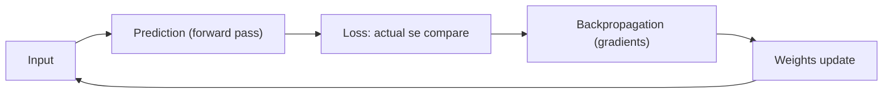
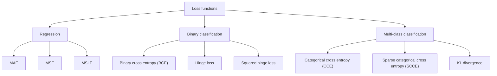
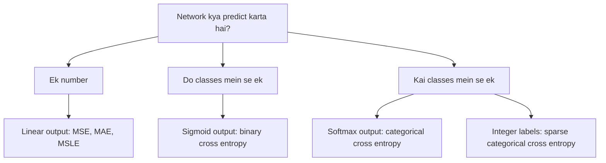
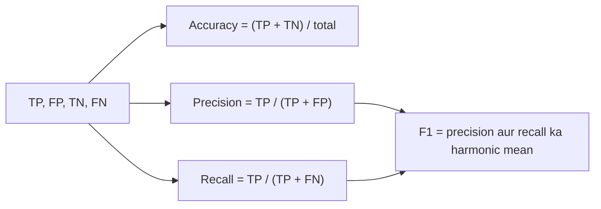

Ye syllabus <Syl m="2" /> hai, "loss functions: squared error loss, cross entropy; choosing the output function and the loss function".

## Loss function kyun chahiye

Network prediction kar sakta hai, lekin akeli prediction kaafi nahi. Galat prediction ho to use pata hona chahiye ki galti chhoti thi ya badi, aur weights kitne update karne hain. Error naape bina network khud ko improve nahi kar sakta. <Cite id="class-dl-chp2" loc="slide 26" />

<Box kind="definition">

A **loss function** is a mathematical function that measures the difference between the predicted output and the actual output. It tells the neural network how wrong its prediction is. <Cite id="class-dl-chp2" loc="slide 26" />

</Box>

- **Small loss** matlab prediction correct answer ke paas hai. **Large loss** matlab door hai. Training ka goal loss minimize karna hai, taaki network behtar predictions kare. <Cite id="class-dl-chp2" loc="slide 26" />
- Simple terms mein, loss function ye evaluate karne ka tareeka hai ki aapka algorithm dataset ko kitna achha model kar raha hai. Ye machine learning algorithm ke parameters ka mathematical function hai. Jo naap nahi sakte use improve nahi kar sakte. Kam loss matlab behtar model; zyada loss matlab poor model. <Cite id="class-dl-chp2" loc="slide 27" />

**DNN mein loss function ka step-by-step role.** <Cite id="class-dl-chp2" loc="slide 26" />

1. **Input** network ko diya jaata hai (red, round, 180 g).
2. **Forward propagation:** network output predict karta hai (185 g).
3. **Actual output** pata hai (180 g).
4. **Loss function** error naapta hai: $\lvert 185 - 180 \rvert = 5$ g.
5. **Backpropagation:** error peeche bheja jaata hai weights update karne ke liye.
6. **Update weights** taaki loss kam ho.
7. **Repeat** kai inputs ke liye jab tak loss chhota na ho jaaye.

## Loss vs cost, aur learning rate

Cost (ya loss) function actual $y$ aur predicted $y$ ke beech ka difference, yaani error, naapta hai. Ye model ko feedback deta hai taaki wo parameters adjust karke error minimize kare, steepest descent (negative gradient) ki direction mein tab tak chalte hue jab tak cost zero ke paas na pahunch jaaye. Dono terms synonymous maane jaate hain, lekin ek chhota difference hai: **loss function ek training example ka error hota hai, jabki cost function poore training set ka average error nikaalta hai.** <Cite id="class-dl-m1" loc="p. 28" />

Ye bhi: cost function = loss (jaise binary cross entropy) + regularization term. <Cite id="class-dl-m2" loc="p. 32" />

**Learning rate** (step size ya alpha bhi kehte hain) wo step ka size hai jo minimum tak pahunchne ke liye liya jaata hai. Ye aam taur par chhoti value hoti hai. High learning rate bade steps deta hai lekin minimum ko overshoot karne ka risk hai. Low learning rate chhote steps deta hai: precision zyada milti hai, lekin iterations ki sankhya efficiency kam kar deti hai, kyunki minimum tak pahunchne mein zyada time aur computation lagta hai. <Cite id="class-dl-m1" loc="p. 29" /> <Cite id="class-dl-chp2" loc="slide 8" />

| | Loss function | Cost function |
|---|---|---|
| Kiska error naapta hai | Ek training example | Poora training set (average) |
| Example | Ek fruit ke liye $\lvert 185 - 180 \rvert = 5$ g | Saare fruits ke losses ka mean |

## Loss functions ke types

Alag machine learning problems ko alag loss functions chahiye. <Cite id="class-dl-chp2" loc="slide 27" />

## 1. Regression loss functions

Regression loss function tab use hota hai jab model continuous numerical values predict kare (fruit ka weight, house price, temperature). Ye predicted value aur actual value ka difference naapta hai. Classification loss functions classes ya probabilities compare karte hain, isliye 180 g aur 185 g jaise numbers ke beech ka error sahi nahi naap sakte. <Cite id="class-dl-chp2" loc="slide 28" />

### Mean absolute error (MAE)

<Box kind="definition">

**MAE** measures the average absolute difference between the predicted value and the actual value. It ignores the positive (+) and negative (−) signs. $\text{MAE} = \dfrac{1}{n}\sum_{i=1}^{n} \lvert y_i - \hat y_i \rvert$ <Cite id="class-dl-chp2" loc="slide 29" />

</Box>

Plain error kyun nahi? Errors +5 aur −5 ka average 0 aa jaata, jabki dono predictions galat hain, aur isse model ki performance ka galat idea milta. MAE har error ko average se pehle positive bana deta hai, isliye saare errors barabar contribute karte hain. <Cite id="class-dl-chp2" loc="slide 29" />

<Sum>

<Given>

actual weights 180, 200, 160, 150 g aur predicted weights 185, 195, 170, 145 g.

</Given>

<Find>

MAE.

</Find>

<Steps>

1. **Absolute errors:** $\lvert 180 - 185 \rvert = 5$, $\lvert 200 - 195 \rvert = 5$, $\lvert 160 - 170 \rvert = 10$, $\lvert 150 - 145 \rvert = 5$.
2. **Add karo:** $5 + 5 + 10 + 5 = 25$.
3. **$n = 4$ se average:** $25/4 = 6.25$.

</Steps>

<Answer>

MAE $= 6.25$ g. <Cite id="class-dl-chp2" loc="slide 30" />

</Answer>

<Box kind="verify">

Dusre order mein absolute errors ka mean: $(10 + 5 + 5 + 5)/4 = 25/4 = 6.25$. Same.

</Box>

</Sum>

**MAE tab use karo** jab numerical values predict karni hon, har error ki importance barabar ho aur simple, interpretable measure chahiye. **Advantages:** samajhna aur calculate karna easy, MSE se kam outlier-sensitive, output data ki same unit mein. **Disadvantages:** chhote aur bade errors ko barabar maanta hai, bade mistakes ko strongly penalize nahi karta, classification ke liye suitable nahi. <Cite id="class-dl-chp2" loc="slide 31" />

### Mean squared error (MSE)

<Box kind="definition">

**MSE** is a regression loss function that measures the average of the squared differences between the predicted value and the actual value. By squaring the error, larger errors receive a much higher penalty than smaller errors. $\text{MSE} = \dfrac{1}{n}\sum_{i=1}^{n} (y_i - \hat y_i)^2$ <Cite id="class-dl-chp2" loc="slide 32" />

</Box>

MAE ke baad MSE kyun? MAE har error ko barabar maanta hai, lekin kai applications mein 20 g ka error 2 g ke error se bahut zyada serious hota hai. Errors 2 g aur 20 g ke squares 4 aur 400 hain, isliye bade error ko bahut zyada penalty milti hai aur network use jaldi kam karta hai. <Cite id="class-dl-chp2" loc="slide 32" />

<Sum>

<Given>

wahi chaar samples: actual 180, 200, 160, 150 aur predicted 185, 195, 170, 145.

</Given>

<Find>

MSE.

</Find>

<Steps>

1. **Errors:** $-5$, $5$, $-10$, $5$ (actual minus predicted).
2. **Har ka square:** $25$, $25$, $100$, $25$.
3. **Add:** $25 + 25 + 100 + 25 = 175$.
4. **$n = 4$ se average:** $175/4 = 43.75$.

</Steps>

<Answer>

MSE $= 43.75$. <Cite id="class-dl-chp2" loc="slide 33" />

</Answer>

<Box kind="verify">

Bada error 10, total $175$ mein se $100$ deta hai, aadhe se zyada, jabki wo 4 mein se sirf 1 sample hai. Isse dikhta hai MSE bade errors ko kaise punish karta hai.

</Box>

</Sum>

**MSE tab use karo** continuous values ke liye jab bade prediction errors ko zyada penalize karna ho (house price, medical measurements, temperature). **Advantages:** bade errors ko strongly penalize karta hai, smooth aur gradient descent se optimize karna easy. **Disadvantages:** outliers ke prati sensitive, aur output original unit mein nahi hota kyunki error squared hai. <Cite id="class-dl-chp2" loc="slide 34" />

### Mean squared logarithmic error (MSLE)

<Box kind="definition">

**MSLE** is a regression loss function that measures the error after applying a logarithm to both the predicted and actual values. It focuses on the **relative** difference rather than only the absolute difference. $\text{MSLE} = \dfrac{1}{n}\sum_{i=1}^{n} \big(\log(1 + y_i) - \log(1 + \hat y_i)\big)^2$ <Cite id="class-dl-chp2" loc="slide 35" />

</Box>

Kyun? Do farms ka error 10 fruits hai: Farm A actual 100, predicted 110; Farm B actual 1000, predicted 1010. Same error Farm A ke liye significant hai aur Farm B ke liye bahut chhota. Logs ke saath difference Farm A ke liye $\log(101) - \log(111) \approx -0.095$ hai lekin Farm B ke liye sirf lagbhag $-0.010$. Hum 1 add karte hain kyunki $\log(0)$ defined nahi hai. <Cite id="class-dl-chp2" loc="slide 35" />

**MSLE tab use karo** jab target values positive hon aur range bahut badi ho, aur relative error absolute error se zyada important ho (population, sales, website visitors). **Use mat karo** negative target values ke saath ya jab exact absolute error important ho. <Cite id="class-dl-chp2" loc="slide 37" />

| | MAE | MSE | MSLE |
|---|---|---|---|
| Uses | Absolute difference | Squared difference | Values ka log, phir squared difference |
| Focus | Saare errors barabar | Bade errors ko zyada penalty | Relative (percentage) error |
| Bade values ke prati sensitive | Kam | Bahut | Kam |
| Negative values handle kare | Yes | Yes | No |

## 2. Binary classification loss functions

Do classes mein network probability deta hai (jaise Apple = 0.85). MAE, MSE aur MSLE numbers ke liye bane hain, class predictions ke liye nahi, isliye aisa loss function chahiye jo predicted probability ko actual class se compare kare. <Cite id="class-dl-chp2" loc="slide 38" />

### Binary cross entropy (BCE, log loss)

<Box kind="definition">

**Binary Cross Entropy (BCE)** is a loss function used to measure the error in binary classification problems. It compares the predicted probability with the actual class. $\text{BCE} = -\big(y \log(\hat y) + (1 - y)\log(1 - \hat y)\big)$, jahan $y$ actual class (0 ya 1) aur $\hat y$ predicted probability (0 se 1) hai. <Cite id="class-dl-chp2" loc="slide 40" />

</Box>

- $y = 1$ ho to loss $-\log(\hat y)$ hai, isliye high $\hat y$ se low loss. $y = 0$ ho to loss $-\log(1 - \hat y)$ hai, isliye low $\hat y$ se low loss. <Cite id="class-dl-chp2" loc="slide 40" />
- Correct prediction se small loss; wrong prediction se large loss. Network loss se weights update karta hai.
- Sigmoid output layer ke saath use hota hai (apple ya not apple, spam ya not spam, disease ya no disease, pass ya fail, fraud ya not fraud). Regression ya multi-class ke liye **use mat karo**. <Cite id="class-dl-chp2" loc="slide 40" />

<Sum>

<Given>

ek sample jiska actual class $y = 1$. Case A: predicted probability $\hat y = 0.95$. Case B: $\hat y = 0.10$. (Natural log.)

</Given>

<Find>

har case mein BCE.

</Find>

<Steps>

1. **$y = 1$ ke liye** loss $-\ln(\hat y)$ reh jaata hai kyunki $(1 - y) = 0$.
2. **Case A:** $-\ln(0.95) = 0.0513$.
3. **Case B:** $-\ln(0.10) = 2.3026$.

</Steps>

<Answer>

Case A loss $= 0.051$ (very small, correct aur confident). Case B loss $= 2.303$ (very large, wrong aur confident). <Cite id="class-dl-chp2" loc="slide 39" />

</Answer>

<Box kind="verify">

$e^{-0.0513} = 0.950$ aur $e^{-2.3026} = 0.100$, isliye dono logs sahi hain. Ranking teacher ki table se match karti hai: 0.95 se very small loss, 0.10 se very large loss.

</Box>

</Sum>

### Hinge loss aur squared hinge loss

**Hinge loss** mainly Support Vector Machines (SVMs) ke saath use hota hai. Labels $+1$ aur $-1$ hote hain, $\hat y$ real-valued score hai (probability nahi), aur $\text{Loss} = \max(0,\ 1 - y\hat y)$. Large margin wali correct prediction ($y\hat y > 1$) ka loss 0; wrong ya boundary ke paas wali prediction ka loss zyada. Ye do classes ke beech clear margin ko badhava deta hai aur probabilities nahi deta. <Cite id="class-dl-chp2" loc="slide 41" /> <Cite id="class-dl-chp2" loc="slide 42" />

**Squared hinge loss** improved version hai: $\text{Loss} = \big(\max(0,\ 1 - y\hat y)\big)^2$. Ye hinge error ko square karta hai, isliye bade mistakes ko bahut zyada penalty milti hai. <Cite id="class-dl-chp2" loc="slide 43" />

| Margin $y\hat y$ | Hinge loss | Squared hinge loss |
|---|---|---|
| 2 (good) | 0 | 0 |
| 1 (on boundary) | 0 | 0 |
| 0.5 (small margin) | 0.5 | 0.25 |
| −1 (wrong) | 2 | 4 |
| −2 (very wrong) | 3 | 9 |

<Cite id="class-dl-chp2" loc="slide 44" />

<Box kind="pitfall">

Teacher ki overview slide mein MAE, MSE, MSLE aur hinge loss ke average ke aage minus sign likha hai, jaise $L = -\frac{1}{n}\sum \lvert y_i - \hat y_i \rvert$. Ye typing error hai: in losses mein leading minus nahi hota (leading minus sirf cross entropy mein hota hai). Is note ke formulas use karo. <Cite id="class-dl-chp2" loc="slide 27" />

</Box>

## 3. Multi-class classification loss functions

Binary losses sirf do classes ke liye hain. Do se zyada classes ho to network ek saath kai classes ki probabilities predict karta hai (Apple 0.10, Banana 0.15, Orange 0.65, Mango 0.10). Loss check karta hai ki sahi class ki probability sabse high hai ya nahi: sahi class highest to small loss, koi aur class highest to large loss. Output layer softmax hai. <Cite id="class-dl-chp2" loc="slide 45" />

### Categorical cross entropy (CCE)

<Box kind="definition">

**Categorical Cross Entropy (CCE)** is a loss function used for multi-class classification. It compares the predicted probabilities with the actual class and measures the prediction error. $\text{CCE} = -\sum_{i=1}^{n} y_i \log(\hat y_i)$, jahan $y_i$ one-hot actual class hai (sahi class ke liye 1, baaki 0) aur $\hat y_i$ softmax se predicted probability. <Cite id="class-dl-chp2" loc="slide 46" /> <Cite id="class-dl-chp2" loc="slide 47" />

</Box>

<Sum>

<Given>

classes Apple, Banana, Orange, Mango. Actual fruit Orange hai, isliye $y = (0, 0, 1, 0)$. Softmax Case A mein $\hat y = (0.05, 0.10, 0.80, 0.05)$ aur Case B mein $(0.70, 0.10, 0.10, 0.10)$ predict karta hai.

</Given>

<Find>

har case mein CCE.

</Find>

<Steps>

1. **Sum mein sirf sahi class bachti hai**, kyunki baaki ke liye $y_i = 0$: $\text{CCE} = -\ln(\hat y_{\text{Orange}})$.
2. **Case A:** $-\ln(0.80) = 0.223$.
3. **Case B:** $-\ln(0.10) = 2.303$.

</Steps>

<Answer>

Case A $= 0.223$ (small: Orange ki probability sabse high). Case B $= 2.303$ (large: Apple galat tareeke se highest hai). <Cite id="class-dl-chp2" loc="slide 46" />

</Answer>

<Box kind="verify">

$e^{-0.223} = 0.800$ aur $e^{-2.303} = 0.100$. Sahi class ki probability badhne par loss girta hai.

</Box>

</Sum>

**CCE tab use karo** jab multi-class classification ho, softmax output layer ho aur one-hot labels hon. Regression, binary classification ya integer labels ke liye **use mat karo**. <Cite id="class-dl-chp2" loc="slide 47" />

### Sparse categorical cross entropy (SCCE)

**SCCE** multi-class classification ka loss function hai jo one-hot encoded labels ki jagah **integer labels** leta hai (Apple = 0, Banana = 1, Orange = 2, Mango = 3). Mathematical concept CCE jaisa hi hai; difference sirf label representation ka hai. Bahut classes hon to ye memory bachata hai aur training simple karta hai. <Cite id="class-dl-chp2" loc="slide 48" /> <Cite id="class-dl-chp2" loc="slide 49" />

### KL divergence

**Kullback-Leibler (KL) divergence** naapta hai ki ek probability distribution dusre se kitna alag hai. Similar distributions ka KL divergence small aur alag distributions ka large hota hai. Ye sirf sahi class nahi, poori distribution compare karta hai, aur knowledge distillation, variational autoencoders, generative models aur language models mein use hota hai. $\text{KL}(P \,\|\, Q) = \sum_x P(x)\log\dfrac{P(x)}{Q(x)}$. <Cite id="class-dl-chp2" loc="slide 50" /> <Cite id="class-dl-chp2" loc="slide 27" />

<Sum>

<Given>

actual $P = (0.70, 0.20, 0.10)$ aur predicted $Q = (0.60, 0.25, 0.15)$ apple, banana, orange ke liye.

</Given>

<Find>

$\text{KL}(P \,\|\, Q)$.

</Find>

<Steps>

1. **Apple:** $0.70 \ln(0.70/0.60) = 0.70 \times 0.1542 = 0.1079$.
2. **Banana:** $0.20 \ln(0.20/0.25) = 0.20 \times (-0.2231) = -0.0446$.
3. **Orange:** $0.10 \ln(0.10/0.15) = 0.10 \times (-0.4055) = -0.0405$.
4. **Add:** $0.1079 - 0.0446 - 0.0405 = 0.0228$.

</Steps>

<Answer>

$\text{KL}(P \,\|\, Q) \approx 0.023$, small, kyunki dono distributions paas hain.

</Answer>

<Box kind="verify">

KL divergence kabhi negative nahi hota aur sirf $P = Q$ par 0 hota hai. Hume chhota positive number mila, jaisa paas wali distributions ke liye expected hai.

</Box>

</Sum>

<Box kind="pitfall">

Teacher ki detail slide 51 mein formula $\sum_x P(x)\log\frac{Q(x)}{P(x)}$ likha hai. Log ke andar $Q/P$ hone se sum negative aa jaata. Sahi form $P(x)\log\frac{P(x)}{Q(x)}$ hai, jaisa overview slide mein hai. <Cite id="class-dl-chp2" loc="slide 51" />

</Box>

## Squared error vs cross entropy

Class notes dono main losses ko seedha compare karte hain. <Cite id="class-dl-m2" loc="p. 14" />

| | Squared error loss (MSE) | Cross entropy loss |
|---|---|---|
| Use hota hai | Regression (continuous target values) | Classification (categorical target values) |
| Formula | $L = \frac{1}{n}\sum (y_i - \hat y_i)^2$ | $L = -\frac{1}{n}\sum [y_i \log\hat y_i + (1 - y_i)\log(1 - \hat y_i)]$ |
| Output range | Koi bhi real value | 0 se 1 (probabilities) |
| Output layer | Linear activation | Sigmoid (binary) ya softmax (multi-class) |
| Penalty | Quadratic: chhote errors ke liye kam sensitive | Logarithmic: confident galat prediction par bahut high penalty |
| Kab | Numbers predict karne hon (house price) | Classes predict karni hon (cat ya dog) |

**Cross entropy MSE se kab zyada appropriate hai?** Jab task classification ho aur network probabilities (sigmoid ya softmax) de. Cross entropy 0 aur 1 ke beech ki probabilities ke saath kaam karta hai, confident galat predictions ko bahut zyada penalize karta hai, aur better gradient behavior se faster convergence deta hai. MSE continuous outputs ke liye theek hai. <Cite id="class-dl-m2" loc="p. 14" />

## Output function aur loss ko saath chunna

Output function final prediction banata hai (model kya kehta hai); loss function naapta hai ki prediction kitni galat hai. Dono match hone chahiye: sigmoid ke saath binary cross entropy aur softmax ke saath categorical cross entropy. <Cite id="class-dl-chp2" loc="slide 52" /> <Cite id="class-dl-chp2" loc="slide 53" />

| Problem type | Output layer | Loss function |
|---|---|---|
| Regression | Linear | MAE, MSE ya MSLE |
| Binary classification | Sigmoid | Binary cross entropy |
| Binary classification (SVM) | Decision score (sigmoid nahi) | Hinge ya squared hinge |
| Multi-class (one-hot labels) | Softmax | Categorical cross entropy |
| Multi-class (integer labels) | Softmax | Sparse categorical cross entropy |
| Probability distribution comparison | Softmax | KL divergence |

<Cite id="class-dl-chp2" loc="slide 54" />

## Classifier ko naapna: accuracy, precision, recall aur F1

Loss ke alawa classifier ko **model accuracy measurement tools** se bhi judge karte hain. <Cite id="class-dl-m2" loc="p. 15" />

- **True Positives (TP):** positive examples jo positive label hue. **False Positives (FP):** negative examples jo positive label hue. **True Negatives (TN):** negative examples jo negative label hue. **False Negatives (FN):** positive examples jo negative label hue.
- **Confusion matrix:** TP, FP, TN aur FN values wali matrix.
- **Accuracy:** total results mein sahi results ka proportion. $\text{Accuracy} = \dfrac{TP + TN}{TP + FP + TN + FN}$.
- **Precision** batata hai ki selected objects mein se kitne sahi the: $\dfrac{TP}{TP + FP}$. **Recall** batata hai ki sahi objects mein se kitne select hue: $\dfrac{TP}{TP + FN}$.
- **F1 score** precision aur recall ka harmonic average hai: $F1 = 2\cdot\dfrac{\text{precision}\cdot\text{recall}}{\text{precision} + \text{recall}}$. F1 0 matlab worst aur 1 matlab best. <Cite id="class-dl-m2" loc="p. 16" />

| | Classified positive | Classified negative |
|---|---|---|
| Positive class | TP | FN |
| Negative class | FP | TN |

**Accuracy gumraah kyun kar sakti hai.** Teacher ke example mein TP = 0, FN = 25, FP = 0, TN = 125 hai. Accuracy $= 125/150 = 83\%$, phir bhi har positive example galat classify hua, isliye model bahut bura hai. Recall $0/25 = 0$ hai. Precision $0/0$ hai, jo undefined hai (ise 0 maante hain), aur F1 score 0 hai. <Cite id="class-dl-m2" loc="p. 16" />

<Box kind="pitfall">

Teacher us example ke liye "both precision and recall are 0.0" likhte hain. Recall sach mein 0 hai, lekin precision $0/(0+0)$ hai, jo undefined hai; jab kuch bhi positive predict na hua ho tab usual convention mein ise 0 maante hain. <Cite id="class-dl-m2" loc="p. 16" />

</Box>

<Sum>

<Given>

class ka example <Cite id="class-dl-m2" loc="p. 17" />: y_true = 0 1 0 0 1 0 1 1 1 aur y_pred = 0 1 1 1 0 0 1 1 0.

</Given>

<Find>

accuracy, precision, recall aur F1.

</Find>

<Steps>

1. **Pair by pair compare karo (true, predicted):** (0,0) TN, (1,1) TP, (0,1) FP, (0,1) FP, (1,0) FN, (0,0) TN, (1,1) TP, (1,1) TP, (1,0) FN.
2. **Count:** TP = 3, TN = 2, FP = 2, FN = 2 (total 9).
3. **Accuracy** $= (3 + 2)/9 = 5/9 = 0.556$.
4. **Precision** $= 3/(3 + 2) = 0.6$. **Recall** $= 3/(3 + 2) = 0.6$.
5. **F1** $= 2 \times 0.6 \times 0.6 / (0.6 + 0.6) = 0.72/1.2 = 0.6$.

</Steps>

<Answer>

Accuracy 55.6%, precision 0.6, recall 0.6, F1 0.6: ek moderate model.

</Answer>

<Box kind="verify">

Counts jud kar total hote hain: $3 + 2 + 2 + 2 = 9$. F1 ko $2TP/(2TP + FP + FN) = 6/(6 + 2 + 2) = 0.6$ bhi likh sakte hain. Same.

</Box>

</Sum>

## Ye kahan pucha gaya

| Agar question kahe | Kya likhna hai | Kab aaya |
|---|---|---|
| "Comment on the significance of loss functions and explain different types" | Definition, training mein role, regression, binary aur multi-class types formulas ke saath | <PYQ id="2024-12/q5a" /> |
| "Discuss the role of a loss function. Compare MSE and cross-entropy ... when is cross-entropy more appropriate?" | Role, comparison table, probabilities wali classification, chhota example | <PYQ id="2025-05/q5a" /> |
| Loss vs cost, learning rate ka effect | Loss = ek example, cost = average; high rate overshoot karta hai, low rate slow | <PYQ id="assignment-1/q1d" /> |
| True aur predicted labels ki list se accuracy aur F1 | Confusion counts, accuracy, precision, recall, F1, interpretation | <PYQ id="assignment-1/q2d" /> |
| Probabilities se cross-entropy loss | Sahi class ki probability ka $-\ln$, average, interpretation | <PYQ id="assignment-1/q2e" /> |

## Quick revision

- Loss function: batata hai ki prediction kitni galat hai; goal ise minimize karna. Loss = ek example, cost = training set ka average.
- Regression: MAE $= \frac{1}{n}\sum \lvert y - \hat y \rvert$ (barabar importance); MSE $= \frac{1}{n}\sum (y - \hat y)^2$ (bade errors penalized); MSLE (relative error, positive values).
- Binary: BCE $= -[y\log\hat y + (1 - y)\log(1 - \hat y)]$ sigmoid ke saath. Hinge $\max(0, 1 - y\hat y)$ SVM ke liye.
- Multi-class: CCE (one-hot labels) softmax ke saath; SCCE (integer labels); KL divergence do distributions compare karta hai.
- Pairing: linear ke saath MSE ya MAE, sigmoid ke saath BCE, softmax ke saath CCE.
- Accuracy $= (TP+TN)/\text{total}$; precision $= TP/(TP+FP)$; recall $= TP/(TP+FN)$; F1 $= 2PR/(P+R)$.

**Conclusion.** Loss function training ka dil hai: ye error naapta hai, optimizer use weights update karne ke liye use karta hai, aur sahi loss (output function se match karke) problem ke type se chuna jaata hai. <Cite id="class-dl-chp2" loc="slide 26" />
