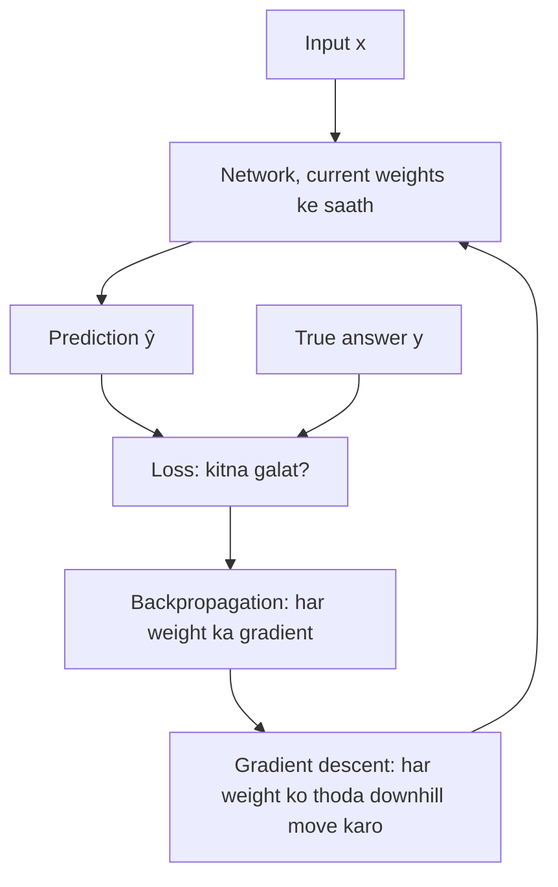
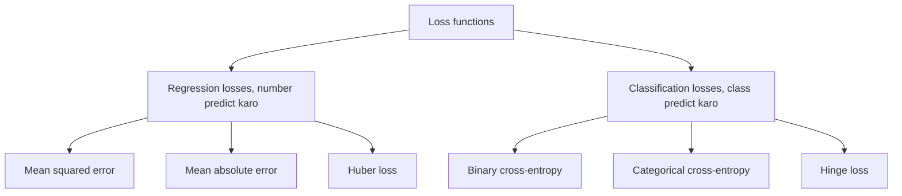
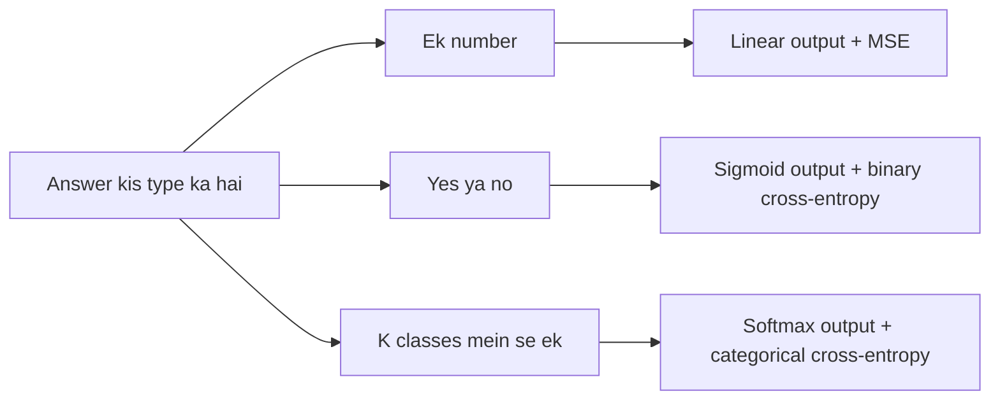

Naye ideas se pehle, jo purane ideas chahiye woh yahan hain. Agar aapko pehle se pata hain, toh next section pe chale jao.

## Pehle basics

- Neural network ek input leta hai (ek photo, numbers ki list) aur ek **prediction** deta hai, jise $\hat{y}$ ("y-hat") likhte hain.
- Har training example ka **true answer** (yaani **target** ya **label**) bhi humein pata hota hai, jise $y$ likhte hain.
- Network ke adjust hone wale numbers uske **weights** hain. **Training** ka matlab hai weights ko aise badalna ki prediction true answer ke paas aa jaaye.
- **Gradient** ek slope hai: ye batata hai ki ek weight ko thoda sa hilane pe error kitna badalta hai. **Gradient descent** har weight ko thoda sa downhill move karta hai, us direction mein jahan error kam hota hai.
- **Probability** 0 se 1 ke beech ka number hai. Classifier aam taur pe probabilities deta hai, jaise "0.9 ki ye email spam hai".
- $\ln$ natural logarithm hai. Bas itna yaad rakho: $\ln 1 = 0$, aur jaise-jaise $p$ 0 ke paas jaata hai, $\ln p$ ek bada negative number ban jaata hai.

## Loss function kya hai

<Box kind="definition">

**Loss function** true answer aur prediction leta hai aur **ek number** return karta hai jo batata hai ki prediction kitna galat hai. Zero matlab perfect; bada number matlab zyada galat.

**Cost function** (ya objective) saare training examples ka average loss hai. Kai books "loss" aur "cost" ko ek hi cheez ke liye use karti hain.

</Box>

Darts ka game socho. Bull's-eye sahi answer hai, aapka dart prediction hai, aur loss bull's-eye se doori hai. Jab tak koi naape nahi ki aap kitna door the, aap apna throw improve nahi kar sakte. Loss function wahi measuring tape hai. Ye <Syl m="2" /> mein loss ka topic hai.

Exam mein English mein likho: "A loss function takes the true answer and the prediction and returns one number that says how wrong the prediction is."

## Training mein loss kaise use hota hai

1. **Forward pass:** network current weights se input leke prediction banata hai.
2. **Loss compute karo:** loss function prediction ko true answer se compare karke ek number deta hai.
3. **Backward pass:** backpropagation har weight ke liye nikalta hai ki us weight ne loss mein kitna contribute kiya (uska gradient).
4. **Update:** gradient descent har weight ko thoda sa us direction mein khiskata hai jahan loss kam ho.
5. **Repeat** karo bahut saare examples aur epochs tak, jab tak loss girna band na ho jaaye.

## Loss function kyun important hai (significance)

1. **Ye performance naapta hai.** "Network kitna achha hai?" ko ek single number mein badal deta hai jise training ke dauraan track kar sakte hain aur models ke beech compare kar sakte hain.
2. **Ye learning chalata hai.** Loss ka gradient hi weights ko milne wala sirf ek signal hai. Loss nahi, toh gradient nahi, toh learning nahi.
3. **Ye decide karta hai ki "good" ka matlab kya hai.** Network bilkul wahi seekhta hai jo loss reward karta hai. Squared error se network average answer predict karta hai; absolute error se beech wala (median) answer. <Cite id="gfdl-ch6" loc="§6.2.1.2" />
4. **Ye task aur output layer ke hisaab se hona chahiye.** Galat match wala loss bahut chhote gradients de sakta hai, aur network bahut galat ho tab bhi training atak jaati hai. <Cite id="gfdl-ch6" loc="§6.2.1" />
5. **Ye control karta hai ki kaunse errors sabse zyada matter karte hain,** jaise outliers ya overconfident galtiyon ko sabse zyada punish karna hai ya nahi.

**Achha loss kaisa hota hai:** perfect prediction pe zero aur prediction jitna kharab, utna bada; smooth, taaki useful slope mile; output ke type (number ya probability) se matched; aur kuch unusual examples se dominate na ho, jab tak wahi na chahiye.

## Loss functions ke types

## Regression losses (number predict karna)

### Mean squared error (squared error loss)

**Ye kya hai.** Har example ke liye true value aur prediction ka difference lo, use square karo, aur saare examples pe in squares ka average lo.

$$
\text{MSE} = \frac{1}{n}\sum_{i=1}^{n} (y_i - \hat{y}_i)^2
$$

Yahan $n$ examples ki ginti hai, $y_i$ true value aur $\hat{y}_i$ prediction. Square karne se har error positive ho jaata hai aur bade errors chhote errors se kahin zyada count hote hain: 2 ka error 4 ka padta hai, jabki 0.5 ka error sirf 0.25 ka. Kai books **sum of squared errors** ke aage $\dfrac{1}{2}$ sirf isliye lagati hain kyunki usse slope saaf aata hai.

**Worked example (MSE).**

Given: true house prices (lakhs) $y = [3, 5, 2]$, predictions $\hat{y} = [2.5, 5, 4]$, toh $n = 3$.

To find: mean squared error.

1. Har error nikalo, $y - \hat{y}$: $3 - 2.5 = 0.5$, $5 - 5 = 0$, $2 - 4 = -2$. Kyun: har prediction kitna door hai, ye yahi batata hai.
2. Har error ko square karo: $0.5^2 = 0.25$, $0^2 = 0$, $(-2)^2 = 4$. Kyun: square karne se minus sign hat jaata hai aur bada error bahut zyada count hota hai.
3. Squares ko jodo: $0.25 + 0 + 4 = 4.25$. Kyun: ye saare houses ka total squared error hai.
4. $n = 3$ se divide karo: $4.25 / 3 = 1.4167$. Kyun: MSE average hai, isliye sirf zyada houses hone se nahi badhta.

**MSE ≈ 1.417 lakh²** (unit squared hai kyunki errors square kiye the).

<Box kind="verify">

Average ko house-wise todke dekho: sirf house 3 deta hai $4 / 3 = 1.333$, aur house 1 aur 2 milke dete hain $0.25 / 3 = 0.083$.

$$
\frac{4}{3} + \frac{0.25}{3} = \frac{4.25}{3} = 1.417
$$

wahi answer. Ye sabse chhote squared error (0) aur sabse bade (4) ke beech bhi hai, jaisa average ko hona chahiye. Dhyan do ki lagbhag poora loss us ek bade error se aa raha hai.

</Box>

**Advantages:**

- Smooth hai, har jagah slope hai jo prediction paas aane pe chhota hota jaata hai, isliye training aaram se settle hoti hai.
- Bade errors ko zor se punish karta hai, jo sahi hai jab badi galtiyan sach mein bahut kharab hon.
- **Linear output** ke liye natural loss hai: ise minimize karna maximum likelihood ke barabar hai jab errors bell-shaped (Gaussian) curve follow karein. <Cite id="gfdl-ch6" loc="§6.2.1.1" /> <Cite id="gfdl-ch5" loc="§5.5.1" />

**Disadvantages:**

- **Outliers ke liye bahut sensitive**: kuch ajeeb values poore model ko apni taraf mod deti hain.
- Sigmoid ya softmax output wale classifiers ke liye kharab: output saturate hone pe dheere seekhta hai (neeche dekho).

**Applications:** house prices, temperature, stock values, photo se age predict karna; kai autoencoders ka reconstruction loss.

### Mean absolute error

**Ye kya hai.** Har error ka sign hata do (−2 ban jaata hai 2), phir average lo. Errors apne size ke proportion mein count hote hain: double error ka cost double, chaar guna nahi. Upar wale house example pe MAE $= (0.5 + 0 + 2) / 3 \approx 0.833$ lakh.

**Advantages:** MSE se kahin kam outliers se pareshaan hota hai; padhna aasaan, kyunki answer wali unit mein hi hota hai.

**Disadvantages:** har non-zero error ke liye slope ka size same hai aur zero pe sharp corner hai, isliye last ki fine-tuning kam smooth hoti hai.

**Applications:** noisy data wala regression, jaise delivery-time ya demand forecasting.

### Huber loss

**Ye kya hai.** Dono ka mix: chhote errors ke liye squared error jaisa aur bade errors ke liye absolute error jaisa behave karta hai, ek chosen threshold $\delta$ (delta) pe switch karke. Toh zero ke paas MSE jaisa smooth, par outliers ke against MAE jaisa robust. <Cite id="wiki-huber-loss" /> <Cite id="pytorch-huberloss" />

**Advantages:** dono ka best. **Disadvantage:** ek aur number ($\delta$) choose karna padta hai. **Applications:** kuch outliers wala regression; reinforcement learning (DQN agent).

## Classification losses (class predict karna)

### Binary cross-entropy (log loss)

**Ye kya hai.** Yes/no problem mein network sigmoid se $p$ deta hai, yaani "yes" (class 1) ki probability. Binary cross-entropy hai **network ne correct answer ko jo probability di, uska minus log**.

$$
L = -\bigl[\,y\ln p + (1-y)\ln(1-p)\,\bigr]
$$

Yahan $y$ true label hai, 1 ya 0. Ek time pe sirf ek term on hota hai: true answer 1 hai toh loss $-\ln p$; 0 hai toh loss $-\ln(1-p)$.

**Ye kaise behave karta hai** (true label 1):

| Network says $p$ | Loss | Meaning |
|---|---|---|
| 0.9 | 0.105 | Confident aur sahi: chhota loss |
| 0.5 | 0.693 | Unsure: medium loss |
| 0.1 | 2.303 | Confident aur galat: bada loss |

Jaise $p$ 0 ki taraf jaata hai, loss bina limit ke badhta hai, isliye confident galat answer ko bahut zor se punish kiya jaata hai. Weather forecaster socho: jisne baarish wale din "100% sunny" bola, uski credibility "60% sunny" bolne wale se kahin zyada girni chahiye.

**Worked example (binary cross-entropy).**

Given: network do emails ke liye $p = 0.9$ ("90% spam") kehta hai. Email A sach mein spam hai ($y = 1$); email B spam nahi hai ($y = 0$).

To find: har email ka loss.

1. Email A, $y = 1$: sirf pehla term on hai, toh $L = -\ln p = -\ln 0.9$. Kyun: correct answer (spam) ko di gayi probability 0.9 hai.
2. Calculate karo: $\ln 0.9 = -0.105$, toh $L_A = 0.105$. Kyun: minus sign negative log ko positive loss bana deta hai.
3. Email B, $y = 0$: sirf doosra term on hai, toh $L = -\ln(1 - p) = -\ln 0.1$. Kyun: correct answer (not spam) ko sirf $1 - 0.9 = 0.1$ probability mili.
4. Calculate karo: $\ln 0.1 = -2.303$, toh $L_B = 2.303$. Kyun: minus sign negative log ko positive loss bana deta hai.

**Loss A ≈ 0.105, loss B ≈ 2.303** (koi unit nahi). Wahi confident "0.9" galat hone pe lagbhag 22 guna zyada mehnga padta hai.

<Box kind="verify">

Email B ne correct class ko 0.1 probability di, toh uska loss table ki $p = 0.1$ wali row ke barabar hona chahiye: 2.303. Hai. Ulta chalke, $e^{-0.105} \approx 0.900$, jo wahi probability wapas deta hai jisse shuru kiya tha.

</Box>

### Categorical cross-entropy (multi-class)

**Ye kya hai.** Wahi idea $K$ classes ke liye. Network har class ke liye probability deta hai (softmax se), aur true label **one-hot** likha jaata hai: correct class ke liye 1 aur baaki ke liye 0. Ek ke alawa saare terms gayab ho jaate hain, toh loss bas correct class ko di gayi probability ka minus log hai.

$$
L = -\sum_{k=1}^{K} y_k \ln p_k = -\ln p_{\text{correct}}
$$

Binary cross-entropy do classes wala special case hai. Dono maximum likelihood se aate hain: cross-entropy minimize karne se correct labels ki probability jitni ho sake utni badi hoti hai. <Cite id="gfdl-ch6" loc="§6.2.1.1" /> <Cite id="d2l-softmax-regression" />

**Worked example (categorical cross-entropy).**

Given: teen classes (cat, dog, bird). Softmax output hai $p = [0.2, 0.7, 0.1]$. Photo sach mein dog ki hai, toh one-hot label $y = [0, 1, 0]$.

To find: categorical cross-entropy loss.

1. Har label ko uski probability ke log se multiply karo: $0 \times \ln 0.2 = 0$, $1 \times \ln 0.7 = \ln 0.7$, $0 \times \ln 0.1 = 0$. Kyun: one-hot label correct class ke alawa har class ko off kar deta hai.
2. Inhe jodo aur aage minus lagao: $L = -\ln 0.7$. Kyun: formula yahi hai, aur sirf dog wala term bacha.
3. Calculate karo: $\ln 0.7 = -0.357$, toh $L = 0.357$. Kyun: minus sign negative log ko positive loss bana deta hai.

**Loss ≈ 0.357** (koi unit nahi).

<Box kind="verify">

Probabilities ka total $0.2 + 0.7 + 0.1 = 1$ hai, toh softmax output valid hai. Ulta chalke, $e^{-0.357} \approx 0.700$, jo dog ki probability hai. Aur 0.7, 0.5 aur 0.9 ke beech hai, toh loss upar wali table ke 0.693 aur 0.105 ke beech hona chahiye; 0.357 hai.

</Box>

**Cross-entropy ke advantages:**

- Jab network confidently galat ho, theek tab strong correction, isliye training fast hoti hai.
- Probability outputs (sigmoid, softmax) ke saath naturally kaam karta hai aur achhi probabilities deta hai.

**Disadvantages:**

- **Mislabelled** examples isse kheench sakte hain, kyunki woh confident galtiyon jaise dikhte hain.
- Probabilities strictly 0 aur 1 ke beech chahiye; software zero ka log lene se bachne ke liye chhote safeguards lagata hai.

**Applications:** spam filters aur medical yes/no tests (binary); digit aur image recognition, aur language models mein next-word prediction (categorical).

### Hinge loss (completeness ke liye)

Support vector machines aur margin classifiers mein use hota hai. Ye zero loss tabhi deta hai jab correct class **safe margin se** jeete, sahi par bahut kareeb ho toh chhota loss, aur galat ho toh badhta hua loss. Ye probabilities nahi deta. <Cite id="cs231n-linear-classify" /> <Cite id="wiki-hinge-loss" />

<Figure caption="Ek example ka loss jiska true label 1 hai, network ki di gayi probability p ke against. Squared error kabhi 1 se upar nahi jaata. Cross-entropy p ke 0 ki taraf jaane pe tezi se upar jaata hai, isliye confident galat answer bahut mehnga padta hai.">
  <CurvePlot curves="mse-loss,ce-loss" x="0,1" y="0,5" xLabel="predicted probability p of the correct class" yLabel="loss" />
</Figure>

## Classification ke liye MSE versus cross-entropy

Sigmoid output wale classifier ke liye MSE hi kyun na use karein? Jawab correction signal ki strength mein hai.

1. Sigmoid output **flat** (saturate) ho jaata hai jab network bahut sure ho, tab bhi jab woh **galat** answer ke baare mein bahut sure ho, jaise correct class ko lagbhag 0 probability dena.
2. **MSE** ke saath, weights tak pahunchne wala gradient sigmoid ke slope se multiply hota hai. Flat region mein woh slope lagbhag zero hai, toh network bahut galat hote hue bhi mushkil se badalta hai.
3. **Cross-entropy** ke saath, logarithm sigmoid ke andar wale exponential ko cancel kar deta hai. Sigmoid ke input ke respect mein gradient bas "predicted probability minus true label", $p - y$, ban jaata hai, jo network bahut galat ho tab bada hota hai. <Cite id="gfdl-ch6" loc="§6.2.2.2" />
4. Toh cross-entropy theek us waqt fast seekhta rehta hai jab network ko correction ki sabse zyada zaroorat hai, jabki MSE atak jaata hai.

**Worked example: spam filter numbers mein.** Justification mein jo "suitable example" maanga jaata hai, woh yahi hai. "Push" sigmoid ke input ke respect mein gradient hai; bada push matlab weights mein bada correction.

Given: ek email jo sach mein spam hai ($y = 1$); sigmoid output use $p = 0.02$ deta hai. MSE ke liye ek example ka loss $(y - p)^2$ lo.

To find: har loss function ke under loss aur push.

1. Cross-entropy loss: $-\ln 0.02 = 3.912$. Kyun: correct class ko di gayi probability ka minus log.
2. MSE loss: $(1 - 0.02)^2 = 0.98^2 = 0.9604$. Kyun: target se squared doori; probability ke liye ye kabhi 1 se zyada nahi hota.
3. Cross-entropy push: $p - y = 0.02 - 1 = -0.98$. Kyun: sigmoid output ke saath cross-entropy gradient bas prediction minus label hai.
4. Is point pe sigmoid slope: $p(1 - p) = 0.02 \times 0.98 = 0.0196$. Kyun: MSE ka gradient is slope se hokar jaata hai, aur ye bahut chhota hai kyunki yahan sigmoid flat hai.
5. MSE push: $(y - p)^2$ ka slope $2(p - y) = -1.96$ hai; ise sigmoid slope se multiply karo: $-1.96 \times 0.0196 = -0.0384$. Kyun: chain rule dono slopes ko multiply karta hai.
6. Compare karo: $0.98 / 0.0384 \approx 25.5$. Kyun: ye batata hai cross-entropy kitne guna zyada zor se push karta hai.

**Cross-entropy: loss ≈ 3.91, push = −0.98. MSE: loss ≈ 0.96, push ≈ −0.038. Cross-entropy lagbhag 25 guna zyada zor se push karta hai.**

<Box kind="verify">

Numbers daalne se pehle dono pushes ko divide karo:

$$
\frac{p - y}{2(p - y)\,p(1 - p)} = \frac{1}{2\,p(1 - p)} = \frac{1}{2 \times 0.0196} = \frac{1}{0.0392} \approx 25.5
$$

wahi ratio. Dono pushes negative hain, jo sahi bolta hai "score badhao" taaki $p$ upar 1 ki taraf jaaye. Aur cross-entropy loss match karta hai

$$
\ln 0.02 = \ln 2 - \ln 100 = 0.693 - 4.605 = -3.912
$$

se.

</Box>

Goodfellow et al. kehte hain ki jab output unit saturate hota hai, toh gradient-based training mein MSE aur MAE "often lead to poor results", aur ye ek reason hai ki cross-entropy zyada popular hai. <Cite id="gfdl-ch6" loc="§6.2.1.2" /> Golik et al. speech recognition networks ke liye dono ko detail mein compare karte hain. <Cite id="golik2013" />

| | Mean squared error | Cross-entropy |
|---|---|---|
| Idea | Target se average squared doori | Correct class ki probability ka minus log |
| Used for | Regression: numbers predict karna | Classification: classes predict karna |
| Paired output layer | Linear | Sigmoid (binary) ya softmax (multi-class) |
| Prediction is | Koi bhi real number | 0 aur 1 ke beech probability |
| Size of loss | Error ke square ke saath badhta hai; probabilities ke liye max 1 | Unbounded: confident galat answers pe bahut bada |
| Gradient with a sigmoid output | Sigmoid ke slope se multiply: saturate hone pe tiny | $p - y$: bahut galat hone pe bada rehta hai |
| Effect on training | Classifiers ke liye slow ya atki hui learning | Classifiers ke liye fast, steady training |
| Probability meaning | Gaussian noise ke under maximum likelihood | Class labels ke liye maximum likelihood |
| Sensitive to | Outliers (squared) | Overconfident galtiyan aur galat labels (log) |

<Box kind="exam">

**Cross-entropy MSE se kab zyada appropriate hai?** Jab bhi output ek **class** ho aur network sigmoid ya softmax se **probabilities** de. Example: spam filter ek email ko, jo sach mein spam hai, sirf 0.02 probability deta hai. Cross-entropy bada loss (lagbhag 3.9) aur correct karne ka strong push deta hai; MSE 1 se kam loss deta hai aur, kyunki wahan sigmoid flat hai, lagbhag 25 guna kamzor push, toh filter mushkil se seekhega.

**MSE kab sahi hai?** Jab output ek **number** ho, jaise kal ka temperature ya house price, linear output layer ke saath.

Exam mein English mein likho: "Cross-entropy is more appropriate than MSE whenever the output is a class and the network outputs probabilities through sigmoid or softmax."

</Box>

## Output layer aur loss saath mein choose karna

| Task | Output layer | Loss | Keras name | PyTorch name |
|---|---|---|---|---|
| Number predict karo (regression) | Linear | MSE (ya MAE, Huber) | `MeanSquaredError` | `nn.MSELoss` |
| Yes ya no (binary) | 1 sigmoid unit | Binary cross-entropy | `BinaryCrossentropy` | `nn.BCELoss` |
| $K$ classes mein se ek (multi-class) | $K$ softmax units | Categorical cross-entropy | `CategoricalCrossentropy` | `nn.CrossEntropyLoss` |
| Kai yes/no tags (multi-label) | Har tag ke liye 1 sigmoid | Har tag pe binary cross-entropy | `BinaryCrossentropy` | `nn.BCELoss` |

<Cite id="keras-losses" /> <Cite id="pytorch-crossentropyloss" />

<Box kind="pitfall">

- PyTorch ka `nn.CrossEntropyLoss` **raw scores (logits)** expect karta hai, softmax probabilities nahi: softmax step woh khud lagata hai. Usse pehle softmax layer lagana ek common bug hai. Keras mein yahi choice `from_logits` option hai. <Cite id="pytorch-crossentropyloss" /> <Cite id="keras-probabilistic-losses" />
- In notes mein cross-entropy natural log use karta hai. Doosra base use karne se loss bas ek constant se scale hota hai.
- Loss ko accuracy se confuse mat karo. Accuracy sahi answers ginti hai; woh smooth nahi hai, isliye usse gradients compute nahi ho sakte.

</Box>

## Ye kahan poocha gaya

| If the question says | What to write | Seen as |
|---|---|---|
| "Significance of loss functions; different types while training a network" | Definition, darts analogy, training-loop steps aur diagram, significance list; phir MSE, MAE, Huber, binary aur categorical cross-entropy (aur hinge), har ek ka kaam, advantages, disadvantages aur use (formulas sirf squared error aur cross-entropy ke liye); output-and-loss table | <PYQ id="2024-12/q5a" /> |
| "Role of a loss function; compare MSE and cross-entropy; when is cross-entropy better" | Training mein role; har loss kya karta hai, formula ke saath; comparison table; saturated sigmoid ke saath MSE kyun atakta hai aur cross-entropy kyun nahi, words mein; spam-filter justification | <PYQ id="2025-05/q5a" /> |

## Conclusion

Loss function network ka measuring tape aur uska akela teacher hai: answer number ho toh MSE choose karo, aur class ho toh cross-entropy.

Exam mein English mein likho: "The loss function is the network's measuring tape: use MSE when the answer is a number and cross-entropy when the answer is a class."

## Quick revision

- Loss = ek prediction kitna galat hai, uska ek number; cost = poore data pe average.
- Loss performance naapta hai, apne gradient se learning chalata hai, aur "good" ka matlab decide karta hai.
- MSE $= \dfrac{1}{n}\sum (y-\hat{y})^2$: regression; bade errors aur outliers dominate karte hain.
- MAE: outliers ke against robust. Huber: chhota error ho toh squared, bada ho toh absolute.
- Binary cross-entropy $= -[y\ln p + (1-y)\ln(1-p)]$; categorical $= -\ln p_{\text{correct}}$. Confident galat answers bahut mehnge padte hain.
- Sigmoid/softmax outputs ke saath cross-entropy ka gradient $p - y$ hai; MSE ka sigmoid ke slope se chhota ho jaata hai aur atak jaata hai.
- Pairs: linear + MSE, sigmoid + binary CE, softmax + categorical CE.
