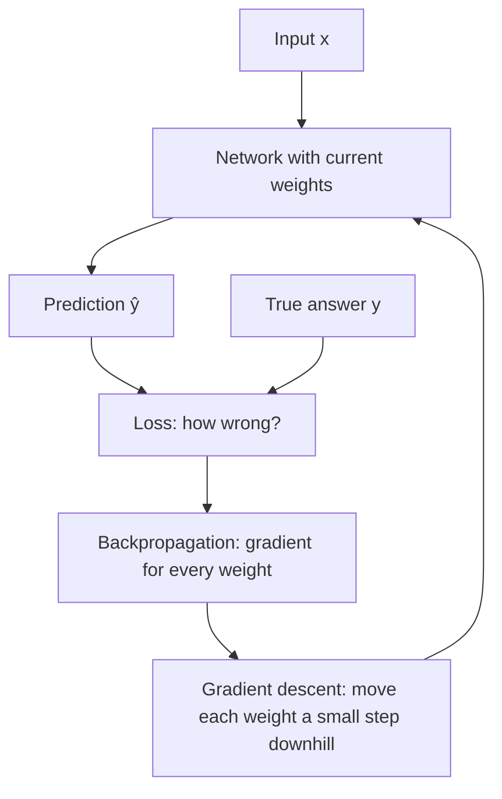
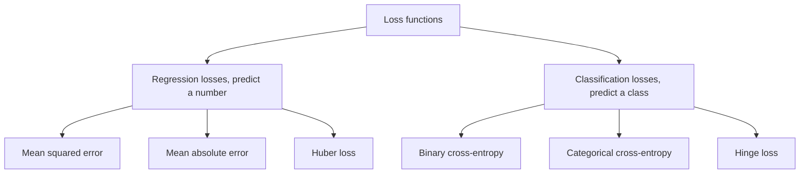
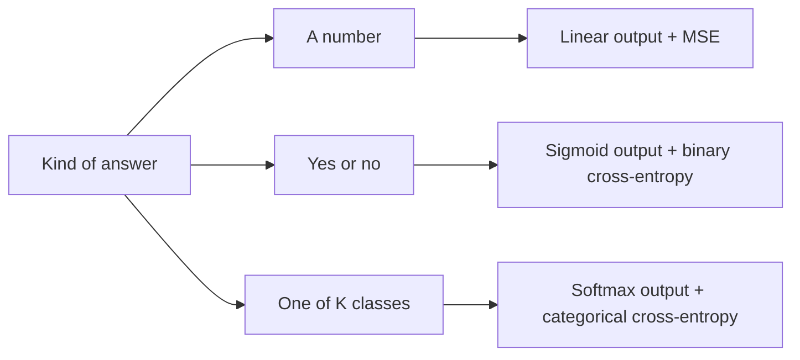

Before the new ideas, here are the old ones you need. If you already know them, skip to the next section.

## The basics first

- A neural network takes an input (a photo, a list of numbers) and produces a **prediction**, written $\hat{y}$ ("y-hat").
- For each training example we also know the **true answer** (the **target** or **label**), written $y$.
- The network's adjustable numbers are its **weights**. **Training** means changing the weights so that the prediction gets close to the true answer.
- A **gradient** is a slope: it says how much the error changes when you nudge a weight a little. **Gradient descent** moves every weight a small step downhill, in the direction that makes the error smaller.
- A **probability** is a number from 0 to 1. A classifier usually outputs probabilities, for example "0.9 that this email is spam".
- $\ln$ is the natural logarithm. All you need: $\ln 1 = 0$, and $\ln p$ becomes a large negative number as $p$ gets close to 0.

## What a loss function is

<Box kind="definition">

A **loss function** takes the true answer and the prediction and returns **one number** that says how wrong the prediction is. Zero means perfect; bigger means worse.

The **cost function** (or objective) is the average loss over all the training examples. Many books use "loss" and "cost" for the same thing.

</Box>

Think of a game of darts. The bull's-eye is the right answer, your dart is the prediction, and the loss is the distance from the bull's-eye. You cannot improve your throw until somebody measures how far off you were. The loss function is that measuring tape. This is the loss topic in <Syl m="2" />.

## How the loss is used in training

1. **Forward pass:** the network takes an input and makes a prediction with its current weights.
2. **Compute the loss:** the loss function compares the prediction with the true answer and gives one number.
3. **Backward pass:** backpropagation works out, for every weight, how much that weight contributed to the loss (its gradient).
4. **Update:** gradient descent nudges every weight a little in the direction that lowers the loss.
5. **Repeat** over many examples and epochs until the loss stops falling.

## Why the loss function matters (its significance)

1. **It measures performance.** It turns "how good is the network?" into a single number we can track during training and compare between models.
2. **It drives learning.** The gradient of the loss is the only signal the weights receive. No loss, no gradient, no learning.
3. **It defines what "good" means.** The network becomes good at exactly what the loss rewards. Squared error makes it predict the average answer; absolute error makes it predict the middle (median) answer. <Cite id="gfdl-ch6" loc="§6.2.1.2" />
4. **It must suit the task and the output layer.** A badly matched loss can give tiny gradients and make training stall even when the network is badly wrong. <Cite id="gfdl-ch6" loc="§6.2.1" />
5. **It controls what errors matter most,** for example whether outliers or overconfident mistakes are punished hardest.

**What a good loss looks like:** zero for a perfect prediction and growing as the prediction gets worse; smooth, so it has a useful slope; matched to the kind of output (number or probability); and not dominated by a few unusual examples unless that is wanted.

## Types of loss functions

## Regression losses (predicting a number)

### Mean squared error (squared error loss)

**What it is.** For each example, take the difference between the true value and the prediction, square it, and average these squares over all examples.

$$
\text{MSE} = \frac{1}{n}\sum_{i=1}^{n} (y_i - \hat{y}_i)^2
$$

Here $n$ is the number of examples, $y_i$ the true value and $\hat{y}_i$ the prediction. Squaring makes every error positive and makes big errors count far more than small ones: an error of 2 costs 4, while an error of 0.5 costs only 0.25. Many books write the **sum of squared errors** with a $\dfrac{1}{2}$ in front only because it makes the slope tidier.

**Worked example (MSE).**

Given: true house prices (lakhs) $y = [3, 5, 2]$, predictions $\hat{y} = [2.5, 5, 4]$, so $n = 3$.

To find: the mean squared error.

1. Find each error, $y - \hat{y}$: $3 - 2.5 = 0.5$, $5 - 5 = 0$, $2 - 4 = -2$. Why: this is how far off each prediction is.
2. Square each error: $0.5^2 = 0.25$, $0^2 = 0$, $(-2)^2 = 4$. Why: squaring removes the minus sign and makes the big error count much more.
3. Add the squares: $0.25 + 0 + 4 = 4.25$. Why: this is the total squared error over all houses.
4. Divide by $n = 3$: $4.25 / 3 = 1.4167$. Why: MSE is the average, so it does not grow just because there are more houses.

**MSE ≈ 1.417 lakh²** (the unit is squared because the errors were squared).

<Box kind="verify">

Split the average by house instead: house 3 alone gives $4 / 3 = 1.333$, and houses 1 and 2 together give $0.25 / 3 = 0.083$.

$$
\frac{4}{3} + \frac{0.25}{3} = \frac{4.25}{3} = 1.417
$$

the same answer. It also sits between the smallest squared error (0) and the largest (4), as an average must. Notice that the one big error supplies almost all of the loss.

</Box>

**Advantages:**

- Smooth, with a slope everywhere that shrinks as the prediction gets close, so training settles gently.
- Punishes large errors strongly, which is right when big mistakes really are much worse.
- It is the natural loss for a **linear output**: minimizing it is the same as maximum likelihood when errors follow a bell-shaped (Gaussian) curve. <Cite id="gfdl-ch6" loc="§6.2.1.1" /> <Cite id="gfdl-ch5" loc="§5.5.1" />

**Disadvantages:**

- Very **sensitive to outliers**: a few wild values bend the whole model to please them.
- Poor for classifiers with sigmoid or softmax outputs: it learns slowly when the output saturates (see below).

**Applications:** predicting house prices, temperatures, stock values, ages from photos; the reconstruction loss of many autoencoders.

### Mean absolute error

**What it is.** Drop the sign of each error (so −2 becomes 2), then take the average. Errors count in proportion to their size: an error twice as big costs twice as much, not four times. On the house example above, MAE $= (0.5 + 0 + 2) / 3 \approx 0.833$ lakh.

**Advantages:** much less upset by outliers than MSE; easy to read, because it is in the same units as the answer.

**Disadvantages:** its slope is the same size for every non-zero error and has a sharp corner at zero, so the final fine-tuning is less smooth.

**Applications:** regression with noisy data, such as delivery-time or demand forecasting.

### Huber loss

**What it is.** A mix of the two: it behaves like squared error for small errors and like absolute error for large ones, switching at a chosen threshold $\delta$ (delta). So it is smooth near zero like MSE, but robust to outliers like MAE. <Cite id="wiki-huber-loss" /> <Cite id="pytorch-huberloss" />

**Advantages:** best of both. **Disadvantage:** one more number ($\delta$) to choose. **Applications:** regression with some outliers; reinforcement learning (the DQN agent).

## Classification losses (predicting a class)

### Binary cross-entropy (log loss)

**What it is.** For a yes/no problem the network outputs $p$, the probability of "yes" (class 1), from a sigmoid. Binary cross-entropy is **minus the log of the probability the network gave to the correct answer**.

$$
L = -\bigl[\,y\ln p + (1-y)\ln(1-p)\,\bigr]
$$

Here $y$ is the true label, 1 or 0. Only one term is ever switched on: if the true answer is 1 the loss is $-\ln p$; if it is 0 the loss is $-\ln(1-p)$.

**How it behaves** (true label 1):

| Network says $p$ | Loss | Meaning |
|---|---|---|
| 0.9 | 0.105 | Confident and right: small loss |
| 0.5 | 0.693 | Unsure: medium loss |
| 0.1 | 2.303 | Confident and wrong: big loss |

The loss grows without limit as $p$ goes to 0, so a confident wrong answer is punished very hard. Think of a weather forecaster: one who said "100% sunny" on a rainy day should lose far more credibility than one who said "60% sunny".

**Worked example (binary cross-entropy).**

Given: the network says $p = 0.9$ ("90% spam") for two emails. Email A really is spam ($y = 1$); email B is not spam ($y = 0$).

To find: the loss for each email.

1. Email A, $y = 1$: only the first term is on, so $L = -\ln p = -\ln 0.9$. Why: the probability given to the correct answer (spam) is 0.9.
2. Work it out: $\ln 0.9 = -0.105$, so $L_A = 0.105$. Why: the minus sign turns the negative log into a positive loss.
3. Email B, $y = 0$: only the second term is on, so $L = -\ln(1 - p) = -\ln 0.1$. Why: the probability given to the correct answer (not spam) is only $1 - 0.9 = 0.1$.
4. Work it out: $\ln 0.1 = -2.303$, so $L_B = 2.303$. Why: the minus sign turns this negative log into a positive loss.

**Loss A ≈ 0.105, loss B ≈ 2.303** (no unit). The same confident "0.9" costs about 22 times more when it is wrong.

<Box kind="verify">

Email B gave the correct class probability 0.1, so its loss must equal the table row for $p = 0.1$: 2.303. It does. Going backwards, $e^{-0.105} \approx 0.900$, which gives back the probability we started from.

</Box>

### Categorical cross-entropy (multi-class)

**What it is.** The same idea for $K$ classes. The network outputs a probability for each class (from softmax), and the true label is written **one-hot**: 1 for the correct class and 0 for the others. All terms but one vanish, so the loss is simply minus the log of the probability given to the correct class.

$$
L = -\sum_{k=1}^{K} y_k \ln p_k = -\ln p_{\text{correct}}
$$

Binary cross-entropy is the special case of two classes. Both come from maximum likelihood: minimizing cross-entropy makes the probability of the correct labels as large as possible. <Cite id="gfdl-ch6" loc="§6.2.1.1" /> <Cite id="d2l-softmax-regression" />

**Worked example (categorical cross-entropy).**

Given: three classes (cat, dog, bird). The softmax output is $p = [0.2, 0.7, 0.1]$. The photo really is a dog, so the one-hot label is $y = [0, 1, 0]$.

To find: the categorical cross-entropy loss.

1. Multiply each label by the log of its probability: $0 \times \ln 0.2 = 0$, $1 \times \ln 0.7 = \ln 0.7$, $0 \times \ln 0.1 = 0$. Why: the one-hot label switches off every class except the correct one.
2. Add them and put the minus sign in front: $L = -\ln 0.7$. Why: that is the formula, and only the dog term survived.
3. Work it out: $\ln 0.7 = -0.357$, so $L = 0.357$. Why: the minus sign turns the negative log into a positive loss.

**Loss ≈ 0.357** (no unit).

<Box kind="verify">

The probabilities add up to $0.2 + 0.7 + 0.1 = 1$, so the softmax output is valid. Going backwards, $e^{-0.357} \approx 0.700$, the dog probability. And 0.7 lies between 0.5 and 0.9, so the loss must lie between 0.693 and 0.105 from the table above; 0.357 does.

</Box>

**Advantages of cross-entropy:**

- Strong correction exactly when the network is confidently wrong, so training is fast.
- Works naturally with probability outputs (sigmoid, softmax) and gives well-behaved probabilities.

**Disadvantages:**

- Can be pulled around by **mislabelled** examples, which look like confident mistakes.
- Needs probabilities strictly between 0 and 1; software adds small safeguards to avoid taking the log of zero.

**Applications:** spam filters and medical yes/no tests (binary); digit and image recognition, and next-word prediction in language models (categorical).

### Hinge loss (for completeness)

Used by support vector machines and margin classifiers. It gives zero loss only when the correct class wins **by a safe margin**, a small loss when it is right but too close, and a growing loss when it is wrong. It does not produce probabilities. <Cite id="cs231n-linear-classify" /> <Cite id="wiki-hinge-loss" />

<Figure caption="Loss for one example whose true label is 1, against the probability p the network gives it. Squared error never goes above 1. Cross-entropy shoots up as p goes to 0, so a confident wrong answer costs a lot.">
  <CurvePlot curves="mse-loss,ce-loss" x="0,1" y="0,5" xLabel="predicted probability p of the correct class" yLabel="loss" />
</Figure>

## MSE versus cross-entropy for classification

Why not just use MSE for a classifier with a sigmoid output? The answer lies in the strength of the correction signal.

1. A sigmoid output goes **flat** (saturates) when the network is very sure, including when it is very sure of the **wrong** answer, for example giving the correct class a probability close to 0.
2. With **MSE**, the gradient that reaches the weights is multiplied by the sigmoid's slope. In the flat region that slope is almost zero, so the network barely changes, even though it is badly wrong.
3. With **cross-entropy**, the logarithm cancels the exponential inside the sigmoid. The gradient with respect to the sigmoid's input becomes simply "predicted probability minus true label", $p - y$, which is large when the network is badly wrong. <Cite id="gfdl-ch6" loc="§6.2.2.2" />
4. So cross-entropy keeps learning fast at exactly the moment the network most needs correcting, while MSE stalls.

**Worked example: the spam filter in numbers.** This is the "suitable example" a justification asks for. The "push" is the gradient with respect to the sigmoid's input; a bigger push means a bigger correction to the weights.

Given: an email that really is spam ($y = 1$); the sigmoid output gives it $p = 0.02$. For MSE use the one-example loss $(y - p)^2$.

To find: the loss and the push under each loss function.

1. Cross-entropy loss: $-\ln 0.02 = 3.912$. Why: minus the log of the probability given to the correct class.
2. MSE loss: $(1 - 0.02)^2 = 0.98^2 = 0.9604$. Why: the squared distance from the target; it can never exceed 1 for a probability.
3. Cross-entropy push: $p - y = 0.02 - 1 = -0.98$. Why: with a sigmoid output the cross-entropy gradient is simply prediction minus label.
4. Sigmoid slope at this point: $p(1 - p) = 0.02 \times 0.98 = 0.0196$. Why: MSE's gradient has to pass through this slope, and it is tiny because the sigmoid is flat here.
5. MSE push: the slope of $(y - p)^2$ is $2(p - y) = -1.96$; multiply by the sigmoid slope: $-1.96 \times 0.0196 = -0.0384$. Why: the chain rule multiplies the two slopes.
6. Compare: $0.98 / 0.0384 \approx 25.5$. Why: this is how many times harder cross-entropy pushes.

**Cross-entropy: loss ≈ 3.91, push = −0.98. MSE: loss ≈ 0.96, push ≈ −0.038. Cross-entropy pushes about 25 times harder.**

<Box kind="verify">

Divide the two pushes before putting numbers in:

$$
\frac{p - y}{2(p - y)\,p(1 - p)} = \frac{1}{2\,p(1 - p)} = \frac{1}{2 \times 0.0196} = \frac{1}{0.0392} \approx 25.5
$$

the same ratio. Both pushes are negative, which correctly says "raise the score" so $p$ moves up towards 1. And the cross-entropy loss matches

$$
\ln 0.02 = \ln 2 - \ln 100 = 0.693 - 4.605 = -3.912
$$

</Box>

Goodfellow et al. state that MSE and MAE "often lead to poor results" with gradient-based training when the output unit saturates, which is one reason cross-entropy is more popular. <Cite id="gfdl-ch6" loc="§6.2.1.2" /> Golik et al. compare the two in detail for speech recognition networks. <Cite id="golik2013" />

| | Mean squared error | Cross-entropy |
|---|---|---|
| Idea | Average squared distance from the target | Minus log of the probability given to the correct class |
| Used for | Regression: predicting numbers | Classification: predicting classes |
| Paired output layer | Linear | Sigmoid (binary) or softmax (multi-class) |
| Prediction is | Any real number | A probability between 0 and 1 |
| Size of loss | Grows with the square of the error; at most 1 for probabilities | Unbounded: very large for confident wrong answers |
| Gradient with a sigmoid output | Multiplied by the sigmoid's slope: tiny when it saturates | $p - y$: stays large when badly wrong |
| Effect on training | Slow or stuck learning for classifiers | Faster, steadier training for classifiers |
| Probability meaning | Maximum likelihood under Gaussian noise | Maximum likelihood for class labels |
| Sensitive to | Outliers (squared) | Overconfident mistakes and wrong labels (log) |

<Box kind="exam">

**When is cross-entropy more appropriate than MSE?** Whenever the output is a **class** and the network outputs **probabilities** through sigmoid or softmax. Example: a spam filter gives a probability of only 0.02 to an email that really is spam. Cross-entropy gives a large loss (about 3.9) and a strong push to correct it; MSE gives a loss below 1 and, because the sigmoid is flat there, a push about 25 times weaker, so the filter would barely learn.

**When is MSE right?** When the output is a **number**, such as tomorrow's temperature or a house price, with a linear output layer.

</Box>

## Choosing the output layer and the loss together

| Task | Output layer | Loss | Keras name | PyTorch name |
|---|---|---|---|---|
| Predict a number (regression) | Linear | MSE (or MAE, Huber) | `MeanSquaredError` | `nn.MSELoss` |
| Yes or no (binary) | 1 sigmoid unit | Binary cross-entropy | `BinaryCrossentropy` | `nn.BCELoss` |
| One of $K$ classes (multi-class) | $K$ softmax units | Categorical cross-entropy | `CategoricalCrossentropy` | `nn.CrossEntropyLoss` |
| Several yes/no tags (multi-label) | 1 sigmoid per tag | Binary cross-entropy per tag | `BinaryCrossentropy` | `nn.BCELoss` |

<Cite id="keras-losses" /> <Cite id="pytorch-crossentropyloss" />

<Box kind="pitfall">

- PyTorch's `nn.CrossEntropyLoss` expects the **raw scores (logits)**, not softmax probabilities: it applies the softmax step itself. Putting a softmax layer before it is a common bug. In Keras the same choice is the `from_logits` option. <Cite id="pytorch-crossentropyloss" /> <Cite id="keras-probabilistic-losses" />
- Cross-entropy uses natural log in these notes. Using another base only scales the loss by a constant.
- Do not confuse the loss with accuracy. Accuracy counts right answers; it is not smooth, so it cannot be used to compute gradients.

</Box>

## Where this was asked

| If the question says | What to write | Seen as |
|---|---|---|
| "Significance of loss functions; different types while training a network" | Definition, darts analogy, the training-loop steps and diagram, the significance list; then MSE, MAE, Huber, binary and categorical cross-entropy (and hinge), each with what it does, advantages, disadvantages and use (formulas only for squared error and cross-entropy); the output-and-loss table | <PYQ id="2024-12/q5a" /> |
| "Role of a loss function; compare MSE and cross-entropy; when is cross-entropy better" | Role in training; what each loss does with its formula; the comparison table; why MSE stalls with a saturated sigmoid and cross-entropy does not, in words; the spam-filter justification | <PYQ id="2025-05/q5a" /> |

## Conclusion

The loss function is the network's measuring tape and its only teacher: pick MSE when the answer is a number and cross-entropy when the answer is a class.

## Quick revision

- Loss = one number for how wrong one prediction is; cost = average over the data.
- The loss measures performance, drives learning through its gradient, and defines what "good" means.
- MSE $= \dfrac{1}{n}\sum (y-\hat{y})^2$: regression; big errors and outliers dominate.
- MAE: robust to outliers. Huber: squared when small, absolute when large.
- Binary cross-entropy $= -[y\ln p + (1-y)\ln(1-p)]$; categorical $= -\ln p_{\text{correct}}$. Confident wrong answers cost a lot.
- With sigmoid/softmax outputs, cross-entropy's gradient is $p - y$; MSE's is shrunk by the sigmoid's slope and stalls.
- Pairs: linear + MSE, sigmoid + binary CE, softmax + categorical CE.
