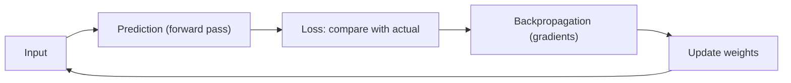
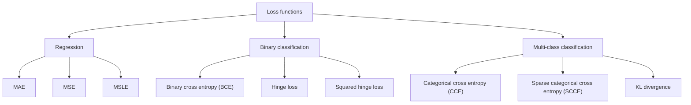
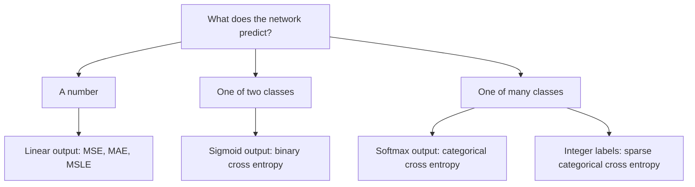
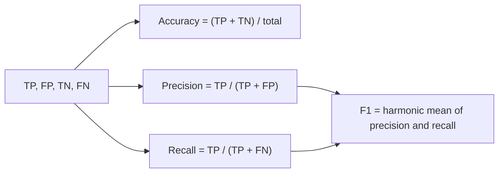

This is syllabus <Syl m="2" />, "loss functions: squared error loss, cross entropy; choosing the output function and the loss function".

## Why we need a loss function

A network can make a prediction, but prediction alone is not enough. If it makes a wrong prediction, it must know whether the mistake was small, whether it was large, and how much the weights should be updated. Without measuring the error, the network cannot improve itself. <Cite id="class-dl-chp2" loc="slide 26" />

<Box kind="definition">

A **loss function** is a mathematical function that measures the difference between the predicted output and the actual output. It tells the neural network how wrong its prediction is. <Cite id="class-dl-chp2" loc="slide 26" />

</Box>

- **Small loss** means the prediction is close to the correct answer. **Large loss** means it is far from the correct answer. The goal during training is to minimize the loss, so the network makes better predictions. <Cite id="class-dl-chp2" loc="slide 26" />
- In simple terms, the loss function is a method of evaluating how well your algorithm is modeling your dataset. It is a mathematical function of the parameters of the machine learning algorithm. You can't improve what you can't measure. Lower loss means a better model; higher loss means a poor model. <Cite id="class-dl-chp2" loc="slide 27" />

**Step-by-step role of the loss function in a DNN.** <Cite id="class-dl-chp2" loc="slide 26" />

1. **Input** is given to the network (red, round, 180 g).
2. **Forward propagation:** the network predicts an output (185 g).
3. **Actual output** is known (180 g).
4. **Loss function** measures the error: $\lvert 185 - 180 \rvert = 5$ g.
5. **Backpropagation:** the error is sent backward to update the weights.
6. **Update weights** to reduce the loss.
7. **Repeat** for many inputs until the loss becomes small.

## Loss versus cost, and the learning rate

The cost (or loss) function measures the difference, or error, between actual $y$ and predicted $y$ at its current position. It gives feedback so the model can adjust its parameters to minimize the error, moving along the direction of steepest descent (the negative gradient) until the cost is close to or at zero. The two terms are considered synonymous, but there is a slight difference: **a loss function refers to the error of one training example, while a cost function calculates the average error across an entire training set.** <Cite id="class-dl-m1" loc="p. 28" />

Also, cost function = loss (say, binary cross entropy) + regularization term. <Cite id="class-dl-m2" loc="p. 32" />

The **learning rate** (also called step size or alpha) is the size of the steps taken to reach the minimum. It is typically a small value. High learning rates result in larger steps but risk overshooting the minimum. A low learning rate has small step sizes: it has the advantage of more precision, but the number of iterations compromises overall efficiency, as it takes more time and computation to reach the minimum. <Cite id="class-dl-m1" loc="p. 29" /> <Cite id="class-dl-chp2" loc="slide 8" />

| | Loss function | Cost function |
|---|---|---|
| Measures error of | One training example | The whole training set (average) |
| Example | $\lvert 185 - 180 \rvert = 5$ g for one fruit | Mean of the losses of all fruits |

## Types of loss functions

Different machine learning problems require different loss functions. <Cite id="class-dl-chp2" loc="slide 27" />

## 1. Regression loss functions

A regression loss function is used when the model predicts continuous numerical values (the weight of a fruit, a house price, a temperature). It measures the difference between the predicted value and the actual value. Classification loss functions compare classes or probabilities, so they cannot correctly measure the error between numbers like 180 g and 185 g. <Cite id="class-dl-chp2" loc="slide 28" />

### Mean absolute error (MAE)

<Box kind="definition">

**MAE** measures the average absolute difference between the predicted value and the actual value. It ignores the positive (+) and negative (−) signs. $\text{MAE} = \dfrac{1}{n}\sum_{i=1}^{n} \lvert y_i - \hat y_i \rvert$ <Cite id="class-dl-chp2" loc="slide 29" />

</Box>

Why not the plain error? The errors +5 and −5 would average to 0 even though both predictions are wrong, which gives an incorrect idea of the model's performance. MAE converts every error into a positive value before averaging, so all errors contribute equally. <Cite id="class-dl-chp2" loc="slide 29" />

<Sum>

<Given>

actual weights 180, 200, 160, 150 g and predicted weights 185, 195, 170, 145 g.

</Given>

<Find>

the MAE.

</Find>

<Steps>

1. **Absolute errors:** $\lvert 180 - 185 \rvert = 5$, $\lvert 200 - 195 \rvert = 5$, $\lvert 160 - 170 \rvert = 10$, $\lvert 150 - 145 \rvert = 5$.
2. **Add them:** $5 + 5 + 10 + 5 = 25$.
3. **Average over $n = 4$:** $25/4 = 6.25$.

</Steps>

<Answer>

MAE $= 6.25$ g. <Cite id="class-dl-chp2" loc="slide 30" />

</Answer>

<Box kind="verify">

Recompute with the mean of the absolute errors in another order: $(10 + 5 + 5 + 5)/4 = 25/4 = 6.25$. Same.

</Box>

</Sum>

**Use MAE** when predicting numerical values, every error should have equal importance and a simple, interpretable measure is needed. **Advantages:** easy to understand and calculate, less sensitive to outliers than MSE, output is in the same unit as the data. **Disadvantages:** treats small and large errors equally, does not strongly penalize large mistakes, not suitable for classification. <Cite id="class-dl-chp2" loc="slide 31" />

### Mean squared error (MSE)

<Box kind="definition">

**MSE** is a regression loss function that measures the average of the squared differences between the predicted value and the actual value. By squaring the error, larger errors receive a much higher penalty than smaller errors. $\text{MSE} = \dfrac{1}{n}\sum_{i=1}^{n} (y_i - \hat y_i)^2$ <Cite id="class-dl-chp2" loc="slide 32" />

</Box>

Why MSE after MAE? MAE treats every error equally, but in many applications a 20 g error is much more serious than a 2 g error. For errors 2 g and 20 g the squared errors are 4 and 400, so the larger error gets a much higher penalty and the network reduces it quickly. <Cite id="class-dl-chp2" loc="slide 32" />

<Sum>

<Given>

the same four samples: actual 180, 200, 160, 150 and predicted 185, 195, 170, 145.

</Given>

<Find>

the MSE.

</Find>

<Steps>

1. **Errors:** $-5$, $5$, $-10$, $5$ (actual minus predicted).
2. **Square each:** $25$, $25$, $100$, $25$.
3. **Add:** $25 + 25 + 100 + 25 = 175$.
4. **Average over $n = 4$:** $175/4 = 43.75$.

</Steps>

<Answer>

MSE $= 43.75$. <Cite id="class-dl-chp2" loc="slide 33" />

</Answer>

<Box kind="verify">

The large error 10 contributes $100$ of the total $175$, more than half, while it is only 1 of the 4 samples. This shows how MSE punishes large errors.

</Box>

</Sum>

**Use MSE** for continuous values when large prediction errors should be penalized more heavily (house price, medical measurements, temperature). **Advantages:** penalizes large errors strongly, smooth and easy to optimize using gradient descent. **Disadvantages:** sensitive to outliers, and the output is not in the original unit because the error is squared. <Cite id="class-dl-chp2" loc="slide 34" />

### Mean squared logarithmic error (MSLE)

<Box kind="definition">

**MSLE** is a regression loss function that measures the error after applying a logarithm to both the predicted and actual values. It focuses on the **relative** difference rather than only the absolute difference. $\text{MSLE} = \dfrac{1}{n}\sum_{i=1}^{n} \big(\log(1 + y_i) - \log(1 + \hat y_i)\big)^2$ <Cite id="class-dl-chp2" loc="slide 35" />

</Box>

Why? Two farms both have an error of 10 fruits: Farm A actual 100, predicted 110; Farm B actual 1000, predicted 1010. The same error is significant for Farm A and very small for Farm B. With logs the difference is $\log(101) - \log(111) \approx -0.095$ for Farm A but only about $-0.010$ for Farm B. We add 1 because $\log(0)$ is not defined. <Cite id="class-dl-chp2" loc="slide 35" />

**Use MSLE** for positive target values with a very large range, where relative error matters more than absolute error (population, sales, website visitors). **Do not use** it with negative target values or when exact absolute error matters. <Cite id="class-dl-chp2" loc="slide 37" />

| | MAE | MSE | MSLE |
|---|---|---|---|
| Uses | Absolute difference | Squared difference | Log of values, then squared difference |
| Focus | Treats all errors equally | Higher penalty to large errors | Relative (percentage) error |
| Sensitive to large values | Less | Very | Less |
| Handles negative values | Yes | Yes | No |

## 2. Binary classification loss functions

With two classes the network gives a probability (for example Apple = 0.85). MAE, MSE and MSLE are designed for numbers, not class predictions, so we need a loss function that compares the predicted probability with the actual class. <Cite id="class-dl-chp2" loc="slide 38" />

### Binary cross entropy (BCE, log loss)

<Box kind="definition">

**Binary Cross Entropy (BCE)** is a loss function used to measure the error in binary classification problems. It compares the predicted probability with the actual class. $\text{BCE} = -\big(y \log(\hat y) + (1 - y)\log(1 - \hat y)\big)$, where $y$ is the actual class (0 or 1) and $\hat y$ the predicted probability (0 to 1). <Cite id="class-dl-chp2" loc="slide 40" />

</Box>

- If $y = 1$ the loss is $-\log(\hat y)$, so a high $\hat y$ gives a low loss. If $y = 0$ the loss is $-\log(1 - \hat y)$, so a low $\hat y$ gives a low loss. <Cite id="class-dl-chp2" loc="slide 40" />
- A correct prediction gives a small loss; a wrong prediction gives a large loss. The network uses the loss to update its weights.
- It is used with the sigmoid output layer (apple or not apple, spam or not spam, disease or no disease, pass or fail, fraud or not fraud). **Do not use** it for regression or for multi-class problems. <Cite id="class-dl-chp2" loc="slide 40" />

<Sum>

<Given>

one sample with actual class $y = 1$. Case A: predicted probability $\hat y = 0.95$. Case B: $\hat y = 0.10$. (Natural log.)

</Given>

<Find>

the BCE in each case.

</Find>

<Steps>

1. **For $y = 1$** the loss reduces to $-\ln(\hat y)$ because $(1 - y) = 0$.
2. **Case A:** $-\ln(0.95) = 0.0513$.
3. **Case B:** $-\ln(0.10) = 2.3026$.

</Steps>

<Answer>

Case A loss $= 0.051$ (very small, correct and confident). Case B loss $= 2.303$ (very large, wrong and confident). <Cite id="class-dl-chp2" loc="slide 39" />

</Answer>

<Box kind="verify">

$e^{-0.0513} = 0.950$ and $e^{-2.3026} = 0.100$, so both logs are right. The ranking matches the teacher's table: 0.95 gives very small loss, 0.10 gives very large loss.

</Box>

</Sum>

### Hinge loss and squared hinge loss

**Hinge loss** is mainly used with Support Vector Machines (SVMs). Labels are $+1$ and $-1$, $\hat y$ is a real-valued score (not a probability), and $\text{Loss} = \max(0,\ 1 - y\hat y)$. A correct prediction with a large margin ($y\hat y > 1$) gives loss 0; a wrong prediction or one near the boundary gives a larger loss. It encourages a clear margin between the two classes and does not produce probabilities. <Cite id="class-dl-chp2" loc="slide 41" /> <Cite id="class-dl-chp2" loc="slide 42" />

**Squared hinge loss** is an improved version: $\text{Loss} = \big(\max(0,\ 1 - y\hat y)\big)^2$. It squares the hinge error, so large mistakes get a much larger penalty. <Cite id="class-dl-chp2" loc="slide 43" />

| Margin $y\hat y$ | Hinge loss | Squared hinge loss |
|---|---|---|
| 2 (good) | 0 | 0 |
| 1 (on boundary) | 0 | 0 |
| 0.5 (small margin) | 0.5 | 0.25 |
| −1 (wrong) | 2 | 4 |
| −2 (very wrong) | 3 | 9 |

<Cite id="class-dl-chp2" loc="slide 44" />

<Box kind="pitfall">

The teacher's overview slide writes MAE, MSE, MSLE and hinge loss with a minus sign in front of the average, for example $L = -\frac{1}{n}\sum \lvert y_i - \hat y_i \rvert$. That is a typing error: these losses have no leading minus (the leading minus belongs only to cross entropy). Use the formulas written in this note. <Cite id="class-dl-chp2" loc="slide 27" />

</Box>

## 3. Multi-class classification loss functions

Binary losses work for only two classes. With more than two classes the network predicts probabilities for many classes at once (Apple 0.10, Banana 0.15, Orange 0.65, Mango 0.10). The loss checks whether the correct class has the highest probability: correct class highest gives a small loss, another class highest gives a large loss. The output layer is softmax. <Cite id="class-dl-chp2" loc="slide 45" />

### Categorical cross entropy (CCE)

<Box kind="definition">

**Categorical Cross Entropy (CCE)** is a loss function used for multi-class classification. It compares the predicted probabilities with the actual class and measures the prediction error. $\text{CCE} = -\sum_{i=1}^{n} y_i \log(\hat y_i)$, where $y_i$ is the one-hot actual class (1 for the correct class, 0 for others) and $\hat y_i$ the predicted probability from softmax. <Cite id="class-dl-chp2" loc="slide 46" /> <Cite id="class-dl-chp2" loc="slide 47" />

</Box>

<Sum>

<Given>

classes Apple, Banana, Orange, Mango. Actual fruit is Orange, so $y = (0, 0, 1, 0)$. Softmax predicts $\hat y = (0.05, 0.10, 0.80, 0.05)$ in Case A and $(0.70, 0.10, 0.10, 0.10)$ in Case B.

</Given>

<Find>

the CCE in each case.

</Find>

<Steps>

1. **Only the correct class survives** the sum, because $y_i = 0$ for the others: $\text{CCE} = -\ln(\hat y_{\text{Orange}})$.
2. **Case A:** $-\ln(0.80) = 0.223$.
3. **Case B:** $-\ln(0.10) = 2.303$.

</Steps>

<Answer>

Case A $= 0.223$ (small: Orange has the highest probability). Case B $= 2.303$ (large: Apple wrongly has the highest probability). <Cite id="class-dl-chp2" loc="slide 46" />

</Answer>

<Box kind="verify">

$e^{-0.223} = 0.800$ and $e^{-2.303} = 0.100$. The loss falls as the probability of the correct class rises.

</Box>

</Sum>

**Use CCE** for multi-class classification with a softmax output layer and one-hot labels. **Do not use** it for regression, binary classification or integer labels. <Cite id="class-dl-chp2" loc="slide 47" />

### Sparse categorical cross entropy (SCCE)

**SCCE** is a loss function for multi-class classification that accepts **integer labels** (Apple = 0, Banana = 1, Orange = 2, Mango = 3) instead of one-hot encoded labels. It is the same mathematical concept as CCE; the difference is only in label representation. It saves memory and simplifies training when there are many classes. <Cite id="class-dl-chp2" loc="slide 48" /> <Cite id="class-dl-chp2" loc="slide 49" />

### KL divergence

**Kullback-Leibler (KL) divergence** measures how different one probability distribution is from another. Similar distributions give a small KL divergence and different distributions give a large one. It compares the whole distribution, not only the correct class, and is used in knowledge distillation, variational autoencoders, generative models and language models. $\text{KL}(P \,\|\, Q) = \sum_x P(x)\log\dfrac{P(x)}{Q(x)}$. <Cite id="class-dl-chp2" loc="slide 50" /> <Cite id="class-dl-chp2" loc="slide 27" />

<Sum>

<Given>

actual $P = (0.70, 0.20, 0.10)$ and predicted $Q = (0.60, 0.25, 0.15)$ for apple, banana, orange.

</Given>

<Find>

$\text{KL}(P \,\|\, Q)$.

</Find>

<Steps>

1. **Apple:** $0.70 \ln(0.70/0.60) = 0.70 \times 0.1542 = 0.1079$.
2. **Banana:** $0.20 \ln(0.20/0.25) = 0.20 \times (-0.2231) = -0.0446$.
3. **Orange:** $0.10 \ln(0.10/0.15) = 0.10 \times (-0.4055) = -0.0405$.
4. **Add:** $0.1079 - 0.0446 - 0.0405 = 0.0228$.

</Steps>

<Answer>

$\text{KL}(P \,\|\, Q) \approx 0.023$, small, because the two distributions are close.

</Answer>

<Box kind="verify">

KL divergence is never negative and is 0 only when $P = Q$. We got a small positive number, as expected for close distributions.

</Box>

</Sum>

<Box kind="pitfall">

The teacher's detail slide 51 writes the formula as $\sum_x P(x)\log\frac{Q(x)}{P(x)}$. With $Q/P$ inside the log the sum would come out negative. The correct form is $P(x)\log\frac{P(x)}{Q(x)}$, as on the overview slide. <Cite id="class-dl-chp2" loc="slide 51" />

</Box>

## Squared error versus cross entropy

The class notes compare the two main losses directly. <Cite id="class-dl-m2" loc="p. 14" />

| | Squared error loss (MSE) | Cross entropy loss |
|---|---|---|
| Used for | Regression (continuous target values) | Classification (categorical target values) |
| Formula | $L = \frac{1}{n}\sum (y_i - \hat y_i)^2$ | $L = -\frac{1}{n}\sum [y_i \log\hat y_i + (1 - y_i)\log(1 - \hat y_i)]$ |
| Output range | Any real value | 0 to 1 (probabilities) |
| Output layer | Linear activation | Sigmoid (binary) or softmax (multi-class) |
| Penalty | Quadratic: less sensitive for small errors | Logarithmic: very high penalty for a confident wrong prediction |
| Use when | Predicting numbers (house price) | Predicting classes (cat or dog) |

**When is cross entropy more appropriate than MSE?** When the task is classification and the network outputs probabilities (sigmoid or softmax). Cross entropy works with probabilities between 0 and 1, penalizes confident wrong predictions very heavily, and gives better gradient behavior for faster convergence. MSE suits continuous outputs. <Cite id="class-dl-m2" loc="p. 14" />

## Choosing the output function and the loss together

The output function produces the final prediction (what the model says); the loss function measures how wrong the prediction is. They must match: sigmoid goes with binary cross entropy and softmax with categorical cross entropy. <Cite id="class-dl-chp2" loc="slide 52" /> <Cite id="class-dl-chp2" loc="slide 53" />

| Problem type | Output layer | Loss function |
|---|---|---|
| Regression | Linear | MAE, MSE or MSLE |
| Binary classification | Sigmoid | Binary cross entropy |
| Binary classification (SVM) | Decision score (no sigmoid) | Hinge or squared hinge |
| Multi-class (one-hot labels) | Softmax | Categorical cross entropy |
| Multi-class (integer labels) | Softmax | Sparse categorical cross entropy |
| Probability distribution comparison | Softmax | KL divergence |

<Cite id="class-dl-chp2" loc="slide 54" />

## Measuring a classifier: accuracy, precision, recall and F1

Besides the loss, a classifier is judged with the **model accuracy measurement tools**. <Cite id="class-dl-m2" loc="p. 15" />

- **True Positives (TP):** positive examples labeled as positive. **False Positives (FP):** negative examples labeled as positive. **True Negatives (TN):** negative examples labeled as negative. **False Negatives (FN):** positive examples labeled as negative.
- **Confusion matrix:** a matrix containing the TP, FP, TN and FN values.
- **Accuracy:** the proportion of correct results in the total results. $\text{Accuracy} = \dfrac{TP + TN}{TP + FP + TN + FN}$.
- **Precision** tells how many of the selected objects were correct: $\dfrac{TP}{TP + FP}$. **Recall** tells how many correct objects were selected: $\dfrac{TP}{TP + FN}$.
- **F1 score** is the harmonic average of precision and recall: $F1 = 2\cdot\dfrac{\text{precision}\cdot\text{recall}}{\text{precision} + \text{recall}}$. F1 of 0 means worst and 1 means best. <Cite id="class-dl-m2" loc="p. 16" />

| | Classified positive | Classified negative |
|---|---|---|
| Positive class | TP | FN |
| Negative class | FP | TN |

**Why accuracy can mislead.** The teacher's example has TP = 0, FN = 25, FP = 0, TN = 125. Accuracy $= 125/150 = 83\%$, yet every positive example is classified wrongly, so the model is very bad. Recall is $0/25 = 0$. Precision is $0/0$, which is undefined (it is treated as 0), and the F1 score is 0. <Cite id="class-dl-m2" loc="p. 16" />

<Box kind="pitfall">

The teacher writes "both precision and recall are 0.0" for that example. Recall is truly 0, but precision is $0/(0+0)$, which is undefined; by the usual convention it is set to 0 when nothing is predicted positive. <Cite id="class-dl-m2" loc="p. 16" />

</Box>

<Sum>

<Given>

the class example <Cite id="class-dl-m2" loc="p. 17" />: y_true = 0 1 0 0 1 0 1 1 1 and y_pred = 0 1 1 1 0 0 1 1 0.

</Given>

<Find>

accuracy, precision, recall and F1.

</Find>

<Steps>

1. **Compare pair by pair (true, predicted):** (0,0) TN, (1,1) TP, (0,1) FP, (0,1) FP, (1,0) FN, (0,0) TN, (1,1) TP, (1,1) TP, (1,0) FN.
2. **Count:** TP = 3, TN = 2, FP = 2, FN = 2 (total 9).
3. **Accuracy** $= (3 + 2)/9 = 5/9 = 0.556$.
4. **Precision** $= 3/(3 + 2) = 0.6$. **Recall** $= 3/(3 + 2) = 0.6$.
5. **F1** $= 2 \times 0.6 \times 0.6 / (0.6 + 0.6) = 0.72/1.2 = 0.6$.

</Steps>

<Answer>

Accuracy 55.6%, precision 0.6, recall 0.6, F1 0.6: a moderate model.

</Answer>

<Box kind="verify">

The counts add up: $3 + 2 + 2 + 2 = 9$. F1 can also be written $2TP/(2TP + FP + FN) = 6/(6 + 2 + 2) = 0.6$. Same.

</Box>

</Sum>

## Where this was asked

| If the question says | What to write | Seen as |
|---|---|---|
| "Comment on the significance of loss functions and explain different types" | Definition, role in training, regression, binary and multi-class types with formulas | <PYQ id="2024-12/q5a" /> |
| "Discuss the role of a loss function. Compare MSE and cross-entropy ... when is cross-entropy more appropriate?" | Role, comparison table, classification with probabilities, a small example | <PYQ id="2025-05/q5a" /> |
| Loss versus cost, effect of the learning rate | Loss = one example, cost = average; high rate overshoots, low rate is slow | <PYQ id="assignment-1/q1d" /> |
| Accuracy and F1 from a list of true and predicted labels | Confusion counts, accuracy, precision, recall, F1, interpretation | <PYQ id="assignment-1/q2d" /> |
| Cross-entropy loss from probabilities | $-\ln$ of the probability of the true class, average, interpretation | <PYQ id="assignment-1/q2e" /> |

## Quick revision

- Loss function: measures how wrong the prediction is; goal is to minimize it. Loss = one example, cost = average over the training set.
- Regression: MAE $= \frac{1}{n}\sum \lvert y - \hat y \rvert$ (equal importance); MSE $= \frac{1}{n}\sum (y - \hat y)^2$ (large errors penalized); MSLE (relative error, positive values).
- Binary: BCE $= -[y\log\hat y + (1 - y)\log(1 - \hat y)]$ with sigmoid. Hinge $\max(0, 1 - y\hat y)$ for SVM.
- Multi-class: CCE (one-hot labels) with softmax; SCCE (integer labels); KL divergence compares two distributions.
- Pairing: linear with MSE or MAE, sigmoid with BCE, softmax with CCE.
- Accuracy $= (TP+TN)/\text{total}$; precision $= TP/(TP+FP)$; recall $= TP/(TP+FN)$; F1 $= 2PR/(P+R)$.

**Conclusion.** The loss function is the heart of training: it measures the error, the optimizer uses it to update the weights, and the right loss (matched to the output function) is chosen from the problem type. <Cite id="class-dl-chp2" loc="slide 26" />
