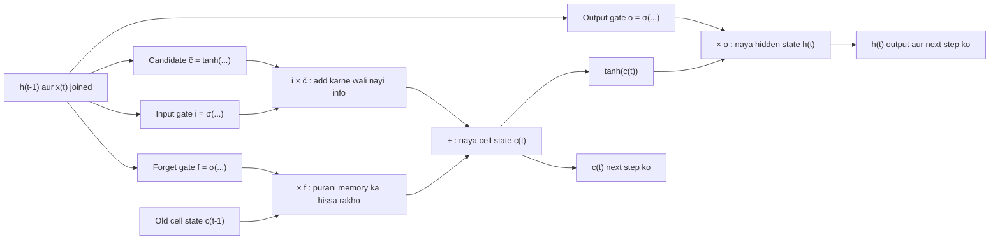
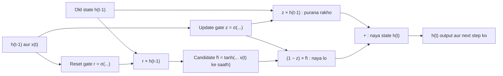

Naye ideas se pehle, purane ideas jo chahiye wo yahan hain. Agar pehle se aate hain to agle section pe chale jao.

## Pehle basics

- **Recurrent neural network (RNN)** ek sequence ko ek-ek step karke padhta hai aur ek memory vector rakhta hai jise **hidden state** $h_t$ kehte hain. Har step pe plain RNN purani memory ko naye input ke saath mix karta hai, result ko tanh se squash karta hai, aur memory ko usse **overwrite** kar deta hai, har step pe same weights use karke.
- **Sigmoid** $\sigma$ kisi bhi number ko $0$ se $1$ ki range mein squash karta hai. **Tanh** kisi bhi number ko $-1$ se $1$ mein squash karta hai.
- Agle do symbols sirf equations mein aate hain, jo tab likhte ho jab question architecture pooche. $\odot$ ka matlab hai **element-wise multiplication**: pehla number pehle se, doosra doosre se, aise hi aage. Jaise $[0.5, 1] \odot [4, 6] = [2, 6]$.
- $[h_{t-1}, x_t]$ ka matlab hai dono vectors ko **end to end jod kar** ek lamba vector banana.
- RNN ko **backpropagation through time (BPTT)** se train karte hain. Ek step peeche jaane pe gradient ek factor se multiply hota hai, jo usually 1 se kam hota hai, isliye bahut steps ke baad gradient **vanish** ho jaata hai aur RNN door-door ke words ke beech link nahi seekh paata. Yahi problem LSTM aur GRU solve karte hain. Ye topic syllabus <Syl m="5" /> mein hai.

## Plain RNN kyun bhool jaata hai

Padho: "I grew up in **France** ... (30 aur words) ... so I speak fluent **French**." "French" predict karne ke liye network ko "France" 30 steps tak yaad rakhna padega. Plain RNN mein poora hidden state har step pe squash aur rewrite hota hai, aur training mein step 30 se step 1 tak gradient lagbhag 30 chhote factors se multiply hota hai. Wo vanish ho jaata hai, isliye network ye link kabhi seekh hi nahi paata. <Cite id="gfdl-ch10" loc="§10.7" />

**Fix, ek line mein:** har step pe memory rewrite karne ki jagah, network ko chhote switches, jinhe **gates** kehte hain, se decide karne do ki kya rakhna hai, kya add karna hai aur kya dikhana hai. Rakhna purani memory ko aage **copy** karke hota hai, jo gradient ko shrink nahi karta.

## Gate kya hota hai

<Box kind="definition">

**Gate** 0 aur 1 ke beech ke numbers ka ek vector hai, jo ek sigmoid layer current input aur previous hidden state se banati hai. Isse doosre vector ke saath element-wise multiply karte hain, ye decide karne ke liye ki har number ka kitna hissa pass hoga: 0 matlab "poora block", 1 matlab "poora pass", aur 0.3 matlab "30% pass".

</Box>

**Chhota example.** Memory vector $[5, -2, 8]$ ko gate $[1, 0, 0.5]$ se pass karo to $[5, 0, 4]$ banta hai: pehla number rakh liya, doosra mita diya, teesra aadha kar diya.

Gate ek **paani ke nal** jaisa hai jo poora band se poora khula, kahin bhi ho sakta hai. Sigmoid smooth hai, isliye network normal gradient descent se seekh sakta hai ki har nal kitna kholna hai. Gates sigmoid use karte hain (0 se 1 ka dial); nayi memory content tanh use karta hai (values $-1$ se $1$, taaki memory ko upar ya neeche push kar sake).

<Figure caption="Gates sigmoid use karte hain (output 0 aur 1 ke beech, isliye ye kitna-pass-karna-hai dial ki tarah kaam karta hai). Naya candidate memory tanh use karta hai (output -1 aur 1 ke beech, isliye ye memory values ko upar ya neeche push kar sakta hai).">
  <CurvePlot curves="sigmoid,tanh" x="-6,6" y="-1.2,1.2" xLabel="input to the layer" yLabel="output" />
</Figure>

## LSTM: Long Short-Term Memory

**Ye kya hai.** LSTM ek RNN cell hai jismein ek alag long-term memory hoti hai, **cell state** $c_t$, aur teen gates jo use control karte hain. Ise Hochreiter aur Schmidhuber ne 1997 mein propose kiya; forget gate 2000 mein Gers, Schmidhuber aur Cummins ne add kiya, aur aaj wahi version use hota hai. <Cite id="hochreiter1997" /> <Cite id="gers2000" />

**Ye kyun zaroori hai.** Lambe gaps tak information yaad rakhne ke liye, jo plain RNN vanishing gradients ki wajah se nahi kar paata.

**Analogy.** Ek student lambe lecture mein chhote whiteboard pe notes likh raha hai. Board pe jagah kam hai, isliye har moment pe student

1. jo ab zaroori nahi wo **mitata** hai (**selective forget**),
2. abhi jo bola gaya uske sirf important parts **likhta** hai (naye input ka **selective read**),
3. jab question poocha jaaye, board ka sirf relevant hissa **bolta** hai (output pe **selective write**).

Whiteboard hai **cell state** $c_t$, long-term memory jo poore sequence ke saath chalti hai. **Hidden state** $h_t$ short-term, "main abhi kya bol raha hoon" wala output hai. Ye teen-part picture LSTM gates sikhane ka aam tareeka hai. <Cite id="nptel-dl" />

### LSTM cell ke parts

Har time step pe cell input $x_t$, previous hidden state $h_{t-1}$ aur previous cell state $c_{t-1}$ leta hai, aur $h_t$ aur $c_t$ banata hai.

| Part | Plain words | Operation |
|---|---|---|
| Forget gate $f_t$ | Har memory number ke liye, purani memory ka kitna rakhna hai (1 rakho, 0 mitao) | Selective forget |
| Input gate $i_t$ | Naye candidate ka kitna memory mein likhna hai | Selective read |
| Candidate $\tilde{c}_t$ | Nayi information jo add ho sakti hai, $-1$ aur $1$ ke beech | New content |
| Cell state $c_t$ | Purani memory ka hissa rakho, nayi ka hissa add karo | Long-term memory |
| Output gate $o_t$ | Memory ka kitna output mein dikhana hai | Selective write |
| Hidden state $h_t$ | Is step ka output, next step ko bhi jaata hai | Short-term output |

### Ek LSTM step kaise kaam karta hai

1. **Dekho.** Previous hidden state aur current input ko jodo.
2. **Selective forget.** Forget gate inhe dekh kar har memory number ke liye decide karta hai ki kitna rakhna hai. Words mein: forget gate = sigmoid of (weights times joined vector, plus bias).
3. **Selective read.** Input gate decide karta hai kitni nayi information andar aaye, aur ek tanh layer candidate nayi information propose karti hai.
4. **Memory update karo.** Naya cell state = (forget gate times purana cell state) **plus** (input gate times candidate). Purani memory multiply aur add karke rakhi jaati hai, kabhi squash nahi hoti.
5. **Selective write.** Output gate decide karta hai memory ka kitna dikhana hai. Naya hidden state = output gate times tanh of naya cell state.
6. $c_t$ aur $h_t$ next step ko do aur same weights ke saath repeat karo.

### LSTM equations

Ye tab likho jab question "architecture" ya "in detail" bole. Ye upar ke chhe steps hi symbols mein hain, kuch naya nahi. Har $W$ ek learned weight matrix hai aur har $b$ ek learned bias, sab time steps mein shared. <Cite id="gfdl-ch10" loc="§10.10.1" /> <Cite id="d2l-lstm" /> <Cite id="colah-lstm" />

$$
f_t = \sigma\left(W_f [h_{t-1}, x_t] + b_f\right) \qquad \text{forget gate}
$$

$$
i_t = \sigma\left(W_i [h_{t-1}, x_t] + b_i\right) \qquad \text{input gate}
$$

$$
\tilde{c}_t = \tanh\left(W_c [h_{t-1}, x_t] + b_c\right) \qquad \text{candidate memory}
$$

$$
c_t = f_t \odot c_{t-1} + i_t \odot \tilde{c}_t \qquad \text{new cell state}
$$

$$
o_t = \sigma\left(W_o [h_{t-1}, x_t] + b_o\right) \qquad \text{output gate}
$$

$$
h_t = o_t \odot \tanh(c_t) \qquad \text{new hidden state}
$$

Exam mein English mein likho: "The cell state is updated additively, c_t = f_t ⊙ c_(t-1) + i_t ⊙ c̃_t, so information and gradients can flow across many time steps."

**Sum 1: ek memory number ke saath ek LSTM step.** Isse update action mein dikhta hai. Gate values seedhe di gayi hain, isliye weights ki zaroorat nahi.

<Sum>

<Given>

purana cell state $c_{t-1} = 2$; forget gate $f_t = 0.9$; input gate $i_t = 0.2$; candidate $\tilde{c}_t = 0.5$; output gate $o_t = 0.8$.

</Given>

<Find>

naya cell state $c_t$ aur naya hidden state $h_t$.

</Find>

<Steps>

1. **Purani memory ka hissa rakho.** Purani memory ko forget gate se multiply karo, kyunki forget gate batata hai kitna fraction rakhna hai: $0.9 \times 2 = 1.8$.
2. **Kitni nayi information add karni hai, choose karo.** Candidate ko input gate se multiply karo, kyunki input gate batata hai naye content ka kitna fraction andar aane dena hai: $0.2 \times 0.5 = 0.1$.
3. **Memory update karo.** Dono parts add karo, kyunki cell state = "rakhi hui purani plus add hui nayi": $c_t = 1.8 + 0.1 = 1.9$.
4. **Output ke liye memory squash karo.** Nayi memory pe tanh lagao, taaki output $-1$ aur $1$ ke beech rahe: $\tanh(1.9) \approx 0.956$.
5. **Kitna dikhana hai, choose karo.** Output gate se multiply karo, kyunki wo batata hai memory ka kitna fraction reveal karna hai: $h_t = 0.8 \times 0.956 \approx 0.765$.

</Steps>

<Answer>

$c_t = 1.9$ aur $h_t \approx 0.765$.

</Answer>

<Box kind="verify">

$c_t$ ko total ki jagah change se check karo. Forget karne se purani memory se $(1 - 0.9) \times 2 = 0.2$ hat jaata hai, aur input $0.1$ add karta hai, to net change $-0.2 + 0.1 = -0.1$, aur $2 - 0.1 = 1.9$. Same answer. $h_t$ ko range se check karo: positive number ka tanh 0 aur 1 ke beech hota hai, isliye $h_t$ ko $0$ aur $o_t = 0.8$ ke beech hona chahiye; $0.765$ hai, aur $0.8$ ke paas hai kyunki $\tanh(1.9)$ 1 ke paas hai.

</Box>

</Sum>

**Iska matlab.** Memory mushkil se badli kyunki forget gate lagbhag khula tha aur input gate lagbhag band. Isi tarah LSTM "France" ko 30 steps tak carry karta hai: wo seekhta hai ki jab tak memory ki zaroorat na ho, $f_t$ ko 1 ke paas aur $i_t$ ko 0 ke paas rakho.

### LSTM, RNN ki limitation kaise overcome karta hai

<Box kind="intuition">

Plain RNN mein memory har step pe tanh se guzarti hai aur $W$ se multiply hoti hai, jaise photocopy ki photocopy, jo har baar thodi aur fade hoti hai. LSTM mein cell state ek "conveyor belt" pe chalta hai: har step pe wo sirf forget gate se multiply hota hai aur usme kuch add hota hai. Agar forget gate 1 hai, to memory bilkul exact copy hoti hai.

</Box>

1. **Additive memory.** Cell state rakh kar aur add karke update hota hai, tanh aur $W$ se rewrite karke nahi. Original paper ne ise **constant error carousel** kaha. <Cite id="hochreiter1997" />
2. **Gradient highway.** Cell state ke along ek step peeche jaane pe gradient sirf forget gate se multiply hota hai. Jab forget gate 1 ke paas rehta hai, gradient bahut steps tak bach jaata hai (neeche Sum 2 dekho).
3. **Learned gates.** Network khud decide karta hai kitni der yaad rakhna hai. Agar koi purani value sach mein zaroori nahi, to forget gate band ho jaata hai aur gradient wahan jaan-boojh kar ruk jaata hai, jo sahi behaviour hai. <Cite id="nptel-dl" />

**Sum 2: 50 steps mein kitna gradient bachta hai.** Ye tab use karo jab question bole "how LSTM overcomes the limitation of RNN".

<Sum>

<Given>

50 time steps; ek plain RNN jo har step pe gradient ko lagbhag $0.5$ se multiply karta hai; ek LSTM jiska forget gate $0.95$ pe rehta hai.

</Given>

<Find>

har network mein gradient ka kitna fraction step 1 tak pahunchta hai.

</Find>

<Steps>

1. **Rule likho.** 50 steps peeche jaane pe gradient per-step factor se 50 baar multiply hota hai, isliye bacha hua fraction = factor$^{50}$.
2. **RNN, pehle 10 steps.** $0.5^{10} = 1/1024 \approx 0.000977$, kyunki das baar aadha karna matlab $2^{10} = 1024$ se divide karna.
3. **RNN, saare 50 steps.** 50 steps matlab 10 ke paanch blocks, to

   $$
   \begin{aligned}
   0.5^{50} &= (0.000977)^5 \\
   &\approx 8.9 \times 10^{-16}
   \end{aligned}
   $$
4. **LSTM, pehle 10 steps.** $0.95^{10} \approx 0.599$ (0.95 ko khud se das baar multiply karo).
5. **LSTM, saare 50 steps.** $(0.599)^5$: $0.599^2 \approx 0.359$, $0.359^2 \approx 0.129$, aur $0.129 \times 0.599 \approx 0.077$.

</Steps>

<Answer>

RNN gradient ka lagbhag $9 \times 10^{-16}$ rakhta hai (practically zero), LSTM lagbhag $0.077$, yaani roughly 8%, rakhta hai, jo abhi bhi usable hai.

</Answer>

<Box kind="verify">

Baar-baar multiply karne ki jagah logarithms se check karo.

$$
\begin{aligned}
50 \times \log_{10} 0.5 &= 50 \times (-0.301) \\
&= -15.05
\end{aligned}
$$

aur $10^{-15.05} \approx 8.9 \times 10^{-16}$.

$$
\begin{aligned}
50 \times \ln 0.95 &= 50 \times (-0.0513) \\
&= -2.565
\end{aligned}
$$

aur $e^{-2.565} \approx 0.077$. Dono match karte hain. Sense check: dono answers 1 se kam hain (1 se chhota factor hamesha shrink karta hai), aur LSTM wala kaafi bada hai kyunki uska factor 1 ke bahut paas hai.

</Box>

</Sum>

<Box kind="pitfall">

Overclaim mat karo. LSTM vanishing-gradient problem ko bahut **kam** karta hai; use poori tarah khatam nahi karta, aur **exploding** gradients ko nahi rokta. Practice mein LSTMs abhi bhi gradient clipping ke saath train hote hain. <Cite id="pascanu2013" /> <Cite id="gfdl-ch10" loc="§10.11.1" />

</Box>

### LSTM ke advantages, disadvantages aur applications

| Advantages | Disadvantages |
|---|---|
| Lambe gaps tak information yaad rakhta hai (1997 paper ne artificial tasks pe 1000 se zyada steps ke time lags bridge kiye) | Weights ke chaar sets, isliye plain RNN se lagbhag 4 guna parameters |
| Vanishing gradients bahut kam karta hai | Train aur run karne mein slow; steps abhi bhi parallel nahi chal sakte |
| Alag gates fine control dete hain: purana rakhna aur naya add karna independently | Achhe se train hone ke liye zyada data chahiye; chhote datasets pe overfit ho sakta hai |
| Kisi bhi length ki sequence process kar sakta hai | Exploding gradients ke liye abhi bhi clipping chahiye |

**Applications:** machine translation, speech recognition, handwriting recognition, text generation, time-series forecasting (stock, weather, energy demand). <Cite id="gfg-lstm" /> <Cite id="ibm-lstm" /> <Cite id="keras-lstm" />

## GRU: Gated Recurrent Unit

**Ye kya hai.** GRU, jo Cho aur saathiyon ne 2014 mein propose kiya, ek simpler gated RNN cell hai. Ye LSTM ke cell state aur hidden state ko **ek** vector $h_t$ mein merge kar deta hai aur sirf **do gates** use karta hai. <Cite id="cho2014" />

**Ye kyun zaroori hai.** Ye LSTM ka main fayda, vanishing gradients ke bina long-term memory, kam weights aur faster training ke saath deta hai.

**Do gates.**

- **Update gate** $z_t$: purani memory ka kitna rakhna hai, aur isliye kitni nayi memory leni hai. Ye LSTM ke forget aur input gates ka kaam **saath mein** karta hai: zyada purani memory rakhna automatically matlab kam nayi lena.
- **Reset gate** $r_t$: naya candidate banate waqt purani memory ka kitna dekhna hai. Agar ye 0 ke paas hai, to candidate lagbhag sirf current input se banta hai, jaise fresh start (naye sentence ki shuruaat mein useful).

**Analogy.** Tum ek news story ka running summary rakh rahe ho. Update gate hai ki purane summary ka kitna rakhna hai. Reset gate hai ki naya sentence likhte waqt purana summary dekhoge, ya sirf aaj ki news se likhoge.

### Ek GRU step kaise kaam karta hai

1. **Dekho.** Previous hidden state aur current input ko jodo.
2. **Gates.** Update gate aur reset gate compute karo, dono sigmoid (0 se 1).
3. **Candidate.** Purane state ko reset gate se multiply karo, input ke saath jodo, aur tanh se pass karke candidate nayi memory pao.
4. **Blend.** Naya state = (update gate times purana state) **plus** (one minus update gate) times candidate. Ye purane aur naye ka weighted average hai.
5. $h_t$ ko output aur next step ko do.

### GRU equations

Ye tab likho jab question "in detail" bole. Ye upar ke steps hi symbols mein hain. Goodfellow ki book aur d2l wala form. <Cite id="gfdl-ch10" loc="§10.10.2" /> <Cite id="d2l-gru" />

$$
z_t = \sigma\left(W_z [h_{t-1}, x_t] + b_z\right) \qquad \text{update gate}
$$

$$
r_t = \sigma\left(W_r [h_{t-1}, x_t] + b_r\right) \qquad \text{reset gate}
$$

$$
\tilde{h}_t = \tanh\left(W_h [r_t \odot h_{t-1}, x_t] + b_h\right) \qquad \text{candidate}
$$

$$
h_t = z_t \odot h_{t-1} + (1 - z_t) \odot \tilde{h}_t \qquad \text{new hidden state}
$$

<Box kind="pitfall">

Kuch sources (jaise Olah ka blog aur Chung et al. ka 2014 comparison paper) likhte hain $h_t = (1 - z_t) \odot h_{t-1} + z_t \odot \tilde{h}_t$. Ye same model hai bas $z_t$ ka meaning ulta hai (wahan $z_t$ 1 ke paas matlab "naya lo"). Dono sahi hain agar tum batao $z_t$ ka matlab kya hai. Ek answer mein ek hi form consistently use karo. <Cite id="chung2014" /> <Cite id="colah-lstm" />

</Box>

**Sum 3: ek memory number ke saath ek GRU step.**

<Sum>

<Given>

purana state $h_{t-1} = 1.0$; update gate $z_t = 0.75$; candidate $\tilde{h}_t = -0.2$.

</Given>

<Find>

naya state $h_t$.

</Find>

<Steps>

1. **Purani memory ka hissa rakho.** Purane state ko update gate se multiply karo, kyunki $z_t$ purani memory ka rakha hua fraction hai: $0.75 \times 1.0 = 0.75$.
2. **Nayi information ke liye bacha share nikalo.** 1 mein se update gate ghatao, kyunki jo rakha nahi gaya wo candidate se liya jaata hai: $1 - 0.75 = 0.25$.
3. **Candidate ka utna share lo.** $0.25 \times (-0.2) = -0.05$.
4. **Blend.** Dono parts add karo: $h_t = 0.75 + (-0.05) = 0.70$.

</Steps>

<Answer>

$h_t = 0.70$.

</Answer>

<Box kind="verify">

Candidate se purane state ki taraf move karke check karo. Purane aur naye ke beech gap $1.0 - (-0.2) = 1.2$ hai; update gate kehta hai candidate se purane state ki taraf us gap ka 75% move karo:

$$
-0.2 + 0.75 \times 1.2 = -0.2 + 0.9 = 0.70
$$

Same answer. Range check: weighted average $-0.2$ aur $1.0$ ke beech hona chahiye, $1.0$ ke zyada paas kyunki uska weight bada hai; $0.70$ hai.

</Box>

</Sum>

**Iska matlab.** Purani memory ka teen chauthai rakha gaya aur naye ka ek chauthai mix hua. Agar update gate 1 hota, to state bilkul exact copy hota, isliye LSTM ki tarah, us path pe gradient shrink nahi hota.

### GRU ke advantages, disadvantages aur applications

| Advantages | Disadvantages |
|---|---|
| Kam gates aur koi cell state nahi: chaar ki jagah teen weight sets, lagbhag 25% kam parameters | Ek hi gate "purana rakhna" aur "naya add karna" dono sambhalta hai, isliye LSTM se kam fine control |
| Train aur run karne mein fast, kam memory | Koi output gate nahi: poora state hamesha exposed rehta hai |
| Aksar LSTM jitna accurate, aur chhote datasets pe achha kaam karta hai | Bahut lambi dependencies pe thoda worse ho sakta hai |
| Ye bhi vanishing gradients bahut kam karta hai | Abhi bhi sequential; exploding gradients ke liye abhi bhi clipping chahiye |

**Applications:** speech recognition, machine translation, music modelling, time-series forecasting, aur on-device models jahan speed aur memory matter karte hain. <Cite id="gfg-gru" /> <Cite id="keras-gru" /> <Cite id="pytorch-gru" />

## LSTM versus GRU

| Point | LSTM | GRU |
|---|---|---|
| Proposed | Hochreiter aur Schmidhuber, 1997 (forget gate 2000 mein add hua) | Cho et al., 2014 |
| Gates | 3: forget, input, output | 2: update, reset |
| Memory | Alag cell state $c_t$ aur hidden state $h_t$ | Sirf ek hidden state $h_t$ |
| Keeping versus adding | Alag forget aur input gates, independent | Ek update gate dono karta hai: keep $z$, add $1 - z$ |
| Output control | Output gate decide karta hai memory ka kitna dikhana hai | Koi output gate nahi: poora state hi output hai |
| Weight sets | 4 (forget, input, candidate, output) | 3 (update, reset, candidate), lagbhag 25% kam parameters |
| Speed | Slower | Train aur run mein faster |
| Data | Bahut data aur bahut lambi dependencies ke saath aksar better | Kam data ke saath bhi aksar utna hi achha |
| Typical uses | Machine translation, speech recognition, lamba text | Similar tasks jahan speed ya memory matter kare, chhote datasets |

**Sum 4: parameters count karo, agar poocha jaaye.** Har gate (aur candidate) ek chhoti layer hai: har (hidden unit, joined input) pair ke liye ek weight plus har hidden unit ka ek bias. <Cite id="keras-lstm" /> <Cite id="pytorch-lstm" />

<Sum>

<Given>

input size $m = 3$, hidden size $n = 2$. LSTM ke 4 weight sets hain (forget, input, candidate, output); GRU ke 3 (update, reset, candidate).

</Given>

<Find>

ek LSTM layer aur ek GRU layer mein trainable parameters ki sankhya.

</Find>

<Steps>

1. **Joined input ki length.** $h_{t-1}$ mein $n = 2$ numbers hain aur $x_t$ mein $m = 3$, to joined vector mein $2 + 3 = 5$.
2. **Ek set mein weights.** $n = 2$ units mein se har ek ka har joined number ke liye ek weight: $2 \times 5 = 10$.
3. **Ek set mein biases.** Har unit ka ek: $2$.
4. **Ek set total.** $10 + 2 = 12$. Symbols mein, ek set mein $n(n + m) + n$ numbers hote hain.
5. **LSTM.** 4 sets: $4 \times 12 = 48$.
6. **GRU.** 3 sets: $3 \times 12 = 36$.

</Steps>

<Answer>

LSTM ke 48 parameters hain aur GRU ke 36 parameters.

</Answer>

<Box kind="verify">

Set ke hisaab se nahi, balki har weight kahan se aata hai us hisaab se count karo. LSTM: input weights $4 \times (n \times m) = 4 \times 6 = 24$, recurrent weights $4 \times (n \times n) = 4 \times 4 = 16$, biases $4 \times n = 8$; total $24 + 16 + 8 = 48$. GRU: $18 + 12 + 6 = 36$. Same answers. Ratio check: $36 / 48 = 0.75$, yaani GRU ke 25% kam parameters, jaisa table kehti hai.

</Box>

</Sum>

Keras ka default GRU, `reset_after=True` ke saath, har set mein ek extra bias rakhta hai aur $36 + 3 \times 2 = 42$ dikhata hai. Batao tum kaunsa version use kar rahe ho.

**Kaunsa better hai?** Chung aur saathiyon ne music aur speech data pe dono compare kiye aur paaya ki dono plain tanh RNN se clearly better hain, par koi ek doosre se consistently better nahi. To honest answer hai: task pe depend karta hai; jab speed matter kare to pehle GRU try karo, jab sequences bahut lambe hon to LSTM. <Cite id="chung2014" /> <Cite id="av-lstm-gru" /> <Cite id="gfg-rnn-lstm-gru" />

## Long-term dependencies pe RNN versus LSTM

| Point | Plain RNN | LSTM |
|---|---|---|
| Memory | Ek hidden state, har step pe poora rewrite | Cell state jo rakha jaata hai aur usme add hota hai |
| Gradient over many steps | Har step tanh slope times $W$ se multiply, usually vanish | Cell path pe forget gate se multiply, jo 1 ke paas reh sakta hai |
| Useful memory span | Practice mein kuch steps se kuch dozen steps tak | Hundreds of steps door ke inputs ko link kar sakta hai |
| Control | Koi nahi: har step sab kuch mix hota hai | Learned gates decide karte hain kya forget, read aur write karna hai |
| Parameters and speed | Kam, per step fast | Lagbhag 4 guna, per step slow |

**Ek real application jahan LSTM plain RNN se clearly better hai: machine translation.** Lamba sentence translate karne ke liye pehle words ka meaning (subject, sentence question hai ya nahi, koi "not") end tak yaad rakhna padta hai, aur verb ka form aksar kai words pehle aaye subject pe depend karta hai. Plain RNN vanishing gradients ki wajah se wo early information kho deta hai. Sutskever aur saathiyon ne English se French translation ke liye deep LSTMs use kiye aur report kiya ki LSTM ne lambe sentences achhe se handle kiye. Speech recognition doosra example hai, jahan deep bidirectional LSTMs ne strong results diye. <Cite id="sutskever2014" /> <Cite id="graves2013" /> <Cite id="hochreiter1997" />

**Conclusion.** Dono gated RNNs hain jo plain RNN ki chhoti memory fix karte hain; LSTM teen gates aur cell state ke saath zyada control deta hai, GRU do gates aur kam weights ke saath similar accuracy deta hai.

Exam mein English mein likho: "Both LSTM and GRU are gated RNNs that solve the vanishing-gradient problem; LSTM offers finer control with three gates and a cell state, while GRU is simpler and faster with two gates."

## Ye kahan poocha gaya

| If the question says | What to write | Seen as |
|---|---|---|
| "Explain Gated Recurrent Unit in detail" | Gates kyun, do gates words mein, step-by-step working, chaar equations, GRU diagram, advantages, disadvantages, uses | <PYQ id="2023-12/q2a" /> |
| "Explain LSTM architecture" | Cell state aur teen gates (selective forget, read, write), step-by-step working, chhe equations, LSTM diagram, advantages, uses | <PYQ id="2023-12/q5b" /> |
| "Explain LSTM model, how it overcomes the limitation of RNN" | Pehle RNN ka vanishing gradient, phir LSTM cell, phir conveyor-belt argument $0.5^{50}$ vs $0.95^{50}$ numbers ke saath (Sum 2) | <PYQ id="2024-05/q4a" /> |
| "Differentiate between the (architecture of) LSTM and GRU" | Dono ka short description aur diagram, phir comparison table | <PYQ id="2024-12/q3b" /> <PYQ id="2025-05/q3b" /> |
| "How RNNs suit sequential data; RNN vs LSTM for long-term dependencies; real-world application" | Memory aur weight sharing; RNN vs LSTM table; machine translation justification ke saath | <PYQ id="2025-05/q4b" /> |

## Quick revision

- Gate = 0..1 mein sigmoid output, element-wise multiply: 0 block karta hai, 1 pass karta hai.
- LSTM: cell state (long-term) plus hidden state (output); forget gate = selective forget, input gate = selective read, output gate = selective write.
- LSTM update: $c_t = f_t \odot c_{t-1} + i_t \odot \tilde{c}_t$, $h_t = o_t \odot \tanh(c_t)$.
- LSTM vanishing gradients ko isliye beat karta hai kyunki cell state ke along gradient sirf forget gate se multiply hota hai, jo 1 ke paas reh sakta hai.
- GRU: update gate (purana rakho vs naya lo) aur reset gate (candidate ke liye purana kitna use karna hai); $h_t = z_t \odot h_{t-1} + (1-z_t) \odot \tilde{h}_t$.
- GRU: kam gates, koi cell state nahi, lagbhag 25% kam parameters, faster. LSTM: zyada control, bahut lambe sequences ke liye safer. Results aksar similar.
