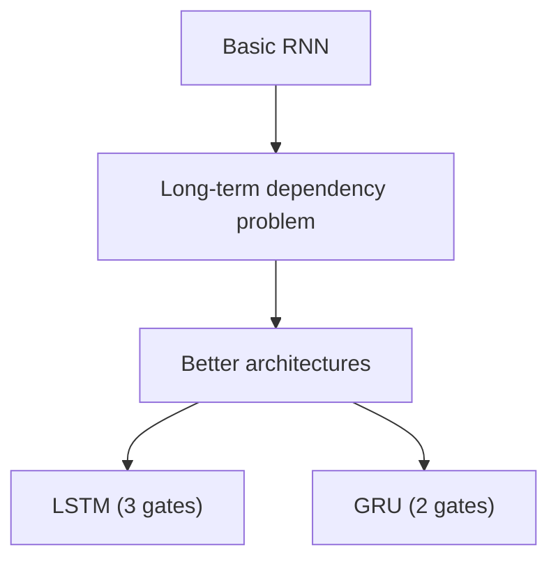
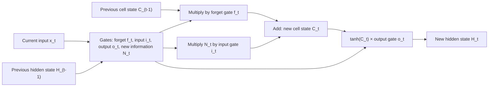
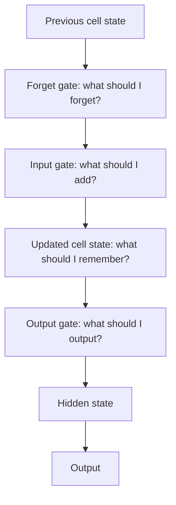
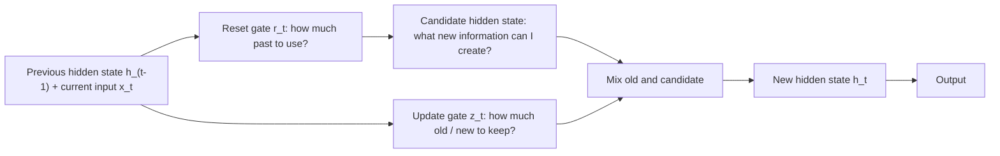

Naye ideas se pehle wo purani baatein jo chahiye. Agar aapko pata hai to seedha agle section par jao.

## Basics pehle

- **RNN** sequence ko ek-ek step mein padhta hai. Har step par wo current input aur previous **hidden state** leta hai aur new hidden state deta hai (RNN note dekho). <Cite id="class-dl-chp5" loc="slide 7" />
- **BPTT** (backpropagation through time) error ko saare time steps mein peeche bhejta hai taaki weights update ho sakein. <Cite id="class-dl-chp5" loc="slide 10" />
- Lambi sequence mein gradient bahut chhota (**vanishing gradient**) ya bahut bada (**exploding gradient**) ho sakta hai. <Cite id="class-dl-chp5" loc="slide 11" />
- **Sigmoid** kisi bhi number ko 0 aur 1 ke beech daal deta hai. **tanh** use −1 aur 1 ke beech daalta hai. <Cite id="class-dl-m5" loc="p. 13" />
- Yahan **gate** bas 0 aur 1 ke beech ka ek number hai jo kisi information se multiply hota hai. 0 matlab gate band (kuch pass nahi), 1 matlab poora khula (sab pass).

## Plain RNN kaafi kyun nahi hai

Basic RNN ko bahut lambi sequences mein information retain karna mushkil lagta hai. "I was born in India ... many words later ... I speak Hindi" mein "India" word ko kai time steps paar karke prediction "Hindi" tak pahunchna hai. BPTT mein is doori par gradient almost zero ho jaata hai, isliye pehle ke time steps ko bahut kam learning signal milta hai. Ye **long-term dependency problem** hai. <Cite id="class-dl-chp5" loc="slide 15" /> <Cite id="class-dl-m5" loc="p. 16" />

## LSTM: Long Short-Term Memory

<Box kind="definition">

**LSTM** ek special kind ka recurrent neural network hai jo long-term dependencies handle kar sakta hai. Long Short Term Memory Network ek advanced RNN hai, ek sequential network, jo information ko persist hone deta hai. Ye RNN ki vanishing gradient problem handle kar sakta hai. <Cite id="class-dl-m5" loc="p. 18" />

**Key idea:** LSTM information ke flow ko control karne ke liye **gates** use karta hai. <Cite id="class-dl-chp5" loc="slide 11" />

</Box>

**Roz ki analogy.** Video dekhte waqt aapko pichhla scene yaad rehta hai, aur kitaab padhte waqt pichhle chapter mein kya hua pata hota hai. RNN bhi pichhli information yaad rakhta hai, lekin vanishing gradient ki wajah se long-term dependencies yaad nahi rakh paata. LSTMs ko explicitly long-term dependency problem se bachne ke liye design kiya gaya hai. <Cite id="class-dl-m5" loc="p. 18" />

### LSTM ko gates kyun chahiye?

RNN ko har time step par nayi information milti hai, lekin saari information important nahi hoti. "I live in Mumbai. I love pizza. I am studying Computer Engineering." mein LSTM ko tay karna hai: kaunsi information rakhun, kaunsi bhoolun, kaunsi nayi information jodun, aur kaunsi information output karun? **Gates LSTM mein information ke flow ko control karte hain.** <Cite id="class-dl-chp5" loc="slide 16" />

### Architecture: teen parts aur do states

High level par LSTM bahut had tak RNN cell jaisa kaam karta hai. Ismein teen parts hain, aur har part ka alag kaam hai. In teen parts ko **gates** kehte hain: <Cite id="class-dl-m5" loc="p. 20" />

1. **Forget gate:** tay karta hai ki pichhle time step se aayi information yaad rakhni hai ya irrelevant hai aur bhool sakte hain.
2. **Input gate:** cell is cell ke input se nayi information seekhne ki koshish karta hai.
3. **Output gate:** cell current time step ki updated information agle time step ko pass karta hai.

Class syllabus yahi teen kaam **selective forget** (forget gate), **selective write** (input gate) aur **selective read** (output gate) naam se likhta hai. <Cite id="class-dl-chp5" loc="slide 2" />

Simple RNN ki tarah LSTM mein bhi hidden state hota hai, pichhle time step ke liye $H_{t-1}$ aur current ke liye $H_t$. Iske alawa ek **cell state** bhi hota hai, $C_{t-1}$ aur $C_t$. **Hidden state ko short-term memory aur cell state ko long-term memory kehte hain.** Cell state saare time steps mein information carry karta hai. <Cite id="class-dl-m5" loc="p. 21" />

### Forget gate: kya bhoolna hai?

LSTM network ke cell mein pehla step ye tay karna hai ki pichhle time step ki information rakhni hai ya bhoolni hai. Ispar **sigmoid** lagta hai, isliye $f_t$ 0 aur 1 ke beech ka number hota hai. <Cite id="class-dl-m5" loc="p. 22" />

$$
f_t = \sigma(x_t U_f + H_{t-1} W_f)
$$

$x_t$ current time step ka input hai, $U_f$ input se jura weight, $H_{t-1}$ pichhle time step ka hidden state aur $W_f$ hidden state se jura weight matrix. Agar $f_t = 0$ to $C_{t-1} \times f_t = 0$ (sab bhool jao). Agar $f_t = 1$ to $C_{t-1} \times f_t = C_{t-1}$ (kuch nahi bhoolna). <Cite id="class-dl-m5" loc="p. 22" />

### Input gate aur new information: kya store karna hai?

Input gate input ki nayi information ki importance naapta hai. $i_t = \sigma(x_t U_i + H_{t-1} W_i)$. <Cite id="class-dl-m5" loc="p. 23" />

Cell state mein jaane wali nayi information pichhle hidden state aur current input ka function hai, activation **tanh** hai, isliye uski value −1 aur 1 ke beech hoti hai. Agar $N_t$ negative hai to information cell state se ghat jaati hai, aur positive hai to jud jaati hai. <Cite id="class-dl-m5" loc="p. 23" />

$$
N_t = \tanh(x_t U_c + H_{t-1} W_c)
$$

### Cell state update karna

$N_t$ seedha add nahi hota. Pehle use input gate se multiply kiya jaata hai, aur purana cell state forget gate se: <Cite id="class-dl-m5" loc="p. 24" />

<Box kind="key">

$$
C_t = f_t \times C_{t-1} + i_t \times N_t
$$

$C_{t-1}$ pichhle time step ka cell state hai. **New cell state = (purane ka jo rakha) + (naye ka jo joda).** <Cite id="class-dl-m5" loc="p. 24" />

</Box>

### Output gate: kya output karna hai?

Output gate tay karta hai ki updated memory ki kaunsi information current output ke roop mein deni hai. Sigmoid ki wajah se iski value bhi 0 aur 1 ke beech hoti hai. Current hidden state = output gate value × updated cell state ka tanh: <Cite id="class-dl-m5" loc="p. 24" />

$$
o_t = \sigma(x_t U_o + H_{t-1} W_o), \qquad H_t = o_t \times \tanh(C_t)
$$

Matlab hidden state long-term memory $C_t$ aur current output ka function hai. Agar current time step ka output chahiye to $H_t$ par **softmax** lagao; sabse zyada score wala token prediction hai. <Cite id="class-dl-m5" loc="p. 25" />

### Poora LSTM step

**Sum: ek LSTM update haath se (class ka example).** <Cite id="class-dl-chp5" loc="slide 17" />

<Sum>

<Given>

purani memory (cell state) $C_{t-1} = 10$. Forget gate $f_t = 0.2$. New information $N_t = 5$. Input gate $i_t = 0.8$.

</Given>

<Find>

naya cell state $C_t$.

</Find>

<Steps>

1. **Purani memory ka kya bacha:** $f_t \times C_{t-1} = 0.2 \times 10 = 2$. Purani information ka sirf thoda hissa bacha, kyunki gate lagbhag band hai.
2. **Kya joda:** $i_t \times N_t = 0.8 \times 5 = 4$.
3. **Dono add karo:** $C_t = 2 + 4 = 6$.

</Steps>

<Answer>

$C_t = 6$

</Answer>

<Box kind="verify">

Formula ek line mein: $C_t = 0.2 \times 10 + 0.8 \times 5 = 2 + 4 = 6$. Gate ke ends bhi check karo: agar $f_t$ 1 aur $i_t$ 0 hota to $C_t$ $10$ rehta, purani memory waisi ki waisi; agar $f_t$ 0 hota to purani memory mit jaati.

</Box>

</Sum>

### LSTM kaise seekhta hai

LSTM koi bilkul alag backpropagation method use **nahi** karta. Ye bhi BPTT se train hota hai: sequence par forward pass prediction aur loss deta hai, aur error sequence mein peeche bheja jaata hai. Fark ye hai ki **cell state information aur gradients ko time mein aage-peeche jaane ka behtar raasta deta hai.** <Cite id="class-dl-chp5" loc="slide 18" />

### LSTM RNN ki limitation kaise door karta hai

- RNN ki limitation: memory har step par overwrite hoti hai aur lambi sequences mein gradient vanish ho jaata hai, isliye wo long-term dependencies yaad nahi rakh paata.
- LSTM ek alag **cell state** (long-term memory) rakhta hai jo sirf thoda forget karke aur thoda add karke badalta hai, gates ke control mein. Isliye useful information kai time steps tak travel kar sakti hai, aur gradient ko time mein peeche jaane ka behtar raasta milta hai. <Cite id="class-dl-m5" loc="p. 18" /> <Cite id="class-dl-chp5" loc="slide 18" />
- LSTM RNN ki vanishing gradient problem handle kar sakta hai. <Cite id="class-dl-m5" loc="p. 18" />

### RNN versus LSTM

| Aspect | RNN | LSTM |
|---|---|---|
| Memory | Hidden state hai | Hidden state + cell state hai |
| Memory mechanism | Basic memory mechanism | Special memory mechanism |
| Long-term dependencies | Struggle kar sakta hai | Behtar handle karne ke liye designed |
| Gates | Gates nahi | Gates use karta hai |
| Structure | Simpler | Zyada complex |
| Vanishing gradient | Problem ho sakti hai | Gates useful information bachaye rakhte hain |

<Cite id="class-dl-chp5" loc="slide 17" />

**Chhoti sequence: RNN achha kaam kar sakta hai. Lambi sequence jisme pehle ki important information hai: LSTM zyada suitable ho sakta hai.** LSTM tab khaas kaam aata hai jab present samajhne ke liye past ki information yaad rakhni padti hai. <Cite id="class-dl-chp5" loc="slide 19" />

### LSTM ke advantages, disadvantages aur applications

- **RNN se advantages:** long-term dependencies handle karta hai; vanishing gradient problem se nipta hai; gates se memory control karta hai. <Cite id="class-dl-chp5" loc="slide 17" />
- **Disadvantages:** RNN (aur GRU) se zyada complex structure aur zyada parameters. <Cite id="class-dl-chp5" loc="slide 21" />
- **Applications:** LSTM sequence models ke liye bahut popular deep learning algorithm hai. Apple ka Siri aur Google ka voice search real-world examples hain. Time-series predictions aur text classification mein bhi use hota hai. <Cite id="class-dl-m5" loc="p. 31" />
  - **Language understanding:** "I grew up in India. After many years, I moved to another country. I still speak ___" ka answer "Hindi", kyunki LSTM pehle wale "India" ko use karta hai. <Cite id="class-dl-chp5" loc="slide 19" />
  - **Time-series prediction:** day 1 se day 5 ki values (stock ya temperature) se agli value.
  - **Speech recognition:** sounds ki sequence words ban jaati hai; pehle ke sounds poora word ya sentence samajhne mein madad karte hain.

## GRU: Gated Recurrent Unit

<Box kind="definition">

**GRU** RNN ka ek aur type hai jo information ko control karne aur long-term dependencies handle karne ke liye gates use karta hai. GRUs RNNs ka modified form hain. Ye bahut lambi range ki dependencies pakadne mein bahut effective hain aur vanishing gradient problem mein bhi madad karte hain. <Cite id="class-dl-chp5" loc="slide 20" /> <Cite id="class-dl-m5" loc="p. 27" />

</Box>

Yahan LSTM ke teen gates ki jagah do hain: **reset gate** aur **update gate**. LSTM ki tarah in gates par sigmoid activation hota hai, isliye inki values 0 aur 1 ke beech rehti hain. <Cite id="class-dl-m5" loc="p. 28" />

**GRU mein alag cell state nahi hota.** Ye mainly **hidden state** se information carry karta hai. Hidden state hi GRU ki main memory hai. <Cite id="class-dl-chp5" loc="slide 20" />

### Reset gate aur update gate (har gate ka use)

- **Reset gate:** intuitively ye control karta hai ki **pichhle state ka kitna hissa hum abhi bhi yaad rakhna chahenge** (kitni past information use karni hai). 0 matlab zyadatar previous information ignore, 1 matlab zyadatar use. Ye naya input process karte waqt past ke influence ko control karta hai. <Cite id="class-dl-m5" loc="p. 28" /> <Cite id="class-dl-chp5" loc="slide 20" />
- **Update gate:** hamein control karne deta hai ki **naye state ka kitna hissa bas purane state ki copy hai.** Ye tay karta hai ki kitni information previous hidden state se aayegi aur kitni nayi candidate information se, yaani kitni purani information rakhi jaaye aur kitni nayi use ho. <Cite id="class-dl-m5" loc="p. 28" /> <Cite id="class-dl-chp5" loc="slide 20" />
- Summary mein GRUs ki do khaas baatein: **reset gates sequences ki short-term dependencies pakadne mein madad karte hain, aur update gates long-term dependencies pakadne mein.** <Cite id="class-dl-m5" loc="p. 30" />

### GRU ka ek step kaise chalta hai

<Cite id="class-dl-chp5" loc="slide 20" />

1. Previous hidden state $h_{t-1}$ aur current input $x_t$ dekho.
2. **Reset gate** $r_t$ se tay karo ki $h_{t-1}$ ka kitna use karna hai.
3. **Candidate** (nayi) information $\tilde{h}_t$ banao.
4. **Update gate** $z_t$ se purane hidden state aur candidate ko mix karo.
5. **New hidden state** $h_t$ banao.

**GRU equations** (Module 5, p. 26, update gate $z_t$ ko **purane** state ke rakhe hue hisse ki tarah likha hai, jo class slides ka convention hai): <Cite id="class-dl-m5" loc="p. 26" /> <Cite id="class-dl-chp5" loc="slide 21" />

$$
\begin{aligned}
r_t &= \sigma(W_r [x_t, h_{t-1}] + b_r) &&\text{(reset gate)}\\
z_t &= \sigma(W_z [x_t, h_{t-1}] + b_z) &&\text{(update gate)}\\
\tilde{h}_t &= \tanh(W_h [x_t,\ r_t \odot h_{t-1}] + b_h) &&\text{(candidate)}\\
h_t &= z_t \odot h_{t-1} + (1 - z_t) \odot \tilde{h}_t &&\text{(new hidden state)}
\end{aligned}
$$

$\sigma$ sigmoid hai, $\odot$ element-wise multiplication hai aur $[x_t, h_{t-1}]$ concatenation hai.

<Box kind="pitfall">

**Aakhri line likhne ke do tareeke.** Class slides $z$ ko purane state ke rakhe hue hisse ki tarah use karti hain ($h_t = z \odot h_{t-1} + (1-z) \odot \tilde{h}_t$, jahan $z = 0.7$ matlab "70% kept"). Module 5 ka figure p. 26 ise ulta likhta hai ($h_t = (1 - z_t) \odot h_{t-1} + z_t \odot \tilde{h}_t$). Dono same mixing batate hain; bas $z$ ka matlab badal jaata hai. Ek chuno aur answer mein usi ko consistently use karo. <Cite id="class-dl-m5" loc="p. 26" />

</Box>

**Sum: update gate numbers par (class ka example).** <Cite id="class-dl-chp5" loc="slide 21" />

<Sum>

<Given>

previous hidden state $h_{t-1} = 10$, new candidate information $\tilde{h}_t = 4$, update gate $z = 0.7$.

</Given>

<Find>

new hidden state $h_t$.

</Find>

<Steps>

1. **Purani information jitni rakhi:** $z \times h_{t-1} = 0.7 \times 10 = 7$ (70% kept).
2. **Nayi information jitni use hui:** $(1 - z) \times \tilde{h}_t = 0.3 \times 4 = 1.2$ (30% used).
3. **Dono add karo:** $h_t = 7 + 1.2 = 8.2$.

</Steps>

<Answer>

$h_t = 8.2$

</Answer>

<Box kind="verify">

Naya value purane value 4 aur 10 ke beech hai, jaise weighted average hona chahiye: $4 \le 8.2 \le 10$. Dono shares $0.7 + 0.3 = 1$. (Ye simplified illustration hai: poora GRU reset gate aur candidate bhi use karta hai.)

</Box>

</Sum>

### GRU ke advantages

- **Simpler architecture** (do gates, alag cell state nahi), isliye **kam parameters** aur hum bade models bana sakte hain. <Cite id="class-dl-m5" loc="p. 31" /> <Cite id="class-dl-chp5" loc="slide 21" />
- Ye long-range dependencies pakadta hai aur vanishing gradient problem mein madad karta hai. <Cite id="class-dl-m5" loc="p. 27" />
- NLP (text generation, translation), speech recognition, time-series forecasting, video analysis aur emotion recognition mein use hota hai. <Cite id="class-dl-m5" loc="p. 26" />

## LSTM versus GRU

GRU ek simplified LSTM hai: iska ek update gate forget aur input gates dono ka kaam karta hai. LSTM zyada powerful aur effective hai kyunki usme 2 ki jagah 3 gates hain; GRU ka advantage simpler architecture hai. <Cite id="class-dl-m5" loc="p. 31" />

| Feature | LSTM | GRU |
|---|---|---|
| Main memory | Cell state + hidden state | Sirf hidden state |
| Gates | 3 main gates | 2 main gates |
| Forget gate | Haan | Nahi |
| Input gate | Haan | Nahi |
| Output gate | Haan | Nahi |
| Reset gate | Nahi | Haan |
| Update gate | Nahi | Haan |
| Structure | Zyada complex | Simpler |
| Parameters | Zyada | Kam |

<Cite id="class-dl-chp5" loc="slide 21" />

## Ye kahan puchha gaya

| If the question says | What to write | Seen as |
|---|---|---|
| "Explain LSTM architecture" ya "Analyse the architecture of LSTM" | Definition, cell state aur hidden state, equations ke saath teen gates, cell update, diagram | <PYQ id="2023-12/q5b" /> <PYQ id="assignment-2/q5b" /> |
| "LSTM, how it overcomes the limitation of RNN" | Pehle RNN ki problem, phir cell state aur gates | <PYQ id="2024-05/q4a" /> |
| "Explain GRU" ya "use of update gate and reset gate" | Definition, do gates aur unka use, equations, GRU diagram | <PYQ id="2023-12/q2a" /> <PYQ id="assignment-2/q5c" /> |
| "Differentiate LSTM and GRU" | Comparison table, phir ek line ki GRU simpler kyun hai | <PYQ id="2024-12/q3b" /> <PYQ id="2025-05/q3b" /> |
| "RNN versus LSTM, long-term dependencies, real application" | RNN vs LSTM table, lambi sequence ka example jaise speech ya language | <PYQ id="2025-05/q4b" /> |

## Quick revision

- Plain RNN bahut pehle ke inputs bhool jaata hai (vanishing gradient). LSTM aur GRU memory control karne ke liye gates jodte hain.
- LSTM: hidden state (short-term) + cell state (long-term). Forget gate $f_t$, input gate $i_t$, output gate $o_t$, new information $N_t = \tanh(\cdot)$.
- $C_t = f_t C_{t-1} + i_t N_t$ aur $H_t = o_t \tanh(C_t)$. Class example: $0.2 \times 10 + 0.8 \times 5 = 6$.
- Sigmoid gates 0 se 1 dete hain (0 forget ya block, 1 keep ya pass). tanh −1 se 1 deta hai.
- GRU: do gates, reset (kitna past use karna, short-term) aur update (kitni purani aur nayi rakhni, long-term); cell state nahi; hidden state hi memory hai. Class example: $0.7 \times 10 + 0.3 \times 4 = 8.2$.
- LSTM: 3 gates, zyada parameters, zyada powerful. GRU: 2 gates, kam parameters, simpler.
- Dono BPTT se train hote hain.
