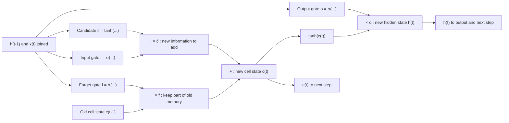
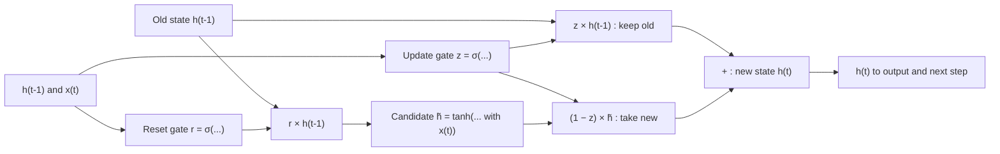

Before the new ideas, here are the old ones you need. If you already know them, skip to the next section.

## The basics first

- A **recurrent neural network (RNN)** reads a sequence one step at a time and keeps a memory vector called the **hidden state** $h_t$. At every step a plain RNN mixes the old memory with the new input, squashes the result through tanh, and **overwrites** the memory with it, using the same weights at every step.
- The **sigmoid** $\sigma$ squashes any number into the range $0$ to $1$. The **tanh** squashes any number into $-1$ to $1$.
- The next two symbols appear only in the equations, which you write when a question asks for the architecture. $\odot$ means **element-wise multiplication**: first number times first number, second times second, and so on. For example $[0.5, 1] \odot [4, 6] = [2, 6]$.
- $[h_{t-1}, x_t]$ means the two vectors **joined end to end** into one longer vector.
- An RNN is trained with **backpropagation through time (BPTT)**. Going back one step multiplies the gradient by a factor, usually below 1, so after many steps the gradient **vanishes** and the RNN cannot learn links between far-apart words. This is the problem LSTM and GRU solve. This topic is syllabus <Syl m="5" />.

## Why a plain RNN forgets

Read: "I grew up in **France** ... (30 more words) ... so I speak fluent **French**." To predict "French", the network must keep "France" for 30 steps. In a plain RNN the whole hidden state is squashed and rewritten at every step, and during training the gradient from step 30 back to step 1 is multiplied by about 30 small factors. It vanishes, so the network never learns that link. <Cite id="gfdl-ch10" loc="§10.7" />

**The fix, in one line:** instead of rewriting the memory at every step, let the network decide, with small switches called **gates**, what to keep, what to add and what to show. Keeping is done by **copying** the old memory forward, which does not shrink the gradient.

## What a gate is

<Box kind="definition">

A **gate** is a vector of numbers between 0 and 1, made by a sigmoid layer from the current input and the previous hidden state. It is multiplied element-wise with another vector to decide how much of each number passes through: 0 means "block completely", 1 means "let through completely", and 0.3 means "let 30% through".

</Box>

**Tiny example.** A memory vector $[5, -2, 8]$ passed through the gate $[1, 0, 0.5]$ becomes $[5, 0, 4]$: the first number is kept, the second erased, the third halved.

A gate is like a **water tap** that can be anywhere from fully closed to fully open. Because the sigmoid is smooth, the network can learn how far to open each tap with ordinary gradient descent. Gates use the sigmoid (a 0 to 1 dial); the new memory content uses tanh (values $-1$ to $1$, so it can push memory up or down).

<Figure caption="Gates use the sigmoid (output between 0 and 1, so it works as a how-much-to-let-through dial). The new candidate memory uses tanh (output between -1 and 1, so it can push memory values up or down).">
  <CurvePlot curves="sigmoid,tanh" x="-6,6" y="-1.2,1.2" xLabel="input to the layer" yLabel="output" />
</Figure>

## LSTM: Long Short-Term Memory

**What it is.** An LSTM is an RNN cell with a separate long-term memory, the **cell state** $c_t$, and three gates that control it. It was proposed by Hochreiter and Schmidhuber in 1997; the forget gate was added by Gers, Schmidhuber and Cummins in 2000, and that version is the one used today. <Cite id="hochreiter1997" /> <Cite id="gers2000" />

**Why it is needed.** To remember information over long gaps, which a plain RNN cannot do because of vanishing gradients.

**The analogy.** A student writing notes on a small whiteboard during a long lecture. The board has limited space, so at each moment the student

1. **erases** what is no longer needed (**selective forget**),
2. **writes down** only the important parts of what was just said (**selective read** of the new input),
3. when asked a question, **says out** only the part of the board that is relevant (**selective write** to the output).

The whiteboard is the **cell state** $c_t$, the long-term memory that runs along the whole sequence. The **hidden state** $h_t$ is the short-term, "what I am saying right now" output. This three-part picture is the usual way to teach LSTM gates. <Cite id="nptel-dl" />

### The parts of an LSTM cell

At each time step the cell takes in the input $x_t$, the previous hidden state $h_{t-1}$ and the previous cell state $c_{t-1}$, and produces $h_t$ and $c_t$.

| Part | Plain words | Operation |
|---|---|---|
| Forget gate $f_t$ | For each memory number, how much of the old memory to keep (1 keep, 0 erase) | Selective forget |
| Input gate $i_t$ | How much of the new candidate to write into memory | Selective read |
| Candidate $\tilde{c}_t$ | The new information that could be added, between $-1$ and $1$ | New content |
| Cell state $c_t$ | Keep part of the old memory, add part of the new | Long-term memory |
| Output gate $o_t$ | How much of the memory to show as output | Selective write |
| Hidden state $h_t$ | The output at this step, also passed to the next step | Short-term output |

### How an LSTM step works

1. **Look.** Join the previous hidden state and the current input.
2. **Selective forget.** The forget gate looks at them and decides, for each memory number, how much to keep. In words: forget gate = sigmoid of (weights times the joined vector, plus a bias).
3. **Selective read.** The input gate decides how much new information to let in, and a tanh layer proposes the candidate new information.
4. **Update the memory.** New cell state = (forget gate times old cell state) **plus** (input gate times candidate). Old memory is kept by multiplying and adding, never squashed.
5. **Selective write.** The output gate decides how much of the memory to show. New hidden state = output gate times tanh of the new cell state.
6. Pass $c_t$ and $h_t$ to the next step and repeat with the same weights.

### The LSTM equations

Write these when the question says "architecture" or "in detail". They are the six steps above in symbols, nothing new. Each $W$ is a learned weight matrix and each $b$ a learned bias, all shared across time steps. <Cite id="gfdl-ch10" loc="§10.10.1" /> <Cite id="d2l-lstm" /> <Cite id="colah-lstm" />

$$
f_t = \sigma\left(W_f [h_{t-1}, x_t] + b_f\right) \qquad \text{forget gate}
$$

$$
i_t = \sigma\left(W_i [h_{t-1}, x_t] + b_i\right) \qquad \text{input gate}
$$

$$
\tilde{c}_t = \tanh\left(W_c [h_{t-1}, x_t] + b_c\right) \qquad \text{candidate memory}
$$

$$
c_t = f_t \odot c_{t-1} + i_t \odot \tilde{c}_t \qquad \text{new cell state}
$$

$$
o_t = \sigma\left(W_o [h_{t-1}, x_t] + b_o\right) \qquad \text{output gate}
$$

$$
h_t = o_t \odot \tanh(c_t) \qquad \text{new hidden state}
$$

**Sum 1: one LSTM step with one memory number.** This shows the update in action. Gate values are given directly, so no weights are needed.

<Sum>

<Given>

old cell state $c_{t-1} = 2$; forget gate $f_t = 0.9$; input gate $i_t = 0.2$; candidate $\tilde{c}_t = 0.5$; output gate $o_t = 0.8$.

</Given>

<Find>

the new cell state $c_t$ and the new hidden state $h_t$.

</Find>

<Steps>

1. **Keep part of the old memory.** Multiply the old memory by the forget gate, because the forget gate says what fraction to keep: $0.9 \times 2 = 1.8$.
2. **Choose how much new information to add.** Multiply the candidate by the input gate, because the input gate says what fraction of the new content to let in: $0.2 \times 0.5 = 0.1$.
3. **Update the memory.** Add the two parts, because the cell state is "kept old plus added new": $c_t = 1.8 + 0.1 = 1.9$.
4. **Squash the memory for output.** Apply tanh to the new memory, so the output stays between $-1$ and $1$: $\tanh(1.9) \approx 0.956$.
5. **Choose how much to show.** Multiply by the output gate, because it says what fraction of the memory to reveal: $h_t = 0.8 \times 0.956 \approx 0.765$.

</Steps>

<Answer>

$c_t = 1.9$ and $h_t \approx 0.765$.

</Answer>

<Box kind="verify">

Check $c_t$ by the change instead of the total. Forgetting removes $(1 - 0.9) \times 2 = 0.2$ from the old memory, and the input adds $0.1$, so the net change is $-0.2 + 0.1 = -0.1$, and $2 - 0.1 = 1.9$. Same answer. Check $h_t$ by its range: tanh of a positive number lies between 0 and 1, so $h_t$ must lie between $0$ and $o_t = 0.8$; $0.765$ does, and is close to $0.8$ because $\tanh(1.9)$ is close to 1.

</Box>

</Sum>

**What it means.** The memory barely changed because the forget gate was nearly open and the input gate nearly closed. That is how an LSTM carries "France" for 30 steps: it learns to keep $f_t$ near 1 and $i_t$ near 0 until the memory is needed.

### How the LSTM overcomes the limitation of the RNN

<Box kind="intuition">

In a plain RNN the memory is pushed through a tanh and multiplied by $W$ at every step, like a photocopy of a photocopy that fades a little more each time. In an LSTM the cell state travels on a "conveyor belt": at each step it is only multiplied by the forget gate and has something added. If the forget gate is 1, the memory is copied exactly.

</Box>

1. **Additive memory.** The cell state is updated by keeping and adding, not by rewriting through tanh and $W$. The original paper called this the **constant error carousel**. <Cite id="hochreiter1997" />
2. **A gradient highway.** Going back one step along the cell state multiplies the gradient only by the forget gate. When the forget gate stays near 1, the gradient survives many steps (see Sum 2 below).
3. **Learned gates.** The network itself decides how long to remember. If an old value really is not needed, the forget gate closes and the gradient stops there on purpose, which is correct behaviour. <Cite id="nptel-dl" />

**Sum 2: how much gradient survives 50 steps.** Use this when the question says "how LSTM overcomes the limitation of RNN".

<Sum>

<Given>

50 time steps; a plain RNN that multiplies the gradient by about $0.5$ per step; an LSTM whose forget gate stays at $0.95$.

</Given>

<Find>

the fraction of the gradient that reaches step 1 in each network.

</Find>

<Steps>

1. **Write the rule.** Going back 50 steps multiplies the gradient by the per-step factor 50 times, so the surviving fraction is factor$^{50}$.
2. **RNN, first 10 steps.** $0.5^{10} = 1/1024 \approx 0.000977$, because ten halvings divide by $2^{10} = 1024$.
3. **RNN, all 50 steps.** 50 steps is five blocks of 10, so

   $$
   \begin{aligned}
   0.5^{50} &= (0.000977)^5 \\
   &\approx 8.9 \times 10^{-16}
   \end{aligned}
   $$
4. **LSTM, first 10 steps.** $0.95^{10} \approx 0.599$ (multiply 0.95 by itself ten times).
5. **LSTM, all 50 steps.** $(0.599)^5$: $0.599^2 \approx 0.359$, $0.359^2 \approx 0.129$, and $0.129 \times 0.599 \approx 0.077$.

</Steps>

<Answer>

the RNN keeps about $9 \times 10^{-16}$ of the gradient (effectively zero), the LSTM keeps about $0.077$, roughly 8%, which is still usable.

</Answer>

<Box kind="verify">

Check with logarithms instead of repeated multiplication.

$$
\begin{aligned}
50 \times \log_{10} 0.5 &= 50 \times (-0.301) \\
&= -15.05
\end{aligned}
$$

and $10^{-15.05} \approx 8.9 \times 10^{-16}$.

$$
\begin{aligned}
50 \times \ln 0.95 &= 50 \times (-0.0513) \\
&= -2.565
\end{aligned}
$$

and $e^{-2.565} \approx 0.077$. Both match. Sense check: both answers are below 1 (a factor under 1 always shrinks), and the LSTM's is far bigger because its factor is much closer to 1.

</Box>

</Sum>

<Box kind="pitfall">

Do not overclaim. The LSTM greatly **reduces** the vanishing-gradient problem; it does not remove it completely, and it does not stop **exploding** gradients. In practice LSTMs are still trained with gradient clipping. <Cite id="pascanu2013" /> <Cite id="gfdl-ch10" loc="§10.11.1" />

</Box>

### Advantages, disadvantages and applications of LSTM

| Advantages | Disadvantages |
|---|---|
| Remembers information over long gaps (the 1997 paper bridged time lags of over 1000 steps on artificial tasks) | Four sets of weights, so about 4 times the parameters of a plain RNN |
| Greatly reduces vanishing gradients | Slower to train and run; steps still cannot run in parallel |
| Separate gates give fine control: keep old and add new independently | Needs more data to train well; can overfit small datasets |
| Can process sequences of any length | Exploding gradients still need clipping |

**Applications:** machine translation, speech recognition, handwriting recognition, text generation, time-series forecasting (stock, weather, energy demand). <Cite id="gfg-lstm" /> <Cite id="ibm-lstm" /> <Cite id="keras-lstm" />

## GRU: Gated Recurrent Unit

**What it is.** The GRU, proposed by Cho and others in 2014, is a simpler gated RNN cell. It merges the LSTM's cell state and hidden state into **one** vector $h_t$ and uses only **two gates**. <Cite id="cho2014" />

**Why it is needed.** It keeps the LSTM's main benefit, long-term memory without vanishing gradients, with fewer weights and faster training.

**The two gates.**

- **Update gate** $z_t$: how much of the old memory to keep, and therefore how much new memory to take in. It does the job of the LSTM's forget and input gates **together**: keeping more old memory automatically means taking in less new.
- **Reset gate** $r_t$: how much of the old memory to look at when making the new candidate. If it is near 0, the candidate is built almost only from the current input, as if starting fresh (useful at the start of a new sentence).

**The analogy.** You keep a running summary of a news story. The update gate is how much of your old summary you keep. The reset gate is whether you look at the old summary while writing the new sentence, or write it from today's news alone.

### How a GRU step works

1. **Look.** Join the previous hidden state and the current input.
2. **Gates.** Compute the update gate and the reset gate, each a sigmoid (0 to 1).
3. **Candidate.** Multiply the old state by the reset gate, join it with the input, and pass it through tanh to get the candidate new memory.
4. **Blend.** New state = (update gate times old state) **plus** (one minus update gate) times candidate. This is a weighted average of old and new.
5. Pass $h_t$ to the output and the next step.

### The GRU equations

Write these when the question says "in detail". They are the steps above in symbols. The form in Goodfellow's book and d2l. <Cite id="gfdl-ch10" loc="§10.10.2" /> <Cite id="d2l-gru" />

$$
z_t = \sigma\left(W_z [h_{t-1}, x_t] + b_z\right) \qquad \text{update gate}
$$

$$
r_t = \sigma\left(W_r [h_{t-1}, x_t] + b_r\right) \qquad \text{reset gate}
$$

$$
\tilde{h}_t = \tanh\left(W_h [r_t \odot h_{t-1}, x_t] + b_h\right) \qquad \text{candidate}
$$

$$
h_t = z_t \odot h_{t-1} + (1 - z_t) \odot \tilde{h}_t \qquad \text{new hidden state}
$$

<Box kind="pitfall">

Some sources (for example Olah's blog and Chung et al.'s 2014 comparison) write $h_t = (1 - z_t) \odot h_{t-1} + z_t \odot \tilde{h}_t$. That is the same model with the meaning of $z_t$ flipped (there, $z_t$ near 1 means "take the new"). Either is correct if you say what $z_t$ means. Use one form consistently in an answer. <Cite id="chung2014" /> <Cite id="colah-lstm" />

</Box>

**Sum 3: one GRU step with one memory number.**

<Sum>

<Given>

old state $h_{t-1} = 1.0$; update gate $z_t = 0.75$; candidate $\tilde{h}_t = -0.2$.

</Given>

<Find>

the new state $h_t$.

</Find>

<Steps>

1. **Keep part of the old memory.** Multiply the old state by the update gate, because $z_t$ is the fraction of old memory kept: $0.75 \times 1.0 = 0.75$.
2. **Find the share left for new information.** Subtract the update gate from 1, because whatever is not kept is taken from the candidate: $1 - 0.75 = 0.25$.
3. **Take that share of the candidate.** $0.25 \times (-0.2) = -0.05$.
4. **Blend.** Add the two parts: $h_t = 0.75 + (-0.05) = 0.70$.

</Steps>

<Answer>

$h_t = 0.70$.

</Answer>

<Box kind="verify">

Check by moving from the candidate towards the old state. The gap between old and new is $1.0 - (-0.2) = 1.2$; the update gate says to move 75% of that gap from the candidate towards the old state:

$$
-0.2 + 0.75 \times 1.2 = -0.2 + 0.9 = 0.70
$$

Same answer. Range check: a weighted average must lie between $-0.2$ and $1.0$, nearer $1.0$ since that has the bigger weight; $0.70$ does.

</Box>

</Sum>

**What it means.** Three quarters of the old memory were kept and a quarter of the new mixed in. If the update gate were 1, the state would be copied exactly, so, as in the LSTM, the gradient along that path is not shrunk.

### Advantages, disadvantages and applications of GRU

| Advantages | Disadvantages |
|---|---|
| Fewer gates and no cell state: three weight sets instead of four, about 25% fewer parameters | One gate couples keeping and adding, so less fine control than an LSTM |
| Faster to train and run, less memory | No output gate: the whole state is always exposed |
| Often as accurate as LSTM, and works well with smaller datasets | Can be slightly worse on very long dependencies |
| Also greatly reduces vanishing gradients | Still sequential; exploding gradients still need clipping |

**Applications:** speech recognition, machine translation, music modelling, time-series forecasting, and on-device models where speed and memory matter. <Cite id="gfg-gru" /> <Cite id="keras-gru" /> <Cite id="pytorch-gru" />

## LSTM versus GRU

| Point | LSTM | GRU |
|---|---|---|
| Proposed | Hochreiter and Schmidhuber, 1997 (forget gate added in 2000) | Cho et al., 2014 |
| Gates | 3: forget, input, output | 2: update, reset |
| Memory | Separate cell state $c_t$ and hidden state $h_t$ | One hidden state $h_t$ only |
| Keeping versus adding | Separate forget and input gates, independent | One update gate does both: keep $z$, add $1 - z$ |
| Output control | Output gate decides how much memory to show | No output gate: the whole state is the output |
| Weight sets | 4 (forget, input, candidate, output) | 3 (update, reset, candidate), about 25% fewer parameters |
| Speed | Slower | Faster to train and run |
| Data | Often better with lots of data and very long dependencies | Often does as well with less data |
| Typical uses | Machine translation, speech recognition, long text | Similar tasks where speed or memory matters, smaller datasets |

**Sum 4: count the parameters, if asked.** Each gate (and the candidate) is one small layer: a weight for every pair of (hidden unit, joined input) plus one bias per hidden unit. <Cite id="keras-lstm" /> <Cite id="pytorch-lstm" />

<Sum>

<Given>

input size $m = 3$, hidden size $n = 2$. LSTM has 4 weight sets (forget, input, candidate, output); GRU has 3 (update, reset, candidate).

</Given>

<Find>

the number of trainable parameters in one LSTM layer and one GRU layer.

</Find>

<Steps>

1. **Length of the joined input.** $h_{t-1}$ has $n = 2$ numbers and $x_t$ has $m = 3$, so the joined vector has $2 + 3 = 5$.
2. **Weights in one set.** Each of the $n = 2$ units has one weight per joined number: $2 \times 5 = 10$.
3. **Biases in one set.** One per unit: $2$.
4. **One set in total.** $10 + 2 = 12$. In symbols, one set has $n(n + m) + n$ numbers.
5. **LSTM.** 4 sets: $4 \times 12 = 48$.
6. **GRU.** 3 sets: $3 \times 12 = 36$.

</Steps>

<Answer>

LSTM has 48 parameters and GRU has 36 parameters.

</Answer>

<Box kind="verify">

Count by where each weight comes from instead of by set. LSTM: input weights $4 \times (n \times m) = 4 \times 6 = 24$, recurrent weights $4 \times (n \times n) = 4 \times 4 = 16$, biases $4 \times n = 8$; total $24 + 16 + 8 = 48$. GRU: $18 + 12 + 6 = 36$. Same answers. Ratio check: $36 / 48 = 0.75$, so GRU has 25% fewer parameters, as the table says.

</Box>

</Sum>

Keras' default GRU, with `reset_after=True`, keeps an extra bias per set and shows $36 + 3 \times 2 = 42$. Say which version you use.

**Which is better?** Chung and others compared them on music and speech data and found both clearly better than a plain tanh RNN, but neither consistently better than the other. So the honest answer is: it depends on the task; try GRU first when speed matters, LSTM when sequences are very long. <Cite id="chung2014" /> <Cite id="av-lstm-gru" /> <Cite id="gfg-rnn-lstm-gru" />

## RNN versus LSTM on long-term dependencies

| Point | Plain RNN | LSTM |
|---|---|---|
| Memory | One hidden state, fully rewritten each step | Cell state that is kept and added to |
| Gradient over many steps | Multiplied by tanh slope times $W$ each step, usually vanishes | Along the cell path multiplied by the forget gate, which can stay near 1 |
| Useful memory span | A few steps to a few tens of steps in practice | Can link inputs hundreds of steps apart |
| Control | None: everything is mixed in every step | Learned gates decide what to forget, read and write |
| Parameters and speed | Fewer, faster per step | About 4 times as many, slower per step |

**A real application where LSTM clearly beats a plain RNN: machine translation.** To translate a long sentence, the meaning of the first words (the subject, whether the sentence is a question, a "not") must be remembered until the end, and the verb's form often depends on a subject many words earlier. A plain RNN loses that early information because of vanishing gradients. Sutskever and others used deep LSTMs for English to French translation and reported that the LSTM handled long sentences well. Speech recognition is another example, where deep bidirectional LSTMs gave strong results. <Cite id="sutskever2014" /> <Cite id="graves2013" /> <Cite id="hochreiter1997" />

**Conclusion.** Both are gated RNNs that fix the plain RNN's short memory; LSTM gives more control with three gates and a cell state, GRU gives similar accuracy with two gates and fewer weights.

## Where this was asked

| If the question says | What to write | Seen as |
|---|---|---|
| "Explain Gated Recurrent Unit in detail" | Why gates, the two gates in words, step-by-step working, the four equations, GRU diagram, advantages, disadvantages, uses | <PYQ id="2023-12/q2a" /> |
| "Explain LSTM architecture" | Cell state and three gates (selective forget, read, write), step-by-step working, six equations, LSTM diagram, advantages, uses | <PYQ id="2023-12/q5b" /> |
| "Explain LSTM model, how it overcomes the limitation of RNN" | RNN's vanishing gradient first, then the LSTM cell, then the conveyor-belt argument with the $0.5^{50}$ vs $0.95^{50}$ numbers (Sum 2) | <PYQ id="2024-05/q4a" /> |
| "Differentiate between the (architecture of) LSTM and GRU" | Short description and diagram of each, then the comparison table | <PYQ id="2024-12/q3b" /> <PYQ id="2025-05/q3b" /> |
| "How RNNs suit sequential data; RNN vs LSTM for long-term dependencies; real-world application" | Memory and weight sharing; the RNN vs LSTM table; machine translation with the justification | <PYQ id="2025-05/q4b" /> |

## Quick revision

- Gate = sigmoid output in 0..1, multiplied element-wise: 0 blocks, 1 passes.
- LSTM: cell state (long-term) plus hidden state (output); forget gate = selective forget, input gate = selective read, output gate = selective write.
- LSTM update: $c_t = f_t \odot c_{t-1} + i_t \odot \tilde{c}_t$, $h_t = o_t \odot \tanh(c_t)$.
- LSTM beats vanishing gradients because along the cell state the gradient is multiplied only by the forget gate, which can stay near 1.
- GRU: update gate (keep old vs take new) and reset gate (how much old to use for the candidate); $h_t = z_t \odot h_{t-1} + (1-z_t) \odot \tilde{h}_t$.
- GRU: fewer gates, no cell state, about 25% fewer parameters, faster. LSTM: more control, safer for very long sequences. Results are often similar.
