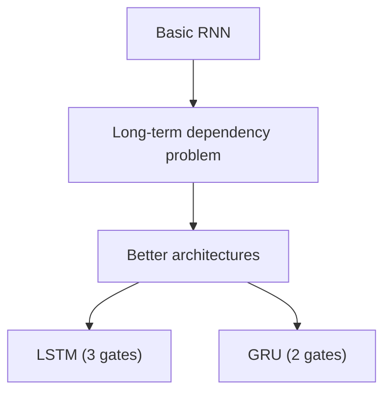
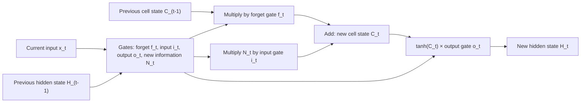
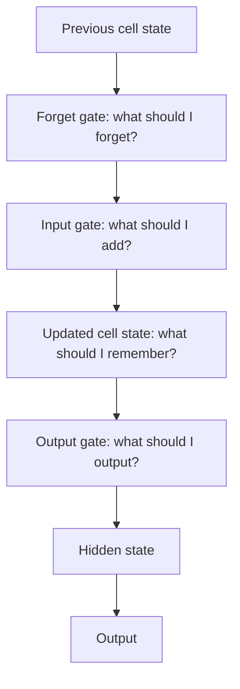
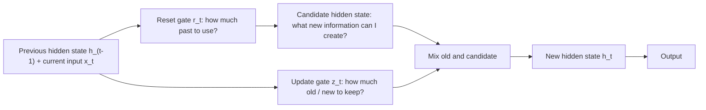

Before the new ideas, here are the old ones you need. If you already know them, skip to the next section.

## The basics first

- An **RNN** reads a sequence one step at a time. At every step it takes the current input and the previous **hidden state** and gives a new hidden state (see the RNN note). <Cite id="class-dl-chp5" loc="slide 7" />
- **BPTT** (backpropagation through time) sends the error backward through all the time steps to update the weights. <Cite id="class-dl-chp5" loc="slide 10" />
- In a long sequence the gradient may become too small (**vanishing gradient**) or too large (**exploding gradient**). <Cite id="class-dl-chp5" loc="slide 11" />
- **Sigmoid** squeezes any number into a value between 0 and 1. **tanh** squeezes it between −1 and 1. <Cite id="class-dl-m5" loc="p. 13" />
- A **gate** here is just a number between 0 and 1 that is multiplied with some information. 0 closes the gate (nothing passes), 1 opens it fully (everything passes).

## Why a plain RNN is not enough

A basic RNN may struggle to retain information over very long sequences. In "I was born in India ... many words later ... I speak Hindi", the word "India" has to reach the prediction "Hindi" across many time steps. During BPTT the gradient becomes almost zero over that distance, so earlier time steps receive very little learning signal. This is the **long-term dependency problem.** <Cite id="class-dl-chp5" loc="slide 15" /> <Cite id="class-dl-m5" loc="p. 16" />

## LSTM: Long Short-Term Memory

<Box kind="definition">

**LSTM** is a special kind of recurrent neural network capable of handling long-term dependencies. Long Short Term Memory Network is an advanced RNN, a sequential network, that allows information to persist. It is capable of handling the vanishing gradient problem faced by RNN. <Cite id="class-dl-m5" loc="p. 18" />

**Key idea:** LSTM uses **gates** to control the flow of information. <Cite id="class-dl-chp5" loc="slide 11" />

</Box>

**Everyday analogy.** While watching a video you remember the previous scene, and while reading a book you know what happened in the earlier chapter. The RNN also remembers previous information, but it cannot remember long-term dependencies because of the vanishing gradient. LSTMs are explicitly designed to avoid the long-term dependency problem. <Cite id="class-dl-m5" loc="p. 18" />

### Why does an LSTM need gates?

An RNN receives new information at every time step, but not all information is important. In "I live in Mumbai. I love pizza. I am studying Computer Engineering." the LSTM has to decide: what information should I keep, what should I forget, what new information should I add, and what information should I output? **Gates control the flow of information in an LSTM.** <Cite id="class-dl-chp5" loc="slide 16" />

### The architecture: three parts and two states

At a high level an LSTM works very much like an RNN cell. It has three parts, and each part performs an individual function. The three parts are called **gates**: <Cite id="class-dl-m5" loc="p. 20" />

1. **Forget gate:** chooses whether the information coming from the previous time step is to be remembered or is irrelevant and can be forgotten.
2. **Input gate:** the cell tries to learn new information from the input to this cell.
3. **Output gate:** the cell passes the updated information from the current time step to the next time step.

The class syllabus lists the same three jobs as **selective forget** (forget gate), **selective write** (input gate) and **selective read** (output gate). <Cite id="class-dl-chp5" loc="slide 2" />

Just like a simple RNN, an LSTM has a hidden state, $H_{t-1}$ for the previous time step and $H_t$ for the current one. In addition it has a **cell state**, $C_{t-1}$ and $C_t$. **The hidden state is known as short-term memory and the cell state is known as long-term memory.** The cell state carries the information along all the time steps. <Cite id="class-dl-m5" loc="p. 21" />

### Forget gate: what should we forget?

In a cell of the LSTM network, the first step is to decide whether we should keep the information from the previous time step or forget it. A **sigmoid** is applied, so $f_t$ is a number between 0 and 1. <Cite id="class-dl-m5" loc="p. 22" />

$$
f_t = \sigma(x_t U_f + H_{t-1} W_f)
$$

$x_t$ is the input at the current time step, $U_f$ the weight associated with the input, $H_{t-1}$ the hidden state of the previous time step and $W_f$ the weight matrix associated with the hidden state. If $f_t = 0$ then $C_{t-1} \times f_t = 0$ (forget everything). If $f_t = 1$ then $C_{t-1} \times f_t = C_{t-1}$ (forget nothing). <Cite id="class-dl-m5" loc="p. 22" />

### Input gate and new information: what should we store?

The input gate quantifies the importance of the new information carried by the input. $i_t = \sigma(x_t U_i + H_{t-1} W_i)$. <Cite id="class-dl-m5" loc="p. 23" />

The new information that may be passed to the cell state is a function of the previous hidden state and the current input, with **tanh** as the activation, so its value is between −1 and 1. If $N_t$ is negative the information is subtracted from the cell state, and if it is positive the information is added. <Cite id="class-dl-m5" loc="p. 23" />

$$
N_t = \tanh(x_t U_c + H_{t-1} W_c)
$$

### Updating the cell state

$N_t$ is not added directly. It is first multiplied by the input gate, and the old cell state is multiplied by the forget gate: <Cite id="class-dl-m5" loc="p. 24" />

<Box kind="key">

$$
C_t = f_t \times C_{t-1} + i_t \times N_t
$$

$C_{t-1}$ is the cell state of the previous time step. **New cell state = (what we keep of the old) + (what we add of the new).** <Cite id="class-dl-m5" loc="p. 24" />

</Box>

### Output gate: what should we output?

The output gate decides what information of the updated memory is given as the current output. Its value is also between 0 and 1 because of the sigmoid. The current hidden state is the output gate value times tanh of the updated cell state: <Cite id="class-dl-m5" loc="p. 24" />

$$
o_t = \sigma(x_t U_o + H_{t-1} W_o), \qquad H_t = o_t \times \tanh(C_t)
$$

So the hidden state is a function of the long-term memory $C_t$ and the current output. If we need the output of the current time step, we apply **softmax** on $H_t$; the token with the maximum score is the prediction. <Cite id="class-dl-m5" loc="p. 25" />

### The whole LSTM step

**Sum: one LSTM update by hand (the class example).** <Cite id="class-dl-chp5" loc="slide 17" />

<Sum>

<Given>

old memory (cell state) $C_{t-1} = 10$. Forget gate $f_t = 0.2$. New information $N_t = 5$. Input gate $i_t = 0.8$.

</Given>

<Find>

the new cell state $C_t$.

</Find>

<Steps>

1. **What the old memory keeps:** $f_t \times C_{t-1} = 0.2 \times 10 = 2$. Only a small amount of the old information is retained, because the gate is nearly closed.
2. **What is added:** $i_t \times N_t = 0.8 \times 5 = 4$.
3. **Add them:** $C_t = 2 + 4 = 6$.

</Steps>

<Answer>

$C_t = 6$

</Answer>

<Box kind="verify">

Use the formula in one line: $C_t = 0.2 \times 10 + 0.8 \times 5 = 2 + 4 = 6$. Also check the gate ends: if $f_t$ were 1 and $i_t$ were 0, $C_t$ would be $10$, the old memory unchanged; if $f_t$ were 0, the old memory would be erased.

</Box>

</Sum>

### How an LSTM learns

LSTM does **not** use a completely different backpropagation method. It is also trained using BPTT: a forward pass over the sequence gives a prediction and a loss, and the error is propagated backward through the sequence. The difference is that **the cell state provides a better pathway for information and gradients across time.** <Cite id="class-dl-chp5" loc="slide 18" />

### How the LSTM overcomes the limitation of the RNN

- The RNN's limitation: the memory is overwritten at every step and the gradient vanishes over long sequences, so it cannot remember long-term dependencies.
- The LSTM keeps a separate **cell state** (long-term memory) that is changed only by forgetting a little and adding a little, controlled by the gates. Useful information can therefore travel across many time steps, and the gradient has a better path back through time. <Cite id="class-dl-m5" loc="p. 18" /> <Cite id="class-dl-chp5" loc="slide 18" />
- LSTM is capable of handling the vanishing gradient problem faced by RNN. <Cite id="class-dl-m5" loc="p. 18" />

### RNN versus LSTM

| Aspect | RNN | LSTM |
|---|---|---|
| Memory | Has hidden state | Has hidden state + cell state |
| Memory mechanism | Basic memory mechanism | Special memory mechanism |
| Long-term dependencies | Can struggle | Designed to handle better |
| Gates | No gates | Uses gates |
| Structure | Simpler | More complex |
| Vanishing gradient | Can be a problem | Gates help preserve useful information |

<Cite id="class-dl-chp5" loc="slide 17" />

**Short sequence: RNN may work well. Long sequence with important earlier information: LSTM can be more suitable.** LSTM is especially useful when understanding the present requires remembering information from the past. <Cite id="class-dl-chp5" loc="slide 19" />

### Advantages, disadvantages and applications of LSTM

- **Advantages over RNN:** handles long-term dependencies; copes with the vanishing gradient problem; controls memory with gates. <Cite id="class-dl-chp5" loc="slide 17" />
- **Disadvantages:** more complex structure and more parameters than an RNN (and than a GRU). <Cite id="class-dl-chp5" loc="slide 21" />
- **Applications:** LSTM is a very popular deep learning algorithm for sequence models. Apple's Siri and Google's voice search are real-world examples. It is also used for time-series predictions and text classification. <Cite id="class-dl-m5" loc="p. 31" />
  - **Language understanding:** "I grew up in India. After many years, I moved to another country. I still speak ___" gives "Hindi", because LSTM uses the earlier "India". <Cite id="class-dl-chp5" loc="slide 19" />
  - **Time-series prediction:** day 1 to day 5 values (stock or temperature) give the next value.
  - **Speech recognition:** a sequence of sounds becomes words; earlier sounds help understand the complete word or sentence.

## GRU: Gated Recurrent Unit

<Box kind="definition">

**GRU** is another type of RNN that uses gates to control information and handle long-term dependencies. GRUs are a modified form of RNNs. They are highly effective at capturing much longer range dependencies and also help with the vanishing gradient problem. <Cite id="class-dl-chp5" loc="slide 20" /> <Cite id="class-dl-m5" loc="p. 27" />

</Box>

Here, the LSTM's three gates are replaced by two: the **reset gate** and the **update gate**. As with LSTMs, these gates have sigmoid activations, forcing their values to lie between 0 and 1. <Cite id="class-dl-m5" loc="p. 28" />

**GRU has no separate cell state.** It mainly uses the **hidden state** to carry information. The hidden state is the GRU's main memory. <Cite id="class-dl-chp5" loc="slide 20" />

### Reset gate and update gate (the use of each gate)

- **Reset gate:** intuitively it controls **how much of the previous state we might still want to remember** (how much past information to use). 0 means ignore most of the previous information, 1 means use most of it. It controls the influence of the past when processing new information. <Cite id="class-dl-m5" loc="p. 28" /> <Cite id="class-dl-chp5" loc="slide 20" />
- **Update gate:** lets us control **how much of the new state is just a copy of the old state.** It decides how much information should come from the previous hidden state and how much from the new candidate information, so it controls how much old information is kept and how much new information is used. <Cite id="class-dl-m5" loc="p. 28" /> <Cite id="class-dl-chp5" loc="slide 20" />
- In summary, GRUs have two distinguishing features: **reset gates help capture short-term dependencies in sequences, and update gates help capture long-term dependencies.** <Cite id="class-dl-m5" loc="p. 30" />

### How a GRU step works

<Cite id="class-dl-chp5" loc="slide 20" />

1. Look at the previous hidden state $h_{t-1}$ and the current input $x_t$.
2. Use the **reset gate** $r_t$ to decide how much of $h_{t-1}$ to use.
3. Create the **candidate** (new) information $\tilde{h}_t$.
4. Use the **update gate** $z_t$ to mix the old hidden state and the candidate.
5. Produce the **new hidden state** $h_t$.

**The GRU equations** (Module 5, p. 26, with the update gate $z_t$ as the share of the **old** state kept, the convention of the class slides): <Cite id="class-dl-m5" loc="p. 26" /> <Cite id="class-dl-chp5" loc="slide 21" />

$$
\begin{aligned}
r_t &= \sigma(W_r [x_t, h_{t-1}] + b_r) &&\text{(reset gate)}\\
z_t &= \sigma(W_z [x_t, h_{t-1}] + b_z) &&\text{(update gate)}\\
\tilde{h}_t &= \tanh(W_h [x_t,\ r_t \odot h_{t-1}] + b_h) &&\text{(candidate)}\\
h_t &= z_t \odot h_{t-1} + (1 - z_t) \odot \tilde{h}_t &&\text{(new hidden state)}
\end{aligned}
$$

$\sigma$ is sigmoid, $\odot$ is element-wise multiplication and $[x_t, h_{t-1}]$ is concatenation.

<Box kind="pitfall">

**Two ways of writing the last line.** The class slides use $z$ as the share of the old state kept ($h_t = z \odot h_{t-1} + (1-z) \odot \tilde{h}_t$, with $z = 0.7$ meaning "70% kept"). The Module 5 figure on p. 26 writes it the other way round ($h_t = (1 - z_t) \odot h_{t-1} + z_t \odot \tilde{h}_t$). Both describe the same mixing; they only swap what $z$ means. Pick one and use it consistently in the answer. <Cite id="class-dl-m5" loc="p. 26" />

</Box>

**Sum: the update gate on numbers (the class example).** <Cite id="class-dl-chp5" loc="slide 21" />

<Sum>

<Given>

previous hidden state $h_{t-1} = 10$, new candidate information $\tilde{h}_t = 4$, update gate $z = 0.7$.

</Given>

<Find>

the new hidden state $h_t$.

</Find>

<Steps>

1. **Old information kept:** $z \times h_{t-1} = 0.7 \times 10 = 7$ (70% kept).
2. **New information used:** $(1 - z) \times \tilde{h}_t = 0.3 \times 4 = 1.2$ (30% used).
3. **Add them:** $h_t = 7 + 1.2 = 8.2$.

</Steps>

<Answer>

$h_t = 8.2$

</Answer>

<Box kind="verify">

The new value lies between the old value 4 and 10, as a weighted average should: $4 \le 8.2 \le 10$. The two shares $0.7 + 0.3 = 1$. (This is a simplified illustration: the full GRU also uses the reset gate and the candidate.)

</Box>

</Sum>

### Advantages of GRU

- **Simpler architecture** (two gates, no separate cell state), so **fewer parameters** and we can build bigger models. <Cite id="class-dl-m5" loc="p. 31" /> <Cite id="class-dl-chp5" loc="slide 21" />
- It captures long-range dependencies and helps with the vanishing gradient problem. <Cite id="class-dl-m5" loc="p. 27" />
- Used in NLP (text generation, translation), speech recognition, time-series forecasting, video analysis and emotion recognition. <Cite id="class-dl-m5" loc="p. 26" />

## LSTM versus GRU

The GRU is a simplified LSTM: its single update gate does the job of the forget and input gates together. LSTM is more powerful and effective as it has 3 gates instead of 2; GRU has the advantage of a simpler architecture. <Cite id="class-dl-m5" loc="p. 31" />

| Feature | LSTM | GRU |
|---|---|---|
| Main memory | Cell state + hidden state | Hidden state only |
| Gates | 3 main gates | 2 main gates |
| Forget gate | Yes | No |
| Input gate | Yes | No |
| Output gate | Yes | No |
| Reset gate | No | Yes |
| Update gate | No | Yes |
| Structure | More complex | Simpler |
| Parameters | More | Fewer |

<Cite id="class-dl-chp5" loc="slide 21" />

## Where this was asked

| If the question says | What to write | Seen as |
|---|---|---|
| "Explain LSTM architecture" or "Analyse the architecture of LSTM" | Definition, cell state and hidden state, three gates with equations, cell update, diagram | <PYQ id="2023-12/q5b" /> <PYQ id="assignment-2/q5b" /> |
| "LSTM, how it overcomes the limitation of RNN" | The RNN problem first, then cell state and gates | <PYQ id="2024-05/q4a" /> |
| "Explain GRU" or "use of update gate and reset gate" | Definition, two gates and their use, equations, GRU diagram | <PYQ id="2023-12/q2a" /> <PYQ id="assignment-2/q5c" /> |
| "Differentiate LSTM and GRU" | The comparison table, then one line on why GRU is simpler | <PYQ id="2024-12/q3b" /> <PYQ id="2025-05/q3b" /> |
| "RNN versus LSTM, long-term dependencies, real application" | RNN vs LSTM table, a long-sequence example such as speech or language | <PYQ id="2025-05/q4b" /> |

## Quick revision

- Plain RNN forgets long-ago inputs (vanishing gradient). LSTM and GRU add gates to control memory.
- LSTM: hidden state (short-term) + cell state (long-term). Forget gate $f_t$, input gate $i_t$, output gate $o_t$, new information $N_t = \tanh(\cdot)$.
- $C_t = f_t C_{t-1} + i_t N_t$ and $H_t = o_t \tanh(C_t)$. Class example: $0.2 \times 10 + 0.8 \times 5 = 6$.
- Sigmoid gates give 0 to 1 (0 forget or block, 1 keep or pass). tanh gives −1 to 1.
- GRU: two gates, reset (how much past to use, short-term) and update (how much old and new to keep, long-term); no cell state; hidden state is the memory. Class example: $0.7 \times 10 + 0.3 \times 4 = 8.2$.
- LSTM: 3 gates, more parameters, more powerful. GRU: 2 gates, fewer parameters, simpler.
- Both are trained by BPTT.
