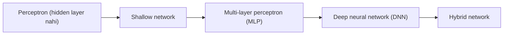
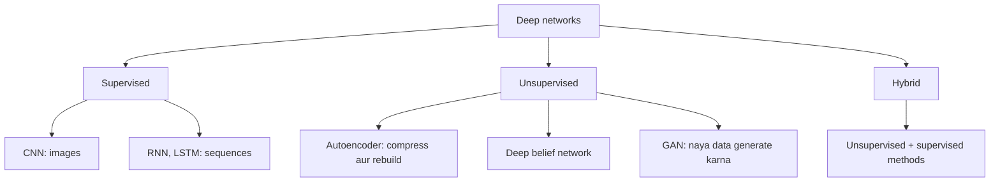
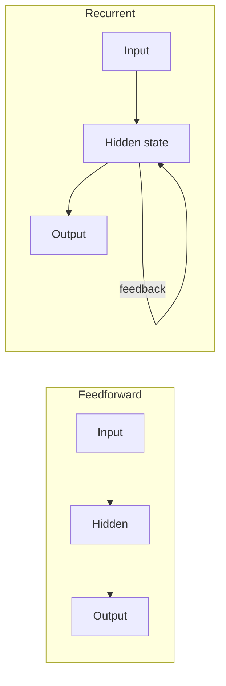

Ye syllabus <Syl m="1" /> hai. Class mein "types of neural networks" naam ki ek single list nahi hai; course aage badhte hue teacher types ko ek-ek karke batate hain. Ye note unhe ek jagah, teacher ke shabdon mein jodta hai.

## Structure ke hisaab se types

### 1. Perceptron aur shallow network

<Box kind="definition">

A **perceptron** is the simplest neural network used for binary classification. It answers only two classes (yes or no, 1 or 0). <Cite id="class-dl-chp1" loc="slide 13" />

</Box>

**Shallow network** mein ek input layer aur ek output layer hoti hai (hidden layer nahi). Iski limitation: ye sirf linear problems solve karta hai aur XOR nahi kar sakta. Example: AND gate. <Cite id="class-dl-chp1" loc="slide 16" />

### 2. Multi-layer perceptron (MLP) aur multilayer feedforward network

<Box kind="definition">

**Multi-Layer Perceptron (MLP)** consists of fully connected dense layers. It is called multi-layer because it contains an input layer, one or more hidden layers and an output layer. Its purpose is to model complex relationships between inputs and outputs. <Cite id="class-dl-m1" loc="p. 17" />

</Box>

Ye un complex aur non-linear problems ke liye hai jo single perceptron nahi kar sakta, jaise XOR. <Cite id="class-dl-chp1" loc="slide 22" />

**Multilayer feedforward neural network (MLFFNN)** ek neural network hai jismein ek input layer, ek ya zyada hidden layers aur ek output layer hoti hai, aur information sirf input se output ki taraf jaati hai. Feedforward network mein feedback ya loops nahi hote, aur output sirf current input par depend karta hai. Applications: pattern recognition, image classification, medical diagnosis. <Cite id="class-dl-chp2" loc="slide 4" /> <Cite id="class-dl-chp1" loc="slide 28" />

### 3. Deep neural network (DNN)

<Box kind="definition">

A **Deep Neural Network (DNN)** is a type of Artificial Neural Network that contains one input layer, two or more hidden layers, and one output layer. It learns patterns from the input data and produces the required output. In simple words, a DNN is a network of neurons that learns from examples and makes predictions or decisions. <Cite id="class-dl-chp2" loc="slide 2" />

</Box>

Single-layer network sirf simple problems solve karta hai. DNN pehli hidden layer mein simple features seekhta hai, gehri layers mein unhe milakar zyada meaningful features banata hai, aur phir accurate predictions deta hai. <Cite id="class-dl-chp2" loc="slide 2" />

### 4. Hybrid network

**Hybrid networks combine different types of neural networks.** Inhe single network ki limitations door karne aur accuracy aur performance badhane ke liye use karte hain. Example: feedforward aur recurrent networks ko combine karna. <Cite id="class-dl-chp1" loc="slide 16" />

## Seekhne ke tareeke ke hisaab se types

Teacher deep network architectures ko teen families mein group karte hain. <Cite id="class-dl-chp1" loc="slide 25" />

| Network | Teacher ke shabdon mein ye kya hai | Kis liye |
|---|---|---|
| CNN | A type of deep neural network specially designed to work with images and other grid-like data. Ye convolutional filters se spatial features seekhta hai. <Cite id="class-dl-chp4" loc="slide 5" /> | Images |
| RNN | A type of neural network that can be used to model sequence data. Ismein hidden states hote hain aur pichhle outputs ko inputs ki tarah use kiya ja sakta hai. <Cite id="class-dl-m5" loc="p. 8" /> <Cite id="class-dl-m5" loc="p. 9" /> | Sequences (text, time) |
| LSTM | A special kind of recurrent neural network capable of handling long-term dependencies. <Cite id="class-dl-m5" loc="p. 18" /> | Lambi sequences |
| Autoencoder | A self-supervised model used to reduce the size of input data by recreating it. <Cite id="class-dl-m3" loc="p. 4" /> | Compression, representation learning |
| GAN | A deep learning model used to generate new data that looks similar to real training data. Ismein do networks hote hain, generator aur discriminator. <Cite id="class-dl-chp6" loc="slide 3" /> | Images generate karna |

## Feedforward vs recurrent

Feedforward network information ko ek hi direction mein input se output tak le jaata hai. Jab feedforward networks mein feedback connections jod diye jaate hain, to unhe recurrent neural networks kehte hain. <Cite id="class-dl-m1" loc="p. 10" />

## Ye kahan pucha gaya

| Agar question kahe | Kya likhna hai | Kab aaya |
|---|---|---|
| "Explain types of neural network" | Perceptron, MLP, DNN aur hybrid ek-ek line mein, phir supervised aur unsupervised families CNN, RNN, LSTM, autoencoder, GAN ke saath, aur ek table | <PYQ id="2025-05/q1c" /> |

## Quick revision

- Perceptron: simplest, binary classification, hidden layer nahi. Shallow network: sirf input aur output layers, sirf linear problems.
- MLP: input + hidden layers + output, fully connected, non-linear problems solve karta hai.
- Feedforward: information sirf aage, loops nahi. Recurrent: feedback connections jude hote hain.
- DNN: ek input layer, do ya zyada hidden layers, ek output layer.
- Hybrid network: alag-alag types combine.
- Supervised: CNN, RNN, LSTM. Unsupervised: autoencoders, DBN, GANs.

**Conclusion.** Neural networks ek-neuron wale perceptron se shuru hokar kai hidden layers wale deep networks tak badhte hain, aur special types (CNN, RNN, LSTM, autoencoder, GAN) khaas data aur learning styles ke liye bane hain. <Cite id="class-dl-chp1" loc="slide 25" />
