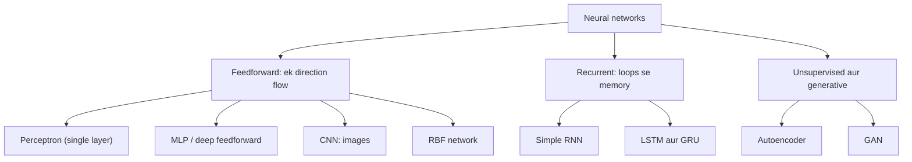
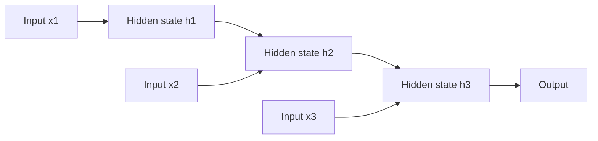

Naye ideas se pehle, wo purane ideas jo tumhe chahiye. Agar ye pehle se aate hain, to agle section pe chale jao.

## Pehle basics

- Ek **neuron** kuch numbers leta hai, har ek ko ek **weight** se multiply karta hai, ek **bias** add karta hai, aur total ko ek **activation function** se pass karta hai (ek simple rule jaise "positive hai to rakho, warna 0").
- **Layer** neurons ka ek group hai jo saath-saath kaam karte hain. **Input layer** data leti hai, **output layer** answer deti hai, aur beech wali layers **hidden layers** kehlati hain.
- Ek **connection** ek neuron ka output doosre neuron tak le jaata hai, aur us pe ek weight hota hai.
- **Training** ka matlab hai weights ko adjust karna taaki answers sahi answers (**labels**) ke kareeb aa jaayein.
- Alag problems mein data ka shape alag hota hai: numbers ki table, ek image (pixels ka grid), ya ek sequence (sentence ke words, time ke saath readings). Har type ka network ek shape ke liye design kiya gaya hai.

## Itne saare types kyun hain

Vehicles ke baare mein socho. Sab mein wheels aur engine hote hain, lekin bus, truck aur bike alag-alag kaam ke liye bane hain. Neural networks bhi aise hi hain: sab neurons aur weights use karte hain, lekin alag data ke liye alag tarah se wired hote hain. Ek plain fully connected network theory mein kuch bhi seekh *sakta* hai, lekin images ke liye use bahut zyada weights chahiye, aur sequences ke liye uske paas memory nahi hoti. Special wiring har problem ko fix karti hai. Ye syllabus <Syl m="1" /> ka part hai; aage ke modules CNN, RNN, autoencoder aur GAN ko detail mein padhte hain.

Networks ko teen common tareekon se group kar sakte hain: <Cite id="tp-ann-basics" /> <Cite id="wiki-nn-types" />

1. **Neurons kaise connected hain.** **Feedforward**: information sirf aage jaati hai, input se output, koi loop nahi. **Recurrent (feedback)**: kuch outputs agle step pe wapas input ban jaate hain, jisse network ko memory milti hai.
2. **Layers ki ginti se.** **Single-layer** (sirf neurons ki ek output layer, jaise perceptron) ya **multilayer** (ek ya zyada hidden layers).
3. **Kaise seekhte hain.** **Supervised** (labels ke saath, jaise CNN classifier) ya **unsupervised** (bina labels, jaise autoencoder). Deng aur Yu ek alag split use karte hain, **generative**, **discriminative** aur **hybrid** classes mein; three-classes topic dekho. <Cite id="deng-yu-2014" loc="§3.1" />

**Feedforward versus recurrent, sabse main split.**

| | Feedforward | Recurrent |
|---|---|---|
| Direction of flow | Ek hi direction, input se output | Loops hain: ek step ka output agle step mein jaata hai |
| Memory of earlier inputs | Nahi | Haan, hidden state ke through |
| Input | Fixed size (ek row, ek image) | Kisi bhi length ka sequence |
| Training | Backpropagation | Backpropagation through time |
| Examples | Perceptron, MLP, CNN, RBF | RNN, LSTM, GRU |

## 1. Perceptron (single-layer network)

**Ye kya hai.** Sabse simple network: ek neuron (ya neurons ki ek layer) jisme **step** activation hota hai. Rosenblatt ne 1958 mein propose kiya. <Cite id="rosenblatt1958" />

**Ye kyun zaroori hai.** Ye pehli machine thi jo haath se program kiye bina, examples se yes/no decision seekh sakti thi.

**Ye kaise kaam karta hai.**

1. Har input ko uske weight se multiply karo.
2. Ye saare products aur bias add karke ek total nikaalo.
3. Agar total 0 ya usse zyada hai to output 1, warna output 0 (step rule).
4. Agar output galat hai, to weights ko sahi answer ki taraf thoda khiskao aur repeat karo.

Example: weights 1 aur 1 aur bias −1.5 se AND gate banta hai: sirf jab dono inputs 1 hon tab total (1 + 1 − 1.5 = 0.5) 0 ya usse zyada hota hai.

**Advantages.** Bahut simple aur fast; apne weights khud seekhta hai; har straight-line-separable problem seekhna guaranteed hai.

**Disadvantages.** Sirf ek straight-line boundary, isliye XOR nahi seekh sakta; output sirf 0 ya 1.

**Applications.** Simple yes/no decisions, logic gates, aur bade networks ka building block. <Cite id="gfg-perceptron" />

## 2. Feedforward network / multilayer perceptron (MLP)

**Ye kya hai.** Layers mein neurons (input, ek ya zyada hidden, output), har neuron agli layer ke har neuron se connected, aur information sirf ek direction mein flow karti hai. <Cite id="gfdl-ch6" />

**Ye kyun zaroori hai.** Ek akela perceptron sirf ek straight line kheench sakta hai, isliye XOR jaisi problems pe fail hota hai. Hidden layers add karne se network apni boundary ko mod (bend) sakta hai.

**Ye kaise kaam karta hai.** Har hidden neuron weighted sum nikaalta hai, bias add karta hai aur ek non-linear activation (ReLU, sigmoid, tanh) lagata hai, phir result aage bhejta hai. Hidden layers ki wajah se ye curved boundaries seekh leta hai; kaafi hidden neurons hon to ye kisi bhi continuous function ko approximate kar sakta hai. Isko backpropagation se train karte hain. <Cite id="rumelhart1986" />

<Figure caption="Ek feedforward network: har arrow aage point karta hai aur har neuron agli layer ke har neuron ko feed karta hai. Koi loop nahi hai, isliye network ko pichhle inputs ki koi memory nahi hoti.">
  <NetworkFigure layers="4,5,3" title="Feedforward network (MLP)" labels="Input,Hidden,Output" />
</Figure>

**Advantages.** Non-linear patterns seekhta hai; general-purpose hai; banana simple hai (`Dense` layers ka stack).

**Disadvantages.** Images ke liye bahut saare weights chahiye aur ye ignore karta hai ki paas-paas ke pixels saath belong karte hain; sequences ke liye memory nahi; overfit ho sakta hai.

**Applications.** Tabular data (rows aur columns), jaise income, age aur debt se loan default predict karna; house prices; doosre networks ki final layers. <Cite id="gfg-feedforward" />

## 3. Convolutional neural network (CNN)

**Ye kya hai.** Ek feedforward network jo images jaise grid data ke liye design kiya gaya hai. <Cite id="gfdl-ch9" /> <Cite id="lecun1998" />

**Ye kyun zaroori hai.** Images pe fully connected network ko har pixel ke liye weight chahiye, jo bahut zyada hai, aur wo ignore karta hai ki paas-paas ke pixels saath belong karte hain.

**Analogy.** Ek bade map ko chhote magnifying glass se padhna. Tum same glass ko map ke har hisse pe slide karte ho, aur har jagah same chhota pattern (ek road, ek river) dhoondhte ho.

**Ye kaise kaam karta hai.**

1. **Convolution layers** chhote **filters** (jaise weights ke 3×3 grid) ko image pe slide karti hain. Har filter ek local pattern detect karta hai, jaise ek edge.
2. Har position pe **same** filter weights use hote hain (**weight sharing**), isliye pattern jahan bhi ho, mil jaata hai.
3. **Pooling layers** result ko chhota karti hain aur strongest responses rakhti hain.
4. Gehri (deeper) layers edges ko shapes mein aur shapes ko objects mein jodti hain.
5. End mein **fully connected layers** class batati hain.

Weight sharing ki wajah se CNN sasta hai: one-channel (greyscale) image pe ek 3×3 filter mein sirf 9 weights aur 1 bias hota hai, image kitni bhi badi ho, jabki fully connected layer ko har pixel-neuron pair ke liye ek weight chahiye.

**Advantages.** Images pe MLP se bahut kam weights; picture mein kahin bhi pattern dhoondh leta hai; features khud seekhta hai.

**Disadvantages.** Bade labelled image sets aur GPUs chahiye; jis data mein grid structure nahi, uske liye kam suitable.

**Applications.** Face recognition, medical scans, self-driving cars, object detection, kuch audio tasks. <Cite id="gfg-cnn" /> <Cite id="ibm-cnn" />

## 4. Recurrent neural network (RNN)

**Ye kya hai.** Loop wala network, sequences ke liye bana hua. <Cite id="gfdl-ch10" />

**Ye kyun zaroori hai.** Feedforward network fixed-size input leta hai aur har input ko process karne ke baad bhool jaata hai, lekin sentence ya time series mein order aur pichhle items matter karte hain.

**Analogy.** Ek kahani padhna. Har naye word ko tum pichhle words ki yaad se samajhte ho.

**Ye kaise kaam karta hai.**

1. RNN sequence ko ek-ek item karke padhta hai.
2. Har step pe wo naye input ko past ki memory ke saath jodta hai, jise **hidden state** kehte hain.
3. Wo ek nayi hidden state (aur zaroorat ho to ek output) banata hai aur hidden state ko agle step ko pass karta hai.
4. Har step pe same weights reuse hote hain, isliye ye kisi bhi length ka sequence handle kar sakta hai.

Ek line mein: new memory = tanh(weights × new input + weights × old memory + bias).

**Advantages.** Kisi bhi length ke sequences handle karta hai; context yaad rakhta hai; time ke across weights share karta hai.

**Disadvantages.** Lambe sequences pe learning signal fade ho jaata hai (vanishing gradient), isliye plain RNN door ki cheezein bhool jaata hai; ek time pe ek step process karta hai, isliye train karna slow hai.

**Applications.** Text, speech, time series, translation. <Cite id="gfg-rnn" /> <Cite id="ibm-rnn" />

## 5. LSTM aur GRU

**Ye kya hain.** **Gates** wale improved RNN: chhote learned switches jo decide karte hain kya yaad rakhna hai, kya bhoolna hai aur kya output karna hai.

**Ye kyun zaroori hain.** Plain RNN kai steps pehle ki information bhool jaata hai kyunki learning signal fade ho jaata hai; gates important information ko bachaye rakhte hain.

**Ye kaise kaam karte hain.** **LSTM** (long short-term memory) ek alag memory cell rakhta hai jisme information lagbhag bina badle flow kar sakti hai, aur ise forget gate, input gate aur output gate control karte hain. <Cite id="hochreiter1997" /> **GRU** (gated recurrent unit) iska simpler version hai jisme do gates hain (reset aur update). <Cite id="cho2014" />

**Advantages.** Plain RNN se kaafi lambe sequences tak information yaad rakhte hain; vanishing-gradient problem kam karte hain.

**Disadvantages.** Plain RNN se zyada weights aur slow (LSTM, GRU se bhi zyada).

**Applications.** Lambe texts, speech recognition, stock ya weather series, machine translation. <Cite id="gfg-lstm" />

## 6. Autoencoder

**Ye kya hai.** Ek unsupervised network jo apne input ko ek beech wali layer (usually narrow) ke through copy karna seekhta hai. <Cite id="gfdl-ch14" />

**Ye kyun zaroori hai.** Zyada tar real data ke labels nahi hote; autoencoder sirf data se useful features seekh leta hai.

**Analogy.** Ek lambe chapter ko kuch bullet points mein summarize karna, phir sirf bullets se chapter dobara likhna. Agar dobara likha hua achha hai, to bullets ne important cheez pakad li thi.

**Ye kaise kaam karta hai.** Ek **encoder** input ko ek chhote **code** mein squeeze karta hai; ek **decoder** code se input wapas banata hai. Loss rebuilt output ko original input se compare karta hai, isliye **labels ki zaroorat nahi**.

<Figure caption="Ek autoencoder. Beech wali layer (code) input se narrow hai, isliye network ko output pe input wapas banane ke liye sirf sabse important information rakhni padti hai.">
  <NetworkFigure layers="5,3,2,3,5" title="Autoencoder" labels="Input,Encoder,Code,Decoder,Output" />
</Figure>

**Advantages.** Unlabelled data se seekhta hai; data ka compact summary deta hai.

**Disadvantages.** Code bahut bada ho to input ko bas copy kar sakta hai; rebuilt images aksar blurry hoti hain.

**Applications.** Compression, images se noise hatana, feature learning, anomaly detection. <Cite id="gfg-autoencoders" /> <Cite id="wiki-autoencoder" />

## 7. Generative adversarial network (GAN)

**Ye kya hai.** Do networks jo ek doosre ke against train hote hain taaki naya, realistic data ban sake. <Cite id="goodfellow2014" />

**Ye kyun zaroori hai.** Baaki types data ko classify ya compress karte hain; GAN naya data banata hai jo real lagta hai.

**Analogy.** Ek forger aur ek detective. Forger (**generator**) random noise se nakli notes banata hai; detective (**discriminator**) nakli aur asli mein farak pehchaanne ki koshish karta hai. Dono ek doosre ko hara kar better hote hain, jab tak nakli asli jaisa na lagne lage.

**Ye kaise kaam karta hai.** Generator random noise ko ek fake sample mein badalta hai. Discriminator ko real aur fake samples ka mix milta hai aur wo har ek ke real hone ki probability output karta hai. Discriminator ko sahi label dene ke liye train karte hain; generator ko is tarah train karte hain ki discriminator uske fakes ko real bol de. Dono baari-baari train hote hain, aur training ke baad sirf generator rakha jaata hai naya data banane ke liye.

**Advantages.** Bahut sharp, realistic images banata hai; labels nahi chahiye.

**Disadvantages.** Training unstable hoti hai; generator sirf kuch hi tarah ke outputs bana sakta hai (mode collapse); deepfakes ke liye misuse ho sakta hai.

**Applications.** Realistic images banana, image-to-image translation, data augmentation. Module 6 isko detail mein cover karta hai. <Cite id="gfdl-ch20" />

## 8. Radial basis function (RBF) network

**Ye kya hai.** Teen layer ka feedforward network (input, ek hidden, output) jiske hidden neurons weighted sum ki jagah is baat pe respond karte hain ki input ek stored centre point se **kitna paas** hai.

**Ye kyun zaroori hai.** Ye curve fit karne ka ek fast, local tareeka deta hai: har hidden neuron input ke sirf ek zone ki parwaah karta hai.

**Ye kaise kaam karta hai.** Har hidden neuron ka ek centre hota hai. Jab input uske centre ke paas ho to wo strongly fire karta hai, aur door ho to weakly, usually ek bell-shaped (Gaussian) curve ke hisaab se jiski width ek setting hai. Output layer in responses ko weights ke saath add karti hai.

**Advantages.** Train karna fast; samajhna aasaan (har neuron ek local zone cover karta hai).

**Disadvantages.** Input mein bahut features hon to bahut neurons chahiye; centres choose karna ek alag step hai.

**Applications.** Function approximation, simple classification, time-series prediction. <Cite id="wiki-nn-types" /> <Cite id="gfg-nn-types" />

## Kuch aur, ek-ek line mein

- **Deep belief networks** aur **restricted Boltzmann machines:** generative networks jo layer-wise pre-training ke liye use hote the. <Cite id="deng-yu-2014" loc="§3.2" />
- **Transformers:** recurrence ki jagah attention use karte hain aur poore sequence ko ek saath process karte hain; modern language models ka base.
- **Self-organizing maps:** unsupervised networks jo similar inputs ko ek grid pe paas-paas rakhte hain.

<Cite id="av-nn-types" /> <Cite id="gfg-nn-types" />

## Comparison table

| Type | Connections | Learns from | Best for | Key idea | Main limit |
|---|---|---|---|---|---|
| Perceptron | Feedforward, single layer | Labels | Simple linear yes/no | Weighted sum aur step | XOR nahi |
| MLP | Feedforward, fully connected | Labels | Tabular data | Hidden layers, non-linear | Images ke liye bahut weights |
| CNN | Feedforward, local aur shared | Labels | Images, video | Filters input pe slide karte hain | Bada labelled data chahiye |
| RNN | Recurrent | Labels (ya next item) | Sequences | Hidden state memory le jaati hai | Long-range context bhoolta hai |
| LSTM / GRU | Gates ke saath recurrent | Labels (ya next item) | Long sequences | Gates memory control karte hain | Slow, zyada weights |
| Autoencoder | Feedforward, encoder-decoder | No labels | Compression, denoising | Chhote code se input wapas banao | Blurry output |
| GAN | Do competing networks | No labels | Data banana | Generator vs discriminator | Unstable training |
| RBF network | Feedforward, distance-based | Labels | Function approximation | Neurons centre se closeness pe respond karte hain | Bahut features pe kamzor |

**Conclusion.** Saare neural networks same neurons aur weights se bante hain; type data ke shape ke hisaab se chuna jaata hai: tables (MLP), images (CNN), sequences (RNN, LSTM, GRU), unlabelled data (autoencoder) ya naya data banana (GAN).

<Box kind="exam">

"Explain types of neural network" (5 marks) ke liye pehle grouping batao (feedforward versus recurrent), phir 4 se 5 types do, har ek pe structure ki ek line aur ek typical use: perceptron, MLP, CNN, RNN (LSTM ke saath), autoencoder ya GAN. Chhota classification tree draw karo. End mein ek sentence: choice data ke shape pe depend karti hai.

Exam mein English mein likho: "The choice of neural network depends on the shape of the data: MLP for tables, CNN for images, RNN or LSTM for sequences."

</Box>

Further reading: <Cite id="gfg-ann-intro" /> <Cite id="ibm-neural-networks" /> <Cite id="tpoint-ann" /> <Cite id="keras-sequential" /> <Cite id="wiki-feedforward" /> <Cite id="wiki-cnn" /> <Cite id="wiki-rnn" /> <Cite id="lecun2015-review" /> <Cite id="nptel-dl" />

## Ye kahan pucha gaya

| If the question says | What to write | Seen as |
|---|---|---|
| "Explain types of neural network" | Connections se grouping; perceptron, MLP, CNN, RNN/LSTM, autoencoder, GAN ka structure aur use; tree diagram | <PYQ id="2025-05/q1c" /> |

## Quick revision

- Feedforward: ek direction flow, koi memory nahi. Recurrent: loops, memory.
- Perceptron: ek neuron, step output, sirf linear boundary.
- MLP: hidden layers, non-linear, tabular data ke liye.
- CNN: chhote shared filters images pe slide karte hain; kam weights; images aur video ke liye.
- RNN: sequence step by step padhta hai, hidden state saath le kar; LSTM aur GRU lambi memory ke liye gates add karte hain.
- Autoencoder: encoder, chhota code, decoder; labels nahi.
- GAN: generator vs discriminator, naya data banata hai.
- RBF: hidden neurons centre se distance pe respond karte hain.
