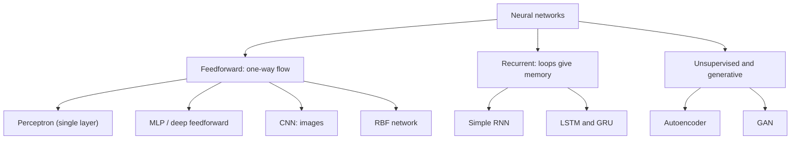
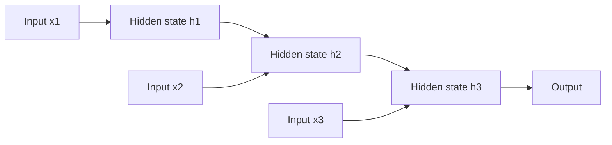

Before the new ideas, here are the old ones you need. If you already know them, skip to the next section.

## The basics first

- A **neuron** takes some numbers in, multiplies each by a **weight**, adds a **bias**, and passes the total through an **activation function** (a simple rule such as "keep it if positive, else 0").
- A **layer** is a group of neurons that work side by side. The **input layer** receives the data, the **output layer** gives the answer, and the layers in between are **hidden layers**.
- A **connection** carries one neuron's output to another neuron, with a weight on it.
- **Training** means adjusting the weights so the answers get close to the correct answers (the **labels**).
- Different problems have different shapes of data: a table of numbers, an image (a grid of pixels), or a sequence (words in a sentence, readings over time). Each type of network is designed for one shape.

## Why there are many types

Think of vehicles. All have wheels and an engine, but a bus, a truck and a bike are built for different jobs. Neural networks are the same: they all use neurons and weights, but they are wired differently for different kinds of data. A plain fully connected network *can* in theory learn anything, but for images it needs far too many weights, and it has no memory for sequences. Special wiring fixes each problem. This is part of syllabus <Syl m="1" />; the later modules study CNNs, RNNs, autoencoders and GANs in depth.

We can group networks in three common ways: <Cite id="tp-ann-basics" /> <Cite id="wiki-nn-types" />

1. **By how the neurons are connected.** **Feedforward**: information only moves forward, input to output, no loops. **Recurrent (feedback)**: some outputs are fed back as inputs at the next step, which gives the network a memory.
2. **By the number of layers.** **Single-layer** (just an output layer of neurons, like the perceptron) or **multilayer** (one or more hidden layers).
3. **By how they learn.** **Supervised** (with labels, for example a CNN classifier) or **unsupervised** (without labels, for example an autoencoder). Deng and Yu use a different split, into **generative**, **discriminative** and **hybrid** classes; see the three-classes topic. <Cite id="deng-yu-2014" loc="§3.1" />

**Feedforward versus recurrent, the main split.**

| | Feedforward | Recurrent |
|---|---|---|
| Direction of flow | One way, input to output | Has loops: output of one step feeds the next |
| Memory of earlier inputs | None | Yes, through the hidden state |
| Input | Fixed size (a row, an image) | Sequence of any length |
| Training | Backpropagation | Backpropagation through time |
| Examples | Perceptron, MLP, CNN, RBF | RNN, LSTM, GRU |

## 1. Perceptron (single-layer network)

**What it is.** The simplest network: one neuron (or one layer of neurons) with a **step** activation. Proposed by Rosenblatt in 1958. <Cite id="rosenblatt1958" />

**Why needed.** It was the first machine that could learn a yes/no decision from examples instead of being programmed by hand.

**How it works.**

1. Multiply each input by its weight.
2. Add all these products and the bias to get one total.
3. Output 1 if the total is at least 0, else output 0 (the step rule).
4. If the output is wrong, nudge the weights towards the correct answer and repeat.

For example, weights 1 and 1 with bias −1.5 make an AND gate: only when both inputs are 1 does the total (1 + 1 − 1.5 = 0.5) reach 0 or more.

**Advantages.** Very simple and fast; learns its weights; guaranteed to learn any straight-line-separable problem.

**Disadvantages.** Only one straight-line boundary, so it cannot learn XOR; outputs only 0 or 1.

**Applications.** Simple yes/no decisions, logic gates, and as the building block of bigger networks. <Cite id="gfg-perceptron" />

## 2. Feedforward network / multilayer perceptron (MLP)

**What it is.** Neurons in layers (input, one or more hidden, output), every neuron connected to every neuron in the next layer, information flowing one way only. <Cite id="gfdl-ch6" />

**Why needed.** A single perceptron can draw only one straight line, so it fails on problems like XOR. Adding hidden layers lets the network bend its boundary.

**How it works.** Each hidden neuron computes a weighted sum, adds a bias and applies a non-linear activation (ReLU, sigmoid, tanh), then passes the result forward. The hidden layers let it learn curved boundaries; with enough hidden neurons it can approximate any continuous function. It is trained with backpropagation. <Cite id="rumelhart1986" />

<Figure caption="A feedforward network: every arrow points forward and every neuron feeds every neuron of the next layer. There are no loops, so the network has no memory of earlier inputs.">
  <NetworkFigure layers="4,5,3" title="Feedforward network (MLP)" labels="Input,Hidden,Output" />
</Figure>

**Advantages.** Learns non-linear patterns; general-purpose; simple to build (a stack of `Dense` layers).

**Disadvantages.** Needs a huge number of weights for images and ignores that nearby pixels belong together; no memory for sequences; can overfit.

**Applications.** Tabular data (rows and columns), such as predicting loan default from income, age and debt; house prices; final layers of other networks. <Cite id="gfg-feedforward" />

## 3. Convolutional neural network (CNN)

**What it is.** A feedforward network designed for grid data such as images. <Cite id="gfdl-ch9" /> <Cite id="lecun1998" />

**Why needed.** A fully connected network on images needs a weight for every pixel, which is far too many, and it ignores that nearby pixels belong together.

**Analogy.** Reading a big map with a small magnifying glass. You slide the same glass over every part of the map, looking for the same small pattern (a road, a river) everywhere.

**How it works.**

1. **Convolution layers** slide small **filters** (for example 3×3 grids of weights) across the image. Each filter detects one local pattern such as an edge.
2. The **same** filter weights are used at every position (**weight sharing**), so a pattern is found wherever it appears.
3. **Pooling layers** shrink the result, keeping the strongest responses.
4. Deeper layers combine edges into shapes and shapes into objects.
5. **Fully connected layers** at the end give the class.

Weight sharing is why CNNs are cheap: on a one-channel (greyscale) image one 3×3 filter has only 9 weights plus 1 bias, however large the image, while a fully connected layer needs a weight for every pixel-to-neuron pair.

**Advantages.** Far fewer weights than an MLP on images; finds a pattern anywhere in the picture; learns features automatically.

**Disadvantages.** Needs large labelled image sets and GPUs; less suited to data with no grid structure.

**Applications.** Face recognition, medical scans, self-driving cars, object detection, some audio tasks. <Cite id="gfg-cnn" /> <Cite id="ibm-cnn" />

## 4. Recurrent neural network (RNN)

**What it is.** A network with a loop, built for sequences. <Cite id="gfdl-ch10" />

**Why needed.** Feedforward networks take a fixed-size input and forget each input once it is done, but in a sentence or a time series the order and the earlier items matter.

**Analogy.** Reading a story. You understand each new word using what you remember from the earlier words.

**How it works.**

1. The RNN reads a sequence one item at a time.
2. At each step it combines the new input with its memory of the past, called the **hidden state**.
3. It produces a new hidden state (and, if needed, an output) and passes the hidden state on to the next step.
4. The same weights are reused at every step, so it can handle sequences of any length.

In one line: new memory = tanh(weights × new input + weights × old memory + bias).

**Advantages.** Handles sequences of any length; remembers context; shares weights over time.

**Disadvantages.** Over long sequences the learning signal fades (vanishing gradient), so a plain RNN forgets things from far back; it processes one step at a time, so it is slow to train.

**Applications.** Text, speech, time series, translation. <Cite id="gfg-rnn" /> <Cite id="ibm-rnn" />

## 5. LSTM and GRU

**What they are.** Improved RNNs with **gates**: small learned switches that decide what to remember, what to forget and what to output.

**Why needed.** A plain RNN forgets information from many steps back because the learning signal fades; gates let important information survive.

**How they work.** The **LSTM** (long short-term memory) keeps a separate memory cell that information can flow along almost unchanged, controlled by a forget gate, an input gate and an output gate. <Cite id="hochreiter1997" /> The **GRU** (gated recurrent unit) is a simpler version with two gates (reset and update). <Cite id="cho2014" />

**Advantages.** Remember information over much longer sequences than a plain RNN; reduce the vanishing-gradient problem.

**Disadvantages.** More weights and slower than a plain RNN (the LSTM more so than the GRU).

**Applications.** Long texts, speech recognition, stock or weather series, machine translation. <Cite id="gfg-lstm" />

## 6. Autoencoder

**What it is.** An unsupervised network that learns to copy its input through a middle layer, usually a narrow one. <Cite id="gfdl-ch14" />

**Why needed.** Most real data has no labels; an autoencoder learns useful features from the data alone.

**Analogy.** Summarizing a long chapter into a few bullet points, then rewriting the chapter from the bullets alone. If the rewrite is good, the bullets captured what mattered.

**How it works.** An **encoder** squeezes the input into a small **code**; a **decoder** rebuilds the input from the code. The loss compares the rebuilt output with the original input, so it needs **no labels**.

<Figure caption="An autoencoder. The middle layer (the code) is narrower than the input, so the network is forced to keep only the most important information to rebuild the input at the output.">
  <NetworkFigure layers="5,3,2,3,5" title="Autoencoder" labels="Input,Encoder,Code,Decoder,Output" />
</Figure>

**Advantages.** Learns from unlabelled data; gives a compact summary of the data.

**Disadvantages.** May simply copy the input if the code is too large; rebuilt images are often blurry.

**Applications.** Compression, removing noise from images, feature learning, anomaly detection. <Cite id="gfg-autoencoders" /> <Cite id="wiki-autoencoder" />

## 7. Generative adversarial network (GAN)

**What it is.** Two networks trained against each other to create new, realistic data. <Cite id="goodfellow2014" />

**Why needed.** The other types classify or compress data; a GAN creates new data that looks real.

**Analogy.** A forger and a detective. The forger (the **generator**) makes fake banknotes from random noise; the detective (the **discriminator**) tries to tell fake from real. Each improves by beating the other, until the fakes look real.

**How it works.** The generator turns random noise into a fake sample. The discriminator receives a mix of real and fake samples and outputs the probability that each is real. The discriminator is trained to label them correctly; the generator is trained to make the discriminator label its fakes as real. The two take turns, and after training only the generator is kept to create new data.

**Advantages.** Produces very sharp, realistic images; needs no labels.

**Disadvantages.** Training is unstable; the generator may produce only a few kinds of output (mode collapse); can be misused for deepfakes.

**Applications.** Creating realistic images, image-to-image translation, data augmentation. Module 6 covers it in detail. <Cite id="gfdl-ch20" />

## 8. Radial basis function (RBF) network

**What it is.** A three-layer feedforward network (input, one hidden, output) whose hidden neurons respond to **how close** the input is to a stored centre point, instead of to a weighted sum.

**Why needed.** It gives a fast, local way to fit a curve: each hidden neuron only cares about one zone of the input.

**How it works.** Each hidden neuron has a centre. It fires strongly when the input is near its centre and weakly when it is far away, usually following a bell-shaped (Gaussian) curve whose width is a setting. The output layer adds up these responses with weights.

**Advantages.** Fast to train; easy to understand (each neuron covers a local zone).

**Disadvantages.** Needs many neurons when the input has many features; choosing the centres is a separate step.

**Applications.** Function approximation, simple classification, time-series prediction. <Cite id="wiki-nn-types" /> <Cite id="gfg-nn-types" />

## Others worth one line

- **Deep belief networks** and **restricted Boltzmann machines:** generative networks used for layer-wise pre-training. <Cite id="deng-yu-2014" loc="§3.2" />
- **Transformers:** use attention instead of recurrence to process whole sequences at once; the basis of modern language models.
- **Self-organizing maps:** unsupervised networks that place similar inputs near each other on a grid.

<Cite id="av-nn-types" /> <Cite id="gfg-nn-types" />

## Comparison table

| Type | Connections | Learns from | Best for | Key idea | Main limit |
|---|---|---|---|---|---|
| Perceptron | Feedforward, single layer | Labels | Simple linear yes/no | Weighted sum and step | No XOR |
| MLP | Feedforward, fully connected | Labels | Tabular data | Hidden layers, non-linear | Too many weights for images |
| CNN | Feedforward, local and shared | Labels | Images, video | Filters slide over the input | Needs big labelled data |
| RNN | Recurrent | Labels (or next item) | Sequences | Hidden state carries memory | Forgets long-range context |
| LSTM / GRU | Recurrent with gates | Labels (or next item) | Long sequences | Gates control memory | Slower, more weights |
| Autoencoder | Feedforward, encoder-decoder | No labels | Compression, denoising | Rebuild the input from a small code | Blurry output |
| GAN | Two competing networks | No labels | Creating data | Generator against discriminator | Unstable training |
| RBF network | Feedforward, distance-based | Labels | Function approximation | Neurons respond to closeness to a centre | Poor with many features |

**Conclusion.** All neural networks are built from the same neurons and weights; the type is chosen to match the shape of the data: tables (MLP), images (CNN), sequences (RNN, LSTM, GRU), unlabelled data (autoencoder) or creating new data (GAN).

<Box kind="exam">

For "Explain types of neural network" (5 marks), name the grouping (feedforward versus recurrent), then give 4 to 5 types with one line each on structure and one typical use: perceptron, MLP, CNN, RNN (with LSTM), autoencoder or GAN. Draw the small classification tree. Finish with one sentence: the choice depends on the shape of the data.

</Box>

Further reading: <Cite id="gfg-ann-intro" /> <Cite id="ibm-neural-networks" /> <Cite id="tpoint-ann" /> <Cite id="keras-sequential" /> <Cite id="wiki-feedforward" /> <Cite id="wiki-cnn" /> <Cite id="wiki-rnn" /> <Cite id="lecun2015-review" /> <Cite id="nptel-dl" />

## Where this was asked

| If the question says | What to write | Seen as |
|---|---|---|
| "Explain types of neural network" | Grouping by connections; perceptron, MLP, CNN, RNN/LSTM, autoencoder, GAN with structure and use; the tree diagram | <PYQ id="2025-05/q1c" /> |

## Quick revision

- Feedforward: one-way flow, no memory. Recurrent: loops, memory.
- Perceptron: one neuron, step output, linear boundary only.
- MLP: hidden layers, non-linear, for tabular data.
- CNN: small shared filters slide over images; few weights; for images and video.
- RNN: reads a sequence step by step, carrying a hidden state; LSTM and GRU add gates for long memory.
- Autoencoder: encoder, small code, decoder; no labels.
- GAN: generator against discriminator, creates new data.
- RBF: hidden neurons respond to distance from a centre.
