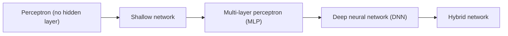
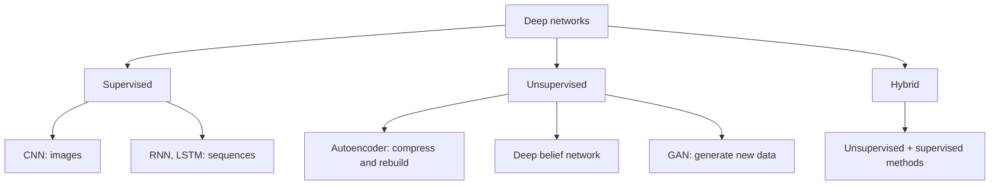
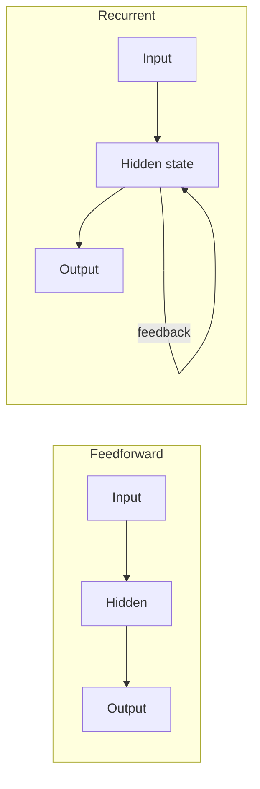

This is syllabus <Syl m="1" />. The class does not give one single list called "types of neural networks"; it names the types one by one as the course goes on. This note gathers them in one place, in the teacher's words.

## Types by structure

### 1. Perceptron and shallow network

<Box kind="definition">

A **perceptron** is the simplest neural network used for binary classification. It answers only two classes (yes or no, 1 or 0). <Cite id="class-dl-chp1" loc="slide 13" />

</Box>

A **shallow network** has one input layer and one output layer (no hidden layer). Its limitation: it can solve only linear problems and cannot solve XOR. Example: AND gate. <Cite id="class-dl-chp1" loc="slide 16" />

### 2. Multi-layer perceptron (MLP) and multilayer feedforward network

<Box kind="definition">

**Multi-Layer Perceptron (MLP)** consists of fully connected dense layers. It is called multi-layer because it contains an input layer, one or more hidden layers and an output layer. Its purpose is to model complex relationships between inputs and outputs. <Cite id="class-dl-m1" loc="p. 17" />

</Box>

It is used to solve complex and non-linear problems that a single perceptron cannot solve, for example XOR. <Cite id="class-dl-chp1" loc="slide 22" />

A **multilayer feedforward neural network (MLFFNN)** is a neural network with one input layer, one or more hidden layers and one output layer, where information flows only from input to output. A feedforward network has no feedback or loops, and its output depends only on the current input. Applications: pattern recognition, image classification, medical diagnosis. <Cite id="class-dl-chp2" loc="slide 4" /> <Cite id="class-dl-chp1" loc="slide 28" />

### 3. Deep neural network (DNN)

<Box kind="definition">

A **Deep Neural Network (DNN)** is a type of Artificial Neural Network that contains one input layer, two or more hidden layers, and one output layer. It learns patterns from the input data and produces the required output. In simple words, a DNN is a network of neurons that learns from examples and makes predictions or decisions. <Cite id="class-dl-chp2" loc="slide 2" />

</Box>

A single-layer network can solve only simple problems. A DNN learns simple features in the first hidden layer, combines them into more meaningful features in deeper layers, and then produces accurate predictions. <Cite id="class-dl-chp2" loc="slide 2" />

### 4. Hybrid network

**Hybrid networks combine different types of neural networks.** They are used to overcome the limitations of a single network and to improve accuracy and performance. Example: combining feedforward and recurrent networks. <Cite id="class-dl-chp1" loc="slide 16" />

## Types by how they learn

The teacher groups the deep network architectures into three families. <Cite id="class-dl-chp1" loc="slide 25" />

| Network | What it is, in the teacher's words | Used for |
|---|---|---|
| CNN | A type of deep neural network specially designed to work with images and other grid-like data. It learns spatial features using convolutional filters. <Cite id="class-dl-chp4" loc="slide 5" /> | Images |
| RNN | A type of neural network that can be used to model sequence data. It has hidden states and allows past outputs to be used as inputs. <Cite id="class-dl-m5" loc="p. 8" /> <Cite id="class-dl-m5" loc="p. 9" /> | Sequences (text, time) |
| LSTM | A special kind of recurrent neural network capable of handling long-term dependencies. <Cite id="class-dl-m5" loc="p. 18" /> | Long sequences |
| Autoencoder | A self-supervised model used to reduce the size of input data by recreating it. <Cite id="class-dl-m3" loc="p. 4" /> | Compression, representation learning |
| GAN | A deep learning model used to generate new data that looks similar to real training data. It has two networks, a generator and a discriminator. <Cite id="class-dl-chp6" loc="slide 3" /> | Generating images |

## Feedforward versus recurrent

A feedforward network passes information one way from input to output. When feedforward networks are extended to include feedback connections, they are called recurrent neural networks. <Cite id="class-dl-m1" loc="p. 10" />

## Where this was asked

| If the question says | What to write | Seen as |
|---|---|---|
| "Explain types of neural network" | Perceptron, MLP, DNN and hybrid with one line each, then the supervised and unsupervised families with CNN, RNN, LSTM, autoencoder, GAN, and a table | <PYQ id="2025-05/q1c" /> |

## Quick revision

- Perceptron: simplest, binary classification, no hidden layer. Shallow network: input and output layers only, linear problems only.
- MLP: input + hidden layers + output, fully connected, solves non-linear problems.
- Feedforward: information only forward, no loops. Recurrent: feedback connections added.
- DNN: one input layer, two or more hidden layers, one output layer.
- Hybrid network: different types combined.
- Supervised: CNN, RNN, LSTM. Unsupervised: autoencoders, DBN, GANs.

**Conclusion.** Neural networks grow from a one-neuron perceptron to deep networks with many hidden layers, and special types (CNN, RNN, LSTM, autoencoder, GAN) are built for particular data and learning styles. <Cite id="class-dl-chp1" loc="slide 25" />
