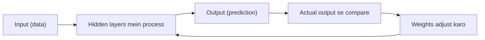
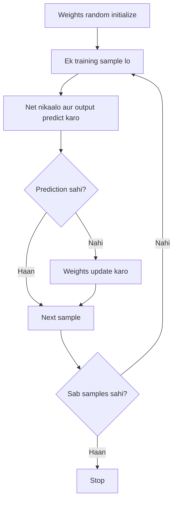
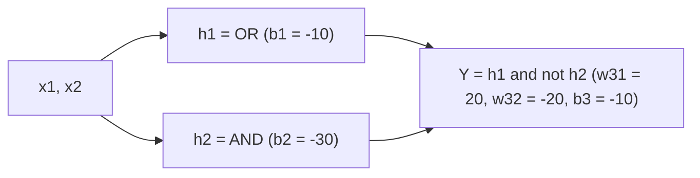
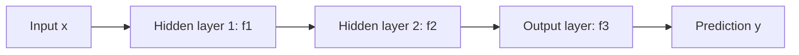

Ye syllabus <Syl m="1" /> hai: deep learning ki history, multilayer perceptron (MLP) aur deep feedforward networks.

## Deep learning ek minute mein

- Deep Learning is a subfield of Machine Learning that involves the use of neural networks to model and solve complex problems. <Cite id="class-dl-chp1" loc="slide 3" />
- Iski key khaasiyat hai deep neural networks, jinmein **multiple layers of interconnected nodes** hote hain. Ye data mein **hierarchical patterns and features discover** karke complex representations seekhte hain, manual feature engineering ke bina. <Cite id="class-dl-chp1" loc="slide 3" />
- Use karne ke main reasons: automatic feature learning, large aur complex data handle karna, high accuracy, complex patterns seekhna, unstructured data (images, video, voice, text) pe achha kaam, aur data badhne pe behtar hona. <Cite id="class-dl-chp1" loc="slide 4" />

## History chhoti si

```mermaid
%% caption: Teacher ki timeline short mein. 1969 mein XOR ki failure se neural networks ruk gaye, phir 1986 mein backpropagation aaya.
flowchart LR
  A["1943: neuron ka model"] --> B["1958: perceptron"]
  B --> C["1969: XOR nahi hota (AI winter)"]
  C --> D["1986: backpropagation, MLP"]
  D --> E["1998: CNN, LeNet"]
  E --> F["2006: deep belief networks"]
  F --> G["2012: ImageNet, AlexNet"]
  G --> H["2014 se: GAN, ResNet, YOLO"]
```

Timeline: 1943 neuron ka mathematical model; 1958 single-layer perceptron; 1969 ye XOR solve nahi kar sakta; 1986 backpropagation aur multi-layer perceptron; 1998 CNN aur LeNet; 2006 deep belief networks; 2009 stacked auto-encoders; 2012 ImageNet, AlexNet, dropout, ReLU; 2014 GoogLeNet, GAN, VGGNet; 2017 AlphaGo aur Mask R-CNN; 2019 AlphaZero aur graph neural networks. <Cite id="class-dl-chp1" loc="slide 6" /> <Cite id="class-dl-m1" loc="p. 4" />

Success stories: face recognition, speech recognition, medical diagnosis (cancer detection), self-driving cars, language translation. <Cite id="class-dl-chp1" loc="slide 7" /> <Cite id="class-dl-m1" loc="p. 9" />

## Biological neuron se artificial neuron tak

**Biological neuron** ek nerve cell hai jo electrical signals se information receive, process aur send karti hai. Dendrites signal receive karte hain, cell body (soma) process karti hai, axon signal aage bhejta hai, aur synapse wo gap hai jahan signal agle neuron ko jaata hai. Short mein: dendrites receive, cell body thinks, axon sends, synapse connects. <Cite id="class-dl-chp1" loc="slide 8" />

<Box kind="definition">

An **artificial neuron** is a math model inspired by a biological neuron. It is used in neural networks to process data in AI. <Cite id="class-dl-chp1" loc="slide 10" />

</Box>

Ye inputs leta hai, unhe weights se multiply karta hai, bias add karta hai, sum ko activation function (ReLU ya sigmoid jaisa) se guzaarta hai aur output deta hai. Parts: inputs $x$ (dendrites jaise), weights $w$ (har input ki importance), summation (inputs × weights ka sum), activation function (output decide karta hai) aur output $y$. <Cite id="class-dl-chp1" loc="slide 10" />

**Neural network** is a computational model inspired by the human brain. Ye connected units (neurons) se bana hota hai jo data se patterns seekhte hain aur decisions lete hain. Neurons input layer, hidden layer(s) aur output layer mein arranged hote hain, aur network error kam karne ke liye weights adjust karke seekhta hai. <Cite id="class-dl-chp1" loc="slide 11" />

**Neural network ke key factors** <Cite id="class-dl-chp1" loc="slide 12" />

| Factor | Matlab |
|---|---|
| Weights | Input kitna important hai. Higher weight matlab output par zyada influence. |
| Bias | Neuron ko better decision lene mein help karne wali extra value. Output ko upar ya neeche shift karta hai. |
| Threshold | Output decide karne wali limit value (jaise marks ≥ 40 matlab pass). |
| Learning constant (learning rate) | Network kitni fast seekhta hai. High fast lekin risky, low slow lekin accurate. |
| Momentum factor | Pichhle weight update ko use karke training fast karta hai aur atakne se bachata hai. |

## Perceptron

<Box kind="definition">

A **perceptron** is the simplest neural network used for binary classification. It answers only two classes: yes or no, 1 or 0. <Cite id="class-dl-chp1" loc="slide 13" />

</Box>

**Perceptron ka working** <Cite id="class-dl-chp1" loc="slide 13" />

1. Input do: $x_1, x_2, \dots$
2. Har input ko uske weight se multiply karo.
3. Sab add karo: $\text{Net} = w_1x_1 + w_2x_2 + \dots + b$
4. Activation function lagao: $\text{Net} \ge 0$ to output 1, warna output 0.

**Example (Netflix movie like prediction).** Inputs: action movie = 1, thriller = 1, IMDb rating = 0.9, critics rating = 0.8. Weights 0.5, 0.4, 0.6, 0.3 aur bias −1.

<Sum>

<Given>

$x = (1, 1, 0.9, 0.8)$, $w = (0.5, 0.4, 0.6, 0.3)$, $b = -1$.

</Given>

<Find>

perceptron ka output $y$.

</Find>

<Steps>

1. **Har input ko weight se multiply karo:** $1 \times 0.5 = 0.5$, $1 \times 0.4 = 0.4$, $0.9 \times 0.6 = 0.54$, $0.8 \times 0.3 = 0.24$.
2. **Bias ke saath add karo:** $\text{Net} = 0.5 + 0.4 + 0.54 + 0.24 - 1 = 1.68 - 1 = 0.68$.
3. **Step rule lagao:** $0.68 \ge 0$, isliye $y = 1$.

</Steps>

<Answer>

$y = 1$: movie pasand aayegi. <Cite id="class-dl-chp1" loc="slide 13" />

</Answer>

<Box kind="verify">

Chaaron products ka sum: $0.5 + 0.4 = 0.9$, phir $0.9 + 0.54 = 1.44$, phir $1.44 + 0.24 = 1.68$. Bias 1 ghataane par 0.68. Same result.

</Box>

</Sum>

**Learning (perceptron learning algorithm).** Weights random se shuru hote hain aur perceptron unhe correct karke seekhta hai: ek training example lo, predict karo, actual se compare karo; galat ho to weights update karo (positive sample galat classify hua to $w = w + x$, negative sample galat classify hua to $w = w - x$); sab examples pe repeat karo jab tak har example sahi classify na ho. <Cite id="class-dl-chp1" loc="slide 13" />

**Delta learning rule** training mein weights update karta hai: $\Delta w = \eta\,(t - y)\,x$, jahan $\eta$ learning rate, $t$ target output, $y$ actual output aur $x$ input hai. Ye error kam karne aur learning behtar karne ke liye use hota hai. <Cite id="class-dl-chp1" loc="slide 16" />

Perceptron ke advantages: simple architecture, fast computation, easy to train. Disadvantages: sequence data handle nahi karta, pichhle inputs ki memory nahi, complex tasks ke liye limited. <Cite id="class-dl-chp1" loc="slide 13" />

## Perceptron se logic gates

**AND gate.** AND tabhi 1 deta hai jab saare inputs 1 hon. Teacher ka perceptron $w_1 = 1$, $w_2 = 1$, bias 0 aur threshold $\theta = 2$ use karta hai. Sum $= x_1w_1 + x_2w_2 + \text{Bias}$. Sum ≥ θ to output 1, warna 0. <Cite id="class-dl-chp1" loc="slide 18" />

| $x_1$ | $x_2$ | Sum | Output |
|---|---|---|---|
| 0 | 0 | 0 | 0 (0 < 2) |
| 0 | 1 | 1 | 0 (1 < 2) |
| 1 | 0 | 1 | 0 (1 < 2) |
| 1 | 1 | 2 | 1 (2 ≥ 2) |

**OR gate:** weights 1 aur 1, bias 0, threshold θ = 1, isliye kam se kam ek input 1 ho to output 1. **NOT gate:** ek input, weight −1, threshold 0: input 0 se sum 0 ≥ 0 isliye output 1; input 1 se sum −1 < 0 isliye output 0. **NAND gate:** weights −1 aur −1, bias 0, threshold −1.5. Sums 0, −1, −1, −2 hain aur sirf −2, −1.5 se chhota hai, isliye output sirf input (1, 1) par 0 hai, baaki sab par 1. (Teacher ki slide 21 mein extra bias −1 bhi add hai, jisse sums −1, −2, −2, −3 ho jaate hain aur outputs galat aate hain; wo extra bias hata do.) <Cite id="class-dl-chp1" loc="slide 19" /> <Cite id="class-dl-chp1" loc="slide 20" /> <Cite id="class-dl-chp1" loc="slide 21" />

## Linear separability aur XOR problem

- **Linearly separable:** data ko ek seedhi line se alag kiya ja sakta hai (single perceptron solve kar leta hai). Examples: AND, OR, NAND. <Cite id="class-dl-m1" loc="p. 5" />
- **Non-linearly separable:** data ko seedhi line se alag nahi kar sakte, isliye MLP (multiple layers) chahiye. Example: XOR. <Cite id="class-dl-chp1" loc="slide 14" />

**XOR** tab 1 deta hai jab exactly ek input 1 ho, warna 0. Chaar points (0,0)=0, (0,1)=1, (1,0)=1, (1,1)=0 ko ek line se alag nahi kar sakte; line kaise bhi kheencho, ek point hamesha galat classify hota hai. <Cite id="class-dl-m1" loc="p. 6" />

**Shallow network** mein ek input layer aur ek output layer hoti hai; ye sirf linear problems solve karta hai aur XOR nahi kar sakta. <Cite id="class-dl-chp1" loc="slide 16" />

## Multi-layer perceptron (MLP)

<Box kind="definition">

**Multi-Layer Perceptron (MLP)** consists of fully connected dense layers that transform input data from one dimension to another. It is called multi-layer because it contains an input layer, one or more hidden layers and an output layer. The purpose of an MLP is to model complex relationships between inputs and outputs. <Cite id="class-dl-m1" loc="p. 17" />

</Box>

- **Input layer:** har neuron ek input feature ke liye hota hai (teen input features to teen neurons).
- **Hidden layers:** koi bhi number of layers, har layer mein koi bhi number of nodes; ye input layer ki information process karti hain (useful features nikaalti hain).
- **Output layer:** final prediction deti hai; multiple outputs ho to utne neurons. <Cite id="class-dl-m1" loc="p. 17" /> <Cite id="class-dl-chp1" loc="slide 22" />

**MLP ke basic working steps:** input, input layer ko diya jaata hai; har layer inputs ko weights se multiply karti hai; bias add hota hai; activation function lagta hai; output agli layer ko jaata hai; final output milta hai. Har neuron ke liye $z = \sum_i w_i x_i + b$ aur output $f(z)$. <Cite id="class-dl-chp1" loc="slide 22" />

MLP ke advantages: XOR jaise non-linear problems solve karta hai, higher accuracy, complex patterns seekhta hai. Disadvantages: zyada computation, zyada data chahiye, slow training, complex structure. <Cite id="class-dl-chp1" loc="slide 22" />

### MLP se XOR (2-2-1 network)

Hidden layer ek **non-linear decision boundary** banati hai, isliye XOR solvable ho jaata hai. Network mein do inputs, do neurons wali hidden layer $h_1, h_2$ aur ek output neuron $Y$ hai. Har neuron weights plus bias lagata hai aur phir activation (step ya sigmoid). <Cite id="class-dl-chp1" loc="slide 23" /> <Cite id="class-dl-chp1" loc="slide 24" />

**Working weights (corrected).** $h_1$ ko OR neuron, $h_2$ ko AND neuron maano, aur output ko "$h_1$ and not $h_2$" rakho:
$w_{11} = w_{21} = 20,\ b_1 = -10$; $w_{12} = w_{22} = 20,\ b_2 = -30$; $w_{31} = 20,\ w_{32} = -20,\ b_3 = -10$ (har neuron mein sigmoid).

| $x_1$ | $x_2$ | $h_1$ (OR) | $h_2$ (AND) | $Y$ |
|---|---|---|---|---|
| 0 | 0 | low | low | 0 |
| 0 | 1 | high | low | 1 |
| 1 | 0 | high | low | 1 |
| 1 | 1 | high | high | 0 |

<Box kind="pitfall">

Teacher ki slide 24 mein $w_{32} = 20$, $b_3 = -30$ likha hai aur input (0,1) ke liye $h_1$ low, $h_2$ high dikhaya hai. In numbers se (0,1) ka output $\sigma(20 \cdot 1 + 20 \cdot 0 - 30) = \sigma(-10) \approx 0$ aata hai, 1 nahi. Exam mein upar wale corrected values likho. <Cite id="class-dl-chp1" loc="slide 24" />

</Box>

## Sigmoid neuron

Sigmoid neuron ek artificial neuron hai jo sigmoid function se 0 aur 1 ke beech output deta hai. Perceptron sirf 0 ya 1 deta hai; sigmoid neuron smooth output deta hai, jahan input mein chhota change output mein chhota change deta hai, aur isse learning behtar hoti hai. $y = \dfrac{1}{1 + e^{-(w^Tx + b)}}$. <Cite id="class-dl-chp1" loc="slide 26" />

| $z = w^Tx + b$ | −4 | −2 | 0 | 2 | 4 |
|---|---|---|---|---|---|
| $y$ | 0.018 | 0.119 | 0.500 | 0.881 | 0.982 |

## Deep feedforward networks

<Box kind="definition">

Deep feedforward networks, also called **feedforward neural networks** or multilayer perceptrons (MLPs), are the prototypical deep learning models. The goal of a feedforward network is to approximate some function $f^*$. For a classifier, $y = f^*(x)$ maps an input $x$ to a category $y$. A feedforward network defines a mapping $y = f(x; \theta)$ and learns the value of the parameters $\theta$ that result in the best function approximation. <Cite id="class-dl-m1" loc="p. 10" />

</Box>

Inhe **feedforward** isliye kehte hain kyunki information $x$ se, beech ki computations se guzar kar, aakhir mein output $y$ tak jaati hai. Koi feedback connection nahi hota jahan model ka output wapas khud mein jaaye. Jab feedforward networks mein feedback connections jod diye jaate hain to unhe recurrent neural networks kehte hain. <Cite id="class-dl-m1" loc="p. 10" />

Inhe **networks** isliye kehte hain kyunki ye aam taur par kai functions ko chain mein jod kar bante hain, jaise $f(x) = f^{(3)}(f^{(2)}(f^{(1)}(x)))$. Yahan $f^{(1)}$ first layer, $f^{(2)}$ second layer hai, aur chain ki length model ki **depth** hai; "deep learning" naam yahin se aaya. Aakhri layer output layer hai. Training data baaki layers ka desired output nahi dikhata, isliye unhe **hidden layers** kehte hain. <Cite id="class-dl-m1" loc="p. 11" />

Key features: data ka backward flow nahi, cycles ya loops nahi, aur output sirf current input par depend karta hai. Examples: pass ya fail predict karna, handwritten digit recognition, spam email detection. Limitations: labeled data chahiye, data quality par depend, time-based patterns nahi seekh sakta. <Cite id="class-dl-chp1" loc="slide 28" />

### Hidden units aur network ka design

- **Hidden units:** hidden layers ke neurons. Har ek inputs ka weighted sum nikaalta hai, bias add karta hai aur activation function lagata hai. Inka purpose important patterns seekhna hai: pehli hidden layer edges dhoondhti hai, agli corners aur contours, aur aise hi aage. <Cite id="class-dl-chp1" loc="slide 28" /> <Cite id="class-dl-m1" loc="p. 12" />
- **Hidden unit ka type chunna:** rectified linear units ek excellent default choice hain. Pehle se batana usually impossible hai ki kaun sa best chalega, isliye design trial and error hai: network train karo aur validation set par evaluate karo. <Cite id="class-dl-m1" loc="p. 15" />
- **Architecture design:** architecture network ka overall structure hai: kitni units aur wo kaise connected hain. Zyadatar networks layers ki chain hote hain, isliye main choices network ki **depth** aur har layer ki **width** hain. Deeper networks aksar har layer mein kam units aur kam parameters use karte hain aur aksar behtar generalize karte hain, lekin optimize karna aksar mushkil hota hai. Ideal architecture experiment se milta hai, validation error dekhte hue. <Cite id="class-dl-m1" loc="p. 23" />
- **Baaki considerations:** layers ko chain hona zaroori nahi; layer $i$ se $i+2$ ya aage jaane wale **skip connections** gradient ko output layers se input ke paas wali layers tak aasani se behne dete hain. Specialized networks layers ke beech kam connections bhi rakhte hain taaki parameters aur computation kam ho. <Cite id="class-dl-m1" loc="p. 25" />

## MLP ki representation power

Representation power matlab neural network ki wide variety of functions ko approximate karne ki ability. Feedforward neural networks universal function approximators hain. <Cite id="class-dl-m1" loc="p. 16" />

<Box kind="definition">

**Universal approximation theorem:** a feedforward network with a linear output layer and at least one hidden layer with any activation function (such as the logistic sigmoid) can approximate any measurable function from one finite-dimensional space to another with any desired non-zero amount of error, provided that the network is given enough hidden units. <Cite id="class-dl-m1" loc="p. 24" />

</Box>

1. **Linear vs non-linear:** hidden layer ke bina model linear hai aur sirf seedhi line ki decision boundary bana sakta hai. Hidden layer ke saath curved boundary ban sakti hai. Hidden layer weighted sums par activation functions lagakar non-linearity laati hai. <Cite id="class-dl-chp1" loc="slide 30" />
2. **Ek hidden layer** aur non-linear activation koi bhi continuous function approximate kar sakti hai.
3. **Zyada hidden layers** zyada complex functions aur decision boundaries model kar sakti hain; depth se units ki sankhya kam lag sakti hai. Ek single layer kisi bhi function ko represent karne ke liye kaafi hai, lekin wo layer bahut badi ho sakti hai aur sahi seekh ya generalize na kar paaye. <Cite id="class-dl-m1" loc="p. 24" />
4. **Hierarchical feature learning:** har hidden layer pichhli layer se higher-level features seekhti hai (edges, phir shapes, phir objects). <Cite id="class-dl-chp1" loc="slide 30" />

Representation power ko affect karne wale factors: hidden layers ki sankhya, neurons ki sankhya, (non-linear) activation function, aur depth vs width. <Cite id="class-dl-m1" loc="p. 16" />

## Ye kahan pucha gaya

| Agar question kahe | Kya likhna hai | Kab aaya |
|---|---|---|
| "Design AND gate using Perceptron" | Weights 1 aur 1, threshold 2, sums ke saath truth table | <PYQ id="2023-12/q1a" /> |
| "What are Feed Forward Neural Networks?" aur "Explain basic architecture of feedforward neural network" | Definition, no feedback, input, hidden aur output layer, working steps, diagram | <PYQ id="2024-05/q1a" /> <PYQ id="2025-05/q1a" /> |
| "Comment on the representation power of MLPs" | Universal approximation theorem, depth aur width, hierarchical features | <PYQ id="2024-12/q1a" /> |
| Hidden units aur unka purpose | Weighted sum plus activation karne wale neurons; ye patterns seekhte hain | <PYQ id="assignment-1/q1a" /> |
| Feedforward network mein har layer ka role | Input, hidden, output layer ka kaam, flow diagram ke saath | <PYQ id="assignment-1/q1b" /> |
| MLP se XOR | 2-2-1 network, corrected weights, truth table | <PYQ id="assignment-1/q1c" /> |

## Quick revision

- Perceptron: binary classification ke liye simplest neural network; Net $= \sum w_ix_i + b$; Net ≥ 0 to output 1 warna 0.
- AND: weights 1 aur 1, threshold 2. OR: threshold 1. NOT: weight −1. NAND: weights −1, −1, threshold −1.5.
- Single perceptron sirf linearly separable problems solve karta hai. XOR ko hidden layer chahiye.
- MLP: input layer + ek ya zyada hidden layers + output layer, fully connected.
- Feedforward network: $y = f(x;\theta)$, feedback nahi; chain ki length depth hai; output ke alawa saari layers hidden layers hain.
- 2-2-1 MLP mein XOR: $h_1$ = OR, $h_2$ = AND, $Y$ = $h_1$ and not $h_2$.
- Representation power: non-linear activation wali ek hidden layer koi bhi continuous function approximate karne ke liye kaafi hai; depth ise efficient banati hai.

**Conclusion.** Perceptron ek neuron hai jiski ek seedhi line boundary hai. Neurons ko layers mein stack karne se MLP bante hain, jo XOR jaise non-linear patterns seekh sakte hain, aur deep feedforward network simple se complex features step by step seekhta hai. <Cite id="class-dl-chp1" loc="slide 22" />
