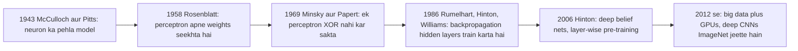
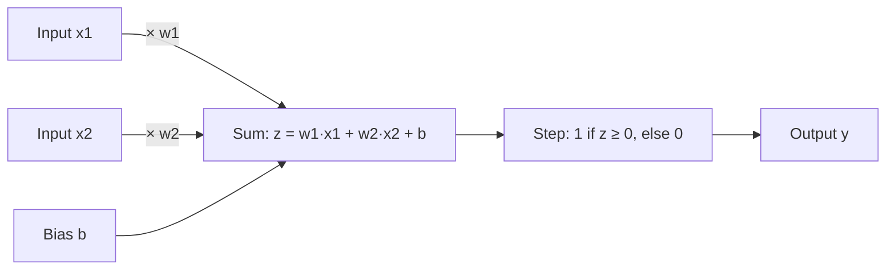
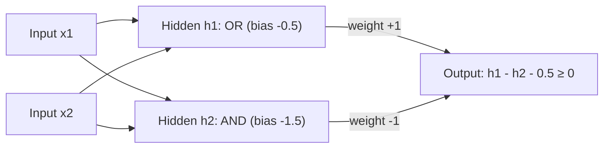
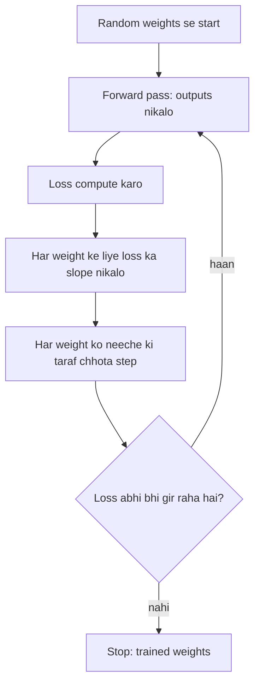

Naye ideas se pehle, purane ideas jo chahiye wo yahan hain. Agar pehle se aate hain to agle section pe chale jao.

## Pehle basics

- **Feature** (ya input) ek number hai jo example ko describe karta hai, jaise ghar ka size ya ek pixel ki brightness.
- **Label** (ya target) us example ka sahi answer hai, jaise "spam" ya "not spam".
- **Weight** ek number hai jo batata hai ki ek input kitna important hai. Bada positive weight matlab "ye input answer ko yes ki taraf push karta hai".
- **Bias** end mein add hone wala ek extra number hai. Ye decision point ko upar ya neeche shift karta hai, ek offset ki tarah.
- **Activation function** wo rule hai jo neuron apne total pe lagata hai output decide karne ke liye (jaise "total 0 ya usse zyada ho to 1, warna 0").
- **Training** matlab weights ko adjust karna taaki outputs labels ke paas aa jaayein. **Loss** ek number hai jo batata hai network kitna galat hai, aur **learning rate** har correction step ka size hai.

## Bahut chhoti history

Ye topic syllabus <Syl m="1" /> ka pehla part hai: history, success stories, perceptrons aur MLPs aur unki representation power, sigmoid neurons, gradient descent aur feedforward networks. Deep learning naya lagta hai, par iski roots 1940s tak jaati hain. Alag-alag naamon se iski popularity ki teen waves aayi hain. <Cite id="gfdl-ch1" loc="§1.2.1" />

- **Wave 1, cybernetics (1940s se 1960s).** McCulloch aur Pitts ne brain cell ka simple on/off model diya. Rosenblatt ka **perceptron** pehla aisa model tha jo examples se apne weights *seekh* sakta tha. <Cite id="rosenblatt1958" />
- **Setback.** Minsky aur Papert ne dikhaya ki ek single perceptron XOR jaise simple patterns nahi seekh sakta, aur interest kam ho gaya. <Cite id="minsky-papert-1969" />
- **Wave 2, connectionism (1980s se mid-1990s).** **Backpropagation** se hidden layers wale networks train karna possible hua, jisse XOR problem fix ho gayi. <Cite id="rumelhart1986" />
- **Wave 3, deep learning (2006 se).** Hinton aur saathiyon ne dikhaya ki bahut deeper networks ko ek-ek layer karke kaise train karein. <Cite id="hinton2006-dbn" /> Phir bade datasets aur fast graphics cards (GPUs) ne deep networks ko images, speech aur text ke liye best method bana diya. <Cite id="lecun2015-review" />

**Wave 3 mein ye kyun chala.** Teen cheezein ek saath aayi: bahut zyada data (internet, phones, sensors), bahut fast hardware (GPUs), aur better training tricks (ReLU, dropout, better initialization). <Cite id="gfdl-ch1" loc="§1.2" />

## Deep learning success stories

Syllabus deep learning ki kuch achievements ke examples maangta hai. Teen-chaar likho, har ek ek line mein. <Cite id="lecun2015-review" /> <Cite id="gfdl-ch1" loc="§1.2" />

| Area | Success story |
|---|---|
| Image recognition | 2012 mein ek deep CNN (AlexNet) ne ImageNet competition bade margin se jeeta, aur tab se deep CNNs image tasks mein aage hain. <Cite id="krizhevsky2012" /> |
| Speech recognition | 2010 se 2012 ke aas-paas deep networks ne error rates bahut kam kiye, aur ab voice assistants inhi pe chalte hain. |
| Language | Machine translation aur chatbots deep sequence models pe bane hain. |
| Medicine aur science | Networks X-rays aur scans padhte hain aur proteins ki shape predict karne mein help karte hain. |
| Everyday products | Face unlock, photo search, spam filters aur recommendations. |

## Perceptron: ek artificial neuron

<Box kind="definition">

**Perceptron:** ek single artificial neuron. Ye har input ko uske weight se multiply karta hai, bias add karta hai, aur total ko **step function** se pass karta hai: total 0 ya usse zyada ho to output 1, warna output 0. Ise Rosenblatt ne 1958 mein propose kiya tha, pehle aise neuron model ke roop mein jo seekh sakta hai. <Cite id="rosenblatt1958" />

</Box>

**Ye kyun zaroori hai.** Hum chahte hain ki machine kai clues se ek simple yes/no decision le, aur har clue kitna matter karta hai ye examples se khud *seekhe*, koi use bataye nahi.

**Analogy.** Talent show ki ek judge kai cheezein dekhti hai (singing, dancing, confidence), har ek ko importance deti hai, points jodti hai, aur total uske bar ko cross kare to "yes" bolti hai. Perceptron numbers ke saath bilkul yahi karta hai.

**Ye kaise kaam karta hai, step by step.**

1. **Inputs lo** $x_1, x_2, \dots, x_n$ (clues).
2. **Har input ko weigh karo:** use uske weight $w_i$ se multiply karo (wo clue kitna matter karta hai).
3. **Sabko bias $b$ ke saath jodo** taaki ek total $z$ mile, yani weighted sum.
4. **Step function lagao:** agar $z$ 0 ya usse zyada hai to output 1 ("yes"), warna 0 ("no").
5. **Seekho:** agar output galat tha, to weights ko thoda sa sahi answer ki taraf khiskao (neeche learning rule).

Symbols mein, weighted sum aur step ye hain

$$
z = w_1x_1 + w_2x_2 + \dots + w_nx_n + b, \qquad
y = \begin{cases} 1 & \text{if } z \ge 0\\ 0 & \text{if } z < 0 \end{cases}
$$

Kuch books bias ki jagah **threshold** $\theta$ likhti hain aur weighted sum $\theta$ tak pahunche to fire karti hain; ye wahi cheez hai with $b = -\theta$. <Cite id="gfg-perceptron" /> <Cite id="w3s-perceptron" />

**Ye kya kar sakta hai (geometry).** Jin points pe weighted sum exactly 0 hota hai, wo ek straight line banate hain (zyada dimensions mein ek flat plane). Line ke ek side ke points ko 1 milta hai aur doosri side ke points ko 0. Isliye perceptron ek **linear classifier** hai: ye sirf un do groups ko alag kar sakta hai jinhe ek straight line alag kar sake. Aise groups ko **linearly separable** kehte hain.

**Perceptron learning rule (pehle words mein).** Perceptron ko ek example dikhao. Agar answer sahi hai, kuch mat badlo. Agar usne 1 bola par 0 hona chahiye tha, to jin inputs ki value 1 thi unke weights kam karo; agar 0 bola par 1 hona chahiye tha, to unhe badhao. Target $t$, output $y$ aur learning rate $\eta$ ke saath:

$$
w_i \leftarrow w_i + \eta\,(t - y)\,x_i, \qquad b \leftarrow b + \eta\,(t - y)
$$

**Perceptron convergence theorem** kehta hai ki agar data linearly separable hai, to ye rule finite number of updates ke baad galti karna band kar deta hai. Agar data separable nahi hai (neeche XOR), to ye kabhi settle nahi hota. <Cite id="wiki-perceptron" /> <Cite id="w3s-perceptron-training" />

**Advantages.**

- Bahut simple aur fast; samajhna aur hardware mein banana easy hai.
- Examples se apne weights khud seekhta hai.
- Agar separating line exist karti hai to use zaroor dhoondh leta hai.

**Disadvantages.**

- Sirf straight-line (linear) boundaries, isliye XOR solve nahi kar sakta.
- Output sirf 0 ya 1 hai, koi confidence level nahi.
- Step function ka koi useful slope nahi hai, isliye ise gradient descent se train nahi kar sakte aur seedha deep networks mein stack nahi kar sakte.

**Applications.** Simple yes/no filters (jaise kuch clues pe spam ya not spam), logic gates, aur sabse important, har bade network ka building block. <Cite id="mlm-perceptron" />

## Perceptron se AND gate design karna

Ye favourite 5-mark question hai, aur isme numbers *chahiye*, isliye ise sum ki tarah solve karo. AND gate tabhi 1 deta hai jab dono inputs 1 hon.

| $x_1$ | $x_2$ | AND |
|---|---|---|
| 0 | 0 | 0 |
| 0 | 1 | 0 |
| 1 | 0 | 0 |
| 1 | 1 | 1 |

**Sum 1: reasoning se AND gate design karo.**

<Sum>

<Given>

do inputs $x_1, x_2$ jo dono 0 ya 1 hain; perceptron rule "output 1 agar $z = w_1x_1 + w_2x_2 + b \ge 0$, warna 0"; upar wali AND truth table.

</Given>

<Find>

weights $w_1, w_2$ aur bias $b$ jo chaaron rows ke liye AND output dein.

</Find>

<Steps>

1. **Equal weights choose karo, $w_1 = w_2 = 1$.** AND mein dono inputs barabar matter karte hain, isliye dono ko same importance do.
2. **Possible sums $x_1 + x_2$ ki list banao.** In weights ke saath weighted sum (bias se pehle) $0 + 0 = 0$, $0 + 1 = 1$, $1 + 0 = 1$ ya $1 + 1 = 2$ hota hai.
3. **Likho ki bias ko kya karna hai.** Sirf sum 2 ko 0 ya usse upar pahunchna chahiye, isliye chahiye $2 + b \ge 0$ (row (1,1) fire kare) aur $1 + b < 0$ (ek input on wali rows off rahein).
4. **Dono conditions solve karo.** $2 + b \ge 0$ se $b \ge -2$. $1 + b < 0$ se $b < -1$. Toh koi bhi $b$ jisme $-2 \le b < -1$ ho, chalega.
5. **Beech ki safe value lo.** $b = -1.5$ (threshold $\theta = 1.5$ ke barabar), taaki koi row bilkul edge pe na baithe.
6. **Har row ko $z = x_1 + x_2 - 1.5$ se check karo.**

| $x_1$ | $x_2$ | $z = x_1 + x_2 - 1.5$ | $y = \text{step}(z)$ | Matches AND? |
|---|---|---|---|---|
| 0 | 0 | $0 + 0 - 1.5 = -1.5$ | 0 | haan |
| 0 | 1 | $0 + 1 - 1.5 = -0.5$ | 0 | haan |
| 1 | 0 | $1 + 0 - 1.5 = -0.5$ | 0 | haan |
| 1 | 1 | $1 + 1 - 1.5 = +0.5$ | 1 | haan |

</Steps>

<Answer>

$w_1 = 1$, $w_2 = 1$, $b = -1.5$ (threshold 1.5). <Cite id="gfg-perceptron-and" />

</Answer>

<Box kind="verify">

Doosre tareeke se check karo, picture se. Decision line wahan hai jahan $z = 0$, yani $x_1 + x_2 = 1.5$. Ye $x_1$ axis ko 1.5 pe aur $x_2$ axis ko 1.5 pe cross karti hai. Points (0,0), (0,1) aur (1,0) ka $x_1 + x_2$ hai 0, 1 aur 1, sab 1.5 se neeche, isliye ye "0" side pe aate hain. Sirf (1,1), jiska $x_1 + x_2 = 2$ hai, 1.5 se upar hai, "1" side pe. Ek line exactly wahi ek corner kaat deti hai jo AND ko chahiye, toh design sahi hai. Range check bhi match karta hai: $-1.5$ step 4 ki allowed range $-2 \le b < -1$ ke andar hai.

</Box>

</Sum>

Exam mein English mein likho: "With $w_1 = w_2 = 1$ and $b = -1.5$, the perceptron outputs 1 only for input (1,1), so it implements the AND gate."

**Sum 2: learning se AND gate design karo.** Guess karne ki jagah, kisi bhi weights se start karo aur chaaron rows pe learning rule lagao jab tak ek poore pass mein koi galti na ho. <Cite id="mlm-perceptron" />

<Sum>

<Given>

starting weights $w_1 = 1$, $w_2 = 1$, bias $b = -1$, learning rate $\eta = 0.5$; training data AND table; rule $w_i \leftarrow w_i + \eta(t - y)x_i$ aur $b \leftarrow b + \eta(t - y)$.

</Given>

<Find>

training rukne ke baad final weights aur bias.

</Find>

<Steps>

1. **Row (0,0), target 0.** $z = 1(0) + 1(0) - 1 = -1$, jo 0 se neeche hai, toh $y = 0$. Sahi, toh kuch nahi badalta.
2. **Row (0,1), target 0.** $z = 1(0) + 1(1) - 1 = 0$, jo "at least 0" hai, toh $y = 1$. Galat (0 hona chahiye tha), toh error $t - y = 0 - 1 = -1$.
3. **Row (0,1) ke baad update.** $w_1 = 1 + 0.5(-1)(0) = 1$ (same, kyunki $x_1$ 0 tha). $w_2 = 1 + 0.5(-1)(1) = 0.5$. $b = -1 + 0.5(-1) = -1.5$. Sirf jo input on tha uska weight aur bias kam hote hain.
4. **Row (1,0), target 0, nayi values ke saath.** $z = 1(1) + 0.5(0) - 1.5 = -0.5$, toh $y = 0$. Sahi.
5. **Row (1,1), target 1.** $z = 1(1) + 0.5(1) - 1.5 = 0$, toh $y = 1$. Sahi. Pehle pass mein ek galti hui.
6. **Doosra pass $w_1 = 1$, $w_2 = 0.5$, $b = -1.5$ ke saath.** Row (0,0): $z = -1.5$, $y = 0$. Row (0,1): $z = 0.5 - 1.5 = -1$, $y = 0$. Row (1,0): $z = 1 - 1.5 = -0.5$, $y = 0$. Row (1,1): $z = 1 + 0.5 - 1.5 = 0$, $y = 1$. Chaaron sahi, toh training ruk jaati hai.

</Steps>

<Answer>

$w_1 = 1$, $w_2 = 0.5$, $b = -1.5$, ek update ke baad mila.

</Answer>

<Box kind="verify">

Rows dobara chalane ki jagah, AND ki chaar conditions se check karo. Off rows: $b = -1.5 < 0$ ((0,0) ke liye), $w_2 + b = -1 < 0$ ((0,1) ke liye), $w_1 + b = -0.5 < 0$ ((1,0) ke liye). On row: $w_1 + w_2 + b = 0 \ge 0$ ((1,1) ke liye). Chaaron hold karti hain, toh ye weights AND compute karte hain. Dhyan do ki row (1,1) bilkul line pe baithi hai ($z = 0$); fir bhi fire karti hai kyunki rule kehta hai "at least 0". Isiliye Sum 1 wala reasoning design, safety gap ke saath, exam ke liye better answer hai. Alag starting values se alag, par utni hi sahi, lines milti hain.

</Box>

</Sum>

**OR gate** comparison ke liye: $w_1 = w_2 = 1$, $b = -0.5$. Koi bhi ek 1 dene pe $1 - 0.5 = 0.5 \ge 0$, toh fire hota hai; (0,0) pe $-0.5$, toh off rehta hai.

## XOR problem: ek neuron kyun kaafi nahi

XOR tab 1 deta hai jab exactly ek input 1 ho: $(0,0) \to 0$, $(0,1) \to 1$, $(1,0) \to 1$, $(1,1) \to 0$. Chaaron points ko ek square pe rakho. Dono 1s opposite corners pe hain aur dono 0s baaki corners pe. Koi bhi single straight line dono 1s ko ek side aur dono 0s ko doosri side nahi rakh sakti. Isliye **koi bhi single perceptron XOR compute nahi kar sakta**, chahe koi bhi weights lo. <Cite id="minsky-papert-1969" />

**Fix: ek hidden layer add karo.** XOR matlab "OR but not AND". Ek hidden neuron OR compute karta hai, doosra AND, aur output neuron tab fire karta hai jab OR on ho aur AND off ho.

| $x_1, x_2$ | $h_1$ (OR) | $h_2$ (AND) | $y$ |
|---|---|---|---|
| 0, 0 | 0 | 0 | 0 |
| 0, 1 | 1 | 0 | 1 |
| 1, 0 | 1 | 0 | 1 |
| 1, 1 | 1 | 1 | 0 |

Hidden layer problem ko ek nayi space mein le jaati hai jahan straight line *kaam karti* hai. Hidden layers ki zaroorat ki poori wajah yahi hai. Goodfellow same XOR problem ko ek chhote ReLU network se solve karte hain. <Cite id="gfdl-ch6" loc="§6.1" /> <Cite id="gfg-perceptron-xor" />

## Sigmoid neurons

<Box kind="definition">

**Sigmoid neuron:** aisa neuron jo perceptron jaisa hi weighted sum nikaalta hai, par use hard step ki jagah smooth S-shaped **sigmoid** (logistic) function se pass karta hai, toh iska output 0 aur 1 ke beech koi bhi number hota hai.

</Box>

**Ye kyun zaroori hai.** Perceptron ka step seedha 0 se 1 pe jump karta hai. Weight mein chhota sa change ya to kuch nahi badalta ya output ko poora flip kar deta hai, toh hum bata nahi sakte ki kaunsa chhota change cheezon ko thoda better banata hai. **Gradient descent** se seekhne ke liye exactly yahi information chahiye. Sigmoid ye fix karta hai: weight mein har chhota change output ko thoda sa badalta hai.

**Ye kaise kaam karta hai.** Perceptron wale hi steps (weigh, add, bias add), par last step total ko smoothly squash karta hai: bada positive total lagbhag 1 deta hai, bada negative total lagbhag 0, aur total 0 exactly 0.5 deta hai. Formula ($e \approx 2.718$ ke saath) hai

$$
\sigma(z) = \frac{1}{1 + e^{-z}}
$$

<Figure caption="Left: perceptron ka step z = 0 pe 0 se 1 jump karta hai, isliye chhote weight changes koi useful signal nahi dete. Right: sigmoid wahi decision smoothly leta hai, toh z mein har chhota change output ko thoda badalta hai, aur gradient descent seekh pata hai.">
  <CurvePlot curves="step" x="-6,6" y="-0.2,1.2" xLabel="z (weighted sum)" yLabel="output" />
  <CurvePlot curves="sigmoid" x="-6,6" y="-0.2,1.2" xLabel="z (weighted sum)" yLabel="output" />
</Figure>

<Box kind="intuition">

Step ek light switch hai: sirf off ya on. Sigmoid ek dimmer hai: knob thoda ghumao to brightness hamesha thodi badalti hai. Learning ko dimmer chahiye, kyunki wo knob ke chhote-chhote turns se seekhti hai.

</Box>

**Advantages.** Smooth aur differentiable, toh gradient descent kaam karta hai; output ko "yes" ki probability ki tarah padh sakte hain; yes/no classifier ke output ke liye accha hai.

**Disadvantages.** Bahut bade ya bahut chhote totals pe curve flat hoti hai, toh learning signal lagbhag gayab ho jaata hai (deep networks mein **vanishing gradient** problem); outputs hamesha positive hote hain, jo learning slow karta hai; exponential thoda costly hai. Isiliye modern hidden layers mein mostly tanh ya ReLU use hota hai, jo activation-functions topic mein hai. <Cite id="gfdl-ch6" loc="§6.3.2" />

| | Perceptron | Sigmoid neuron |
|---|---|---|
| Activation | Hard step | Smooth S-curve |
| Output | Sirf 0 ya 1 | 0 aur 1 ke beech koi bhi value |
| Meaning of output | Ek decision | Probability jaisa confidence |
| Trained by | Perceptron learning rule | Gradient descent with backpropagation |
| Can be stacked deep and trained | Nahi | Haan |

## Gradient descent

<Box kind="definition">

**Gradient descent:** ek method jo network ko train karta hai, har weight ko baar-baar us direction mein chhota step move karke jisse loss kam ho. <Cite id="gfdl-ch4" loc="§4.3" />

</Box>

**Ye kyun zaroori hai.** Network mein millions weights ho sakte hain, haath se ya trial se set karne ke liye bahut zyada. Gradient descent ek saath har weight ke liye batata hai ki use kis taraf move karna hai.

**Analogy.** Ghane kohre (fog) mein pahaadi se neeche utarna. Neeche ka end dikhta nahi, par pairon ke neeche zameen kis taraf dhalaan hai ye feel hota hai, toh tum neeche ki taraf chhota step lete ho, baar-baar, jab tak zameen flat na ho jaaye.

**Ye kaise kaam karta hai, step by step.**

1. Chhote random weights se start karo.
2. **Forward pass:** training examples andar daalo aur outputs lo.
3. **Loss:** measure karo outputs kitne galat hain.
4. **Gradient:** har weight ke liye loss ka slope nikalo, yani weight badhane se loss upar jaata hai ya neeche (ye backpropagation karta hai).
5. **Update:** har weight ko uske slope ke against (neeche ki taraf) chhota step move karo. Step size learning rate hai.
6. Repeat karo jab tak loss girna band na kare.

Ek update rule jo aana chahiye: new weight = old weight minus learning rate times slope,

$$
w \leftarrow w - \eta\,\frac{\partial L}{\partial w}
$$

jahan $\dfrac{\partial L}{\partial w}$ weight $w$ ke respect mein loss $L$ ka slope hai, aur $\eta$ learning rate hai. Slope positive ho to $w$ kam karte hain; negative ho to badhate hain. <Cite id="gfg-gradient-descent" />

**Advantages.** Simple, general (smooth activations wale kisi bhi network pe kaam karta hai), aur millions weights tak scale karta hai.

**Disadvantages.** Learning rate dhyan se choose karna padta hai (bahut bada overshoot karta hai, bahut chhota slow hai); flat regions ya poor local minima mein atak sakta hai; plain full-batch gradient descent big data pe slow hai. Variants (stochastic, mini-batch, momentum, Adam) ye fix karte hain aur gradient-descent topic mein hain.

## Feedforward neural networks aur MLP

<Box kind="definition">

**Feedforward neural network:** aisa network jisme information sirf ek direction mein flow karti hai, input layer se ek ya zyada hidden layers se hote hue output layer tak. Koi loops ya feedback connections nahi hote. Jab ek layer ka har neuron agli layer ke har neuron se connected ho, to ise **multilayer perceptron (MLP)** ya fully connected (dense) network kehte hain. <Cite id="gfdl-ch6" />

</Box>

**Ye kyun zaroori hai.** Ek neuron sirf ek straight line kheenchta hai. Real problems (digits pehchanna, prices predict karna) ko curved, complicated boundaries chahiye. Neurons ko layers mein stack karne se network simple decisions se complicated decisions bana leta hai.

**Analogy.** Factory ki assembly line. Raw material ek end se aata hai, har station ek kaam karke result aage bhejta hai, aur finished product doosre end se nikalta hai. Product bante waqt kuch bhi kabhi pichhle station pe wapas nahi bheja jaata.

**Basic architecture.**

1. **Input layer.** Har input feature ke liye ek node. Ye koi calculation nahi karti; bas numbers aage pass karti hai.
2. **Hidden layers.** Har neuron pichhli layer ke outputs ka weighted sum nikaalta hai, apna bias add karta hai, aur non-linear activation (sigmoid, tanh, ReLU) lagata hai. "Hidden" matlab inki sahi values hum data mein kabhi nahi dekhte; network khud useful beech ke features banata hai (images ke liye: edges, phir shapes, phir objects).
3. **Output layer.** Final answer deti hai: yes/no ke liye ek sigmoid neuron, kai classes ke liye kai softmax neurons, ya ek number ke liye plain linear neuron.
4. **Weights aur biases** har connection pe wo parameters hain jinhe training adjust karti hai.
5. **Activation functions** non-linearity add karte hain; inke bina poora network ek straight-line model mein collapse ho jaata.

<Figure caption="Ek feedforward network (MLP) jisme 3 inputs, 4 neurons ki do hidden layers, aur 2 outputs hain. Har arrow left se right jaata hai: koi loop back nahi. Har neuron agli layer ke har neuron se connected hai.">
  <NetworkFigure layers="3,4,4,2" title="Multilayer perceptron" labels="Input,Hidden 1,Hidden 2,Output" />
</Figure>

**Ye kaise kaam karta hai (forward pass words mein).** Input values input layer mein aati hain. Har hidden neuron jo values milti hain unhe weigh karke jodta hai, apna bias add karta hai, activation lagata hai aur result aage bhejta hai. Agli layer in nayi values ke saath yahi karti hai, aur aise hi output layer tak jo answer deti hai. Poora network aisi layers ki ek chain hai; chain mein layers ki ginti uski **depth** hai, aur "deep" shabd yahin se aata hai. <Cite id="gfdl-ch6" />

**Ye kaise seekhta hai.** Output ke liye forward pass, error measure karne ke liye loss, har weight ne error mein kitna hissa diya ye nikaalne ke liye backpropagation, har weight ko nudge karne ke liye gradient descent; kai epochs tak repeat. Ye steps backpropagation aur gradient-descent topics mein hain. <Cite id="rumelhart1986" />

**Sum 3: network ka size.** Exams kabhi-kabhi poochte hain ki network mein kitne weights hain. Keras mein har fully connected layer ek `Dense` layer hai, aur Keras ye count `model.summary()` mein print karta hai. <Cite id="keras-dense" />

<Sum>

<Given>

upar figure wala MLP, layer sizes 3 (input), 4 (hidden 1), 4 (hidden 2), 2 (output), har layer agli layer se fully connected.

</Given>

<Find>

weights, biases aur total trainable parameters ki ginti.

</Find>

<Steps>

1. **Rule.** $n$ neurons wali layer aur $m$ neurons wali layer ke beech $n \times m$ weights (har arrow ka ek) aur $m$ biases (har receiving neuron ka ek) hote hain. Input layer ka koi bias nahi hota kyunki wo calculation nahi karti.
2. **Input se hidden 1.** $3 \times 4 = 12$ weights aur 4 biases.
3. **Hidden 1 se hidden 2.** $4 \times 4 = 16$ weights aur 4 biases.
4. **Hidden 2 se output.** $4 \times 2 = 8$ weights aur 2 biases.
5. **Jodo.** Weights $12 + 16 + 8 = 36$. Biases $4 + 4 + 2 = 10$. Total $36 + 10 = 46$.

</Steps>

<Answer>

36 weights + 10 biases = 46 trainable parameters.

</Answer>

<Box kind="verify">

Layer ki jagah per neuron count karo. Har hidden-1 neuron ko 3 inputs milte hain aur 1 bias hai, toh $3 + 1 = 4$ parameters, aur 4 aise neurons se $4 \times 4 = 16$. Har hidden-2 neuron ko 4 inputs plus 1 bias, toh 5 parameters, aur $4 \times 5 = 20$. Har output neuron ko bhi 4 inputs plus 1 bias, 5 parameters, aur $2 \times 5 = 10$. Total $16 + 20 + 10 = 46$, pehle jaisa hi.

</Box>

</Sum>

<Box kind="pitfall">

Non-linear activation ke bina layers stack karna bekaar hai: straight-line function ka straight-line function bhi straight line hi hai, toh 10-layer linear network ek layer se zyada kuch nahi kar sakta. Hidden layers ki non-linearity hi MLP ko power deti hai.

</Box>

**Feedforward network ke types.**

- **Single-layer** (perceptron): input seedha output se connected; sirf linear boundaries.
- **Multilayer (MLP):** ek ya zyada hidden layers; koi bhi boundary.
- **Deep feedforward network:** bahut saari hidden layers wala MLP.
- Specialized feedforward networks jaise **CNNs** (images ke liye shared local filters) aur **RBF networks** types-of-networks topic mein hain.

**Advantages.**

- Non-linear patterns seekh sakta hai; theory mein koi bhi continuous function approximate kar sakta hai (agla section).
- Design karna aur backpropagation se train karna simple hai.
- Classification aur regression dono ke liye kaam karta hai.
- Prediction time pe fast: ek forward pass, koi loop nahi.

**Disadvantages.**

- Koi memory nahi: har input akela handle hota hai, toh sequences (text, speech) ke liye theek nahi; wahan RNNs use hote hain.
- Fully connected layers ko images ke liye bahut saare weights chahiye aur ye ignore karti hain ki paas ke pixels saath belong karte hain; wahan CNNs use hote hain.
- Bahut saara labelled data chahiye aur overfit kar sakta hai.
- Black box ki tarah kaam karta hai: explain karna mushkil ki answer kyun diya.

**Applications.** Tabular data se credit scoring aur loan-default prediction, test results se medical diagnosis, simple digit recognition, house-price prediction, aur CNNs ke andar final classification layers. <Cite id="gfg-feedforward" /> <Cite id="ibm-neural-networks" />

## MLPs aur feedforward networks ki representation power

"Representation power" poochta hai: *agar hum best weights choose kar sakein, to network kaunse functions express kar sakta hai?* Ye is baare mein hai ki kya possible hai, is baare mein nahi ki seekhna kitna easy hai.

**Step 1: ek perceptron.** Sirf linearly separable functions: AND, OR, NOT, par XOR nahi.

**Step 2: ek hidden layer ke saath Boolean functions.** Koi bhi Boolean function (koi bhi truth table) perceptrons ki ek hidden layer se ban sakta hai. Ek simple construction mein har us input pattern ke liye ek hidden neuron hota hai jo 1 dena chahiye, aur output neuron unka OR leta hai. Catch hai size: $n$ inputs ke saath $2^n$ patterns hote hain, toh $2^n$ tak hidden neurons lag sakte hain, jo exponentially badhta hai. <Cite id="gfdl-ch6" loc="§6.4.1" /> <Cite id="nptel-dl" />

**Step 3: real-valued functions, universal approximation theorem.**

<Box kind="definition">

**Universal approximation theorem:** ek feedforward network jisme linear output layer aur kam se kam ek hidden layer ho jisme "squashing" activation (jaise sigmoid) ho, wo kisi bhi continuous function ko ek closed, bounded region pe jitna chaho utna close approximate kar sakta hai, agar uske paas kaafi hidden neurons hon. Baad ke results ne ise doosri activations tak extend kiya, ReLU bhi. <Cite id="hornik1989" /> <Cite id="gfdl-ch6" loc="§6.4.1" />

</Box>

**Intuition.** Do bahut steep sigmoid neurons, ek upar step karta hai aur ek thoda baad neeche, mil kar ek patla "bump" (block) banate hain. Alag heights ke kai blocks saath-saath ek staircase banate hain jo kisi bhi smooth curve ko follow kar sakti hai, jaise Lego bricks se pahaadi banana. Zyada bricks, closer fit.

**Step 4: theorem kya promise *nahi* karta.**

- **Size.** "Kaafi neurons" ka matlab bahut bada, even exponential, number ho sakta hai.
- **Learning.** Ye kehta hai ki acche weights *exist* karte hain, ye nahi ki gradient descent unhe *dhoondh* lega.
- **Generalization.** Jo network training data ko perfectly fit kare wo naye data pe phir bhi bura kar sakta hai (overfitting).

**Step 5: depth kyun help karti hai.** Deep networks kai functions ko shallow network se kaafi kam neurons mein represent kar sakte hain. Har extra layer neeche wali layer ke features ko reuse aur combine kar sakti hai, toh ek deep ReLU network apni input space ko itne linear pieces mein kaat sakta hai jo depth ke saath exponentially badhte hain. <Cite id="montufar2014" /> Kuch simple functions hain jinhe do hidden layers wala network modest neurons se represent karta hai, par ek hidden layer wale network ko input size ke saath exponentially badhte neurons chahiye. <Cite id="eldan2016" /> Practice mein deeper networks kai tasks pe better generalize bhi karte hain. <Cite id="gfdl-ch6" loc="§6.4.1" />

| | Shallow and wide (1 hidden layer) | Deep (many hidden layers) |
|---|---|---|
| Can represent any continuous function? | Haan, theory mein | Haan |
| Neurons needed | Aksar bahut zyada | Same function ke liye kaafi kam |
| Features learned | Sirf ek level | Level by level (edges, shapes, objects) |
| Training | Simple | Mushkil (vanishing gradients), ReLU, good initialization, normalization se solve |

<Box kind="exam">

"Representation power of MLPs" ke liye paanch points likho: (1) ek perceptron = sirf linear boundaries, XOR nahi kar sakta; (2) ek hidden layer koi bhi Boolean function kar sakti hai, par $2^n$ tak neurons lag sakte hain; (3) universal approximation theorem; (4) caveats: size, learnability, generalization; (5) depth wahi power kaafi kam neurons mein deti hai. Example ke liye XOR network draw karo.

</Box>

## Perceptron versus MLP ek nazar mein

| | Perceptron | MLP (feedforward network) |
|---|---|---|
| Layers | Input aur ek output neuron | Input, ek ya zyada hidden, output |
| Activation | Step (0 ya 1) | Smooth non-linear (sigmoid, tanh, ReLU) |
| Decision boundary | Ek straight line | Koi bhi shape (curves, islands) |
| XOR | Impossible | Easy (2 hidden neurons) |
| Training | Perceptron learning rule | Backpropagation with gradient descent |
| Typical use | Simple linear yes/no, logic gates | Real data pe classification aur regression |

Further reading: <Cite id="gfg-mlp" /> <Cite id="gfg-uat" /> <Cite id="d2l-mlp-activations" /> <Cite id="cs231n-nn1" /> <Cite id="mlm-mlp-crash" /> <Cite id="tp-ann-building-blocks" /> <Cite id="wiki-mlp" /> <Cite id="wiki-feedforward" /> <Cite id="wiki-uat" /> <Cite id="wiki-ann-history" />

## Ye kahan poocha gaya

| If the question says | What to write | Seen as |
|---|---|---|
| "Design AND gate using perceptron" | Truth table, perceptron formula, $w_1 = w_2 = 1$, $b = -1.5$ choose karo, chaaron rows check karo, line picture, optional learning rule | <PYQ id="2023-12/q1a" /> |
| "What are feedforward neural networks?" | Definition (one-way flow, no loops), kyun chahiye, forward pass kaise kaam karta hai, diagram, advantages, disadvantages, uses | <PYQ id="2024-05/q1a" /> |
| "Representation power of MLPs" | Perceptron limit (XOR), $2^n$ neurons ke saath Boolean functions, universal approximation theorem, caveats, depth | <PYQ id="2024-12/q1a" /> |
| "Basic architecture of feedforward neural network" | Diagram, input, hidden aur output layers ka role, weights, biases, activation, forward pass, uses | <PYQ id="2025-05/q1a" /> |

## Quick revision

- Perceptron: inputs weigh karo, bias add karo, total kam se kam 0 ho to 1, warna 0. Ye ek straight line kheenchta hai.
- AND: $w_1 = w_2 = 1$, $b = -1.5$. OR: $w_1 = w_2 = 1$, $b = -0.5$.
- Learning rule: weights sirf galti pe badlo, $w_i \leftarrow w_i + \eta(t - y)x_i$; data linearly separable ho to converge karta hai.
- XOR linearly separable nahi hai; ise hidden layer chahiye (OR aur AND, phir "OR but not AND").
- Sigmoid $\sigma(z) = 1/(1 + e^{-z})$ ek smooth step hai, toh gradient descent kaam karta hai; drawback: vanishing gradients.
- Gradient descent: har weight ko loss pe neeche ki taraf chhota step, $w \leftarrow w - \eta\,\partial L / \partial w$.
- Feedforward / MLP: input, hidden, output layers; one-way flow; koi memory nahi; tabular data ke liye accha.
- Network size: $n \times m$ weights plus $m$ biases har layer pair ke liye; 3-4-4-2 network = 46 parameters.
- Universal approximation: ek hidden layer, kaafi neurons, koi bhi continuous function, par shayad bahut bada; depth zyada efficient hai.
