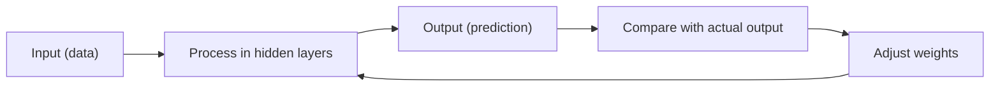
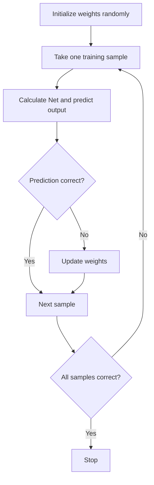
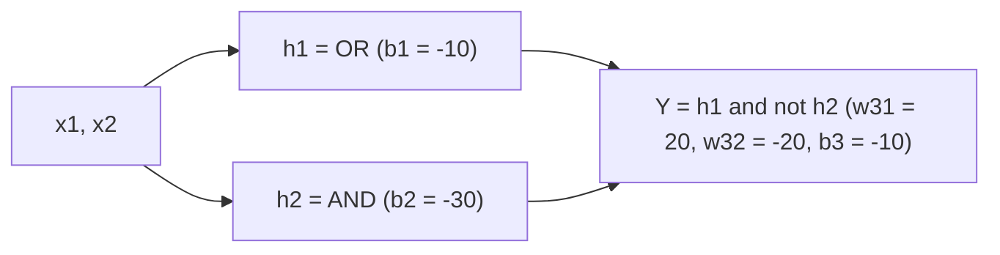
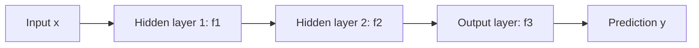

This is syllabus <Syl m="1" />: history of deep learning, the multilayer perceptron (MLP) and deep feedforward networks.

## Deep learning in one minute

- Deep Learning is a subfield of Machine Learning that involves the use of neural networks to model and solve complex problems. <Cite id="class-dl-chp1" loc="slide 3" />
- The key characteristic is the use of deep neural networks, which have **multiple layers of interconnected nodes**. They learn complex representations by **discovering hierarchical patterns and features** in the data, without manual feature engineering. <Cite id="class-dl-chp1" loc="slide 3" />
- Main reasons for using it: automatic feature learning, handles large and complex data, high accuracy, learns complex patterns, works well with unstructured data (images, video, voice, text), and improves with more data. <Cite id="class-dl-chp1" loc="slide 4" />

## A very short history

```mermaid
%% caption: The teacher's timeline in short. The XOR failure in 1969 stopped neural networks until backpropagation in 1986.
flowchart LR
  A["1943: model of a neuron"] --> B["1958: perceptron"]
  B --> C["1969: cannot solve XOR (AI winter)"]
  C --> D["1986: backpropagation, MLP"]
  D --> E["1998: CNN, LeNet"]
  E --> F["2006: deep belief networks"]
  F --> G["2012: ImageNet, AlexNet"]
  G --> H["2014 onwards: GAN, ResNet, YOLO"]
```

The timeline is: 1943 mathematical model of a neuron; 1958 the single-layer perceptron; 1969 it cannot solve XOR; 1986 backpropagation and the multi-layer perceptron; 1998 CNN and LeNet; 2006 deep belief networks; 2009 stacked auto-encoders; 2012 ImageNet, AlexNet, dropout, ReLU; 2014 GoogLeNet, GAN, VGGNet; 2017 AlphaGo and Mask R-CNN; 2019 AlphaZero and graph neural networks. <Cite id="class-dl-chp1" loc="slide 6" /> <Cite id="class-dl-m1" loc="p. 4" />

Success stories: face recognition, speech recognition, medical diagnosis (cancer detection), self-driving cars, language translation. <Cite id="class-dl-chp1" loc="slide 7" /> <Cite id="class-dl-m1" loc="p. 9" />

## From the biological neuron to the artificial neuron

A **biological neuron** is a nerve cell that receives, processes and sends information using electrical signals. Dendrites receive signals, the cell body (soma) processes them, the axon sends the signal on, and the synapse is the gap where the signal passes to the next neuron. In short: dendrites receive, cell body thinks, axon sends, synapse connects. <Cite id="class-dl-chp1" loc="slide 8" />

<Box kind="definition">

An **artificial neuron** is a math model inspired by a biological neuron. It is used in neural networks to process data in AI. <Cite id="class-dl-chp1" loc="slide 10" />

</Box>

It takes inputs, multiplies them with weights, adds a bias, passes the sum through an activation function (like ReLU or sigmoid) and gives an output. The parts are: inputs $x$ (like dendrites), weights $w$ (importance of each input), summation (adds inputs × weights), activation function (decides the output) and output $y$. <Cite id="class-dl-chp1" loc="slide 10" />

A **neural network** is a computational model inspired by the human brain. It is made of connected units called neurons that learn patterns from data and make decisions. The neurons are arranged in an input layer, hidden layer(s) and an output layer, and the network learns by adjusting weights to reduce error. <Cite id="class-dl-chp1" loc="slide 11" />

**Key factors of a neural network** <Cite id="class-dl-chp1" loc="slide 12" />

| Factor | Meaning |
|---|---|
| Weights | Show how important an input is. A higher weight means more influence on the output. |
| Bias | An extra value added to help the neuron make a better decision. It shifts the output up or down. |
| Threshold | A limit value used to decide the output (for example marks ≥ 40 means pass). |
| Learning constant (learning rate) | Controls how fast the network learns. High is fast but risky, low is slow but accurate. |
| Momentum factor | Uses the previous weight update to speed up training and avoid getting stuck. |

## The perceptron

<Box kind="definition">

A **perceptron** is the simplest neural network used for binary classification. It answers only two classes: yes or no, 1 or 0. <Cite id="class-dl-chp1" loc="slide 13" />

</Box>

**Working of a perceptron** <Cite id="class-dl-chp1" loc="slide 13" />

1. Give the input $x_1, x_2, \dots$
2. Multiply each input with its weight.
3. Add everything: $\text{Net} = w_1x_1 + w_2x_2 + \dots + b$
4. Apply the activation function: if $\text{Net} \ge 0$ then output 1, else output 0.

**Example (Netflix movie like prediction).** Inputs: action movie = 1, thriller = 1, IMDb rating = 0.9, critics rating = 0.8. Weights 0.5, 0.4, 0.6, 0.3 and bias −1.

<Sum>

<Given>

$x = (1, 1, 0.9, 0.8)$, $w = (0.5, 0.4, 0.6, 0.3)$, $b = -1$.

</Given>

<Find>

the perceptron output $y$.

</Find>

<Steps>

1. **Multiply each input by its weight:** $1 \times 0.5 = 0.5$, $1 \times 0.4 = 0.4$, $0.9 \times 0.6 = 0.54$, $0.8 \times 0.3 = 0.24$.
2. **Add them with the bias:** $\text{Net} = 0.5 + 0.4 + 0.54 + 0.24 - 1 = 1.68 - 1 = 0.68$.
3. **Apply the step rule:** $0.68 \ge 0$, so $y = 1$.

</Steps>

<Answer>

$y = 1$: the movie is liked. <Cite id="class-dl-chp1" loc="slide 13" />

</Answer>

<Box kind="verify">

The four products add to $0.5 + 0.4 = 0.9$, then $0.9 + 0.54 = 1.44$, then $1.44 + 0.24 = 1.68$. Subtract the bias magnitude 1 to get 0.68. Same result.

</Box>

</Sum>

**Learning (perceptron learning algorithm).** The weights start random and the perceptron learns by correcting them: take one training example, predict, compare with the actual answer; if wrong, update the weights (for a positive sample wrongly classified $w = w + x$, for a negative sample wrongly classified $w = w - x$); repeat for all examples until every example is classified correctly. <Cite id="class-dl-chp1" loc="slide 13" />

The **delta learning rule** updates weights during training: $\Delta w = \eta\,(t - y)\,x$, where $\eta$ is the learning rate, $t$ the target output, $y$ the actual output and $x$ the input. It is used to reduce error and improve learning. <Cite id="class-dl-chp1" loc="slide 16" />

Perceptron: advantages are a simple architecture, fast computation, easy to train. Disadvantages are that it cannot handle sequence data, has no memory of past inputs, and is limited for complex tasks. <Cite id="class-dl-chp1" loc="slide 13" />

## Logic gates with a perceptron

**AND gate.** AND gives output 1 only when all inputs are 1. The teacher's perceptron uses $w_1 = 1$, $w_2 = 1$, bias 0 and threshold $\theta = 2$. Sum $= x_1w_1 + x_2w_2 + \text{Bias}$. If Sum ≥ θ the output is 1, else 0. <Cite id="class-dl-chp1" loc="slide 18" />

| $x_1$ | $x_2$ | Sum | Output |
|---|---|---|---|
| 0 | 0 | 0 | 0 (0 < 2) |
| 0 | 1 | 1 | 0 (1 < 2) |
| 1 | 0 | 1 | 0 (1 < 2) |
| 1 | 1 | 2 | 1 (2 ≥ 2) |

**OR gate:** weights 1 and 1, bias 0, threshold θ = 1, so the output is 1 when at least one input is 1. **NOT gate:** one input with weight −1, threshold 0: input 0 gives sum 0 ≥ 0 so output 1; input 1 gives sum −1 < 0 so output 0. **NAND gate:** weights −1 and −1, bias 0, threshold −1.5. The sums are 0, −1, −1, −2, and only −2 is below −1.5, so the output is 0 only for the input (1, 1) and 1 otherwise. (The teacher's slide 21 also adds a bias of −1, which makes the sums −1, −2, −2, −3 and gives the wrong outputs; drop that extra bias.) <Cite id="class-dl-chp1" loc="slide 19" /> <Cite id="class-dl-chp1" loc="slide 20" /> <Cite id="class-dl-chp1" loc="slide 21" />

## Linear separability and the XOR problem

- **Linearly separable:** data can be separated by a straight line (a single perceptron can solve it). Examples: AND, OR, NAND. <Cite id="class-dl-m1" loc="p. 5" />
- **Non-linearly separable:** data cannot be separated by a straight line, so it needs an MLP (multiple layers). Example: XOR. <Cite id="class-dl-chp1" loc="slide 14" />

**XOR** gives 1 when exactly one input is 1, otherwise 0. The four points (0,0)=0, (0,1)=1, (1,0)=1, (1,1)=0 cannot be split by one line; however the line is drawn, one point is always misclassified. <Cite id="class-dl-m1" loc="p. 6" />

A **shallow network** has one input layer and one output layer; it can solve only linear problems and cannot solve XOR. <Cite id="class-dl-chp1" loc="slide 16" />

## The multi-layer perceptron (MLP)

<Box kind="definition">

**Multi-Layer Perceptron (MLP)** consists of fully connected dense layers that transform input data from one dimension to another. It is called multi-layer because it contains an input layer, one or more hidden layers and an output layer. The purpose of an MLP is to model complex relationships between inputs and outputs. <Cite id="class-dl-m1" loc="p. 17" />

</Box>

- **Input layer:** each neuron corresponds to an input feature (three input features means three neurons).
- **Hidden layers:** any number of layers with any number of nodes; they process the information from the input layer (they extract useful features).
- **Output layer:** gives the final prediction; with multiple outputs it has that many neurons. <Cite id="class-dl-m1" loc="p. 17" /> <Cite id="class-dl-chp1" loc="slide 22" />

**Basic working steps of an MLP:** input is given to the input layer; each layer multiplies inputs with weights; bias is added; the activation function is applied; the output is passed to the next layer; the final output is produced. For each neuron $z = \sum_i w_i x_i + b$ and the output is $f(z)$. <Cite id="class-dl-chp1" loc="slide 22" />

MLP: advantages are that it solves non-linear problems like XOR, has higher accuracy and learns complex patterns. Disadvantages are more computation, more data needed, slower training and a complex structure. <Cite id="class-dl-chp1" loc="slide 22" />

### XOR with an MLP (2-2-1 network)

The hidden layer creates a **non-linear decision boundary**, so XOR becomes solvable. The network has two inputs, a hidden layer of two neurons $h_1, h_2$ and one output neuron $Y$. Each neuron applies weights plus bias and then an activation (step or sigmoid). <Cite id="class-dl-chp1" loc="slide 23" /> <Cite id="class-dl-chp1" loc="slide 24" />

**Working weights (corrected).** Use $h_1$ as an OR neuron and $h_2$ as an AND neuron, and let the output be "$h_1$ and not $h_2$":
$w_{11} = w_{21} = 20,\ b_1 = -10$; $w_{12} = w_{22} = 20,\ b_2 = -30$; $w_{31} = 20,\ w_{32} = -20,\ b_3 = -10$ (sigmoid in every neuron).

| $x_1$ | $x_2$ | $h_1$ (OR) | $h_2$ (AND) | $Y$ |
|---|---|---|---|---|
| 0 | 0 | low | low | 0 |
| 0 | 1 | high | low | 1 |
| 1 | 0 | high | low | 1 |
| 1 | 1 | high | high | 0 |

<Box kind="pitfall">

The teacher's slide 24 lists $w_{32} = 20$, $b_3 = -30$ and marks $h_1$ low, $h_2$ high for input (0,1). With those numbers the output for (0,1) would be $\sigma(20 \cdot 1 + 20 \cdot 0 - 30) = \sigma(-10) \approx 0$, not 1. Use the corrected values above in the exam. <Cite id="class-dl-chp1" loc="slide 24" />

</Box>

## Sigmoid neuron

A sigmoid neuron is an artificial neuron that uses a sigmoid function to give output values between 0 and 1. A perceptron gives only 0 or 1; the sigmoid neuron gives a smooth output, where a small change in input gives a small change in output, which helps better learning. $y = \dfrac{1}{1 + e^{-(w^Tx + b)}}$. <Cite id="class-dl-chp1" loc="slide 26" />

| $z = w^Tx + b$ | −4 | −2 | 0 | 2 | 4 |
|---|---|---|---|---|---|
| $y$ | 0.018 | 0.119 | 0.500 | 0.881 | 0.982 |

## Deep feedforward networks

<Box kind="definition">

Deep feedforward networks, also called **feedforward neural networks** or multilayer perceptrons (MLPs), are the prototypical deep learning models. The goal of a feedforward network is to approximate some function $f^*$. For a classifier, $y = f^*(x)$ maps an input $x$ to a category $y$. A feedforward network defines a mapping $y = f(x; \theta)$ and learns the value of the parameters $\theta$ that result in the best function approximation. <Cite id="class-dl-m1" loc="p. 10" />

</Box>

They are called **feedforward** because information flows through the function being evaluated from $x$, through the intermediate computations, and finally to the output $y$. There are no feedback connections in which outputs of the model are fed back into itself. When feedforward networks are extended to include feedback connections, they are called recurrent neural networks. <Cite id="class-dl-m1" loc="p. 10" />

They are called **networks** because they are typically represented by composing many functions in a chain, for example $f(x) = f^{(3)}(f^{(2)}(f^{(1)}(x)))$. Here $f^{(1)}$ is the first layer, $f^{(2)}$ the second, and the length of the chain gives the **depth** of the model; this is where the name "deep learning" comes from. The final layer is the output layer. The training data does not show the desired output for the other layers, so they are called **hidden layers**. <Cite id="class-dl-m1" loc="p. 11" />

Key features: no backward flow of data, no cycles or loops, and the output depends only on the current input. Examples: predicting pass or fail, handwritten digit recognition, spam email detection. Limitations: needs labeled data, depends on data quality and cannot learn time-based patterns. <Cite id="class-dl-chp1" loc="slide 28" />

### Hidden units and the design of the network

- **Hidden units:** the neurons of the hidden layers. Each one computes a weighted sum of its inputs, adds a bias and applies an activation function. Their purpose is to learn important patterns: the first hidden layer finds edges, the next finds corners and contours, and so on. <Cite id="class-dl-chp1" loc="slide 28" /> <Cite id="class-dl-m1" loc="p. 12" />
- **Choosing the type of hidden unit:** rectified linear units are an excellent default choice. It is usually impossible to predict in advance which will work best, so the design is trial and error: train a network and evaluate it on a validation set. <Cite id="class-dl-m1" loc="p. 15" />
- **Architecture design:** the architecture is the overall structure of the network: how many units it has and how they are connected. Most networks are a chain of layers, so the main choices are the **depth** of the network and the **width** of each layer. Deeper networks often use far fewer units per layer and far fewer parameters and often generalize better, but are often harder to optimize. The ideal architecture is found by experiment, watching the validation error. <Cite id="class-dl-m1" loc="p. 23" />
- **Other considerations:** layers need not form a chain; **skip connections** from layer $i$ to layer $i+2$ or higher make it easier for the gradient to flow from the output layers to the layers near the input. Specialized networks also use fewer connections between layers to reduce parameters and computation. <Cite id="class-dl-m1" loc="p. 25" />

## Representation power of MLPs

Representation power is the ability of a neural network to approximate a wide variety of functions. Feedforward neural networks are universal function approximators. <Cite id="class-dl-m1" loc="p. 16" />

<Box kind="definition">

**Universal approximation theorem:** a feedforward network with a linear output layer and at least one hidden layer with any activation function (such as the logistic sigmoid) can approximate any measurable function from one finite-dimensional space to another with any desired non-zero amount of error, provided that the network is given enough hidden units. <Cite id="class-dl-m1" loc="p. 24" />

</Box>

1. **Linear versus non-linear:** without a hidden layer the model is linear and can only draw a straight-line decision boundary. With a hidden layer it can draw a curved boundary. The hidden layer introduces non-linearity by applying activation functions to weighted sums. <Cite id="class-dl-chp1" loc="slide 30" />
2. **One hidden layer** with a non-linear activation can approximate any continuous function.
3. **More hidden layers** can model more complex functions and decision boundaries; depth can reduce the number of units needed. A single layer is enough to represent any function, but the layer may be infeasibly large and may fail to learn and generalize correctly. <Cite id="class-dl-m1" loc="p. 24" />
4. **Hierarchical feature learning:** each hidden layer learns higher-level features from the previous layer (edges, then shapes, then objects). <Cite id="class-dl-chp1" loc="slide 30" />

Factors that affect representation power: number of hidden layers, number of neurons, the (non-linear) activation function, and depth versus width. <Cite id="class-dl-m1" loc="p. 16" />

## Where this was asked

| If the question says | What to write | Seen as |
|---|---|---|
| "Design AND gate using Perceptron" | Weights 1 and 1, threshold 2, the truth table with sums | <PYQ id="2023-12/q1a" /> |
| "What are Feed Forward Neural Networks?" and "Explain basic architecture of feedforward neural network" | Definition, no feedback, input, hidden and output layer, working steps, diagram | <PYQ id="2024-05/q1a" /> <PYQ id="2025-05/q1a" /> |
| "Comment on the representation power of MLPs" | Universal approximation theorem, depth and width, hierarchical features | <PYQ id="2024-12/q1a" /> |
| Hidden units and their purpose | Neurons that compute weighted sum plus activation; they learn patterns | <PYQ id="assignment-1/q1a" /> |
| Role of each layer in a feedforward network | Input, hidden and output layer jobs, with a flow diagram | <PYQ id="assignment-1/q1b" /> |
| XOR with an MLP | 2-2-1 network, corrected weights, truth table | <PYQ id="assignment-1/q1c" /> |

## Quick revision

- Perceptron: simplest neural network for binary classification; Net $= \sum w_ix_i + b$; output 1 if Net ≥ 0 else 0.
- AND: weights 1 and 1, threshold 2. OR: threshold 1. NOT: weight −1. NAND: weights −1, −1, threshold −1.5.
- A single perceptron solves linearly separable problems only. XOR needs a hidden layer.
- MLP: input layer + one or more hidden layers + output layer, fully connected.
- Feedforward network: $y = f(x;\theta)$, no feedback; the chain length is the depth; the layers that are not the output are hidden layers.
- XOR in a 2-2-1 MLP: $h_1$ = OR, $h_2$ = AND, $Y$ = $h_1$ and not $h_2$.
- Representation power: one hidden layer with non-linear activation is enough to approximate any continuous function; depth makes it efficient.

**Conclusion.** A perceptron is one neuron with one straight-line boundary. Stacking neurons in layers gives an MLP, which can learn non-linear patterns such as XOR, and a deep feedforward network learns features step by step from simple to complex. <Cite id="class-dl-chp1" loc="slide 22" />
