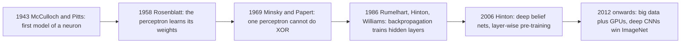
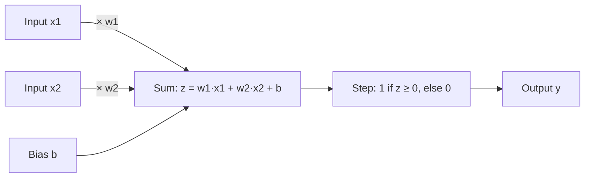
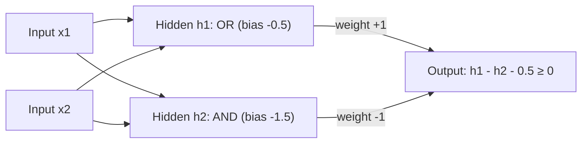
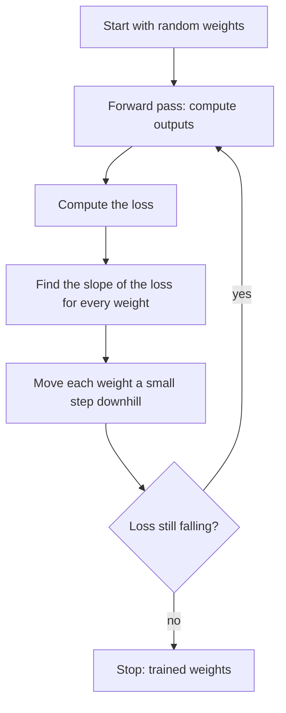

Before the new ideas, here are the old ones you need. If you already know them, skip to the next section.

## The basics first

- A **feature** (or input) is one number that describes an example, for example the size of a house or the brightness of one pixel.
- A **label** (or target) is the correct answer for that example, for example "spam" or "not spam".
- A **weight** is a number that says how important one input is. A big positive weight means "this input pushes the answer towards yes".
- A **bias** is one extra number added at the end. It moves the decision point up or down, like an offset.
- An **activation function** is the rule a neuron applies to its total to decide its output (for example "1 if the total is 0 or more, else 0").
- **Training** means adjusting the weights so the outputs get close to the labels. The **loss** is one number that says how wrong the network is, and the **learning rate** is the size of each correction step.

## A very short history

This topic is the first part of syllabus <Syl m="1" />: history, success stories, perceptrons and MLPs and their representation power, sigmoid neurons, gradient descent and feedforward networks. Deep learning sounds new, but its roots go back to the 1940s. It has had three waves of popularity under different names. <Cite id="gfdl-ch1" loc="§1.2.1" />

- **Wave 1, cybernetics (1940s to 1960s).** McCulloch and Pitts described a simple on/off model of a brain cell. Rosenblatt's **perceptron** was the first such model that could *learn* its weights from examples. <Cite id="rosenblatt1958" />
- **The setback.** Minsky and Papert showed that a single perceptron cannot learn simple patterns such as XOR, and interest dropped. <Cite id="minsky-papert-1969" />
- **Wave 2, connectionism (1980s to mid-1990s).** **Backpropagation** made it possible to train networks with hidden layers, which fixed the XOR problem. <Cite id="rumelhart1986" />
- **Wave 3, deep learning (2006 onwards).** Hinton and colleagues showed how to train much deeper networks one layer at a time. <Cite id="hinton2006-dbn" /> Large datasets and fast graphics cards (GPUs) then made deep networks the best method for images, speech and text. <Cite id="lecun2015-review" />

**Why it took off in wave 3.** Three things came together: much more data (the internet, phones, sensors), much faster hardware (GPUs), and better training tricks (ReLU, dropout, better initialization). <Cite id="gfdl-ch1" loc="§1.2" />

## Deep learning success stories

The syllabus asks for a few examples of what deep learning achieved. Write three or four with one line each. <Cite id="lecun2015-review" /> <Cite id="gfdl-ch1" loc="§1.2" />

| Area | Success story |
|---|---|
| Image recognition | In 2012 a deep CNN (AlexNet) won the ImageNet competition by a large margin, and deep CNNs have led image tasks ever since. <Cite id="krizhevsky2012" /> |
| Speech recognition | Deep networks cut error rates sharply around 2010 to 2012 and now power voice assistants. |
| Language | Machine translation and chatbots are built on deep sequence models. |
| Medicine and science | Networks read X-rays and scans and help predict the shape of proteins. |
| Everyday products | Face unlock, photo search, spam filters and recommendations. |

## The perceptron: one artificial neuron

<Box kind="definition">

**Perceptron:** a single artificial neuron. It multiplies each input by a weight, adds a bias, and passes the total through a **step function**: output 1 if the total is at least 0, otherwise output 0. It was proposed by Rosenblatt in 1958 as the first neuron model that can learn. <Cite id="rosenblatt1958" />

</Box>

**Why it is needed.** We want a machine to make a simple yes/no decision from several clues, and to *learn* how much each clue matters from examples instead of being told.

**Analogy.** A judge on a talent show listens to several things (singing, dancing, confidence), gives each one an importance, adds up the points, and says "yes" if the total crosses her bar. A perceptron does exactly this with numbers.

**How it works, step by step.**

1. **Take the inputs** $x_1, x_2, \dots, x_n$ (the clues).
2. **Weigh each input:** multiply it by its weight $w_i$ (how much that clue matters).
3. **Add them up with the bias** $b$ to get one total $z$, the weighted sum.
4. **Apply the step function:** if $z$ is 0 or more the output is 1 ("yes"), otherwise 0 ("no").
5. **Learn:** if the output was wrong, nudge the weights a little towards the right answer (the learning rule below).

In symbols, the weighted sum and the step are

$$
z = w_1x_1 + w_2x_2 + \dots + w_nx_n + b, \qquad
y = \begin{cases} 1 & \text{if } z \ge 0\\ 0 & \text{if } z < 0 \end{cases}
$$

Some books write a **threshold** $\theta$ instead of a bias and fire when the weighted sum reaches $\theta$; this is the same thing with $b = -\theta$. <Cite id="gfg-perceptron" /> <Cite id="w3s-perceptron" />

**What it can do (the geometry).** The points where the weighted sum is exactly 0 form a straight line (a flat plane in more dimensions). Points on one side get 1 and points on the other side get 0. So a perceptron is a **linear classifier**: it can only separate two groups that one straight line can separate. Such groups are called **linearly separable**.

**The perceptron learning rule (in words first).** Show the perceptron one example. If its answer is right, change nothing. If it said 1 but should have said 0, lower the weights of the inputs that were on; if it said 0 but should have said 1, raise them. With target $t$, output $y$ and learning rate $\eta$:

$$
w_i \leftarrow w_i + \eta\,(t - y)\,x_i, \qquad b \leftarrow b + \eta\,(t - y)
$$

The **perceptron convergence theorem** says that if the data is linearly separable, this rule stops making mistakes after a finite number of updates. If the data is not separable (XOR below), it never settles. <Cite id="wiki-perceptron" /> <Cite id="w3s-perceptron-training" />

**Advantages.**

- Very simple and fast; easy to understand and to build in hardware.
- Learns its own weights from examples.
- Guaranteed to find a separating line when one exists.

**Disadvantages.**

- Only straight-line (linear) boundaries, so it cannot solve XOR.
- Output is only 0 or 1, with no confidence level.
- The step function has no useful slope, so it cannot be trained by gradient descent or stacked into deep networks directly.

**Applications.** Simple yes/no filters (for example spam or not spam on a few clues), logic gates, and, most importantly, as the building block of every larger network. <Cite id="mlm-perceptron" />

## Designing an AND gate with a perceptron

This is a favourite 5-mark question, and it *does* need numbers, so solve it like a sum. The AND gate outputs 1 only when both inputs are 1.

| $x_1$ | $x_2$ | AND |
|---|---|---|
| 0 | 0 | 0 |
| 0 | 1 | 0 |
| 1 | 0 | 0 |
| 1 | 1 | 1 |

**Sum 1: design the AND gate by reasoning.**

<Sum>

<Given>

two inputs $x_1, x_2$ that are each 0 or 1; the perceptron rule "output 1 if $z = w_1x_1 + w_2x_2 + b \ge 0$, else 0"; the AND truth table above.

</Given>

<Find>

weights $w_1, w_2$ and a bias $b$ that give the AND output for all four rows.

</Find>

<Steps>

1. **Choose equal weights, $w_1 = w_2 = 1$.** Both inputs matter equally in AND, so give them the same importance.
2. **List the possible sums $x_1 + x_2$.** With these weights the weighted sum (before the bias) is $0 + 0 = 0$, $0 + 1 = 1$, $1 + 0 = 1$ or $1 + 1 = 2$.
3. **Write what the bias must do.** Only the sum 2 should reach 0 or more, so we need $2 + b \ge 0$ (row (1,1) fires) and $1 + b < 0$ (rows with one input on stay off).
4. **Solve the two conditions.** $2 + b \ge 0$ gives $b \ge -2$. $1 + b < 0$ gives $b < -1$. So any $b$ with $-2 \le b < -1$ works.
5. **Pick a safe value in the middle.** $b = -1.5$ (the same as a threshold $\theta = 1.5$), so no row sits right on the edge.
6. **Check every row with $z = x_1 + x_2 - 1.5$.**

| $x_1$ | $x_2$ | $z = x_1 + x_2 - 1.5$ | $y = \text{step}(z)$ | Matches AND? |
|---|---|---|---|---|
| 0 | 0 | $0 + 0 - 1.5 = -1.5$ | 0 | yes |
| 0 | 1 | $0 + 1 - 1.5 = -0.5$ | 0 | yes |
| 1 | 0 | $1 + 0 - 1.5 = -0.5$ | 0 | yes |
| 1 | 1 | $1 + 1 - 1.5 = +0.5$ | 1 | yes |

</Steps>

<Answer>

$w_1 = 1$, $w_2 = 1$, $b = -1.5$ (threshold 1.5). <Cite id="gfg-perceptron-and" />

</Answer>

<Box kind="verify">

Check it a different way, with the picture. The decision line is where $z = 0$, that is $x_1 + x_2 = 1.5$. It crosses the $x_1$ axis at 1.5 and the $x_2$ axis at 1.5. The points (0,0), (0,1) and (1,0) have $x_1 + x_2$ equal to 0, 1 and 1, all below 1.5, so they fall on the "0" side. Only (1,1), with $x_1 + x_2 = 2$, is above 1.5, on the "1" side. One line cuts off exactly the one corner AND needs, so the design is right. A quick range check also agrees: $-1.5$ lies inside the allowed range $-2 \le b < -1$ from step 4.

</Box>

</Sum>

**Sum 2: design the AND gate by learning.** Instead of guessing, start from any weights and apply the learning rule over the four rows until a full pass makes no mistake. <Cite id="mlm-perceptron" />

<Sum>

<Given>

starting weights $w_1 = 1$, $w_2 = 1$, bias $b = -1$, learning rate $\eta = 0.5$; the AND table as training data; the rule $w_i \leftarrow w_i + \eta(t - y)x_i$ and $b \leftarrow b + \eta(t - y)$.

</Given>

<Find>

the final weights and bias after training stops.

</Find>

<Steps>

1. **Row (0,0), target 0.** $z = 1(0) + 1(0) - 1 = -1$, which is below 0, so $y = 0$. Correct, so nothing changes.
2. **Row (0,1), target 0.** $z = 1(0) + 1(1) - 1 = 0$, which is "at least 0", so $y = 1$. Wrong (should be 0), so the error is $t - y = 0 - 1 = -1$.
3. **Update after row (0,1).** $w_1 = 1 + 0.5(-1)(0) = 1$ (unchanged, because $x_1$ was 0). $w_2 = 1 + 0.5(-1)(1) = 0.5$. $b = -1 + 0.5(-1) = -1.5$. Only the input that was on and the bias are lowered.
4. **Row (1,0), target 0, with the new values.** $z = 1(1) + 0.5(0) - 1.5 = -0.5$, so $y = 0$. Correct.
5. **Row (1,1), target 1.** $z = 1(1) + 0.5(1) - 1.5 = 0$, so $y = 1$. Correct. The first pass made one mistake.
6. **Second pass with $w_1 = 1$, $w_2 = 0.5$, $b = -1.5$.** Row (0,0): $z = -1.5$, $y = 0$. Row (0,1): $z = 0.5 - 1.5 = -1$, $y = 0$. Row (1,0): $z = 1 - 1.5 = -0.5$, $y = 0$. Row (1,1): $z = 1 + 0.5 - 1.5 = 0$, $y = 1$. All four are correct, so training stops.

</Steps>

<Answer>

$w_1 = 1$, $w_2 = 0.5$, $b = -1.5$, reached after one update.

</Answer>

<Box kind="verify">

Check it against the four conditions AND needs, instead of re-running the rows. Off rows: $b = -1.5 < 0$ (for (0,0)), $w_2 + b = -1 < 0$ (for (0,1)), $w_1 + b = -0.5 < 0$ (for (1,0)). On row: $w_1 + w_2 + b = 0 \ge 0$ (for (1,1)). All four hold, so these weights compute AND. Note that row (1,1) sits exactly on the line ($z = 0$); it still fires because the rule says "at least 0". This is why the reasoning design in Sum 1, with a safety gap, is the nicer exam answer. Different starting values give different, equally correct, lines.

</Box>

</Sum>

**OR gate** for comparison: $w_1 = w_2 = 1$, $b = -0.5$. Any single 1 gives $1 - 0.5 = 0.5 \ge 0$, so it fires; (0,0) gives $-0.5$, so it stays off.

## The XOR problem: why one neuron is not enough

XOR outputs 1 when exactly one input is 1: $(0,0) \to 0$, $(0,1) \to 1$, $(1,0) \to 1$, $(1,1) \to 0$. Put the four points on a square. The two 1s sit on opposite corners and the two 0s on the other corners. No single straight line can put both 1s on one side and both 0s on the other. So **no single perceptron can compute XOR**, whatever weights it uses. <Cite id="minsky-papert-1969" />

**The fix: add a hidden layer.** XOR is "OR but not AND". One hidden neuron computes OR, another computes AND, and the output neuron fires when OR is on and AND is off.

| $x_1, x_2$ | $h_1$ (OR) | $h_2$ (AND) | $y$ |
|---|---|---|---|
| 0, 0 | 0 | 0 | 0 |
| 0, 1 | 1 | 0 | 1 |
| 1, 0 | 1 | 0 | 1 |
| 1, 1 | 1 | 1 | 0 |

The hidden layer moves the problem into a new space where a straight line *does* work. This is the whole reason we need hidden layers. Goodfellow solves the same XOR problem with a small ReLU network. <Cite id="gfdl-ch6" loc="§6.1" /> <Cite id="gfg-perceptron-xor" />

## Sigmoid neurons

<Box kind="definition">

**Sigmoid neuron:** a neuron that computes the same weighted sum as a perceptron but passes it through the smooth S-shaped **sigmoid** (logistic) function instead of the hard step, so its output is any number between 0 and 1.

</Box>

**Why it is needed.** The perceptron's step jumps straight from 0 to 1. A tiny change in a weight either changes nothing or flips the output completely, so we cannot tell which small change makes things a little better. Learning by **gradient descent** needs exactly that information. The sigmoid fixes this: every small change in a weight changes the output a little.

**How it works.** Same steps as the perceptron (weigh, add, add bias), but the last step squashes the total smoothly: a large positive total gives nearly 1, a large negative total gives nearly 0, and a total of 0 gives exactly 0.5. The formula (with $e \approx 2.718$) is

$$
\sigma(z) = \frac{1}{1 + e^{-z}}
$$

<Figure caption="Left: the perceptron's step jumps from 0 to 1 at z = 0, so small weight changes give no useful signal. Right: the sigmoid makes the same decision smoothly, so every small change in z changes the output a little, and gradient descent can learn.">
  <CurvePlot curves="step" x="-6,6" y="-0.2,1.2" xLabel="z (weighted sum)" yLabel="output" />
  <CurvePlot curves="sigmoid" x="-6,6" y="-0.2,1.2" xLabel="z (weighted sum)" yLabel="output" />
</Figure>

<Box kind="intuition">

The step is a light switch: only off or on. The sigmoid is a dimmer: turning the knob a little always changes the brightness a little. Learning needs the dimmer, because it learns by small turns of the knob.

</Box>

**Advantages.** Smooth and differentiable, so gradient descent works; output can be read as a probability of "yes"; good for the output of a yes/no classifier.

**Disadvantages.** For very large or very small totals the curve is flat, so the learning signal almost vanishes (the **vanishing gradient** problem in deep networks); outputs are always positive, which slows learning; the exponential is a little costly. That is why modern hidden layers usually use tanh or ReLU, covered in the activation-functions topic. <Cite id="gfdl-ch6" loc="§6.3.2" />

| | Perceptron | Sigmoid neuron |
|---|---|---|
| Activation | Hard step | Smooth S-curve |
| Output | 0 or 1 only | Any value between 0 and 1 |
| Meaning of output | A decision | A probability-like confidence |
| Trained by | Perceptron learning rule | Gradient descent with backpropagation |
| Can be stacked deep and trained | No | Yes |

## Gradient descent

<Box kind="definition">

**Gradient descent:** a method that trains a network by repeatedly moving every weight a small step in the direction that makes the loss smaller. <Cite id="gfdl-ch4" loc="§4.3" />

</Box>

**Why it is needed.** A network may have millions of weights, far too many to set by hand or by trial. Gradient descent tells us, for every weight at once, which way to move it.

**Analogy.** Walking down a hill in thick fog. You cannot see the bottom, but you can feel which way the ground slopes under your feet, so you take a small step downhill, again and again, until the ground is flat.

**How it works, step by step.**

1. Start with small random weights.
2. **Forward pass:** feed the training examples in and get the outputs.
3. **Loss:** measure how wrong the outputs are.
4. **Gradient:** for each weight, find the slope of the loss, that is, whether increasing the weight makes the loss go up or down (backpropagation does this).
5. **Update:** move each weight a small step against its slope (downhill). The step size is the learning rate.
6. Repeat until the loss stops falling.

The one update rule you should know: new weight = old weight minus learning rate times slope,

$$
w \leftarrow w - \eta\,\frac{\partial L}{\partial w}
$$

where $\dfrac{\partial L}{\partial w}$ is the slope of the loss $L$ with respect to the weight $w$, and $\eta$ is the learning rate. If the slope is positive we decrease $w$; if negative we increase it. <Cite id="gfg-gradient-descent" />

**Advantages.** Simple, general (works for any network with smooth activations), and scales to millions of weights.

**Disadvantages.** The learning rate must be chosen well (too big overshoots, too small is slow); it can get stuck in flat regions or poor local minima; plain full-batch gradient descent is slow on big data. The variants (stochastic, mini-batch, momentum, Adam) fix these and are covered in the gradient-descent topic.

## Feedforward neural networks and the MLP

<Box kind="definition">

**Feedforward neural network:** a network in which information flows in one direction only, from the input layer through one or more hidden layers to the output layer. There are no loops or feedback connections. When every neuron in one layer is connected to every neuron in the next, it is called a **multilayer perceptron (MLP)** or a fully connected (dense) network. <Cite id="gfdl-ch6" />

</Box>

**Why it is needed.** One neuron draws only one straight line. Real problems (recognizing digits, predicting prices) need curved, complicated boundaries. Stacking neurons in layers lets the network build complicated decisions out of simple ones.

**Analogy.** A factory assembly line. Raw material enters at one end, each station does one job and passes the result forward, and the finished product leaves at the other end. Nothing is ever sent back to an earlier station while a product is being made.

**The basic architecture.**

1. **Input layer.** One node per input feature. It does no calculation; it just passes the numbers on.
2. **Hidden layers.** Each neuron computes a weighted sum of the previous layer's outputs, adds its bias, and applies a non-linear activation (sigmoid, tanh, ReLU). "Hidden" means we never see their correct values in the data; the network invents useful in-between features (for images: edges, then shapes, then objects).
3. **Output layer.** Gives the final answer: one sigmoid neuron for yes/no, several softmax neurons for many classes, or a plain linear neuron for a number.
4. **Weights and biases** on every connection are the parameters that training adjusts.
5. **Activation functions** add the non-linearity; without them the whole network would collapse into one straight-line model.

<Figure caption="A feedforward network (MLP) with 3 inputs, two hidden layers of 4 neurons, and 2 outputs. Every arrow goes left to right: there is no loop back. Each neuron is connected to every neuron in the next layer.">
  <NetworkFigure layers="3,4,4,2" title="Multilayer perceptron" labels="Input,Hidden 1,Hidden 2,Output" />
</Figure>

**How it works (the forward pass in words).** The input values enter the input layer. Each hidden neuron weighs and adds the values it receives, adds its bias, applies its activation and sends the result forward. The next layer does the same with these new values, and so on until the output layer gives the answer. The whole network is a chain of such layers; the number of layers in the chain is its **depth**, which is where the word "deep" comes from. <Cite id="gfdl-ch6" />

**How it learns.** Forward pass to get the output, a loss to measure the error, backpropagation to find how much each weight caused the error, gradient descent to nudge each weight; repeat over many epochs. These steps are covered in the backpropagation and gradient-descent topics. <Cite id="rumelhart1986" />

**Sum 3: size of a network.** Exams sometimes ask how many weights a network has. In Keras each fully connected layer is a `Dense` layer, and Keras prints this count in `model.summary()`. <Cite id="keras-dense" />

<Sum>

<Given>

the MLP in the figure above, with layer sizes 3 (input), 4 (hidden 1), 4 (hidden 2), 2 (output), every layer fully connected to the next.

</Given>

<Find>

the number of weights, biases and total trainable parameters.

</Find>

<Steps>

1. **Rule.** Between a layer of $n$ neurons and a layer of $m$ neurons there are $n \times m$ weights (one per arrow) and $m$ biases (one per receiving neuron). The input layer has no biases because it does no calculation.
2. **Input to hidden 1.** $3 \times 4 = 12$ weights and 4 biases.
3. **Hidden 1 to hidden 2.** $4 \times 4 = 16$ weights and 4 biases.
4. **Hidden 2 to output.** $4 \times 2 = 8$ weights and 2 biases.
5. **Add up.** Weights $12 + 16 + 8 = 36$. Biases $4 + 4 + 2 = 10$. Total $36 + 10 = 46$.

</Steps>

<Answer>

36 weights + 10 biases = 46 trainable parameters.

</Answer>

<Box kind="verify">

Count per neuron instead of per layer. Each hidden-1 neuron receives 3 inputs and has 1 bias, so $3 + 1 = 4$ parameters, and 4 such neurons give $4 \times 4 = 16$. Each hidden-2 neuron receives 4 inputs plus 1 bias, so 5 parameters, and $4 \times 5 = 20$. Each output neuron also receives 4 inputs plus 1 bias, 5 parameters, and $2 \times 5 = 10$. Total $16 + 20 + 10 = 46$, the same as before.

</Box>

</Sum>

<Box kind="pitfall">

Without a non-linear activation, stacking layers is useless: a straight-line function of a straight-line function is still a straight line, so a 10-layer linear network can do no more than one layer. The non-linearity in the hidden layers is what gives an MLP its power.

</Box>

**Types of feedforward network.**

- **Single-layer** (the perceptron): input connected straight to the output; linear boundaries only.
- **Multilayer (MLP):** one or more hidden layers; any boundary.
- **Deep feedforward network:** an MLP with many hidden layers.
- Specialized feedforward networks such as **CNNs** (shared local filters for images) and **RBF networks** are covered in the types-of-networks topic.

**Advantages.**

- Can learn non-linear patterns; in theory can approximate any continuous function (next section).
- Simple to design and to train with backpropagation.
- Works for both classification and regression.
- Fast at prediction time: one pass forward, no loops.

**Disadvantages.**

- No memory: each input is handled on its own, so it is a poor fit for sequences (text, speech); RNNs are used there.
- Fully connected layers need very many weights for images and ignore that nearby pixels belong together; CNNs are used there.
- Needs a lot of labelled data and can overfit.
- Works like a black box: hard to explain why it gave an answer.

**Applications.** Credit scoring and loan-default prediction from tabular data, medical diagnosis from test results, simple digit recognition, house-price prediction, and as the final classification layers inside CNNs. <Cite id="gfg-feedforward" /> <Cite id="ibm-neural-networks" />

## Representation power of MLPs and feedforward networks

"Representation power" asks: *which functions can a network express at all, if we could choose the best weights?* It is about what is possible, not about how easy it is to learn.

**Step 1: one perceptron.** Only linearly separable functions: AND, OR, NOT, but not XOR.

**Step 2: Boolean functions with one hidden layer.** Any Boolean function (any truth table) can be built with one hidden layer of perceptrons. One simple construction uses one hidden neuron for each input pattern that should give 1, and the output neuron ORs them. The catch is size: with $n$ inputs there are $2^n$ patterns, so this may need up to $2^n$ hidden neurons, which grows exponentially. <Cite id="gfdl-ch6" loc="§6.4.1" /> <Cite id="nptel-dl" />

**Step 3: real-valued functions, the universal approximation theorem.**

<Box kind="definition">

**Universal approximation theorem:** a feedforward network with a linear output layer and at least one hidden layer with a "squashing" activation (such as the sigmoid) can approximate any continuous function on a closed, bounded region as closely as we want, provided it has enough hidden neurons. Later results extended this to other activations, including ReLU. <Cite id="hornik1989" /> <Cite id="gfdl-ch6" loc="§6.4.1" />

</Box>

**The intuition.** Two very steep sigmoid neurons, one stepping up and one stepping down a little later, together make a narrow "bump" (a block). Many blocks of different heights side by side make a staircase that can follow any smooth curve, like building a hill out of Lego bricks. More bricks give a closer fit.

**Step 4: what the theorem does *not* promise.**

- **Size.** "Enough neurons" may mean an enormous, even exponential, number.
- **Learning.** It says good weights *exist*, not that gradient descent will *find* them.
- **Generalization.** A network that fits the training data perfectly may still do badly on new data (overfitting).

**Step 5: why depth helps.** Deep networks can represent many functions with far fewer neurons than a shallow one. Each extra layer can reuse and combine the features of the layer below, so a deep ReLU network can cut its input space into a number of linear pieces that grows exponentially with depth. <Cite id="montufar2014" /> There are simple functions that a network with two hidden layers represents with a modest number of neurons, but a network with one hidden layer needs a number of neurons that grows exponentially with the input size. <Cite id="eldan2016" /> In practice, deeper networks also tend to generalize better on many tasks. <Cite id="gfdl-ch6" loc="§6.4.1" />

| | Shallow and wide (1 hidden layer) | Deep (many hidden layers) |
|---|---|---|
| Can represent any continuous function? | Yes, in theory | Yes |
| Neurons needed | Often enormous | Far fewer for the same function |
| Features learned | One level only | Built up level by level (edges, shapes, objects) |
| Training | Simple | Harder (vanishing gradients), solved with ReLU, good initialization, normalization |

<Box kind="exam">

For "representation power of MLPs" write five points: (1) one perceptron = linear boundaries only, cannot do XOR; (2) one hidden layer can do any Boolean function, but may need up to $2^n$ neurons; (3) universal approximation theorem; (4) caveats: size, learnability, generalization; (5) depth gives the same power with far fewer neurons. Draw the XOR network as your example.

</Box>

## Perceptron versus MLP at a glance

| | Perceptron | MLP (feedforward network) |
|---|---|---|
| Layers | Input and one output neuron | Input, one or more hidden, output |
| Activation | Step (0 or 1) | Smooth non-linear (sigmoid, tanh, ReLU) |
| Decision boundary | One straight line | Any shape (curves, islands) |
| XOR | Impossible | Easy (2 hidden neurons) |
| Training | Perceptron learning rule | Backpropagation with gradient descent |
| Typical use | Simple linear yes/no, logic gates | Classification and regression on real data |

Further reading: <Cite id="gfg-mlp" /> <Cite id="gfg-uat" /> <Cite id="d2l-mlp-activations" /> <Cite id="cs231n-nn1" /> <Cite id="mlm-mlp-crash" /> <Cite id="tp-ann-building-blocks" /> <Cite id="wiki-mlp" /> <Cite id="wiki-feedforward" /> <Cite id="wiki-uat" /> <Cite id="wiki-ann-history" />

## Where this was asked

| If the question says | What to write | Seen as |
|---|---|---|
| "Design AND gate using perceptron" | Truth table, perceptron formula, choose $w_1 = w_2 = 1$, $b = -1.5$, check all four rows, the line picture, optionally the learning rule | <PYQ id="2023-12/q1a" /> |
| "What are feedforward neural networks?" | Definition (one-way flow, no loops), why needed, how the forward pass works, diagram, advantages, disadvantages, uses | <PYQ id="2024-05/q1a" /> |
| "Representation power of MLPs" | Perceptron limit (XOR), Boolean functions with $2^n$ neurons, universal approximation theorem, caveats, depth | <PYQ id="2024-12/q1a" /> |
| "Basic architecture of feedforward neural network" | The diagram, the role of input, hidden and output layers, weights, biases, activation, the forward pass, uses | <PYQ id="2025-05/q1a" /> |

## Quick revision

- Perceptron: weigh the inputs, add the bias, output 1 if the total is at least 0, else 0. It draws one straight line.
- AND: $w_1 = w_2 = 1$, $b = -1.5$. OR: $w_1 = w_2 = 1$, $b = -0.5$.
- Learning rule: change weights only on a mistake, $w_i \leftarrow w_i + \eta(t - y)x_i$; it converges if the data is linearly separable.
- XOR is not linearly separable; it needs a hidden layer (OR and AND, then "OR but not AND").
- Sigmoid $\sigma(z) = 1/(1 + e^{-z})$ is a smooth step, so gradient descent can work; drawback: vanishing gradients.
- Gradient descent: move each weight a small step downhill on the loss, $w \leftarrow w - \eta\,\partial L / \partial w$.
- Feedforward / MLP: input, hidden, output layers; one-way flow; no memory; good for tabular data.
- Network size: $n \times m$ weights plus $m$ biases for each pair of layers; the 3-4-4-2 network has 46 parameters.
- Universal approximation: one hidden layer, enough neurons, any continuous function, but possibly huge; depth is more efficient.
