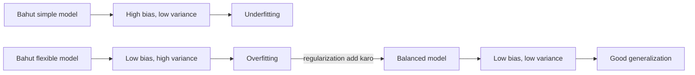
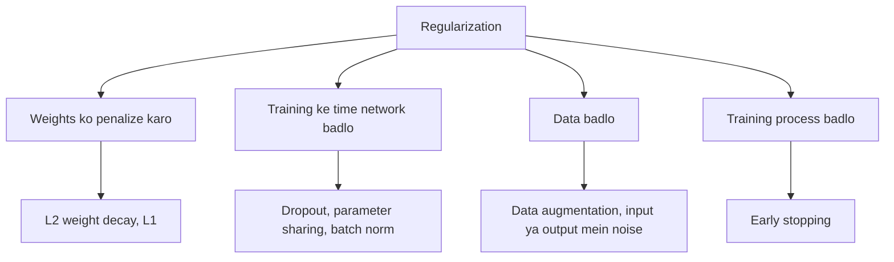
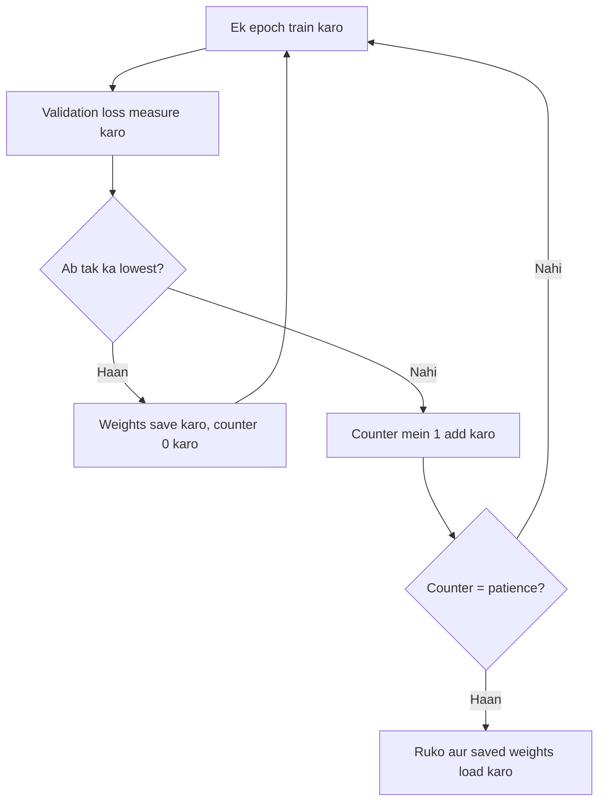
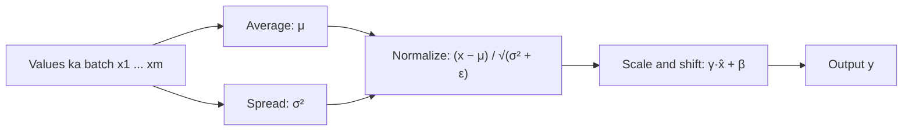
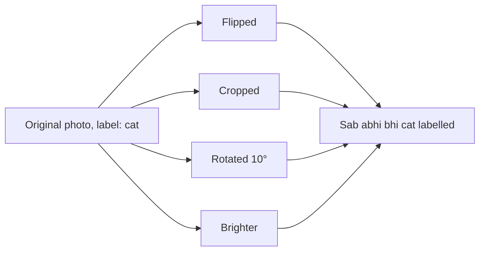

Naye ideas se pehle, woh purane ideas jo tumhe chahiye. Agar pehle se aate hain, to next section pe jao.

## Pehle basics

- Neural network ek bada formula hai jisme bahut saare adjust hone wale numbers hote hain, jinhe **weights** kehte hain.
- **Training** matlab weights ko adjust karna taaki network ke answers sahi answers ke paas aa jaayein.
- **Loss** ek number hai jo batata hai network kitna galat hai. Kam hai to better.
- Har adjustment ek chhota step hai jo loss ko kam karta hai. Step ka size **learning rate** hai, jise $\eta$ (eta) likhte hain.
- Saare training examples se ek poora pass ek **epoch** hai.
- Kuch examples hum alag rakh dete hain, inhe **validation set** kehte hain. Network inse kabhi seekhta nahi. Ye batate hain ki network unseen data pe kaisa kar raha hai, aur actually humein wahi chahiye. Unseen data pe accha karna **generalization** kehlata hai.

## Problem: seekhne ki jagah ratta maarna

Exam ki taiyari karte do students socho.

- Student A pichhle saal ka paper word by word ratta maar leta hai. Pichhle saal ke paper pe A ko 100% milta hai. Naye paper pe, jisme alag questions hain, A fail ho jaata hai.
- Student B subject samajhta hai. Pichhle saal ke paper pe B ko thoda kam milta hai, par naye paper pe bhi accha karta hai.

Neural network Student A jaisa ban sakta hai. Uske paas itne weights hote hain ki woh training examples ko ratta maar sakta hai, unki galtiyan aur random quirks bhi. Yahi **overfitting** hai. **Regularization** matlab har woh trick jo network ko Student B jaisa banne ke liye push kare. Ye syllabus <Syl m="2" />, section 2.3 hai, aur papers mein sabse zyada aane wale topics mein se ek.

## Overfitting aur underfitting

<Box kind="definition">

**Overfitting:** network training data ko, uske noise ke saath, itna close fit kar leta hai ki naye data pe bahut kharab karta hai.
**Underfitting:** network bahut simple hai, ya bahut kam train hua hai, isliye real pattern pakad nahi paata, aur training aur naye dono data pe kharab hai.

</Box>

**Har ek ko kaise pehchaane.** Training data ka score validation data ke score se compare karo. Teen cases dikhane ke liye made-up numbers:

| Case | Accuracy on training data | Accuracy on validation data | What it means |
|---|---|---|---|
| Underfitting | 55% | 52% | Pattern abhi seekha nahi |
| Good fit | 92% | 90% | Pattern seekh liya |
| Overfitting | 99% | 70% | Training data ratta maar liya |

Overfitting ki pehchaan hai dono scores ke beech **bada gap**. Underfitting ki pehchaan hai ki **dono** scores low hain.

**Learning curve.** Neeche wali picture dono errors ko epochs ke against plot karti hai. Training error neeche jaata rehta hai. Validation error pehle neeche jaata hai, apne lowest point pe pahunchta hai, phir upar jaane lagta hai. Wahi turning point hai jahan network ratta maarna shuru karta hai.

<Figure caption="Illustrative learning curves. Dashed line ke left mein network abhi seekh raha hai; right mein validation error badhta hai jabki training error girta rehta hai: yahi overfitting hai.">
  <CurvePlot curves="train-error,val-error" x="0,20" y="0,1.25" xLabel="Epoch" yLabel="Error" mark="min:val-error" />
</Figure>

**Causes aur cures.**

| | Overfitting | Underfitting |
|---|---|---|
| Typical causes | Data ke hisaab se network bahut bada, kam data, noisy data, bahut lamba training | Network bahut chhota, kam epochs, bahut zyada regularization, kharab input features |
| Cures | Zyada data, data augmentation, L1/L2, dropout, early stopping, chhota network | Bada network, lamba training, kam regularization, better features |

**Real-world example.** Kuch sau emails pe train kiya gaya spam filter ye seekh sakta hai ki jis email mein ek particular sender ka naam hai woh spam hai. Un emails pe woh perfect hai, par naye sender ki acchi emails ko galat mark kar deta hai. Yahi overfitting hai. <Cite id="rev-m2-regularization-ibm-overfitting" />

## Bias, variance aur trade-off

**Bias** woh error hai jo galat ya bahut simple assumptions se aata hai. High bias wala model training data pe bhi real pattern miss kar deta hai. Ye underfitting hai. Socho ki jo points clearly curve pe hain, unpe tum ek straight line fit kar rahe ho.

**Variance** woh error hai jo particular training set ke liye bahut sensitive hone se aata hai. High variance wala model thode alag sample pe train karo to bahut badal jaata hai. Ye overfitting hai. Socho ek wiggly curve jo har training point se guzarti hai, noise samet.

**Bias ke types jo pooche ja sakte hain.**

- **Statistical bias (bias error):** model ki average prediction aur truth ke beech ka gap, jaisa upar bataya.
- **Inductive bias:** model ke built-in assumptions, jinke bina woh generalize hi nahi kar sakta. Jaise CNN maanta hai ki paas wale pixels related hote hain aur ek pattern image mein kahin bhi ho, uska matlab same hai.
- **Data (sampling) bias:** training data real world ko represent nahi karta, jaise face dataset jisme zyada tar ek hi skin tone ho. Koi bhi regularization isse fix nahi karta. Better data chahiye.
- **Neuron ka bias term:** woh extra number $b$ jo weighted sum mein add hota hai. Ye same word ka alag matlab hai, isliye isse bias error ke saath mix mat karo.

**Trade-off.** Model ko zyada flexible banao to bias kam hota hai par variance badhta hai. Simple banao to variance kam hota hai par bias badhta hai. Naye data pe total error kahin beech mein sabse kam hota hai. Regularization ek bahut flexible network ko us beech ki taraf le jaata hai: thoda zyada bias accept karta hai taaki variance bahut kam ho jaaye. <Cite id="gfdl-ch5" loc="§5.4" /> <Cite id="rev-m2-regularization-wiki-bias-variance" />

| | High bias | High variance |
|---|---|---|
| Training error | High | Low |
| Validation error | High | High |
| Gap between them | Chhota | Bada |
| Name | Underfitting | Overfitting |
| Fix | Zyada capacity, kam regularization | Zyada data, zyada regularization |

<Cite id="rev-m2-regularization-gfg-bias-variance" />

## Regularization kya hai

<Box kind="definition">

**Regularization** model, loss ya training process mein kiya gaya koi bhi change hai jiska maksad naye data pe error kam karna hai, training data pe error nahi. <Cite id="gfdl-ch7" />

</Box>

**Ye kyun zaroori hai.** Deep networks mein millions weights hote hain, aur training examples se bhi zyada ho sakte hain. Bina kisi restraint ke woh ratta maar lenge. Regularization wahi restraint hai.

Exam mein English mein likho: "Regularization is any modification we make to a learning algorithm that is intended to reduce its generalization error but not its training error."

Syllabus ke methods chaar families mein aate hain:

## L2 regularization (weight decay)

**Ye kya hai.** L2 regularization loss mein ek penalty add karta hai jo har weight ke **square** ke saath badhti hai. Ab network ke do goals hain: accurate raho, aur weights chhote rakho.

**Ye kyun zaroori hai.** Bade weights network ko jumpy bana dete hain: input mein chhota sa change output ko bahut badal deta hai, aur ratta maarne wala network bilkul aisa hi dikhta hai. Chhote weights ek shaant, smooth function dete hain jo better generalize karta hai.

**Kaise kaam karta hai.**

1. Ek strength $\lambda$ (lambda) chuno, jaise 0.0001. Ye batata hai ki accuracy ke comparison mein chhote weights tumhare liye kitne important hain.
2. Penalty ko normal loss mein add karo.
3. Normal tarah train karo. Penalty ka gradient har step pe har weight ko thoda zero ki taraf kheenchta hai.
4. Ek weight bada tabhi rehta hai jab data use lagatar upar push kare, yaani jab woh sach mein useful ho.

Standard formula kehta hai: new loss = old loss + $\lambda$ times squared weights ke sum ka half.

$$
\text{new loss} = \text{old loss} + \frac{\lambda}{2}\sum_i w_i^2
$$

**Isse weight decay kyun kehte hain.** Words mein: har training step pe, har weight pehle apne aap ke $(1-\eta\lambda)$ fraction tak shrink hota hai, aur phir usual step liya jaata hai.

$$
w \leftarrow (1-\eta\lambda)\,w \;-\; \eta\,(\text{usual gradient})
$$

Kyunki $(1-\eta\lambda)$ 1 se thoda kam hai, har weight har step pe thoda **decay** hota hai. <Cite id="gfdl-ch7" loc="§7.1.1" /> <Cite id="d2l-weight-decay" />

**Worked example: ek weight-decay step.**

Given: weight $w = 10$, learning rate $\eta = 0.1$, strength $\lambda = 0.5$, usual gradient (old loss se) $= 2$.
To find: ek step ke baad weight.

1. $\eta$ ko $\lambda$ se multiply karo, kyunki yahi part weight ko shrink karta hai: $0.1 \times 0.5 = 0.05$.
2. Shrink factor nikaalo, kyunki weight apna itna fraction rakhta hai: $1 - 0.05 = 0.95$.
3. Weight ko shrink karo (yahi "decay" hai): $0.95 \times 10 = 9.5$.
4. Usual step lo, kyunki data abhi bhi weight ko move karna chahta hai: $\eta \times 2 = 0.1 \times 2 = 0.2$, to $9.5 - 0.2 = 9.3$.

**New weight = 9.3**

<Box kind="verify">

Step ko plain tarike se karo. New loss ka gradient = usual gradient plus $\lambda w$ ($\dfrac{\lambda}{2}w^2$ ka slope): $2 + 0.5 \times 10 = 2 + 5 = 7$. Phir $w - \eta \times 7 = 10 - 0.7 = 9.3$. Same answer, to shrink-then-step wala form sahi hai. L2 ke bina weight $10 - 0.2 = 9.8$ hota, yaani penalty ne use 0.5 aur zero ki taraf kheencha, jaisa expected tha.

</Box>

**Advantages.** Add karna simple hai (Keras ya PyTorch mein ek setting). Saare inputs use mein rehte hain, jo us data ke liye accha hai jahan bahut features thoda thoda help karte hain. Smooth penalty, isliye training stable rehti hai.

**Disadvantages.** Weights chhote ho jaate hain par lagbhag kabhi exactly zero nahi hote, isliye model simple nahi hota. $\lambda$ ko tune karna padta hai: bahut bada to network underfit karta hai, bahut chhota to abhi bhi overfit karta hai.

**Applications.** CNNs aur transformers ki training mein aam taur pe use hota hai (aksar optimizer ki "weight decay" setting ke roop mein), aur ridge regression mein.

## L1 regularization

**Ye kya hai.** L1 regularization ek penalty add karta hai jo har weight ki **absolute value** (size, sign ignore karke) ke saath badhti hai.

**Kaise kaam karta hai.** L1 penalty ka zero ki taraf pull har weight ke liye **same strength** ka hota hai, bada ho ya chhota. Isliye ek chhota weight jiski data ko sach mein zaroorat nahi, use poora zero tak, ya zero ke bahut paas tak, kheench liya jaata hai. Sirf woh weights bachte hain jo matter karte hain.

Standard formula kehta hai: new loss = old loss + $\lambda$ times absolute weights ka sum.

$$
\text{new loss} = \text{old loss} + \lambda\sum_i |w_i|
$$

Isliye L1 ek **sparse** network deta hai: bahut saare weights zero hote hain. Ye automatic **feature selection** ki tarah kaam karta hai, kyunki jis input ke saare weights zero hain woh effectively ignore ho jaata hai. <Cite id="gfdl-ch7" loc="§7.1.2" /> <Cite id="gfg-l1-sparsity" />

**Worked example: same weights pe dono penalties.**

Given: do weights $w_1 = 3$ aur $w_2 = -4$, strength $\lambda = 0.1$.
To find: L2 penalty aur L1 penalty.

1. L2: har weight ka square karo, kyunki L2 squares use karta hai (sign gayab ho jaata hai): $3^2 = 9$, $(-4)^2 = 16$.
2. Squares add karo: $9 + 16 = 25$.
3. $\dfrac{\lambda}{2} = 0.05$ se multiply karo, jaisa L2 formula kehta hai: $0.05 \times 25 = 1.25$.
4. L1: har weight ki absolute value lo, kyunki L1 sign ignore karta hai: $|3| = 3$, $|-4| = 4$.
5. Inhe add karo: $3 + 4 = 7$.
6. $\lambda = 0.1$ se multiply karo, jaisa L1 formula kehta hai: $0.1 \times 7 = 0.7$.

**L2 penalty = 1.25, L1 penalty = 0.7**

<Box kind="verify">

Weight by weight dobara calculate karo. L2: $0.05 \times 9 = 0.45$ aur $0.05 \times 16 = 0.80$; $0.45 + 0.80 = 1.25$. L1: $0.1 \times 3 = 0.3$ aur $0.1 \times 4 = 0.4$; $0.3 + 0.4 = 0.7$. Dono match karte hain. Sign check: dono penalties positive hain, jo hona hi chahiye, kyunki penalty loss mein sirf add hoti hai.

</Box>

**Advantages.** Chhota, simple model deta hai jo samajhna aasaan hai. Important inputs automatically chun leta hai.

**Disadvantages.** Absolute value ka zero pe sharp corner hota hai, isliye wahan gradient defined nahi hai aur optimizers ko special rule chahiye. Jab do inputs strongly related hon, to ye aksar ek ko random rakh leta hai aur doosre ko drop kar deta hai. Deep networks ke andar L2 se kam common hai.

**Applications.** Lasso regression, bahut wide datasets se genes ya features select karna, phones ke liye networks compress karna.

**L1 zeros kyun deta hai aur L2 kyun nahi (picture).** Penalty ko ek fence ki tarah socho: weights ko iske andar rehna hai. L1 ke liye fence ek diamond hai; L2 ke liye ek circle. Ovals equal loss ki lines hain, best unpenalized answer ke around. Regularized answer wahan hai jahan sabse chhota oval pehli baar fence ko touch karta hai. Diamond ke axes pe sharp corners hain, isliye touch aksar corner pe hota hai, jahan ek weight exactly zero hai. Circle ke corners nahi hain, isliye dono weights non-zero rehte hain.

<Figure caption="Same loss, do fences. L1 (left) mein contour pehle diamond ke corner ko touch karta hai, to w2 = 0. L2 (right) mein woh circle ko wahan touch karta hai jahan dono weights non-zero hain. Touch points compute kiye gaye hain, sketch nahi.">
  <NormBalls />
</Figure>

| | L1 | L2 (weight decay) |
|---|---|---|
| Penalty uses | Weights ki absolute values | Weights ke squares |
| Pull towards zero | Har weight ke liye same strength | Bade weights ke liye strong, chhote ke liye weak |
| Effect | Bahut weights zero ho jaate hain (sparse) | Saare weights chhote, rarely zero |
| Feature selection | Haan, automatic | Nahi |
| Smoothness | Zero pe corner | Har jagah smooth |
| Good when | Sirf kuch inputs sach mein matter karte hain | Zyada tar inputs thodi useful information dete hain |
| Classical name | Lasso | Ridge |

## Dropout

**Ye kya hai.** Dropout har training step mein ek layer ke kuch neurons ko randomly off (zero) kar deta hai. Har step pe ek alag random set off hota hai.

**Ye kyun zaroori hai.** Bade network mein neurons **co-adapt** kar sakte hain: ek neuron doosre ki galtiyan theek karna seekh leta hai, aur milkar woh training data ratta maar lete hain. Dropout ye partnerships tod deta hai.

**Analogy.** Ek group project socho jahan har din kuch members random absent hote hain. Koi bhi aaram se baith ke ek star member pe sab kuch nahi chhod sakta, kyunki woh star shayad aaye hi nahi. Sabko real kaam karna seekhna padta hai.

**Kaise kaam karta hai.**

1. Ek **keep probability** $p$ chuno, jaise hidden layers ke liye 0.5 aur inputs ke liye lagbhag 0.8.
2. Har training batch ke liye, har neuron ko probability $p$ se rakho aur warna off kar do. Practice mein iska matlab hai layer ke output ko 1s aur 0s ke random mask se multiply karna.
3. Sirf bache hue neurons ke saath train karo. Agle batch pe, alag random set off karo.
4. **Test time pe** kuch bhi off mat karo, kyunki humein poore network ka answer chahiye. Ab zyada neurons active hain, to outputs training se bade honge. Original paper isko test time pe weights ko $p$ se multiply karke theek karta hai. Common modern method, **inverted dropout**, iske bajaye training ke time bache hue outputs ko $1/p$ se scale up karta hai, taaki test time pe kuch change na ho.

<Figure caption="Left: poora network, test time pe use hota hai. Right: dropout ke saath ek training step. Crossed-out neurons is batch ke liye off hain, isliye unke connections kuch nahi le jaate; agla batch alag random set off karta hai.">
  <NetworkFigure layers="3,4,4,2" title="Full network (testing)" />
  <NetworkFigure layers="3,4,4,2" dropped="1:1,1:3,2:0" title="One training step (dropout)" />
</Figure>

<Box kind="intuition">

Ye overfitting kyun rokta hai: (1) ek neuron particular neighbours ke present hone pe depend nahi kar sakta, isliye har ek ko khud kuch useful seekhna padta hai; (2) har step ek alag "thinned" network train karta hai, aur final network lagbhag in sabke average ki tarah behave karta hai, aur averaging training data ke quirks se aayi galtiyan cancel kar deta hai; (3) random switching noise add karta hai, jisse ratta maarna mushkil ho jaata hai.

</Box>

**Advantages.** Loss badle bina overfitting kam karta hai. Bahut sasta: bas ek random 0/1 mask. Bahut tarah ke networks aur tasks mein kaam karta hai. Ek network ke andar hi ek sasta ensemble (bahut networks ka average) deta hai. <Cite id="srivastava2014" />

**Disadvantages.** Training zyada time leti hai kyunki learning signal zyada noisy hai. Keep probability ek aur setting hai jise tune karna padta hai. Chhote networks ya bahut kam data mein kam useful hai, aur agar dono ko carelessly lagaya jaaye to batch normalization ke saath awkward interact karta hai.

**Applications.** AlexNet jaise image classifiers ki fully connected layers, text aur speech models, aur Keras aur PyTorch ki "Dropout" layer. <Cite id="keras-dropout" />

## Early stopping

**Ye kya hai.** Early stopping matlab tab tak train karna jab tak network **validation** data pe improve kar raha hai, aur improve hona band ho to ruk jaana.

**Ye kyun zaroori hai.** Learning curve dobara dekho: ek point ke baad, zyada epochs validation error ko badtar banate hain. Early stopping us point ko automatically pakad leta hai.

**Kaise kaam karta hai.**

1. Har epoch ke baad, validation loss measure karo.
2. Jab bhi woh naye lowest value pe pahunche, weights ki ek copy save karo.
3. Agar woh ek fixed number of epochs (**patience**) tak improve na ho, to ruk jao aur saved weights pe wapas jao.

**Short example.** Patience 2 aur validation losses 0.90, 0.60, 0.45, **0.40**, 0.42, 0.47 ke saath, best epoch 4 hai. Epochs 5 aur 6 dono worse hain, isliye training epoch 6 ke baad rukti hai aur epoch 4 ke weights use hote hain.

**Advantages.** Network ya loss mein koi change nahi. Training time bachata hai. Use karna lagbhag free hai, aur har doosre method ke saath kaam karta hai. Simple loss ke liye iska effect L2 jaisa hota hai. <Cite id="gfdl-ch7" loc="§7.8" />

**Disadvantages.** Validation set chahiye, jo training se data le leta hai. Noisy validation curve isse bahut jaldi rokwa sakta hai, isliye patience dhyan se chuno.

**Applications.** Keras ka "EarlyStopping" callback, aur bahut se practical training runs. <Cite id="keras-early-stopping" />

## Batch normalization

**Ye kya hai.** Batch normalization (batch norm) ek layer hai jo agli layer ke inputs ko rescale karti hai taaki current mini-batch pe har unit ki values ka average 0 aur spread 1 ho. Phir network ko unke liye best scale aur shift seekhne deti hai.

**Ye kyun zaroori hai.** Training ke time jaise earlier layers badalti hain, baad wali layers tak pahunchne wali values ka size badalta rehta hai. Har layer ko baar baar re-adjust karna padta hai, isliye training slow aur unstable hoti hai aur chhota learning rate chahiye. Batch norm values ko ek steady range mein rakhta hai.

**Kaise kaam karta hai (ek unit aur ek mini-batch ke liye).**

1. Batch ki values ka **average** nikaalo.
2. Unka **spread** (variance) nikaalo.
3. **Normalize:** average subtract karo aur spread ke square root se divide karo, taaki values ka average 0 aur spread 1 ho.
4. **Scale and shift:** ek learned number $\gamma$ (gamma) se multiply karo aur ek learned number $\beta$ (beta) add karo, taaki agar better ho to network rescaling ko undo kar sake.
5. **Test time pe** shayad ek hi example ho aur koi batch na ho, isliye layer training ke time store kiye gaye mean aur variance ke running averages use karti hai.

Formulas, step by step: $\mu_B$ batch average hai, $\sigma_B^2$ batch variance, $\epsilon$ ek tiny number jo zero se divide hone se rokta hai.

$$
\mu_B = \frac{1}{m}\sum_i x_i
\qquad
\sigma_B^2 = \frac{1}{m}\sum_i (x_i-\mu_B)^2
$$

$$
\hat{x}_i = \frac{x_i-\mu_B}{\sqrt{\sigma_B^2+\epsilon}}
\qquad
y_i = \gamma\,\hat{x}_i + \beta
$$

**Worked example: chaar values pe batch norm.**

Given: ek mini-batch mein ek unit ki values: 2, 4, 6, 8. Simple rakhne ke liye $\gamma = 1$, $\beta = 0$ aur $\epsilon \approx 0$ lo.
To find: normalized values.

1. Average, batch ka centre nikaalne ke liye: $(2+4+6+8)/4 = 20/4 = 5$.
2. Har value se average subtract karo, taaki woh 0 pe centre ho jaayein: $-3, -1, 1, 3$.
3. Inka square karo, kyunki variance bina sign ke spread measure karta hai: $9, 1, 1, 9$.
4. Squares ka average lo, yahi variance hai: $(9+1+1+9)/4 = 20/4 = 5$.
5. Variance ka square root, taaki spread values ki units mein aa jaaye: $\sqrt{5} \approx 2.236$.
6. Har centred value ko 2.236 se divide karo, taaki spread 1 ho jaaye: $-3/2.236 \approx -1.342$, $-1/2.236 \approx -0.447$, $1/2.236 \approx 0.447$, $3/2.236 \approx 1.342$.
7. $\gamma = 1$ se scale aur $\beta = 0$ se shift karo, isse values same rehti hain.

**Normalized batch ≈ −1.34, −0.45, 0.45, 1.34**

<Box kind="verify">

Output ka average 0 aur variance 1 hona chahiye. Average:

$$
(-1.342 - 0.447 + 0.447 + 1.342)/4 = 0/4 = 0
$$

Variance: $1.342^2 \approx 1.801$ aur $0.447^2 \approx 0.200$, to

$$
(1.801 + 0.200 + 0.200 + 1.801)/4 = 4.002/4 \approx 1.00
$$

Dono checks pass (chhota sa 0.002 rounding ki wajah se hai).

</Box>

**Ye regularize bhi kyun karta hai.** Har example ko un doosre examples ke saath normalize kiya jaata hai jo us batch mein hain, isliye uski value mein thoda random noise aa jaata hai. Ye noise thoda regularizing effect deta hai, kuch kuch dropout jaisa.

**Advantages.** Fast aur steady training. Higher learning rate use kar sakte ho. Network is baat pe kam depend karta hai ki weights shuru mein kaise set kiye gaye the. Mild regularization.

**Disadvantages.** Bahut chhote batches ke saath kharab kaam karta hai, kyunki tab batch average reliable nahi hota. Training aur testing mein alag behave karta hai, jisse bugs aa sakte hain. Thoda computation add karta hai. Original paper ne speed-up ko "internal covariate shift" se explain kiya tha, par ye explanation abhi bhi debated hai; answer mein simply likho ki ye training ko stabilize aur fast karta hai. <Cite id="ioffe2015" /> <Cite id="gfdl-ch8" loc="§8.7.1" />

**Applications.** Bahut se modern CNNs, jaise ResNet, convolutions ke baad batch norm layer lagate hain. <Cite id="keras-batchnorm" />

## Data augmentation

**Ye kya hai.** Data augmentation existing training examples ko aise tarike se badalkar extra examples banata hai jisse correct answer same rahe.

**Ye kyun zaroori hai.** Overfitting ka sabse accha ilaaj zyada data hai, par real labelled data mehenga hai. Augmentation free mein zyada variety deta hai.

**Kaise kaam karta hai.**

1. Ek training example lo.
2. Ek random change apply karo jo uska label na badle.
3. Badla hua example network ko do. Har epoch thoda alag version dekhta hai, isliye network ek exact picture ratta nahi maar sakta.

**Types.**

- **Images:** left to right flip, crop, thoda rotate, zoom, shift, brightness ya contrast change.
- **Audio:** background noise add karo, speed ya pitch thoda badlo.
- **Text:** words ko synonyms se replace karo, doosri language mein translate karke wapas laao.

**Dhyan rakho:** change se answer nahi badalna chahiye. Digit 6 ko 180° rotate karo to woh 9 jaisa dikhta hai, isliye digits ke liye woh rotation galat label dega. <Cite id="gfdl-ch7" loc="§7.4" />

**Advantages.** Zyada data paane ka sasta tarika. Network ko lighting ya position jaise chhote changes ke liye robust banata hai. Kisi bhi doosre method ke saath combine ho sakta hai.

**Disadvantages.** Galat transformations galat labels banate hain. Zyada data hone se training zyada time leti hai. Safe changes chunne ke liye task ki knowledge chahiye.

**Applications.** Image classification, medical imaging jahan data kam hai, speech recognition. <Cite id="rev-m2-regularization-wiki-data-augmentation" />

## Syllabus ke baaki regularizers

**Parameter sharing.** Same weights ko bahut jagah reuse karo. Convolution filter poori image pe slide hota hai, isliye weights ka ek chhota set har jagah use hota hai. Kam free weights matlab ratta maarne ka kam chance. *Advantage:* bahut kam weights aur ek sensible built-in assumption. *Disadvantage:* sirf wahan suitable jahan same pattern sach mein kahin bhi aa sakta hai. *Application:* images ke liye CNNs, RNNs jo har time step pe weights ka ek hi set reuse karte hain. <Cite id="gfdl-ch7" loc="§7.9" />

**Input mein noise add karna.** Thode noisy inputs pe train karo taaki network chhote changes pe strongly react na kare. Kuch simple models ke liye, bahut thoda input noise add karna weights ke size pe penalty jaisa kaam karta dikhaya gaya hai, L2 jaisa. *Advantage:* zyada robust network. *Disadvantage:* bahut zyada noise real signal ko chhupa deta hai. *Application:* speech recognition aur denoising autoencoders. <Cite id="gfdl-ch7" loc="§7.5" />

**Output mein noise add karna (label smoothing).** Target ko soft karo, jaise correct class ke liye 1.0 ki jagah 0.9 use karo, taaki network overconfident na bane ya un labels ke peeche na bhaage jo shayad galat hon. *Advantage:* better-calibrated, kam overconfident predictions. *Disadvantage:* model ki probabilities ab exactly true wali nahi rehti. *Application:* image classifiers aur translation models. <Cite id="gfdl-ch7" loc="§7.5.1" />

## Saare methods ek nazar mein

| Method | What it changes | Main idea | Main drawback |
|---|---|---|---|
| L2 / weight decay | Loss | Saare weights chhote rakho | Weights kabhi exactly zero nahi |
| L1 | Loss | Bekaar weights zero karo | Zero pe corner, deep nets mein kam use |
| Dropout | Training ke time network | Random neurons off karo | Slow training |
| Batch normalization | Network | Har layer ke inputs rescale karo | Chhote batches mein weak |
| Early stopping | Training process | Lowest validation loss pe ruko | Validation set chahiye |
| Data augmentation | Data | Label same rakhne wali copies banao | Galat changes, galat labels |
| Parameter sharing | Network | Weights reuse karo | Sirf jahan patterns repeat hon |
| Input / output noise | Data | Network robust aur kam confident banao | Zyada noise nuksaan karta hai |

**Conclusion.** Overfitting ratta maarna hai; upar ka har regularization method training data pe thodi accuracy chhodkar naye data pe bahut better karta hai, aur practice mein kai methods saath use hote hain (jaise weight decay, dropout, data augmentation aur early stopping).

## Ye kahan poocha gaya

| If the question says | What to write | Seen as |
|---|---|---|
| "Explain dropout" ya "dropout and its advantages" | Definition, kyun zaroori, steps, diagram, test-time scaling, overfitting kyun rokta hai, advantages | <PYQ id="2023-12/q1c" /> <PYQ id="2024-05/q1c" /> <PYQ id="2024-12/q1c" /> |
| "Explain regularization" | Kya hai, kyun zaroori, chaar families, main methods pe ek ek line | <PYQ id="2025-05/q1b" /> |
| "Overfitting and underfitting" | Dono definitions, table, learning curve, causes aur fixes, bias aur variance | <PYQ id="2025-05/q1d" /> |
| "L1 and L2 regularization" | Dono ideas aur penalties words mein, diamond aur circle picture, comparison table | <PYQ id="2024-05/q5a" /> |
| "Early stopping, batch normalization, data augmentation" | Har ek ki definition, steps, advantage aur use, batch norm steps ke saath | <PYQ id="2023-12/q3b" /> |

## Quick revision

- Overfitting: training data pe great, naye data pe kharab (high variance). Underfitting: dono pe kharab (high bias).
- Regularization: koi bhi cheez jo training data ki jagah naye data pe error kam kare.
- L2 $\dfrac{\lambda}{2}\sum w_i^2$ add karta hai aur har step pe har weight ko thoda shrink karta hai (weight decay). L1 $\lambda\sum |w_i|$ add karta hai aur bahut weights ko zero ki taraf push karta hai.
- Dropout: training ke time random neurons off karo; test time pe sab on rakho (scaling ke saath).
- Early stopping: wahan ruko jahan validation loss lowest hai aur wahi weights use karo.
- Batch norm: batch average subtract karo, spread se divide karo, phir $\gamma$ se scale aur $\beta$ se shift karo.
- Augmentation: sirf woh changes jo label same rakhein.
