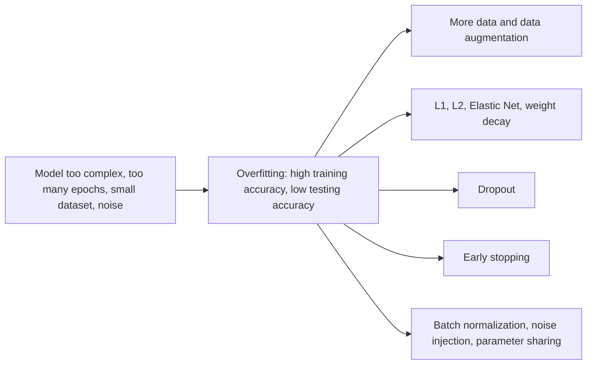
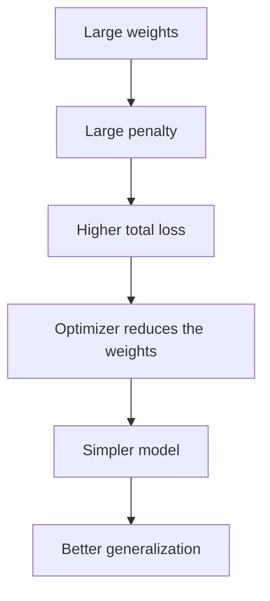
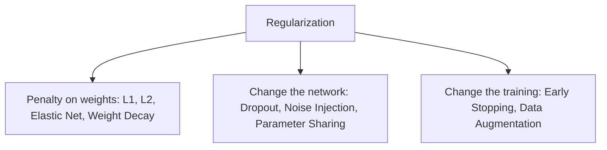
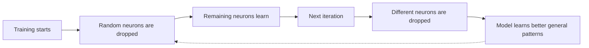
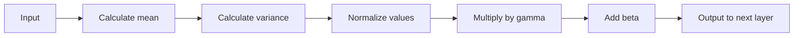
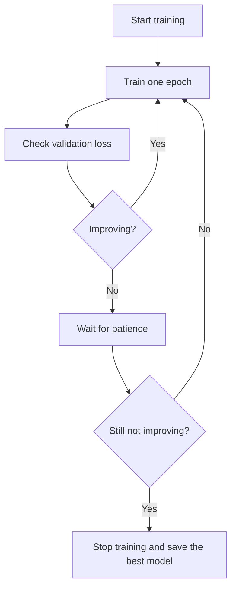
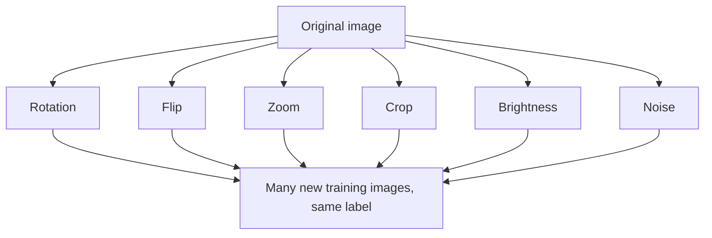

Naye ideas se pehle wo purani baatein jo chahiye. Agar pata hai to seedha agle section par jao.

## Basics pehle

- **Weight** ek number hai jo batata hai ek input neuron ke liye kitna important hai. Weights wo **parameters** hain jo network seekhta hai. <Cite id="class-dl-chp2" loc="slide 4" />
- **Loss** prediction ka error hai. **Epoch** training data ka ek complete pass hai. <Cite id="class-dl-chp2" loc="slide 69" />
- Data teen parts mein baanta jaata hai. **Training data** model banata hai (isse weights seekhe jaate hain). **Validation data** model selection aur parameter tuning ke liye hai. **Testing data** final (tuned) model ki accuracy test karta hai; tuning ke dauran use dekhna bhi nahi chahiye. <Cite id="class-dl-m2" loc="p. 27" />
- **Hyperparameter** wo setting hai jo aap training se pehle chunte ho (jaise learning rate ya λ). Ise optimizer nahi seekhta. <Cite id="class-dl-chp2" loc="slide 98" />

## Overfitting aur underfitting

### Hum kya chahte hain: generalization

Training ke baad main sawal ye hai: kya model naye, unseen data par sahi predictions kar sakta hai? Model ko sirf training data par nahi, us data par bhi achha perform karna chahiye jo usne pehle kabhi nahi dekha. <Cite id="class-dl-chp2" loc="slide 92" />

<Box kind="definition">

**Generalization** is the ability of a model to make correct predictions on new (unseen) data. A good model learns patterns, not memorization. <Cite id="class-dl-chp2" loc="slide 92" />

</Box>

Model 100% training accuracy tak pahunch kar bhi naye data par galat predictions kar sakta hai, kyunki wo actual pattern seekh sakta hai (achha) ya training data ratta maar sakta hai (bura). Isliye **high training accuracy achhe model ke barabar nahi hai**. <Cite id="class-dl-chp2" loc="slide 92" />

Textbook yahi kehta hai: overfitting matlab "a neural network will provide excellent prediction performance on the training data that it is built on, but will perform poorly on unseen test instances". Learning process "remembers random artifacts of the training data that do not generalize". Extreme overfitting ko **memorization** kehte hain. <Cite id="class-dl-m2" loc="p. 19" />

### Underfitting, good fit aur overfitting

<Box kind="definition">

**Underfitting:** the model is too simple to learn the important patterns in the data. It performs poorly on both training and testing data. **Overfitting:** the model learns the training data too well, including noise and unnecessary details. It performs very well on training data but poorly on testing data. **Good fit:** the model learns the correct patterns without memorizing the data and performs well on both. <Cite id="class-dl-chp2" loc="slide 93" />

</Box>

**Fruit example (teacher ka).** Underfitting: model training examples bhi nahi seekh paata, to apple ko banana bol deta hai. Overfitting: training apple par ek chhota black spot tha, to model sochta hai "apple mein hamesha black spot hona chahiye", aur bina spot wala naya apple "Not Apple" ban jaata hai. Good fit: model achhe se generalize karta hai. <Cite id="class-dl-chp2" loc="slide 93" />

| | Underfitting | Good fit | Overfitting |
|---|---|---|---|
| Model complexity | Too simple | Balanced | Too complex |
| Training accuracy | Low | High | Very high |
| Testing accuracy | Low | High | Low |
| Pattern seekhta hai? | No | Yes | Memorizes |
| Generalization | Poor | Excellent | Poor |

<Cite id="class-dl-chp2" loc="slide 93" />

### Kaise pehchanein: loss curves

Hum model ki performance training data aur validation (testing) data par compare karte hain. <Cite id="class-dl-chp2" loc="slide 95" />

- **Underfitting:** training loss aur validation loss dono high, kyunki model training data nahi seekh paata.
- **Good fit:** dono losses ghatte hain aur ek dusre ke kareeb rehte hain.
- **Overfitting:** training loss ghatta rehta hai, par validation loss badhna shuru ho jaata hai.

Textbook overfitting ke do signs add karta hai: training instances aur unseen test instances ke error ke beech gap bada hota hai, aur jab model alag data sets par train ho to wahi test instance ko bahut alag predictions mil sakti hain. **Generalization error** out-of-sample test data par error hai. <Cite id="class-dl-m2" loc="p. 22" />

| | Training accuracy | Validation accuracy |
|---|---|---|
| Underfitting | Low | Low |
| Good fit | High | High |
| Overfitting | Very high | Low |

<Cite id="class-dl-chp2" loc="slide 95" />

**Generalization error** training data aur unseen data par model ki performance ka difference hai: chhota difference matlab achhi generalization, bada difference matlab poor generalization. Teacher ke example mein model ki training fruits par accuracy 99% hai aur naye fruits par 60%: bada gap, jo overfitting se aaya hai. <Cite id="class-dl-chp2" loc="slide 95" />

### Bias aur variance

<Box kind="definition">

**Bias** is the error caused because the model is too simple (it makes strong assumptions and cannot learn the real pattern). High bias leads to underfitting. **Variance** is the error caused because the model becomes too sensitive to the training data (it memorizes the training examples instead of learning patterns). High variance leads to overfitting. <Cite id="class-dl-chp2" loc="slide 94" />

</Box>

**Bias-variance trade-off**: model complexity badhne par bias ghatta hai aur variance badhta hai. Goal sahi balance dhundna hai (low bias aur low variance best model deta hai). <Cite id="class-dl-chp2" loc="slide 94" /> Textbook error ke teen parts batata hai: bias, variance aur noise (data ka inherent error). <Cite id="class-dl-m2" loc="p. 26" />

| Model | Bias | Variance |
|---|---|---|
| Underfitting | High | Low |
| Good fit | Moderate | Moderate |
| Overfitting | Low | High |

<Cite id="class-dl-chp2" loc="slide 94" />

### Causes aur solutions

| | Causes | Kaise kam karein |
|---|---|---|
| **Underfitting** | Model bahut simple; training epochs kam; learning rate bahut high; features kam; training jaldi ruk gayi | Epochs badhao; model complexity badhao; better features add karo; appropriate learning rate chuno; model ko zyada der train karo |
| **Overfitting** | Model bahut complex; training epochs bahut zyada; chhota training dataset; bahut zyada parameters; training data mein noise | Zyada training data collect karo; data augmentation; early stopping; dropout; L1 regularization; L2 regularization; model complexity kam karo |

<Cite id="class-dl-chp2" loc="slide 96" />

<Cite id="class-dl-chp2" loc="slide 96" /> Ye syllabus <Syl m="2" /> hai.

## Regularization kya hai?

<Box kind="definition">

**Regularization** is a technique used to reduce overfitting by controlling the complexity of the model. Instead of allowing the model to memorize the training data, regularization encourages it to learn only the important patterns. Its main goal is to improve generalization, so the model performs well on both training and unseen data. <Cite id="class-dl-chp2" loc="slide 97" />

</Box>

Textbook ki definition: "Many strategies used in machine learning are explicitly designed to reduce the test error, possibly at the expense of increased training error. These strategies are known collectively as regularization." <Cite id="class-dl-m2" loc="p. 19" /> Deep learning mein regularization actually **nodes ke weight matrices ko penalize** karti hai. <Cite id="class-dl-m2" loc="p. 20" />

**Zyada epochs se train kyun nahi kar dete?** Koi soch sakta hai "agar model ko zyada epochs train karein to wo better ho jaayega". Ye sach nahi hai: bahut zyada epochs tak training chalne par model training data ratta maarne lagta hai, to training accuracy badh sakti hai par testing accuracy ghat sakti hai. <Cite id="class-dl-chp2" loc="slide 97" />

### Regularization kaise kaam karti hai: penalty

Regularization **loss function mein penalty add karti hai**. Agar model bahut bade ya unnecessary weights banata hai to use extra penalty milti hai. Natija: bahut bade weights discourage hote hain, model simple hota hai, wo noise ke bajaye important features seekhta hai aur unseen data par performance improve hoti hai. <Cite id="class-dl-chp2" loc="slide 97" />

- Regularization ke bina: Loss = Prediction Error. Model sirf prediction error kam karne ki koshish karta hai.
- Regularization ke saath: **Total Loss = Prediction Error + Regularization Penalty**. Model (1) prediction error kam karta hai aur (2) weights ko chhota aur simple rakhta hai. <Cite id="class-dl-chp2" loc="slide 97" />

Textbook ise yun likhta hai: Cost function = Loss (say, binary cross entropy) + Regularization term. <Cite id="class-dl-m2" loc="p. 32" />

<Cite id="class-dl-chp2" loc="slide 98" />

**Optimizer chhote weights kyun chunta hai?** Maan lo do models ka prediction error same hai. Model A ka weight 25 hai, model B ka 5. A ka penalty high hai, to uska total loss high; B ka penalty low aur total loss low. Optimizer B chunta hai. <Cite id="class-dl-chp2" loc="slide 98" />

### Regularization coefficient λ (lambda)

<Box kind="definition">

**λ (lambda)** is called the **regularization coefficient** (regularization strength). It controls how much penalty is added to the loss function. Think of λ as a control knob. Ye training se pehle chuna jaane wala hyperparameter hai; weights optimizer seekhta hai. <Cite id="class-dl-chp2" loc="slide 99" />

</Box>

| λ | Penalty | Result |
|---|---|---|
| λ = 0 | Koi penalty nahi (no regularization) | Model bahut complex ho jaata hai, weights bahut bade, training data ratta maarta hai: **overfitting** |
| Chhota λ (recommended) | Chhoti penalty | Weights control mein, important features seekhe jaate hain, noise ignore: **good fit**, best choice |
| Bada λ | Bahut badi penalty | Weights bahut chhote, model bahut simple, enough patterns nahi seekh paata: **underfitting** |

<Cite id="class-dl-chp2" loc="slide 99" />

Textbook bhi sahmat hai: agar regularization coefficient itna high ho ki weights lagbhag zero ho jaayein, to result bahut simple linear network aur halka underfitting hai, isliye coefficient ki value optimize karni padti hai taaki well-fitted model mile. <Cite id="class-dl-m2" loc="p. 21" />

**Rozmarra ka example (teacher ka).** λ = 0: student textbook ka har sentence ratta maarta hai aur sawal thoda badalne par answer nahi de paata. Chhota λ: student concepts samajhta hai aur sawal badalne par bhi sahi answer deta hai. Bada λ: student bahut kam padhta hai aur simple sawal bhi nahi kar paata. <Cite id="class-dl-chp2" loc="slide 99" />

**Regularization ke advantages:** overfitting kam karti hai, generalization improve karti hai, simpler model banati hai, noise ka effect kam karti hai, unseen data par better performance, model ko zyada robust banati hai. **Disadvantages:** bahut zyada regularization se underfitting hoti hai, sahi λ chunna mushkil hai, training accuracy thodi ghat sakti hai, ek extra hyperparameter tune karna padta hai. <Cite id="class-dl-chp2" loc="slide 99" />

### Regularization ke types

Teacher nau list karte hain: L1 (Lasso), L2 (Ridge), Elastic Net, Weight Decay, Dropout, Early Stopping, Data Augmentation, Noise Injection aur Parameter Sharing. <Cite id="class-dl-chp2" loc="slide 100" /> Textbook unhe penalty-based regularization, ensemble methods (dropout), early stopping, pretraining, continuation and curriculum methods aur sharing parameters mein group karta hai. <Cite id="class-dl-m2" loc="pp. 23-25" />

<Cite id="class-dl-chp2" loc="slide 100" />

## L1 regularization (Lasso)

<Box kind="definition">

**L1 regularization** reduces overfitting by adding the sum of the absolute values of all weights to the loss function. It is also called **Lasso** (Least Absolute Shrinkage and Selection Operator) because it shrinks large weights, selects only important features and makes unnecessary weights exactly 0. <Cite id="class-dl-chp2" loc="slide 101" />

</Box>

Iska goal unnecessary weights kam karna, unimportant features hatana, simpler model banana aur generalization improve karna hai. **Key idea:** bade weights ko penalize karo, to weights chhote hote hain, model simple hota hai, aur overfitting kam hoti hai. <Cite id="class-dl-chp2" loc="slide 101" />

<Box kind="definition">

**Formula.** Original loss: Loss = Prediction Error. L1 regularized loss: Total Loss = Prediction Loss + $\lambda \sum |w|$. Yahan $\lambda$ regularization coefficient hai, $\sum$ saare weights par sum hai aur $|w|$ har weight ki absolute value. <Cite id="class-dl-chp2" loc="slide 101" />

</Box>

Textbook kehta hai squared penalty ko "with a penalty on the sum of the absolute magnitudes of the coefficients" se badal diya jaata hai, aur $|w_i|$ exactly 0 par differentiable nahi hai, to practice mein us point par slope 0 maan lete hain. <Cite id="class-dl-m2" loc="pp. 33-34" />

**Absolute value kya hai?** Zero se distance, sign ignore karke: $|{-5}| = 5$, $|{+5}| = 5$, $|0| = 0$. <Cite id="class-dl-chp2" loc="slide 102" />

**Sum 1: L1 penalty aur total loss.** <Cite id="class-dl-chp2" loc="slide 102" />

<Sum>

<Given>

Weights $w_1 = 6$, $w_2 = -4$, $w_3 = 2$, $w_4 = -1$. Prediction error $= 4$. $\lambda = 0.1$.

</Given>

<Find>

L1 penalty aur total loss.

</Find>

<Steps>

1. **Absolute values:** $|6| = 6$, $|-4| = 4$, $|2| = 2$, $|-1| = 1$.
2. **Sum:** $\sum |w| = 6 + 4 + 2 + 1 = 13$. Bade weights penalty mein zyada jodte hain.
3. **Penalty:** $\lambda \sum |w| = 0.1 \times 13 = 1.3$.
4. **Total loss** $= 4 + 1.3 = 5.3$.

</Steps>

<Answer>

L1 penalty ($\lambda$ se multiply karne se pehle) $= 13$; $\lambda = 0.1$ ke saath penalty 1.3 aur total loss 5.3.

</Answer>

<Box kind="verify">

Sum doosre tareeke se check karo: $(6 + 4) + (2 + 1) = 10 + 3 = 13$. Ye bhi $4 + 1.3 = 5.3$.

</Box>

</Sum>

**Weight update process aur feature selection.** Bade weight se badi penalty aur higher total loss, to optimizer weight kam karta hai; kuch weights 0 ho jaate hain. Agar koi feature bahut kam contribute karta hai to uska weight 0 ho jaata hai aur model us feature ko automatically ignore karta hai. Ye L1 ki ek unique property hai: **feature selection**. <Cite id="class-dl-chp2" loc="slide 102" /> Fruit example mein texture (0.4) aur background (0.2) 0 ho jaate hain, jabki shape (8 se 7.4) aur colour (6 se 5.5) bache rehte hain. <Cite id="class-dl-chp2" loc="slide 102" />

Textbook careful hai: L1 "creates sparse solutions in which the vast majority of the values of $w_i$ are 0s (after ignoring computational errors)". Agar kisi input ka weight 0 hai to us input ka koi effect nahi, to "the L1-regularizer acts as a feature selector". <Cite id="class-dl-m2" loc="p. 35" /> Isliye "zero ya zero ke bahut kareeb" likho, "hamesha exactly zero" nahi.

**L1 ke advantages:** overfitting kam, automatic feature selection, unnecessary features hataata hai, simpler model, interpret karna aasan. **Disadvantages:** λ bahut bada ho to useful features hata sakta hai, λ chunna important hai, deep learning mein L2 se kam use hota hai. **Kab use karein:** dataset mein bahut input features hon, kuch features unnecessary hon aur simpler models prefer hon. <Cite id="class-dl-chp2" loc="slide 102" />

## L2 regularization (Ridge)

**L1 ki problem.** L1 kuch weights ko exactly 0 bana deta hai, par kabhi kabhi har feature important hota hai, aur kuch features hat jaayein to model useful information kho sakta hai. Humein aisi technique chahiye jo sab features rakhe aur phir bhi overfitting kam kare. <Cite id="class-dl-chp2" loc="slide 103" />

<Box kind="definition">

**L2 regularization** reduces overfitting by adding the sum of the squares of all weights to the loss function. Instead of making weights exactly 0, it reduces (shrinks) all weights so the model becomes simpler while still using every feature. It is also called **Ridge** regularization (Tikhonov regularization). <Cite id="class-dl-chp2" loc="slide 103" />

</Box>

**Formula.** Total Loss = Prediction Loss + $\lambda \sum w^2$. Bade weights ka bada square, to bada penalty. <Cite id="class-dl-chp2" loc="slide 103" /> Textbook L2 regularization ko "also known as **weight decay** as it forces the weights to decay towards zero (but not exactly zero)" kehta hai. <Cite id="class-dl-m2" loc="p. 34" />

**Sum 2: L2 penalty aur total loss.** <Cite id="class-dl-chp2" loc="slide 104" />

<Sum>

<Given>

Weights $w_1 = 5$, $w_2 = -3$, $w_3 = 2$, $w_4 = -1$. Prediction error $= 4$. $\lambda = 0.1$.

</Given>

<Find>

L2 penalty aur total loss.

</Find>

<Steps>

1. **Squares:** $5^2 = 25$, $(-3)^2 = 9$, $2^2 = 4$, $(-1)^2 = 1$. Square sign hata deta hai aur bade weights ko bahut zyada count karta hai.
2. **Sum:** $\sum w^2 = 25 + 9 + 4 + 1 = 39$.
3. **Penalty:** $\lambda \sum w^2 = 0.1 \times 39 = 3.9$.
4. **Total loss** $= 4 + 3.9 = 7.9$.

</Steps>

<Answer>

L2 penalty ($\lambda$ se pehle) $= 39$; $\lambda = 0.1$ ke saath penalty 3.9 aur total loss 7.9.

</Answer>

<Box kind="verify">

Akela weight 5 hi 39 mein se 25 deta hai, to lagbhag 64% penalty sabse bade weight se aati hai. Isse dikhta hai L2 bade weights ko sabse zyada shrink kyun karta hai.

</Box>

</Sum>

**Sum 3: optimizer chhota weight kyun chunta hai (teacher ke Model A aur Model B).** <Cite id="class-dl-chp2" loc="slide 98" />

<Sum>

<Given>

Do models jinka prediction error 4 hai. Model A ka weight 25 aur Model B ka weight 5. L2 penalty $\lambda = 0.01$ ke saath.

</Given>

<Find>

har model ka total loss.

</Find>

<Steps>

1. **Model A:** penalty $= 0.01 \times 25^2 = 0.01 \times 625 = 6.25$. Total $= 4 + 6.25 = 10.25$.
2. **Model B:** penalty $= 0.01 \times 5^2 = 0.01 \times 25 = 0.25$. Total $= 4 + 0.25 = 4.25$.

</Steps>

<Answer>

Model A: 10.25. Model B: 4.25. Optimizer model B chunta hai, jiska weight chhota hai.

</Answer>

<Box kind="verify">

Dono models ka prediction error same hai, to fark sirf penalty ka hai: $6.25 - 0.25 = 6$ aur $10.25 - 4.25 = 6$.

</Box>

</Sum>

Textbook update mein ek difference batata hai: L2 regularization **multiplicative decay** ko forgetting mechanism ki tarah use karta hai, jabki L1 **additive updates** use karta hai. Accuracy ke nazariye se L2 usually L1 se behtar hai, isliye L2 lagbhag hamesha prefer hota hai. <Cite id="class-dl-m2" loc="p. 35" />

**L2 ke advantages:** overfitting kam, saare important features rakhta hai, smoother models, stable training, deep learning mein sabse zyada use hota hai. **Disadvantages:** feature selection nahi karta, jab bahut features irrelevant hon to kam useful, λ dhyan se chunna padta hai. <Cite id="class-dl-chp2" loc="slide 104" />

### L1 versus L2

| Aspect | L1 (Lasso) | L2 (Ridge) |
|---|---|---|
| Penalty term | $\lambda \sum \lvert w \rvert$ (absolute value) | $\lambda \sum w^2$ (square) |
| Weights par effect | Kuch weights 0 ho jaate hain | Weights chhote par usually 0 nahi |
| Feature selection | Yes (unimportant features hataata hai) | No (saare features rakhta hai) |
| Dusre naam | Lasso (Least Absolute Shrinkage and Selection Operator) | Ridge (Tikhonov regularization) |
| Common use | Jab kuch features unimportant hon | Jab saare features important hon |

<Cite id="class-dl-chp2" loc="slides 102 and 103" />

## Elastic Net regularization

L1 bahut features hata deta hai aur L2 koi nahi hataata. Kabhi kabhi humein feature selection aur weight shrinking dono ek saath chahiye. <Cite id="class-dl-chp2" loc="slide 105" />

<Box kind="definition">

**Elastic Net** combines the advantages of L1 and L2: it removes unimportant features (like L1) and shrinks the remaining weights (like L2). This creates a simpler and more stable model. <Cite id="class-dl-chp2" loc="slide 105" />

</Box>

**Formula.** Total Loss = Prediction Loss + $\lambda_1 \sum |w| + \lambda_2 \sum w^2$, jahan $\lambda_1$ L1 penalty (feature selection) control karta hai aur $\lambda_2$ L2 penalty (weight shrinking). <Cite id="class-dl-chp2" loc="slide 106" />

**Sum 4: L1 example ke weights par Elastic Net penalty.**

<Sum>

<Given>

Weights $6, -4, 2, -1$ (Sum 1 se). $\lambda_1 = 0.1$ aur $\lambda_2 = 0.1$.

</Given>

<Find>

Elastic Net penalty.

</Find>

<Steps>

1. **L1 part:** $\sum |w| = 13$, to $\lambda_1 \times 13 = 1.3$.
2. **L2 part:** $\sum w^2 = 36 + 16 + 4 + 1 = 57$, to $\lambda_2 \times 57 = 5.7$.
3. **Elastic Net penalty** $= 1.3 + 5.7 = 7.0$.

</Steps>

<Answer>

Penalty $= 7.0$ (L1 part 1.3 plus L2 part 5.7).

</Answer>

<Box kind="verify">

$36 + 16 + 4 + 1 = 57$ aur $0.1 \times 57 = 5.7$. Akela L1 1.3 deta aur akela L2 5.7, to jod 7.0 hai.

</Box>

</Sum>

**Advantages:** overfitting kam, feature selection, bade weights shrink, stable models, jab features highly correlated hon tab achha, sirf L1 ya sirf L2 se better balance. **Disadvantages:** computationally zyada expensive, do hyperparameters ($\lambda_1$ aur $\lambda_2$) tune karne padte hain, configure karna mushkil, chhote datasets ke liye hamesha zaroori nahi. <Cite id="class-dl-chp2" loc="slide 106" />

| | Elastic Net | L1 (Lasso) | L2 (Ridge) |
|---|---|---|---|
| Uses | L1 aur L2 saath | Sirf L1 | Sirf L2 |
| Kuch features hataata hai? | Yes | Yes (kuch weights 0) | No |
| Bache weights shrink karta hai? | Yes | Zyada nahi | Yes |
| Penalties ki sankhya | Do ($\lambda_1$, $\lambda_2$) | Ek | Ek |

<Cite id="class-dl-chp2" loc="slide 106" />

## Weight decay

<Box kind="definition">

**Weight Decay** is a regularization technique that reduces (shrinks) the weights after every update during training. Simple definition: weight decay = gradually reducing the size of the weights during training. <Cite id="class-dl-chp2" loc="slide 121" />

</Box>

Kaise kaam karta hai: gradient descent weights update karta hai, phir weight decay updated weights ko thoda kam karta hai, to model seekhte hue weights chhote rakhta hai. Update rule $w \leftarrow w - \eta \nabla L - \eta \lambda w$ hai: loss se normal update plus weight-decay term jo weights ko shrink karta hai. <Cite id="class-dl-chp2" loc="slides 100 and 121" /> Standard SGD ke liye L2 regularization aur weight decay lagbhag same behave karte hain; **weight decay lagbhag L2 (Ridge) regularization ke barabar hai**. <Cite id="class-dl-chp2" loc="slide 121" />

**Sum 5: weight decay ka ek step.**

<Sum>

<Given>

$w = 2$, learning rate $\eta = 0.1$, $\lambda = 0.5$, loss ka gradient $\nabla L = 0.4$.

</Given>

<Find>

weight decay ke saath aur bina naya weight.

</Find>

<Steps>

1. **Decay ke bina:** $w \leftarrow 2 - 0.1 \times 0.4 = 1.96$.
2. **Decay term:** $\eta \lambda w = 0.1 \times 0.5 \times 2 = 0.1$.
3. **Decay ke saath:** $w \leftarrow 2 - 0.04 - 0.1 = 1.86$.

</Steps>

<Answer>

Weight decay ke saath naya weight 1.86 hai (bina decay ke 1.96). Weight decay weight ko 0.1 aur zero ki taraf kheenchta hai.

</Answer>

<Box kind="verify">

Doosra tareeka: $w(1 - \eta\lambda) - \eta \nabla L = 2 \times 0.95 - 0.04 = 1.9 - 0.04 = 1.86$. Wahi aata hai, jo weight ka multiplicative decay dikhata hai.

</Box>

</Sum>

## Dropout

**Problem.** L1, L2 aur Elastic Net weights control karte hain, par ye control nahi karte ki neurons ek dusre par kitna depend karte hain. Deep networks mein kuch neurons doosre neurons par bahut dependent ho sakte hain. Agar ek neuron galat pattern seekhta hai to bahut se doosre neurons bhi wahi galat pattern seekhte hain, aur network training data ratta maarne lagta hai. <Cite id="class-dl-chp2" loc="slide 107" />

<Box kind="definition">

**Dropout** is a regularization technique that randomly turns OFF (drops) some neurons during training. These dropped neurons do not participate in forward propagation, backpropagation or weight updates. Each training iteration uses a slightly different network. <Cite id="class-dl-chp2" loc="slide 107" />

</Box>

**Dropout overfitting ki problem kaise solve karta hai.** Training mein dropout kuch neurons randomly select karke unhe temporarily OFF kar deta hai. Sirf bache hue neurons learning ke liye use hote hain. Har iteration mein alag neurons drop hote hain, to model training data ratta nahi maar sakta; balki har neuron independently useful patterns seekhta hai. **Random drop → less dependency → learn general patterns → overfitting reduces.** <Cite id="class-dl-chp2" loc="slide 107" />

Textbook ise ensemble ki tarah samjhata hai: dropout edge sampling ke bajaye node sampling se neural network ensemble banata hai. Agar node drop hota hai to uske saare incoming aur outgoing connections bhi drop ho jaate hain. Nodes sirf input aur hidden layers se sample hote hain (output nodes kabhi drop nahi hote, warna prediction nahi de sakte). Agar network mein $M$ nodes hain to $2^M$ possible sampled networks hain, par unke **weights shared** hain. <Cite id="class-dl-m2" loc="p. 38" />

Training steps (textbook): <Cite id="class-dl-m2" loc="p. 39" />

1. Base network se ek network sample karo (input nodes probability $p_i$ se, hidden nodes $p_h$ se rakhe jaate hain, sab independent; node hatane par uske edges bhi hat jaate hain).
2. Ek training instance ya mini-batch sample karo.
3. Bache hue edges ke weights backpropagation se update karo.

<Cite id="class-dl-chp2" loc="slide 107" />

**Dropout rate (p)** batata hai training mein kitne percent neurons OFF honge: <Cite id="class-dl-chp2" loc="slide 108" />

| p | Kya hota hai |
|---|---|
| 0 (0%) | Koi neuron drop nahi; regularization nahi; overfitting ka zyada chance |
| 0.2 (20%) | Paanch mein se ek neuron drop; thodi regularization |
| **0.5 (50%)** | Aadhe neurons drop; hidden layers ke liye **sabse common**; learning aur overfitting rokne ke beech achha balance |
| 0.8 (80%) | Zyadatar neurons drop; model bahut kam seekhta hai; underfitting ho sakti hai |

**Training aur testing.** Training mein random neurons OFF hote hain aur har iteration mein alag neurons drop hote hain. Testing mein koi neuron drop nahi hota, saare neurons active hote hain aur prediction ke liye poora network use hota hai. <Cite id="class-dl-chp2" loc="slide 108" />

**Sum 6: kitne neurons aur kitne networks?** <Cite id="class-dl-chp2" loc="slide 108" />

<Sum>

<Given>

100 neurons ki hidden layer jisme dropout rate $p = 0.5$, aur ek aur jisme $p = 0.2$. Ek chhota network jisme 4 droppable nodes (input aur hidden) hain.

</Given>

<Find>

dropped neurons ki expected sankhya, aur possible sampled networks ki sankhya.

</Find>

<Steps>

1. **$p = 0.5$:** $0.5 \times 100 = 50$ neurons har iteration mein average drop hote hain.
2. **$p = 0.2$:** $0.2 \times 100 = 20$ neurons average drop hote hain.
3. **Possible networks:** 4 nodes mein se har ek ya to rakha jaata hai ya drop, to $2^4 = 16$ sampled networks. Textbook ka formula $M$ nodes ke liye $2^M$ hai.

</Steps>

<Answer>

$p = 0.5$ par 50 neurons drop, $p = 0.2$ par 20, aur 4 droppable nodes ke liye 16 possible networks.

</Answer>

<Box kind="verify">

2 nodes ke choices likho: dono rakhe, sirf A drop, sirf B drop, dono drop = 4 networks $= 2^2$. Har extra node count double karta hai, to 4 nodes se $2^4 = 16$.

</Box>

</Sum>

**Dropout ke advantages:** overfitting kam, generalization improve, neuron dependency rokta hai, network zyada robust, simple aur deep learning mein widely used. **Disadvantages:** training thodi slow, sahi dropout rate chunna important hai, bahut high dropout se underfitting ho sakti hai, usually sirf training mein apply hota hai. <Cite id="class-dl-chp2" loc="slide 108" /> Textbook add karta hai ki dropout efficient hai (sirf hidden units sample karne ka extra kaam hai) par ye network ki expressive power kam karta hai, to iske poore fayde ke liye bade models aur zyada units chahiye. <Cite id="class-dl-m2" loc="p. 40" />

Keras mein dropout ek layer hai: dense layers ke beech `Dropout(0.25)`. <Cite id="class-dl-m2" loc="p. 43" />

## Batch normalization

**Problem: internal covariate shift.** Network deep hone par training mushkil hoti hai: ek layer ka output agli layer ka input hai, weights badalte rehte hain, to har layer ke inputs badalte rehte hain. Training slow hoti hai, model unstable hota hai aur optimizer ko best weights dhundne mein zyada time lagta hai. Is problem ko **Internal Covariate Shift** kehte hain. <Cite id="class-dl-chp2" loc="slide 109" />

Ye kyun hota hai: weights update hote hain, to ek layer ka output badalta hai, to agli layer ka input badalta hai, to agli layer ko phir se seekhna padta hai, aur training slow ho jaati hai. Optimizer model improve kar raha ho tab bhi agli layer ko badalte inputs milte rehte hain. <Cite id="class-dl-chp2" loc="slide 109" /> Textbook ka example: dog / not-dog classifier sirf safed kutton par train hua, phir non-white kutte diye gaye: hidden activations ka distribution badal jaata hai, aur "this change in hidden activation is known as an internal covariate shift". <Cite id="class-dl-m2" loc="p. 81" />

<Box kind="definition">

**Batch Normalization (BatchNorm)** is a technique that normalizes the outputs of a layer before passing them to the next layer. Instead of allowing values to vary widely, BatchNorm keeps them within a similar range. This makes training faster and more stable. <Cite id="class-dl-chp2" loc="slide 109" />

</Box>

**Batch kya hai? Normalization kya hai?** Batch training samples ka ek chhota group hai jo saath mein process hota hai (jaise 1000 images 32 ke batches mein bheji jaati hain). Normalization matlab values ko similar range mein laana (jaise 10, 50, 100, 200 chhoti values ban jaati hain jo 0 ke aas-paas hain). <Cite id="class-dl-chp2" loc="slide 110" />

**Step by step kaise kaam karta hai** (teacher ke steps): <Cite id="class-dl-chp2" loc="slide 110" />

1. Batch ka **mean** $\mu$ calculate karo (saare outputs ka average).
2. Batch ka **variance** $\sigma^2$ calculate karo (values mean se kitni phaili hain).
3. **Normalize:** $\hat x = \dfrac{x - \mu}{\sqrt{\sigma^2 + \epsilon}}$. Normalization ke baad mean lagbhag 0 aur variance lagbhag 1 hota hai. ($\epsilon$ zero se divide hone se bachne ke liye chhoti value hai.)
4. $\gamma$ (gamma) se **scale** karo: $\gamma \hat x$. Gamma network ko decide karne deta hai ki values bade hon ya chhote.
5. $\beta$ (beta) se **shift** karo: $\gamma \hat x + \beta$. Beta network ko normalized values shift karne deta hai.
6. Output agli layer ko do.

<Box kind="definition">

**Final Batch Normalization formula:** $y = \gamma \left[ \dfrac{x - \mu}{\sqrt{\sigma^2 + \epsilon}} \right] + \beta$, jahan $\mu$ mean hai, $\sigma^2$ variance, $\epsilon$ zero se division rokta hai, $\gamma$ scaling parameter aur $\beta$ shifting parameter. <Cite id="class-dl-chp2" loc="slide 110" />

</Box>

Do trainable parameters $\gamma$ aur $\beta$ model ko "the optimum distribution for each hidden layer" chunne dete hain: $\gamma$ standard deviation adjust karta hai aur $\beta$ curve ko left ya right shift karta hai. <Cite id="class-dl-m2" loc="p. 72" />

<Cite id="class-dl-chp2" loc="slide 110" />

**Sum 7: chaar values par batch normalization (teacher ka mean example, poora kiya).** <Cite id="class-dl-chp2" loc="slide 110" />

<Sum>

<Given>

Chaar outputs ka batch $2, 4, 6, 8$. $\gamma = 2$, $\beta = 1$ lo aur $\epsilon$ ignore karo.

</Given>

<Find>

mean, variance, normalized values aur final outputs.

</Find>

<Steps>

1. **Mean:** $\mu = (2 + 4 + 6 + 8) / 4 = 5$.
2. **Variance:** deviations $-3, -1, 1, 3$; squares $9, 1, 1, 9$; $\sigma^2 = 20 / 4 = 5$. To $\sigma = \sqrt{5} = 2.236$.
3. **Normalize** $\hat x = (x - 5) / 2.236$: $-1.342, -0.447, 0.447, 1.342$.
4. **Scale aur shift** $y = 2\hat x + 1$: $-1.683, 0.106, 1.894, 3.683$.

</Steps>

<Answer>

Normalized values: $-1.342, -0.447, 0.447, 1.342$ (mean 0, variance 1). Final outputs: $-1.683, 0.106, 1.894, 3.683$.

</Answer>

<Box kind="verify">

Normalized values ka sum 0 hai, aur unka variance $(1.8 + 0.2 + 0.2 + 1.8)/4 = 1.0$. Slide ke apne normalization examples (10, 50, 100, 200 se −1.2, −0.3, 0.5, 1.0 aur 20, 50, 100, 150 se −1.1, −0.4, 0.5, 1.0) sirf mota picture hain: exact values −1.13, −0.56, 0.14, 1.55 aur −1.21, −0.61, 0.40, 1.41 hain.

</Box>

</Sum>

**Kahan lagta hai?** Dense ya Convolution layer ke baad aur activation function (ReLU) se pehle: teacher kehte hain BN activation function se pehle apply hota hai. <Cite id="class-dl-chp2" loc="slide 110" />

**Training versus testing.** BatchNorm training mein current batch ki statistics use karta hai; testing mein learned statistics use karta hai. <Cite id="class-dl-chp2" loc="slide 109" /> (Textbook: "Batch normalization is computed differently during the training and the testing phase". <Cite id="class-dl-m2" loc="p. 72" />)

**Benefits:** faster training; stable learning; higher learning rate allow karta hai; internal covariate shift kam; overfitting thodi kam (har batch ki statistics alag hoti hai, jo thodi randomness add karti hai, ek chhota regularization effect, par dropout ya L1/L2 ka replacement nahi). **Advantages:** faster convergence, stable learning, weight initialization ke prati kam sensitive, overall model performance improve. **Disadvantages:** training mein extra computation, bahut chhote batch sizes par kam effective, extra memory chahiye, dropout jaisi doosri regularization techniques ko poori tarah replace nahi karta. <Cite id="class-dl-chp2" loc="slide 112" />

| | Batch normalization | Dropout |
|---|---|---|
| Kya karta hai | Activations normalize karta hai | Neurons ko randomly OFF karta hai |
| Neurons | Saare neurons active rehte hain | Kuch neurons temporarily hat jaate hain |
| Main purpose | Mainly training speed up | Mainly overfitting kam |

<Cite id="class-dl-chp2" loc="slide 112" />

Textbook add karta hai ki batch normalization lagbhag kisi bhi deep network ko reparametrize karne ka tareeka hai, aur iske advantages training speed up karna aur internal covariate shift handle karna hain. <Cite id="class-dl-m2" loc="pp. 71 and 79" />

## Early stopping

**Problem.** Training mein model har epoch weights update karke training data se seekhta hai. Shuru mein wo useful patterns seekhta hai aur accuracy improve hoti hai. Agar training bahut zyada epochs chale to model patterns seekhne ke bajaye training data ratta maarne lagta hai: training accuracy bahut high rehti hai, validation accuracy ghatti hai, aur model unseen data par kharab perform karta hai. Dropout, L1 aur L2 learning process modify karke overfitting kam karte hain, par agar model bahut der train ho to overfitting phir bhi ho sakti hai. Sabse simple solution hai overfitting shuru hone se pehle training rok dena. <Cite id="class-dl-chp2" loc="slide 113" />

<Box kind="definition">

**Early Stopping** is a regularization technique that stops the training process automatically when the model stops improving on the validation data. Instead of training for a fixed number of epochs, the model is stopped at the best epoch. <Cite id="class-dl-chp2" loc="slide 113" />

</Box>

Textbook: "In early stopping, the iterative optimization method is terminated early without converging to the optimal solution on the training data." Training data ka ek hissa **validation set** ke roop mein alag rakha jaata hai; us par model ka error monitor hota hai. Ek point par ye error validation set par badhne lagta hai jabki training set par ghatta rehta hai: wahi termination ka point hai. <Cite id="class-dl-m2" loc="pp. 24 and 42" />

**Kaise kaam karta hai.** Training mein model har epoch ke baad validation loss check karta hai. Agar validation loss kai consecutive epochs tak improve nahi hota to training automatically ruk jaati hai. Natija: model training data ratta nahi maarta, overfitting kam hoti hai aur best-performing model save ho jaata hai. <Cite id="class-dl-chp2" loc="slide 113" />

<Cite id="class-dl-chp2" loc="slide 113" />

**Key terms.** **Best epoch** wo epoch hai jisme validation loss sabse kam ya validation accuracy sabse high ho; wahi model hum rakhte hain. **Patience** epochs ki wo sankhya hai jitna model rukne se pehle intezaar karta hai; patience = 3 ho to agar validation loss 3 consecutive epochs tak improve na ho to training ruk jaati hai. Patience chhote fluctuations ki wajah se jaldi rukne se bachata hai. Early stopping mainly validation loss monitor karta hai, training loss nahi. <Cite id="class-dl-chp2" loc="slide 114" />

**Sum 8: patience 3 ke saath early stopping (teacher ki table).** <Cite id="class-dl-chp2" loc="slide 114" />

<Sum>

<Given>

Epoch ke hisaab se validation loss: 1 → 0.90, 2 → 0.70, 3 → 0.55, 4 → 0.48, 5 → 0.49, 6 → 0.50, 7 → 0.51. Patience $= 3$.

</Given>

<Find>

best epoch aur wo epoch jahan training rukti hai.

</Find>

<Steps>

1. **Epochs 1 se 3:** loss har baar improve hota hai (0.90, 0.70, 0.55), to continue.
2. **Epoch 4:** 0.48 ab tak ka sabse kam hai, to ye **best model** hai; save karo.
3. **Epoch 5:** 0.49, 0.48 se kharab hai, wait (1).
4. **Epoch 6:** 0.50 ab bhi kharab hai, wait (2).
5. **Epoch 7:** 0.51 ab bhi kharab hai, wait (3). Patience khatam.

</Steps>

<Answer>

Training epoch 7 par rukti hai aur epoch 4 ka saved model (loss 0.48) use hota hai.

</Answer>

<Box kind="verify">

Epoch 4 ke baad loss teen baar lagatar badha (0.49, 0.50, 0.51), jo patience 3 ke barabar hai. Epoch 4 se pehle kisi epoch ka loss 0.48 se kam nahi tha.

</Box>

</Sum>

**Advantages:** overfitting rokta hai, training time bachata hai, best model automatically select karta hai, implement karna aasan, generalization improve. **Disadvantages:** validation dataset chahiye, sahi patience value chunna important hai, patience bahut chhota ho to jaldi ruk sakta hai. <Cite id="class-dl-chp2" loc="slide 114" /> Keras mein: `EarlyStopping(monitor='val_err', patience=5)`, jahan monitor wo quantity hai jise dekha jaata hai aur patience wo epochs ki sankhya jisme koi improvement na ho to training ruk jaati hai. <Cite id="class-dl-m2" loc="p. 43" />

## Data augmentation

**Problem.** Deep learning models ko bahut saara training data chahiye, par kai real-world cases mein sirf chhota dataset milta hai. Chhota dataset model ko general patterns seekhne ke bajaye ratta maarne par majboor karta hai (wo wahi images baar-baar dekhta hai aur background, lighting, camera angle aur noise yaad kar leta hai, asli object nahi). Isse overfitting hoti hai. Zyada data collect karna time-consuming, expensive, mushkil aur kabhi impossible hai (jaise medical images). <Cite id="class-dl-chp2" loc="slide 115" />

<Box kind="definition">

**Data Augmentation** creates new training samples by modifying the existing data. The modified images still represent the same object but look different to the model. It increases the diversity of the training dataset. <Cite id="class-dl-chp2" loc="slide 115" />

</Box>

Textbook ka version: "a set of techniques used to artificially expand the size and diversity of a training dataset by applying transformations to existing data samples". Ye overfitting kam karta hai, model ko transformations (rotation, flipping, noise) ke prati invariance seekhne mein help karta hai, jab data collect karna expensive ho tab useful hai aur real-world mein robustness badhata hai. <Cite id="class-dl-m2" loc="p. 83" />

**Kaise kaam karta hai.** Original training image ko alag-alag transformations se modify kiya jaata hai. Har transformed image ek naya training sample ban jaati hai, aur **label nahi badalta**: rotated ya flipped apple ab bhi Apple hai. <Cite id="class-dl-chp2" loc="slide 116" />

<Cite id="class-dl-chp2" loc="slide 116" />

### Common data augmentation techniques (teacher ke chhe)

| Technique | Kya karta hai | Kyun help karta hai |
|---|---|---|
| **Rotation** | Image ko chhote angle se rotate karte hain (jaise 20°) | Alag orientations ke liye useful |
| **Flipping** | Image horizontally ya vertically flip hoti hai | Model ko mirrored objects pehchanne mein help |
| **Zooming** | Object bada ya chhota kiya jaata hai | Alag distances par objects pehchanne mein help |
| **Cropping** | Image ka ek hissa hata diya jaata hai | Aise objects bhi seekhta hai jo partially dikhte hon |
| **Brightness adjustment** | Brightness badhai ya ghatai jaati hai | Alag lighting conditions mein kaam karta hai |
| **Noise addition** | Image mein chhota random noise add hota hai | Model ko noisy inputs ke prati robust banata hai |

<Cite id="class-dl-chp2" loc="slide 116" />

Textbook techniques ko data type ke hisaab se group karta hai: **image** data (geometric transformations jaise rotation, flipping, cropping, scaling, translation; colour transformations jaise brightness, contrast, saturation, hue; noise addition jaise Gaussian ya salt-and-pepper noise; cutout/random erasing; mixup jo do images aur unke labels combine karta hai; affine aur perspective transformations), **text** data (synonym replacement, back translation, random insertion/deletion/swap, BERT jaise language model se contextual augmentation) aur **audio** data (time stretching ya compression, pitch shifting, noise add karna, time mein shift, speed badalna). Ye warning bhi deta hai: "be careful with health care data". <Cite id="class-dl-m2" loc="pp. 89-92" />

**Sum 9: kitna data milta hai?**

<Sum>

<Given>

100 original apple images. Har image ko 20° rotate, flip, zoom in aur brighter banaya jaata hai, aur original bhi rakha jaata hai.

</Given>

<Find>

training set ka size.

</Find>

<Steps>

1. Har image 4 naye images deti hai (rotation, flip, zoom, brightness) plus original: $1 + 4 = 5$ images.
2. Training set: $100 \times 5 = 500$ images.

</Steps>

<Answer>

100 originals se 500 training images, sab ka label Apple.

</Answer>

<Box kind="verify">

Naye images $= 100 \times 4 = 400$, aur $400 + 100$ originals $= 500$.

</Box>

</Sum>

**Advantages:** bina aur data collect kiye training data badhta hai, overfitting kam, generalization improve, model robust, CNN performance improve. **Disadvantages:** training time badhta hai, bahut zyada augmentation se accuracy ghat sakti hai, kuch transformations har dataset ke liye suitable nahi. <Cite id="class-dl-chp2" loc="slide 116" /> Keras mein class `ImageDataGenerator(rotation_range=20, width_shift_range=0.1, ..., horizontal_flip=True, ...)` use karti hai. <Cite id="class-dl-m2" loc="p. 93" />

| | More data | Data augmentation |
|---|---|---|
| Matlab | Naye real-world samples collect karna | Existing data se naye samples banana |
| Cost aur time | High (time-consuming, expensive) | Low (quick aur easy) |
| Purpose | Dataset size badhana | Dataset size aur diversity badhana |

<Cite id="class-dl-chp2" loc="slide 115" />

## Noise injection aur parameter sharing

**Noise injection.** Training ke dauran inputs, weights ya hidden layers ki activations mein jaan-boojh kar chhota random noise add kiya jaata hai. Model exact values ratta maarne ke bajaye robust patterns seekhta hai. Types: **input noise** (network mein jaane se pehle input data mein), **weight noise** (training mein weights mein, jaise 0.80 + 0.02 = 0.82) aur **hidden layer (activation) noise** (hidden neurons ke outputs mein). Noise sirf training mein add hota hai; testing mein nahi. **Advantages:** overfitting kam, generalization improve, noisy inputs ke prati robust. **Disadvantages:** bahut zyada noise accuracy kam kar sakta hai, noise ki matra chunna important hai. <Cite id="class-dl-chp2" loc="slides 118 and 119" />

**Parameter sharing.** Ek technique jisme kai neurons ya connections weights ka same set use karte hain. Alag-alag weights seekhne ke bajaye model ek shared weight seekhta hai jo kai jagah reuse hota hai, jisse trainable parameters, memory aur overfitting ka chance kam hota hai. CNN mein wahi filter poori image par apply hota hai, to model apple ko kahin bhi pehchaan sakta hai. Ye mainly CNNs aur RNNs mein use hota hai. Ek limitation: shared weights kuch problems mein location-specific patterns capture nahi kar paate. <Cite id="class-dl-chp2" loc="slide 120" /> Textbook: sharing parameters model ke degrees of freedom kam karta hai aur recurrent tatha convolutional networks mein use hota hai. <Cite id="class-dl-m2" loc="p. 25" />

## Comparison: kaun sa method kya karta hai

| Method | Kis par kaam karta hai | Main idea |
|---|---|---|
| L1 (Lasso) | Weights | Penalty $\lambda \sum \lvert w \rvert$; kuch weights 0 (feature selection) |
| L2 (Ridge) | Weights | Penalty $\lambda \sum w^2$; weights chhote par 0 nahi |
| Elastic Net | Weights | L1 + L2 saath |
| Weight decay | Weights | Har update ke baad weights shrink (L2 ke lagbhag barabar) |
| Dropout | Neurons | Training mein neurons ko randomly OFF karta hai |
| Batch normalization | Activations | Har layer ke outputs normalize; faster, stable training |
| Early stopping | Training duration | Validation loss improve hona band ho to rukta hai |
| Data augmentation | Training data | Existing data se naye samples banata hai |
| Noise injection | Inputs, weights, activations | Training mein chhota random noise add |
| Parameter sharing | Parameters ki sankhya | Wahi weights kai jagah reuse |

<Cite id="class-dl-chp2" loc="slide 100" />

## Ye kahan puchha gaya

| Question | Kya likhna hai | Solution |
|---|---|---|
| "Explain regularization in neural network" | Definition, kyun zaroori, penalty idea, λ, methods ki chhoti list | <PYQ id="2025-05/q1b" /> |
| "Explain overfitting and underfitting" | Definitions, fruit example, curves, table, bias aur variance, fixes | <PYQ id="2025-05/q1d" /> |
| "Explain dropout. How does it solve overfitting?" | Definition, random drop, dropout rate, training vs testing, advantages | <PYQ id="2023-12/q1c" /> <PYQ id="2024-05/q1c" /> <PYQ id="2024-12/q1c" /> |
| "L1 and L2 regularization" | Formulas, har ek kya karta hai, feature selection, comparison table | <PYQ id="2024-05/q5a" /> |
| "Early stopping, batch normalization and data augmentation" | Har ek ka problem, definition, kaise kaam karta hai, advantages | <PYQ id="2023-12/q3b" /> |
| "Need for regularization; early stopping and dropout" | Overfitting problem, regularization, dono methods | <PYQ id="assignment-1/q2a" /> |
| "Data augmentation and its types with examples" | Definition, examples ke saath chhe techniques, text aur audio | <PYQ id="assignment-1/q2b" /> |

## Quick revision

- Underfitting: bahut simple, high bias, training aur testing dono par poor. Overfitting: bahut complex, high variance, training par bahut achha par testing par poor. Good fit: balanced.
- Regularization: Total Loss = Prediction Error + Regularization Penalty. λ control knob hai: 0 overfit karta hai, chhota best hai, bada underfit karta hai.
- L1: $\lambda \sum |w|$, weights 0 kar sakta hai, feature selection (Lasso). L2: $\lambda \sum w^2$, weights chhote par 0 nahi (Ridge, weight decay). Elastic Net: dono.
- Dropout: sirf training mein neurons randomly OFF (common rate 0.5). Early stopping: validation loss improve hona band ho to ruko (patience). Data augmentation: naye samples, same label.
- Batch normalization: $y = \gamma \hat x + \beta$ jahan $\hat x = (x - \mu)/\sqrt{\sigma^2 + \epsilon}$; internal covariate shift fix, faster aur stable training.
