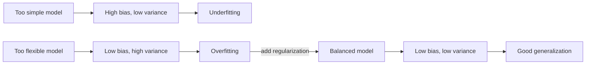
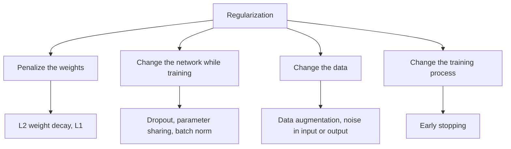
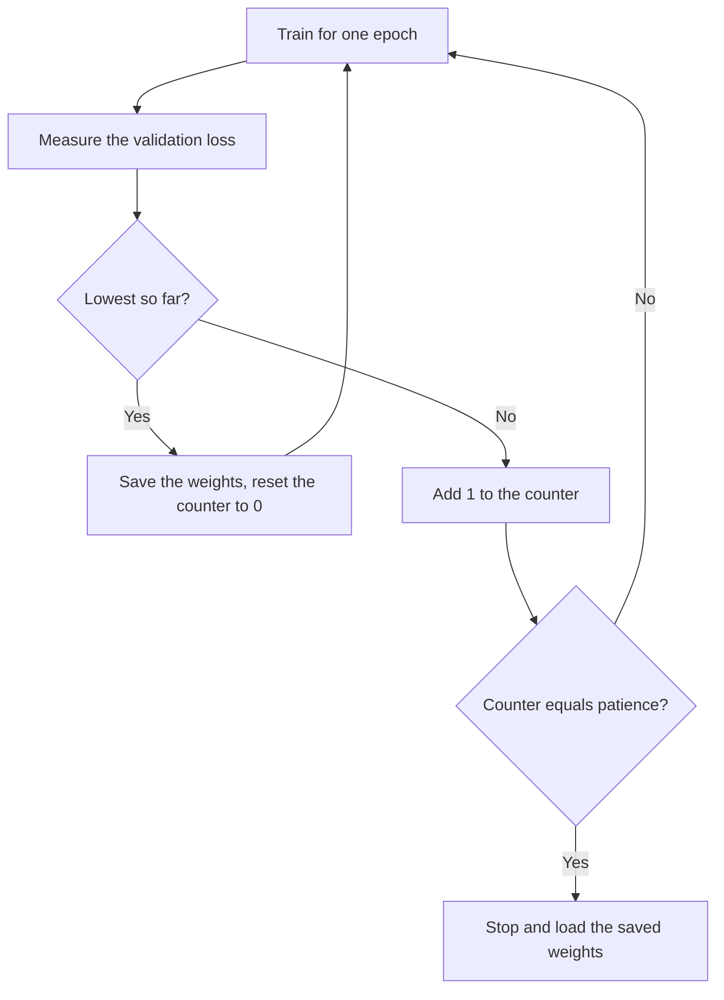
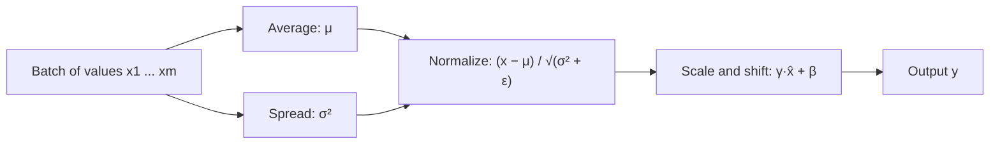
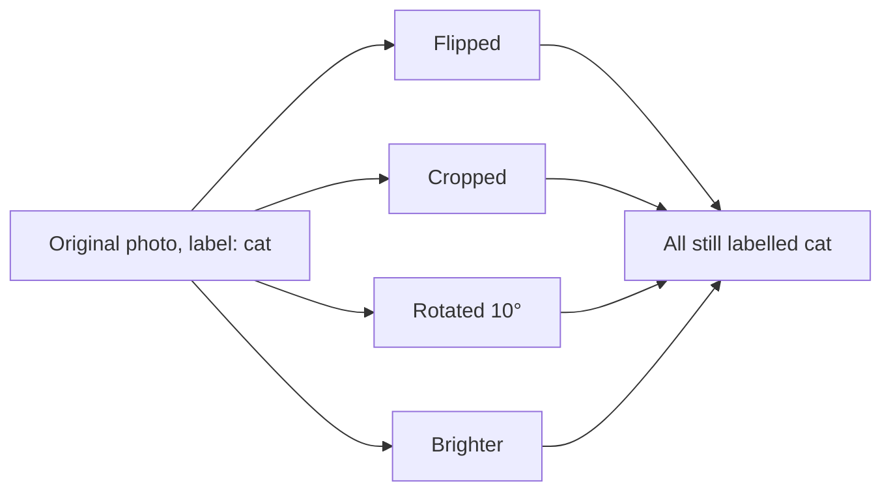

Before the new ideas, here are the old ones you need. If you already know them, skip to the next section.

## The basics first

- A neural network is a big formula with many adjustable numbers called **weights**.
- **Training** means adjusting the weights so the network's answers get close to the correct answers.
- The **loss** is one number that says how wrong the network is. Lower is better.
- Each adjustment is a small step that lowers the loss. The size of the step is the **learning rate**, written $\eta$ (eta).
- One full pass through all the training examples is one **epoch**.
- We keep some examples aside as a **validation set**. The network never learns from them. They tell us how the network does on data it has not seen, which is what we really care about. Doing well on unseen data is called **generalization**.

## The problem: memorizing instead of learning

Think of two students preparing for an exam.

- Student A memorizes last year's paper word for word. On last year's paper A scores 100%. On a new paper with different questions, A fails.
- Student B understands the subject. B scores a bit less on last year's paper, but also does well on the new one.

A neural network can behave like Student A. It has so many weights that it can memorize the training examples, including their mistakes and random quirks. That is **overfitting**. **Regularization** means every trick that pushes the network to behave like Student B. This is syllabus <Syl m="2" />, section 2.3, and one of the topics that comes up most often in the papers.

## Overfitting and underfitting

<Box kind="definition">

**Overfitting:** the network fits the training data, including its noise, so closely that it does much worse on new data.
**Underfitting:** the network is too simple, or trained too little, to capture the real pattern, so it is poor on both training and new data.

</Box>

**How to recognise each one.** Compare the score on training data with the score on validation data. Here are made-up numbers to show the three cases:

| Case | Accuracy on training data | Accuracy on validation data | What it means |
|---|---|---|---|
| Underfitting | 55% | 52% | Has not learned the pattern yet |
| Good fit | 92% | 90% | Learned the pattern |
| Overfitting | 99% | 70% | Memorized the training data |

The giveaway for overfitting is a **big gap** between the two scores. The giveaway for underfitting is that **both** scores are low.

**The learning curve.** The picture below plots both errors against the number of epochs. The training error keeps going down. The validation error goes down at first, reaches its lowest point, and then starts going up. That turning point is where the network starts memorizing.

<Figure caption="Illustrative learning curves. Left of the dashed line the network is still learning; right of it the validation error rises while the training error keeps falling: that is overfitting.">
  <CurvePlot curves="train-error,val-error" x="0,20" y="0,1.25" xLabel="Epoch" yLabel="Error" mark="min:val-error" />
</Figure>

**Causes and cures.**

| | Overfitting | Underfitting |
|---|---|---|
| Typical causes | Network too big for the data, too little data, noisy data, training too long | Network too small, too few epochs, too much regularization, poor input features |
| Cures | More data, data augmentation, L1/L2, dropout, early stopping, a smaller network | A bigger network, longer training, less regularization, better features |

**Real-world example.** A spam filter trained on a few hundred emails may learn that every email containing one sender's name is spam. It is perfect on those emails but marks good emails from a new sender wrongly. That is overfitting. <Cite id="rev-m2-regularization-ibm-overfitting" />

## Bias, variance and the trade-off

**Bias** is the error that comes from wrong or too simple assumptions. A model with high bias misses the real pattern even on training data. That is underfitting. Picture fitting a straight line to points that clearly lie on a curve.

**Variance** is the error that comes from being too sensitive to the particular training set. A model with high variance changes a lot if you train it on a slightly different sample. That is overfitting. Picture a wiggly curve that passes through every training point, noise included.

**Types of bias you may be asked about.**

- **Statistical bias (bias error):** the gap between the model's average prediction and the truth, as described above.
- **Inductive bias:** the built-in assumptions a model makes so that it can generalize at all. For example, a CNN assumes that nearby pixels are related and that a pattern means the same thing anywhere in the image.
- **Data (sampling) bias:** the training data does not represent the real world, for example a face dataset with mostly one skin tone. No amount of regularization fixes this. You need better data.
- **The bias term in a neuron:** the extra number $b$ added to the weighted sum. It is a different meaning of the same word, so do not mix it up with bias error.

**The trade-off.** Making a model more flexible lowers bias but raises variance. Making it simpler lowers variance but raises bias. The total error on new data is lowest somewhere in the middle. Regularization moves a too-flexible network towards that middle: it accepts a little more bias to get a large drop in variance. <Cite id="gfdl-ch5" loc="§5.4" /> <Cite id="rev-m2-regularization-wiki-bias-variance" />

| | High bias | High variance |
|---|---|---|
| Training error | High | Low |
| Validation error | High | High |
| Gap between them | Small | Large |
| Name | Underfitting | Overfitting |
| Fix | More capacity, less regularization | More data, more regularization |

<Cite id="rev-m2-regularization-gfg-bias-variance" />

## What regularization is

<Box kind="definition">

**Regularization** is any change to the model, the loss or the training process that is meant to reduce the error on new data, not the error on training data. <Cite id="gfdl-ch7" />

</Box>

**Why it is needed.** Deep networks have millions of weights, and can have more weights than training examples. Without some restraint they will memorize. Regularization is the restraint.

The methods in the syllabus fall into four families:

## L2 regularization (weight decay)

**What it is.** L2 regularization adds a penalty to the loss that grows with the **square** of each weight. The network now has two goals: be accurate, and keep its weights small.

**Why it is needed.** Large weights make a network jumpy: a tiny change in the input can change the output a lot, which is exactly what a memorizing network looks like. Small weights give a calmer, smoother function that generalizes better.

**How it works.**

1. Pick a strength $\lambda$ (lambda), for example 0.0001. It says how much you care about small weights compared with accuracy.
2. Add the penalty to the normal loss.
3. Train as usual. The gradient of the penalty pulls every weight a little towards zero at every step.
4. A weight stays large only if the data keeps pushing it up, that is, only if it is truly useful.

The standard formula says: new loss = old loss + $\lambda$ times half the sum of the squared weights.

$$
\text{new loss} = \text{old loss} + \frac{\lambda}{2}\sum_i w_i^2
$$

**Why it is called weight decay.** In words: at every training step, each weight is first shrunk to a fraction $(1-\eta\lambda)$ of itself, and then the usual step is taken.

$$
w \leftarrow (1-\eta\lambda)\,w \;-\; \eta\,(\text{usual gradient})
$$

Because $(1-\eta\lambda)$ is a little less than 1, every weight **decays** a bit at every step. <Cite id="gfdl-ch7" loc="§7.1.1" /> <Cite id="d2l-weight-decay" />

**Worked example: one weight-decay step.**

Given: weight $w = 10$, learning rate $\eta = 0.1$, strength $\lambda = 0.5$, usual gradient (from the old loss) $= 2$.
To find: the weight after one step.

1. Multiply $\eta$ by $\lambda$, because that is the part that shrinks the weight: $0.1 \times 0.5 = 0.05$.
2. Find the shrink factor, because the weight keeps this fraction of itself: $1 - 0.05 = 0.95$.
3. Shrink the weight (the "decay"): $0.95 \times 10 = 9.5$.
4. Take the usual step, because the data still wants to move the weight: $\eta \times 2 = 0.1 \times 2 = 0.2$, so $9.5 - 0.2 = 9.3$.

**New weight = 9.3**

<Box kind="verify">

Do the step the plain way instead. The gradient of the new loss is the usual gradient plus $\lambda w$ (the slope of $\dfrac{\lambda}{2}w^2$): $2 + 0.5 \times 10 = 2 + 5 = 7$. Then $w - \eta \times 7 = 10 - 0.7 = 9.3$. Same answer, so the shrink-then-step form is correct. Without L2 the weight would be $10 - 0.2 = 9.8$, so the penalty pulled it 0.5 closer to zero, as expected.

</Box>

**Advantages.** Simple to add (one setting in Keras or PyTorch). Keeps all inputs in use, which suits data where many features each help a little. Smooth penalty, so training stays stable.

**Disadvantages.** Weights become small but almost never exactly zero, so it does not simplify the model. $\lambda$ must be tuned: too large and the network underfits, too small and it still overfits.

**Applications.** Common in training CNNs and transformers (often as the "weight decay" setting of the optimizer), and in ridge regression.

## L1 regularization

**What it is.** L1 regularization adds a penalty that grows with the **absolute value** (size, ignoring the sign) of each weight.

**How it works.** The pull of the L1 penalty towards zero has the **same strength** for every weight, big or small. A small weight that the data does not really need is therefore pulled all the way to zero, or extremely close to it. Only the weights that matter survive.

The standard formula says: new loss = old loss + $\lambda$ times the sum of the absolute weights.

$$
\text{new loss} = \text{old loss} + \lambda\sum_i |w_i|
$$

So L1 gives a **sparse** network: many weights are zero. This works like automatic **feature selection**, because an input whose weights are all zero is effectively ignored. <Cite id="gfdl-ch7" loc="§7.1.2" /> <Cite id="gfg-l1-sparsity" />

**Worked example: the two penalties on the same weights.**

Given: two weights $w_1 = 3$ and $w_2 = -4$, strength $\lambda = 0.1$.
To find: the L2 penalty and the L1 penalty.

1. L2: square each weight, because L2 uses squares (the sign disappears): $3^2 = 9$, $(-4)^2 = 16$.
2. Add the squares: $9 + 16 = 25$.
3. Multiply by $\dfrac{\lambda}{2} = 0.05$, as the L2 formula says: $0.05 \times 25 = 1.25$.
4. L1: take the absolute value of each weight, because L1 ignores the sign: $|3| = 3$, $|-4| = 4$.
5. Add them: $3 + 4 = 7$.
6. Multiply by $\lambda = 0.1$, as the L1 formula says: $0.1 \times 7 = 0.7$.

**L2 penalty = 1.25, L1 penalty = 0.7**

<Box kind="verify">

Recompute weight by weight. L2: $0.05 \times 9 = 0.45$ and $0.05 \times 16 = 0.80$; $0.45 + 0.80 = 1.25$. L1: $0.1 \times 3 = 0.3$ and $0.1 \times 4 = 0.4$; $0.3 + 0.4 = 0.7$. Both match. Sign check: both penalties are positive, as they must be, since a penalty only ever adds to the loss.

</Box>

**Advantages.** Produces a smaller, simpler model that is easier to interpret. Picks out the important inputs automatically.

**Disadvantages.** The absolute value has a sharp corner at zero, so the gradient there is not defined and optimizers need a special rule. When two inputs are strongly related it tends to keep one at random and drop the other. Less common than L2 inside deep networks.

**Applications.** Lasso regression, selecting genes or features from very wide datasets, compressing networks for phones.

**Why L1 gives zeros and L2 does not (picture).** Think of the penalty as a fence: the weights must stay inside it. For L1 the fence is a diamond; for L2 it is a circle. The ovals are lines of equal loss around the best unpenalized answer. The regularized answer is where the smallest oval first touches the fence. The diamond has sharp corners on the axes, so the touch usually happens at a corner, where one weight is exactly zero. The circle has no corners, so both weights stay non-zero.

<Figure caption="Same loss, two fences. With L1 (left) the contour first touches the diamond at its corner, so w2 = 0. With L2 (right) it touches the circle where both weights are non-zero. The touch points were computed, not sketched.">
  <NormBalls />
</Figure>

| | L1 | L2 (weight decay) |
|---|---|---|
| Penalty uses | Absolute values of the weights | Squares of the weights |
| Pull towards zero | Same strength for every weight | Stronger for big weights, weak for small ones |
| Effect | Many weights become zero (sparse) | All weights become small, rarely zero |
| Feature selection | Yes, automatic | No |
| Smoothness | Corner at zero | Smooth everywhere |
| Good when | Only a few inputs really matter | Most inputs carry a little useful information |
| Classical name | Lasso | Ridge |

## Dropout

**What it is.** Dropout randomly switches off (sets to zero) some neurons in a layer during each training step. A different random set is switched off at every step.

**Why it is needed.** In a big network, neurons can **co-adapt**: one neuron learns to fix the mistakes of another, and together they memorize the training data. Dropout breaks these partnerships.

**Analogy.** Imagine a group project where, each day, some members are absent at random. Nobody can sit back and let one star member do everything, because that star may not turn up. Everybody has to learn to do real work.

**How it works.**

1. Choose a **keep probability** $p$, for example 0.5 for hidden layers and about 0.8 for inputs.
2. For each training batch, keep every neuron with probability $p$ and switch it off otherwise. In practice this means multiplying the layer's output by a random mask of 1s and 0s.
3. Train with only the remaining neurons. On the next batch, switch off a different random set.
4. **At test time** switch nothing off, because we want the full network's answer. More neurons are now active, so the outputs would be bigger than during training. The original paper fixes this by multiplying the weights by $p$ at test time. The common modern method, **inverted dropout**, instead scales up the surviving outputs by $1/p$ during training, so nothing changes at test time.

<Figure caption="Left: the full network, used at test time. Right: one training step with dropout. The crossed-out neurons are switched off for this batch, so their connections carry nothing; the next batch switches off a different random set.">
  <NetworkFigure layers="3,4,4,2" title="Full network (testing)" />
  <NetworkFigure layers="3,4,4,2" dropped="1:1,1:3,2:0" title="One training step (dropout)" />
</Figure>

<Box kind="intuition">

Why this stops overfitting: (1) a neuron cannot depend on particular neighbours being present, so each one must learn something useful by itself; (2) every step trains a different "thinned" network, and the final network behaves approximately like the average of all of them, and averaging cancels out the mistakes caused by quirks of the training data; (3) the random switching adds noise, which makes memorizing hard.

</Box>

**Advantages.** Reduces overfitting without changing the loss. Very cheap: just a random 0/1 mask. Works in many kinds of networks and tasks. Gives a cheap kind of ensemble (many networks averaged) inside one network. <Cite id="srivastava2014" />

**Disadvantages.** Training takes longer because the learning signal is noisier. The keep probability is one more setting to tune. Less useful in small networks or with very little data, and it interacts awkwardly with batch normalization if both are placed carelessly.

**Applications.** The fully connected layers of image classifiers such as AlexNet, text and speech models, and the "Dropout" layer in Keras and PyTorch. <Cite id="keras-dropout" />

## Early stopping

**What it is.** Early stopping means training only while the network keeps improving on **validation** data, and stopping when it stops improving.

**Why it is needed.** Look again at the learning curve: after a point, more epochs make the validation error worse. Early stopping catches that point automatically.

**How it works.**

1. After every epoch, measure the validation loss.
2. Whenever it reaches a new lowest value, save a copy of the weights.
3. If it fails to improve for a fixed number of epochs (the **patience**), stop and go back to the saved weights.

**Short example.** With a patience of 2 and validation losses 0.90, 0.60, 0.45, **0.40**, 0.42, 0.47, the best epoch is 4. Epochs 5 and 6 are both worse, so training stops after epoch 6 and the weights from epoch 4 are used.

**Advantages.** No change to the network or the loss. Saves training time. Almost free to use, and works alongside every other method. For a simple loss it has an effect similar to L2. <Cite id="gfdl-ch7" loc="§7.8" />

**Disadvantages.** Needs a validation set, which takes data away from training. A noisy validation curve can make it stop too soon, so patience must be chosen with care.

**Applications.** The "EarlyStopping" callback in Keras, and many practical training runs. <Cite id="keras-early-stopping" />

## Batch normalization

**What it is.** Batch normalization (batch norm) is a layer that rescales the inputs of the next layer so that, over the current mini-batch, each unit's values have average 0 and spread 1. It then lets the network learn the best scale and shift for them.

**Why it is needed.** As earlier layers change during training, the values arriving at later layers keep changing in size. Each layer has to keep re-adjusting, so training is slow and unstable and needs a small learning rate. Batch norm keeps the values in a steady range.

**How it works (for one unit and one mini-batch).**

1. Find the **average** of the values in the batch.
2. Find their **spread** (variance).
3. **Normalize:** subtract the average and divide by the square root of the spread, so the values have average 0 and spread 1.
4. **Scale and shift:** multiply by a learned number $\gamma$ (gamma) and add a learned number $\beta$ (beta), so the network can undo the rescaling if that works better.
5. **At test time** there may be a single example and no batch, so the layer uses running averages of the mean and variance stored during training.

The formulas, step for step: $\mu_B$ is the batch average, $\sigma_B^2$ the batch variance, $\epsilon$ a tiny number that prevents dividing by zero.

$$
\mu_B = \frac{1}{m}\sum_i x_i
\qquad
\sigma_B^2 = \frac{1}{m}\sum_i (x_i-\mu_B)^2
$$

$$
\hat{x}_i = \frac{x_i-\mu_B}{\sqrt{\sigma_B^2+\epsilon}}
\qquad
y_i = \gamma\,\hat{x}_i + \beta
$$

**Worked example: batch norm on four values.**

Given: one unit's values in a mini-batch: 2, 4, 6, 8. Take $\gamma = 1$, $\beta = 0$ and $\epsilon \approx 0$ to keep it simple.
To find: the normalized values.

1. Average, to find the centre of the batch: $(2+4+6+8)/4 = 20/4 = 5$.
2. Subtract the average from each value, to centre them on 0: $-3, -1, 1, 3$.
3. Square these, because variance measures spread without signs: $9, 1, 1, 9$.
4. Average the squares to get the variance: $(9+1+1+9)/4 = 20/4 = 5$.
5. Square root of the variance, to get the spread in the same units as the values: $\sqrt{5} \approx 2.236$.
6. Divide each centred value by 2.236, so the spread becomes 1: $-3/2.236 \approx -1.342$, $-1/2.236 \approx -0.447$, $1/2.236 \approx 0.447$, $3/2.236 \approx 1.342$.
7. Scale by $\gamma = 1$ and shift by $\beta = 0$, which leaves the values unchanged.

**Normalized batch ≈ −1.34, −0.45, 0.45, 1.34**

<Box kind="verify">

The output should have average 0 and variance 1. Average:

$$
(-1.342 - 0.447 + 0.447 + 1.342)/4 = 0/4 = 0
$$

Variance: $1.342^2 \approx 1.801$ and $0.447^2 \approx 0.200$, so

$$
(1.801 + 0.200 + 0.200 + 1.801)/4 = 4.002/4 \approx 1.00
$$

Both checks pass (the tiny 0.002 is rounding).

</Box>

**Why it also regularizes.** Each example is normalized using whichever other examples happen to be in its batch, so its value carries a little random noise. That noise has a mild regularizing effect, a bit like dropout.

**Advantages.** Faster and steadier training. A higher learning rate can be used. The network depends less on how the weights were first set. Mild regularization.

**Disadvantages.** Works poorly with very small batches, because the batch average is then unreliable. Behaves differently in training and testing, which can cause bugs. Adds some computation. The original paper explained the speed-up by "internal covariate shift", but that explanation is still debated; in an answer, say simply that it stabilizes and speeds up training. <Cite id="ioffe2015" /> <Cite id="gfdl-ch8" loc="§8.7.1" />

**Applications.** Many modern CNNs, for example ResNet, place a batch norm layer after their convolutions. <Cite id="keras-batchnorm" />

## Data augmentation

**What it is.** Data augmentation makes extra training examples by changing the existing ones in ways that keep the correct answer.

**Why it is needed.** More data is the best cure for overfitting, but real labelled data is costly. Augmentation gives more variety for free.

**How it works.**

1. Take a training example.
2. Apply a random change that does not alter its label.
3. Feed the changed example to the network. Each epoch sees a slightly different version, so the network cannot memorize one exact picture.

**Types.**

- **Images:** flip left to right, crop, rotate slightly, zoom, shift, change brightness or contrast.
- **Audio:** add background noise, change speed or pitch slightly.
- **Text:** replace words with synonyms, translate to another language and back.

**Be careful:** the change must not alter the answer. Rotating the digit 6 by 180° makes it look like a 9, so that rotation would give a wrong label for digits. <Cite id="gfdl-ch7" loc="§7.4" />

**Advantages.** Cheap way to get more data. Makes the network robust to small changes such as lighting or position. Can be combined with any other method.

**Disadvantages.** Wrong transformations create wrong labels. Training takes longer because there is more data. Needs knowledge of the task to choose safe changes.

**Applications.** Image classification, medical imaging where data is scarce, speech recognition. <Cite id="rev-m2-regularization-wiki-data-augmentation" />

## Other regularizers in the syllabus

**Parameter sharing.** Reuse the same weights in many places. A convolution filter is slid over the whole image, so one small set of weights is used everywhere. Fewer free weights means less chance to memorize. *Advantage:* far fewer weights and a sensible built-in assumption. *Disadvantage:* only suitable where the same pattern really can appear anywhere. *Application:* CNNs for images, RNNs that reuse one set of weights at every time step. <Cite id="gfdl-ch7" loc="§7.9" />

**Adding noise to the input.** Train on slightly noisy inputs so the network does not react strongly to tiny changes. For some simple models, adding a very small amount of input noise has been shown to work like a penalty on the size of the weights, similar to L2. *Advantage:* more robust network. *Disadvantage:* too much noise hides the real signal. *Application:* speech recognition and denoising autoencoders. <Cite id="gfdl-ch7" loc="§7.5" />

**Adding noise to the output (label smoothing).** Soften the target, for example use 0.9 instead of 1.0 for the correct class, so the network does not become overconfident or chase labels that may be wrong. *Advantage:* better-calibrated, less overconfident predictions. *Disadvantage:* the model's probabilities are no longer exactly the true ones. *Application:* image classifiers and translation models. <Cite id="gfdl-ch7" loc="§7.5.1" />

## All methods at a glance

| Method | What it changes | Main idea | Main drawback |
|---|---|---|---|
| L2 / weight decay | The loss | Keep all weights small | Never makes weights exactly zero |
| L1 | The loss | Make unneeded weights zero | Corner at zero, less used in deep nets |
| Dropout | The network while training | Switch off random neurons | Slower training |
| Batch normalization | The network | Rescale each layer's inputs | Weak with small batches |
| Early stopping | The training process | Stop at the lowest validation loss | Needs a validation set |
| Data augmentation | The data | Make label-preserving copies | Wrong changes give wrong labels |
| Parameter sharing | The network | Reuse weights | Only where patterns repeat |
| Input / output noise | The data | Make the network robust and less confident | Too much noise hurts |

**Conclusion.** Overfitting is memorizing; every regularization method above gives up a little accuracy on training data to do much better on new data, and in practice several are used together (for example weight decay, dropout, data augmentation and early stopping).

## Where this was asked

| If the question says | What to write | Seen as |
|---|---|---|
| "Explain dropout" or "dropout and its advantages" | Definition, why needed, steps, diagram, test-time scaling, why it stops overfitting, advantages | <PYQ id="2023-12/q1c" /> <PYQ id="2024-05/q1c" /> <PYQ id="2024-12/q1c" /> |
| "Explain regularization" | What it is, why it is needed, the four families, one line each on the main methods | <PYQ id="2025-05/q1b" /> |
| "Overfitting and underfitting" | Both definitions, the table, the learning curve, causes and fixes, bias and variance | <PYQ id="2025-05/q1d" /> |
| "L1 and L2 regularization" | Both ideas and penalties in words, the diamond and circle picture, the comparison table | <PYQ id="2024-05/q5a" /> |
| "Early stopping, batch normalization, data augmentation" | Definition, steps, advantage and use for each, with the batch norm steps | <PYQ id="2023-12/q3b" /> |

## Quick revision

- Overfitting: great on training data, poor on new data (high variance). Underfitting: poor on both (high bias).
- Regularization: anything that lowers the error on new data rather than on training data.
- L2 adds $\dfrac{\lambda}{2}\sum w_i^2$ and shrinks every weight a little each step (weight decay). L1 adds $\lambda\sum |w_i|$ and pushes many weights to zero.
- Dropout: switch off random neurons while training; keep everything at test time (with scaling).
- Early stopping: stop where the validation loss is lowest and use those weights.
- Batch norm: subtract the batch average, divide by the spread, then scale by $\gamma$ and shift by $\beta$.
- Augmentation: only changes that keep the label.
