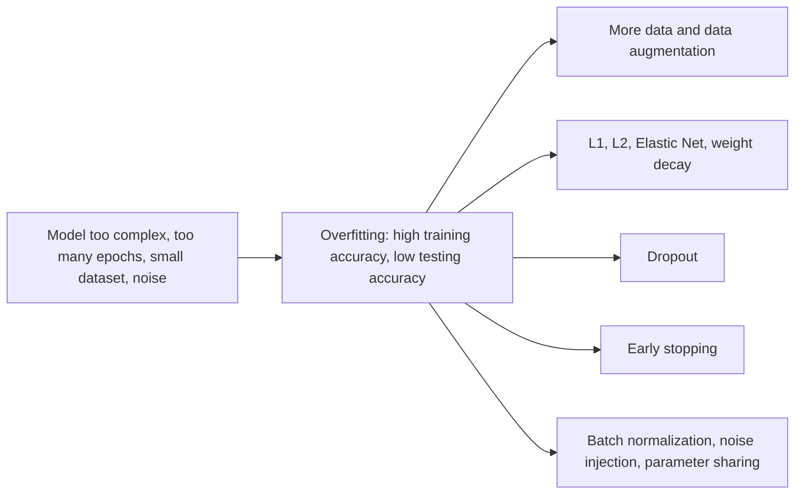
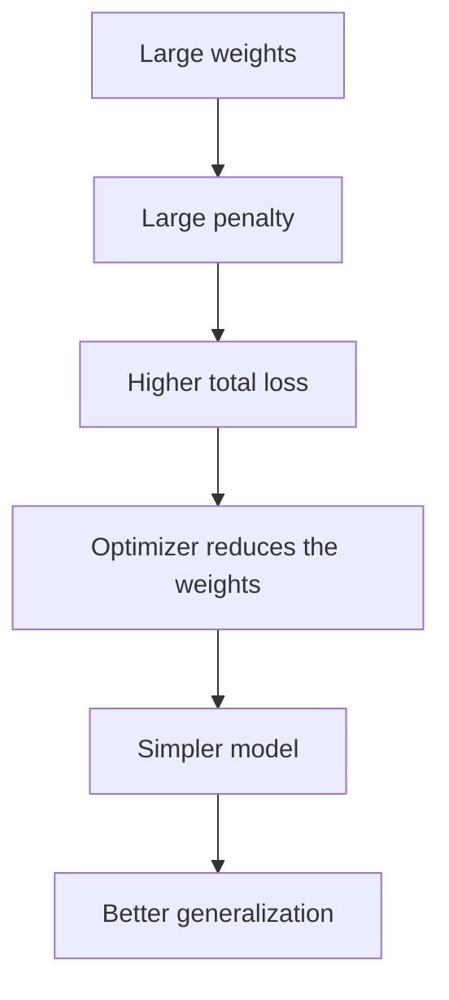
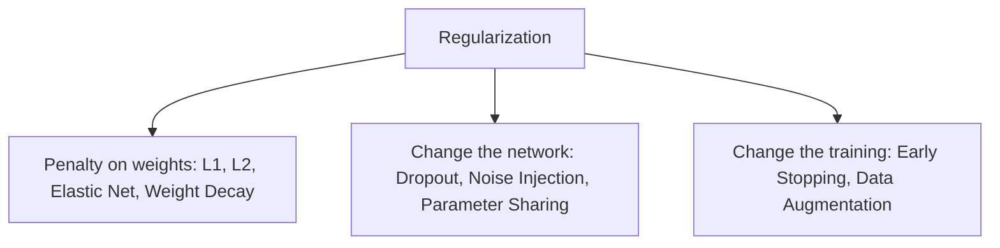
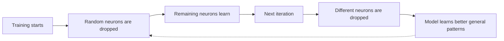
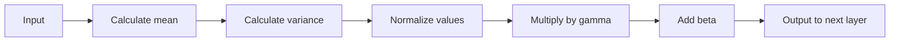
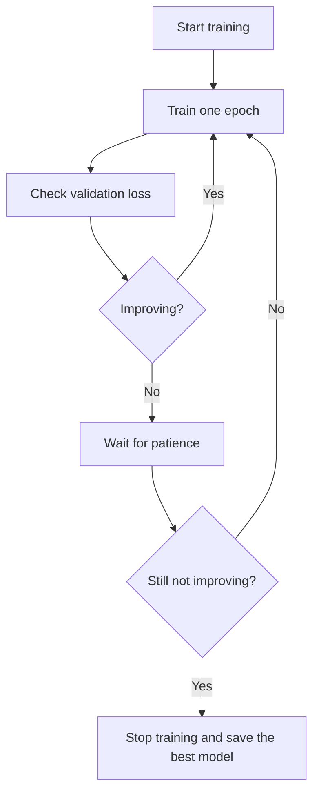
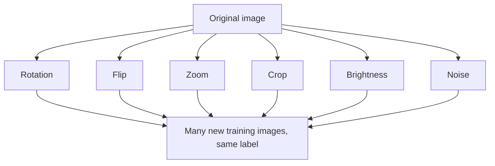

Before the new ideas, here are the old ones you need. If you already know them, skip to the next section.

## The basics first

- A **weight** is a number that shows how important an input is to a neuron. The weights are the **parameters** the network learns. <Cite id="class-dl-chp2" loc="slide 4" />
- The **loss** is the error of the prediction. An **epoch** is one complete pass through the training data. <Cite id="class-dl-chp2" loc="slide 69" />
- The data is split into three parts. **Training data** builds the model (it is used to learn the weights). **Validation data** is used for model selection and parameter tuning. **Testing data** tests the accuracy of the final (tuned) model; it must not even be looked at while tuning. <Cite id="class-dl-m2" loc="p. 27" />
- A **hyperparameter** is a setting that you choose before training (for example the learning rate or λ). It is not learned by the optimizer. <Cite id="class-dl-chp2" loc="slide 98" />

## Overfitting and underfitting

### What we want: generalization

After training, the main question is: can the model make correct predictions on new, unseen data? A model should not only perform well on the training data but also on data it has never seen before. <Cite id="class-dl-chp2" loc="slide 92" />

<Box kind="definition">

**Generalization** is the ability of a model to make correct predictions on new (unseen) data. A good model learns patterns, not memorization. <Cite id="class-dl-chp2" loc="slide 92" />

</Box>

A model may reach 100% training accuracy but still make wrong predictions on new data, because it may learn the actual pattern (good) or memorize the training data (bad). Therefore **high training accuracy is not the same as a good model**. <Cite id="class-dl-chp2" loc="slide 92" />

The textbook says the same: overfitting means "a neural network will provide excellent prediction performance on the training data that it is built on, but will perform poorly on unseen test instances". The learning process "remembers random artifacts of the training data that do not generalize". Extreme overfitting is called **memorization**. <Cite id="class-dl-m2" loc="p. 19" />

### Underfitting, good fit and overfitting

<Box kind="definition">

**Underfitting:** the model is too simple to learn the important patterns in the data. It performs poorly on both training and testing data. **Overfitting:** the model learns the training data too well, including noise and unnecessary details. It performs very well on training data but poorly on testing data. **Good fit:** the model learns the correct patterns without memorizing the data and performs well on both. <Cite id="class-dl-chp2" loc="slide 93" />

</Box>

**Fruit example (the teacher's).** Underfitting: the model cannot even learn the training examples, so it calls an apple a banana. Overfitting: the training apple had a small black spot, so the model thinks "an apple must always have a black spot", and a new apple without the spot is called "Not Apple". Good fit: the model generalizes well. <Cite id="class-dl-chp2" loc="slide 93" />

| | Underfitting | Good fit | Overfitting |
|---|---|---|---|
| Model complexity | Too simple | Balanced | Too complex |
| Training accuracy | Low | High | Very high |
| Testing accuracy | Low | High | Low |
| Learns the pattern? | No | Yes | Memorizes |
| Generalization | Poor | Excellent | Poor |

<Cite id="class-dl-chp2" loc="slide 93" />

### How to identify them: loss curves

We compare the model's performance on training data and on validation (testing) data. <Cite id="class-dl-chp2" loc="slide 95" />

- **Underfitting:** training loss and validation loss are both high, because the model cannot learn the training data.
- **Good fit:** both losses decrease and stay close to each other.
- **Overfitting:** training loss keeps decreasing, but the validation loss starts increasing.

The textbook adds two signs of overfitting: the gap between the error on training instances and unseen test instances is large, and when a model is trained on different data sets the same test instance may get very different predictions. The **generalization error** is the error on out-of-sample test data. <Cite id="class-dl-m2" loc="p. 22" />

| | Training accuracy | Validation accuracy |
|---|---|---|
| Underfitting | Low | Low |
| Good fit | High | High |
| Overfitting | Very high | Low |

<Cite id="class-dl-chp2" loc="slide 95" />

**Generalization error** is the difference between the model's performance on training data and unseen data: a small difference means good generalization, a large difference means poor generalization. In the teacher's example a model has 99% accuracy on training fruits and 60% on new fruits: a large gap, caused by overfitting. <Cite id="class-dl-chp2" loc="slide 95" />

### Bias and variance

<Box kind="definition">

**Bias** is the error caused because the model is too simple (it makes strong assumptions and cannot learn the real pattern). High bias leads to underfitting. **Variance** is the error caused because the model becomes too sensitive to the training data (it memorizes the training examples instead of learning patterns). High variance leads to overfitting. <Cite id="class-dl-chp2" loc="slide 94" />

</Box>

The **bias-variance trade-off**: as model complexity increases, bias decreases and variance increases. The goal is to find the right balance (low bias and low variance gives the best model). <Cite id="class-dl-chp2" loc="slide 94" /> The textbook lists three parts of the error: bias, variance and noise (the inherent error in the data). <Cite id="class-dl-m2" loc="p. 26" />

| Model | Bias | Variance |
|---|---|---|
| Underfitting | High | Low |
| Good fit | Moderate | Moderate |
| Overfitting | Low | High |

<Cite id="class-dl-chp2" loc="slide 94" />

### Causes and solutions

| | Causes | How to reduce |
|---|---|---|
| **Underfitting** | Model is too simple; too few training epochs; learning rate is too high; insufficient features; training stopped too early | Increase the number of epochs; increase model complexity; add better features; choose an appropriate learning rate; train the model for longer |
| **Overfitting** | Model is too complex; too many training epochs; small training dataset; too many parameters; noise in the training data | Collect more training data; data augmentation; early stopping; dropout; L1 regularization; L2 regularization; reduce model complexity |

<Cite id="class-dl-chp2" loc="slide 96" />

<Cite id="class-dl-chp2" loc="slide 96" /> This is syllabus <Syl m="2" />.

## What is regularization?

<Box kind="definition">

**Regularization** is a technique used to reduce overfitting by controlling the complexity of the model. Instead of allowing the model to memorize the training data, regularization encourages it to learn only the important patterns. Its main goal is to improve generalization, so the model performs well on both training and unseen data. <Cite id="class-dl-chp2" loc="slide 97" />

</Box>

The textbook's definition: "Many strategies used in machine learning are explicitly designed to reduce the test error, possibly at the expense of increased training error. These strategies are known collectively as regularization." <Cite id="class-dl-m2" loc="p. 19" /> In deep learning, regularization actually **penalizes the weight matrices of the nodes**. <Cite id="class-dl-m2" loc="p. 20" />

**Why not just train for more epochs?** One might think "if we train the model for more epochs, it will become better". That is not true: when training continues for too many epochs the model starts memorizing the training data, so more epochs may increase training accuracy but testing accuracy may decrease. <Cite id="class-dl-chp2" loc="slide 97" />

### How regularization works: the penalty

Regularization **adds a penalty to the loss function**. If the model creates very large or unnecessary weights, it receives an extra penalty. As a result very large weights are discouraged, the model becomes simpler, it learns important features instead of noise and its performance on unseen data improves. <Cite id="class-dl-chp2" loc="slide 97" />

- Without regularization: Loss = Prediction Error. The model only tries to reduce the prediction error.
- With regularization: **Total Loss = Prediction Error + Regularization Penalty**. The model tries to (1) reduce the prediction error and (2) keep the weights small and simple. <Cite id="class-dl-chp2" loc="slide 97" />

The textbook writes it as: Cost function = Loss (say, binary cross entropy) + Regularization term. <Cite id="class-dl-m2" loc="p. 32" />

<Cite id="class-dl-chp2" loc="slide 98" />

**Why does the optimizer choose smaller weights?** Suppose two models give the same prediction error. Model A has weight 25, model B has weight 5. The penalty for A is high, so its total loss is high; B has a low penalty and a low total loss. The optimizer chooses B. <Cite id="class-dl-chp2" loc="slide 98" />

### The regularization coefficient λ (lambda)

<Box kind="definition">

**λ (lambda)** is called the **regularization coefficient** (regularization strength). It controls how much penalty is added to the loss function. Think of λ as a control knob. It is a hyperparameter chosen before training; the weights are learned by the optimizer. <Cite id="class-dl-chp2" loc="slide 99" />

</Box>

| λ | Penalty | Result |
|---|---|---|
| λ = 0 | No penalty (no regularization) | The model becomes very complex, weights become very large, it memorizes the training data: **overfitting** |
| Small λ (recommended) | Small penalty | Weights are controlled, important features are learned, noise is ignored: **good fit**, the best choice |
| Large λ | Very large penalty | Weights become very small, the model becomes too simple and cannot learn enough patterns: **underfitting** |

<Cite id="class-dl-chp2" loc="slide 99" />

The textbook agrees: if the regularization coefficient is so high that the weights are nearly zero, the result is a much simpler linear network and slight underfitting, so we need to optimize the value of the coefficient to get a well-fitted model. <Cite id="class-dl-m2" loc="p. 21" />

**Everyday analogy (the teacher's).** λ = 0: the student memorizes every sentence from the textbook and cannot answer if the question changes slightly. Small λ: the student understands concepts and answers correctly even if the question changes. Large λ: the student studies too little and cannot answer even simple questions. <Cite id="class-dl-chp2" loc="slide 99" />

**Advantages of regularization:** reduces overfitting, improves generalization, produces a simpler model, reduces the effect of noise, better performance on unseen data, makes the model more robust. **Disadvantages:** too much regularization causes underfitting, choosing the correct λ is difficult, training accuracy may decrease slightly, one extra hyperparameter must be tuned. <Cite id="class-dl-chp2" loc="slide 99" />

### The types of regularization

The teacher lists nine: L1 (Lasso), L2 (Ridge), Elastic Net, Weight Decay, Dropout, Early Stopping, Data Augmentation, Noise Injection and Parameter Sharing. <Cite id="class-dl-chp2" loc="slide 100" /> The textbook groups them as penalty-based regularization, ensemble methods (dropout), early stopping, pretraining, continuation and curriculum methods, and sharing parameters. <Cite id="class-dl-m2" loc="pp. 23-25" />

<Cite id="class-dl-chp2" loc="slide 100" />

## L1 regularization (Lasso)

<Box kind="definition">

**L1 regularization** reduces overfitting by adding the sum of the absolute values of all weights to the loss function. It is also called **Lasso** (Least Absolute Shrinkage and Selection Operator) because it shrinks large weights, selects only important features and makes unnecessary weights exactly 0. <Cite id="class-dl-chp2" loc="slide 101" />

</Box>

Its goal is to reduce unnecessary weights, remove unimportant features, build a simpler model and improve generalization. **Key idea:** penalize large weights, so weights become smaller, the model becomes simpler, and overfitting reduces. <Cite id="class-dl-chp2" loc="slide 101" />

<Box kind="definition">

**Formula.** Original loss: Loss = Prediction Error. L1 regularized loss: Total Loss = Prediction Loss + $\lambda \sum |w|$. Here $\lambda$ is the regularization coefficient, $\sum$ is the sum over all weights and $|w|$ is the absolute value of each weight. <Cite id="class-dl-chp2" loc="slide 101" />

</Box>

The textbook says the squared penalty is replaced "with a penalty on the sum of the absolute magnitudes of the coefficients", and that $|w_i|$ is not differentiable when $w_i$ is exactly 0, so in practice the slope is set to 0 at that point. <Cite id="class-dl-m2" loc="pp. 33-34" />

**What is absolute value?** The distance from zero, ignoring the sign: $|{-5}| = 5$, $|{+5}| = 5$, $|0| = 0$. <Cite id="class-dl-chp2" loc="slide 102" />

**Sum 1: L1 penalty and total loss.** <Cite id="class-dl-chp2" loc="slide 102" />

<Sum>

<Given>

Weights $w_1 = 6$, $w_2 = -4$, $w_3 = 2$, $w_4 = -1$. Prediction error $= 4$. $\lambda = 0.1$.

</Given>

<Find>

the L1 penalty and the total loss.

</Find>

<Steps>

1. **Absolute values:** $|6| = 6$, $|-4| = 4$, $|2| = 2$, $|-1| = 1$.
2. **Sum:** $\sum |w| = 6 + 4 + 2 + 1 = 13$. The bigger weights add more to the penalty.
3. **Penalty:** $\lambda \sum |w| = 0.1 \times 13 = 1.3$.
4. **Total loss** $= 4 + 1.3 = 5.3$.

</Steps>

<Answer>

L1 penalty (before multiplying by $\lambda$) $= 13$; with $\lambda = 0.1$ the penalty is 1.3 and the total loss is 5.3.

</Answer>

<Box kind="verify">

Check the sum a second way: $(6 + 4) + (2 + 1) = 10 + 3 = 13$. Also $4 + 1.3 = 5.3$.

</Box>

</Sum>

**Weight update process and feature selection.** A large weight gives a large penalty and a higher total loss, so the optimizer reduces the weight; some weights become 0. If a feature contributes very little, its weight becomes 0 and the model automatically ignores that feature. This is the one unique property of L1: **feature selection**. <Cite id="class-dl-chp2" loc="slide 102" /> In the fruit example, texture (0.4) and background (0.2) go to 0, while shape (8 to 7.4) and colour (6 to 5.5) remain. <Cite id="class-dl-chp2" loc="slide 102" />

The textbook is careful: L1 "creates sparse solutions in which the vast majority of the values of $w_i$ are 0s (after ignoring computational errors)". If the weight on an input is 0, that input has no effect, so "the L1-regularizer acts as a feature selector". <Cite id="class-dl-m2" loc="p. 35" /> So say "zero or very close to zero", not "always exactly zero".

**Advantages of L1:** reduces overfitting, performs automatic feature selection, removes unnecessary features, produces a simpler model, easy to interpret. **Disadvantages:** may remove useful features if λ is too large, choosing λ is important, less commonly used than L2 in deep learning. **Used when** the dataset has many input features, some features are unnecessary and simpler models are preferred. <Cite id="class-dl-chp2" loc="slide 102" />

## L2 regularization (Ridge)

**The problem with L1.** L1 makes some weights exactly 0, but sometimes every feature is important, and if some features are removed the model may lose useful information. We need a technique that keeps all features while still reducing overfitting. <Cite id="class-dl-chp2" loc="slide 103" />

<Box kind="definition">

**L2 regularization** reduces overfitting by adding the sum of the squares of all weights to the loss function. Instead of making weights exactly 0, it reduces (shrinks) all weights so the model becomes simpler while still using every feature. It is also called **Ridge** regularization (Tikhonov regularization). <Cite id="class-dl-chp2" loc="slide 103" />

</Box>

**Formula.** Total Loss = Prediction Loss + $\lambda \sum w^2$. Larger weights give a larger square, which gives a larger penalty. <Cite id="class-dl-chp2" loc="slide 103" /> The textbook calls L2 regularization "also known as **weight decay** as it forces the weights to decay towards zero (but not exactly zero)". <Cite id="class-dl-m2" loc="p. 34" />

**Sum 2: L2 penalty and total loss.** <Cite id="class-dl-chp2" loc="slide 104" />

<Sum>

<Given>

Weights $w_1 = 5$, $w_2 = -3$, $w_3 = 2$, $w_4 = -1$. Prediction error $= 4$. $\lambda = 0.1$.

</Given>

<Find>

the L2 penalty and the total loss.

</Find>

<Steps>

1. **Squares:** $5^2 = 25$, $(-3)^2 = 9$, $2^2 = 4$, $(-1)^2 = 1$. The square removes the sign and makes big weights count much more.
2. **Sum:** $\sum w^2 = 25 + 9 + 4 + 1 = 39$.
3. **Penalty:** $\lambda \sum w^2 = 0.1 \times 39 = 3.9$.
4. **Total loss** $= 4 + 3.9 = 7.9$.

</Steps>

<Answer>

L2 penalty (before $\lambda$) $= 39$; with $\lambda = 0.1$ the penalty is 3.9 and the total loss is 7.9.

</Answer>

<Box kind="verify">

The weight 5 alone gives 25 of the 39, so about 64% of the penalty comes from the biggest weight. This shows why L2 shrinks large weights hardest.

</Box>

</Sum>

**Sum 3: why the optimizer picks the smaller weight (the teacher's Model A and Model B).** <Cite id="class-dl-chp2" loc="slide 98" />

<Sum>

<Given>

Two models with the same prediction error 4. Model A has weight 25 and Model B has weight 5. L2 penalty with $\lambda = 0.01$.

</Given>

<Find>

the total loss of each model.

</Find>

<Steps>

1. **Model A:** penalty $= 0.01 \times 25^2 = 0.01 \times 625 = 6.25$. Total $= 4 + 6.25 = 10.25$.
2. **Model B:** penalty $= 0.01 \times 5^2 = 0.01 \times 25 = 0.25$. Total $= 4 + 0.25 = 4.25$.

</Steps>

<Answer>

Model A: 10.25. Model B: 4.25. The optimizer chooses model B, the one with the smaller weight.

</Answer>

<Box kind="verify">

Both models have the same prediction error, so the only difference is the penalty: $6.25 - 0.25 = 6$ and $10.25 - 4.25 = 6$.

</Box>

</Sum>

The textbook points out one difference in the update: L2 regularization uses **multiplicative decay** as a forgetting mechanism, whereas L1 regularization uses **additive updates**. From an accuracy point of view L2 usually outperforms L1, which is why L2 is almost always preferred. <Cite id="class-dl-m2" loc="p. 35" />

**Advantages of L2:** reduces overfitting, keeps all important features, produces smoother models, stable training, most widely used in deep learning. **Disadvantages:** does not perform feature selection, less useful when many features are irrelevant, λ must be chosen carefully. <Cite id="class-dl-chp2" loc="slide 104" />

### L1 versus L2

| Aspect | L1 (Lasso) | L2 (Ridge) |
|---|---|---|
| Penalty term | $\lambda \sum \lvert w \rvert$ (absolute value) | $\lambda \sum w^2$ (square) |
| Effect on weights | Some weights become 0 | Weights become small but usually not 0 |
| Feature selection | Yes (removes unimportant features) | No (keeps all features) |
| Also called | Lasso (Least Absolute Shrinkage and Selection Operator) | Ridge (Tikhonov regularization) |
| Common use | When some features are unimportant | When all features are important |

<Cite id="class-dl-chp2" loc="slides 102 and 103" />

## Elastic Net regularization

L1 removes too many features and L2 does not remove any. Sometimes we need both feature selection and weight shrinking together. <Cite id="class-dl-chp2" loc="slide 105" />

<Box kind="definition">

**Elastic Net** combines the advantages of L1 and L2: it removes unimportant features (like L1) and shrinks the remaining weights (like L2). This creates a simpler and more stable model. <Cite id="class-dl-chp2" loc="slide 105" />

</Box>

**Formula.** Total Loss = Prediction Loss + $\lambda_1 \sum |w| + \lambda_2 \sum w^2$, where $\lambda_1$ controls the L1 penalty (feature selection) and $\lambda_2$ controls the L2 penalty (weight shrinking). <Cite id="class-dl-chp2" loc="slide 106" />

**Sum 4: Elastic Net penalty on the L1 example weights.**

<Sum>

<Given>

Weights $6, -4, 2, -1$ (from Sum 1). $\lambda_1 = 0.1$ and $\lambda_2 = 0.1$.

</Given>

<Find>

the Elastic Net penalty.

</Find>

<Steps>

1. **L1 part:** $\sum |w| = 13$, so $\lambda_1 \times 13 = 1.3$.
2. **L2 part:** $\sum w^2 = 36 + 16 + 4 + 1 = 57$, so $\lambda_2 \times 57 = 5.7$.
3. **Elastic Net penalty** $= 1.3 + 5.7 = 7.0$.

</Steps>

<Answer>

Penalty $= 7.0$ (L1 part 1.3 plus L2 part 5.7).

</Answer>

<Box kind="verify">

$36 + 16 + 4 + 1 = 57$ and $0.1 \times 57 = 5.7$. L1 alone would give 1.3 and L2 alone 5.7, so the sum is 7.0.

</Box>

</Sum>

**Advantages:** reduces overfitting, performs feature selection, shrinks large weights, produces stable models, works well when features are highly correlated, better balance than only L1 or only L2. **Disadvantages:** more computationally expensive, two hyperparameters ($\lambda_1$ and $\lambda_2$) must be tuned, more difficult to configure, not always necessary for small datasets. <Cite id="class-dl-chp2" loc="slide 106" />

| | Elastic Net | L1 (Lasso) | L2 (Ridge) |
|---|---|---|---|
| Uses | L1 and L2 together | Only L1 | Only L2 |
| Removes some features? | Yes | Yes (some weights 0) | No |
| Shrinks remaining weights? | Yes | Not much | Yes |
| Number of penalties | Two ($\lambda_1$, $\lambda_2$) | One | One |

<Cite id="class-dl-chp2" loc="slide 106" />

## Weight decay

<Box kind="definition">

**Weight Decay** is a regularization technique that reduces (shrinks) the weights after every update during training. Simple definition: weight decay = gradually reducing the size of the weights during training. <Cite id="class-dl-chp2" loc="slide 121" />

</Box>

How it works: gradient descent updates the weights, then weight decay slightly reduces the updated weights, so the model learns while keeping the weights small. The update rule is $w \leftarrow w - \eta \nabla L - \eta \lambda w$: the normal update from the loss plus the weight-decay term that shrinks the weights. <Cite id="class-dl-chp2" loc="slides 100 and 121" /> For standard SGD, L2 regularization and weight decay behave almost the same; **weight decay is almost the same as L2 (Ridge) regularization**. <Cite id="class-dl-chp2" loc="slide 121" />

**Sum 5: one weight-decay step.**

<Sum>

<Given>

$w = 2$, learning rate $\eta = 0.1$, $\lambda = 0.5$, gradient of the loss $\nabla L = 0.4$.

</Given>

<Find>

the new weight with and without weight decay.

</Find>

<Steps>

1. **Without decay:** $w \leftarrow 2 - 0.1 \times 0.4 = 1.96$.
2. **Decay term:** $\eta \lambda w = 0.1 \times 0.5 \times 2 = 0.1$.
3. **With decay:** $w \leftarrow 2 - 0.04 - 0.1 = 1.86$.

</Steps>

<Answer>

With weight decay the new weight is 1.86 (without it, 1.96). Weight decay pulls the weight 0.1 further toward zero.

</Answer>

<Box kind="verify">

Another way: $w(1 - \eta\lambda) - \eta \nabla L = 2 \times 0.95 - 0.04 = 1.9 - 0.04 = 1.86$. It is the same, which shows the multiplicative decay of the weight.

</Box>

</Sum>

## Dropout

**The problem.** L1, L2 and Elastic Net control the weights, but they do not control how neurons depend on each other. In deep networks some neurons may become too dependent on other neurons. If one neuron learns a wrong pattern, many other neurons also learn the same wrong pattern, and the network starts memorizing the training data. <Cite id="class-dl-chp2" loc="slide 107" />

<Box kind="definition">

**Dropout** is a regularization technique that randomly turns OFF (drops) some neurons during training. These dropped neurons do not participate in forward propagation, backpropagation or weight updates. Each training iteration uses a slightly different network. <Cite id="class-dl-chp2" loc="slide 107" />

</Box>

**How dropout solves the problem of overfitting.** During training, dropout randomly selects some neurons and temporarily switches them OFF. Only the remaining neurons are used for learning. Different neurons are dropped in every iteration, so the model cannot memorize the training data; instead every neuron learns useful patterns independently. **Random drop → less dependency → learn general patterns → overfitting reduces.** <Cite id="class-dl-chp2" loc="slide 107" />

The textbook explains it as an ensemble: dropout uses node sampling instead of edge sampling to create a neural network ensemble. If a node is dropped, all its incoming and outgoing connections are dropped too. Nodes are sampled only from the input and hidden layers (the output nodes are never dropped, otherwise we could not give a prediction). If the network has $M$ nodes, there are $2^M$ possible sampled networks, but their **weights are shared**. <Cite id="class-dl-m2" loc="p. 38" />

Training steps (textbook): <Cite id="class-dl-m2" loc="p. 39" />

1. Sample a network from the base network (input nodes kept with probability $p_i$, hidden nodes with $p_h$, all independent; removing a node removes its edges).
2. Sample a single training instance or a mini-batch.
3. Update the weights of the retained edges using backpropagation.

<Cite id="class-dl-chp2" loc="slide 107" />

**Dropout rate (p)** tells what percentage of neurons will be turned OFF during training: <Cite id="class-dl-chp2" loc="slide 108" />

| p | What happens |
|---|---|
| 0 (0%) | No neurons dropped; no regularization; higher chance of overfitting |
| 0.2 (20%) | One in five neurons dropped; small regularization |
| **0.5 (50%)** | Half the neurons dropped; **most common** for hidden layers; good balance between learning and preventing overfitting |
| 0.8 (80%) | Most neurons dropped; the model learns very little; may lead to underfitting |

**Training and testing.** During training random neurons are turned OFF and different neurons are dropped in every iteration. During testing no neurons are dropped, all neurons are active and the complete network is used for prediction. <Cite id="class-dl-chp2" loc="slide 108" />

**Sum 6: how many neurons and networks?** <Cite id="class-dl-chp2" loc="slide 108" />

<Sum>

<Given>

A hidden layer of 100 neurons with dropout rate $p = 0.5$, and another with $p = 0.2$. A small network with 4 droppable nodes (input and hidden).

</Given>

<Find>

the expected number of dropped neurons, and the number of possible sampled networks.

</Find>

<Steps>

1. **$p = 0.5$:** $0.5 \times 100 = 50$ neurons dropped on average per iteration.
2. **$p = 0.2$:** $0.2 \times 100 = 20$ neurons dropped on average.
3. **Possible networks:** each of the 4 nodes is either kept or dropped, so $2^4 = 16$ sampled networks. The textbook's formula is $2^M$ for $M$ nodes.

</Steps>

<Answer>

50 neurons dropped at $p = 0.5$, 20 at $p = 0.2$, and 16 possible networks for 4 droppable nodes.

</Answer>

<Box kind="verify">

List the choices for 2 nodes: both kept, only A dropped, only B dropped, both dropped = 4 networks $= 2^2$. Each extra node doubles the count, so 4 nodes give $2^4 = 16$.

</Box>

</Sum>

**Advantages of dropout:** reduces overfitting, improves generalization, prevents neuron dependency, makes the network more robust, simple and widely used in deep learning. **Disadvantages:** training becomes slightly slower, choosing the correct dropout rate is important, a very high dropout may cause underfitting, usually applied only during training. <Cite id="class-dl-chp2" loc="slide 108" /> The textbook adds that dropout is efficient (only the sampling of hidden units is extra work) but it reduces the expressive power of the network, so larger models with more units are needed to gain its full advantages. <Cite id="class-dl-m2" loc="p. 40" />

In Keras, dropout is a layer: `Dropout(0.25)` between dense layers. <Cite id="class-dl-m2" loc="p. 43" />

## Batch normalization

**The problem: internal covariate shift.** As networks get deeper, training becomes difficult: the output of one layer is the input to the next, the weights keep changing, so the inputs to each layer keep changing. Training becomes slow, the model becomes unstable and the optimizer takes longer to find the best weights. This problem is called **Internal Covariate Shift**. <Cite id="class-dl-chp2" loc="slide 109" />

Why it happens: weights are updated, so the output of one layer changes, so the input of the next layer changes, so the next layer has to learn again, and training becomes slow. Even though the optimizer is improving the model, the next layer still receives changing inputs. <Cite id="class-dl-chp2" loc="slide 109" /> The textbook's example: a dog / not-dog classifier trained on white dogs only, then given non-white dogs: the distribution of the hidden activations changes, and "this change in hidden activation is known as an internal covariate shift". <Cite id="class-dl-m2" loc="p. 81" />

<Box kind="definition">

**Batch Normalization (BatchNorm)** is a technique that normalizes the outputs of a layer before passing them to the next layer. Instead of allowing values to vary widely, BatchNorm keeps them within a similar range. This makes training faster and more stable. <Cite id="class-dl-chp2" loc="slide 109" />

</Box>

**What is a batch? What is normalization?** A batch is a small group of training samples processed together (for example 1000 images sent as batches of 32). Normalization means bringing values into a similar range (for example 10, 50, 100, 200 become small values around 0). <Cite id="class-dl-chp2" loc="slide 110" />

**How it works, step by step** (the teacher's steps): <Cite id="class-dl-chp2" loc="slide 110" />

1. **Calculate the mean** $\mu$ of the batch (the average of all outputs).
2. **Calculate the variance** $\sigma^2$ of the batch (how spread out the values are from the mean).
3. **Normalize:** $\hat x = \dfrac{x - \mu}{\sqrt{\sigma^2 + \epsilon}}$. After normalization the mean is about 0 and the variance about 1. ($\epsilon$ is a small value to avoid division by zero.)
4. **Scale** using $\gamma$ (gamma): $\gamma \hat x$. Gamma lets the network decide whether the values should become larger or smaller.
5. **Shift** using $\beta$ (beta): $\gamma \hat x + \beta$. Beta lets the network shift the normalized values.
6. Pass the output to the next layer.

<Box kind="definition">

**Final Batch Normalization formula:** $y = \gamma \left[ \dfrac{x - \mu}{\sqrt{\sigma^2 + \epsilon}} \right] + \beta$, where $\mu$ is the mean, $\sigma^2$ the variance, $\epsilon$ prevents division by zero, $\gamma$ is the scaling parameter and $\beta$ the shifting parameter. <Cite id="class-dl-chp2" loc="slide 110" />

</Box>

The two trainable parameters $\gamma$ and $\beta$ let the model choose "the optimum distribution for each hidden layer": $\gamma$ adjusts the standard deviation and $\beta$ shifts the curve left or right. <Cite id="class-dl-m2" loc="p. 72" />

<Cite id="class-dl-chp2" loc="slide 110" />

**Sum 7: batch normalization on four values (the teacher's mean example, completed).** <Cite id="class-dl-chp2" loc="slide 110" />

<Sum>

<Given>

A batch of four outputs $2, 4, 6, 8$. Take $\gamma = 2$, $\beta = 1$ and ignore $\epsilon$.

</Given>

<Find>

the mean, the variance, the normalized values and the final outputs.

</Find>

<Steps>

1. **Mean:** $\mu = (2 + 4 + 6 + 8) / 4 = 5$.
2. **Variance:** deviations $-3, -1, 1, 3$; squares $9, 1, 1, 9$; $\sigma^2 = 20 / 4 = 5$. So $\sigma = \sqrt{5} = 2.236$.
3. **Normalize** $\hat x = (x - 5) / 2.236$: $-1.342, -0.447, 0.447, 1.342$.
4. **Scale and shift** $y = 2\hat x + 1$: $-1.683, 0.106, 1.894, 3.683$.

</Steps>

<Answer>

Normalized values: $-1.342, -0.447, 0.447, 1.342$ (mean 0, variance 1). Final outputs: $-1.683, 0.106, 1.894, 3.683$.

</Answer>

<Box kind="verify">

The normalized values add up to 0, and their variance is $(1.8 + 0.2 + 0.2 + 1.8)/4 = 1.0$. The slide's own normalization examples (10, 50, 100, 200 to −1.2, −0.3, 0.5, 1.0 and 20, 50, 100, 150 to −1.1, −0.4, 0.5, 1.0) are only rough pictures: the exact values are −1.13, −0.56, 0.14, 1.55 and −1.21, −0.61, 0.40, 1.41.

</Box>

</Sum>

**Where is it placed?** After the Dense or Convolution layer and before the activation function (ReLU): the teacher says BN is applied before the activation function. <Cite id="class-dl-chp2" loc="slide 110" />

**Training versus testing.** BatchNorm uses the current batch's statistics during training; during testing it uses the learned statistics. <Cite id="class-dl-chp2" loc="slide 109" /> (The textbook: "Batch normalization is computed differently during the training and the testing phase". <Cite id="class-dl-m2" loc="p. 72" />)

**Benefits:** faster training; stable learning; allows a higher learning rate; reduces internal covariate shift; slightly reduces overfitting (each batch has different statistics, which adds a little randomness, a small regularization effect, but not a replacement for dropout or L1/L2). **Advantages:** faster convergence, stable learning, less sensitive to weight initialization, improves overall model performance. **Disadvantages:** adds extra computation during training, less effective with very small batch sizes, requires additional memory, does not completely replace other regularization techniques like dropout. <Cite id="class-dl-chp2" loc="slide 112" />

| | Batch normalization | Dropout |
|---|---|---|
| What it does | Normalizes activations | Randomly turns OFF neurons |
| Neurons | All neurons remain active | Some neurons are temporarily removed |
| Main purpose | Mainly speeds up training | Mainly reduces overfitting |

<Cite id="class-dl-chp2" loc="slide 112" />

The textbook adds that batch normalization is a way of reparametrizing almost any deep network, and its advantages are that it speeds up training and handles internal covariate shift. <Cite id="class-dl-m2" loc="pp. 71 and 79" />

## Early stopping

**The problem.** During training the model learns from the training data by updating weights every epoch. At first it learns useful patterns and accuracy improves. If training continues for too many epochs the model starts memorizing the training data instead of learning patterns: training accuracy stays very high, validation accuracy decreases, and the model performs poorly on unseen data. Dropout, L1 and L2 reduce overfitting by modifying the learning process, but if the model is trained for too long, overfitting can still occur. The simplest solution is to stop training before overfitting begins. <Cite id="class-dl-chp2" loc="slide 113" />

<Box kind="definition">

**Early Stopping** is a regularization technique that stops the training process automatically when the model stops improving on the validation data. Instead of training for a fixed number of epochs, the model is stopped at the best epoch. <Cite id="class-dl-chp2" loc="slide 113" />

</Box>

The textbook: "In early stopping, the iterative optimization method is terminated early without converging to the optimal solution on the training data." A portion of the training data is held out as a **validation set**; the model's error on it is monitored. At some point this error begins to rise on the validation set even though it continues to reduce on the training set: that is the point to terminate. <Cite id="class-dl-m2" loc="pp. 24 and 42" />

**How it works.** During training the model continuously checks the validation loss after every epoch. If the validation loss stops improving for several consecutive epochs, training is stopped automatically. As a result the model does not memorize the training data, overfitting is reduced and the best-performing model is saved. <Cite id="class-dl-chp2" loc="slide 113" />

<Cite id="class-dl-chp2" loc="slide 113" />

**Key terms.** The **best epoch** is the epoch with the lowest validation loss or the highest validation accuracy; that is the model we keep. **Patience** is the number of epochs the model waits before stopping; with patience = 3, if the validation loss does not improve for 3 consecutive epochs, training stops. Patience prevents stopping too early because of small fluctuations. Early stopping mainly monitors the validation loss, not the training loss. <Cite id="class-dl-chp2" loc="slide 114" />

**Sum 8: early stopping with patience 3 (the teacher's table).** <Cite id="class-dl-chp2" loc="slide 114" />

<Sum>

<Given>

Validation loss by epoch: 1 → 0.90, 2 → 0.70, 3 → 0.55, 4 → 0.48, 5 → 0.49, 6 → 0.50, 7 → 0.51. Patience $= 3$.

</Given>

<Find>

the best epoch and the epoch where training stops.

</Find>

<Steps>

1. **Epochs 1 to 3:** the loss improves each time (0.90, 0.70, 0.55), so continue.
2. **Epoch 4:** 0.48 is the lowest so far, so this is the **best model**; save it.
3. **Epoch 5:** 0.49 is worse than 0.48, wait (1).
4. **Epoch 6:** 0.50 is still worse, wait (2).
5. **Epoch 7:** 0.51 is still worse, wait (3). Patience is used up.

</Steps>

<Answer>

Training stops at epoch 7 and the saved model from epoch 4 (loss 0.48) is used.

</Answer>

<Box kind="verify">

After epoch 4 the loss rose three times in a row (0.49, 0.50, 0.51), which equals the patience of 3. No epoch before 4 had a loss below 0.48.

</Box>

</Sum>

**Advantages:** prevents overfitting, saves training time, automatically selects the best model, easy to implement, improves generalization. **Disadvantages:** requires a validation dataset, choosing the correct patience value is important, may stop too early if the patience is too small. <Cite id="class-dl-chp2" loc="slide 114" /> In Keras: `EarlyStopping(monitor='val_err', patience=5)`, where monitor is the quantity being watched and patience is the number of epochs with no improvement after which training stops. <Cite id="class-dl-m2" loc="p. 43" />

## Data augmentation

**The problem.** Deep learning models need a large amount of training data, but in many real-world cases only a small dataset is available. A small dataset causes the model to memorize instead of learning general patterns (it sees the same images again and again and memorizes the background, lighting, camera angle and noise, not the actual object). This leads to overfitting. Collecting more data is time-consuming, expensive, difficult and sometimes impossible (for example medical images). <Cite id="class-dl-chp2" loc="slide 115" />

<Box kind="definition">

**Data Augmentation** creates new training samples by modifying the existing data. The modified images still represent the same object but look different to the model. It increases the diversity of the training dataset. <Cite id="class-dl-chp2" loc="slide 115" />

</Box>

The textbook's version: "a set of techniques used to artificially expand the size and diversity of a training dataset by applying transformations to existing data samples". It reduces overfitting, helps the model learn invariance to transformations (rotation, flipping, noise), is useful when collecting data is expensive and boosts robustness in the real world. <Cite id="class-dl-m2" loc="p. 83" />

**How it works.** The original training image is modified using different transformations. Each transformed image becomes a new training sample, and **the label does not change**: a rotated or flipped apple is still an Apple. <Cite id="class-dl-chp2" loc="slide 116" />

<Cite id="class-dl-chp2" loc="slide 116" />

### Common data augmentation techniques (the teacher's six)

| Technique | What it does | Why it helps |
|---|---|---|
| **Rotation** | The image is rotated by a small angle (for example 20°) | Useful for different orientations |
| **Flipping** | The image is flipped horizontally or vertically | Helps the model recognize mirrored objects |
| **Zooming** | The object is enlarged or reduced | Helps recognize objects at different distances |
| **Cropping** | A part of the image is removed | Learns objects even when partially visible |
| **Brightness adjustment** | Brightness is increased or decreased | Works under different lighting conditions |
| **Noise addition** | Small random noise is added to the image | Makes the model robust to noisy inputs |

<Cite id="class-dl-chp2" loc="slide 116" />

The textbook groups the techniques by data type: **image** data (geometric transformations such as rotation, flipping, cropping, scaling, translation; colour transformations such as brightness, contrast, saturation, hue; noise addition such as Gaussian or salt-and-pepper noise; cutout/random erasing; mixup, which combines two images and their labels; affine and perspective transformations), **text** data (synonym replacement, back translation, random insertion/deletion/swap, contextual augmentation with a language model such as BERT) and **audio** data (time stretching or compression, pitch shifting, adding noise, shifting in time, changing speed). It also warns: "be careful with health care data". <Cite id="class-dl-m2" loc="pp. 89-92" />

**Sum 9: how much data do we get?**

<Sum>

<Given>

100 original apple images. Each image is rotated by 20°, flipped, zoomed in and made brighter, and the original is kept.

</Given>

<Find>

the size of the training set.

</Find>

<Steps>

1. Each image gives 4 new images (rotation, flip, zoom, brightness) plus the original: $1 + 4 = 5$ images.
2. Training set: $100 \times 5 = 500$ images.

</Steps>

<Answer>

500 training images from 100 originals, all with the label Apple.

</Answer>

<Box kind="verify">

New images created $= 100 \times 4 = 400$, and $400 + 100$ originals $= 500$.

</Box>

</Sum>

**Advantages:** increases training data without collecting more, reduces overfitting, improves generalization, makes the model robust, improves CNN performance. **Disadvantages:** increases training time, excessive augmentation may reduce accuracy, some transformations may not suit every dataset. <Cite id="class-dl-chp2" loc="slide 116" /> In Keras the class uses `ImageDataGenerator(rotation_range=20, width_shift_range=0.1, ..., horizontal_flip=True, ...)`. <Cite id="class-dl-m2" loc="p. 93" />

| | More data | Data augmentation |
|---|---|---|
| What it means | Collect new real-world samples | Create new samples from existing data |
| Cost and time | High (time-consuming, expensive) | Low (quick and easy) |
| Purpose | Increase dataset size | Increase dataset size and diversity |

<Cite id="class-dl-chp2" loc="slide 115" />

## Noise injection and parameter sharing

**Noise injection.** Small random noise is intentionally added during training to the inputs, the weights or the activations of hidden layers. The model learns robust patterns instead of memorizing exact values. Types: **input noise** (added to the input data before it enters the network), **weight noise** (added to the weights during training, for example 0.80 + 0.02 = 0.82) and **hidden layer (activation) noise** (added to the outputs of hidden neurons). Noise is added only during training; during testing no noise is added. **Advantages:** reduces overfitting, improves generalization, makes the model robust to noisy inputs. **Disadvantages:** too much noise can reduce accuracy, choosing the amount of noise is important. <Cite id="class-dl-chp2" loc="slides 118 and 119" />

**Parameter sharing.** A technique where multiple neurons or connections use the same set of weights. Instead of learning separate weights, the model learns one shared weight that is reused in multiple places, which reduces the total number of trainable parameters, the memory and the chance of overfitting. In a CNN the same filter is applied across the entire image, so the model can recognize an apple anywhere. It is mainly used in CNNs and RNNs. A limitation: shared weights may not capture location-specific patterns in some problems. <Cite id="class-dl-chp2" loc="slide 120" /> The textbook: sharing parameters reduces the degrees of freedom of the model and is used in recurrent and convolutional networks. <Cite id="class-dl-m2" loc="p. 25" />

## Comparison: which method does what

| Method | What it acts on | Main idea |
|---|---|---|
| L1 (Lasso) | Weights | Penalty $\lambda \sum \lvert w \rvert$; some weights become 0 (feature selection) |
| L2 (Ridge) | Weights | Penalty $\lambda \sum w^2$; weights become small but not 0 |
| Elastic Net | Weights | L1 + L2 together |
| Weight decay | Weights | Shrinks the weights after every update (almost the same as L2) |
| Dropout | Neurons | Randomly turns neurons OFF during training |
| Batch normalization | Activations | Normalizes the outputs of each layer; faster, stable training |
| Early stopping | Training duration | Stops when validation loss stops improving |
| Data augmentation | Training data | Creates new samples from existing data |
| Noise injection | Inputs, weights, activations | Adds small random noise during training |
| Parameter sharing | Number of parameters | Reuses the same weights in many places |

<Cite id="class-dl-chp2" loc="slide 100" />

## Where this was asked

| Question | What to write | Solution |
|---|---|---|
| "Explain regularization in neural network" | Definition, why it is needed, the penalty idea, λ, short list of methods | <PYQ id="2025-05/q1b" /> |
| "Explain overfitting and underfitting" | Definitions, fruit example, curves, table, bias and variance, fixes | <PYQ id="2025-05/q1d" /> |
| "Explain dropout. How does it solve overfitting?" | Definition, random drop, dropout rate, training vs testing, advantages | <PYQ id="2023-12/q1c" /> <PYQ id="2024-05/q1c" /> <PYQ id="2024-12/q1c" /> |
| "L1 and L2 regularization" | Formulas, what each does, feature selection, comparison table | <PYQ id="2024-05/q5a" /> |
| "Early stopping, batch normalization and data augmentation" | Problem, definition, how it works, advantages of each | <PYQ id="2023-12/q3b" /> |
| "Need for regularization; early stopping and dropout" | Overfitting problem, regularization, the two methods | <PYQ id="assignment-1/q2a" /> |
| "Data augmentation and its types with examples" | Definition, six techniques with examples, text and audio | <PYQ id="assignment-1/q2b" /> |

## Quick revision

- Underfitting: too simple, high bias, poor on training and testing. Overfitting: too complex, high variance, very good on training but poor on testing. Good fit: balanced.
- Regularization: Total Loss = Prediction Error + Regularization Penalty. λ is the control knob: 0 overfits, small is best, large underfits.
- L1: $\lambda \sum |w|$, can make weights 0, feature selection (Lasso). L2: $\lambda \sum w^2$, small but not 0 weights (Ridge, weight decay). Elastic Net: both.
- Dropout: randomly turn neurons OFF during training only (common rate 0.5). Early stopping: stop when validation loss stops improving (patience). Data augmentation: new samples, same label.
- Batch normalization: $y = \gamma \hat x + \beta$ with $\hat x = (x - \mu)/\sqrt{\sigma^2 + \epsilon}$; fixes internal covariate shift, faster and stable training.
