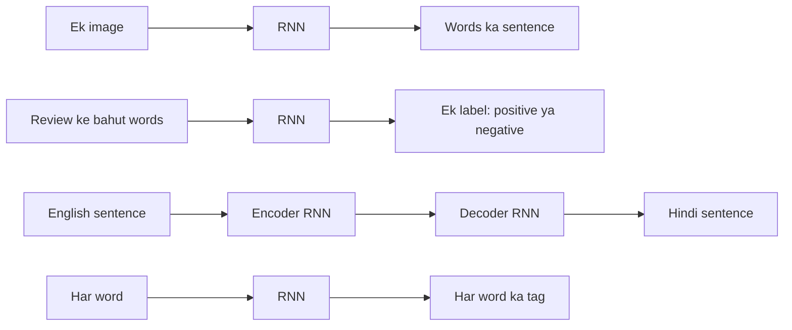
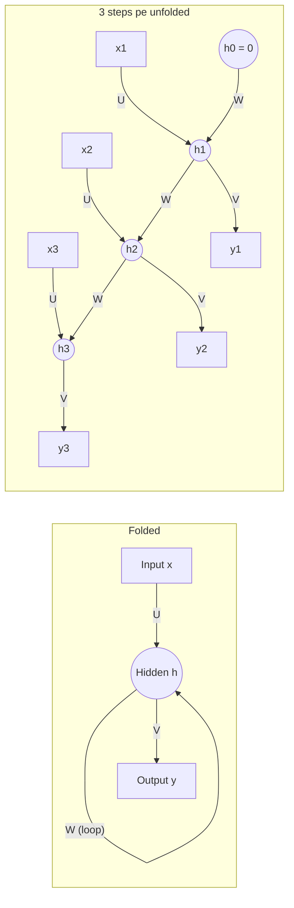
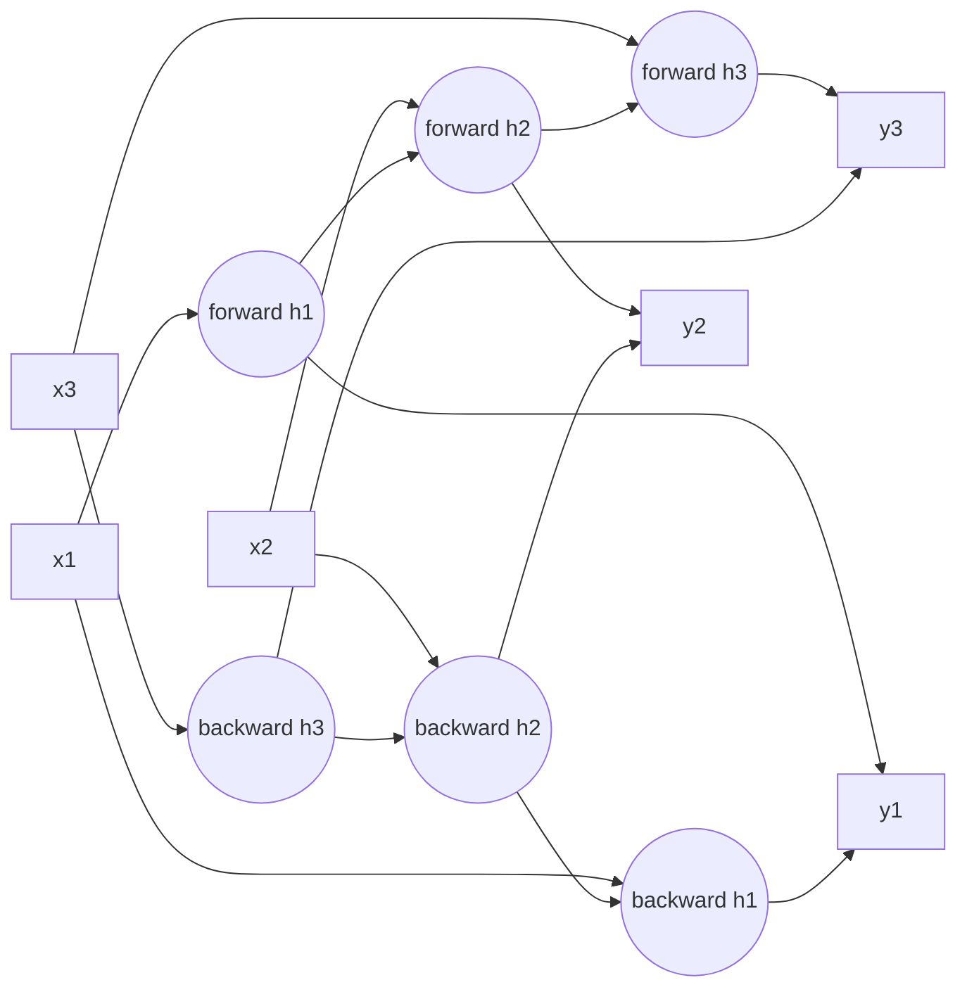
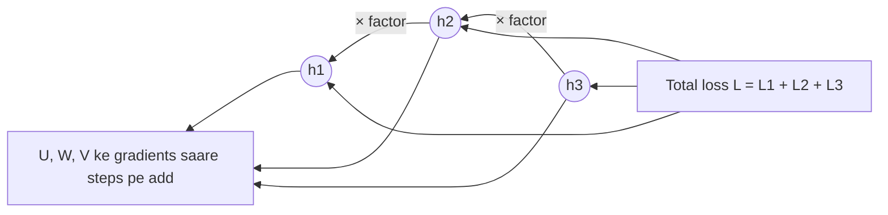

Naye ideas se pehle, purane ideas jo tumhe chahiye. Agar pata hain to agle section pe chale jao.

## Pehle basics

- Ek **neuron** kuch numbers leta hai, har ek ko ek **weight** se multiply karta hai, sabko ek **bias** ke saath add karta hai, aur total ko ek **activation function** se pass karta hai. Do common ones: **tanh** kisi bhi number ko $-1$ se $1$ ki range mein squash karta hai, aur **sigmoid** $0$ se $1$ mein.
- Ek **feedforward network** (MLP) numbers ko sirf ek direction mein bhejta hai: input layer, hidden layers, output layer. Iske paas **koi memory nahi** hoti. Har input alag se handle hota hai, aur input ka size hamesha same hona chahiye.
- **Training** ka matlab hai weights ko adjust karna taaki **loss** (ek number jo batata hai network kitna galat hai) kam ho.
- **Gradient** har weight ke liye batata hai ki use kis direction mein aur kitna change karna hai. **Backpropagation** network mein peeche jaate hue gradients nikalta hai, aur raste mein har layer ke effects **multiply** hote hain (chain rule). Ye multiplication yaad rakhna; aage gradients vanish ya explode kyun hote hain, uski poori wajah yahi hai.

## Problem: data jo order mein aata hai

Ye sentence ek word at a time padho: "I grew up in France, so I speak fluent ...". Last word guess karne ke liye tumhe kuch words pehle ka "France" yaad rakhna padega. Feedforward network sirf fixed-size input dekhta hai aur inputs ke beech sab bhool jaata hai, isliye ye kaam achhe se nahi kar paata.

Jis data mein **order matter karta hai** aur har item pichhle items pe depend karta hai, use **sequence** kehte hain. Examples: sentence ke words, ek word ke characters, share ka daily price, speech recording ke samples, video ke frames. Ye topic syllabus <Syl m="5" /> hai.

## Sequence learning problems

<Box kind="definition">

**Sequence learning problem** woh task hai jisme input, output, ya dono sequences hote hain, isliye model ko **dependent** inputs ki ek series dekhni padti hai, har **time step** pe ek, aur ek output ya outputs ki series deni padti hai.

</Box>

Exam mein English mein likho: "A sequence learning problem is a task where the input, the output, or both are sequences of dependent items, one per time step."

**Inhe special model kyun chahiye.** Khapra ke NPTEL lectures teen cheezein batate hain jo in problems ko ordinary problems se alag banati hain, aur isliye model se teen wishes <Cite id="nptel-dl" />:

1. **Inputs ek doosre pe depend karte hain.** "d", "e" ke baad next letter predict karne ke liye tumhe pehle wale letters chahiye, sirf current wala nahi.
2. **Length fixed nahi hai.** "deep" mein 4 letters hain aur "learning" mein 8. Sentences mein kitne bhi words ho sakte hain.
3. **Har step pe same kaam hota hai.** Har position pe task same hai (ek letter padho, next letter predict karo), isliye har step pe same function use hona chahiye.

Feedforward network teeno mein fail hota hai: memory nahi, fixed input size, aur har input position ke liye alag weights. RNN teeno wishes poori karta hai: memory carry karta hai (dependence), input mein jitne steps hain utne steps chalta hai (koi bhi length), aur har step pe same weights reuse karta hai (same function).

**Sequence problems ke types.** Karpathy ki famous picture inhe input aur output ke shape se sort karti hai <Cite id="karpathy-rnn" />:

| Kind | Input | Output | Example |
|---|---|---|---|
| One to one | Ek item | Ek item | Normal image classification (koi sequence nahi) |
| One to many | Ek item | Ek sequence | Image captioning: ek picture in, ek sentence out |
| Many to one | Ek sequence | Ek item | Movie review ka sentiment: bahut words in, positive ya negative out |
| Many to many (alag lengths) | Ek sequence | Ek sequence | Machine translation: English sentence in, Hindi sentence out |
| Many to many (har input ka ek output) | Ek sequence | Same length ka sequence | Part-of-speech tagging: har word ka tag; har video frame ko label karna |

Do RNNs se translation, ek jo input padhta hai (**encoder**) aur ek jo output likhta hai (**decoder**), ise **sequence-to-sequence** model kehte hain. <Cite id="sutskever2014" /> <Cite id="gfdl-ch10" loc="§10.4" />

**Sequence learning ke real-world applications:** speech-to-text, machine translation, chatbots, phone keyboard pe next-word suggestion, stock aur weather forecasting, music generation, video activity recognition.

## Recurrent neural network: memory wala network

**Ye kya hai.** **Recurrent neural network (RNN)** ek neural network hai jisme ek loop hai: ek time step pe hidden layer ka output agle time step pe extra input ki tarah wapas feed hota hai. Yahi wapas feed hui value network ki memory hai.

**Analogy.** Ek story padhne ka socho. Har sentence ke baad tum zero se start nahi karte; tum ab tak ki story ka summary dimaag mein rakhte ho, aur har naye sentence ke saath use update karte ho. RNN bilkul yahi karta hai. Iska running summary numbers ka ek vector hai jise **hidden state** kehte hain, time step $t$ ke liye $h_t$ likhte hain.

**Kaise kaam karta hai, step by step.**

1. Khali memory se start karo, $h_0 = 0$.
2. Step $t$ pe do cheezein lo: naya input $x_t$ aur pichhli memory $h_{t-1}$.
3. Dono ko mix karo, har ek apne weights ke set se, bias add karo, aur result ko tanh se squash karo. Yahi nayi memory $h_t$ hai.
4. Nayi memory se is step ka output banao (jaise har possible next word ki probability).
5. Agle step pe jao aur **same weights ke saath** repeat karo, jab tak sequence khatam na ho.

**Do equations.** Words mein: nayi memory = tanh of (recurrent weights times purani memory, plus input weights times naya input, plus bias); output = softmax of (output weights times memory, plus bias). Ye Goodfellow ki book ki equations hain, same letters ke saath. <Cite id="gfdl-ch10" loc="§10.2" />

$$
h_t = \tanh\left(W h_{t-1} + U x_t + b\right)
$$

$$
\hat{y}_t = \text{softmax}\left(V h_t + c\right)
$$

- $x_t$: step $t$ pe input (jaise ek word numbers mein badla hua); $h_t$: step $t$ ke baad hidden state (memory).
- $U$: input-to-hidden weights; $W$: hidden-to-hidden (**recurrent**) weights, woh loop jo memory deta hai; $V$: hidden-to-output weights; $b$, $c$: biases.
- $\hat{y}_t$: step $t$ pe output. **Softmax** scores ko probabilities mein badalta hai jinka total 1 hota hai; number output ke liye ise skip karte hain.

<Box kind="intuition">

**Same** $U$, $W$, $V$, $b$, $c$ har time step pe use hote hain. Ise **parameter sharing** kehte hain. Isi wajah se ek RNN 3 words ka sentence bhi padh sakta hai aur 300 ka bhi, weights ki ginti length ke saath nahi badhti, aur position 2 pe seekhi cheez (jaise "not" kya karta hai) position 20 pe bhi kaam karti hai.

</Box>

Exam mein English mein likho: "The same weights U, W and V are shared across all time steps."

**Worked sum: haath se RNN ka forward pass.**

<Sum>

<Given>

sab kuch ek number, taaki haath se calculate kar sakein: input weight $U = 0.5$, recurrent weight $W = 1.0$, bias $b = 0$, output weight $V = 2$ bina softmax ke, starting memory $h_0 = 0$, inputs $x = [1, 2, -1]$. Hum $\tanh(z) = \dfrac{e^{2z} - 1}{e^{2z} + 1}$ use karenge.

</Given>

<Find>

hidden states $h_1, h_2, h_3$ aur outputs $\hat{y}_1, \hat{y}_2, \hat{y}_3$.

</Find>

<Steps>

1. Step 1, andar ki value:

   $$
   \begin{aligned}
   W h_0 + U x_1 &= 1.0 \times 0 + 0.5 \times 1 \\
   &= 0.5
   \end{aligned}
   $$

   *(Purani memory khali hai, isliye sirf naya input count hota hai.)*
2. Step 1, memory: $e^{1} = 2.7183$, toh $h_1 = \dfrac{1.7183}{3.7183} = 0.4621$. *(tanh sum ko −1 se 1 mein squash karta hai.)*
3. Step 1, output: $\hat{y}_1 = 2 \times 0.4621 = 0.9242$. *(Output memory se padha jaata hai.)*
4. Step 2, andar ki value:

   $$
   \begin{aligned}
   1.0 \times 0.4621 + 0.5 \times 2 &= 0.4621 + 1 \\
   &= 1.4621
   \end{aligned}
   $$

   *(Ab purani memory naye input mein add hoti hai.)*
5. Step 2, memory: $e^{2.9242} = 18.62$, toh $h_2 = \dfrac{17.62}{19.62} = 0.8981$. *(Same tanh, same weights, naya step.)*
6. Step 2, output: $\hat{y}_2 = 2 \times 0.8981 = 1.7962$. *(Output weight times memory, pehle jaisa.)*
7. Step 3, andar ki value:

   $$
   \begin{aligned}
   1.0 \times 0.8981 + 0.5 \times (-1) &= 0.8981 - 0.5 \\
   &= 0.3981
   \end{aligned}
   $$

   *(Negative input sum ko neeche kheenchta hai, par memory use positive rakhti hai.)*
8. Step 3, memory: $e^{0.7962} = 2.2171$, toh $h_3 = \dfrac{1.2171}{3.2171} = 0.3783$. *(Phir se tanh se squash.)*
9. Step 3, output: $\hat{y}_3 = 2 \times 0.3783 = 0.7566$. *(Output weight times memory.)*

</Steps>

<Answer>

$h = [0.4621, 0.8981, 0.3783]$ aur outputs $\hat{y} = [0.9242, 1.7962, 0.7566]$.

</Answer>

<Box kind="verify">

**Check 1, chhoti values ka shortcut.** Chhote $z$ ke liye $\tanh(z) \approx z - \dfrac{z^3}{3}$. Step 1 ke liye:

$$
0.5 - \frac{0.125}{3} = 0.5 - 0.0417 = 0.4583
$$

jo 0.4621 ke kareeb hai (shortcut thoda kam deta hai). Step 3 ke liye:

$$
\begin{aligned}
0.3981 - \frac{0.0631}{3} &= 0.3981 - 0.0210 \\
&= 0.3771
\end{aligned}
$$

jo 0.3783 ke kareeb hai. Dono match karte hain.

**Check 2, range aur sign.** Har $h$ −1 aur 1 ke beech hai, jaisa tanh mein hona chahiye. Har $h$ ka sign uski andar wali value jaisa hai aur size thoda chhota hai, jo tanh hamesha deta hai. Har output apne $h$ ka exactly double hai.

</Box>

</Sum>

Step 3 pe input negative hai, phir bhi hidden state positive rehta hai, kyunki woh $W h_{t-1}$ ke through pehle ke inputs abhi bhi yaad rakhta hai. Yahi carry hua part memory hai.

## Computational graph ko unfold karna

**Ye kya hai.** RNN usually ek loop wale box ki tarah draw hota hai. Loop ke baare mein sochna mushkil hai, isliye hum use **unfold** (ya unroll) karte hain: har time step ke liye box ki ek copy draw karo aur loop ki jagah har copy se agli copy tak ek arrow lagao. <Cite id="gfdl-ch10" loc="§10.1" />

**Ye kyun zaroori hai.** Backpropagation sirf bina loop wale graph pe kaam karna jaanta hai. Unfolding loop ko ek ordinary feedforward chain bana deta hai, jitna sequence lamba utna deep, jisme har copy ke same weights hain. Ab ordinary backpropagation us pe chal sakta hai.

**Unfolding ke advantages.**

- Saaf dikhata hai kaun si value kis pe depend karti hai, isliye chain pe ordinary backpropagation laga sakte hain (yahi BPTT hai, neeche).
- Dikhata hai ki model ka har step pe input size same hai, sequence length chahe jo ho.
- Sharing dikhata hai: weights ka ek set, baar baar use hota hua.

**Disadvantage.** Unfolded chain sequence jitni lambi hoti hai, isliye lamba sequence ek bahut deep network ban jaata hai: training ko har step ke liye memory chahiye aur vanishing aur exploding gradients ki problem aati hai.

## RNN ke key components

Jab question components puchhe, ye list karo:

| Component | What it is | Job |
|---|---|---|
| Input layer $x_t$ | Har time step pe sequence ka ek element | Data ko order mein andar feed karta hai |
| Hidden state $h_t$ | Numbers ka ek vector | Memory: ab tak dekhi har cheez ka summary |
| Input weights $U$ | Matrix | Decide karte hain naya input memory ko kaise affect kare |
| Recurrent weights $W$ | Matrix | Decide karte hain purani memory nayi mein kaise carry ho |
| Output weights $V$ | Matrix | Memory ko output mein badalte hain |
| Biases $b$, $c$ | Vectors | Sums ko shift karte hain, kisi bhi neuron ki tarah |
| Activation | Hidden state mein usually tanh; output pe softmax ya kuch nahi | Non-linearity add karta hai aur hidden values ko bounded rakhta hai |
| Output $\hat{y}_t$ | Ek step pe prediction | Har step pe (tagging) ya sirf last step pe (sentiment) |
| Loss | Har output step ka ek loss, sab add | Batata hai outputs ka poora sequence kitna galat hai |

Weights shared hain, isliye parameters ki ginti sequence length pe depend nahi karti. <Cite id="keras-simplernn" /> <Cite id="pytorch-rnn" />

**Worked sum: ek RNN layer ke parameters ginna.**

<Sum>

<Given>

har input $x_t$ mein 3 numbers hain, hidden state mein 2 numbers hain, aur layer mein ek bias vector hai (jaise Keras `SimpleRNN` mein).

</Given>

<Find>

recurrent layer ke trainable parameters ki ginti.

</Find>

<Steps>

1. Input weights $U$: 2 hidden units mein se har ek 3 inputs mein se har ek se juda hai, toh $2 \times 3 = 6$. *(Har input–hidden pair ka ek weight.)*
2. Recurrent weights $W$: har hidden unit pichhle step ke har hidden unit se juda hai, toh $2 \times 2 = 4$. *(Yahi memory loop hai.)*
3. Bias $b$: har hidden unit ka ek, toh $2$. *(Har neuron ka apna bias.)*
4. Total: $6 + 4 + 2 = 12$. *(Teeno groups add karo.)*

</Steps>

<Answer>

12 parameters, sequence mein 5 steps hon ya 500.

</Answer>

<Box kind="verify">

Is baar hidden unit ke hisaab se group karo: 2 hidden units mein se har ek ke 3 input weights, 2 recurrent weights aur 1 bias hain, yaani $3 + 2 + 1 = 6$ numbers, aur $2 \times 6 = 12$. Same answer. Keras ise units × (units + inputs + 1) $= 2 \times (2 + 3 + 1) = 12$ likhta hai. (PyTorch ka `nn.RNN` do bias vectors rakhta hai, toh woh $12 + 2 = 14$ batayega.)

</Box>

</Sum>

## Deep (stacked) RNNs

RNN layers ko stack kar sakte ho: layer 1 ke hidden states har step pe layer 2 ke inputs ban jaate hain. Neeche ki layers simple patterns pakadti hain (letters, sounds), upar ki layers zyada abstract (words, meaning), deep feedforward network ki tarah. **Advantage:** zyada expressive. **Disadvantage:** slow aur train karna mushkil. <Cite id="gfdl-ch10" loc="§10.5" /> <Cite id="d2l-deep-rnn" />

## Bidirectional RNNs

**Ye kya hai.** **Bidirectional RNN (BiRNN)** same sequence pe do RNNs hain, ek left se right padhta hai aur ek right se left, jinke hidden states har step pe combine hote hain.

**Ye kyun zaroori hai.** Ordinary RNN ne step $t$ pe sirf past dekha hai. Par kabhi kabhi ek word ka matlab uske baad aane wale word pe depend karta hai. "He said, Teddy bears are on sale" aur "He said, Teddy Roosevelt was a president" mein, jab tak agla word na padho, pata nahi chalta ki "Teddy" toy hai ya person.

**Analogy.** Jaise ek sentence ko do baar padhna, ek baar aage se aur ek baar peeche se, aur phir jo samjha use combine karna.

**Kaise kaam karta hai, step by step.**

1. Ek **forward** RNN $x_1, x_2, \dots, x_T$ padhta hai aur har step pe ek forward state banata hai. Ise **past** pata hai.
2. Ek **backward** RNN, apne alag weights ke saath, $x_T, \dots, x_1$ padhta hai aur har step pe ek backward state banata hai. Ise **future** pata hai.
3. Har step pe dono states end to end jod diye jaate hain (concatenate) ek lambe vector mein.
4. Output layer ye joda hua vector use karti hai, isliye har output poora sentence dekhta hai.

| Advantages | Disadvantages |
|---|---|
| Har output past aur future dono context use karta hai | Koi bhi output dene se pehle **poora** sequence chahiye, isliye live, word-by-word prediction nahi kar sakta |
| Tagging aur recognition ke liye usually zyada accurate | Lagbhag double computation aur parameters |

**Applications:** speech recognition, part-of-speech tagging, named-entity recognition, missing word fill karna. <Cite id="gfdl-ch10" loc="§10.3" /> <Cite id="d2l-birnn" /> <Cite id="gfg-birnn" /> <Cite id="keras-bidirectional" />

## Training: backpropagation through time (BPTT)

**Ye kya hai.** BPTT **unfolded** RNN pe lagaya gaya ordinary backpropagation hai. <Cite id="gfdl-ch10" loc="§10.2.2" />

**Ye kyun zaroori hai.** Weights time ke across shared hain, aur late step ka loss bahut steps pehle ke inputs pe depend karta hai. Ordinary backpropagation ko bina loop ka graph chahiye, isliye pehle unfold karte hain aur phir time ke along backpropagate karte hain.

**Kaise kaam karta hai, step by step.**

1. RNN ko poore sequence pe **unfold** karo.
2. **Forward pass.** $t = 1$ se $T$ tak, har step ka hidden state, output aur loss nikalo.
3. **Total loss.** Step losses add karo: $L = L_1 + L_2 + \dots + L_T$.
4. **Backward pass.** Last step se pehle step tak peeche jao. Har hidden state pe error do jagah se aata hai: uska apna output, **aur** agla hidden state jisme woh feed hua tha.
5. **Add karo.** Same $U$, $W$, $V$ har copy mein hain, isliye har weight ka gradient saare time steps ke gradients ka **sum** hai.
6. Har weight ko gradient descent se ek baar **update** karo.

Ek line mein: total loss step losses ka sum hai, isliye shared weight ka gradient har step ke loss ke gradients ka sum hai (jisme se har ek khud pichhle steps tak peeche jaata hai):

$$
\frac{\partial L}{\partial W} = \sum_{t=1}^{T} \frac{\partial L_t}{\partial W}
$$

**Important observation.** Step 3 ke loss se step 1 tak pahunchne ke liye gradient step 3, phir step 2 se peeche guzarta hai, aur har step peeche jaane pe woh **ek aur factor se multiply** hota hai (roughly "tanh ka slope times $W$"). $k$ steps peeche jaane ka matlab $k$ factors ka product. Agle section ki jad yahi hai. <Cite id="gfg-bptt" /> <Cite id="mlm-bptt" />

| Advantages of BPTT | Disadvantages of BPTT |
|---|---|
| Shared weights ke exact gradients; ordinary backpropagation use karta hai | Har hidden state store karna padta hai, isliye memory sequence length ke saath badhti hai |
| RNN ko time ke across links seekhne deta hai | Lambe sequences ke liye slow: steps parallel nahi chal sakte |
| | Lambe products se vanishing ya exploding gradients |

### Truncated BPTT

**Ye kya hai.** Bahut lambe sequences (jaise 100,000 characters ki book) ke liye BPTT ka sasta version.

**Kaise kaam karta hai.**

1. Sequence ko chunks mein kaato, jaise har ek 50 steps ka.
2. **Forward** pass abhi bhi hidden state ko ek chunk se agle chunk tak le jaata hai, isliye memory aage behti rehti hai.
3. **Backward** pass sirf current chunk ke andar peeche jaata hai, phir weights update hote hain.

**Advantages:** fast, bahut kam memory, aur bahut lambe products se bachta hai (isliye kam exploding). **Disadvantage:** network chunk se lambe links directly nahi seekh sakta. <Cite id="nptel-dl" /> <Cite id="d2l-bptt" />

## Vanishing aur exploding gradients

**Ye kya hain.** "Vanilla" (plain) RNN ki main limitation. BPTT ke dauraan early time steps tak bheja gaya gradient ya toh zero ki taraf chhota ho jaata hai (**vanishing gradient**) ya bahut bada ho jaata hai (**exploding gradient**).

**Ye kyun hota hai, words mein.** Ek step peeche jaane pe gradient ek factor se multiply hota hai jo tanh ke slope aur recurrent weights $W$ se bana hai. Bahut steps peeche jaane pe aise bahut factors multiply hote hain. Agar factors usually 1 se chhote hain, toh product bahut tezi se chhota hota hai. Agar 1 se bade hain, toh bahut tezi se badhta hai. <Cite id="gfdl-ch10" loc="§10.7" /> <Cite id="pascanu2013" />

<Box kind="intuition">

Chinese whispers (telephone) ka game: ek message 20 logon se guzarta hai. Agar har insaan jo suna uska sirf aadha aage bataye, toh end tak lagbhag kuch nahi pahunchta. Agar har ek aadha aur badha chadha ke bataye, toh line ke end pe kuch bahut hi blown up sunai deta hai. Time mein peeche jaate gradients bhi aise hi behave karte hain.

</Box>

**Worked sum: gradient kitni tezi se chhota ya bada hota hai.**

<Sum>

<Given>

har step peeche jaane pe gradient same factor $r$ se multiply hota hai; hum $r = 0.5$ aur $r = 1.5$ dekhenge.

</Given>

<Find>

10 steps peeche jaane ke baad gradient kitna badalta hai.

</Find>

<Steps>

1. 10 steps peeche jaana = 10 factors multiply karna, toh change $r^{10}$ hai. *(Har step ka ek factor.)*
2. $r = 0.5$ ke liye: das baar aadha karo:

   $$
   \begin{aligned}
   1 &\to 0.5 \\
   &\to 0.25 \\
   &\to 0.125 \\
   &\to 0.0625 \\
   &\to 0.03125 \\
   &\to 0.015625 \\
   &\to 0.0078 \\
   &\to 0.0039 \\
   &\to 0.00195 \\
   &\to 0.000977
   \end{aligned}
   $$

   *(Har step sirf aadha rakhta hai.)*
3. $r = 1.5$ ke liye: das baar 1.5 se multiply karo:

   $$
   \begin{aligned}
   1 &\to 1.5 \\
   &\to 2.25 \\
   &\to 3.375 \\
   &\to 5.06 \\
   &\to 7.59 \\
   &\to 11.39 \\
   &\to 17.09 \\
   &\to 25.63 \\
   &\to 38.44 \\
   &\to 57.67
   \end{aligned}
   $$

   *(Har step aadha aur add karta hai.)*

</Steps>

<Answer>

$0.5^{10} \approx 0.001$ (lagbhag 1000 guna kamzor: vanishing) aur $1.5^{10} \approx 58$ (lagbhag 58 guna bada: exploding).

</Answer>

<Box kind="verify">

Is baar square karke dekho. $0.5^2 = 0.25$, $0.5^4 = 0.0625$, $0.5^8 = 0.0039$, aur

$$
\begin{aligned}
0.5^{10} &= 0.5^8 \times 0.5^2 \\
&= 0.0039 \times 0.25 \\
&= 0.000977
\end{aligned}
$$

saath hi $2^{10} = 1024$, toh $0.5^{10} = 1/1024$. $1.5^2 = 2.25$, $1.5^4 = 5.0625$, $1.5^8 = 25.63$, aur $1.5^{10} = 25.63 \times 2.25 = 57.67$. Same answers.

</Box>

</Sum>

| Factor per step | After 10 steps | What happens |
|---|---|---|
| 0.5 | $0.5^{10} \approx 0.001$ | **Vanishing:** lagbhag 1000 guna kamzor |
| 1.5 | $1.5^{10} \approx 58$ | **Exploding:** lagbhag 58 guna bada |

**tanh se vanishing kyun likely hai.** tanh ka slope maximum 1 hai (sirf centre pe) aur sigmoid ka maximum 0.25; baaki jagah ye bahut chhote hain, jaisa plot dikhata hai. Isliye, jab tak $W$ bada na ho, har factor usually 1 se chhota hota hai. Khapra ke lectures isko aise kehte hain: agar slope times $W$ ka size 1 se neeche rahe, gradient vanish hota hai; 1 se upar ho to explode kar sakta hai. <Cite id="nptel-dl" />

<Figure caption="tanh (peak 1) aur sigmoid (peak 0.25) ke slopes. 0 se door dono zero ke kareeb hain. Time mein har step peeche gradient inme se ek slope se multiply hota hai, isliye product usually chhota hota jaata hai.">
  <CurvePlot curves="tanh-derivative,sigmoid-derivative" x="-5,5" y="0,1.1" xLabel="value inside the activation" yLabel="slope" />
</Figure>

**Effects.**

- **Vanishing gradients:** door ke peeche wale steps ko lagbhag koi learning signal nahi milta, isliye network ki **short memory** hoti hai. "The cat, which ate all the fish on the table, **was** full" mein woh nahi seekh paata ki "was" das words pehle wale "cat" se agree karta hai. Training crash nahi hoti; bas chupchaap long dependencies seekhne mein fail hoti hai.
- **Exploding gradients:** weight update bahut door jump karta hai, loss bahut upar neeche hota hai, aur numbers overflow hokar "NaN" (not a number) ban sakte hain. Ye notice karna aasaan hai.

**Fixes.**

| Problem | Fix | How it helps |
|---|---|---|
| Exploding | **Gradient clipping** | Agar gradient threshold se lamba hai, use threshold tak scale down karo, direction same rakhte hue (jaise $[3, 4]$, length 5, length 1 pe clip karke $[0.6, 0.8]$ banta hai) |
| Exploding aur cost | **Truncated BPTT** | Har product mein kam factors |
| Vanishing | **LSTM aur GRU cells** | Gates ek aisa path banate hain jahan memory lagbhag bina badle aage copy hoti hai, isliye gradient har step pe chhota nahi hota |
| Vanishing | Careful starting weights, ReLU-type activations | Start mein factors ko 1 ke paas rakhte hain |

<Cite id="gfdl-ch10" loc="§10.11.1" /> <Cite id="pytorch-clip-grad-norm" /> <Cite id="gfg-vanishing-exploding-rnn" />

**Worked sum: gradient clipping.**

<Sum>

<Given>

ek gradient $g = [3, 4]$ aur clipping threshold 1.

</Given>

<Find>

clipped gradient.

</Find>

<Steps>

1. Gradient ki length:

   $$
   \begin{aligned}
   \sqrt{3^2 + 4^2} &= \sqrt{9 + 16} \\
   &= \sqrt{25} \\
   &= 5
   \end{aligned}
   $$

   *(Clipping total size dekhta hai.)*
2. Compare: $5 > 1$, isliye clip karna padega. *(Threshold se neeche hota to waise hi chhod dete.)*
3. Scale factor:

   $$
   \begin{aligned}
   \frac{\text{threshold}}{\text{length}} &= \frac{1}{5} \\
   &= 0.2
   \end{aligned}
   $$

   *(Itna chhota karo ki nayi length threshold ke barabar ho.)*
4. Har part multiply karo:

   $$
   [3 \times 0.2, 4 \times 0.2] = [0.6, 0.8]
   $$

   *(Har part same amount se chhota hota hai, isliye direction same rehti hai.)*

</Steps>

<Answer>

clipped gradient $[0.6, 0.8]$ hai.

</Answer>

<Box kind="verify">

Nayi length:

$$
\begin{aligned}
\sqrt{0.6^2 + 0.8^2} &= \sqrt{0.36 + 0.64} \\
&= \sqrt{1} \\
&= 1
\end{aligned}
$$

exactly threshold. Direction: $3 : 4 = 0.75$ aur $0.6 : 0.8 = 0.75$, same ratio, isliye gradient abhi bhi usi taraf point karta hai.

</Box>

</Sum>

<Box kind="pitfall">

Clipping sirf **exploding** gradients fix karta hai. Woh chhote gradient ko bada nahi kar sakta, isliye **vanishing** gradients ke liye kuch nahi karta. Unke liye LSTM jaise gated cells chahiye (LSTM aur GRU note dekho). <Cite id="hochreiter1997" />

</Box>

## Simple RNN ke advantages aur disadvantages

| Advantages | Disadvantages |
|---|---|
| Kisi bhi length ke sequences handle karta hai | Long-range dependencies mein struggle karta hai (vanishing gradients) |
| Har step pe same weights: kam parameters | Exploding gradients training ko unstable bana sakte hain |
| Past ki memory rakhta hai | Steps ek ke baad ek process karne padte hain, isliye lambe sequences pe train karna slow hai |
| One-to-many, many-to-one aur many-to-many tasks ke liye ek model | Plain RNN future nahi dekh sakta (bidirectional RNN dekh sakta hai) |

## RNN versus feedforward network

| Point | Feedforward network | RNN |
|---|---|---|
| Memory | Nahi | Hidden state steps ke across carry hota hai |
| Input size | Fixed | Koi bhi length |
| Weights | Har input position ke liye alag | Time steps ke across shared |
| Data | Independent items (ek image) | Ordered, dependent items (ek sentence) |
| Training | Backpropagation | Backpropagation through time |

**RNNs ke applications:** next-word prediction aur text generation, speech recognition, machine translation, sentiment analysis, time-series forecasting (weather, stock prices), music generation. <Cite id="gfg-rnn" /> <Cite id="ibm-rnn" /> <Cite id="d2l-rnn" />

## Simple RNN versus LSTM, long-term dependencies pe

| Point | Simple RNN | LSTM |
|---|---|---|
| Memory | Ek hidden state, har step pe poora rewrite hota hai | Alag cell state plus gates jo decide karte hain kya rakhna, add karna aur dikhana hai |
| Bahut steps pe gradient | Har step pe ek factor se multiply, isliye usually vanish hota hai | Cell state zyaadatar addition se aage jaata hai, isliye gradient bahut der tak bachta hai |
| Useful memory span | Short: bahut steps door ke links seekhna mushkil | Long: original paper ne test tasks mein 1000 se zyada steps ke gaps bridge kiye |
| Parameters aur speed | Kam, har step fast | Same size ke simple RNN se lagbhag chaar guna weights, slow |
| Good for | Chhote sequences, simple patterns | Lambe sentences, translation, speech, lambi time series |

Gates ki details LSTM aur GRU note mein hain. <Cite id="hochreiter1997" /> <Cite id="gfdl-ch10" loc="§10.10" />

**Conclusion.** RNN har step pe shared weights ke saath apna hidden state wapas feed karke neural network ko memory deta hai, jo kisi bhi length ke ordered data ke liye fit hai; iski kamzori vanishing gradients se aane wali short memory hai, jise fix karne ke liye LSTM aur GRU cells bane.

Exam mein English mein likho: "An RNN gives a network memory by feeding back its hidden state with shared weights; its main limitation is the vanishing gradient, which LSTM and GRU fix."

<Box kind="exam">

"Explain RNN architecture" ke liye folded aur unfolded dono diagram draw karo, hidden state ko memory ki tarah explain karo, words mein bolne ke baad $h_t = \tanh(W h_{t-1} + U x_t + b)$ aur $\hat{y}_t = \text{softmax}(V h_t + c)$ likho, "the same weights are shared across time" likho, types examples ke saath list karo, aur BPTT aur vanishing-gradient limitation ek ek line mein mention karo.

</Box>

## Ye kahan puchha gaya

| If the question says | What to write | Seen as |
|---|---|---|
| "Describe sequence learning problem" | Definition, teen properties (dependent inputs, variable length, har step same task), kinds ki table examples ke saath, RNN kyun fit hai | <PYQ id="2023-12/q1e" /> |
| "Explain RNN architecture in detail" ya "working of RNN with a diagram" | Folded aur unfolded diagram, step-by-step working, do equations, parameter sharing, types, BPTT, advantages aur limitations | <PYQ id="2023-12/q4a" /> <PYQ id="2025-05/q4a" /> |
| "Key components of an RNN" | Components table, equations, unfolding, time pe summed loss | <PYQ id="2024-12/q4a" /> |
| "Vanishing and exploding gradient in RNNs" | BPTT factors kyun multiply karta hai, $0.5^{10}$ aur $1.5^{10}$ numbers, tanh slope plot, effects, fixes (clipping, truncation, LSTM/GRU) | <PYQ id="2023-12/q6b" /> |
| "LSTM, how it overcomes the limitation of RNN" | Pehle RNN ki limitation (vanishing gradient), phir LSTM cell (LSTM aur GRU note dekho) | <PYQ id="2024-05/q4a" /> |
| "How RNNs suit sequential data; RNN vs LSTM on long-term dependencies; real application" | Memory aur sharing, RNN vs LSTM table, machine translation jaisa ek application | <PYQ id="2025-05/q4b" /> |

## Quick revision

- Sequence problems: inputs ek doosre pe depend karte hain, length badalti hai, har step pe same task.
- Kinds: one-to-many (captioning), many-to-one (sentiment), many-to-many (translation, tagging).
- RNN: hidden state = memory; $h_t = \tanh(W h_{t-1} + U x_t + b)$, $\hat{y}_t = \text{softmax}(V h_t + c)$; har step pe same $U, W, V$.
- Unfolding loop ko shared weights wali copies ki chain bana deta hai, taaki backpropagation chal sake.
- Bidirectional RNN: forward RNN plus backward RNN; output dono ko jodta hai; poora sequence chahiye.
- BPTT: unfolded chain pe backprop; shared weights ke gradients time pe sum hote hain. Truncated BPTT sirf chunks ke andar backpropagate karta hai.
- Har step peeche gradient ek factor se multiply hota hai: 1 se neeche vanish ($0.5^{10} \approx 0.001$), 1 se upar explode ($1.5^{10} \approx 58$).
- Clipping exploding gradients fix karta hai; LSTM aur GRU vanishing gradients fix karte hain.
