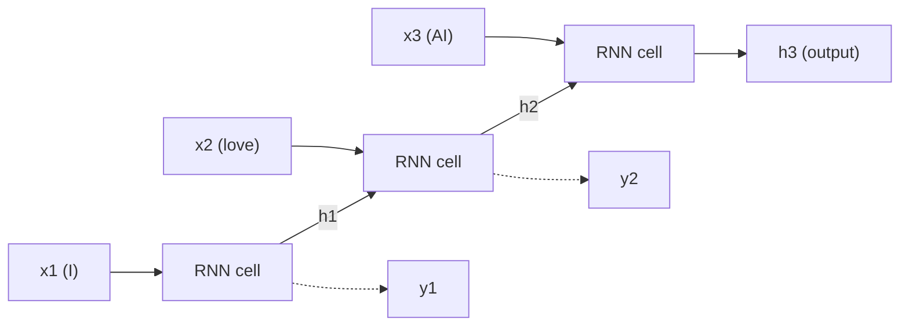
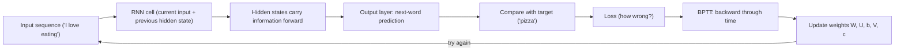
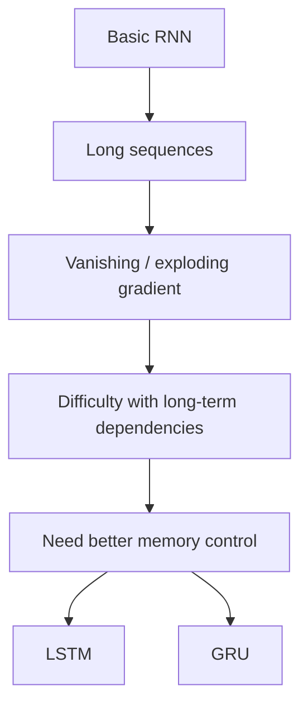
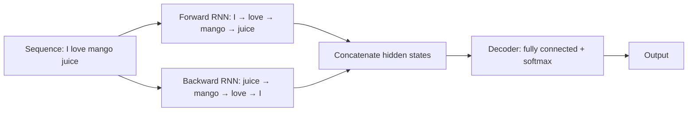
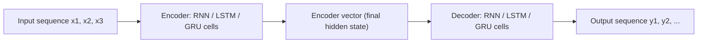
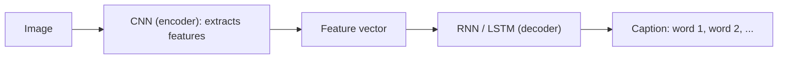

Naye ideas se pehle wo purani baatein jo chahiye. Agar aapko pata hai to seedha agle section par jao.

## Basics pehle

- Neural network numbers leta hai, unhe **weights** se multiply karta hai, **bias** add karta hai aur numbers bahar deta hai. Weights aur biases hi **parameters** hain jo network seekhta hai.
- **Loss** batata hai ki prediction kitna galat hai. **Backpropagation** error ko network mein peeche bhejta hai taaki pata chale har weight kaise badalna hai. Phir weights update hote hain.
- **Gradient** ek partial derivative hai. Ye batata hai ki input thoda badalne par function ka output kitna badalta hai. Gradient se error ke change ke hisaab se saare weights ka change naapa jaata hai. Agar slope zero hai to model seekhna band kar deta hai. <Cite id="class-dl-m5" loc="p. 14" />
- Aapne images ke liye CNN dekha. Ab data alag hai: words, sounds aur readings jo ek ke baad ek aate hain. <Cite id="class-dl-chp5" loc="slide 4" />

## Sequence models aur sequence learning problem

<Box kind="definition">

**Sequence:** wo data jisme elements ka **order** **matter** karta hai. <Cite id="class-dl-chp5" loc="slide 3" />

**Sequence models** wo machine learning models hain jo data ki sequences input ya output karte hain. Sequential data mein text streams, audio clips, video clips, time-series data wagairah aate hain. Recurrent Neural Networks (RNNs) sequence models mein use hone wala popular algorithm hai. <Cite id="class-dl-m5" loc="p. 3" />

</Box>

**Ye normal data se alag kyun hai?** Sentence mein current word ko samajhne ke liye aas-paas ke words important ho sakte hain. "Bank" ka matlab "I went to the bank to deposit money" mein financial institution hai aur "We sat on the bank of the river" mein river side. Current word samajhne ke liye surrounding sequence ki information kaam aa sakti hai. <Cite id="class-dl-chp5" loc="slide 3" />

<Box kind="definition">

**Sequence learning problem:** "How can a neural network learn from data when the order and previous information matter?" <Cite id="class-dl-chp5" loc="slide 3" />

</Box>

**Sequence data ke examples aur hum kya predict karna chahte hain:** <Cite id="class-dl-chp5" loc="slide 3" />

| Sequence data | What we want to predict |
|---|---|
| Sentence | Sentiment / next word |
| Speech | Recognized words |
| Stock prices | Future price |
| Weather readings | Future temperature |
| Music notes | Next note |

**Sequence models ki applications** (Module 5): <Cite id="class-dl-m5" loc="p. 4" /> <Cite id="class-dl-m5" loc="p. 5" />

1. **Speech recognition:** audio clip input hai aur model uska text banata hai. Input aur output dono sequences hain.
2. **Sentiment classification:** text mein jo opinion hai use classify kiya jaata hai. Input words ki sequence hai.
3. **Video activity recognition:** model video clip mein activity pehchanta hai. Video clip frames ki sequence hai, isliye input sequence hai.

### Normal neural network kyun nahi use kar sakte?

Basic feedforward network ke paas **pichhle inputs ki built-in memory nahi** hoti. Deep feedforward model ko sequence ke har element ke liye alag parameters bhi chahiye ho sakte hain, aur wo alag-alag length ki sequences par generalize na kar paaye. <Cite id="class-dl-chp5" loc="slide 5" /> <Cite id="class-dl-m5" loc="p. 7" />

## Recurrent neural network (RNN)

<Box kind="definition">

**RNN:** ek type ka neural network jisme hidden states hote hain aur jo pichhle outputs ko inputs ki tarah use karne deta hai. <Cite id="class-dl-m5" loc="p. 9" />

**Easy idea (exam mein ye likho):** "I will process the current input, but I will also carry some information from previous steps." RNN is designed to work with sequential data. <Cite id="class-dl-chp5" loc="slide 3" />

</Box>

Recurrent Neural Networks sequence ke **har element ke liye same weights** use karte hain. Isse parameters kam hote hain aur model alag-alag length ki sequences par generalize kar paata hai. Attention models se pehle sequential data ke liye RNN hi standard suggestion tha. <Cite id="class-dl-m5" loc="p. 7" /> <Cite id="class-dl-m5" loc="p. 8" />

**Roz ki analogy.** Kahani padhte waqt aap pichhla page nahi bhoolte. Aap ab tak ki ek chhoti summary saath rakhte ho aur page-by-page use update karte ho. RNN apni memory ke saath wahi karta hai. <Cite id="class-dl-chp5" loc="slide 6" />

### Memory hi hidden state hai

<Box kind="definition">

**Hidden state:** RNN jo memory carry karta hai. Hidden state = information carried from previous time steps. <Cite id="class-dl-chp5" loc="slide 6" />

</Box>

### "Recurrent" kyun?

**Recurrent = Repeated.** Network baar-baar naye inputs process karta hai aur pichhla hidden state aage le jaata hai. RNN ka core working principle: **current input + previous hidden state → new hidden state.** <Cite id="class-dl-chp5" loc="slide 7" />

Har time step par RNN cell **current input** aur **previous hidden state** leta hai aur **new hidden state** aur ek **output** banata hai. Ye process sequence ke har element ke liye repeat hota hai. <Cite id="class-dl-chp5" loc="slide 7" />

### RNN equations

Har time step $t$ ke liye hidden state aur output do equations se milte hain. Module notes hidden state ke liye $a^{\langle t \rangle}$ likhte hain: <Cite id="class-dl-m5" loc="p. 9" />

$$
a^{\langle t \rangle} = g_1(W_{aa}\, a^{\langle t-1 \rangle} + W_{ax}\, x^{\langle t \rangle} + b_a), \qquad y^{\langle t \rangle} = g_2(W_{ya}\, a^{\langle t \rangle} + b_y)
$$

Class slides mein wahi cheez parameters $W, U, b, V, c$ ke saath likhi hai: <Cite id="class-dl-chp5" loc="slide 14" />

$$
h_t = \tanh(U x_t + W h_{t-1} + b), \qquad \hat{y}_t = \text{softmax}(V h_t + c)
$$

Yahan $x_t$ time $t$ ka input hai, $h_{t-1}$ pichhla hidden state, $h_t$ naya hidden state aur $\hat{y}_t$ output. $g_1, g_2$ activation functions hain jaise tanh aur softmax. Weights **time ke across shared** hain.

### RNN kaam karne ke alag tareeke (types of RNN)

Architecture problem ke hisaab se badal sakta hai, ek input-output se lekar bahut saare inputs-outputs tak. <Cite id="class-dl-m5" loc="p. 11" /> <Cite id="class-dl-chp5" loc="slide 8" />

| Type | What it means | Examples |
|---|---|---|
| **One to one** | Sirf ek pair. Traditional neural networks mein use hota hai. | Ordinary classifier |
| **One to many** | Ek input se kai outputs. | Music generation, image captioning |
| **Many to one** | Alag time steps ke kai inputs se ek output. | Sentiment analysis, emotion identification, spam detection, text classification |
| **Many to many** | Kai inputs se kai outputs (lengths alag ho sakti hain). | Machine translation (English to French), sequence labelling |

### RNN versus feedforward network

| Aspect | Feedforward network | RNN |
|---|---|---|
| Memory | Pichhle inputs ki built-in memory nahi | Hidden state hai jo pichhle steps ki information carry karta hai |
| Data | Har input alag treat hota hai | Sequences par kaam karta hai; order matter karta hai |
| Weights | Sequence ke har element ke liye alag parameters chahiye honge | Har time step par same weights, isliye parameters kam |
| Length | Fixed-size input | Alag-alag length ki sequences handle kar sakta hai |

<Cite id="class-dl-m5" loc="p. 7" /> <Cite id="class-dl-m5" loc="p. 8" /> <Cite id="class-dl-m5" loc="p. 13" />

## Unfolding the computational graph

<Box kind="definition">

**Unfolding** means showing the same RNN cell separately at each time step. The **weights are shared** across all time steps. <Cite id="class-dl-chp5" loc="slide 12" />

</Box>

Unfolding loop ko chain bana deti hai, taaki us par normal backpropagation chal sake.

## RNN kaise seekhta hai? Backpropagation through time (BPTT)

RNN bhi kisi aur network ki tarah seekhta hai: apni prediction ko actual answer se compare karta hai aur weights adjust karta hai. Lekin RNN mein kai time steps hote hain, to error peeche kaise bheja jaaye? Wahi **Backpropagation Through Time (BPTT)** hai. <Cite id="class-dl-chp5" loc="slide 10" />

<Box kind="definition">

**BPTT** is backpropagation applied across the different time steps of an RNN. Easy meaning: forward through time, phir backward through time. <Cite id="class-dl-chp5" loc="slide 10" />

</Box>

**BPTT ke steps** (example: I → love → AI): <Cite id="class-dl-chp5" loc="slide 10" />

1. **Forward pass:** RNN har word padhta hai aur h1, h2, h3 aur ek output deta hai.
2. **Calculate loss:** prediction ko actual output se compare karo.
3. **Backward pass:** error loss se t3, t2, t1 tak peeche jaata hai.
4. **Update weights:** nikale gaye gradients se weights update karo.

### Ek complete example: agla word predict karna

Class ek poora example karwati hai. <Cite id="class-dl-chp5" loc="slide 14" />

1. **The sequence:** "I love eating ___", target (sahi agla word) "pizza" hai.
2. **Forward pass:** RNN words ek-ek karke padhta hai, current word aur pichhli information (hidden state se) use karke.
3. **Output layer and prediction:** final hidden state output layer mein jaati hai jo agle word ki probabilities deti hai: pizza 70%, burger 15%, apple 10%, salad 5%. Prediction pizza hai.
4. **Compare with target:** agar prediction target ke barabar hai to loss chhota hota hai (zero ke paas).
5. **Wrong prediction:** agar model "apple" predict kare to loss bada hota hai.
6. **BPTT:** error peeche bheja jaata hai taaki pata chale ki galti mein kis hisse ka haath tha aur weights aur biases ke gradients nikal sakein.
7. **Update the weights** $(W, U, b, V, c)$ gradients se.
8. **Try again:** wahi sentence ab pizza 90%, burger 5%, apple 3%, salad 2% deta hai.

<Box kind="verify">

Dono tables ki probabilities 100% banti hain: $70 + 15 + 10 + 5 = 100$ aur $90 + 5 + 3 + 2 = 100$.

</Box>

### Truncated BPTT

Bahut lambi sequence (maan lo 100 steps) mein normal BPTT error ko poori sequence mein bhejne ki koshish karta hai. Ye computationally expensive, memory intensive aur bahut lambi sequences ke liye mushkil ho sakta hai. <Cite id="class-dl-chp5" loc="slide 22" />

<Box kind="definition">

**Truncated BPTT** limits backpropagation to a fixed number of time steps instead of going through the entire sequence. <Cite id="class-dl-chp5" loc="slide 22" />

</Box>

## Vanilla RNN ki limitations

Basic (vanilla) RNN sequences ke liye achha kaam karta hai, lekin in cheezon mein struggle kar sakta hai: <Cite id="class-dl-chp5" loc="slide 12" />

1. Long-term dependencies.
2. Vanishing gradients.
3. Exploding gradients.
4. Bahut pehle ke time steps ki information yaad rakhna mushkil.
5. Sequential processing se training slow ho sakti hai.

### Long-term dependency problem

Basic RNN ko important information ko kai time steps tak le jaana mushkil lag sakta hai. Ye **long-term dependency problem** hai. Chhoti sequence mein RNN information aasani se le jaata hai; lambi sequence mein word 1 ki information ko word 50 ke output ko influence karna pad sakta hai. <Cite id="class-dl-chp5" loc="slide 11" /> <Cite id="class-dl-chp5" loc="slide 15" /> <Cite id="class-dl-m5" loc="p. 16" />

### Vanishing aur exploding gradients

BPTT ke dauraan gradient ko kai time steps se guzarna padta hai. Guzarte hue wo bahut chhota ya bahut bada ho sakta hai. <Cite id="class-dl-chp5" loc="slide 10" />

<Box kind="definition">

**Vanishing gradient:** gradient values bahut chhoti ho jaati hain, isliye model seekhna band kar deta hai ya bahut zyada time leta hai. Gradient time mein peeche jaate hue chhota hota jaata hai, isliye pehle ke time steps ko bahut kam learning signal milta hai. <Cite id="class-dl-m5" loc="p. 14" /> <Cite id="class-dl-chp5" loc="slide 11" />

**Exploding gradient:** gradient bahut bada ho jaata hai. Isse bahut bade weight updates, unstable training aur seekhna mushkil ho jaata hai. <Cite id="class-dl-chp5" loc="slide 11" />

</Box>

**Sum: factor kya karta hai.** Slides ke numbers lo: gradient har step peeche jaate hue same factor se multiply hota hai. <Cite id="class-dl-chp5" loc="slide 11" />

<Sum>

<Given>

start gradient 1. Case A: har step par 0.1 se multiply. Case B: har step par 10 se multiply. Time mein chaar step peeche.

</Given>

<Find>

har step ke baad gradient.

</Find>

<Steps>

1. **Case A (factor 1 se kam):** $1 \to 0.1 \to 0.01 \to 0.001 \to 0.0001$. Har step 0.1 se multiply karta hai.
2. **Case B (factor 1 se zyada):** $1 \to 10 \to 100 \to 1000 \to 10000$. Har step 10 se multiply karta hai.
3. 4 steps ke baad: $0.1^4 = 0.0001$ aur $10^4 = 10000$.

</Steps>

<Answer>

Case A vanish hokar 0.0001 ho jaata hai. Case B explode hokar 10,000. Sequence jitni lambi, haalat utni kharab.

</Answer>

<Box kind="verify">

Wapas multiply karo: $0.0001 \times 10 \times 10 \times 10 \times 10 = 1$, yaani start value. Isi tarah $10000 \times 0.1^4 = 1$.

</Box>

</Sum>

**Fixes.** **Exploding gradients** ka solution simple hai: gradients ko truncate ya squash karna (class truncated BPTT bhi use karti hai). **Vanishing gradients** ko solve karna bahut mushkil tha; Hochreiter aur Schmidhuber ke **LSTM** ne ye problem solve ki (LSTM and GRU note dekho). <Cite id="class-dl-m5" loc="p. 14" /> <Cite id="class-dl-m5" loc="p. 16" />

## Bidirectional RNN

<Box kind="definition">

**Bidirectional RNN:** sequence ko forward aur backward dono directions mein process karta hai taaki dono taraf ki information use ho sake. Normal RNN mainly past ki information use karta hai. <Cite id="class-dl-chp5" loc="slide 12" />

</Box>

**Ye kaise kaam karta hai.** Hum do alag sequences dekhte hain: ek left se right aur doosri ulti order mein. "I love mango juice" word sequence ke liye forward layer sequence jaisi hai waisi deti hai, aur backward layer "juice mango love I" deti hai. Typically do alag RNNs use hote hain, har direction ke liye ek. Unke hidden states usually concatenate karke ek single hidden state banate hain, aur outputs combined states se bante hain. Final hidden state ek decoder mein jaati hai, jaise fully connected network ke baad softmax. <Cite id="class-dl-m5" loc="p. 32" /> <Cite id="class-dl-m5" loc="p. 33" />

**BRNN ki limitations.** <Cite id="class-dl-m5" loc="p. 33" />

- Prediction karne se pehle poori sequence available honi chahiye. Real-time speech recognition mein poora utterance available nahi hota.
- Language model mein jo agla word predict karta hai, BRNN suitable nahi hai kyunki wo future words bhi expect karta hai; accuracy kharab aati hai.
- BRNN, RNN se slow hai kyunki backward pass shuru hone ke liye forward pass ke results chahiye. Gradients ki dependency chain lambi ho jaati hai.

## Encoder-decoder (sequence to sequence) architecture

<Box kind="definition">

A **sequence to sequence model** aims to map a fixed-length input with a fixed-length output where the length of the input and the output may differ. <Cite id="class-dl-m5" loc="p. 38" />

</Box>

**Example.** "What are you doing today?" ko English se Chinese mein translate karne par input 5 words ka hai aur output 7 symbols ka. Hum regular LSTM network se English sentence ke har word ko Chinese sentence se one-to-one map nahi kar sakte. Uses: machine translation, speech recognition, image captioning. <Cite id="class-dl-m5" loc="p. 38" />

Model ke **3 parts hain: encoder, intermediate (encoder) vector aur decoder.** <Cite id="class-dl-m5" loc="p. 39" />

1. **Encoder:** kai recurrent units ka stack (behtar performance ke liye LSTM ya GRU cells). Har unit input sequence ka ek element leta hai, us element ki information collect karta hai aur aage bhejta hai. Question-answering problem mein input sequence question ke saare words hain, $x_i$ matlab $i$-th word. Hidden states RNN formula $h_t = f(W_{hh} h_{t-1} + W_{hx} x_t)$ se nikalte hain. <Cite id="class-dl-m5" loc="p. 40" />
2. **Encoder vector:** encoder ka banaya final hidden state. Ye saare input elements ki information rakhne ki koshish karta hai taaki decoder sahi predictions kar sake. Ye **decoder ka initial hidden state** banta hai. <Cite id="class-dl-m5" loc="p. 41" />
3. **Decoder:** kai recurrent units ka stack, har ek time step $t$ par ek output $y_t$ predict karta hai. Har unit pichhle unit se hidden state leta hai aur ek output aur apna hidden state banata hai, $h_t = f(W^{(hh)} h_{t-1})$, aur output $y_t = \text{softmax}(W^{S} h_t)$. Question answering mein output sequence answer ke words hain. <Cite id="class-dl-m5" loc="p. 42" />

Model ki taakat ye hai ki wo **alag-alag length ki sequences ko ek doosre se map** kar sakta hai. Inputs aur outputs correlated nahi hote aur unki lengths alag ho sakti hain. <Cite id="class-dl-m5" loc="p. 42" />

### Application: image captioning

**Image captioning** matlab image se textual description banana, image ke objects aur actions ke basis par. Generated output ek sentence mein batata hai ki image mein kya hai. Task do modules mein baanta jaata hai: ek **image-based model (encoder)** jo image ke features nikalta hai, jiske liye hum usually **CNN** use karte hain, aur ek **language-based model (decoder)** jo un features ko natural sentence banata hai, jiske liye hum **RNN** use karte hain. <Cite id="class-dl-m5" loc="p. 45" /> <Cite id="class-dl-m5" loc="p. 46" />

## Recursive neural networks

**Recursive neural networks (RvNNs)** RNNs ko generalize karte hain. Apni **tree structure** ki wajah se wo hierarchical models seekh sakte hain, jabki RNN sirf sequential data handle karta hai. Tree mein har node ke children ki sankhya fixed hoti hai taaki recursive operations ho sakein aur steps mein same weights use ho. Child representations ko parent representations mein combine kiya jaata hai. NLP mein ek main use sentences ka syntactic parsing hai: noun ya verb phrases jaise chhote components pehchaano aur unhe hierarchy mein organize karo. <Cite id="class-dl-m5" loc="p. 34" /> <Cite id="class-dl-m5" loc="p. 36" />

| Recurrent network | Recursive network |
|---|---|
| Chain structure, temporal sequences represent karta hai | Tree structure, hierarchical data represent karta hai |
| Chain ki length mein weights shared | Tree ke har step par same weights, har node ke fixed children |
| Sequential data jaise sentences ke liye | Hierarchical data ke liye, jaise sentence parsing |

<Cite id="class-dl-m5" loc="p. 37" />

## RNN ki applications

RNNs sequence data wali problems solve karte hain: audio, text, video aur biological sequences. Jab order aur pichhli information matter karti hai tab ye kaam aate hain. <Cite id="class-dl-m5" loc="p. 15" /> <Cite id="class-dl-chp5" loc="slide 13" />

- **Speech recognition**, **generation of music**, **automated translations**, **analysis of video action**, **sequence study of the genome and DNA**. <Cite id="class-dl-m5" loc="p. 15" />
- **Sentiment analysis** ("The movie was amazing" ka result Positive), **next-word prediction** ("I am going to ___" ka "school"), **text generation** ("Once upon a time..." se ek-ek word), **temperature prediction** (30, 31, 32, 33 degrees se Friday ke liye 34). <Cite id="class-dl-chp5" loc="slide 13" />
- CNN ke saath milkar RNN un images ke labels (captions) banate hain jinhe tag nahi kiya gaya. <Cite id="class-dl-m5" loc="p. 16" />

Sabmein common baat: **data sequence mein aata hai, aur pichhli information current ya future information ko samajhne ya predict karne mein madad karti hai.** <Cite id="class-dl-chp5" loc="slide 13" />

## Ye kahan puchha gaya

| If the question says | What to write | Seen as |
|---|---|---|
| "Describe sequence learning problem" ya "sequence modelling" | Sequence ki definition, problem sentence, examples ki table, normal network kyun fail hota hai, kaun se networks use hote hain | <PYQ id="2023-12/q1e" /> <PYQ id="assignment-2/q5a" /> |
| "Explain RNN architecture / working of RNN with a diagram" | Hidden state, cell, unfolded diagram, equations, shared weights, types, BPTT | <PYQ id="2023-12/q4a" /> <PYQ id="2025-05/q4a" /> <PYQ id="2024-12/q4a" /> |
| "Vanishing and exploding gradient in RNNs" | BPTT har step par gradient ko multiply karta hai: bahut chhota ya bahut bada, effects, fixes | <PYQ id="2023-12/q6b" /> |
| "Encoder-decoder / bidirectional RNN" | seq2seq ke teen parts, ya ulti directions mein do RNNs, limits | <PYQ id="assignment-2/q5d" /> |
| "RNN suited for sequential data; RNN vs LSTM" | Memory aur shared weights, phir long-term dependency problem | <PYQ id="2025-05/q4b" /> <PYQ id="2024-05/q4a" /> |

## Quick revision

- Sequence: order matter karta hai. Sequence learning problem: jab order aur pichhli information matter kare tab seekhna.
- RNN: hidden state memory carry karta hai. Current input + previous hidden state → new hidden state. Har step par same weights.
- Unfolding: same RNN cell har time step par dikhaya gaya. BPTT: time mein aage, phir time mein peeche.
- Types: one to one, one to many (captioning, music), many to one (sentiment), many to many (translation).
- Vanishing gradient = too small (seekhna ruk jaata hai). Exploding gradient = too large (unstable). Vanilla RNN long-term dependencies nahi rakh paata. Fix: LSTM aur GRU; truncated BPTT; gradient clipping.
- Bidirectional RNN: forward aur backward RNNs, hidden states joined. Poori sequence chahiye.
- Encoder-decoder: encoder, encoder vector, decoder. Input aur output ki lengths alag ho sakti hain.
- Recurrent = chain (sequences); recursive = tree (hierarchies).
