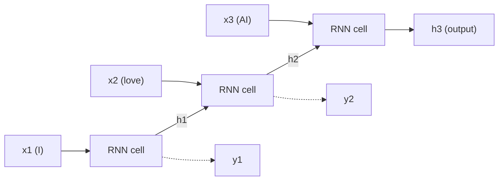
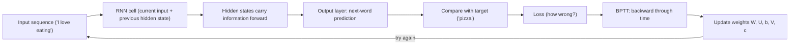
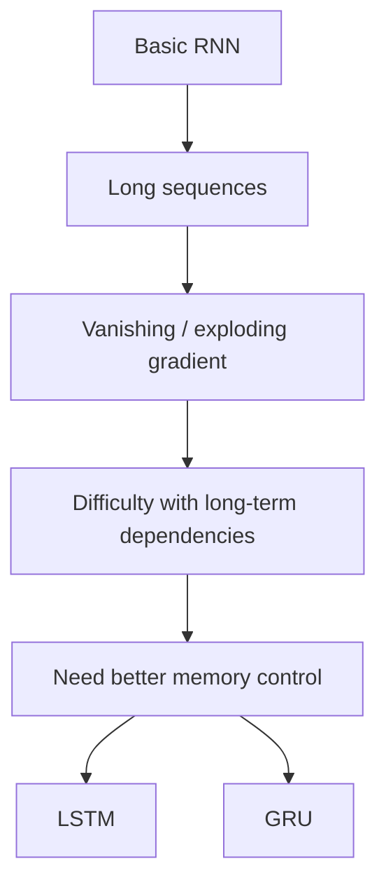
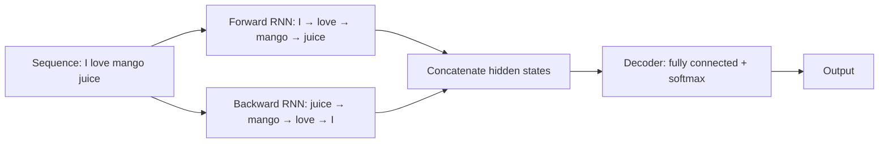
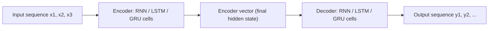
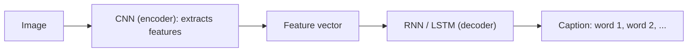

Before the new ideas, here are the old ones you need. If you already know them, skip to the next section.

## The basics first

- A neural network takes numbers in, multiplies them by **weights**, adds a **bias** and gives numbers out. The weights and biases are the **parameters** the network learns.
- A **loss** measures how wrong a prediction is. **Backpropagation** sends the error backward through the network to find how each weight should change. Then the weights are updated.
- A **gradient** is a partial derivative. It measures how much the output of a function varies when the inputs are changed slightly. A gradient is used to measure the change in all weights in relation to the change in error. If the slope is zero, the model stops learning. <Cite id="class-dl-m5" loc="p. 14" />
- You met the CNN for images. Now the data is different: words, sounds and readings that come one after another. <Cite id="class-dl-chp5" loc="slide 4" />

## Sequence models and the sequence learning problem

<Box kind="definition">

**Sequence:** data where the **order** of the elements **matters**. <Cite id="class-dl-chp5" loc="slide 3" />

**Sequence models** are the machine learning models that input or output sequences of data. Sequential data includes text streams, audio clips, video clips, time-series data and so on. Recurrent Neural Networks (RNNs) are a popular algorithm used in sequence models. <Cite id="class-dl-m5" loc="p. 3" />

</Box>

**Why is this different from normal data?** In a sentence, the surrounding words can be important for understanding the current word. The word "bank" means a financial institution in "I went to the bank to deposit money" and a river side in "We sat on the bank of the river". To understand the current word, information from the surrounding sequence can be useful. <Cite id="class-dl-chp5" loc="slide 3" />

<Box kind="definition">

**Sequence learning problem:** "How can a neural network learn from data when the order and previous information matter?" <Cite id="class-dl-chp5" loc="slide 3" />

</Box>

**Examples of sequence data and what we want to predict:** <Cite id="class-dl-chp5" loc="slide 3" />

| Sequence data | What we want to predict |
|---|---|
| Sentence | Sentiment / next word |
| Speech | Recognized words |
| Stock prices | Future price |
| Weather readings | Future temperature |
| Music notes | Next note |

**Applications of sequence models** (Module 5): <Cite id="class-dl-m5" loc="p. 4" /> <Cite id="class-dl-m5" loc="p. 5" />

1. **Speech recognition:** an audio clip is the input and the model generates its text. Both input and output are sequences.
2. **Sentiment classification:** the opinion in a piece of text is classified. The input is a sequence of words.
3. **Video activity recognition:** the model identifies the activity in a video clip. A video clip is a sequence of frames, so the input is a sequence.

### Why can we not simply use a normal neural network?

A basic feedforward network does **not have a built-in memory of previous inputs**. A deep feedforward model may also need specific parameters for each element of the sequence, and it may be unable to generalize to sequences of different length. <Cite id="class-dl-chp5" loc="slide 5" /> <Cite id="class-dl-m5" loc="p. 7" />

## The recurrent neural network (RNN)

<Box kind="definition">

**RNN:** a type of neural network that has hidden states and allows past outputs to be used as inputs. <Cite id="class-dl-m5" loc="p. 9" />

**Easy idea (write this in the exam):** "I will process the current input, but I will also carry some information from previous steps." RNN is designed to work with sequential data. <Cite id="class-dl-chp5" loc="slide 3" />

</Box>

Recurrent Neural Networks use the **same weights for each element of the sequence**. This decreases the number of parameters and lets the model generalize to sequences of varying lengths. RNNs were the standard suggestion for sequential data before attention models. <Cite id="class-dl-m5" loc="p. 7" /> <Cite id="class-dl-m5" loc="p. 8" />

**Everyday analogy.** Reading a story: you do not forget the last page when you turn to the next one. You carry a short summary of what you read so far and update it page by page. The RNN does the same with its memory. <Cite id="class-dl-chp5" loc="slide 6" />

### Memory is the hidden state

<Box kind="definition">

**Hidden state:** the memory carried by an RNN. Hidden state = information carried from previous time steps. <Cite id="class-dl-chp5" loc="slide 6" />

</Box>

### Why "recurrent"?

**Recurrent = Repeated.** The network repeatedly processes new inputs while carrying the previous hidden state forward. The core working principle of RNN is: **current input + previous hidden state → new hidden state.** <Cite id="class-dl-chp5" loc="slide 7" />

At every time step, the RNN cell takes the **current input** and the **previous hidden state** and produces a **new hidden state** and an **output**. This process is repeated for every element in the sequence. <Cite id="class-dl-chp5" loc="slide 7" />

### The RNN equations

For each time step $t$, the hidden state and the output are given by two equations. The Module notes write them with $a^{\langle t \rangle}$ for the hidden state: <Cite id="class-dl-m5" loc="p. 9" />

$$
a^{\langle t \rangle} = g_1(W_{aa}\, a^{\langle t-1 \rangle} + W_{ax}\, x^{\langle t \rangle} + b_a), \qquad y^{\langle t \rangle} = g_2(W_{ya}\, a^{\langle t \rangle} + b_y)
$$

In the class slides the same thing is written with the parameters $W, U, b, V, c$: <Cite id="class-dl-chp5" loc="slide 14" />

$$
h_t = \tanh(U x_t + W h_{t-1} + b), \qquad \hat{y}_t = \text{softmax}(V h_t + c)
$$

Here $x_t$ is the input at time $t$, $h_{t-1}$ the previous hidden state, $h_t$ the new hidden state and $\hat{y}_t$ the output. $g_1, g_2$ are activation functions such as tanh and softmax. The weights are **shared across time**.

### Different ways an RNN can work (types of RNN)

The architecture can vary with the problem, from a single input and output to many inputs and outputs. <Cite id="class-dl-m5" loc="p. 11" /> <Cite id="class-dl-chp5" loc="slide 8" />

| Type | What it means | Examples |
|---|---|---|
| **One to one** | One pair only. Used in traditional neural networks. | An ordinary classifier |
| **One to many** | A single input gives several outputs. | Music generation, image captioning |
| **Many to one** | Many inputs from different time steps give one output. | Sentiment analysis, emotion identification, spam detection, text classification |
| **Many to many** | Several inputs give several outputs (the lengths may differ). | Machine translation (English to French), sequence labelling |

### RNN versus feedforward network

| Aspect | Feedforward network | RNN |
|---|---|---|
| Memory | No built-in memory of previous inputs | Has a hidden state that carries information from previous steps |
| Data | Each input is treated separately | Works on sequences; order matters |
| Weights | Separate parameters would be needed for each element of a sequence | Same weights at every time step, so fewer parameters |
| Length | Fixed-size input | Can handle sequences of varying length |

<Cite id="class-dl-m5" loc="p. 7" /> <Cite id="class-dl-m5" loc="p. 8" /> <Cite id="class-dl-m5" loc="p. 13" />

## Unfolding the computational graph

<Box kind="definition">

**Unfolding** means showing the same RNN cell separately at each time step. The **weights are shared** across all time steps. <Cite id="class-dl-chp5" loc="slide 12" />

</Box>

Unfolding turns the loop into a chain, so that ordinary backpropagation can be run on it.

## How does an RNN learn? Backpropagation through time (BPTT)

An RNN learns like any other network: it compares its prediction with the actual answer and adjusts its weights. But an RNN has many time steps, so how is the error sent backward? That is **Backpropagation Through Time (BPTT)**. <Cite id="class-dl-chp5" loc="slide 10" />

<Box kind="definition">

**BPTT** is backpropagation applied across the different time steps of an RNN. Easy meaning: forward through time, then backward through time. <Cite id="class-dl-chp5" loc="slide 10" />

</Box>

**Steps of BPTT** (example: I → love → AI): <Cite id="class-dl-chp5" loc="slide 10" />

1. **Forward pass:** the RNN reads each word and gives h1, h2, h3 and an output.
2. **Calculate loss:** compare the prediction with the actual output.
3. **Backward pass:** the error goes from the loss back through t3, t2, t1.
4. **Update weights:** use the calculated gradients to update the weights.

### A complete example: predicting the next word

The class works one full example. <Cite id="class-dl-chp5" loc="slide 14" />

1. **The sequence:** "I love eating ___", the target (correct next word) is "pizza".
2. **Forward pass:** the RNN reads the words one by one, using the current word and the previous information from the hidden state.
3. **Output layer and prediction:** the final hidden state goes to the output layer, which gives probabilities for the next word: pizza 70%, burger 15%, apple 10%, salad 5%. The prediction is pizza.
4. **Compare with target:** if the prediction equals the target, the loss is small (near zero).
5. **Wrong prediction:** if the model predicts "apple", the loss is high.
6. **BPTT:** the error is propagated backward to find which parts contributed to the mistake and to calculate the gradients for the weights and biases.
7. **Update the weights** $(W, U, b, V, c)$ using the gradients.
8. **Try again:** the same sentence now gives pizza 90%, burger 5%, apple 3%, salad 2%.

<Box kind="verify">

The probabilities in both tables add up to 100%: $70 + 15 + 10 + 5 = 100$ and $90 + 5 + 3 + 2 = 100$.

</Box>

### Truncated BPTT

For a very long sequence (say 100 steps), normal BPTT tries to propagate the error through the whole sequence. That can be computationally expensive, memory intensive and difficult for very long sequences. <Cite id="class-dl-chp5" loc="slide 22" />

<Box kind="definition">

**Truncated BPTT** limits backpropagation to a fixed number of time steps instead of going through the entire sequence. <Cite id="class-dl-chp5" loc="slide 22" />

</Box>

## Limitations of a vanilla RNN

A basic (vanilla) RNN works well for sequences, but it can struggle with: <Cite id="class-dl-chp5" loc="slide 12" />

1. Long-term dependencies.
2. Vanishing gradients.
3. Exploding gradients.
4. Difficulty remembering information from far earlier time steps.
5. Sequential processing can make training slower.

### The long-term dependency problem

A basic RNN may struggle to carry important information across many time steps. This is the **long-term dependency problem**. For a short sequence the RNN can easily carry information; for a long sequence, the information from word 1 may need to influence the output at word 50. <Cite id="class-dl-chp5" loc="slide 11" /> <Cite id="class-dl-chp5" loc="slide 15" /> <Cite id="class-dl-m5" loc="p. 16" />

### Vanishing and exploding gradients

During BPTT the gradient has to travel through many time steps. As it travels, it can become very small or very large. <Cite id="class-dl-chp5" loc="slide 10" />

<Box kind="definition">

**Vanishing gradient:** the gradient values become too small, so the model stops learning or takes far too long. The gradient becomes smaller and smaller as it moves backward through time, so earlier time steps receive very little learning signal. <Cite id="class-dl-m5" loc="p. 14" /> <Cite id="class-dl-chp5" loc="slide 11" />

**Exploding gradient:** the gradient becomes extremely large. This gives very large weight updates and unstable training, and learning can become difficult. <Cite id="class-dl-chp5" loc="slide 11" />

</Box>

**Sum: what the factor does.** Take the numbers of the slides: the gradient is multiplied by the same factor at each step back in time. <Cite id="class-dl-chp5" loc="slide 11" />

<Sum>

<Given>

start gradient 1. Case A: it is multiplied by 0.1 at each step. Case B: it is multiplied by 10 at each step. Four steps back in time.

</Given>

<Find>

the gradient after each step.

</Find>

<Steps>

1. **Case A (factor below 1):** $1 \to 0.1 \to 0.01 \to 0.001 \to 0.0001$. Each step multiplies by 0.1.
2. **Case B (factor above 1):** $1 \to 10 \to 100 \to 1000 \to 10000$. Each step multiplies by 10.
3. After 4 steps: $0.1^4 = 0.0001$ and $10^4 = 10000$.

</Steps>

<Answer>

Case A vanishes to 0.0001. Case B explodes to 10,000. The longer the sequence, the worse it gets.

</Answer>

<Box kind="verify">

Multiply back: $0.0001 \times 10 \times 10 \times 10 \times 10 = 1$, the start value. In the same way, $10000 \times 0.1^4 = 1$.

</Box>

</Sum>

**The fixes.** For **exploding gradients** the solution is simple: truncating or squashing the gradients (the class also uses truncated BPTT). **Vanishing gradients** were far more difficult to address; Hochreiter and Schmidhuber's **LSTM** solved the problem (see the LSTM and GRU note). <Cite id="class-dl-m5" loc="p. 14" /> <Cite id="class-dl-m5" loc="p. 16" />

## Bidirectional RNN

<Box kind="definition">

**Bidirectional RNN:** processes the sequence in both forward and backward directions to use information from both sides. A normal RNN uses information mainly from the past. <Cite id="class-dl-chp5" loc="slide 12" />

</Box>

**How it works.** We consider two separate sequences: one from left to right and the other in the reverse order. For the word sequence "I love mango juice", the forward layer feeds the sequence as it is, and the backward layer feeds "juice mango love I". Typically two separate RNNs are used, one for each direction. Their hidden states are usually concatenated to form a single hidden state, and the outputs are generated from the combined states. The final hidden state goes to a decoder, such as a fully connected network followed by softmax. <Cite id="class-dl-m5" loc="p. 32" /> <Cite id="class-dl-m5" loc="p. 33" />

**Limitations of BRNN.** <Cite id="class-dl-m5" loc="p. 33" />

- The entire sequence must be available before we can make predictions. For real-time speech recognition the whole utterance may not be available.
- For a language model that predicts the next word, BRNN is not suitable because it expects future words as well; it gives poor accuracy.
- BRNN is slower than RNN because the results of the forward pass must be available for the backward pass to proceed. Gradients have a long dependency chain.

## Encoder-decoder (sequence to sequence) architecture

<Box kind="definition">

A **sequence to sequence model** aims to map a fixed-length input with a fixed-length output where the length of the input and the output may differ. <Cite id="class-dl-m5" loc="p. 38" />

</Box>

**Example.** Translating "What are you doing today?" from English to Chinese has an input of 5 words and an output of 7 symbols. We cannot use a regular LSTM network to map each word of the English sentence to the Chinese sentence one to one. Uses: machine translation, speech recognition, image captioning. <Cite id="class-dl-m5" loc="p. 38" />

The model consists of **3 parts: encoder, intermediate (encoder) vector and decoder.** <Cite id="class-dl-m5" loc="p. 39" />

1. **Encoder:** a stack of several recurrent units (LSTM or GRU cells for better performance). Each accepts a single element of the input sequence, collects information for that element and propagates it forward. In a question-answering problem the input sequence is all the words of the question, $x_i$ being the $i$-th word. The hidden states are computed with the RNN formula $h_t = f(W_{hh} h_{t-1} + W_{hx} x_t)$. <Cite id="class-dl-m5" loc="p. 40" />
2. **Encoder vector:** the final hidden state produced by the encoder. It tries to hold the information of all input elements so the decoder can make accurate predictions. It acts as the **initial hidden state of the decoder.** <Cite id="class-dl-m5" loc="p. 41" />
3. **Decoder:** a stack of several recurrent units, each predicting an output $y_t$ at a time step $t$. Each unit accepts a hidden state from the previous unit and produces an output and its own hidden state, $h_t = f(W^{(hh)} h_{t-1})$, and the output is $y_t = \text{softmax}(W^{S} h_t)$. In question answering the output sequence is the words of the answer. <Cite id="class-dl-m5" loc="p. 42" />

The power of the model is that it can **map sequences of different lengths to each other**. The inputs and outputs are not correlated and their lengths can differ. <Cite id="class-dl-m5" loc="p. 42" />

### Application: image captioning

**Image captioning** is the process of generating a textual description from an image, based on the objects and actions in it. The generated output describes in a single sentence what is shown. The task is divided into two modules: an **image-based model (encoder)** that extracts the features of the image, for which we usually use a **CNN**, and a **language-based model (decoder)** that turns those features into a natural sentence, for which we use an **RNN**. <Cite id="class-dl-m5" loc="p. 45" /> <Cite id="class-dl-m5" loc="p. 46" />

## Recursive neural networks

**Recursive neural networks (RvNNs)** generalize RNNs. Because of their **tree structure** they can learn hierarchical models, whereas RNNs handle only sequential data. The number of children of each node in the tree is fixed so that it can perform recursive operations and use the same weights across the steps. Child representations are combined into parent representations. One of the main uses in NLP is the syntactic parsing of sentences: identify smaller components such as noun or verb phrases and organize them in a hierarchy. <Cite id="class-dl-m5" loc="p. 34" /> <Cite id="class-dl-m5" loc="p. 36" />

| Recurrent network | Recursive network |
|---|---|
| Chain structure, represents temporal sequences | Tree structure, represents hierarchical data |
| Weights are shared across the chain length | Same weights used at every step of the tree, with a fixed number of children per node |
| Used for sequential data such as sentences | Used for hierarchical data, for example sentence parsing |

<Cite id="class-dl-m5" loc="p. 37" />

## Applications of RNN

RNNs are used to tackle problems with sequence data: audio, text, video and biological sequences. They are useful when order and previous information matter. <Cite id="class-dl-m5" loc="p. 15" /> <Cite id="class-dl-chp5" loc="slide 13" />

- **Speech recognition**, **generation of music**, **automated translations**, **analysis of video action**, **sequence study of the genome and DNA**. <Cite id="class-dl-m5" loc="p. 15" />
- **Sentiment analysis** ("The movie was amazing" gives Positive), **next-word prediction** ("I am going to ___" gives "school"), **text generation** ("Once upon a time..." one word at a time), **temperature prediction** (30, 31, 32, 33 degrees gives 34 for Friday). <Cite id="class-dl-chp5" loc="slide 13" />
- With a CNN, RNNs create labels (captions) for images that are not tagged. <Cite id="class-dl-m5" loc="p. 16" />

What is common to all of them: **the data comes in a sequence, and previous information can help understand or predict the current or future information.** <Cite id="class-dl-chp5" loc="slide 13" />

## Where this was asked

| If the question says | What to write | Seen as |
|---|---|---|
| "Describe sequence learning problem" or "sequence modelling" | Definition of sequence, the problem sentence, the table of examples, why a normal network fails, the networks used | <PYQ id="2023-12/q1e" /> <PYQ id="assignment-2/q5a" /> |
| "Explain RNN architecture / working of RNN with a diagram" | Hidden state, the cell, unfolded diagram, equations, shared weights, types, BPTT | <PYQ id="2023-12/q4a" /> <PYQ id="2025-05/q4a" /> <PYQ id="2024-12/q4a" /> |
| "Vanishing and exploding gradient in RNNs" | BPTT multiplies the gradient at each step: too small or too large, effects, fixes | <PYQ id="2023-12/q6b" /> |
| "Encoder-decoder / bidirectional RNN" | The three parts of seq2seq, or two RNNs in opposite directions, limits | <PYQ id="assignment-2/q5d" /> |
| "RNN suited for sequential data; RNN vs LSTM" | Memory and shared weights, then the long-term dependency problem | <PYQ id="2025-05/q4b" /> <PYQ id="2024-05/q4a" /> |

## Quick revision

- Sequence: order matters. Sequence learning problem: learn when order and previous information matter.
- RNN: hidden state carries memory. Current input + previous hidden state → new hidden state. Same weights at every step.
- Unfolding: the same RNN cell shown at each time step. BPTT: forward through time, backward through time.
- Types: one to one, one to many (captioning, music), many to one (sentiment), many to many (translation).
- Vanishing gradient = too small (stops learning). Exploding gradient = too large (unstable). Vanilla RNN cannot hold long-term dependencies. Fix: LSTM and GRU; truncated BPTT; clipping the gradient.
- Bidirectional RNN: forward and backward RNNs, hidden states joined. Needs the whole sequence.
- Encoder-decoder: encoder, encoder vector, decoder. Input and output lengths can differ.
- Recurrent = chain (sequences); recursive = tree (hierarchies).
