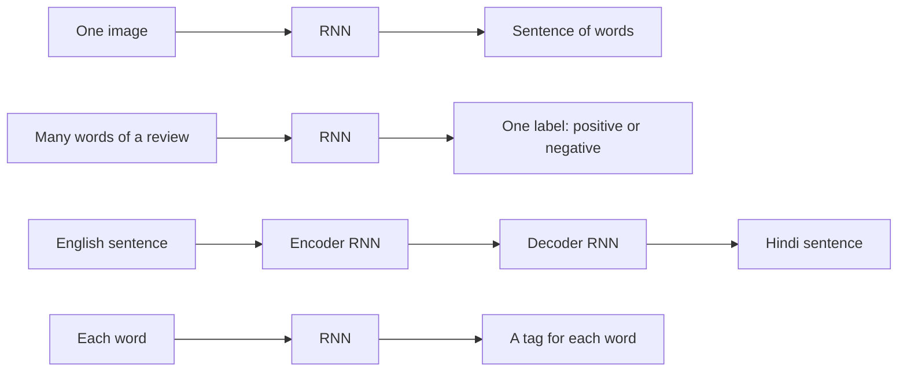
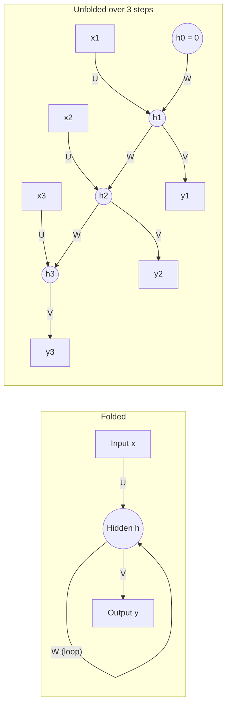
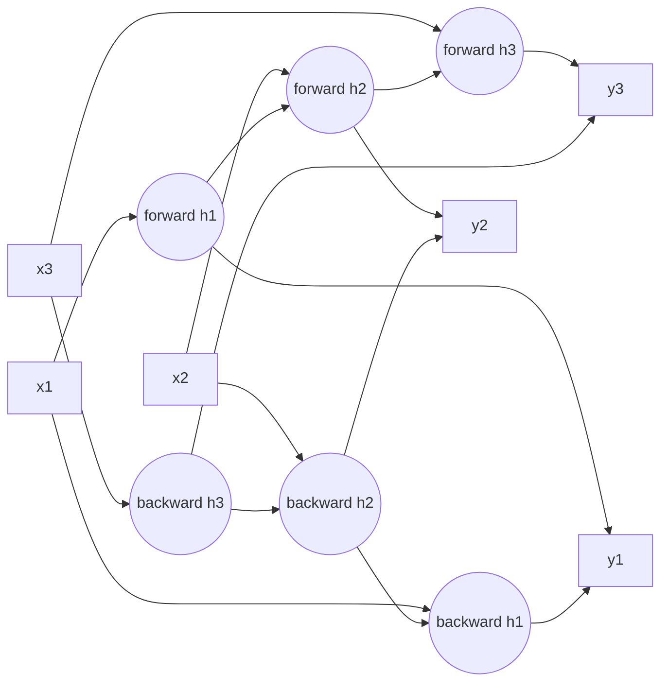
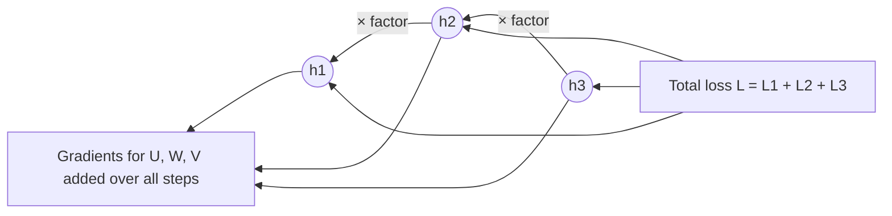

Before the new ideas, here are the old ones you need. If you already know them, skip to the next section.

## The basics first

- A **neuron** takes some numbers in, multiplies each by a **weight**, adds them up with a **bias**, and passes the total through an **activation function**. Two common ones: **tanh** squashes any number into the range $-1$ to $1$, and the **sigmoid** squashes into $0$ to $1$.
- A **feedforward network** (an MLP) passes numbers in one direction only: input layer, hidden layers, output layer. It has **no memory**. Each input is handled on its own, and the input must always have the same size.
- **Training** means adjusting the weights so the **loss** (one number that says how wrong the network is) goes down.
- The **gradient** tells us, for each weight, which way and how much to change it. **Backpropagation** finds the gradients by going backwards through the network, and on the way back the effects of each layer are **multiplied** together (the chain rule). Remember this multiplication; it is the whole reason gradients vanish or explode later.

## The problem: data that comes in order

Read this sentence one word at a time: "I grew up in France, so I speak fluent ...". To guess the last word you need to remember "France" from several words ago. A feedforward network sees only a fixed-size input and forgets everything between inputs, so it cannot do this well.

Data where the **order matters** and each item depends on the ones before it is called a **sequence**. Examples: the words of a sentence, the characters of a word, the daily price of a share, the samples of a speech recording, the frames of a video. This topic is syllabus <Syl m="5" />.

## Sequence learning problems

<Box kind="definition">

A **sequence learning problem** is a task where the input, the output, or both are sequences, so the model must look at a series of **dependent** inputs, one per **time step**, and produce one output or a series of outputs.

</Box>

**Why they need a special model.** Khapra's NPTEL lectures list three things that make these problems different from ordinary ones, and so three wishes for the model <Cite id="nptel-dl" />:

1. **The inputs depend on each other.** When predicting the next letter after "d", "e", you need the earlier letters, not only the current one.
2. **The length is not fixed.** "deep" has 4 letters and "learning" has 8. Sentences have any number of words.
3. **The same job is done at every step.** At every position the task is the same (read a letter, predict the next letter), so the same function should be used at every step.

A feedforward network fails all three: it has no memory, a fixed input size, and separate weights for each input position. An RNN meets all three wishes: it carries a memory (dependence), it simply runs for as many steps as the input has (any length), and it reuses the same weights at each step (same function).

**Kinds of sequence problems.** Karpathy's well-known picture sorts them by the shape of the input and output <Cite id="karpathy-rnn" />:

| Kind | Input | Output | Example |
|---|---|---|---|
| One to one | One item | One item | Ordinary image classification (no sequence) |
| One to many | One item | A sequence | Image captioning: one picture in, a sentence out |
| Many to one | A sequence | One item | Sentiment of a movie review: many words in, positive or negative out |
| Many to many (different lengths) | A sequence | A sequence | Machine translation: an English sentence in, a Hindi sentence out |
| Many to many (one output per input) | A sequence | A sequence of the same length | Part-of-speech tagging: a tag for every word; labelling every video frame |

Translation with two RNNs, one that reads the input (the **encoder**) and one that writes the output (the **decoder**), is the **sequence-to-sequence** model. <Cite id="sutskever2014" /> <Cite id="gfdl-ch10" loc="§10.4" />

**Real-world applications of sequence learning:** speech-to-text, machine translation, chatbots, next-word suggestion on a phone keyboard, stock and weather forecasting, music generation, video activity recognition.

## The recurrent neural network: a network with a memory

**What it is.** A **recurrent neural network (RNN)** is a neural network with a loop: the output of its hidden layer at one time step is fed back in as an extra input at the next time step. This fed-back value is the network's memory.

**The analogy.** Think of reading a story. After each sentence you do not start from zero; you carry a summary of the story so far in your head, and you update that summary with each new sentence. An RNN does exactly this. Its running summary is a vector of numbers called the **hidden state**, written $h_t$ for time step $t$.

**How it works, step by step.**

1. Start with an empty memory, $h_0 = 0$.
2. At step $t$, take in two things: the new input $x_t$ and the previous memory $h_{t-1}$.
3. Mix them, each through its own set of weights, add a bias, and squash the result with tanh. This is the new memory $h_t$.
4. From the new memory, make the output for this step (for example, the probability of each possible next word).
5. Move to the next step and repeat, **with the same weights**, until the sequence ends.

**The two equations.** In words: the new memory is tanh of (recurrent weights times old memory, plus input weights times new input, plus a bias); the output is softmax of (output weights times the memory, plus a bias). These are the equations in Goodfellow's book, with the same letters. <Cite id="gfdl-ch10" loc="§10.2" />

$$
h_t = \tanh\left(W h_{t-1} + U x_t + b\right)
$$

$$
\hat{y}_t = \text{softmax}\left(V h_t + c\right)
$$

- $x_t$: the input at step $t$ (for example one word turned into numbers); $h_t$: the hidden state (memory) after step $t$.
- $U$: input-to-hidden weights; $W$: hidden-to-hidden (**recurrent**) weights, the loop that gives memory; $V$: hidden-to-output weights; $b$, $c$: biases.
- $\hat{y}_t$: the output at step $t$. **Softmax** turns scores into probabilities that add up to 1; for a number output we skip it.

<Box kind="intuition">

The **same** $U$, $W$, $V$, $b$, $c$ are used at every time step. This is called **parameter sharing**. It is why one RNN can read a sentence of 3 words or 300 words, why the number of weights does not grow with the length, and why something learned at position 2 (say, what "not" does) also works at position 20.

</Box>

**Worked sum: a forward pass through an RNN by hand.**

<Sum>

<Given>

one number for everything so we can calculate by hand: input weight $U = 0.5$, recurrent weight $W = 1.0$, bias $b = 0$, output weight $V = 2$ with no softmax, starting memory $h_0 = 0$, inputs $x = [1, 2, -1]$. We use $\tanh(z) = \dfrac{e^{2z} - 1}{e^{2z} + 1}$.

</Given>

<Find>

the hidden states $h_1, h_2, h_3$ and the outputs $\hat{y}_1, \hat{y}_2, \hat{y}_3$.

</Find>

<Steps>

1. Step 1, inside value:

   $$
   \begin{aligned}
   W h_0 + U x_1 &= 1.0 \times 0 + 0.5 \times 1 \\
   &= 0.5
   \end{aligned}
   $$

   *(Old memory is empty, so only the new input counts.)*
2. Step 1, memory: $e^{1} = 2.7183$, so $h_1 = \dfrac{1.7183}{3.7183} = 0.4621$. *(tanh squashes the sum into −1 to 1.)*
3. Step 1, output: $\hat{y}_1 = 2 \times 0.4621 = 0.9242$. *(The output is read from the memory.)*
4. Step 2, inside value:

   $$
   \begin{aligned}
   1.0 \times 0.4621 + 0.5 \times 2 &= 0.4621 + 1 \\
   &= 1.4621
   \end{aligned}
   $$

   *(Now the old memory is added to the new input.)*
5. Step 2, memory: $e^{2.9242} = 18.62$, so $h_2 = \dfrac{17.62}{19.62} = 0.8981$. *(Same tanh, same weights, new step.)*
6. Step 2, output: $\hat{y}_2 = 2 \times 0.8981 = 1.7962$. *(Output weight times memory, as before.)*
7. Step 3, inside value:

   $$
   \begin{aligned}
   1.0 \times 0.8981 + 0.5 \times (-1) &= 0.8981 - 0.5 \\
   &= 0.3981
   \end{aligned}
   $$

   *(The negative input pulls the sum down, but the memory keeps it positive.)*
8. Step 3, memory: $e^{0.7962} = 2.2171$, so $h_3 = \dfrac{1.2171}{3.2171} = 0.3783$. *(Squash again with tanh.)*
9. Step 3, output: $\hat{y}_3 = 2 \times 0.3783 = 0.7566$. *(Output weight times memory.)*

</Steps>

<Answer>

$h = [0.4621, 0.8981, 0.3783]$ and outputs $\hat{y} = [0.9242, 1.7962, 0.7566]$.

</Answer>

<Box kind="verify">

**Check 1, a shortcut for small values.** For a small $z$, $\tanh(z) \approx z - \dfrac{z^3}{3}$. For step 1:

$$
0.5 - \frac{0.125}{3} = 0.5 - 0.0417 = 0.4583
$$

close to 0.4621 (the shortcut slightly underestimates). For step 3:

$$
\begin{aligned}
0.3981 - \frac{0.0631}{3} &= 0.3981 - 0.0210 \\
&= 0.3771
\end{aligned}
$$

close to 0.3783. Both agree.

**Check 2, range and sign.** Every $h$ lies between −1 and 1, as tanh demands. Each $h$ has the same sign as its inside value and is a bit smaller in size, as tanh always gives. Each output is exactly twice its $h$.

</Box>

</Sum>

At step 3 the input is negative, yet the hidden state stays positive, because it still remembers the earlier inputs through $W h_{t-1}$. That carried-over part is the memory.

## Unfolding the computational graph

**What it is.** An RNN is usually drawn as one box with a loop. The loop is hard to reason about, so we **unfold** (or unroll) it: draw one copy of the box for every time step and replace the loop by an arrow from each copy to the next. <Cite id="gfdl-ch10" loc="§10.1" />

**Why it is needed.** Backpropagation only knows how to work on a graph without loops. Unfolding turns the loop into an ordinary feedforward chain, as deep as the sequence is long, in which every copy has the same weights. Now ordinary backpropagation can run on it.

**Advantages of unfolding.**

- It shows clearly which value depends on which, so we can apply ordinary backpropagation to the chain (this is BPTT, below).
- It shows that the model has the same input size at every step, whatever the sequence length.
- It shows the sharing: one set of weights, used again and again.

**Disadvantage.** The unfolded chain is as long as the sequence, so a long sequence becomes a very deep network: training needs memory for every step and suffers from vanishing and exploding gradients.

## The key components of an RNN

When a question asks for the components, list these:

| Component | What it is | Job |
|---|---|---|
| Input layer $x_t$ | One element of the sequence per time step | Feeds the data in, in order |
| Hidden state $h_t$ | A vector of numbers | The memory: a summary of everything seen so far |
| Input weights $U$ | Matrix | Decide how the new input affects the memory |
| Recurrent weights $W$ | Matrix | Decide how the old memory carries into the new one |
| Output weights $V$ | Matrix | Turn the memory into an output |
| Biases $b$, $c$ | Vectors | Shift the sums, as in any neuron |
| Activation | Usually tanh in the hidden state; softmax or none at the output | Adds non-linearity and keeps the hidden values bounded |
| Output $\hat{y}_t$ | Prediction at a step | At every step (tagging) or only at the last step (sentiment) |
| Loss | One loss per output step, added up | Says how wrong the whole sequence of outputs is |

Because the weights are shared, the number of parameters does not depend on the sequence length. <Cite id="keras-simplernn" /> <Cite id="pytorch-rnn" />

**Worked sum: counting the parameters of one RNN layer.**

<Sum>

<Given>

each input $x_t$ has 3 numbers, the hidden state has 2 numbers, and the layer has one bias vector (as in Keras `SimpleRNN`).

</Given>

<Find>

the number of trainable parameters in the recurrent layer.

</Find>

<Steps>

1. Input weights $U$: every one of the 2 hidden units connects to every one of the 3 inputs, so $2 \times 3 = 6$. *(One weight per input–hidden pair.)*
2. Recurrent weights $W$: every hidden unit connects to every hidden unit of the previous step, so $2 \times 2 = 4$. *(This is the memory loop.)*
3. Bias $b$: one per hidden unit, so $2$. *(Each neuron has its own bias.)*
4. Total: $6 + 4 + 2 = 12$. *(Add the three groups.)*

</Steps>

<Answer>

12 parameters, whether the sequence has 5 steps or 500.

</Answer>

<Box kind="verify">

Group by hidden unit instead: each of the 2 hidden units has 3 input weights, 2 recurrent weights and 1 bias, that is $3 + 2 + 1 = 6$ numbers, and $2 \times 6 = 12$. Same answer. Keras writes this as units × (units + inputs + 1) $= 2 \times (2 + 3 + 1) = 12$. (PyTorch's `nn.RNN` keeps two bias vectors, so it would report $12 + 2 = 14$.)

</Box>

</Sum>

## Deep (stacked) RNNs

You can stack RNN layers: the hidden states of layer 1 become the inputs of layer 2 at every step. Lower layers pick up simple patterns (letters, sounds), higher layers more abstract ones (words, meaning), as in a deep feedforward network. **Advantage:** more expressive. **Disadvantage:** slower and harder to train. <Cite id="gfdl-ch10" loc="§10.5" /> <Cite id="d2l-deep-rnn" />

## Bidirectional RNNs

**What it is.** A **bidirectional RNN (BiRNN)** is two RNNs over the same sequence, one reading it left to right and one reading it right to left, whose hidden states are combined at each step.

**Why it is needed.** An ordinary RNN at step $t$ has seen only the past. But sometimes the meaning of a word depends on what comes after it. In "He said, Teddy bears are on sale" versus "He said, Teddy Roosevelt was a president", you cannot tell whether "Teddy" is a toy or a person until you read the next word.

**The analogy.** Like reading a sentence twice, once forwards and once backwards, and then combining what you understood.

**How it works, step by step.**

1. A **forward** RNN reads $x_1, x_2, \dots, x_T$ and makes a forward state at each step. It knows the **past**.
2. A **backward** RNN, with its own separate weights, reads $x_T, \dots, x_1$ and makes a backward state at each step. It knows the **future**.
3. At each step the two states are joined end to end (concatenated) into one longer vector.
4. The output layer uses this joined vector, so every output sees the whole sentence.

| Advantages | Disadvantages |
|---|---|
| Each output uses both past and future context | Needs the **whole** sequence before giving any output, so it cannot do live, word-by-word prediction |
| Usually more accurate for tagging and recognition | About twice the computation and parameters |

**Applications:** speech recognition, part-of-speech tagging, named-entity recognition, filling in a missing word. <Cite id="gfdl-ch10" loc="§10.3" /> <Cite id="d2l-birnn" /> <Cite id="gfg-birnn" /> <Cite id="keras-bidirectional" />

## Training: backpropagation through time (BPTT)

**What it is.** BPTT is ordinary backpropagation applied to the **unfolded** RNN. <Cite id="gfdl-ch10" loc="§10.2.2" />

**Why it is needed.** The weights are shared across time, and the loss at a late step depends on inputs from many steps earlier. Ordinary backpropagation needs a loop-free graph, so we unfold first and then backpropagate along time.

**How it works, step by step.**

1. **Unfold** the RNN over the whole sequence.
2. **Forward pass.** For $t = 1$ to $T$, compute the hidden state, the output and the loss at that step.
3. **Total loss.** Add the step losses: $L = L_1 + L_2 + \dots + L_T$.
4. **Backward pass.** Go from the last step back to the first. The error at each hidden state comes from two places: its own output, **and** the next hidden state it fed into.
5. **Add up.** Because the same $U$, $W$, $V$ appear in every copy, each weight's gradient is the **sum** of its gradients from all the time steps.
6. **Update** each weight once with gradient descent.

In one line: because the total loss is a sum of step losses, the gradient of a shared weight is the sum of the gradients of every step's loss (each of which itself reaches back through the earlier steps):

$$
\frac{\partial L}{\partial W} = \sum_{t=1}^{T} \frac{\partial L_t}{\partial W}
$$

**The important observation.** To reach step 1 from the loss at step 3, the gradient passes back through step 3, then step 2, and at each step back it is **multiplied by one more factor** (roughly "slope of tanh times $W$"). Going back $k$ steps means a product of $k$ factors. This is the root of the next section. <Cite id="gfg-bptt" /> <Cite id="mlm-bptt" />

| Advantages of BPTT | Disadvantages of BPTT |
|---|---|
| Exact gradients for shared weights; uses ordinary backpropagation | Must store every hidden state, so memory grows with sequence length |
| Lets the RNN learn links across time | Slow for long sequences: steps cannot run in parallel |
| | Long products cause vanishing or exploding gradients |

### Truncated BPTT

**What it is.** A cheaper version of BPTT for very long sequences (say a book of 100,000 characters).

**How it works.**

1. Cut the sequence into chunks, for example 50 steps each.
2. The **forward** pass still carries the hidden state from one chunk to the next, so the memory flows on.
3. The **backward** pass only goes back within the current chunk, then the weights are updated.

**Advantages:** faster, uses far less memory, and avoids very long products (so less exploding). **Disadvantage:** the network cannot directly learn links longer than the chunk. <Cite id="nptel-dl" /> <Cite id="d2l-bptt" />

## Vanishing and exploding gradients

**What they are.** The main limitation of a "vanilla" (plain) RNN. During BPTT the gradient sent back to early time steps either shrinks towards zero (**vanishing gradient**) or grows huge (**exploding gradient**).

**Why it happens, in words.** Going back one step multiplies the gradient by a factor made of the slope of tanh and the recurrent weights $W$. Going back many steps multiplies many such factors together. If the factors are usually below 1, the product shrinks very fast. If they are above 1, it grows very fast. <Cite id="gfdl-ch10" loc="§10.7" /> <Cite id="pascanu2013" />

<Box kind="intuition">

The game of Chinese whispers (telephone): a message is passed through 20 people. If each person passes on only half of what they heard, almost nothing reaches the end. If each one exaggerates by half again, the end of the line hears something wildly blown up. Gradients going back through time behave the same way.

</Box>

**Worked sum: how fast the gradient shrinks or grows.**

<Sum>

<Given>

the gradient is multiplied by the same factor $r$ at every step back in time; we look at $r = 0.5$ and $r = 1.5$.

</Given>

<Find>

how much the gradient changes after going back 10 steps.

</Find>

<Steps>

1. Going back 10 steps multiplies 10 factors, so the change is $r^{10}$. *(One factor per step.)*
2. For $r = 0.5$: halve ten times:

   $$
   \begin{aligned}
   1 &\to 0.5 \\
   &\to 0.25 \\
   &\to 0.125 \\
   &\to 0.0625 \\
   &\to 0.03125 \\
   &\to 0.015625 \\
   &\to 0.0078 \\
   &\to 0.0039 \\
   &\to 0.00195 \\
   &\to 0.000977
   \end{aligned}
   $$

   *(Each step keeps only half.)*
3. For $r = 1.5$: multiply by 1.5 ten times:

   $$
   \begin{aligned}
   1 &\to 1.5 \\
   &\to 2.25 \\
   &\to 3.375 \\
   &\to 5.06 \\
   &\to 7.59 \\
   &\to 11.39 \\
   &\to 17.09 \\
   &\to 25.63 \\
   &\to 38.44 \\
   &\to 57.67
   \end{aligned}
   $$

   *(Each step adds half again.)*

</Steps>

<Answer>

$0.5^{10} \approx 0.001$ (about 1000 times weaker: vanishing) and $1.5^{10} \approx 58$ (about 58 times larger: exploding).

</Answer>

<Box kind="verify">

Square repeatedly instead. $0.5^2 = 0.25$, $0.5^4 = 0.0625$, $0.5^8 = 0.0039$, and

$$
\begin{aligned}
0.5^{10} &= 0.5^8 \times 0.5^2 \\
&= 0.0039 \times 0.25 \\
&= 0.000977
\end{aligned}
$$

also $2^{10} = 1024$, so $0.5^{10} = 1/1024$. $1.5^2 = 2.25$, $1.5^4 = 5.0625$, $1.5^8 = 25.63$, and $1.5^{10} = 25.63 \times 2.25 = 57.67$. Same answers.

</Box>

</Sum>

| Factor per step | After 10 steps | What happens |
|---|---|---|
| 0.5 | $0.5^{10} \approx 0.001$ | **Vanishing:** about 1000 times weaker |
| 1.5 | $1.5^{10} \approx 58$ | **Exploding:** about 58 times larger |

**Why tanh makes vanishing likely.** The slope of tanh is at most 1 (only at the centre) and the slope of the sigmoid at most 0.25; elsewhere they are much smaller, as the plot shows. So, unless $W$ is large, each factor is usually below 1. Khapra's lectures state it as: if the slope times the size of $W$ stays below 1, the gradient vanishes; above 1 it can explode. <Cite id="nptel-dl" />

<Figure caption="Slopes of tanh (peak 1) and sigmoid (peak 0.25). Away from 0 both are close to zero. Every step back in time multiplies the gradient by one of these slopes, so the product usually shrinks.">
  <CurvePlot curves="tanh-derivative,sigmoid-derivative" x="-5,5" y="0,1.1" xLabel="value inside the activation" yLabel="slope" />
</Figure>

**Effects.**

- **Vanishing gradients:** the far-back steps get almost no learning signal, so the network has a **short memory**. In "The cat, which ate all the fish on the table, **was** full", it cannot learn that "was" agrees with "cat" ten words earlier. Training does not crash; it just quietly fails to learn long dependencies.
- **Exploding gradients:** the weight update jumps far away, the loss swings wildly, and numbers can overflow to "NaN" (not a number). This is easy to notice.

**Fixes.**

| Problem | Fix | How it helps |
|---|---|---|
| Exploding | **Gradient clipping** | If the gradient is longer than a threshold, scale it down to the threshold, keeping its direction (for example $[3, 4]$, length 5, clipped to length 1 becomes $[0.6, 0.8]$) |
| Exploding and cost | **Truncated BPTT** | Fewer factors in each product |
| Vanishing | **LSTM and GRU cells** | Gates create a path where the memory is copied forward almost unchanged, so the gradient is not shrunk at every step |
| Vanishing | Careful starting weights, ReLU-type activations | Keep the factors near 1 at the start |

<Cite id="gfdl-ch10" loc="§10.11.1" /> <Cite id="pytorch-clip-grad-norm" /> <Cite id="gfg-vanishing-exploding-rnn" />

**Worked sum: gradient clipping.**

<Sum>

<Given>

a gradient $g = [3, 4]$ and a clipping threshold of 1.

</Given>

<Find>

the clipped gradient.

</Find>

<Steps>

1. Length of the gradient:

   $$
   \begin{aligned}
   \sqrt{3^2 + 4^2} &= \sqrt{9 + 16} \\
   &= \sqrt{25} \\
   &= 5
   \end{aligned}
   $$

   *(Clipping looks at the total size.)*
2. Compare: $5 > 1$, so it must be clipped. *(Below the threshold it would be left alone.)*
3. Scale factor:

   $$
   \begin{aligned}
   \frac{\text{threshold}}{\text{length}} &= \frac{1}{5} \\
   &= 0.2
   \end{aligned}
   $$

   *(Shrink so the new length equals the threshold.)*
4. Multiply each part:

   $$
   [3 \times 0.2, 4 \times 0.2] = [0.6, 0.8]
   $$

   *(Every part is shrunk by the same amount, so the direction stays.)*

</Steps>

<Answer>

the clipped gradient is $[0.6, 0.8]$.

</Answer>

<Box kind="verify">

New length:

$$
\begin{aligned}
\sqrt{0.6^2 + 0.8^2} &= \sqrt{0.36 + 0.64} \\
&= \sqrt{1} \\
&= 1
\end{aligned}
$$

exactly the threshold. Direction: $3 : 4 = 0.75$ and $0.6 : 0.8 = 0.75$, the same ratio, so the gradient still points the same way.

</Box>

</Sum>

<Box kind="pitfall">

Clipping fixes **exploding** gradients only. It cannot make a tiny gradient bigger, so it does nothing for **vanishing** gradients. For those you need gated cells such as LSTM (see the LSTM and GRU note). <Cite id="hochreiter1997" />

</Box>

## Advantages and disadvantages of a simple RNN

| Advantages | Disadvantages |
|---|---|
| Handles sequences of any length | Struggles with long-range dependencies (vanishing gradients) |
| Same weights at every step: few parameters | Exploding gradients can make training unstable |
| Keeps a memory of the past | Must process steps one after another, so it is slow to train on long sequences |
| One model for one-to-many, many-to-one and many-to-many tasks | A plain RNN cannot see the future (a bidirectional RNN can) |

## RNN versus feedforward network

| Point | Feedforward network | RNN |
|---|---|---|
| Memory | None | Hidden state carried across steps |
| Input size | Fixed | Any length |
| Weights | Separate for each input position | Shared across time steps |
| Data | Independent items (one image) | Ordered, dependent items (a sentence) |
| Training | Backpropagation | Backpropagation through time |

**Applications of RNNs:** next-word prediction and text generation, speech recognition, machine translation, sentiment analysis, time-series forecasting (weather, stock prices), music generation. <Cite id="gfg-rnn" /> <Cite id="ibm-rnn" /> <Cite id="d2l-rnn" />

## Simple RNN versus LSTM on long-term dependencies

| Point | Simple RNN | LSTM |
|---|---|---|
| Memory | One hidden state, rewritten fully at every step | A separate cell state plus gates that decide what to keep, add and show |
| Gradient over many steps | Multiplied by a factor at every step, so it usually vanishes | The cell state is passed on mostly by addition, so the gradient survives much longer |
| Useful memory span | Short: links many steps apart are hard to learn | Long: the original paper bridged gaps of over 1000 steps in test tasks |
| Parameters and speed | Fewer, faster per step | About four times the weights of a simple RNN of the same size, slower |
| Good for | Short sequences, simple patterns | Long sentences, translation, speech, long time series |

The details of the gates are in the LSTM and GRU note. <Cite id="hochreiter1997" /> <Cite id="gfdl-ch10" loc="§10.10" />

**Conclusion.** An RNN gives a neural network a memory by feeding its hidden state back in at every step with shared weights, which suits ordered data of any length; its weakness is a short memory caused by vanishing gradients, which LSTM and GRU cells were designed to fix.

<Box kind="exam">

For "Explain RNN architecture" draw both the folded and the unfolded diagram, explain the hidden state as memory, write $h_t = \tanh(W h_{t-1} + U x_t + b)$ and $\hat{y}_t = \text{softmax}(V h_t + c)$ after saying them in words, say "the same weights are shared across time", list the types with examples, and mention BPTT and the vanishing-gradient limitation in one line each.

</Box>

## Where this was asked

| If the question says | What to write | Seen as |
|---|---|---|
| "Describe sequence learning problem" | Definition, the three properties (dependent inputs, variable length, same task each step), the table of kinds with examples, why an RNN fits | <PYQ id="2023-12/q1e" /> |
| "Explain RNN architecture in detail" or "working of RNN with a diagram" | Folded and unfolded diagram, step-by-step working, the two equations, parameter sharing, types, BPTT, advantages and limitations | <PYQ id="2023-12/q4a" /> <PYQ id="2025-05/q4a" /> |
| "Key components of an RNN" | The components table, the equations, unfolding, loss summed over time | <PYQ id="2024-12/q4a" /> |
| "Vanishing and exploding gradient in RNNs" | Why BPTT multiplies factors, the $0.5^{10}$ and $1.5^{10}$ numbers, tanh slope plot, effects, fixes (clipping, truncation, LSTM/GRU) | <PYQ id="2023-12/q6b" /> |
| "LSTM, how it overcomes the limitation of RNN" | The RNN limitation (vanishing gradient) first, then the LSTM cell (see the LSTM and GRU note) | <PYQ id="2024-05/q4a" /> |
| "How RNNs suit sequential data; RNN vs LSTM on long-term dependencies; real application" | Memory and sharing, the RNN vs LSTM table, an application such as machine translation | <PYQ id="2025-05/q4b" /> |

## Quick revision

- Sequence problems: inputs depend on each other, length varies, same task at every step.
- Kinds: one-to-many (captioning), many-to-one (sentiment), many-to-many (translation, tagging).
- RNN: hidden state = memory; $h_t = \tanh(W h_{t-1} + U x_t + b)$, $\hat{y}_t = \text{softmax}(V h_t + c)$; same $U, W, V$ at every step.
- Unfolding turns the loop into a chain of copies with shared weights, so backpropagation can run.
- Bidirectional RNN: forward RNN plus backward RNN; output joins both; needs the whole sequence.
- BPTT: backprop on the unfolded chain; gradients for shared weights are summed over time. Truncated BPTT backpropagates only within chunks.
- Each step back multiplies the gradient by a factor: below 1 vanishes ($0.5^{10} \approx 0.001$), above 1 explodes ($1.5^{10} \approx 58$).
- Clipping fixes exploding gradients; LSTM and GRU fix vanishing gradients.
