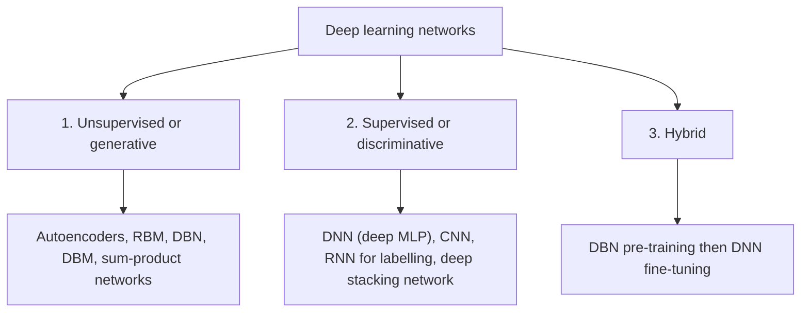
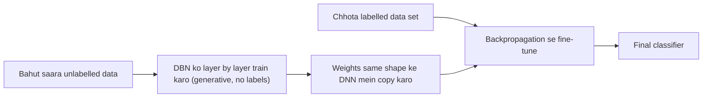

Naye ideas se pehle, wo purane ideas jo aapko chahiye. Agar ye already aate hain, to agle section pe jaao.

## Pehle basics

- Ek **example** data ka ek item hai, jaise ek photo. Uske **features** wo numbers hain jo use describe karte hain (pixel values).
- **Label** ek example ka sahi answer hai, jaise "cat". Labels lagane ke liye usually ek insaan chahiye, isliye ye mehenge padte hain.
- **Supervised learning** labels *wale* examples se seekhta hai: input ko label se map karna seekhta hai. Jaise ek student jiska teacher har answer check karta hai.
- **Unsupervised learning** *bina* label wale examples se seekhta hai: data mein structure khud dhundta hai, jaise groups ya ek compact summary. Jaise ek bachcha jo bina naam bataye toys ko alag-alag dher mein sort kar deta hai. <Cite id="gfdl-ch5" loc="§5.1.3" /> <Cite id="gfg-supervised-unsupervised" />
- **Probability** 0 se 1 ke beech ka ek number hai jo batata hai ki kuch hone ke chances kitne hain. Is topic mein koi calculation nahi hai, bas textbook definitions ki ek chhoti si notation: $P(y \mid x)$, padho "probability of $y$ given $x$", matlab input $x$ dekhne ke baad label $y$ hone ke chances kitne hain.
- **Deep network** bahut saari layers wala network hai, jisme har layer neeche wali layer se zyada abstract features banati hai (pehle edges, phir shapes, phir objects). <Cite id="lecun2015-review" />

## Deep networks ko classes mein kyun baantein?

Deep architectures darjanon hain. Inhe samajhne ke liye Deng aur Yu (hamare syllabus ki doosri textbook) inhe is basis pe group karte hain ki ye **kis kaam ke liye** bane hain: data ko describe ya generate karna, ya use recognize aur classify karna. Isse teen classes banti hain. <Cite id="deng-yu-2014" loc="§3.1" /> Ye syllabus <Syl m="1" /> hai, "Three classes of deep learning and basic terminology".

Ye grouping student ya engineer ko ek practical sawaal ka jawab dene mein madad karti hai: *kya mere paas labels hain, aur kya mujhe data ko samajhna ya banana hai, ya sirf classify karna hai?* Jawab se class pata chalti hai, aur class se networks ki family.

## Do words jo aapko chahiye: generative aur discriminative

Socho Hindi aur Marathi speech ko alag pehchanne ke do tareeke.

- **Discriminative** tareeka: sirf wo clues seekho jo dono ko alag karte hain, jaise kuch words jo ek language mein aate hain aur doosri mein nahi. Ye seedha sound dekhkar har language ke chances seekhta hai, $P(y \mid x)$.
- **Generative** tareeka: seekho ki har language poori tarah kaisi sunai deti hai, itna achchhe se ki aap usme ek sentence khud bana (generate) sako. Ye seekhta hai ki data khud kaise phaila hua hai, likha jaata hai $P(x)$ ya, label ke saath, $P(x, y)$.

<Cite id="wiki-generative-model" /> <Cite id="wiki-discriminative-model" />

**Generative model bhi classify kar sakta hai.** Agar model ko pata hai ki spam kaisa dikhta hai aur normal mail kaisa, aur dono kitne common hain, to wo pooch sakta hai "ye nayi mail kis type se aane ke chances zyada hain?" aur classifier ki tarah answer de sakta hai. Ye conversion Bayes' rule se hota hai. Deng aur Yu yahi point karte hain: generative model ko discriminative mein badla ja sakta hai, aur yahin se hybrid class ka idea aata hai. <Cite id="deng-yu-2014" loc="§3.1" />

| | Generative | Discriminative |
|---|---|---|
| Question it answers | Data kaisa dikhta hai? | Is input pe kaunsa label fit hota hai? |
| Learns | Data khud, $P(x)$ ya $P(x, y)$ | Classes ke beech ki boundary, $P(y \mid x)$ |
| Can create new data? | Haan | Nahi |
| Needs labels? | Zaroori nahi | Haan |

## Class 1: unsupervised ya generative learning ke liye deep networks

<Box kind="definition">

**Unsupervised ya generative deep networks** ka kaam observed data ke high-order patterns (correlations) ko capture karna hai, analysis ke liye ya naya data banane ke liye, jab **koi labels available nahi** hote. Generative mode mein ye data aur uski classes ka joint distribution bhi model kar sakte hain. <Cite id="deng-yu-2014" loc="§3.1" />

</Box>

**Ye kyun zaroori hai.** Duniya ka zyada tar data (photos, audio, text) bina labels ke hai, aur labelling slow aur mehengi hai. Ye networks phir bhi usse useful knowledge seekh lete hain.

**Analogy.** Ek art student jo hazaaron paintings dekhti hai bina kisi ke painter ka naam bataye. Wo itna achchhe se seekh leti hai ki real paintings kaisi dikhti hain, aur usi style mein nayi paintings bana sakti hai.

**Kaise kaam karta hai.**

1. Bahut saare unlabelled examples andar daalo.
2. Network apne hi input ko rebuild, predict ya imitate karne ki koshish karta hai (jaise autoencoder ek chhote code se input ko wapas banata hai).
3. Ye achchhe se karne ke liye use main patterns dhundhne padte hain, jo uski hidden layers mein learned features ban jaate hain.
4. Learned features se data analyse kar sakte ho, ya model ko "ulta" chalakar naye samples bana sakte ho.

**Examples.** <Cite id="deng-yu-2014" loc="§3.2" />

- **Deep autoencoder:** input ko ek chhote code mein dabata hai aur wapas banata hai; ye code data ki learned summary hai. <Cite id="gfdl-ch14" />
- **Restricted Boltzmann machine (RBM):** visible units ki ek layer aur hidden units ki ek layer, ek layer ke andar koi connection nahi.
- **Deep belief network (DBN):** RBMs ka stack, ek-ek layer karke train kiya jaata hai. <Cite id="hinton2006-dbn" />
- **Deep Boltzmann machine (DBM)** aur **sum-product networks**.
- **Unsupervised mode mein RNN:** sequence ki pichhli values se agli value predict karta hai, bina kisi extra label ke.
- Is class mein baad mein judne wale (Deng aur Yu ke likhne ke baad) **generative adversarial networks (GANs)** hain, jo realistic nayi images banana seekhte hain. <Cite id="goodfellow2014" /> <Cite id="gfdl-ch20" />

**Advantages.**

- Labels nahi chahiye, isliye bahut saara sasta data use kar sakta hai.
- Naya data bana sakta hai (images, speech, text).
- Interpret karna aur domain knowledge add karna aasaan; uncertainty achchhe se handle karta hai. <Cite id="deng-yu-2014" loc="§3.1" />

**Disadvantages.**

- Probabilistic models ko bade problems pe exactly train aur use karna aksar mushkil (intractable) hota hai. <Cite id="deng-yu-2014" loc="§3.1" />
- Pure classification mein usually supervised network se kam accurate.
- Seekhe hue patterns kitne achchhe hain ye judge karna mushkil, kyunki koi answer key nahi hai.

**Applications.** Unlabelled data se feature learning, compression, images se noise hatana, anomaly detection (ek fraud transaction jise model achchhe se rebuild nahi kar pata), aur naye samples banana. <Cite id="ibm-generative-model" />

## Class 2: supervised learning ke liye deep networks

<Box kind="definition">

**Supervised (discriminative) deep networks** ka kaam classification ke liye seedhi discriminative power dena hai, usually input diya hone pe har class ki probability, $P(y \mid x)$, model karke. Labels hamesha available hote hain, seedhe ya indirectly. Inhe **discriminative deep networks** bhi kehte hain. <Cite id="deng-yu-2014" loc="§3.1" />

</Box>

**Ye kyun zaroori hai.** Bahut saare real tasks bas itne hain ki "is input pe sahi label lagao": kya ye tumour cancerous hai, kaunsa word bola gaya, kya ye mail spam hai. Sirf isi kaam ke liye bana network ise sabse achchha karta hai.

**Analogy.** Ek student jo answer key ke saath multiple-choice exam ki taiyaari kar raha hai. Wo textbook likhne ki koshish nahi karta; bas sahi option chunna seekhta hai.

**Kaise kaam karta hai.**

1. Bahut saare examples collect karo, har ek apne sahi label ke saath.
2. Network har example ke liye prediction karta hai (forward pass).
3. Loss naapta hai ki prediction label se kitna door hai.
4. Backpropagation aur gradient descent weights ko adjust karte hain taaki loss kam ho.
5. Training ke baad network naye input ke liye sabse likely label deta hai; jaise ek cat-or-dog CNN keh sakta hai "cat, 90% confidence". Wo kabhi cat draw karna nahi seekhta.

**Examples.** <Cite id="deng-yu-2014" loc="§3.3" />

- **Deep neural network (DNN):** bahut saari hidden layers wala MLP, backpropagation se train hota hai. <Cite id="gfdl-ch6" />
- **Convolutional neural network (CNN):** convolution aur pooling layers jo weights share karti hain; images ke liye standard network. <Cite id="gfg-cnn" />
- **Discriminative model ki tarah RNN:** input sequence ke liye label sequence deta hai, jaise handwriting ya speech recognition mein.
- **Deep stacking network (DSN)** aur **deep-structured conditional random fields**.

**Advantages.**

- Jab kaafi labels hon to usually sabse accurate choice.
- Train aur test karne mein fast, flexible, aur end-to-end learning ke liye suitable (raw input andar, answer bahar). <Cite id="deng-yu-2014" loc="§3.1" />

**Disadvantages.**

- Bahut saare labelled examples chahiye, jo mehenge hain.
- Sirf boundary seekhta hai, isliye data generate nahi kar sakta aur task ke alawa data ke baare mein kam jaanta hai.
- Kam labels hon to overfit karta hai.

**Applications.** Image classification aur face recognition, speech recognition, handwriting recognition, spam filtering, scans se medical diagnosis. <Cite id="tp-supervised-nn" />

## Class 3: hybrid deep networks

<Box kind="definition">

**Hybrid deep networks:** goal discrimination (classification) hai, par ise **generative ya unsupervised deep networks ke results se madad milti hai, aksar kaafi zyada**. Ye supervised network ke better optimization aur/ya regularization se ho sakta hai, ya generative network ke parameters ko discriminative criteria se train karke. <Cite id="deng-yu-2014" loc="§3.1" />

</Box>

**Ye kyun zaroori hai.** Aksar hamare paas unlabelled data ka pahaad hota hai par labelled data thoda sa. Purely supervised network unlabelled hissa waste kar deta hai; hybrid network use karta hai. Jaise, 1,000,000 unlabelled X-rays aur sirf 2,000 jinpe doctor ne label lagaya hai: hybrid network pehle sabse seekhta hai ki X-rays kaise dikhte hain, phir 2,000 labels sirf fine-tune karne ke liye use karta hai. Ye setting **semi-supervised learning** se closely related hai. <Cite id="ibm-semi-supervised" /> <Cite id="wiki-weak-supervision" />

**Analogy.** Ek medical student pehle bahut saari textbooks aur case photos padhti hai, koi exam nahi hai (unsupervised), aur ek general samajh banati hai. Phir wo sahi diagnosis wale solved cases ke chhote set se practice karti hai (supervised). General reading ki wajah se practice kaafi zyada effective ho jaati hai.

**Kaise kaam karta hai: classic DBN-DNN.** <Cite id="deng-yu-2014" loc="§3.4" /> <Cite id="hinton2006-dbn" />

1. **Pre-train:** unlabelled data pe ek DBN ko layer by layer train karo (generative, no labels).
2. **Transfer:** uske weights same shape ke DNN mein copy karo aur ek output layer add karo.
3. **Fine-tune:** poore DNN ko labelled data se backpropagation use karke train karo.

**Generative part madad kyun karta hai?** Do views: <Cite id="deng-yu-2014" loc="§3.4" />

1. **Optimization view.** Bina labels ke seekhe gaye weights random numbers se kaafi better starting point hain, isliye training ek achchhe solution tak pahunchti hai. **Pre-training** word yahin se aata hai.
2. **Regularization view.** Unsupervised stage ek sensible prior ki tarah kaam karti hai: network ko un functions ki taraf le jaati hai jo data ke real structure pe fit hote hain, isliye overfitting aksar kam hoti hai.

**Doosre hybrid examples.** CNN ko DBN se ya denoising, sparse ya contractive autoencoders se pre-train karna; RBM ko discriminative (class-label) objective se train karna; aur ek speech-translation system jo speech recognition aur machine translation ko jodta hai aur dono ko final translation ke liye train karta hai. <Cite id="deng-yu-2014" loc="§3.4" />

**Advantages.**

- Unlabelled aur labelled dono data use karta hai, isliye labels kam hon tab bhi achchha kaam karta hai.
- Random weights se train kiye purely supervised network ke comparison mein aksar better starting point aur kam overfitting.

**Disadvantages.**

- Do training stages, isliye zyada time, zyada computation aur zyada design choices.
- Jab labels bahut saare hon to pre-training ka fayda chhota ho sakta hai; modern tricks (ReLU, dropout, batch normalization) ke saath bahut saare networks ab random start se bhi achchhe train ho jaate hain.

**Applications.** Speech recognition (lagbhag 2010 se 2012 ke DBN-DNN acoustic models), kam labelled scans wali medical imaging, aur koi bhi task jisme raw data bahut ho par labels kam.

<Box kind="pitfall">

Deng aur Yu mein "hybrid" ka matlab hai "generative, discriminative ki madad karta hai". Purane speech-recognition papers mein "hybrid" ka matlab tha ek neural network jo HMM ko feed karta hai; wo alag meaning hai. Aur bahut si websites pe "three types of machine learning" supervised, unsupervised aur reinforcement learning hain. Wo alag list hai. Is syllabus ke liye answer likho: generative ya unsupervised, supervised ya discriminative, aur hybrid. <Cite id="deng-yu-2014" loc="§3.1" />

</Box>

## Teen classes kyun, do kyun nahi?

Usual machine-learning split do-way hai: discriminative versus generative. Deng aur Yu hybrid class add karte hain kyunki deep learning ka ek key lesson ye hai ki generative ya unsupervised models better optimization ya regularization ke through discriminative models ki training ko kaafi improve kar sakte hain, aur do-way split ye baat chhupa deta hai. <Cite id="deng-yu-2014" loc="§3.1" /> <Cite id="deng2012-three-classes" />

## Teeno classes side by side

| | 1. Unsupervised or generative | 2. Supervised or discriminative | 3. Hybrid |
|---|---|---|---|
| Goal | Data model karna; patterns dhundhna; naya data banana | Label predict karna | Label predict karna, generative model ki madad se |
| Labels needed | Nahi | Haan, bahut saare | Thode, plus unlabelled data |
| Learns | Data kaisa dikhta hai, $P(x)$ ya $P(x, y)$ | Input diya hone pe class, $P(y \mid x)$ | Dono, stages mein ya saath mein |
| Examples | Autoencoder, RBM, DBN, DBM, (GAN) | DNN, CNN, RNN for labelling, DSN | DBN-DNN, autoencoder-pre-trained CNN |
| Main strength | Unlabelled data use karta hai, generate kar sakta hai | Kaafi labels hon to sabse accurate | Kam labels mein kaam karta hai |
| Main weakness | Exactly train karna mushkil, classify karne mein weak | Bahut labels chahiye | Do stages, zyada cost |
| Typical use | Feature learning, compression, generation | Image aur speech recognition | Labels kam hon tab recognition |

## Basic terminology

Deng aur Yu teen classes ke saath ye terms define karte hain. <Cite id="deng-yu-2014" />

- **Deep learning:** machine learning jo information processing ki bahut saari layers use karke kai levels pe features seekhti hai, jahan higher-level features lower-level features se bante hain.
- **Deep neural network (DNN):** bahut saari fully connected hidden layers wala multilayer perceptron.
- **Boltzmann machine (BM):** symmetrically connected, neuron jaise units ka network jo probabilities ke hisaab se randomly on ya off hote hain.
- **Restricted Boltzmann machine (RBM):** ek BM jisme ek visible layer aur ek hidden layer hai aur layer ke andar koi connection nahi.
- **Deep belief network (DBN):** hidden variables ki bahut saari layers wala probabilistic generative model; top ki do layers ke beech undirected (do-taraf, symmetric) connections hote hain, aur har neeche wali layer ko upar wali layer se directed, top-down connections milte hain. <Cite id="wiki-dbn" />
- **Deep autoencoder:** ek DNN jiska target output class label nahi balki uska apna input hai, isliye ye bina labels ke seekhta hai. <Cite id="wiki-autoencoder" />
- **Distributed representation:** data ko bahut saare hidden factors ke interaction se explain kiya jaata hai, isliye ek concept bahut saare units pe ek pattern ki tarah store hota hai aur har unit bahut saare concepts ko represent karne mein madad karta hai. Kuch combinations se seekhe factors aksar naye combinations pe bhi achchhe se generalize karte hain.

Roz milne wale terms: **neuron** (ek unit jo weighted sum aur activation compute karta hai), **layer**, **weight**, **bias**, **activation function**, **loss**, **epoch** (training data pe ek poora pass), **batch** (ek update ke liye examples ka group), **learning rate**, **training, validation aur test sets**. <Cite id="d2l-intro" /> <Cite id="gfg-intro-dl" />

## Conclusion

Deep networks purpose ke hisaab se teen classes mein aate hain: generative ya unsupervised networks data ko khud seekhte hain, supervised ya discriminative networks labels predict karna seekhte hain, aur hybrid networks pehli type ko use karke doosri type ko better train karte hain jab labels kam hon. <Cite id="deng-yu-2014" loc="§3.1" />

Exam mein English mein likho: "Deep networks fall into three classes by purpose: generative or unsupervised, supervised or discriminative, and hybrid, where a generative model helps a discriminative one."

Further reading: <Cite id="ibm-supervised-unsupervised" /> <Cite id="ibm-deep-learning" /> <Cite id="w3s-deep-learning" /> <Cite id="gfg-autoencoders" /> <Cite id="wiki-deep-learning" /> <Cite id="nptel-dl" /> <Cite id="gfdl-ch1" />

## Ye kahan poocha gaya

| If the question says | What to write | Seen as |
|---|---|---|
| "What are the three classes of deep learning, explain each?" (10 marks) | Tree diagram; har class ke liye definition, kaise kaam karta hai, 2 se 3 examples, advantages aur disadvantages, aur use; hybrid kaam karne ke do reasons; comparison table | <PYQ id="2024-05/q2a" /> <PYQ id="2024-12/q2a" /> |

## Quick revision

- Teen classes (Deng aur Yu): unsupervised ya generative; supervised ya discriminative; hybrid.
- Generative: labels nahi, data ko model karta hai, data bana sakta hai. Autoencoder, RBM, DBN, DBM (aur baad mein GANs).
- Discriminative: labels, input diya hone pe class predict karta hai. DNN, CNN, RNN for labelling, DSN.
- Hybrid: generative model ki madad se discrimination. DBN pre-training phir DNN fine-tuning.
- Generative madad karta hai better optimization (pre-training starting point) aur regularization (ek prior) se.
- Generative model ko Bayes' rule se classifier banaya ja sakta hai.
- Supervised, unsupervised, reinforcement learning se confuse mat karo.
