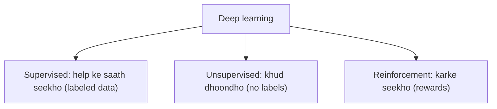
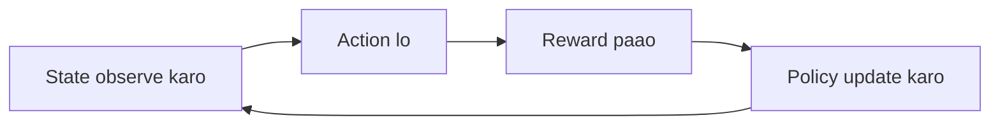
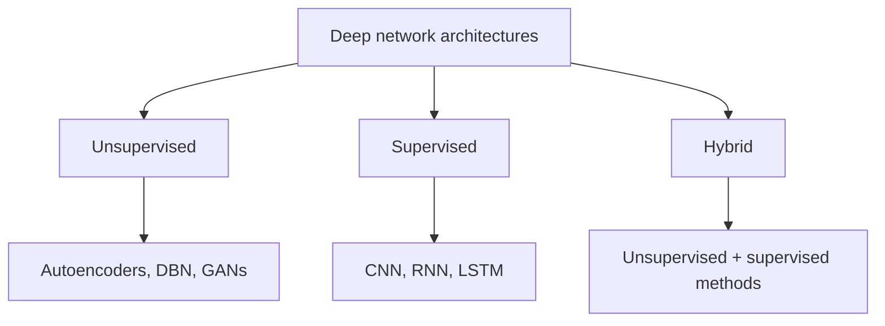

Ye syllabus <Syl m="1" /> hai, "classes and basic terminology of deep learning".

## Teen classes

Deep learning models mainly teen types mein bante hain, is hisaab se ki **wo data se kaise seekhte hain**. <Cite id="class-dl-chp1" loc="slide 25" /> Class notes yahi baat dusre shabdon mein kehte hain: deep learning problems ko supervision signal ke type ke hisaab se teen categories mein baanta jaata hai. <Cite id="class-dl-m1" loc="p. 36" />

### 1. Supervised learning

<Box kind="definition">

**Supervised learning:** the model learns from **labeled data**. Input comes with the correct output. It learns a mapping from input (X) to output (Y). <Cite id="class-dl-chp1" loc="slide 25" /> <Cite id="class-dl-m1" loc="p. 36" />

</Box>

- **Example:** agar hum cat ki photo dekar kahein "ye cat hai", to model usse seekhta hai. Labeled cat aur dog images deep neural network se guzarti hain, jo predicted label (cat ya dog) deta hai. <Cite id="class-dl-chp1" loc="slide 25" />
- **Use cases:** image classification (jaise dog ya cat), emails mein spam detection, handwriting recognition, object detection, medical diagnosis, sentiment analysis. <Cite id="class-dl-m1" loc="p. 36" />
- **Deep networks:** CNN, RNN, LSTM. <Cite id="class-dl-chp1" loc="slide 25" />

### 2. Unsupervised learning

<Box kind="definition">

**Unsupervised learning:** the model learns from data **without labels**. It finds patterns or groups in the data by itself. It discovers hidden patterns or structure in the data. <Cite id="class-dl-chp1" loc="slide 25" /> <Cite id="class-dl-m1" loc="p. 36" />

</Box>

- **Example:** agar hum bina naam ke bahut saari animal photos dein, to model milte-julte animals ko ek group mein rakhta hai. Customer segmentation ko feature 1 vs feature 2 plot par clusters ki tarah dikhaya gaya hai. <Cite id="class-dl-chp1" loc="slide 25" />
- **Use cases:** customer segmentation (clustering), similar products ko group karna, feature learning, dimensionality reduction (jaise PCA, t-SNE), anomaly detection. <Cite id="class-dl-chp1" loc="slide 25" /> <Cite id="class-dl-m1" loc="p. 36" />
- **Deep networks:** autoencoders, deep belief networks (DBN), GANs. <Cite id="class-dl-chp1" loc="slide 25" />

### 3. Reinforcement learning

<Box kind="definition">

**Reinforcement learning:** the model learns by **doing actions and getting rewards or punishments** from an environment. It tries to **maximize rewards** over time (the goal is to maximize the cumulative reward). <Cite id="class-dl-chp1" loc="slide 25" /> <Cite id="class-dl-m1" loc="p. 36" />

</Box>

- **Example:** robot jo chalna seekh raha hai. Wo koshish karta hai, girta hai, aur feedback se seekhta hai. <Cite id="class-dl-chp1" loc="slide 25" />
- **Kaise kaam karta hai:** agent state observe karta hai, action leta hai, reward receive karta hai aur apni policy update karta hai; environment reward aur naya state wapas bhejta hai. <Cite id="class-dl-m1" loc="p. 36" />
- **Use cases:** game playing (chess, Go, AlphaGo), robotics, self-driving cars, resource optimization, control systems.

## Teeno classes side by side

| Type | Learns from | Needs labels? | Main goal | Examples |
|---|---|---|---|---|
| Supervised | Labeled data | Yes | Predict output | Image classification, spam detection |
| Unsupervised | Unlabeled data | No | Find patterns or groups | Customer segmentation, grouping |
| Reinforcement | Actions and feedback | No | Maximize rewards | Game playing, robotics |
| Hybrid | Both labeled and unlabeled data | Maybe | Better prediction and efficiency | Advanced AI systems |

<Cite id="class-dl-chp1" loc="slide 25" />

**Exam ke liye extra points:** supervised learning = with answers; unsupervised learning = without answers; reinforcement learning = learning by experience; teeno deep learning tasks ka hissa hain. Key idea: supervised help ke saath seekhta hai, unsupervised khud dhoondhta hai, reinforcement karke seekhta hai, hybrid sabka best hai. <Cite id="class-dl-chp1" loc="slide 25" />

## Class ke hisaab se deep network architectures

Teacher deep network architectures ko bhi isi tarah groups mein baantte hain. <Cite id="class-dl-chp1" loc="slide 25" />

## Deep learning ki basic terminology

1. **Neuron (node):** neural network ki basic processing unit. Ye inputs leta hai, weights aur bias lagata hai, activation function se guzaarta hai aur output deta hai: $z = \sum_{i=1}^{n} w_ix_i + b$, $y = \phi(z)$.
2. **Layer:** same level ke neurons ka group: input layer (data receive karti hai), hidden layer(s) (computation karti hain), output layer (final output deti hai).
3. **Dataset:** training, validation aur testing ke liye use hone wala data ka collection. Ise training set, validation set aur test set mein baanta jaata hai.
4. **Weight (parameters):** training ke dauran model jo values seekhta hai. Weights neurons ke beech connection ki strength decide karte hain aur error kam karne ke liye training mein update hote hain.
5. **Bias:** weighted sum mein jodi jaane wali extra parameter jo model ko data better fit karne mein help karti hai. Ye activation function ko shift karne deti hai.
6. **Activation function:** neuron ke output par lagne wala function jo non-linearity laata hai. Ye decide karta hai ki neuron activate ho ya nahi aur kitna. Common: ReLU, sigmoid, tanh, leaky ReLU, softmax.
7. **Loss function (cost function):** batata hai ki model ki predictions actual values se kitni door hain; goal is loss ko minimize karna. $L(y, \hat y)$, jahan $y$ true value aur $\hat y$ predicted value hai. Examples: MSE (regression), cross-entropy (classification).
8. **Optimizer:** algorithm jo loss function minimize karne ke liye weights aur bias update karta hai. Examples: gradient descent, Adam, RMSprop.
9. **Learning rate:** hyperparameter jo weights update karte waqt step size control karta hai. Bahut high matlab overshoot; bahut low matlab slow learning.
10. **Epoch:** poore training data ka neural network se ek complete pass. Model kai epochs mein seekhta hai. <Cite id="class-dl-m1" loc="p. 37" />

## Ye kahan pucha gaya

| Agar question kahe | Kya likhna hai | Kab aaya |
|---|---|---|
| "What are the three classes of deep learning? Explain each." | Supervised, unsupervised aur reinforcement learning ki definition, ek example aur applications, comparison table, architecture tree | <PYQ id="2024-05/q2a" /> <PYQ id="2024-12/q2a" /> |

## Quick revision

- Teen classes, data se seekhne ke tareeke ke hisaab se: supervised, unsupervised, reinforcement.
- Supervised: labeled data, output predict karna (image classification, spam detection, handwriting recognition).
- Unsupervised: no labels, patterns ya groups dhoondhna (customer segmentation, similar products grouping, feature learning).
- Reinforcement: actions aur rewards, reward maximize karna (game playing, robotics, self-driving cars).
- Architectures: unsupervised (autoencoders, DBN, GANs), supervised (CNN, RNN, LSTM), hybrid (dono).
- Terms: neuron, layer, dataset, weight, bias, activation function, loss function, optimizer, learning rate, epoch.

**Conclusion.** Deep learning ki teen classes alag hain us data aur feedback ke type se jo learning mein use hota hai: supervised labeled data se outputs predict karna seekhta hai, unsupervised unlabeled data mein patterns dhoondhta hai, aur reinforcement interaction se seekhta hai taaki reward maximize ho. <Cite id="class-dl-m1" loc="p. 36" />
