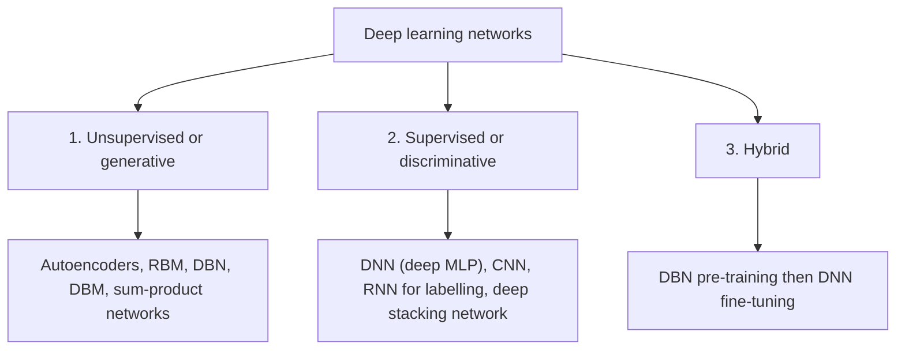
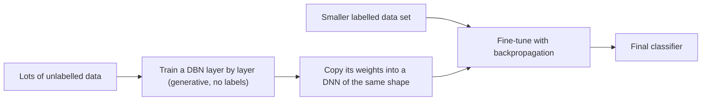

Before the new ideas, here are the old ones you need. If you already know them, skip to the next section.

## The basics first

- An **example** is one item of data, for example one photo. Its **features** are the numbers that describe it (the pixel values).
- A **label** is the correct answer for an example, for example "cat". Labels usually need a human, so they are costly.
- **Supervised learning** learns from examples *with* labels: it learns to map the input to the label. Like a student with a teacher who marks every answer.
- **Unsupervised learning** learns from examples *without* labels: it finds structure in the data by itself, such as groups or a compact summary. Like a child who sorts toys into piles without being told the names. <Cite id="gfdl-ch5" loc="§5.1.3" /> <Cite id="gfg-supervised-unsupervised" />
- A **probability** is a number from 0 to 1 saying how likely something is. This topic needs no calculation, only one short piece of notation from the textbook definitions: $P(y \mid x)$, read "probability of $y$ given $x$", means how likely the label $y$ is once we have seen the input $x$.
- A **deep network** is a network with many layers, each building more abstract features from the layer below (edges, then shapes, then objects). <Cite id="lecun2015-review" />

## Why sort deep networks into classes?

There are dozens of deep architectures. To make sense of them, Deng and Yu (the second textbook in our syllabus) group them by **what they are meant to be used for**: describing or generating data, or recognizing and classifying it. This gives three classes. <Cite id="deng-yu-2014" loc="§3.1" /> This is syllabus <Syl m="1" />, "Three classes of deep learning and basic terminology".

The grouping helps a student or an engineer answer one practical question: *do I have labels, and do I want to understand or create data, or only classify it?* The answer points to the class, and the class points to a family of networks.

## Two words you need: generative and discriminative

Think of two ways to tell Hindi and Marathi speech apart.

- The **discriminative** way: learn only the clues that separate them, such as a few words that occur in one language and not the other. It directly learns the chance of each language given the sound, $P(y \mid x)$.
- The **generative** way: learn what each language sounds like in full, well enough that you could even produce (generate) a sentence in it. It learns how the data itself is spread out, written $P(x)$ or, together with the label, $P(x, y)$.

<Cite id="wiki-generative-model" /> <Cite id="wiki-discriminative-model" />

**A generative model can still classify.** If a model knows what spam looks like and what normal mail looks like, and how common each is, it can ask "which kind is this new mail more likely to come from?" and answer like a classifier. This conversion uses Bayes' rule. Deng and Yu make exactly this point: a generative model can be turned into a discriminative one, which is the seed of the hybrid class. <Cite id="deng-yu-2014" loc="§3.1" />

| | Generative | Discriminative |
|---|---|---|
| Question it answers | What does the data look like? | Which label fits this input? |
| Learns | The data itself, $P(x)$ or $P(x, y)$ | The boundary between classes, $P(y \mid x)$ |
| Can create new data? | Yes | No |
| Needs labels? | Not necessarily | Yes |

## Class 1: deep networks for unsupervised or generative learning

<Box kind="definition">

**Unsupervised or generative deep networks** are meant to capture the high-order patterns (correlations) in the observed data, for analysis or for creating new data, when **no labels** are available. Used in generative mode, they can also model the joint distribution of the data and its classes. <Cite id="deng-yu-2014" loc="§3.1" />

</Box>

**Why it is needed.** Most of the world's data (photos, audio, text) has no labels, and labelling is slow and costly. These networks can still learn useful knowledge from it.

**Analogy.** An art student who studies thousands of paintings without anyone naming the painters. She learns what real paintings look like so well that she can paint new ones in the same style.

**How it works.**

1. Feed in lots of unlabelled examples.
2. The network tries to rebuild, predict or imitate its own input (for example an autoencoder rebuilds the input from a small code).
3. To do this well it must discover the main patterns, which end up in its hidden layers as learned features.
4. The learned features can be used to analyse the data, or the model can be run "backwards" to create new samples.

**Examples.** <Cite id="deng-yu-2014" loc="§3.2" />

- **Deep autoencoder:** squeezes the input into a small code and rebuilds it; the code is a learned summary of the data. <Cite id="gfdl-ch14" />
- **Restricted Boltzmann machine (RBM):** a layer of visible units and a layer of hidden units, with no connections inside a layer.
- **Deep belief network (DBN):** a stack of RBMs, trained one layer at a time. <Cite id="hinton2006-dbn" />
- **Deep Boltzmann machine (DBM)** and **sum-product networks**.
- **RNN in unsupervised mode:** predicts the next value of a sequence from the earlier ones, with no extra labels.
- Later additions to this class (after Deng and Yu wrote) include **generative adversarial networks (GANs)**, which learn to create realistic new images. <Cite id="goodfellow2014" /> <Cite id="gfdl-ch20" />

**Advantages.**

- Needs no labels, so it can use huge amounts of cheap data.
- Can create new data (images, speech, text).
- Easier to interpret and to add domain knowledge to; handles uncertainty well. <Cite id="deng-yu-2014" loc="§3.1" />

**Disadvantages.**

- Probabilistic models are often hard (intractable) to train and use exactly for large problems. <Cite id="deng-yu-2014" loc="§3.1" />
- Usually less accurate than a supervised network at pure classification.
- Hard to judge how good the learned patterns are, since there is no answer key.

**Applications.** Feature learning from unlabelled data, compression, removing noise from images, anomaly detection (a fraud transaction that the model cannot rebuild well), and creating new samples. <Cite id="ibm-generative-model" />

## Class 2: deep networks for supervised learning

<Box kind="definition">

**Supervised (discriminative) deep networks** are meant to directly give discriminative power for classification, usually by modelling the probability of each class given the input, $P(y \mid x)$. Labels are always available, directly or indirectly. They are also called **discriminative deep networks**. <Cite id="deng-yu-2014" loc="§3.1" />

</Box>

**Why it is needed.** Many real tasks are simply "put the right label on this input": is this tumour cancerous, which word was spoken, is this mail spam. A network built only for that job does it best.

**Analogy.** A student preparing for a multiple-choice exam with an answer key. He does not try to write the textbook; he only learns to pick the right option.

**How it works.**

1. Collect many examples, each with its correct label.
2. The network makes a prediction for each example (forward pass).
3. A loss measures how far the prediction is from the label.
4. Backpropagation and gradient descent adjust the weights to reduce the loss.
5. After training, the network outputs the most likely label for a new input; for example a cat-or-dog CNN may say "cat with 90% confidence". It never learns to draw a cat.

**Examples.** <Cite id="deng-yu-2014" loc="§3.3" />

- **Deep neural network (DNN):** an MLP with many hidden layers, trained with backpropagation. <Cite id="gfdl-ch6" />
- **Convolutional neural network (CNN):** convolution and pooling layers that share weights; the standard network for images. <Cite id="gfg-cnn" />
- **RNN used as a discriminative model:** outputs a label sequence for an input sequence, as in handwriting or speech recognition.
- **Deep stacking network (DSN)** and **deep-structured conditional random fields**.

**Advantages.**

- Usually the most accurate choice when enough labels exist.
- Faster to train and test, flexible, and suitable for end-to-end learning (raw input in, answer out). <Cite id="deng-yu-2014" loc="§3.1" />

**Disadvantages.**

- Needs many labelled examples, which are costly.
- Learns only the boundary, so it cannot generate data and knows little about the data beyond the task.
- With few labels it overfits.

**Applications.** Image classification and face recognition, speech recognition, handwriting recognition, spam filtering, medical diagnosis from scans. <Cite id="tp-supervised-nn" />

## Class 3: hybrid deep networks

<Box kind="definition">

**Hybrid deep networks:** the goal is discrimination (classification), but it is **assisted, often significantly, by the results of generative or unsupervised deep networks**. This can be done by better optimization and/or regularization of a supervised network, or by using discriminative criteria to train the parameters of a generative network. <Cite id="deng-yu-2014" loc="§3.1" />

</Box>

**Why it is needed.** We often have a mountain of unlabelled data but only a little labelled data. A purely supervised network wastes the unlabelled part; a hybrid network uses it. For example, with 1,000,000 unlabelled X-rays and only 2,000 that a doctor has labelled, a hybrid network first learns what X-rays look like from all of them and then uses the 2,000 labels only to fine-tune. This setting is closely related to **semi-supervised learning**. <Cite id="ibm-semi-supervised" /> <Cite id="wiki-weak-supervision" />

**Analogy.** A medical student first reads many textbooks and case photos with no exam in sight (unsupervised), and builds a general understanding. Then she practises with a smaller set of solved cases with correct diagnoses (supervised). The general reading makes the practice much more effective.

**How it works: the classic DBN-DNN.** <Cite id="deng-yu-2014" loc="§3.4" /> <Cite id="hinton2006-dbn" />

1. **Pre-train:** train a DBN layer by layer on unlabelled data (generative, no labels).
2. **Transfer:** copy its weights into a DNN of the same shape and add an output layer.
3. **Fine-tune:** train the whole DNN with the labelled data using backpropagation.

**Why does the generative part help?** Two views: <Cite id="deng-yu-2014" loc="§3.4" />

1. **Optimization view.** The weights learned without labels are a much better starting point than random numbers, so training reaches a good solution. This is where the word **pre-training** comes from.
2. **Regularization view.** The unsupervised stage acts like a sensible prior: it steers the network towards functions that fit the real structure of the data, so it tends to overfit less.

**Other hybrid examples.** Pre-training a CNN with a DBN or with denoising, sparse or contractive autoencoders; training an RBM with a discriminative (class-label) objective; and a speech-translation system that chains speech recognition and machine translation and trains both for the final translation. <Cite id="deng-yu-2014" loc="§3.4" />

**Advantages.**

- Uses both unlabelled and labelled data, so it works well when labels are scarce.
- Often a better starting point, and less overfitting, than a purely supervised network trained from random weights.

**Disadvantages.**

- Two training stages, so more time, more computation and more design choices.
- When labels are plentiful the pre-training gain can be small; with modern tricks (ReLU, dropout, batch normalization) many networks now train well from random starts.

**Applications.** Speech recognition (the DBN-DNN acoustic models of around 2010 to 2012), medical imaging with few labelled scans, and any task with plenty of raw data but few labels.

<Box kind="pitfall">

In Deng and Yu, "hybrid" means "generative helps discriminative". In older speech-recognition papers "hybrid" meant a neural network feeding an HMM; that is a different meaning. Also, on many websites the "three types of machine learning" are supervised, unsupervised and reinforcement learning. That is a different list. For this syllabus, answer with generative or unsupervised, supervised or discriminative, and hybrid. <Cite id="deng-yu-2014" loc="§3.1" />

</Box>

## Why three classes and not two?

The usual machine-learning split is two-way: discriminative versus generative. Deng and Yu add the hybrid class because a key lesson of deep learning is that generative or unsupervised models can greatly improve the training of discriminative ones through better optimization or regularization, and a two-way split hides this. <Cite id="deng-yu-2014" loc="§3.1" /> <Cite id="deng2012-three-classes" />

## The three classes side by side

| | 1. Unsupervised or generative | 2. Supervised or discriminative | 3. Hybrid |
|---|---|---|---|
| Goal | Model the data; find patterns; create new data | Predict the label | Predict the label, helped by a generative model |
| Labels needed | No | Yes, many | Few, plus unlabelled data |
| Learns | What the data looks like, $P(x)$ or $P(x, y)$ | The class given the input, $P(y \mid x)$ | Both, in stages or together |
| Examples | Autoencoder, RBM, DBN, DBM, (GAN) | DNN, CNN, RNN for labelling, DSN | DBN-DNN, autoencoder-pre-trained CNN |
| Main strength | Uses unlabelled data, can generate | Most accurate with enough labels | Works with few labels |
| Main weakness | Hard to train exactly, weaker at classifying | Needs many labels | Two stages, more cost |
| Typical use | Feature learning, compression, generation | Image and speech recognition | Recognition when labels are scarce |

## Basic terminology

Deng and Yu define these terms alongside the three classes. <Cite id="deng-yu-2014" />

- **Deep learning:** machine learning that uses many layers of information processing to learn features at many levels, where higher-level features are built from lower-level ones.
- **Deep neural network (DNN):** a multilayer perceptron with many fully connected hidden layers.
- **Boltzmann machine (BM):** a network of symmetrically connected, neuron-like units that switch on or off at random according to probabilities.
- **Restricted Boltzmann machine (RBM):** a BM with one visible layer and one hidden layer and no connections inside a layer.
- **Deep belief network (DBN):** a probabilistic generative model with many layers of hidden variables; the top two layers have undirected (two-way, symmetric) connections, and each lower layer receives directed, top-down connections from the layer above. <Cite id="wiki-dbn" />
- **Deep autoencoder:** a DNN whose target output is its own input instead of a class label, so it learns without labels. <Cite id="wiki-autoencoder" />
- **Distributed representation:** the data is explained by the interaction of many hidden factors, so a concept is stored as a pattern over many units and each unit helps represent many concepts. Factors learned from some combinations often generalize well to new combinations.

Everyday terms you will also meet: **neuron** (one unit that computes a weighted sum and an activation), **layer**, **weight**, **bias**, **activation function**, **loss**, **epoch** (one pass over the training data), **batch** (a group of examples used for one update), **learning rate**, **training, validation and test sets**. <Cite id="d2l-intro" /> <Cite id="gfg-intro-dl" />

## Conclusion

Deep networks fall into three classes by purpose: generative or unsupervised networks learn the data itself, supervised or discriminative networks learn to predict labels, and hybrid networks use the first kind to train the second better when labels are few. <Cite id="deng-yu-2014" loc="§3.1" />

Further reading: <Cite id="ibm-supervised-unsupervised" /> <Cite id="ibm-deep-learning" /> <Cite id="w3s-deep-learning" /> <Cite id="gfg-autoencoders" /> <Cite id="wiki-deep-learning" /> <Cite id="nptel-dl" /> <Cite id="gfdl-ch1" />

## Where this was asked

| If the question says | What to write | Seen as |
|---|---|---|
| "What are the three classes of deep learning, explain each?" (10 marks) | The tree diagram; for each class the definition, how it works, 2 to 3 examples, advantages and disadvantages, and its use; the two reasons hybrid works; the comparison table | <PYQ id="2024-05/q2a" /> <PYQ id="2024-12/q2a" /> |

## Quick revision

- Three classes (Deng and Yu): unsupervised or generative; supervised or discriminative; hybrid.
- Generative: no labels, models the data, can create data. Autoencoder, RBM, DBN, DBM (and later GANs).
- Discriminative: labels, predicts the class given the input. DNN, CNN, RNN for labelling, DSN.
- Hybrid: discrimination helped by a generative model. DBN pre-training then DNN fine-tuning.
- Generative helps through better optimization (pre-training start point) and regularization (a prior).
- A generative model can be turned into a classifier with Bayes' rule.
- Do not confuse with supervised, unsupervised, reinforcement learning.
