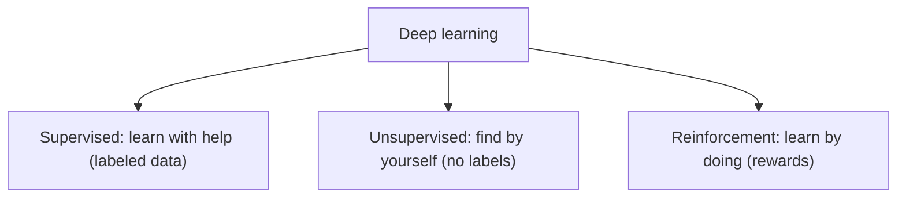
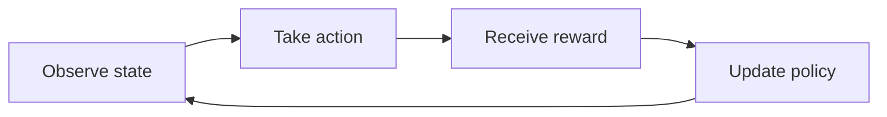
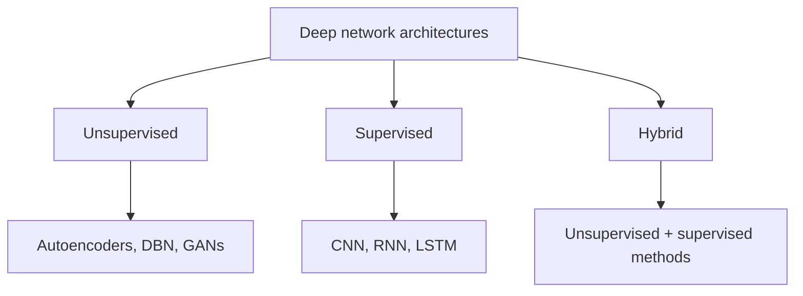

This is syllabus <Syl m="1" />, "classes and basic terminology of deep learning".

## The three classes

Deep learning models are mainly divided into three types based on **how they learn from data**. <Cite id="class-dl-chp1" loc="slide 25" /> The class notes say the same in other words: deep learning problems are broadly classified into three categories based on the type of supervision signal. <Cite id="class-dl-m1" loc="p. 36" />

### 1. Supervised learning

<Box kind="definition">

**Supervised learning:** the model learns from **labeled data**. Input comes with the correct output. It learns a mapping from input (X) to output (Y). <Cite id="class-dl-chp1" loc="slide 25" /> <Cite id="class-dl-m1" loc="p. 36" />

</Box>

- **Example:** if we give a photo of a cat and say "this is a cat", the model learns from it. A set of labeled cat and dog images goes through a deep neural network, which gives the predicted label (cat or dog). <Cite id="class-dl-chp1" loc="slide 25" />
- **Use cases:** image classification (for example dog or cat), spam detection in emails, handwriting recognition, object detection, medical diagnosis, sentiment analysis. <Cite id="class-dl-m1" loc="p. 36" />
- **Deep networks used:** CNN, RNN, LSTM. <Cite id="class-dl-chp1" loc="slide 25" />

### 2. Unsupervised learning

<Box kind="definition">

**Unsupervised learning:** the model learns from data **without labels**. It finds patterns or groups in the data by itself. It discovers hidden patterns or structure in the data. <Cite id="class-dl-chp1" loc="slide 25" /> <Cite id="class-dl-m1" loc="p. 36" />

</Box>

- **Example:** if we give many animal photos without names, the model groups similar ones together. Customer segmentation is shown as clusters of points on a feature 1 versus feature 2 plot. <Cite id="class-dl-chp1" loc="slide 25" />
- **Use cases:** customer segmentation (clustering), grouping similar products, feature learning, dimensionality reduction (for example PCA, t-SNE), anomaly detection. <Cite id="class-dl-chp1" loc="slide 25" /> <Cite id="class-dl-m1" loc="p. 36" />
- **Deep networks used:** autoencoders, deep belief networks (DBN), GANs. <Cite id="class-dl-chp1" loc="slide 25" />

### 3. Reinforcement learning

<Box kind="definition">

**Reinforcement learning:** the model learns by **doing actions and getting rewards or punishments** from an environment. It tries to **maximize rewards** over time (the goal is to maximize the cumulative reward). <Cite id="class-dl-chp1" loc="slide 25" /> <Cite id="class-dl-m1" loc="p. 36" />

</Box>

- **Example:** a robot learning to walk. It tries, falls, and learns by getting feedback. <Cite id="class-dl-chp1" loc="slide 25" />
- **How it works:** the agent observes the state, takes an action, receives a reward and updates its policy; the environment sends back the reward and the new state. <Cite id="class-dl-m1" loc="p. 36" />
- **Use cases:** game playing (chess, Go, AlphaGo), robotics, self-driving cars, resource optimization, control systems.

## The three classes side by side

| Type | Learns from | Needs labels? | Main goal | Examples |
|---|---|---|---|---|
| Supervised | Labeled data | Yes | Predict output | Image classification, spam detection |
| Unsupervised | Unlabeled data | No | Find patterns or groups | Customer segmentation, grouping |
| Reinforcement | Actions and feedback | No | Maximize rewards | Game playing, robotics |
| Hybrid | Both labeled and unlabeled data | Maybe | Better prediction and efficiency | Advanced AI systems |

<Cite id="class-dl-chp1" loc="slide 25" />

**Extra points for the exam:** supervised learning = with answers; unsupervised learning = without answers; reinforcement learning = learning by experience; all are part of deep learning tasks. Key idea: supervised learns with help, unsupervised finds by itself, reinforcement learns by doing, hybrid is the best of all. <Cite id="class-dl-chp1" loc="slide 25" />

## Deep network architectures by class

The teacher also sorts the deep network architectures into the same groups. <Cite id="class-dl-chp1" loc="slide 25" />

## Basic terminology of deep learning

1. **Neuron (node):** the basic processing unit in a neural network. It receives inputs, applies weights and bias, passes through an activation function and produces an output: $z = \sum_{i=1}^{n} w_ix_i + b$, $y = \phi(z)$.
2. **Layer:** a group of neurons at the same level: input layer (receives data), hidden layer(s) (perform computation), output layer (produces final output).
3. **Dataset:** a collection of data used for training, validation and testing. It is split into a training set, a validation set and a test set.
4. **Weight (parameters):** values learned by the model during training. Weights determine the strength of connections between neurons and are updated during training to reduce error.
5. **Bias:** an additional parameter added to the weighted sum to help the model fit the data better. It allows shifting the activation function.
6. **Activation function:** a function applied to the neuron's output to introduce non-linearity. It decides whether a neuron should be activated and by how much. Common: ReLU, sigmoid, tanh, leaky ReLU, softmax.
7. **Loss function (cost function):** measures how far the model's predictions are from the actual values; the goal is to minimize this loss. $L(y, \hat y)$, with $y$ the true value and $\hat y$ the predicted value. Examples: MSE (regression), cross-entropy (classification).
8. **Optimizer:** an algorithm that updates the weights and bias to minimize the loss function. Examples: gradient descent, Adam, RMSprop.
9. **Learning rate:** a hyperparameter that controls the step size while updating weights. Too high means overshoot; too low means slow learning.
10. **Epoch:** one complete pass of the entire training data through the neural network. The model learns over multiple epochs. <Cite id="class-dl-m1" loc="p. 37" />

## Where this was asked

| If the question says | What to write | Seen as |
|---|---|---|
| "What are the three classes of deep learning? Explain each." | Definition, one example and applications of supervised, unsupervised and reinforcement learning, a comparison table, the architecture tree | <PYQ id="2024-05/q2a" /> <PYQ id="2024-12/q2a" /> |

## Quick revision

- Three classes, based on how they learn from data: supervised, unsupervised, reinforcement.
- Supervised: labeled data, predict output (image classification, spam detection, handwriting recognition).
- Unsupervised: no labels, find patterns or groups (customer segmentation, grouping similar products, feature learning).
- Reinforcement: actions and rewards, maximize reward (game playing, robotics, self-driving cars).
- Architectures: unsupervised (autoencoders, DBN, GANs), supervised (CNN, RNN, LSTM), hybrid (both).
- Terms: neuron, layer, dataset, weight, bias, activation function, loss function, optimizer, learning rate, epoch.

**Conclusion.** The three classes of deep learning differ by the type of data and feedback used for learning: supervised learns from labeled data to predict outputs, unsupervised finds patterns in unlabeled data, and reinforcement learns by interaction to maximize reward. <Cite id="class-dl-m1" loc="p. 36" />
