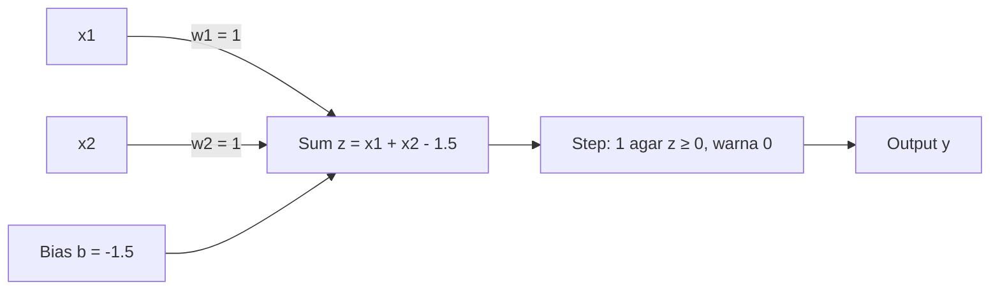

**In simple words:** perceptron ek artificial neuron hai. Ye har input ko uske weight se multiply karta hai, bias add karta hai, aur total 0 ya usse zyada ho to 1 output deta hai, warna 0. AND ke liye hum weights aur bias aise choose karte hain ki sirf (1, 1) ka total 0 ya usse upar pahunche. <Cite id="rosenblatt1958" />

$$
z = w_1x_1 + w_2x_2 + b, \qquad y = 1 \text{ if } z \ge 0, \text{ else } 0
$$

<Sum>

<Given>

AND truth table (output 1 sirf tab jab $x_1 = x_2 = 1$) aur upar wala step perceptron.

</Given>

<Find>

$w_1, w_2$ aur $b$ jo table ko reproduce karein.

</Find>

<Steps>

1. **$w_1 = w_2 = 1$ lo**, kyunki AND dono inputs ko same treat karta hai. Weighted sum ab 0, 1, 1 ya 2 hoga.
2. **Row (1,1) ko fire karna hai:** $2 + b \ge 0$, yaani $b \ge -2$.
3. **Rows (0,1) aur (1,0) ko fire nahi karna:** $1 + b < 0$, yaani $b < -1$. Row (0,0) apne aap off rehti hai.
4. **$-2 \le b < -1$ ke beech mein $b$ choose karo**, safety gap ke liye: $b = -1.5$.
5. **Har row test karo:**

| $x_1$ | $x_2$ | $z = x_1 + x_2 - 1.5$ | $y$ | AND |
|---|---|---|---|---|
| 0 | 0 | $-1.5$ | 0 | 0 |
| 0 | 1 | $-0.5$ | 0 | 0 |
| 1 | 0 | $-0.5$ | 0 | 0 |
| 1 | 1 | $0.5$ | 1 | 1 |

</Steps>

<Answer>

$w_1 = 1$, $w_2 = 1$, $b = -1.5$. <Cite id="gfg-perceptron-and" />

</Answer>

<Box kind="verify">

Picture se check karo. Decision line $x_1 + x_2 = 1.5$ hai. Points (0,0), (0,1), (1,0) ke sums 0, 1, 1 hain, sab 1.5 se neeche, to output 0. Sirf (1,1), jiska sum 2 hai, line ke upar hai. Ek seedhi line exactly wahi corner alag karti hai jo AND ko chahiye.

</Box>

</Sum>

**Conclusion:** AND linearly separable hai, isliye ek perceptron ise implement kar deta hai. <Cite id="wiki-perceptron" /> <Cite id="w3s-perceptron" /> <Cite id="mlm-perceptron" />

Exam mein English mein likho: "AND is linearly separable, so a single perceptron with w1 = w2 = 1 and b = -1.5 implements it."
