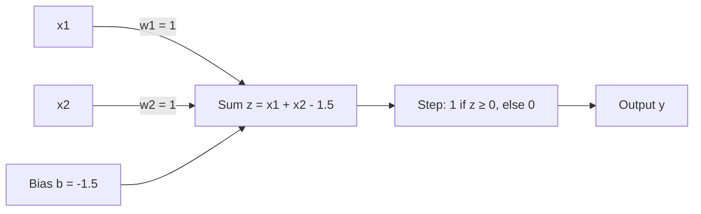

**In simple words:** a perceptron is one artificial neuron. It weighs each input, adds a bias, and outputs 1 if the total is at least 0, otherwise 0. For AND we pick weights and a bias so that only (1, 1) reaches 0 or more. <Cite id="rosenblatt1958" />

$$
z = w_1x_1 + w_2x_2 + b, \qquad y = 1 \text{ if } z \ge 0, \text{ else } 0
$$

<Sum>

<Given>

the AND truth table (output 1 only for $x_1 = x_2 = 1$) and the step perceptron above.

</Given>

<Find>

$w_1, w_2$ and $b$ that reproduce the table.

</Find>

<Steps>

1. **Take $w_1 = w_2 = 1$**, because AND treats both inputs alike. The weighted sum is then 0, 1, 1 or 2.
2. **Row (1,1) must fire:** $2 + b \ge 0$, so $b \ge -2$.
3. **Rows (0,1) and (1,0) must not fire:** $1 + b < 0$, so $b < -1$. Row (0,0) is then automatically off.
4. **Pick $b$ in the middle of $-2 \le b < -1$**, for a safety gap: $b = -1.5$.
5. **Test every row:**

| $x_1$ | $x_2$ | $z = x_1 + x_2 - 1.5$ | $y$ | AND |
|---|---|---|---|---|
| 0 | 0 | $-1.5$ | 0 | 0 |
| 0 | 1 | $-0.5$ | 0 | 0 |
| 1 | 0 | $-0.5$ | 0 | 0 |
| 1 | 1 | $0.5$ | 1 | 1 |

</Steps>

<Answer>

$w_1 = 1$, $w_2 = 1$, $b = -1.5$. <Cite id="gfg-perceptron-and" />

</Answer>

<Box kind="verify">

Check with the picture. The decision line is $x_1 + x_2 = 1.5$. The points (0,0), (0,1), (1,0) have sums 0, 1, 1, all below 1.5, so they get 0. Only (1,1), with sum 2, lies above the line. One straight line cuts off exactly the corner AND needs.

</Box>

</Sum>

**Conclusion:** AND is linearly separable, so one perceptron implements it. <Cite id="wiki-perceptron" /> <Cite id="w3s-perceptron" /> <Cite id="mlm-perceptron" />
